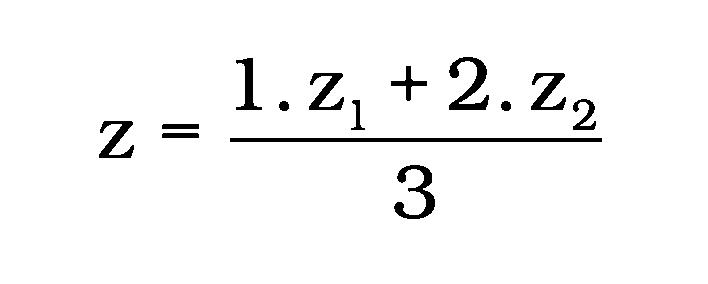

# Čl. I

Vyhláška Ministerstva školstva Slovenskej republiky č. 510/2004 Z. z. o ukončovaní štúdia na stredných školách a o ukončovaní prípravy v odborných učilištiach, učilištiach a praktických školách v znení vyhlášky č. 379/2005 Z. z. a vyhlášky č. 482/2006 Z. z. sa mení a dopĺňa takto:

- 1. V § 7 ods. 12 sa za slová „na úrovni B“ vkladajú slová „alebo na úrovni C“.

- 2. V § 12 ods. 2 písm. d) sa slovo „špecializovaného“ nahrádza slovom „špecializačného“.

- 3. V § 14 sa vypúšťa odsek 2.

  - Doterajšie odseky 3 až 9 sa označujú ako odseky 2 až 8.

- 4. V § 14 odsek 3 znie:

- „(3)

- Čas vyčlenený pre jednotlivé časti a predmety maturitnej skúšky je uvedený v prílohe.“.

- 5. V § 24 odseky 3 a 4 znejú:

- „(3)

- Žiak, zákonný zástupca žiaka alebo ním poverená osoba, alebo osoba, ktorej je maloleté dieťa zverené do náhradnej osobnej starostlivosti, pestún alebo zástupca zariadenia, v ktorom je maloleté dieťa umiestnené na základe rozhodnutia súdu v zariadení ústavnej starostlivosti (ďalej len “žiadateľ„), môže požiadať riaditeľa školy o nahliadnutie do svojej písomnej práce a porovnať jej hodnotenie s kľúčom správnych odpovedí a pravidlami hodnotenia práce do piatich dní odo dňa, keď sa dozvedel o jej výsledku. Žiadateľ môže podať prostredníctvom riaditeľa školy písomné námietky voči hodnoteniu

- a)

- písomnej formy internej časti maturitnej skúšky do ôsmich dní odo dňa, keď sa dozvedel o jej výsledku, Štátnej školskej inšpekcii,15)

- b)

- ústnej formy internej časti maturitnej skúšky alebo praktickej časti odbornej zložky do ôsmich dní od jej vykonania Štátnej školskej inšpekcii,15)

- c)

- teoretickej časti odbornej zložky alebo praktickej časti odbornej zložky na stredných zdravotníckych školách do ôsmich dní od jej vykonania Ministerstvu zdravotníctva Slovenskej republiky.15c)

- (4)

- Ak je opodstatnená námietka voči hodnoteniu

- a)

- písomnej formy internej časti maturitnej skúšky, môže Štátna školská inšpekcia uložiť záväzný pokyn na odstránenie zistených nedostatkov,15a)

- b)

- ústnej formy internej časti maturitnej skúšky alebo praktickej časti odbornej zložky, môže Štátna školská inšpekcia nariadiť komisionálne preskúšanie pri zistení nedostatkov pri klasifikácii,15b)

- c)

- teoretickej časti odbornej zložky alebo praktickej časti odbornej zložky na stredných zdravotníckych školách, môže Ministerstvo zdravotníctva Slovenskej republiky uložiť záväzný pokyn na odstránenie zistených nedostatkov alebo nariadiť komisionálne preskúšanie pri zistení nedostatkov pri klasifikácii.

- Preskúšanie sa koná pred predmetovou maturitnou komisiou v pôvodnom zložení.“.

  - Poznámka pod čiarou k odkazu 15c znie:

  - „15c)

  - § 13 ods. 11 zákona č. 596/2003 Z. z.“.

- 6. V prílohe I. časti ZOZNAM MATURITNÝCH PREDMETOV

  - Poznámka pod čiarou k odkazu 2 znie:

  - „2)

  - Na úrovni C môžu vykonať maturitnú skúšku z cudzieho jazyka len žiaci v študijných odboroch stredných odborných učilíšť a v nadstavbovom štúdiu, ak vyhláška neustanovuje inak.“.

- 7. V prílohe I. časti ZOZNAM MATURITNÝCH PREDMETOV názov predmetu pod poradovým číslom 33 znie: „katolícke náboženstvo6)“.

- 8. V prílohe II. časť ČLENENIE MATURITNEJ SKÚŠKY znie:

- „II. ČLENENIE MATURITNEJ SKÚŠKY

- Por. číslo | P r e d m e t | Úroveň | Časť | | |

- | | | Externá | Interná a jej formy | |

- | | | | písomná | ústna |

- | | | | | príprava | odpoveď

- 1 | anglický jazyk | A | 120' | 45' | 20' | 20'

- | | B | 100' | 45' | 20' | 20'

- | | C | 100' | 45' | 20' | 20'

- 2 | biológia | A | - | - | 20' | 20'

- | | B | - | - | 15' | 15'

- 3 | dejepis | A | - | - | 20' | 20'

- | | B | - | - | 15' | 15'

- 4 | francúzsky jazyk | A | 120' | 45' | 20' | 20'

- | | B | 100' | 45' | 20' | 20'

- | | C | 100' | 45' | 20' | 20'

- 5 | fyzika | A | - | - | 20' | 20'

- | | B | - | - | 15' | 15'

- 6 | geografia | A | - | - | 20' | 20'

- | | B | - | - | 15' | 15'

- 7 | chémia | A | - | - | 20' | 20'

- | | B | - | - | 15' | 15'

- 8 | informatika | A | - | - | 30' | 15'

- | | B | - | - | 30' | 15'

- 9 | maďarský jazyk a literatúra | A | 90' | 150' | 15' | 15'

- | | B | 90' | 150' | 15' | 15'

- 10 | matematika | A | 120' | - | 20' | 20'

- | | B | 120' | - | 15' | 15'

- 11 | náuka o spoločnosti | A | - | - | 20' | 20'

- | | B | - | - | 15' | 15'

- 12 | nemecký jazyk | A | 120' | 45' | 20' | 20'

- | | B | 100' | 45' | 20' | 20'

- | | C | 100' | 45' | 20' | 20'

- 13 | občianska náuka | A | - | - | 20' | 20'

- | | B | - | - | 15' | 15'

- 14 | ruský jazyk | A | 120' | 45' | 20' | 20'

- | | B | 100' | 45' | 20' | 20'

- | | C | 100' | 45' | 20' | 20'

- 15 | slovenský jazyk a literatúra | A | 90' | 150' | 20' | 20'

- | | B | 90' | 150' | 15' | 15'

- 16 | slovenský jazyk a slovenská literatúra | A | 90' | 150' | 20' | 20'

- | | B | 90' | 150' | 15' | 15'

- 17 | španielsky jazyk | A | 120' | 45' | 20' | 20'

- | | B | 100' | 45' | 20' | 20'

- | | C | 100' | 45' | 20' | 20'

- 18 | taliansky jazyk | A | 120' | 45' | 20' | 20'

- | | B | 100' | 45' | 20' | 20'

- | | C | 100' | 45' | 20' | 20'

- 19 | ukrajinský jazyk a literatúra | A | 90' | 150' | 15' | 15'

- | | B | 90' | 150' | 15' | 15'

- 20 | teoretická časť odbornej zložky | | - | - | 30' | 30'

- 21 | praktická časť odbornej zložky | | - | max. 24 hodín (príprava a výkon) | |

- 22 | dejiny umenia | | - | - | 20' | 20'

- 23 | deskriptívna geometria | | - | - | 30' | 15'

- 24 | ekológia | | - | - | 15' | 15'

- 25 | ekonomika | | - | - | 15' | 15'

- 26 | estetika | | - | - | 15' | 15'

- 27 | evanjelické a. v. náboženstvo | | - | - | 15' | 15'

- 28 | kresťanská etika | | - | - | 15' | 15'

- 29 | latinčina | | - | - | 15' | 15'

- 30 | právo | | - | - | 15' | 15'

- 31 | psychológia | | - | - | 15' | 15'

- 32 | reformované náboženstvo | | - | - | 15' | 15'

- 33 | katolícke náboženstvo | | - | - | 15' | 15'

- 34 | stretnutia s ľudovou kultúrou | | - | - | 15' | 20'

- 35 | športový manažment | | - | - | 15' | 15'

- 36 | základy športovej prípravy | | - | - | 15' | 15'

- 37 | muzikál | | - | - | 20' | 20'

- 38 | literárna tvorba | | - | - | 15' | 15'

- 39 | poľský jazyk | | - | - | 20' | 20'

- 40 | chorvátsky jazyk | | - | - | 20' | 20'

- “.

- 9. V prílohe III. časti POKYNY K EXTERNEJ ČASTI A PÍSOMNEJ FORME INTERNEJ ČASTI MATURITNEJ SKÚŠKY bod 1. Anglický jazyk, francúzsky jazyk, nemecký jazyk, ruský jazyk, taliansky jazyk a španielsky jazyk znie:

- „Obsahom a úrovňou náročnosti zodpovedá úrovni B2 (úroveň A), úrovni B1 (úroveň B), resp. úrovni A2 (úroveň C) Spoločného európskeho referenčného rámca Rady Európy.

- Externá časť maturitnej skúšky z anglického jazyka, francúzskeho jazyka, nemeckého jazyka, ruského jazyka, talianskeho jazyka a zo španielskeho jazyka sa skladá z centrálne vypracovanej, vo všetkých školách v rovnakom čase zadanej, pod externým dozorom konanej a externe vyhodnotenej písomnej skúšky – testu. Test má tri časti a skladá sa len z úloh s výberom odpovede a z úloh s krátkou odpoveďou.

- Čítanie s porozumením – cieľom tejto časti je zistiť, ako žiaci rozumejú textu a ako sa vedia v ňom orientovať tak, aby pochopili hlavné myšlienky, základné súvislosti a vyriešili úlohy: doplňovanie chýbajúcich informácií, výber z viacerých možností, určenie správnosti alebo nesprávnosti výpovede.

- Gramatika a lexika – testujú sa tu znalosti gramatických štruktúr a slovnej zásoby a ich správne použitie v kontexte. Žiaci majú do textových ukážok dopĺňať adekvátne gramatické tvary na základe výberu z viacerých možností.

- Počúvanie s porozumením – v tejto časti majú žiaci preukázať, ako porozumeli základným informáciám, a riešiť úlohy: určenie správnosti alebo nesprávnosti výpovede, výber z viacerých možností a doplňovanie chýbajúcich informácií.

- Úpravy pre žiakov so špeciálnymi výchovno-vzdelávacími potrebami.

- Test z cudzieho jazyka pre žiakov so sluchovým postihnutím nebude obsahovať úlohy na počúvanie s porozumením.

- Písomnou formou internej časti je centrálne vypracovaný, vo všetkých školách v rovnakom čase zadaný, pod externým dozorom konaný a na základe centrálnych pokynov interne vyhodnotený test, ktorý sa bude skladať len z úloh s dlhšou odpoveďou.

- Charakteristika úloh testu pre úroveň A:

- a)

- napísať jasný a detailný text na rôzne témy, ktoré žiaka zaujímajú,

- b)

- podrobne, štylisticky a jazykovo správne písať o udalostiach, reálnych alebo fiktívnych zážitkoch,

- c)

- napísať dobre zrozumiteľný príbeh,

- d)

- napísať pozdrav, pozvanie, odkaz, blahoželanie, telegram,

- e)

- napísať súkromný a formálny list, žiadosť, životopis, sťažnosť, reklamáciu, inzerát,

- f)

- opísať osobu, predmet, miesto, činnosť, situáciu,

- g)

- napísať súvislý text, v ktorom vyjadrí svoje názory, postoje, myšlienky, city,

- h)

- napísať referát, diskusný príspevok, správu, rozprávanie.

- Charakteristika úloh testu pre úroveň B:

- a)

- jednoducho a jasne písať o témach, ktoré sú žiakovi známe a zaujímajú ho,

- b)

- vyjadriť svoj názor na témy, ktoré ho zaujímajú,

- c)

- vyjadriť svoje pocity (ľútosť, radosť, záujem, súcit a pod.),

- d)

- zvládnuť základné formy korešpondencie,

- e)

- napísať pozdrav, pozvanie, odkaz, blahoželanie, telegram,

- f)

- napísať súkromný a formálny list, žiadosť, životopis, sťažnosť, reklamáciu, inzerát,

- g)

- opísať osobu, predmet, miesto, činnosť, situáciu.

- Charakteristika úloh testu pre úroveň C:

- a)

- jednoducho a jasne písať o témach, ktoré sú žiakovi známe a zaujímajú ho,

- b)

- zvládnuť základné formy korešpondencie,

- c)

- napísať pozdrav, pozvanie, odkaz, blahoželanie,

- d)

- napísať súkromný a formálny list, žiadosť, životopis, inzerát,

- e)

- jednoduchým spôsobom opísať osobu, predmet, miesto, činnosť, situáciu.“.

- 10. V prílohe III. časti POKYNY K EXTERNEJ ČASTI A PÍSOMNEJ FORME INTERNEJ ČASTI MATURITNEJ SKÚŠKY bod 2. Maďarský jazyk a literatúra, ukrajinský jazyk a literatúra znie:

- „Externá časť maturitnej skúšky z maďarského jazyka a literatúry, ukrajinského jazyka a literatúry sa skladá z centrálne vypracovanej, vo všetkých školách v rovnakom čase zadanej, pod externým dozorom konanej a externe vyhodnotenej písomnej skúšky – testu. Test sa skladá len z úloh s výberom odpovede a z úloh s krátkou odpoveďou.

- Písomnou formou internej časti sú centrálne pripravené súbory štyroch tém, prípadne východiskové texty a určené žánrové formy. Žiak si vyberie a vypracuje iba jednu tému. Písomná práca sa vo všetkých školách zadáva v rovnakom čase, koná sa pod externým dozorom a vyhodnocuje sa interne na základe centrálnych pokynov.

- Charakteristika úloh písomnej práce:

- a)

- analýza a interpretácia umeleckého diela alebo vecného textu (jeho obsahová, kompozičná a štylistická analýza, argumentácia a hodnotenie),

- b)

- spracovanie zvolenej témy v určenej žánrovej forme,

- c)

- porovnanie dvoch textov podľa zadania,

- d)

- štýlová a žánrová transformácia textov.“.

- 11. V prílohe III. časti POKYNY K EXTERNEJ ČASTI A PÍSOMNEJ FORME INTERNEJ ČASTI MATURITNEJ SKÚŠKY bod 4. Slovenský jazyk a literatúra znie:

- „Externá časť maturitnej skúšky zo slovenského jazyka a literatúry sa skladá z centrálne vypracovanej, vo všetkých školách v rovnakom čase zadanej, pod externým dozorom konanej a externe vyhodnotenej písomnej skúšky – testu. Test sa skladá len z úloh s výberom odpovede a z úloh s krátkou odpoveďou.

- Písomnou formou internej časti sú centrálne pripravené súbory štyroch tém, prípadne východiskové texty a určené žánrové formy. Žiak si vyberie a vypracuje iba jednu tému. Žiak má preukázať komplexnosť ovládania spisovného jazyka, mieru tvorivosti v písomnom prejave a celkovú vzdelanosť a kultúrnosť v miere vychádzajúcej z cieľových požiadaviek. Písomná práca sa vo všetkých školách zadáva v rovnakom čase, koná sa pod externým dozorom a vyhodnocuje sa interne na základe centrálnych pokynov.

- Charakteristika úloh písomnej práce:

- a)

- analýza a interpretácia umeleckého diela alebo vecného textu (jeho obsahová, kompozičná a štylistická analýza, argumentácia a hodnotenie),

- b)

- spracovanie zvolenej témy v určenej žánrovej forme,

- c)

- porovnanie dvoch textov podľa zadania,

- d)

- štýlová a žánrová transformácia textov.“.

- 12. V prílohe III. časti POKYNY K EXTERNEJ ČASTI A PÍSOMNEJ FORME INTERNEJ ČASTI MATURITNEJ SKÚŠKY bod 5. Slovenský jazyk a slovenská literatúra znie:

- „Externá časť maturitnej skúšky zo slovenského jazyka a slovenskej literatúry sa skladá z centrálne vypracovanej, vo všetkých školách v rovnakom čase zadanej, pod externým dozorom konanej a externe vyhodnotenej písomnej skúšky – testu. Test sa skladá len z úloh s výberom odpovede a z úloh s krátkou odpoveďou.

- Písomnou formou internej časti sú centrálne pripravené súbory štyroch tém, prípadne východiskové texty a určené žánrové formy. Žiak si vyberie a vypracuje iba jednu tému. Písomná práca sa vo všetkých školách zadáva v rovnakom čase, koná sa pod externým dozorom a vyhodnocuje sa interne na základe centrálnych pokynov.

- Charakteristika úloh písomnej práce:

- a)

- analýza a interpretácia umeleckého diela alebo vecného textu (jeho obsahová, kompozičná a štylistická analýza, argumentácia a hodnotenie),

- b)

- spracovanie zvolenej témy v určenej žánrovej forme,

- c)

- porovnanie dvoch textov podľa zadania,

- d)

- štýlová a žánrová transformácia textov.“.

- 13. V prílohe VI. časti POŽIADAVKY NA INTERNÚ ČASŤ MATURITNEJ SKÚŠKY bod 33 vrátane nadpisu znie:

- „33.

- KATOLÍCKE NÁBOŽENSTVO

- Charakteristika úloh maturitných zadaní

- Úloha č. 1 – Úloha je zameraná viac na vedomosti a porozumenie. V úlohe je presne určená a definovaná pravda, historický jav, o ktorých má žiak preukázať svoje vedomosti (prevláda forma monológu).

- Úloha č. 2 – Úloha je zameraná viac na aplikáciu niektorej pravdy alebo prikázania v praktickom živote. Žiak v nej má zaujať stanovisko k problematike a podložiť ho učením cirkvi, vie sa vyjadrovať k aktuálnym otázkam z tejto oblasti (prevláda forma dialógu s členmi predmetovej maturitnej komisie).

- Zastúpenie jednotlivých tematických okruhov v úlohách maturitných zadaní je takéto:

- 20 % – 30 % vyznanie viery,

- 20 % – 30 % sviatosť viery,

- 20 % – 30 % život z viery,

- 20 % – 30 % modlitba v živote viery.

- Všeobecné pomôcky

- Sväté písmo, mapy, atlasy, obrazový materiál a ukážky textov.

- Hodnotenie

- a)

- Každá úloha maturitného zadania sa hodnotí známkou 1 – 5.

- b)

- Hodnotením maturitnej skúšky z katolíckeho náboženstva bude známka, ktorá vznikne ako vážený priemer známok z odpovedí na jednotlivé úlohy maturitného zadania.

- c)

- Váha hodnotenia jednotlivých úloh v základnej úrovni je 1 : 2. Pri výpočte váženého priemeru sa používa vzorec

- 

- pričom z je po zaokrúhlení výsledná známka a zi je známka za úlohu č. i.

- Úpravy pre žiakov so špeciálnymi výchovno-vzdelávacími potrebami

- Trvanie skúšky: 20 minút.

- Čas na prípravu: 20 minút.“.
