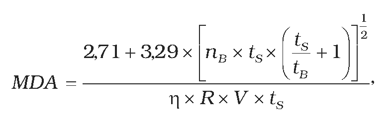
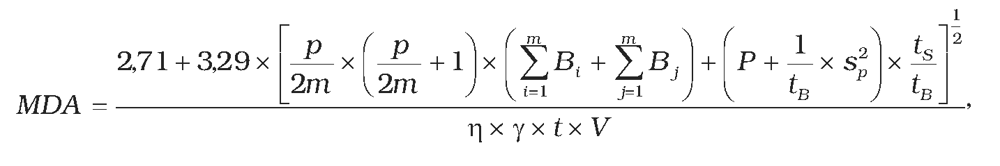

Príloha č. 1 k vyhláške č. 524/2007 Z. z.

- Požiadavky na monitorovanie pri normálnej radiačnej situácii [Tabuľka 01](../assets/c065fe0c39346edb5b4344c9ec78b876e6807d5c495d1bcd9d969e5a83661b89.pdf)

- Vysvetlivka

- Ak sa v prílohe č. 1 a v prílohe č. 2 na meranie aktivity v monitorovanej položke používa ako kritérium požadovanej citlivosti merania minimálna detegovateľná aktivita (MDA), stanovuje sa pre hladinu spoľahlivosti 95 % podľa vzťahu

  - a) pre nespektrometrické merania

- 

- kde

- MDA je minimálna detegovateľná aktivita [Bq, Bq/kg],

- nBje početnosť impulzov pozadia,

- tB je doba merania pozadia,

- tSje doba merania vzorky,

- η je detekčná účinnosť,

- R je chemická výťažnosť,

- V je množstvo vzorky (objem, hmotnosť,...),

  - b) pre spektrometrické merania

- 

- kde

- MDA je minimálna detekovateľná aktivita [Bq, Bq/kg,...],

- p je počet kanálov v oblasti, z ktorej bola stanovená plocha píku,

- P je plocha interferujúceho píku, t. j. plocha píku na energii E stanovená pri meraní pozadia bez prítomnosti vzorky,

- Bi,Bjje počet impulzov v i-tom kanáli na ľavej strane píku a j-tom kanáli na pravej strane píku v oblasti, z ktorej sa odhaduje pozadie pod píkom,

- sp2 je variancia charakterizujúca chybu odhadu plochy P interferujúceho píku,

- tB je doba merania pozadia,

- tSje doba merania vzorky,

- η je detekčná účinnosť fotónov s energiou E,

- γ je zastúpenie fotónov s energiou E v rozpadovej schéme daného rádionuklidu,

- m je počet kanálov na každej strane píku slúžiacich na určenie pozadia,

- V je množstvo vzorky (objem, hmotnosť,...).
