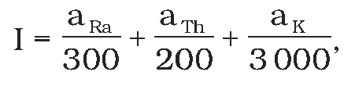

Príloha č. 1 k vyhláške č. 528/2007 Z. z.

- NAJVYŠŠIE PRÍPUSTNÉ HODNOTY INDEXU HMOTNOSTNEJ AKTIVITY PRE OBSAH PRÍRODNÝCH RÁDIONUKLIDOV V STAVEBNÝCH VÝROBKOCH A FREKVENCIA MERANÍ OBSAHU PRÍRODNÝCH RÁDIONUKLIDOV V STAVEBNÝCH VÝROBKOCH Stavebný výrobok | Index hmotnostnej aktivity | Frekvencia meraní

- Stavebné výrobky určené na výstavbu múrov, podláh a stropov, ako sú: – tehly a iné výrobky z hliny, – betón a prefabrikované stavebné dielce z betónu, – stavebné výrobky z pórobetónu a škvárobetónu, – prírodný kameň na murovanie, – cementy. Vláknocementové a sadrokartónové dosky. | 1 | raz za rok

- Stavebné výrobky určené na obklady múrov, podláh a stropov do hrúbky 3 cm, ako sú: – keramické a betónové obkladačky a dlaždice, – obkladačky a dlažby z prírodného kameňa, – malty, suché maltové zmesi a iné pojivá. Schodiskové prvky (iné ako z dreva, kovov a plastov). Piesok, štrk, kamenivo, popolčeky, škvára, troska, hlušina a kaly na stavebné účely, ak nie sú použité na výstavbu múrov, podláh a stropov. | 2 | raz za dva roky

  - Spôsob stanovenia indexu hmotnostnej aktivity pre obsah prírodných rádionuklidov v stavebných výrobkoch

- Index hmotnostnej aktivity je bezrozmerná veličina určená vzťahom

- 

- kde aRa, aTh, aK sú namerané hmotnostné aktivity 226Ra, 232Th a 40K v stavebnom výrobku. Ak je obsah niektorého rádionuklidu menší ako najmenšia detegovateľná hmotnostná aktivita, pri výpočte indexu hmotnostnej aktivity sa pre taký rádionuklid použije hodnota najmenšej detegovateľnej aktivity.
