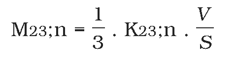
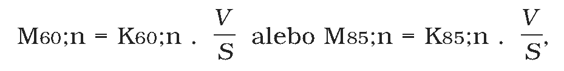

Príloha k vyhláške č. 550/2007 Z. z.

- MIGRAČNÁ SKÚŠKA

  - 1. Touto prílohou sa špecifikuje postup na stanovenie látok uvoľnených z priemyslovo vyrábaných alebo používaných výrobkov určených na priamy styk s vodou, ako je potrubie, drobný montážny materiál (fitingy), tesniace krúžky, nátery, povlaky, membrány a iné.

  - 2. Princíp migračnej skúšky

    - Po presne stanovenom postupe na predúpravu (stagnácia, preplachovanie) vzorky sa povrch testovanej vzorky uvedie do styku so skúšobnou vodou počas troch po sebe nasledujúcich časových úsekoch:

  - 2.1. vzorka výrobku určeného na styk so studenou vodou sa skúša postupne v troch po sebe nasledujúcich 72-hodinových intervaloch pri 23 °C (± 2 °C),

  - 2.2. vzorka výrobku určeného na styk s teplou alebo horúcou vodou sa skúša postupne v troch po sebe nasledujúcich 24-hodinových intervaloch pri 60 °C (±2 °C) – teplá voda alebo 85 °C (±2 °C) – horúca voda.

  - 3. Laboratórne vyšetrenia sa vykonávajú z vylúhov vzorky z každého časového intervalu osobitne a vypočítavajú sa migračné rýchlosti.

  - 4. Používané chemikálie

  - 4.1. vodovodná voda – voda s obsahom voľného chlóru menším ako 0,3 mg.l-1 ± 0,05 mg.l-1,

  - 4.2. skúšobná voda – voda bez chlóru s vodivosťou menšou ako 2 mS.m-1 a obsahom TOC menším ako 0,2 ppm C ± 0,1 ppm C pripravená pomocou reverznej osmózy, deionizáciou alebo destiláciou s následnou filtráciou aktívnym uhlím,

  - 4.3. a) chlórovaná skúšobná voda – skúšobná voda (4.2.) s obsahom aktívneho chlóru 1 mg.l-1 ± 0,2 mg.l-1,

    - b) chlórdioxidovaná skúšobná voda – skúšobná voda (4.2.) s obsahom chlórdioxidu 1 mg.l-1 ± 0,2 mg.l-1,

  - 4.4. roztoky na čistenie laboratórneho skla

  - 4.4.1. kyselina chlorovodíková, koncentrovaná (30-percentná), s čistotou p. a.,

  - 4.4.2. roztok kyseliny chlorovodíkovej pripravený pomalým pridávaním 500 ml kyseliny chlorovodíkovej (4.4.1.) do 500 ml skúšobnej vody (4.2.),

  - 4.4.3. kyselina dusičná, koncentrovaná (65-percentná), s čistotou p. a.,

  - 4.4.4. roztok kyseliny dusičnej pripravený pomalým pridávaním 500 ml kyseliny dusičnej (4.4.3.) do 500 ml skúšobnej vody (3.2.),

  - 4.4.5. kyselina sírová, koncentrovaná (98-percentná), s čistotou p. a.,

  - 4.4.6. kyselina chrómová, s čistotou p. a. (5-percentná) alebo pripravená rozpustením 50 g oxidu chrómového v 1 l kyseliny sírovej (3.4.5.),

  - 4.5. a) roztok chlórnanu sodného pripravený z komerčného roztoku chlórnanu sodného (NaOCl) a skúšobnej vody (4.2.) s obsahom voľného chlóru 0,1 hmotnostného percenta.

    - b) roztok chlórdioxidu pripravený z chloritanu sodného a anhydridu kyseliny jantárovej s obsahom chlórdioxidu cca 300 mg.l-1,

    - c) roztok chlórdioxidu pripravený postupom podľa bodu 4.5.b a skúšobnej vody (4.2.) s koncentráciou chlórdioxidu 10 mg.l-1.

  - 5. Laboratórne vybavenie

  - 5.1. laboratórne sklo upravené vymytím roztokom kyseliny chlorovodíkovej (4.4.2), kyseliny dusičnej (4.4.4.) alebo kyseliny chrómovej (4.4.6.) a dôkladne opláchnuté skúšobnou vodou (4.2.),

  - 5.2. doštičky z nehrdzavejúcej ocele a skla používané na skúšanie náterov alebo hmôt určených na ochranu povrchov sa čistia umývaním v biologicky odbúrateľnom laboratórnom saponátovom prípravku s následným oplachom v roztoku kyseliny chlorovodíkovej (4.4.2.) alebo v roztoku kyseliny dusičnej (4.4.4.) a nakoniec oplachom skúšobnou vodou (4.2.); dostičky sa nechajú odkvapkať a usušia sa v teplovzdušnej sušičke,

  - 5.3. nádobky, nádržky, zátky a spojky sú vyrobené z materiálu, ktorý je stály v priebehu migračnej skúšky, ako je sklo, PET, PTFE či nehrdzavejúca oceľ pri 60 °C (±2 °C) a 85 °C (±2 °C).

  - 6. Príprava vzoriek a požiadavky na skúšanie

  - 6.1. vzorky sa pripravia tak, aby so skúšobnou vodou (4.2. alebo 4.3.) prišiel do styku len povrch, ktorý je určený na styk s vodou; pri homogénnych výrobkoch možno uviesť do styku so skúšobnou vodou celú vzorku vrátane povrchov, ktoré nie sú určené na styk s vodou,

  - 6.2. ak nie je k dispozícii postup pre špecifický druh výrobku alebo ak nemožno z technických dôvodov vzorku vyšetriť za uvedených podmienok, sú možné odchýlky od skúšobného postupu; tieto odchýlky musia byť riadne zdôvodnené a uvedené v protokole o migračnej skúške.

  - 7. Doprava a skladovanie vzoriek

  - 7.1. ak sa vzorky musia skladovať, používajú sa na tento účel nádoby z nehrdzavejúcej ocele, hodvábny papier, sklo alebo iné materiály, ktoré neovplyvňujú migračnú skúšku; vzorky sa skladujú bez prístupu svetla pri teplote 21°C (±4°C) okrem prípadov, keď zadávateľ vzoriek priloží iné inštrukcie na skladovanie, t. j. zachovanie takých podmienok, ktorým je výrobok vystavený v praxi,

  - 7.2. skladovacie obaly alebo vrecká sa neuzatvárajú, zaprašovací púder sa nepoužíva a čistenie sa vykonáva len vtedy, ak je tento postup súčasťou obvyklých výrobných postupov,

  - 7.3. pred použitím sa kontajnery z nehrdzavejúcej ocele, sklo a iné skladovacie materiály, ak je to možné, umyjú biologicky odbúrateľným saponátovým prostriedkom alebo peroxidom vodíka (3-percentným v/v; s čistotou p. a.), prepláchnu sa roztokom kyseliny chlorovodíkovej (4.4.2.) alebo roztokom kyseliny dusičnej (4.4.4.) a nakoniec skúšobnou vodou (4.2.).

  - 8. Stanovenie pomeru povrchu k objemu vzorky

  - 8.1. pomer plochy skúšaného povrchu vzorky, ktorý má prísť do styku so skúšobnou vodou, k objemu skúšobnej vody musí byť 1:1 (1 cm2 : 1 cm3), tento pomer však nesmie byť menší ako 1 : 2 (0,5 cm2 : 1 cm3); veľkosť plochy vzorky a k nej zodpovedajúci objem skúšobnej vody sa musí zvoliť tak, aby boli splnené požiadavky na objem výluhu na laboratórne vyšetrenie; ustanovenia prvej a druhej vety sa nevzťahujú na potrubia s priemerom menším ako 40 mm,

  - 8.2. ak vzorka nemá hladký povrch alebo tvar vzorky je taký, že nemožno presne určiť jej povrch, použije sa odhadnutá plocha povrchu vzorky, ale v tomto prípade sa musí zaznamenať dĺžka a šírka, spolu s dostatočne podrobným opisom výrobku (výrobkov), aby sa ďalšie skúšobné vzorky mohli pripraviť v rozmedzí ± 10 % plôch povrchu pôvodnej vzorky,

  - 8.3. migračná skúška domácej inštalácie a prívodného potrubia (potrubie s priemerom ≤80 mm) sa vykoná s použitím vzoriek s dĺžkou, ktorá poskytuje dostatočný objem výluhu na laboratórne vyšetrenie; vzorky sa naplnia skúšobnou vodou (4.2., 4.3.) a uzavrú sa na oboch koncoch zátkami (5.3.); v niektorých prípadoch je prípustné vystaviť celú plochu povrchu vzoriek skúšobnej vode (4.2., 4.3.), teda i povrchy, ktoré nie sú určené na styk s vodou,

  - 8.4. migračná skúška prívodného a diaľkového potrubia (potrubie s priemerom >80 mm), ak nie je k dispozícii vzorka jeho malého priemeru, vykoná sa ponorením časti potrubia do skúšobnej vody (4.2., 4.3.) v celosklenených nádobách (5.3.),

  - 8.5. vzorky nehomogénnych výrobkov musia mať rovnaké zloženie ako hotové výrobky; vzorky sa skúšajú tak, že do styku so skúšobnou vodou (4.2., 4.3.) prichádza povrch určený na styk s pitnou vodou,

  - 8.6. migračná skúška z náterov sa vykoná ponorením doštičiek (napr. doštičiek z nehrdzavejúcej ocele alebo z pieskom matovaného skla povrchovo upravených skúšaným náterom) do skúšobnej vody (4.2., 4.3.) takým spôsobom, aby exponovaný povrch doštičiek nebol v kontakte s povrchom nádoby; doštičky sa pripravia a opatria náterom štandardným priemyselným postupom; doštičky s náterom sa skúšajú v nádobách (4.3.), ktoré sú naplnené skúšobnou vodou (4.2., 4.3.) a uzatvorené uzáverom; priemyselne pripravené nátery sa vyšetrujú na základe postupu podľa bodu 8.3.,

  - 8.7. vzorky filtračných tkanív a membrán musia obsahovať všetky materiály použité na výrobu hotového výrobku.

  - 9. Predúprava vzoriek

  - 9.1. Predúprava stagnáciou

    - Skúšaná vzorka výrobku určeného na styk s vodou sa ponorí do vodovodnej vody a nechá stáť 24 h ± 0,5 h pri teplote 23 °C (±2 °C). Vzorky výrobkov, ktoré sú určené na styk s teplou alebo horúcou vodou, ponoria sa do vodovodnej vody a ponechajú stáť 7,5 h ± 0,5 h pri teplote 60 °C (±2 °C) alebo 85 °C (±2 °C). Potom sa voda odstráni a nahradí čerstvou vodovodnou vodou vytemperovanou na skúšobnú teplotu a nechá stáť 16 h ± 0,5 h pri skúšobnej teplote. Vo všetkých prípadoch sa po predúprave vzorky stagnáciou vzorka prepláchne na základe postupu podľa bodu 9.2.

  - 9.2. Preplachovanie

    - Všetky vzorky sa preplachujú vodovodnou vodou (4.1.) 60 min. ± 10 min. pod jej stálym prúdom 5 cm3.s-1 ± 2 cm3.s-1 a nakoniec opláchnu skúšobnou vodou (4.2., 4.3.) najmenej 2 minúty.

  - 10. Postup migračnej skúšky

  - 10.1. Každá migračná skúška sa vykonáva paralelne s dvomi rovnakými skúšobnými vzorkami. Migračné skúšky sa vykonávajú bezprostredne po predúprave vzoriek ponorením povrchov vzoriek určených na styk s vodou (alebo celých vzoriek) do skúšobnej vody. Vzorky sa lúhujú trikrát po sebe počas 72 hodín, ak ide o výrobok určený na styk so studenou vodou alebo počas 24 hodín, ak ide o výrobok určený na styk s teplou alebo horúcou vodou. Je potrebné dodržať skúšobné teploty. Po prvom a druhom expozičnom čase (72 h alebo 24 h) sa vždy zleje celý objem výluhu a hneď sa nahradí rovnakým objemom čerstvej skúšobnej vody. Laboratórne vyšetrenie sa vykonáva z výluhov získaných po každom migračnom čase zvlášť.

  - 10.2. Nádoby alebo nádrže, v ktorých sa vykonávajú migračné skúšky, treba uzatvárať tak, aby nedošlo k úniku prchavých látok alebo ku kontaminácii výluhu. Migračné skúšky sa vykonávajú pri 23 °C (±2 °C) (výrobky na styk so studenou vodou), 60 °C (±2 °C) (výrobky na styk s teplou vodou) alebo 85 °C (±2 °C) (výrobky na styk s horúcou vodou).

  - 11. Analýza

  - 11.1. Požadované chemické vyšetrenie vo vzťahu k materiálovému zloženiu skúšaného výrobku sa vykonáva použitím príslušnej vhodnej analytickej metódy. Stanovenie Kn (koncentrácia paralelných stanovení sledovanej látky vo výluhu) sa vykonáva na konci každej migračnej doby.

  - 11.2. S každou skúšanou vzorkou sa vykonáva slepý pokus, a to za rovnakých podmienok migračnej skúšky, ako je opísané v bode 10, ale s vynechaním vzorky skúšaného výrobku. Na konci každej migračnej doby sa stanoví priemerná koncentrácia Ko; n (n je poradové číslo migračnej skúšky) každej sledovanej látky. Ak niektorý výsledok slepého pokusu je väčší ako príslušná najnižšia koncentrácia sledovanej látky (hodnota ležiaca medzi detekčným limitom a koncentráciou, ktorej presiahnutie pri pitnej vode je neprípustné), potom treba zistiť zdroj kontaminácie, odstrániť ho a celý postup zopakovať.

  - 11.3. Pozitívna kontrola skúšobného systému (metóda štandardného prídavku); tam, kde je to možné, vykonáva sa kontrolná migračná skúška so štandardným prídavkom stanovovanej látky, a to v koncentrácii, ktorá je predpokladaná. Kontrolná migračná skúška sa vykoná podľa bodu 11.2. (slepé pokusy). Ak je výťažnosť pridanej látky menšia ako určená požiadavka v referenčnej norme, celý postup sa preskúma a opakuje, kým sa nedosiahnu požadované výsledky.

  - 12. Výpočet výsledkov

    - Koncentrácie sledovaných látok sa vyjadria ako KT;n a vypočítajú sa zo vzorca

    - KT;n = Kn – Ko;n,

    - kde

    - KT;n = koncentrácia sledovanej látky pri migračnej teplote T v mg.l-1

    - Kn = koncentrácia paralelných stanovení sledovanej látky vo výluhu v mg.l-1za migračný čas 72 hodín pri testovaní studenou vodou alebo za migračný čas 24 hodín pri testovaní teplou alebo horúcou vodou

    - Ko;n = priemerná koncentrácia paralelných stanovení sledovanej látky v slepom pokuse v mg.l-1

    - n = poradové číslo migračnej skúšky

    - Migračné hodnoty MT;n migrovaných látok sa vypočítajú zo vzorca

  - – pre migračné skúšky vykonávané pri teplote 23 °C

  - 

  - – pre migračné skúšky vykonávané pri teplote 60 °C alebo 85 °C:

  - 

  - kde

  - M = migračná hodnota látky v mg.dm-2.d-1

  - V = objem výluhu v l

  - S = plocha povrchu vzorky vystavená skúšobnej vode v dm2

  - Výsledky pre migračnú hodnotu M a koncentráciu K sa vyjadrujú MtT;n a KtT;n,

  - kde

  - T = migračná teplota v °C

  - t = migračný čas v h

  - n = poradové číslo migračnej skúšky

  - Napr.: M2460;3 je migračná hodnota 3. migračnej skúšky pri 60 °C za migračný čas 24 hodín

  - K7223;1 je koncentrácia 1. migračnej skúšky pri 23 °C za migračný čas 72 hodín

  - 13. Hodnotenie výsledkov

    - Na hodnotenie zdravotnej neškodnosti výrobku určeného na styk s vodou sa použijú koncentrácie migrovaných látok z 3. výluhu.

  - 14. Protokol o migračnej skúške musí obsahovať

  - 14.1. názov a adresu skúšobného laboratória a miesto, kde sa migračná skúška vykonala, ak je iné ako adresa skúšobného laboratória,

  - 14.2. jednoznačnú identifikáciu protokolu (napr. sériové číslo), každej strany a celkový počet strán protokolu,

  - 14.3. dátum prijatia vzorky,

  - 14.4. protokolové číslo vzorky,

  - 14.5. dátum začatia a ukončenia laboratórneho vyšetrenia,

  - 14.6. obchodný názov výrobku,

  - 14.7. materiálové zloženie výrobku,

  - 14.8. obchodné meno výrobcu, sídlo, ak ide o právnickú osobu; meno, priezvisko a trvalé bydlisko, ak ide o fyzickú osobu, a dátum výroby (ak je to účelné), názov organizácie, ktorá predkladá vzorku, alebo organizácie zodpovedajúcej za prípravu vzorky,

  - 14.9. opis vzorky vrátane plochy povrchu s rozmermi vzorky a objemom skúšobnej vody,

  - 14.10. zamýšľané použitie výrobku,

  - 14.11. analytická metóda a jej zdroj vrátane validačných charakteristík,

  - 14.12. koncentrácie Kn a Ko;n v mg.l-1 a vypočítané migračné hodnoty MtT;n v mg.dm-2.deň-1 pre každú látku a pre každú z dvojice paralelných stanovení po 1., 2. a 3. migračnom čase,

  - 14.13. aritmetické priemery KtT;n a MtT;n paralelných stanovení pre každú látku po 1., 2. a 3. migračnom čase,

  - 14.14. údaje o počte vyšetrovaných vzoriek výrobku, počte vykonaných migračných skúšok pri každej vzorke a údaje o použitej skúšobnej vode,

  - 14.15. akékoľvek odchýlky od skúšobného postupu a ich zdôvodnenie,

  - 14.16. vyhlásenie, že výsledky skúšok sa vzťahujú iba na skúšané vzorky,

  - 14.17. vyhlásenie, že sa protokol o migračnej skúške nesmie reprodukovať v skrátenej forme a bez súhlasu skúšobného laboratória.

  - 15. Zariadenie na doúpravu pitnej vody v mieste spotreby sa vyšetruje a posudzuje nasledujúcim spôsobom:

  - 15.1. jednotlivé materiály, ktoré sú v styku s vodou, vyšetrujú sa postupom podľa tejto prílohy,

  - 15.2. zariadenie sa ďalej vyšetruje ako celok za prevádzky (podľa výrobcom stanovených podmienok), aby sa overilo, či

  - 15.2.1. zariadenie nezhoršuje kvalitu vstupnej vody v mikrobiologických a základných chemicko-fyzikálnych ukazovateľoch,

  - 15.2.2. zariadenie má 99,99-percentný dezinfekčný účinok (overuje sa len v prípade, ak je výrobcom deklarovaný).

  - 15.3. Hodnotenie

    - Počet kultivovateľných mikroorganizmov pri 22 °C a kultivovateľných mikroorganizmov pri 36 °C po 24-hodinovej stagnácii vody v zariadení neprekročí desaťnásobok počtu vo vstupnej vode.

    - V prípade použitia technológie znižujúcej tvrdosť vody je nevyhnutné dodržať minimálne odporúčanú hodnotu obsahu Ca a Mg vo vode stanovenú osobitným predpisom.9)
