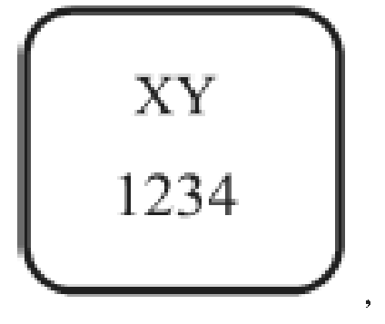

# Čl. I

Nariadenie vlády Slovenskej republiky č. 308/2003 Z. z., ktorým sa upravujú opatrenia na kontrolu niektorých chorôb zvierat a špecifické opatrenia vo vzťahu k vezikulárnej chorobe ošípaných v znení nariadenia vlády Slovenskej republiky č. 494/2003 Z. z. sa mení a dopĺňa takto:

- 1. V § 17 odsek 4 znie:

- „(4)

- Funkciu národného laboratória pre vezikulárnu chorobu ošípaných vykonáva laboratórium autorizované Štátnou veterinárnou a potravinovou správou.7)“.

  - Poznámka pod čiarou k odkazu 7 znie:

  - „7)

  - § 6 ods. 2 písm. m) zákona č. 39/2007 Z. z. o veterinárnej starostlivosti.“.

- 2. Príloha č. 1 vrátane nadpisu znie:

- „Príloha č. 1 k nariadeniu vlády č. 308/2003 Z. z.

- ZOZNAM PREBERANÝCH PRÁVNYCH AKTOV EURÓPSKYCH SPOLOČENSTIEV

- 1.

- Smernica Rady 92/119/EHS zo 17. decembra 1992, ktorou sa ustanovujú všeobecné opatrenia Európskeho spoločenstva pre boj s určitými nákazami zvierat, ako aj špecifické opatrenia vo vzťahu k vezikulárnej chorobe ošípaných (Mimoriadne vydanie Ú. v. EÚ, kap. 3/zv. 14).

- 2.

- Smernica Rady 2002/60/ES z 27. júna 2002, ktorou sa ustanovujú osobitné opatrenia na kontrolu afrického moru ošípaných a ktorá mení a dopĺňa smernicu 92/119/EHS, pokiaľ ide o Teschenovu chorobu a africký mor ošípaných (Mimoriadne vydanie Ú. v. EÚ, kap. 3/zv. 36).

- 3.

- Smernica Rady 2006/104/ES z 20. novembra 2006, ktorou sa z dôvodu pristúpenia Bulharska a Rumunska upravujú určité smernice v oblasti poľnohospodárstva (veterinárnych a fytosanitárnych právnych predpisov) (Ú. v. EÚ L 363, 20. 12. 2006).

- 4.

- Smernica Komisie 2007/10/ES z 21. februára 2007, ktorou a mení a dopĺňa príloha II k smernici Rady 92/119/ES, pokiaľ ide o opatrenia, ktoré treba prijať v rámci ochrannej zóny v dôsledku prepuknutia vezikulárnej choroby ošípaných (Ú. v. EÚ L 63, 1. 3. 2007).“.

- 3. V prílohe č. 3 sa vypúšťa bod 5.

- Doterajšie body 6 až 11 sa označujú ako body 5 až 10.

- 4. V prílohe č. 3 bode 6 písm. b) siedmy bod znie:

- „7.

- mäso pochádzajúce z ošípaných uvedených v bode 6.1

- 7.1 nie je predmetom obchodu medzi členskými štátmi ani medzinárodného obchodu a musí byť označené zdravotnou značkou pre čerstvé mäso podľa osobitného predpisu,1)

- 7.2 sa získava, rozrába, prepravuje a skladuje oddelene od mäsa určeného na obchod medzi členskými štátmi a medzinárodný obchod a používa sa tak, aby sa zabránilo jeho pridaniu do mäsových výrobkov určených na obchod medzi členskými štátmi alebo medzinárodný obchod, ak nebolo podrobené ošetreniu podľa osobitného predpisu.2)“.

  - Poznámky pod čiarou k odkazom 1 a 2 znejú:

  - „1)

  - Príloha č. 2 k nariadeniu vlády Slovenskej republiky č. 41/2005 Z. z., ktorým sa ustanovujú požiadavky na zdravie zvierat týkajúce sa produkcie, spracovania, distribúcie a uvádzania na trh produktov živočíšneho pôvodu určených na ľudskú spotrebu.

  - 2)

  - Príloha č. 3 k nariadeniu vlády Slovenskej republiky č. 41/2005 Z. z.“.

- 5. V prílohe č. 3 bode 6 sa písmeno b) dopĺňa bodmi 8 a 9, ktoré znejú:

- „8.

- odchylne od bodu 7 možno použiť inú identifikačnú značku ako osobitnú identifikačnú značku uvedenú v osobitnom predpise1) pre bravčové mäso uvedené v bode 6.1 pod podmienkou, že je jasne odlíšiteľná od iných identifikačných značiek, ktoré sa používajú pre bravčové mäso podľa osobitných predpisov.3) Ak sa príslušný orgán rozhodne použiť alternatívnu identifikačnú značku, informuje o tom komisiu,

- 9.

- na účely bodu 8 musí byť identifikačná značka čitateľná a nezmazateľná, znaky musia byť ľahko čitateľné a viditeľne umiestnené. Identifikačná značka musí mať nasledujúci tvar a musí obsahovať nasledujúce údaje:

- 

- kde XY znamená kód príslušnej krajiny ustanovený v osobitnom predpise,3)

- 1234 znamená schvaľovacie číslo prevádzkarne podľa osobitného predpisu.4)“.

  - Poznámky pod čiarou k odkazom 3 a 4 znejú:

  - „3)

  - Príloha II oddiel I časť B bod 6 nariadenia Európskeho parlamentu a Rady (ES) č. 853/2004 z 29. apríla 2004, ktorým sa ustanovujú osobitné hygienické predpisy pre potraviny živočíšneho pôvodu (Mimoriadne vydanie Ú v. EÚ, kap. 3/zv. 45, Ú. v. EÚ L 139, 30. 4. 2004).

  - Nariadenie Komisie (ES) č. 2076/2005 z 5. decembra 2005, ktorým sa ustanovujú prechodné opatrenia na implementáciu nariadení Európskeho parlamentu a Rady (ES) č. 853/2004, (ES) č. 854/2004 a (ES) č. 882/2004 a ktorým sa menia a dopĺňajú nariadenia (ES) č. 853/2004 a (ES) č. 854/2004 (Ú. v. EÚ L 338, 22. 12. 2005).

  - 4)

  - Príloha II oddiel I časť B bod 7 nariadenia Európskeho parlamentu a Rady (ES) č. 853/2004.“.

- 6. V prílohe č. 3 sa bod 6 dopĺňa písmenom e), ktoré znie:

- „e)

- ak opatrenia uvedené v bode 6 sú v platnosti dlhšie ako 30 dní z dôvodu výskytu ďalších prípadov choroby a ak v dôsledku toho vznikajú problémy s ustajnením zvierat, príslušný orgán môže na základe odôvodnenej žiadosti vlastníka zvierat a pod podmienkou, že úradný veterinárny lekár skonštatoval uvedené skutočnosti, povoliť prepravu zvierat z chovu v rámci ochranného pásma. Body 6 a 8 sa uplatnia po nevyhnutných zmenách.“.
