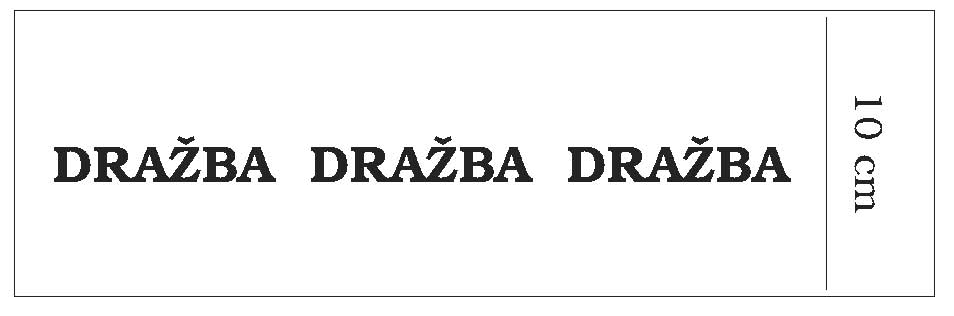

# Čl. I

Zákon č. 527/2002 Z. z. o dobrovoľných dražbách a o doplnení zákona Slovenskej národnej rady č. 323/1992 Zb. o notároch a notárskej činnosti (Notársky poriadok) v znení neskorších predpisov sa mení a dopĺňa takto:

- 1. V § 1 ods. 1 sa za slová „(ďalej len „dražba")“ vkladá čiarka a slová „kontrolu Ministerstva spravodlivosti Slovenskej republiky (ďalej len „ministerstvo") nad dodržiavaním podmienok organizovania a priebehu dražieb“.

- 2. V poznámke pod čiarou k odkazu 1 sa vypúšťa citácia „zákon č. 328/1991 Zb. o konkurze a vyrovnaní v znení neskorších predpisov“.

- 3. V § 3 odsek 2 znie:

- „(2)

- Podľa tohto zákona nemožno dražiť predmet dražby, s ktorým navrhovateľ dražby alebo dražobník na základe zmluvy, vykonateľného rozhodnutia súdu alebo vykonateľného rozhodnutia orgánu verejnej správy nemôže nakladať, alebo ak konanie dražby vylučuje osobitný predpis.2)“.

- 4. § 5 sa dopĺňa odsekom 9, ktorý znie:

- „(9)

- Účastníkom dražby nemôže byť dlžník a manžel dlžníka; nikto nemôže dražiť v ich mene.“.

- 5. V § 6 sa vypúšťa odsek 4.

- Doterajší odsek 5 sa označuje ako odsek 4.

- 6. V § 7 odsek 1 znie:

- „(1)

- Navrhovateľom dražby je vlastník predmetu dražby, osoba, ktorá vykonáva záložné právo (ďalej len “záložný veriteľ„), alebo iná osoba, ktorá je oprávnená navrhnúť vykonanie dražby podľa osobitného zákona.9)“.

- Poznámka pod čiarou k odkazu 9 znie:

- „9)

- Napríklad zákon Národnej rady Slovenskej republiky č. 182/1993 Z. z. o vlastníctve bytov a nebytových priestorov v znení neskorších predpisov, zákon č. 7/2005 Z. z. o konkurze a reštrukturalizácii a o zmene a doplnení niektorých zákonov v znení neskorších predpisov.“.

- 7. V § 7 ods. 2 sa slovo „sumu“ nahrádza slovom „výšku“.

- 8. V § 8 odsek 2 znie:

- „(2)

- Dražobník je povinný umožniť nazretie do písomností súvisiacich s dražbou navrhovateľovi dražby, vlastníkovi predmetu dražby, dlžníkovi a účastníkovi dražby; to neplatí o údaji o znížení najnižšieho podania pred konaním dražby alebo opakovanej dražby.“.

- 9. V § 10 odsek 1 znie:

- „(1)

- Písomnosti sa doručujú poštou formou listovej zásielky do vlastných rúk, a ak to nie je možné alebo účelné, doručujú sa iným preukázateľným spôsobom do vlastných rúk osobe, ktorej sú určené. Na doručovanie sa primerane použijú ustanovenia osobitného predpisu.11)“.

- 10. V poznámke pod čiarou k odkazu 11 sa citácia „§ 47 Občianskeho súdneho poriadku“ nahrádza citáciou „§ 45 až 50 Občianskeho súdneho poriadku“.

- 11. V § 11 odsek 4 znie:

- „(4)

- Ak je predmetom dražby byt, dom, iná nehnuteľnosť, podnik alebo jeho časť, dražobník je povinný najmenej 15 dní pred konaním dražby zverejniť oznámenie o dražbe alebo oznámenie o opakovanej dražbe na úradnej tabuli obce, na ktorej území sa predmet dražby nachádza. V rovnakej lehote zverejní oznámenie o dražbe aj v periodickej tlači s pôsobnosťou minimálne pre obec, na ktorej území sa predmet dražby nachádza, základné údaje o čase, mieste, predmete a najnižšom podaní dražby alebo opakovanej dražby. Obec je povinná bezodkladne a bezodplatne takéto oznámenie zverejniť.“.

- 12. V § 11 sa za odsek 4 vkladá nový odsek 5, ktorý znie:

- „(5)

- Dražobník umiestni na predmet dražby podľa odseku 4 najmenej 15 dní pred konaním dražby označenie podľa prílohy. Zároveň v tejto lehote na viditeľné miesto na predmet dražby umiestni oznámenie o dražbe alebo oznámenie o opakovanej dražbe. Vlastník predmetu dražby je povinný strpieť umiestnenie takéhoto označenia.“.

- Doterajšie odseky 5 a 6 sa označujú ako odseky 6 a 7.

- 13. V § 12 ods. 1 sa nad slovo „posudkom“ umiestňuje odkaz 11a.

- Poznámka pod čiarou k odkazu 11a znie:

- „11a)

- Vyhláška Ministerstva spravodlivosti Slovenskej republiky č. 492/2004 Z. z. o stanovení všeobecnej hodnoty majetku.“.

- 14. § 12 sa dopĺňa odsekmi 3 a 4, ktoré znejú:

- „(3)

- Ak osoba, ktorá má predmet dražby v držbe, neumožní vykonanie ohodnotenia predmetu dražby, ohodnotenie možno vykonať z dostupných údajov, ktoré má dražobník k dispozícii.

- (4)

- Ak je navrhovateľom dražby záložný veriteľ, dražobník zašle vlastníkovi predmetu dražby znalecký posudok,11a) a to najneskôr 30 dní pred dňom konania dražby.“.

- 15. V poznámke pod čiarou k odkazu 12 sa citácia „Zákon č. 241/2001 Z. z. o ochrane utajovaných skutočností a o zmene a doplnení niektorých zákonov“ nahrádza citáciou „Napríklad zákon Slovenskej národnej rady č. 511/1992 Zb. o správe daní a poplatkov a o zmenách v sústave územných finančných orgánov v znení neskorších predpisov.“.

- 16. Za § 13 sa vkladajú § 13a a 13b, ktoré znejú:

- 㤠13a

- (1)

- Vlastník predmetu dražby, ako aj osoba, ktorá má predmet dražby v držbe, alebo nájomca sú povinní bez zbytočného odkladu oznámiť dražobníkovi na jeho žiadosť všetky skutočnosti, ktoré sú im známe o stave predmetu dražby, ako aj o právach a záväzkoch viaznucich na predmete dražby.

- (2)

- Veriteľ je povinný na žiadosť dražobníka poskytnúť potrebnú súčinnosť na zistenie pravosti a výšky pohľadávky.

- § 13b

- (1)

- Dražobník je povinný zachovávať mlčanlivosť o všetkých skutočnostiach, o ktorých sa pri výkone svojej činnosti dozvedel, ak tento zákon (§ 17 ods. 9) alebo osobitný zákon neustanovuje inak.12a)

- (2)

- Povinnosti zachovávať mlčanlivosť môže dražobníka zbaviť dotknutá osoba, ak ide o údaj, ktorý sa týka jej oprávneného záujmu.

- (3)

- Povinnosť zachovávať mlčanlivosť podľa odseku 1 trvá aj po zániku oprávnenia na vykonávanie dražobnej činnosti.“.

  - Poznámka pod čiarou k odkazu 12a znie:

  - „12a)

  - Napríklad Trestný poriadok, Občiansky súdny poriadok, zákon č. 455/1991 Zb. o živnostenskom podnikaní (živnostenský zákon) v znení neskorších predpisov.“.

- 17. V § 16 odsek 3 znie:

- „(3)

- Ak navrhovateľom dražby je záložný veriteľ, zmluva o vykonaní dražby musí ďalej obsahovať dôvod konania dražby a meno, priezvisko, trvalý pobyt vlastníka predmetu dražby, ak je fyzickou osobou; ak je vlastník predmetu dražby právnická osoba, zmluva o vykonaní dražby musí obsahovať názov alebo obchodné meno, sídlo a identifikačné číslo, ak je pridelené.“.

- 18. V § 16 sa za odsek 3 vkladajú nové odseky 4 až 6, ktoré znejú:

- „(4)

- Ak v záložnej zmluve bola dohodnutá suma ako najnižšie podanie pre prípad konania dobrovoľnej dražby, v zmluve o vykonaní dražby musí byť najnižšie podanie uvedené najmenej v tejto sume, ak tento zákon neustanovuje inak. Prílohou zmluvy je aj písomné vyhlásenie záložného veriteľa o pravosti, výške a splatnosti pohľadávky, pre ktorú sa navrhuje výkon záložného práva, a o tom, že predmet dražby je možné dražiť (§ 7 ods. 2).

- (5)

- Ak sa navrhuje výkon záložného práva predajom spoluvlastníckeho podielu k veci, musia byť v zmluve uvedené mená, priezviská, trvalý pobyt ostatných spoluvlastníkov; okrem spoluvlastníkov k spoločným častiam bytového domu, k spoločným zariadeniam bytového domu, k príslušenstvu bytového domu, ktoré je určené na spoločné užívanie a slúži výlučne tomuto bytovému domu a pritom nie je stavebnou súčasťou bytového domu, k pozemku zastavanom bytovým domom a k oploteným záhradám a stavbám, najmä oploteniam, prístreškom a oploteným nádvoriam, ktoré sa nachádzajú na pozemku patriacom k bytovému domu.12a)

- (6)

- Vo veciach zákonného záložného práva a v prípadoch, ak je predmetom dražby alebo opakovanej dražby byt alebo dom, v ktorom má dlžník hlásený trvalý pobyt podľa osobitného predpisu,12b) najnižšie podanie nemôže byť nižšie ako tri štvrtiny hodnoty predmetu dražby určenej znaleckým posudkom a v ostatných prípadoch výkonu záložného práva nižšie ako polovica hodnoty predmetu dražby určenej znaleckým posudkom.“.

  - Poznámky pod čiarou k odkazom 12a a 12b znejú:

  - „12a)

  - § 2 zákona Národnej rady Slovenskej republiky č. 182/1993 Z. z. v znení neskorších predpisov.

  - 12b)

  - § 3 zákona č. 253/1998 Z. z. o hlásení pobytu občanov Slovenskej republiky a registri obyvateľov Slovenskej republiky v znení zákona č. 454/2004 Z. z.“.

- Doterajšie odseky 4 až 7 sa označujú ako odseky 7 až 10.

- 19. V § 16 odsek 7 znie:

- „(7)

- V zmluve možno dohodnúť aj oprávnenie licitátora znížiť najnižšie podanie a zároveň sa uvedie suma, o ktorú je najnižšie podanie možné znížiť; v prípade výkonu záložného práva najnižšie podanie nie je možné dohodnúť nižšie, ako ustanovuje tento zákon.“.

- 20. V poznámke pod čiarou k odkazu 13 sa citácia „Zákon č. 263/1999 Z. z. o verejnom obstarávaní a o zmene a doplnení niektorých zákonov v znení zákona č. 557/2001 Z. z.“ nahrádza citáciou „Zákon č. 523/2003 Z. z. o verejnom obstarávaní a o zmene zákona č. 575/2001 Z. z. o organizácii činnosti vlády a organizácii ústrednej štátnej správy v znení neskorších predpisov v znení neskorších predpisov.“.

- 21. § 17 vrátane nadpisu znie:

- 㤠17

- Oznámenie o dražbe

- (1)

- Dražobník vyhlási konanie dražby oznámením o dražbe, v ktorom uvedie

- a)

- označenie dražobníka a navrhovateľa dražby,

- b)

- miesto, dátum a čas otvorenia dražby,

- c)

- či ide o opakovanú dražbu,

- d)

- označenie a opis predmetu dražby a jeho príslušenstva, práv a záväzkov na predmete dražby viaznucich a s ním spojených, ak podstatným spôsobom ovplyvňujú hodnotu predmetu dražby, opis stavu, v akom sa predmet dražby nachádza, a jeho odhadnutú alebo zistenú cenu,

- e)

- najnižšie podanie a minimálne prihodenie, ktoré môže účastník dražby urobiť,

- f)

- ak požaduje zloženie dražobnej zábezpeky, spôsob a lehotu na jej zloženie, číslo účtu a adresu miesta, kde má byť dražobná zábezpeka zložená, čo je dokladom o zložení dražobnej zábezpeky, výške dražobnej zábezpeky, a spôsob jej vrátenia; či je možné zložiť dražobnú zábezpeku platobnou kartou alebo šekom,

- g)

- ak je prípustný aj iný spôsob úhrady ceny dosiahnutej vydražením ako úhrada v hotovosti, uvedenie tohto spôsobu; spôsob úhrady ceny dosiahnutej vydražením nesmie byť pre vydražiteľa spojený s nadbytočnými ťažkosťami,

- h)

- dátum a čas vykonania obhliadky predmetu dražby, pri hnuteľných veciach tiež miesto konania obhliadky a organizačné opatrenia na zabezpečenie obhliadky,

- i)

- pri spoločnej dražbe poradie, v akom budú jednotlivé predmety dražby dražené,

- j)

- podmienky odovzdania predmetu dražby vydražiteľovi,

- k)

- meno, priezvisko a sídlo notára, ktorý bude priebeh dražby osvedčovať notárskou zápisnicou, ak to vyžaduje tento zákon (§ 20 ods. 13),

- l)

- poučenie podľa § 21 ods. 2 až 6.

- (2)

- Oznámenie o dražbe uverejní dražobník v registri dražieb najmenej 15 dní pred otvorením dražby, ak tento zákon neustanovuje inak.

- (3)

- Ak je predmetom dražby byt, dom, iná nehnuteľnosť, podnik alebo jeho organizačná zložka alebo ak najnižšie podanie presiahne 500 000 Sk, uverejní dražobník oznámenie o dražbe v registri dražieb najmenej 30 dní pred začatím dražby. Oznámenie o dražbe dražobník bez zbytočného odkladu zašle aj ministerstvu na zverejnenie v Obchodnom vestníku.

- (4)

- Pre predmety dražby podliehajúce skaze je dražobník oprávnený lehotu na uverejnenie oznámenia o dražbe primerane skrátiť.

- (5)

- V lehotách ustanovených v odsekoch 2 až 4 zašle dražobník oznámenie o dražbe

- a)

- navrhovateľovi dražby, dlžníkovi záložného veriteľa, vlastníkovi predmetu dražby, ak nie je totožný s dlžníkom záložného veriteľa,

- b)

- osobám, ktoré majú podľa oznámenia navrhovateľa dražby k predmetu dražby záložné alebo iné právo zapísané v katastri nehnuteľností, v Notárskom centrálnom registri záložných práv,14) v evidencii podľa osobitných zákonov15) alebo v listinách osvedčujúcich vlastnícke právo k predmetu dražby a nevyhnutných na nakladanie s ním,

- c)

- ak je predmetom dražby byt, dom alebo iná nehnuteľnosť, osobám, ktoré majú podľa oznámenia navrhovateľa dražby k predmetu dražby predkupné právo alebo iné vecné právo zapísané v katastri nehnuteľností, a tiež príslušnej správe katastra na vyznačenie poznámky,

- d)

- ak je predmetom dražby hnuteľná vec, osobám, ktoré majú podľa oznámenia navrhovateľa dražby predkupné právo k predmetu dražby,

- e)

- ak je predmetom dražby spoluvlastnícky podiel k veci, ostatným spoluvlastníkom k tejto veci oznámeným navrhovateľom dražby (§ 16 ods. 3),

- f)

- ak je predmetom dražby nehnuteľnosť, podnik alebo jeho časť, správcovi dane príslušnému podľa miesta trvalého pobytu alebo miesta podnikania vlastníka nehnuteľnosti, podniku alebo jeho časti, ak je vlastník fyzickou osobou, alebo podľa sídla vlastníka, ak je vlastník právnickou osobou, a správcovi dane, v ktorého obvode sa nehnuteľnosť, podnik alebo jeho časť nachádza,

- g)

- ak je predmetom dražby podnik alebo jeho časť, Protimonopolnému úradu Slovenskej republiky,

- h)

- ak je predmetom dražby majetok právnickej osoby, ktorej zakladateľom alebo zriaďovateľom je štát, aj orgánu štátu vykonávajúcemu práva zakladateľa, zriaďovateľa, spoločníka alebo člena tejto právnickej osoby,

- i)

- notárovi, ktorý bude priebeh dražby osvedčovať notárskou zápisnicou [(ods. 1 písm. k)].

- (6)

- Ak sa má doručiť oznámenie o dražbe podielovým spoluvlastníkom v bytovom dome alebo spoločenstvu vlastníkov bytov alebo správcovi bytového domu, dražobník môže oznámenie o dražbe doručiť aj vyvesením oznámenia o dražbe na obvyklom mieste v spoločných priestoroch bytového domu. Spoločenstvo vlastníkov bytov alebo správca bytového domu sú povinní na žiadosť dražobníka bezodkladne a bezodplatne oznámenie o dražbe vyvesiť v spoločných priestoroch bytového domu, kde sa predmet dražby nachádza.

- (7)

- Oznámenie o dražbe spolu s dodatkami (§ 18) je dražobník povinný pred začatím dražby vyvesiť vo verejne prístupnej časti objektu, v ktorom sa dražba koná.

- (8)

- Rovnopis oznámenia o dražbe uložený u dražobníka musí byť podpísaný navrhovateľom dražby; podpis navrhovateľa dražby musí byť úradne osvedčený. V prípade účasti notára na dražbe (§ 20 ods. 13) je rovnopis oznámenia o dražbe prílohou osvedčeného odpisu notárskej zápisnice.

- (9)

- Dražobník je povinný na žiadosť dlžníka alebo vlastníka predmetu dražby oznámiť výšku pohľadávky s vyčísleným príslušenstvom a nákladmi dražby. Dražobník je oprávnený toto oznámenie neposkytnúť, ak žiadateľ odmietne preukázať svoju totožnosť.“.

- 22. § 18 vrátane nadpisu znie:

- 㤠18

- Zmeny v oznámení o dražbe

- (1)

- Podmienky a údaje, ktoré dražobník v oznámení o dražbe uviedol, nie je možné dodatočne meniť. Ak dôjde k zmenám v rozsahu práv a povinností viaznucich na predmete dražby a s ním spojených alebo stavu, v ktorom sa predmet dražby nachádza; dražobník je povinný vyhotoviť a pripojiť dodatok k zverejneniu oznámenia o dražbe bez zbytočného odkladu po tom, čo sa o zmenách dozvedel. Ak notárovi uvedenému v oznámení o dražbe bráni prekážka v účasti na dražbe, v oznámení o dražbe je možné dodatočne zmeniť údaj o notárovi.

- (2)

- Ak bolo oznámenie o dražbe zverejnené v Obchodnom vestníku podľa § 17 ods. 3, dražobník v ňom bez zbytočného odkladu zverejní aj zmeny v oznámení o dražbe.“.

- 23. V § 19 odsek 1 znie:

- „(1)

- Dražobník je povinný upustiť od dražby najneskôr do jej začatia

- a)

- na základe písomnej žiadosti navrhovateľa dražby,

- b)

- ak je dražobníkovi preukázané vykonateľným rozhodnutím, že navrhovateľ dražby nie je oprávnený navrhnúť vykonanie dražby,

- c)

- ak je podľa vykonateľného rozhodnutia súdu zmluva o vykonaní dražby neplatná, ak dôjde k odstúpeniu od zmluvy o vykonaní dražby alebo nie je možné podľa podmienok dohodnutých v zmluve o vykonaní dražby dražbu vykonať,

- d)

- ak neboli splnené podmienky ustanovené v § 13 a 17,

- e)

- ak bol na majetok vlastníka predmetu dražby vyhlásený konkurz alebo ak bola povolená reštrukturalizácia v súvislosti s majetkom vlastníka predmetu dražby,

- f)

- ak je navrhovateľom dražby vlastník predmetu dražby a ak bol na predmet dražby alebo jeho časť nariadený výkon rozhodnutia alebo exekučné konanie podľa osobitných predpisov,16)

- g)

- ak je navrhovateľom dražby záložný veriteľ a na predmet dražby zaťažený jeho záložným právom bol nariadený s jeho súhlasom9) výkon rozhodnutia alebo exekučné konanie podľa osobitných predpisov,16)

- h)

- ak bolo navrhovateľovi dražby alebo dražobníkovi vykonateľným rozhodnutím súdu alebo vykonateľným rozhodnutím orgánu verejnej správy zakázané s predmetom dražby nakladať,

- i)

- ak zaniklo živnostenské oprávnenie dražobníka,

- j)

- ak dražobník nemá uzatvorené poistenie zodpovednosti za škodu,

- k)

- ak je navrhovateľom dražby záložný veriteľ a dlžník alebo vlastník predmetu dražby pred dražbou zloží dražobníkovi na účely splnenia dlhu sumu rovnajúcu sa pohľadávke s príslušenstvom vrátane nákladov dražby v rozsahu, v akom je povinný ich znášať; dražobník je oprávnený prijať plnenie popri veriteľovi.“.

- 24. § 19 sa dopĺňa odsekom 4, ktorý znie:

- „(4)

- Ak bolo oznámenie o dražbe zverejnené v Obchodnom vestníku podľa § 17 ods. 3, dražobník v ňom bez zbytočného odkladu zverejní aj oznámenie o upustení od dražby.“.

- 25. V § 20 sa vypúšťa odsek 7.

- Doterajšie odseky 8 až 14 sa označujú ako odseky 7 až 13.

- 26. V § 20 odsek 13 znie:

- „(13)

- Ak ide o dražbu bytu, domu, inej nehnuteľnosti, podniku alebo jeho časti alebo ak najnižšie podanie hnuteľných vecí, práv a iných majetkových hodnôt presiahne sumu 1 000 000 Sk, musí byť priebeh dražby osvedčený notárskou zápisnicou, v ktorej notár uvedie aj povinnosť predchádzajúceho vlastníka podľa § 29 ods. 2 prvej vety.“.

- 27. § 21 vrátane nadpisu znie:

- 㤠21

- Zmarenie a neplatnosť dražby

- (1)

- O zmarení dražby vyrozumie dražobník bez zbytočného odkladu osoby uvedené v § 17 ods. 5. Oznámenie o zmarení dražby uverejní dražobník bez zbytočného odkladu obdobným spôsobom ako oznámenie o dražbe. Ak sa oznámenie o dražbe zverejnilo v registri dražieb a v Obchodnom vestníku podľa § 17 ods. 3, dražobník tam bez zbytočného odkladu zverejní aj oznámenie o zmarení dražby.

- (2)

- V prípade, ak boli porušené ustanovenia tohto zákona, môže osoba, ktorá tvrdí, že tým bola dotknutá na svojich právach, požiadať súd, aby určil neplatnosť dražby. Právo domáhať sa určenia neplatnosti dražby zaniká, ak sa neuplatní do troch mesiacov odo dňa príklepu okrem prípadu, ak dôvody neplatnosti dražby súvisia so spáchaním trestného činu a zároveň ide o dražbu domu alebo bytu, v ktorom má predchádzajúci vlastník predmetu dražby v čase príklepu hlásený trvalý pobyt podľa osobitného predpisu;12b) v tomto prípade je možné domáhať sa neplatnosti dražby aj po uplynutí tejto lehoty. V prípade spoločnej dražby bude neplatná len tá časť dražby, ktorej sa takýto rozsudok týka (§ 23).

- (3)

- Osoba, ktorá podala na súde žalobu podľa odseku 2, je povinná oznámiť príslušnej správe katastra nehnuteľností začatie súdneho konania.

- (4)

- Účastníkmi súdneho konania o neplatnosť dražby podľa odseku 2 sú navrhovateľ dražby, dražobník, vydražiteľ, predchádzajúci vlastník a dotknutá osoba podľa odseku 2.

- (5)

- Ak vydražiteľ zmaril dražbu alebo ak súd určil dražbu za neplatnú, účinky príklepu zanikajú ku dňu príklepu.

- (6)

- Neplatnosť dražby nie je možné vysloviť z dôvodu oneskoreného začatia dražby, ak bolo príčinou oneskoreného začatia dražby konanie inej dražby tým istým dražobníkom na tom istom mieste a ak neumožnil vlastník predmetu dražby, ako aj osoba, ktorá má k predmetu dražby iné ako vlastnícke právo, vykonať riadnu obhliadku predmetu dražby.

- (7)

- O neplatnosti dražby dražobník bez zbytočného odkladu vyrozumie osoby uvedené v § 17 ods. 5. Oznámenie o neplatnosti dražby dražobník uverejní bez zbytočného odkladu na dobu najmenej 30 dní spôsobom v mieste obvyklým. Ak bolo oznámenie o dražbe uverejnené v registri dražieb, dražobník tam uverejní aj oznámenie o neplatnosti dražby. Ak sa oznámenie o dražbe zverejnilo v Obchodnom vestníku podľa § 17 ods. 3, dražobník v ňom bez zbytočného odkladu zverejní aj oznámenie o neplatnosti dražby.“.

- 28. V § 22 ods. 4 sa za prvú vetu vkladá táto veta:

- „Ak sa oznámenie o dražbe zverejnilo v Obchodnom vestníku podľa § 17 ods. 3, dražobník v ňom bez zbytočného odkladu zverejní aj oznámenie o konaní opakovanej dražby; na náležitosti oznámenia o konaní opakovanej dražby sa vzťahuje § 17 ods. 1 písm. a) až f).“.

- 29. V § 24 ods. 2 písm. c) sa za slovom „dražby“ vypúšťa čiarka a slová „ak je možné, aj“.

- 30. § 24 ods. 2 sa dopĺňa písmenami h) a i), ktoré znejú:

- „h)

- námietky proti priebehu dražby,

- i)

- poučenie podľa § 21 ods. 2 až 6.“.

- 31. V § 24 odseky 3 a 4 znejú:

- „(3)

- Súčasťou zápisnice je podpísaný rovnopis oznámenia o dražbe (§ 17 ods. 8) a jeho prípadné dodatky (§ 18). Súčasťou zápisnice sú aj vznesené námietky zaslané dražobníkovi.

- (4)

- Zápisnicu o vykonanej dražbe podpíše dražobník, licitátor, osoba, ktorá vzniesla námietky proti priebehu dražby a v prípade vydraženia aj vydražiteľ. Ak odmietne niektorá osoba zápisnicu o vykonaní dražby podpísať, dražobník to uvedie v zápisnici.“.

- 32. V § 24 ods. 8 sa slová „2 až 6“ nahrádzajú slovami „2 až 7“.

- 33. V § 24 ods. 9 sa na konci pripája táto veta:

- „Rovnaké údaje dražobník zverejní aj v Obchodnom vestníku, ak v ňom bolo zverejnené oznámenie o dražbe podľa § 17 ods. 3.“.

- 34. V § 25 odsek 1 znie:

- „(1)

- Ak nie je v zmluve o vykonaní dražby dohodnuté inak, náklady dražby sa hradia z výťažku dražby. Ak je navrhovateľom dražby záložný veriteľ, náklady dražby sa hradia z výťažku dražby v rozsahu povinnosti vlastníka predmetu dražby znášať ich náhradu.“.

- 35. V § 25 sa za odsek 1 vkladá nový odsek 2, ktorý znie:

- „(2)

- Ak je navrhovateľom dražby záložný veriteľ, vlastník predmetu dražby znáša odmenu dražobníka najviac v rozsahu 10 % z výťažku dražby, nie však viac ako 20 % z výšky pohľadávky. Ak sa upustilo od dražby z dôvodu plnenia dlhu, vlastník predmetu dražby znáša odmenu dražobníka v rozsahu najviac 3 % z vymáhanej pohľadávky a po doručení oznámenia o dražbe vlastníkovi predmetu dražby 10 % z vymáhanej pohľadávky. Odmena dražobníka je najviac 1 000 000 Sk zvýšených o 1 % z ceny dosiahnutej vydražením, presahujúcej 10 000 000 Sk.“.

- Doterajšie odseky 2 až 4 sa označujú ako odseky 3 až 5.

- 36. V § 25 odsek 3 znie:

- „(3)

- Ak za náklady dražby nezodpovedá iná osoba ako navrhovateľ dražby, uhradí ich dražobníkovi navrhovateľ dražby, ak nie je v zmluve o vykonaní dražby dohodnuté inak.“.

- 37. § 25 sa dopĺňa odsekom 6, ktorý znie:

- „(6)

- Ak neplatnosť dražby spôsobil dražobník, znáša náklady dražby; ustanovenie § 33 ods. 3 tým nie je dotknuté.“.

- 38. V § 26 ods. 3 sa vypúšťa druhá veta.

- 39. V § 26 ods. 7 sa slová „3 až 5“ nahrádzajú slovami „4 až 5“.

- 40. V § 27 ods. 1 sa na konci pripája táto veta:

- „Ku dňu zaplatenia ceny dosiahnutej vydražením vydražiteľom zaniká pohľadávka veriteľa v rozsahu uspokojenia veriteľa z výťažku dražby.“.

- 41. V § 28 odsek 3 znie:

- „(3)

- Ak ide o byt, dom alebo inú nehnuteľnosť, zašle dražobník po zaplatení ceny predmetu dražby jedno vyhotovenie osvedčeného odpisu notárskej zápisnice spolu s potvrdením o zaplatení bez zbytočného odkladu príslušnej správe katastra.“.

- 42. V § 28 ods. 4 sa slová „(§ 17 ods. 7)“ nahrádzajú slovami „(§ 17 ods. 8)“.

- 43. V § 29 ods. 2 prvá veta znie:

- „Ak ide o predmet dražby podľa § 20 ods. 13, predchádzajúci vlastník je povinný odovzdať predmet dražby na základe predloženia osvedčeného odpisu notárskej zápisnice a doloženia totožnosti vydražiteľa podľa podmienok uvedených v oznámení o dražbe bez zbytočných prieťahov.“.

- 44. V § 29 ods. 4 sa na konci pripája táto veta:

- „Ak niektorá osoba odmietne zápisnicu podpísať alebo ju prevziať, táto skutočnosť sa vyznačí v zápisnici a zápisnica sa považuje za odovzdanú aj tejto osobe; o tom dražobník túto osobu poučí.“.

- 45. § 32 vrátane nadpisu znie:

- 㤠32

- Odovzdanie výťažku dražby

- (1)

- Výťažok dražby po uhradení nákladov dražby, po uspokojení pohľadávok záložného veriteľa a po zaplatení ceny dosiahnutej vydražením bez zbytočných prieťahov dražobník odovzdá predchádzajúcemu vlastníkovi predmetu dražby, ak osobitný zákon13a) neustanovuje inak.

- (2)

- Ak predchádzajúci vlastník predmet dražby neodovzdal vydražiteľovi, dražobník mu zloží sumu určenú podľa odseku 1 do notárskej úschovy; rovnako tak postupuje, ak predchádzajúci vlastník túto sumu odmieta prevziať.

- (3)

- Ak je dražba neplatná, každá osoba, ktorá prevzala výťažok dražby podľa odseku 1, je povinná vrátiť ho bezodkladne vydražiteľovi. Dražobník je povinný na výzvu vydražiteľa oznámiť mu sumu, ktorú odovzdal záložnému veriteľovi a dlžníkovi, prípadne sumu, ktorú zložil do notárskej úschovy. Právo na náhradu škody tým nie je dotknuté.

- (4)

- Ak je dražba neplatná a predchádzajúci vlastník a vydražiteľ si majú navzájom vrátiť plnenia, môže sa domáhať splnenia záväzku len ten, kto sám splnil svoj záväzok skôr alebo je pripravený záväzok splniť.“.

  - Poznámka pod čiarou k odkazu 13a znie:

  - „13a)

  - § 151ma ods. 5 Občianskeho zákonníka.“.

- 46. Za § 33 sa vkladá nová tretia časť, ktorá znie:

- „TRETIA ČASŤ

- KONTROLA A SPRÁVNE DELIKTY

- § 33a

- (1)

- Kontrolu dodržiavania podmienok organizovania a priebehu dražieb vykonáva ministerstvo. Na výkon kontroly sa nevzťahuje osobitný predpis.14a)

- (2)

- Ministerstvo uverejní na svojej internetovej stránke zoznam dražobníkov a údaje o nich v rozsahu verejnej časti živnostenského registra. Údaje o dražobníkoch ministerstvu zašle alebo sprístupní14b) Ministerstvo vnútra Slovenskej republiky.

- § 33b

- Kontrola sa vykonáva

- a)

- pravidelnými, náhodnými alebo účelovými previerkami dodržiavania zákonnosti a správnosti postupov a povinností dražobníkov,

- b)

- preskúmavaním podnetov na postup pri výkone činnosti dražobníkov.

- § 33c

- (1)

- Kontrolu vykonáva ministerstvom poverený zamestnanec ministerstva (ďalej len „poverená osoba").

- (2)

- Poverenie ministerstva na vykonanie kontroly má písomnú formu a obsahuje označenie kontrolovaného dražobníka, predmet kontroly, deň začatia kontroly, dátum a miesto vyhotovenia poverenia a meno, priezvisko, funkciu a podpis zamestnanca ministerstva oprávneného na udelenie poverenia.

- § 33d

- (1)

- Poverená osoba je z výkonu kontroly vylúčená, ak so zreteľom na jej pomer k veci, ku kontrolovanému dražobníkovi alebo k zamestnancom dražobníka možno mať pochybnosť o jej nezaujatosti.

- (2)

- Ak sa poverená osoba dozvie skutočnosti nasvedčujúce, že je z výkonu kontroly vylúčená, je povinná bezodkladne oznámiť tieto skutočnosti osobe, ktorá ju vykonaním kontroly poverila. Pri výkone kontroly môže zatiaľ urobiť len úkony, ktoré nepripúšťajú odklad.

- (3)

- Ak má kontrolovaný dražobník pochybnosti o nezaujatosti poverenej osoby, môže podať ministerstvu odôvodnené písomné námietky.

- (4)

- O vylúčení poverenej osoby z výkonu kontroly rozhodne do troch dní od oznámenia alebo podania námietok osoba, ktorá poverenú osobu vykonaním kontroly poverila; ak rozhodne, že poverená osoba je z výkonu kontroly vylúčená, urobí aj vhodné opatrenie na zabezpečenie ďalšieho výkonu kontroly. Na rozhodovanie o zaujatosti poverenej osoby sa všeobecný predpis o správnom konaní nepoužije.14c)

- § 33e

- (1)

- Poverená osoba je pri výkone kontroly oprávnená

- a)

- vstupovať do objektov, zariadení, na pozemky a do iných priestorov kontrolovaných dražobníkov, ak bezprostredne súvisia s predmetom kontroly,

- b)

- nahliadať do spisu, účtovníctva a iných záznamov kontrolovaného dražobníka a robiť z nich kópie a odpisy,

- c)

- v odôvodnených prípadoch odoberať písomnosti a iné záznamy kontrolovaného dražobníka,

- d)

- vyžadovať od kontrolovaného dražobníka, jeho zamestnancov, prípadne jeho spoločníkov všetky informácie týkajúce sa výkonu jeho činnosti,

- e)

- vyžadovať od kontrolovaného dražobníka, jeho zamestnancov, prípadne jeho spoločníkov aj inú súčinnosť potrebnú na zabezpečenie riadneho výkonu kontroly a vykonať ďalšie opatrenia potrebné na zabezpečenie účinného a objektívneho výkonu kontroly.

- (2)

- Poverená osoba je pri výkone kontroly povinná preukázať sa kontrolovanému dražobníkovi pri začatí kontroly písomným poverením ministerstva na vykonanie kontroly spolu so služobným preukazom, prípadne občianskym preukazom.

- § 33f

- (1)

- Pri výkone kontroly sú dražobník, jeho zamestnanci, prípadne spoločníci povinní poskytovať poverenej osobe súčinnosť a vytvárať im vhodné materiálne a technické podmienky potrebné na riadny výkon kontroly, najmä zabezpečiť im vhodné miesto na vykonanie kontroly a zdržať sa konania, ktoré môže mariť výkon kontroly.

- (2)

- Povinnosť zachovávať mlčanlivosť sa neporuší poskytnutím súčinnosti podľa odseku 1.

- § 33g

- (1)

- O výsledku vykonanej kontroly poverená osoba vyhotoví protokol, ktorého odpis doručia kontrolovanému dražobníkovi. Kontrolovaný dražobník môže v lehote do troch dní od doručenia odpisu protokolu uplatniť proti protokolu písomné námietky a poverená osoba je povinná opodstatnenosť námietok preveriť.

- (2)

- Protokol obsahuje označenie kontrolovaného dražobníka, miesto a čas vykonania kontroly, predmet kontroly, mená, priezviská a podpisy osôb, ktoré kontrolu vykonali, preukázané zistenia pri kontrole, dátum vypracovania protokolu, vlastnoručné podpisy poverených osôb, vyjadrenie kontrolovaného dražobníka k výsledku kontroly a ďalšie písomnosti a materiály. Na základe uznaných námietok sa k protokolu vypracuje dodatok ako súčasť protokolu.

- § 33h

- Poverená osoba, ktorá sa dozvedela o skutočnostiach súvisiacich s kontrolou, je povinná zachovávať mlčanlivosť o týchto skutočnostiach. Povinnosť mlčanlivosti trvá aj po skončení výkonu ich funkcie alebo zamestnania.

- § 33i

- Trovy ministerstva spojené s kontrolou uhrádza ministerstvo a trovy kontrolovaného dražobníka spojené s kontrolou platí kontrolovaný dražobník.

- § 33j

- (1)

- Za porušenie alebo obchádzanie povinností ustanovených v § 11 ods. 1, 2 a 3, § 12 ods. 1 a 4, § 13 ods. 1 a 2, § 13a ods. 2, § 14, § 17 ods. 1, § 18, § 20 ods. 14, § 23 ods. 1, § 24 ods. 1, 2, 5, 6 a 7, § 29 ods. 2, § 28 ods. 1 a 3 a v § 32 ministerstvo uloží dražobníkovi pokutu v sume 50 000 Sk.

- (2)

- Za porušenie alebo obchádzanie povinností ustanovených v § 13b, § 15 a v § 17 ods. 9 ministerstvo uloží dražobníkovi pokutu v sume 100 000 Sk.

- (3)

- Za porušenie iných povinností ako tých, ktoré sú uvedené v odsekoch 1 a 2, ministerstvo uloží dražobníkovi pokutu 10 000 Sk.

- (4)

- Ak ministerstvo zistí, že dražobník opakovane porušuje povinnosti podľa odseku 3, môže dať podnet príslušnému orgánu podľa osobitného predpisu8) na zrušenie živnostenského oprávnenia.

- (5)

- Porušenie povinností dražobníka upustiť od dražby, ak tak bol povinný urobiť, alebo povinnosti dohodnúť a udržiavať poistenie zodpovednosti za škodu sa považuje za osobitné závažné porušenie povinností.8)

- (6)

- Ak ministerstvo zistí, že dražobník porušuje povinnosti podľa odseku 5, dá podnet príslušnému orgánu podľa osobitného predpisu8) na zrušenie živnostenského oprávnenia.

- § 33k

- (1)

- Konanie o uložení pokuty možno začať do jedného roka od zistenia porušenia povinnosti, najneskôr do troch rokov odo dňa, keď k porušeniu povinnosti došlo.

- (2)

- Výnos pokuty je príjmom štátneho rozpočtu.

- (3)

- Na konanie o uložení pokuty podľa tohto zákona sa vzťahuje všeobecný predpis o správnom konaní.14c)“.

  - Poznámky pod čiarou k odkazom 14a až 14c znejú:

  - „14a)

  - Zákon Národnej rady Slovenskej republiky č. 10/1996 Z. z. o kontrole v štátnej správe v znení neskorších predpisov.

  - 14b)

  - § 60b ods. 3 a 6 zákona č. 455/1991 Zb. v znení zákona č. 358/2007 Z. z.

  - 14c)

  - Zákon č. 71/1967 Zb. o správnom konaní (správny poriadok) v znení neskorších predpisov.“.

- Doterajšia tretia časť sa označuje ako štvrtá časť.

- 47. Doterajší text § 34 sa označuje ako odsek 1 a dopĺňa sa odsekom 2, ktorý znie:

- „(2)

- Ak predmetom dražby je vec nadobudnutá prevodom na zabezpečenie pohľadávky,18) na navrhovateľa dražby sa primerane vzťahujú ustanovenia o záložnom veriteľovi a na osobu, ktorá previedla právo na zabezpečenie pohľadávky, primerane sa vzťahujú ustanovenia o vlastníkovi veci.“.

  - Poznámka pod čiarou k odkazu 18 znie:

  - „18)

  - § 553 až 553c Občianskeho zákonníka.“.

- 48. Za § 36 sa vkladá § 36a, ktorý vrátane nadpisu znie:

- 㤠36a

- Prechodné ustanovenie účinné od 1. januára 2008

- Dražby, o ktorých vykonaní bola uzavretá zmluva pred 1. januárom 2008, ako i vzťahy s nimi súvisiace sa dokončia podľa doterajších predpisov.“.

- 49. Zákon sa dopĺňa prílohou, ktorá vrátane nadpisu znie:

- „Príloha k zákonu č. 527/2002 Z. z. v znení zákona č. 568/2007 Z. z.

- OZNAČENIE PREDMETU DRAŽBY

- Páska

- ."
