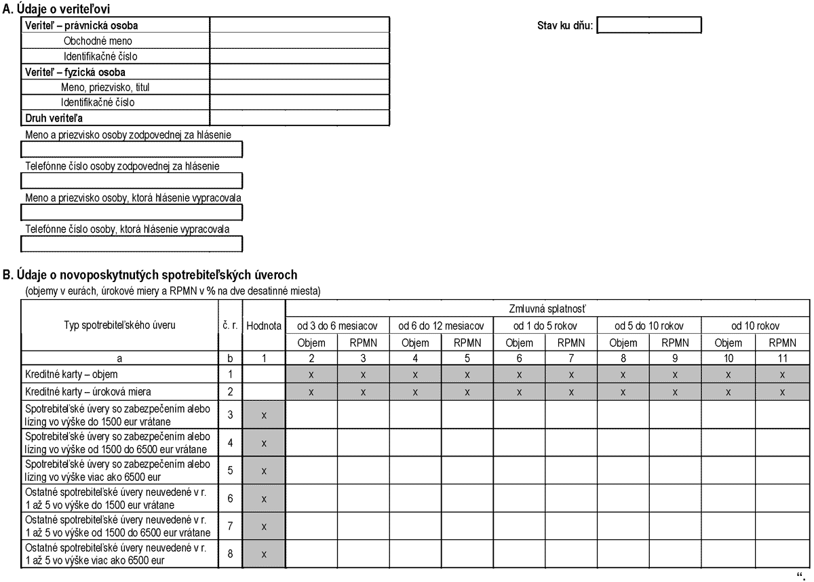

Príloha k vyhláške č. 660/2007 Z. z.

- VZOR

  - Hlásenie o novoposkytnutých úveroch

  - 

- Vysvetlivky na vypĺňanie hlásenia o novoposkytnutých spotrebiteľských úveroch

  - 1. V záhlaví v ľavom rohu sa za slovom „Veriteľ“ uvádza obchodné meno a identifikačné číslo, ak ide o právnickú osobu, alebo meno, priezvisko, titul a identifikačné číslo, ak ide o fyzickú osobu. Ďalej sa uvádzajú identifikačné údaje o osobách zodpovedných za vypĺňanie hlásenia a druh veriteľa v tomto členení:

    - a) banka alebo pobočka zahraničnej banky,3)

    - b) lízingová spoločnosť,4)

    - c) spoločnosť splátkového financovania,5)

    - d) iné spoločnosti poskytujúce spotrebiteľské úvery.

  - 2. Do hlásenia sú zahrnuté novoposkytnuté spotrebiteľské úvery, ktoré veriteľ poskytol počas uplynulého kalendárneho štvrťroka. Novoposkytnutým spotrebiteľským úverom sa rozumie nová zmluva o spotrebiteľskom úvere uzatvorená medzi spotrebiteľom a veriteľom. Novými zmluvami o spotrebiteľskom úvere sú

    - a) zmluvy o spotrebiteľskom úvere, ktoré prvýkrát určujú výšku splátky, úrokovú sadzbu alebo výšku poplatkov dohodnutého obchodu medzi spotrebiteľom a veriteľom,

    - b) zmeny zmluvných podmienok zmluvy o spotrebiteľských úveroch uskutočnené za aktívnej účasti spotrebiteľa.

  - 3. Objemy novoposkytnutých spotrebiteľských úverov sa vykazujú v eurách, a to za novoposkytnuté spotrebiteľské úvery, ktoré veriteľ poskytol počas uplynulého kalendárneho štvrťroka. Vykazuje sa celková suma spotrebiteľského úveru dohodnutá v zmluve o spotrebiteľskom úvere, a to bez ohľadu na to, či sa spotrebiteľský úver čerpá naraz alebo po častiach. Spotrebiteľské úvery sa vykazujú neznížené o opravné položky, ktoré k nim boli vytvorené. Spotrebiteľské úvery v cudzej mene sa prepočítajú na eurá podľa referenčného výmenného kurzu určeného a vyhláseného Európskou centrálnou bankou alebo podľa referenčného výmenného kurzu určeného a vyhláseného Národnou bankou Slovenska, ak ide o menu, pre ktorú Európska centrálna banka neurčuje a nevyhlasuje výmenný kurz, platného ku dňu zostavenia hlásenia; Európska centrálna banka a Národná banka Slovenska určujú a vyhlasujú referenčné výmenné kurzy k cudzím menám na základe čl. 111 ods. 1 a 3 Zmluvy o založení Európskeho spoločenstva a čl. 12 ods. 12.1 Protokolu o Štatúte Európskeho systému centrálnych bánk a Európskej centrálnej banky pripojeného k Zmluve o založení Európskeho spoločenstva (Ú. v. EÚ C 321E, 29. 12. 2006) alebo na základe § 28 ods. 2 zákona Národnej rady Slovenskej republiky č. 566/1992 Zb. o Národnej banke Slovenska v znení neskorších predpisov. Pri pohľadávkach z lízingu nie je do objemu novoposkytnutých spotrebiteľských úverov zahrnutá akontácia.

  - 4. Kreditnými kartami sa rozumejú spotrebiteľské úvery, ktoré spotrebiteľ získal prostredníctvom kreditnej platobnej karty. Za spotrebiteľský úver sa považuje len tá časť sumy, ktorú spotrebiteľ získal prostredníctvom kreditnej platobnej karty a po skončení bezúročného obdobia nesplatil. Vykazuje sa výška tejto sumy ku dňu zostavenia hlásenia.

  - 5. Úrokovou mierou pri kreditných kartách sa rozumie individuálne dohodnutá úroková sadzba medzi veriteľom a spotrebiteľom prepočítaná na ročný základ a určená v percentách za rok, platná po začatí úročeného obdobia. Úroková miera pri kreditných kartách môže zahŕňať len všetky úrokové platby. Úrokové miery pri kreditných kartách sa počítajú ako vážený priemer všetkých úrokových mier za kreditné karty. Váhové informácie predstavujú zostatky spotrebiteľských úverov získaných prostredníctvom kreditnej karty po skončení neúročeného obdobia ku dňu zostavenia hlásenia.

  - 6. V hlásení sa vykazujú údaje o vážených priemeroch RPMN za novoposkytnuté spotrebiteľské úvery za každý ich typ, ktoré veriteľ poskytol počas uplynulého kalendárneho štvrťroka. Váhové informácie predstavujú zmluvne dohodnuté objemy jednotlivých typov novoposkytnutých spotrebiteľských úverov za príslušný kalendárny štvrťrok. RPMN je definovaná v zákone č. 258/2001 Z. z. o spotrebiteľských úveroch a o zmene a doplnení zákona Slovenskej národnej rady č. 71/1986 Zb. o Slovenskej obchodnej inšpekcii v znení neskorších predpisov v znení neskorších predpisov. Vzorec na výpočet RPMN je uvedený v prílohe citovaného zákona.

  - 7. Zabezpečením sa rozumie dohoda, na ktorej základe je veriteľ oprávnený uspokojiť si svoju pohľadávku, ak dlžník nedodrží svoj záväzok alebo príde k splneniu vopred určenej podmienky, výkonom záložného práva alebo výkonom zabezpečovacieho prevodu práva.

- Použité skratky

- skratka | | popis

- ------------------------------------------------ | |

- č. r. | – | číslo riadku

- RPMN | – | ročná percentuálna miera nákladov
