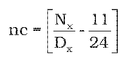
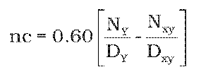
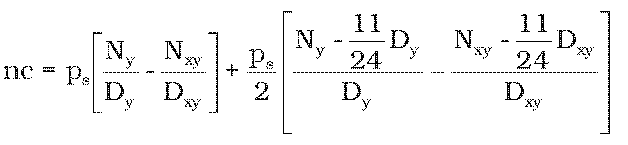

Príloha č. 1 k zákonu č. 43/2004 Z. z.

- VZORCE NA VÝPOČET STAROBNÉHO DÔCHODKU A PREDČASNÉHO STAROBNÉHO DÔCHODKU VYPLÁCANÝCH DOŽIVOTNE A POZOSTALOSTNÝCH DÔCHODKOV

  - I. DEFINÍCIE

    - Potrebný jednotkový kapitál (nc) – výška peňažných prostriedkov alebo iných aktív na osobnom dôchodkovom účte sporiteľa potrebných na financovanie jednotkového doživotného starobného dôchodku (dôchodok vo výške 1 Sk vyplácaný mesačne) alebo jednotkového doživotného predčasného starobného dôchodku a pozostalostného dôchodku pre pozostalých uvedených v zákone.

  - II. VZORCE

    - Uvedené vzorce sa použijú na výpočet výšky aktív potrebných na vyplácanie doživotného starobného dôchodku alebo doživotného predčasného starobného dôchodku príslušnou poisťovňou.

    - Vo vzorcoch sa použijú tieto veličiny a ich označenia:

    - x = vek sporiteľa (muža alebo ženy),

    - y = vek manžela/manželky sporiteľa (muža alebo ženy),

    - h = vek najmladšieho nezaopatreného dieťaťa po zomretom,

    - z = priemerný vek, po ktorého dosiahnutí už dieťa nemá nárok na sirotský dôchodok,

    - nc = potrebný jednotkový kapitál,

    - x' = x + z – h

    - y' = y + z – h

    - Nx, Nxy, Dx= komutatívne funkcie definované takto:

    - Dx =Vx 1X

    - Nx= ∑Dx+t

    - Dxy =V(x+y)/2 1xy

    - 1xy= k 1x 1y

    - Nxy= ∑Dx+t,y+t

    - k = 1/10,

    - kde

    - V = (1+ i )–1 .... diskontný faktor,

    - i = technická úroková miera na výpočet dôchodkov vyplácaných doživotne,

    - 1x = počet žijúcich ľudí vo veku x rokov.

    - Na výpočet 1x sa musia použiť zmiešané úmrtnostné tabuľky schválené Národnou bankou Slovenska.

    - 2.1 Vzorec na výpočet potrebného jednotkového kapitálu pre starobné dôchodky a predčasné starobné dôchodky poskytované formou doživotného dôchodku

    - Potrebný jednotkový kapitál (nc) je v prípade doživotného starobného dôchodku a doživotného predčasného starobného dôchodku určený z pohľadu sporiteľa a pozostalých takto:

    - A. Poberateľ doživotného starobného dôchodku alebo doživotného predčasného starobného dôchodku

    - 

    - B. Manžel/manželka poberajúca pozostalostný dôchodok najviac s jedným nezaopatreným dieťaťom:

    - 

    - C. Manžel/manželka poberajúca pozostalostný dôchodok viac ako s jedným nezaopatreným dieťaťom:

    - 

      - kde ps predstavuje príslušný percentuálny podiel vdovského alebo vdoveckého dôchodku pri viac ako jednom nezaopatrenom dieťati a určuje sa týmto spôsobom:

      - ps= 2 / [2a + b],

      - kde

      - a = počet žijúcich rodičov (1 alebo 0),

      - b = počet nezaopatrených detí, ktorým sa vypláca sirotský dôchodok.

      - Uvedená úprava podielu vdovského alebo vdoveckého dôchodku sa bude aplikovať vždy, keď 0.6 * a + 0.3 * b > 1.0.

      - Takýmto spôsobom bude zaručené, že suma všetkých vyplácaných vdovských alebo vdoveckých dôchodkov nebude nikdy vyššia ako 1 alebo 100 % z relevantného doživotného starobného dôchodku alebo doživotného predčasného starobného dôchodku.

    - 2.2 Vzorec na výpočet doživotného starobného dôchodku a doživotného predčasného starobného dôchodku

      - Po výpočte potrebného jednotkového kapitálu v bode 2.1 je výška mesačného doživotného starobného dôchodku a doživotného predčasného starobného dôchodku určená nasledujúcim spôsobom.

      - Mesačný doživotný starobný dôchodok a doživotný predčasný starobný dôchodok = Suma peňažných prostriedkov alebo iných aktív v aktuálnej hodnote osobného dôchodkového účtu sporiteľa / [Suma celého potrebného jednotkového kapitálu [(∑nc) x 12].

    - 2.3 Vzorec na výpočet doživotného starobného dôchodku alebo doživotného predčasného starobného dôchodku formou programového výberu s doživotným dôchodkom

      - V prípade poberania doživotného starobného dôchodku alebo doživotného predčasného starobného dôchodku formou programového výberu s doživotným dôchodkom časť osobného dôchodkového účtu, ktorá ostáva v správe dôchodkovej správcovskej spoločnosti na financovanie starobného dôchodku alebo predčasného dôchodku ako disponibilného prebytku v rámci programového výberu, sa musí odpočítať od aktuálnej hodnoty osobného dôchodkového účtu. Výsledkom je zostatok na osobnom dôchodkovom účte potrebný na vyplácanie starobného dôchodku alebo predčasného starobného dôchodku vyplácaného doživotne príslušnou poisťovňou.

      - Aj v tomto prípade ostáva všeobecný vzorec na výpočet potrebného jednotkového kapitálu identický. Aktuálna hodnota osobného dôchodkového účtu sa musí upraviť odpočítaním sumy, ktorá ostáva v správe dôchodkovej správcovskej spoločnosti na financovanie starobného dôchodku alebo predčasného starobného dôchodku ako disponibilného prebytku v rámci programového výberu. Výška mesačného starobného dôchodku alebo predčasného starobného dôchodku vyplácaného doživotne sa určuje ako:

      - Mesačný doživotný starobný dôchodok alebo doživotný predčasný starobný dôchodok = [Aktuálna hodnota osobného dôchodkového účtu – Zostatok určený na vyplácanie starobného dôchodku alebo predčasného starobného dôchodku ako disponibilného prebytku v rámci programového výberu]/ [Suma celého potrebného jednotkového kapitálu [(∑nc) x 12].
