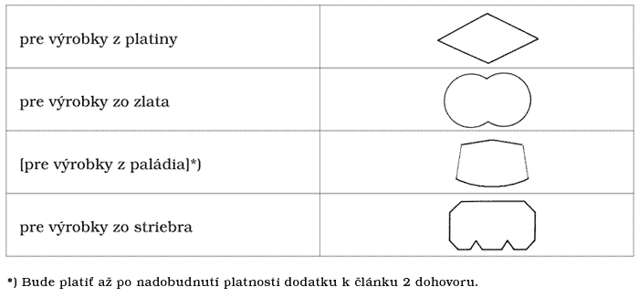

PRÍLOHA II Kontrola autorizovaným puncovým úradom/puncovými úradmi

1. Vo všeobecnosti

Autorizovaný puncový úrad/úrady (ďalej len ako „puncový úrad“) preskúma, či výrobky z drahých kovov, ktoré má úrad označiť spoločnou kontrolnou značkou, spĺňajú podmienky uvedené v Prílohe I dohovoru.

1.1 Ak puncový úrad rozhodne, že výrobok je z hľadiska všetkých kovových súčastí kompletný a spĺňa požiadavky uvedené v ustanoveniach Prílohy I k tomuto dohovoru, puncový úrad na požiadanie označí výrobok svojou puncovou značkou a spoločnou kontrolnou značkou. V prípade použitia spoločnej kontrolnej značky puncový úrad pred odovzdaním výrobku zabezpečí, aby bol výrobok riadne označený v súlade s nižšie uvedenými ustanoveniami.

2. Metódy analýzy

Pri skúmaní výrobkov z drahých kovov použije puncový úrad ktorúkoľvek zo schválených metód analýzy uvedených v dodatku I. Stály výbor môže tento zoznam doplniť na základe ďalšieho vývoja. Na vyhodnotenie homogénnosti šarže môžu byť použité aj iné skúšobné metódy.

3. Odoberanie vzoriek

Počet výrobkov vybraných zo šarže a počet vzoriek odobraných z týchto výrobkov na skúšanie a analýzu musí byť dostatočný na určenie homogénnosti šarže na zabezpečenie požadovaného rýdzostného čísla všetkých častí kontrolovaných výrobkov v šarži. Stály výbor určuje usmernenia v oblasti odoberania vzoriek.

4. Označovanie

Výrobky spĺňajúce kritériá podľa Prílohy I budú označené aspoň nasledujúcimi značkami:

a) registrovaná zodpovednostná značka popísaná v odseku 4.2,

b) značka puncového úradu,

c) spoločná kontrolná značka popísaná v odseku 4.3, a

d) zodpovedajúce označenie rýdzosti v arabských čísliciach.

Značky b) a c) vyrazí na výrobok puncový úrad.

Značky a) a d) možno na výrobok vyraziť, odliať alebo gravírovať.

Vždy, ak to bude možné, budú všetky značky umiestnené pri sebe v bezprostrednej blízkosti.

Iné značky, ktoré sa nesmú s už spomenutými zamieňať, sú povolené ako dodatočné značky.

4.1 Stály výbor môže rozhodnúť o iných metódach označovania výrobkov.

4.2 Zodpovednostná značka uvedená v odseku 4 a) sa zapíše do úradného registra zmluvného štátu, na území ktorého je daný výrobok kontrolovaný, a/alebo v jednom z jeho puncových úradov.

4.3 Spoločná kontrolná značka bude obsahovať zobrazenie váh a arabské číslice vyjadrujúce rýdzostné číslo výrobku v tisícinách ako reliéf na šrafovanom pozadí vo vnútri štítu, ktorý určuje, o aký drahý kov ide, a to takto:

4.3.1 Možno použiť všetky rozličné rýdzostné čísla, ktoré uvádza Stály výbor.

4.3.2 Schválené veľkosti spoločnej kontrolnej značky sú uvedené v dodatku 2. Tento zoznam môže Stály výbor doplniť.

4.4 Výrobky pozostávajúce z viac ako jednej zliatiny toho istého drahého kovu

Ak výrobok pozostáva z rôznych zliatin toho istého drahého kovu, použije sa značka rýdzosti a spoločná kontrolná značka zodpovedajúca zliatine najnižšej rýdzosti, ktorá sa vo výrobku nachádza. Stály výbor môže rozhodnúť o výnimkách.

4.5 Výrobky pozostávajúce zo súčiastok

Ak výrobok pozostáva zo súčastí, ktoré sú spojené závesmi alebo sú ľahko oddeliteľné, budú uvedené značky umiestnené na hlavnej časti. Všade, kde to bude možné, bude spoločná kontrolná značka umiestnená aj na menších častiach.

4.6 Výrobky obsahujúce zliatiny rôznych drahých kovov

4.6.1 Ak výrobok obsahuje zliatiny rôznych drahých kovov a ak sú farba a rozsah každej zliatiny jasne viditeľné, budú na jednej zliatine drahého kovu umiestnené značky uvedené v odseku 4 a), b), c) a d) a na ďalšej (ďalších zliatinách) bude príslušná spoločná kontrolná značka.

4.6.2 Ak výrobok obsahuje zliatiny rôznych drahých kovov a ak farba a rozsah každej zliatiny nie sú jasne viditeľné, budú značky uvedené v odseku 4 a), b), c) a d) umiestnené na najmenej vzácnom drahom kove. Pre vzácnejšie drahé kovy nemožno použiť spoločnú kontrolnú značku.

4.6.3 O výnimkách súvisiacich s uvedenými pravidlami rozhodne na základe uvedenia technických dôvodov Stály výbor.
