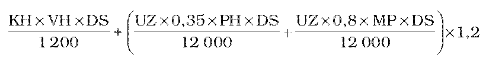
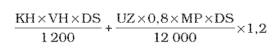

Príloha č. 9 k vyhláške č. 199/2008 Z. z.

- VÝPOČET KAPACITY SKLADOVACEJ NÁDRŽE NA HNOJOVKU

  - Vzorec pre nezastrešené hnojisko:

  - 

  - Vzorec pre zastrešené hnojisko s nezastrešenou manipulačnou plochou:

  - 

  - kde:

  - KH – kapacita hnojiska v m3,

  - VH – výtok hnojovky z hnoja pri výške uskladneného hnoja v m

  - 2 m – 6 % pri dostatočnom podstielaní

  - 9 % pri nedostatočnom podstielaní

  - 3 m – 9 % pri dostatočnom podstielaní

  - 12 % pri nedostatočnom podstielaní

  - 4 m – 12 % pri dostatočnom podstielaní

  - 15 % pri nedostatočnom podstielaní

  - 5 m – 15 % pri dostatočnom podstielaní

  - 18 % pri nedostatočnom podstielaní

  - 6 m – 18 % pri dostatočnom podstielaní

  - 21 % pri nedostatočnom podstielaní,

  - DS – doba skladovania hnojovky v mesiacoch,

  - UZ – ročný úhrn zrážok v mm

  - PH – plocha hnojiska m2

  - MP – manipulačná plocha pri hnojisku v m2

  - 1,2 – 20 % rezerva na návalové vody.
