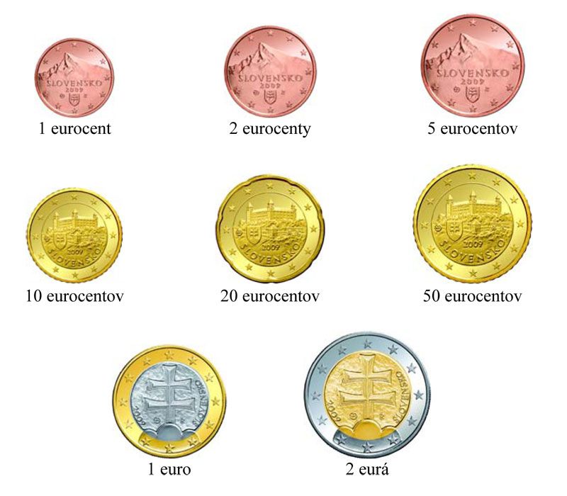

## 308

OZNÁMENIE

Národnej banky Slovenska

zo 7. júla 2008

o nominálnych hodnotách, vzhľade, technických parametroch, základných ochranných prvkoch a ďalších náležitostiach eurobankoviek a euromincí vydaných a určených do peňažného obehu v eurozóne a v zúčastnených tretích štátoch

1. Úvodné ustanovenia

- a) Národná banka Slovenska vydáva podľa § 17h ods. 1 zákona Národnej rady Slovenskej republiky č. 566/1992 Zb. o Národnej banke Slovenska v znení neskorších predpisov a podľa § 1 ods. 2 písm. d) zákona Národnej rady Slovenskej republiky č. 1/1993 Z. z. o Zbierke zákonov Slovenskej republiky v znení zákona č. 275/2002 Z. z. oznámenie o nominálnych hodnotách, vzhľade, technických parametroch, základných ochranných prvkoch a ďalších náležitostiach eurobankoviek a euromincí vydaných a určených do peňažného obehu v eurozóne a v zúčastnených tretích štátoch (San Maríno, Vatikán, Monacké kniežatstvo).

- b) Dňa 8. júla 2008 Rada Európskej únie rozhodla, že Slovenská republika spĺňa podmienky na prijatie eura a prijíma euro 1. januára 2009.1)

- c) Od 1. januára 2009 sa stávajú eurobankovky a euromince vrátane zberateľských euromincí vydaných Národnou bankou Slovenska zákonnými platidlami vo svojej nominálnej hodnote pri všetkých hotovostných peňažných platbách v Slovenskej republike.2)

2. Eurobankovky

- a) Eurobankovky majú rovnaký dizajn pre všetky členské štáty eurozóny a zúčastnené tretie štáty. Eurobankovky v nominálnych hodnotách 5, 10, 20, 50, 100, 200 a 500 eur zobrazujú architektonické motívy inšpirované „historickými obdobiami a štýlmi Európy“. Vyobrazené motívy predstavujú charakteristické prvky rôznych architektonických štýlov vo forme okien a brán na lícnej strane a mostov na rubovej strane. Ďalšími charakteristickými prvkami na eurobankovkách sú: symbol Európskej únie, názov meny v rímskej a gréckej abecede, iniciálky Európskej centrálnej banky v zneniach úradných jazykov, symbol ©, ktorý upozorňuje, že autorské práva patria Európskej centrálnej banke, a podpis prezidenta Európskej centrálnej banky.

- b) Národná banka Slovenska uverejňuje na svojej internetovej stránke podrobné informácie o nominálnych hodnotách, vzhľade, technických parametroch, základných ochranných prvkoch a ďalších náležitostiach všetkých eurobankoviek. Informácie o eurobankovkách sú verejnosti dostupné aj na internetovej stránke Európskej centrálnej banky www.ecb.int.

3. Euromince

- a) Obehové euromince majú na líci spoločnú európsku stranu a na rube majú charakteristickú národnú stranu, pričom časť euromincí má pôvodnú spoločnú európsku stranu a časť euromincí má novú spoločnú európsku stranu. Vzhľad spoločnej európskej strany euromincí a národných strán euromincí vydaných jednotlivými členskými štátmi eurozóny a zúčastnenými tretími štátmi zverejňuje Európska komisia v Úradnom vestníku Európskej únie.3) Okrem vzhľadu obehových euromincí Európska komisia zverejňuje v Úradnom vestníku Európskej únie aj vzhľad pamätných obehových euromincí.

- b) Slovenská republika bude 10, 20 a 50-eurocentové mince a 1 a 2-eurové mince vydávať s novou spoločnou európskou stranou euromincí.4) Mince s najnižšími hodnotami (1, 2 a 5-eurocentové mince) sa budú vydávať s pôvodnou spoločnou európskou stranou.

- c) Podrobnosti o nominálnych hodnotách a technických špecifikáciách euromincí určených do obehu ustanovuje osobitný predpis.5)

- d) Národná banka Slovenska uverejňuje na svojej internetovej stránke www.nbs.sk podrobné informácie o nominálnych hodnotách, vzhľade, technických parametroch a ďalších náležitostiach všetkých euromincí. Informácie o eurominciach sú verejnosti dostupné aj na internetovej stránke Európskej centrálnej banky www.ecb.int.

4. Popis národných strán slovenských euromincí

1, 2 a 5 eurocentov

Na minci je vyobrazený tatranský štít Kriváň, ktorý je považovaný za symbol ochrany slobody a svojbytnosti slovenského národa. V strede mincového poľa je nápis „SLOVENSKO“ a pod ním letopočet. Pod letopočtom je štátny znak Slovenskej republiky. Po jeho ľavej strane je značka mincovne a po jeho pravej strane iniciálka priezviska autora výtvarného návrhu Drahomíra Zobeka „Z“. Pri okraji mince je do kruhu umiestnených dvanásť hviezd Európskej únie.

10, 20 a 50 eurocentov

V strede mincového poľa je v naznačenom vnútornom kruhu vyobrazený Bratislavský hrad, ktorý je charakteristickou dominantou hlavného mesta Slovenskej republiky Bratislavy. V ľavej časti mincového poľa je do motívu Bratislavského hradu zakomponovaný štátny znak Slovenskej republiky. Pod Bratislavským hradom v strede je letopočet a pod ním v opise vnútorného kruhu je zľava doprava nápis „SLOVENSKO“. Pri ľavom okraji vnútorného kruhu je značka mincovne a pri jeho pravom okraji sú štylizované iniciálky mien a priezvisk autorov výtvarného návrhu Jána Černaja „JČ“ a Pavla Károlyho „PK“. Pri okraji mincového poľa je do kruhu umiestnených dvanásť hviezd Európskej únie.

1 a 2 euro

- a) V strede mincového poľa je vo vnútornom kruhu vyobrazený dvojkríž na trojvrší symbolizujúci štátny znak Slovenskej republiky. Na pozadí dvojkríža je kompozícia štylizovaných skál. Vpravo od dvojkríža je v opise vnútorného kruhu zdola nahor nápis „SLOVENSKO“ a vľavo od dvojkríža je letopočet. Nad trojvrším vľavo je umiestnená značka mincovne a vpravo sú štylizované iniciálky mena a priezviska autora výtvarného návrhu Ivana Řeháka „IŘ“. Pri okraji mincového poľa je 12 do kruhu umiestnených hviezd Európskej únie, z ktorých tri sú zakomponované do spodnej časti trojvršia.

- b) Na hrane dvojeurovej mince je nápis „SLOVENSKÁ REPUBLIKA“. Začiatok a koniec nápisu je oddelený dvoma hviezdami, medzi ktorými je lipový list.

Štát vydania: Slovenská republika

Začiatok vydávania: január 2009

v z. Viliam Ostrožlík v. r.
