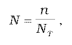

Príloha č. 1 k vyhláške č. 315/2008 Z. z.

SLEDOVANIE ŠTANDARDU KVALITY PRI PRENOSE ELEKTRINY

1. Evidencia dodržania lehoty na odoslanie stanoviska k podaniu týkajúceho sa kvality elektriny podľa § 2 písm. a) a b)

Regulovaný subjekt:

Obdobie od do

Tabuľka č. 1

r. 1 | Počet zaznamenaných podaní (udalostí) v sledovanom období | | | | |

r. 2 | Počet neuzavretých podaní (udalostí) v sledovanom období | | | | |

r. 3 | Počet podaní (udalostí) z minulých období | | | | |

r. 4 | Počet podaní (udalostí) zaradených do hodnotenia za sledované obdobie (r. 4 = r. 1 – r. 2 + r. 3) | | | | |

Podania z r. 4 | Oprávnené podanie | | | | |

| Neoprávnené podanie | | | | |

Číslo udalosti | Identifikačné údaje fyzickej osoby alebo právnickej osoby dotknutého odberného miesta a číslo odberného miesta | Dátum prijatia podania | Dátum odoslania stanoviska | Parameter elektriny mimo tolerancie uvedený v podaní | Podanie O / N | Vyhodnotenie 1 / 0

Podania (udalosti) zo sledovaného obdobia | | | | | |

Podania (udalosti) z minulých období | | | | | |

Vysvetlivky k tabuľke č. 1:

Ak je v podaní uvedených viacero parametrov elektriny mimo tolerancie, do riadkov v stĺpci „Parameter elektriny mimo tolerancie uvedený v podaní“ sa uvedie ten parameter, ktorý je najviac mimo povolenej tolerancie.

V stĺpci „Podanie O / N“ sa uvedie:

O – ak je podanie oprávnené,

N – ak nie je podanie oprávnené.

V stĺpci „Vyhodnotenie 1 / 0“ sa uvedie:

1 – v prípade dodržania ustanovenej lehoty,

0 – v ostatných prípadoch.

Ak došlo ku zníženiu kvality elektriny udalosťou, ktorá nastala mimo prenosovej sústavy prevádzkovateľa prenosovej sústavy, ku ktorej je dotknuté odberné miesto pripojené, štandard kvality nebol prevádzkovateľom prenosovej sústavy porušený a podanie sa vyhodnotí ako neoprávnené.

2. Evidencia uzatvorenia zmluvy a uskutočnenia prenosu elektriny do siedmich pracovných dní podľa § 2 písm. c),

Regulovaný subjekt:

Obdobie od do

Tabuľka č. 2

r. 1 | Počet zaznamenaných udalostí v sledovanom období | | |

r. 2 | Počet neuzavretých udalostí v sledovanom období | | |

r. 3 | Počet udalostí z minulých období | | |

r. 4 | Počet udalostí zaradených do hodnotenia za sledované obdobie (r. 4 = r. 1 – r. 2 + r. 3) | | |

Udalosti z riadku 4 | Vybavené v lehote | | |

| Vybavené mimo lehoty | | |

| Nevybavené | | |

Číslo udalosti | Identifikačné údaje fyzickej osoby alebo právnickej osoby, ktorá požiadala o prístup do prenosovej sústavy a o prenos elektriny | Dátum prijatia oznámenia o splnení podmienok | Dátum uskutočnenia prenosu elektriny | Vyhodnotenie 1 / 0 / X

Udalosti zo sledovaného obdobia | | | |

Udalosti z minulých období | | | |

Vysvetlivky k tabuľke č. 2:

V stĺpci „Vyhodnotenie 1 / 0 / X“ sa uvedie:

1 – v prípade dodržania ustanovenej lehoty,

0 – v prípade nedodržania ustanovenej lehoty,

X – v prípade nedodržania ustanovenej lehoty alebo neuskutočnenia prenosu elektriny z dôvodu, že dotknutý účastník trhu neposkytne súčinnosť.

3. Evidencia obnovenia prenosu elektriny do odberného miesta do dvoch pracovných dní podľa § 2 písm. d)

Regulovaný subjekt:

Obdobie od do

Tabuľka č. 3

r. 1 | Počet zaznamenaných udalostí v sledovanom období | | |

r. 2 | Počet neuzavretých udalostí v sledovanom období | | |

r. 3 | Počet udalostí z minulých období | | |

r. 4 | Počet udalostí zaradených do hodnotenia za sledované obdobie (r. 4 = r. 1 – r. 2 + r. 3) | | |

Udalosti z riadku 4 | Vybavené v lehote | | |

| Vybavené mimo lehoty | | |

| Nevybavené | | |

Číslo udalosti | Identifikačné údaje dotknutého koncového odberateľa alebo dodávateľa elektriny, alebo obchodníka s elektrinou | Dátum splnenia podmienok na obnovenie prenosu elektriny | Dátum obnovenia prenosu elektriny | Vyhodnotenie 1 / 0 / X

Udalosti zo sledovaného obdobia | | | |

Udalosti z minulých období | | | |

Vysvetlivky k tabuľke č. 3:

V stĺpci „Vyhodnotenie 1 / 0 / X“ sa uvedie:

1 – v prípade dodržania ustanovenej lehoty,

0 – v prípade nedodržania ustanovenej lehoty,

X – v prípade nedodržania ustanovenej lehoty alebo neobnovenia prenosu elektriny z dôvodu, že dotknutý účastník trhu s elektrinou neposkytne súčinnosť.

4. Evidencia obnovenia prenosu elektriny do odberného miesta do dvoch pracovných dní podľa § 2 písm. e)

Regulovaný subjekt:

Obdobie od do

Tabuľka č. 4

r. 1 | Počet zaznamenaných udalostí v sledovanom období | | |

r. 2 | Počet neuzavretých udalostí v sledovanom období | | |

r. 3 | Počet udalostí z minulých období | | |

r. 4 | Počet udalostí zaradených do hodnotenia za sledované obdobie (r. 4 = r. 1 – r. 2 + r. 3) | | |

Udalosti z riadku 4 | Vybavené v lehote | | |

| Vybavené mimo lehoty | | |

| Nevybavené | | |

Číslo udalosti | Identifikačné údaje dotknutého koncového odberateľa | Dátum doručenia žiadosti o obnovenie prenosu elektriny | Dátum obnovenia prenosu elektriny | Vyhodnotenie 1 / 0 / X

Udalosti zo sledovaného obdobia | | | |

Udalosti z minulých období | | | |

Vysvetlivky k tabuľke č. 4:

V stĺpci „Vyhodnotenie 1 / 0 / X“ sa uvedie:

1 – v prípade dodržania ustanovenej lehoty,

0 – v prípade nedodržania ustanovenej lehoty,

X – v prípade nedodržania ustanovenej lehoty alebo neobnovenia prenosu elektriny z dôvodu, že dotknutý účastník trhu s elektrinou neposkytne súčinnosť.

5. Evidencia obnovenia prenosu elektriny po poruche v prenosovej sústave do 12 hodín podľa § 2 písm. f)

Regulovaný subjekt:

Obdobie od do

Tabuľka č. 5

r. 1 | Počet zaznamenaných udalostí v sledovanom období | | |

r. 2 | Počet neuzavretých udalostí v sledovanom období | | |

r. 3 | Počet udalostí z minulých období | | |

r. 4 | Počet udalostí zaradených do hodnotenia za sledované obdobie (r. 4 = r. 1 – r. 2 + r. 3) | | |

Udalosti z riadku 4 | Vybavené v lehote | | |

| Vybavené mimo lehoty | | |

| Nevybavené | | |

Číslo udalosti | Identifikačné údaje dotknutého koncového odberateľa alebo dodávateľa elektriny, alebo obchodníka s elektrinou a číslo dotknutého odberného miesta | Dátum a čas, keď sa prevádzkovateľ sústavy o poruche dozvedel | Dátum a čas obnovenia prenosu elektriny | Vyhodnotenie 1 / 0

Udalosti zo sledovaného obdobia | | | |

Udalosti z minulých období | | | |

Vysvetlivky k tabuľke č. 5:

V stĺpci „Vyhodnotenie 1 / 0“ sa uvedie:

1 – v prípade dodržania stanovenej lehoty,

0 – v ostatných prípadoch.

6. Evidencia obnovenia prenosu elektriny do 24 hodín po odstránení poruchy na zariadení na výrobu elektriny podľa § 2 písm. g)

Regulovaný subjekt:

Obdobie od do

Tabuľka č. 6

r. 1 | Počet zaznamenaných udalostí v sledovanom období | | |

r. 2 | Počet neuzavretých udalostí v sledovanom období | | |

r. 3 | Počet udalostí z minulých období | | |

r. 4 | Počet udalostí zaradených do hodnotenia za sledované obdobie (r. 4 = r. 1 – r. 2 + r. 3) | | |

Udalosti z riadku 4 | Vybavené v lehote | | |

| Vybavené mimo lehoty | | |

| Nevybavené | | |

Číslo udalosti | Identifikačné údaje o zariadení na výrobu elektriny, z odberného miesta ktorého bol prerušený prenos elektriny | Dátum a čas odstránenia poruchy na zariadení na výrobu elektriny | Dátum a čas obnovenia prenosu elektriny | Vyhodnotenie 1 / 0 / X

Udalosti zo sledovaného obdobia | | | |

Udalosti z minulých období | | | |

Vysvetlivky k tabuľke č. 6:

V stĺpci „Vyhodnotenie 1 / 0 / X“ sa uvedie:

1 – v prípade dodržania ustanovenej lehoty,

0 – v prípade nedodržania ustanovenej lehoty,

X – v prípade nedodržania ustanovenej lehoty alebo neobnovenia prenosu elektriny z dôvodu, že dotknutý účastník trhu neposkytne súčinnosť.

7. Evidencia zabezpečenia preskúšania určeného meradla podľa § 2 písm. h)

Regulovaný subjekt:

Obdobie od do

Tabuľka č. 7

r. 1 | Počet zaznamenaných udalostí v sledovanom období | | |

r. 2 | Počet neuzavretých udalostí v sledovanom období | | |

r. 3 | Počet udalostí z minulých období | | |

r. 4 | Počet udalostí zaradených do hodnotenia za sledované obdobie (r. 4 = r. 1 – r. 2 + r. 3) | | |

Udalosti z riadku 4 | Vybavené v lehote | | |

| Vybavené mimo lehoty | | |

| Nevybavené | | |

Číslo udalosti | Identifikačné údaje fyzickej osoby alebo právnickej osoby, na ktorej odberné miesto sa vzťahuje žiadosť o preskúšanie meradla a číslo meradla | Dátum prijatia podania | Dátum odoslania meradla na preskúšanie | Vyhodnotenie 1 / 0 / X

Udalosti zo sledovaného obdobia | | | |

Udalosti z minulých období | | | |

Vysvetlivky k tabuľke č. 7:

V stĺpci „Vyhodnotenie 1 / 0 / X“ sa uvedie:

1 – v prípade dodržania ustanovenej lehoty,

0 – v prípade nedodržania ustanovenej lehoty,

X – v prípade nedodržania ustanovenej lehoty alebo nevybavenia podnetu z dôvodu, že dotknutý účastník trhu s elektrinou neposkytne súčinnosť.

8. Evidencia overenia správnosti vyúčtovania platby za prenos elektriny a odstránenie zistených nedostatkov vyúčtovania a odoslanie oznámenia, či je podanie oprávnené alebo nie v lehote podľa § 2 písm. i)

Regulovaný subjekt:

Obdobie od do

Tabuľka č. 8

r. 1 | Počet zaznamenaných udalostí v sledovanom období | | | |

r. 2 | Počet neuzavretých udalostí v sledovanom období | | | |

r. 3 | Počet udalostí z minulých období | | | |

r. 4 | Počet udalostí zaradených do hodnotenia za sledované obdobie (r. 4 = r. 1 – r. 2 + r. 3) | | | |

Udalosti z riadku 4 | Vybavené v lehote | | | |

| Vybavené mimo lehoty | | | |

| Nevybavené | | | |

Číslo udalosti | Identifikačné údaje fyzickej osoby alebo právnickej osoby na ktorej odberné miesto sa vzťahuje žiadosť o overenie správnosti vyúčtovania | Dátum prijatia žiadosti o overenie vyúčtovania | Podanie O / N | Dátum odstránenia zistených nedostatkov a odoslania oznámenia | Vyhodnotenie 1 / 0 / X

Udalosti zo sledovaného obdobia | | | | |

Udalosti z minulých období | | | | |

Vysvetlivky k tabuľke č. 8:

V stĺpci „Podanie O / N“ sa uvedie:

O – ak je podanie oprávnené,

N – ak podanie nie je neoprávnené.

V stĺpci „Vyhodnotenie 1 / 0 / X“ sa uvedie:

1 – v prípade dodržania ustanovenej lehoty na odstránenie zistených nedostatkov vyúčtovania a odoslanie oznámenia, či je podanie oprávnené alebo nie,

0 – v prípade nedodržania ustanovenej lehoty,

X – v prípade nedodržania ustanovenej lehoty alebo nevybavenia podnetu z dôvodu, že dotknutý účastník trhu s elektrinou neposkytne súčinnosť.

9. Evidencia dodržania plynulosti prenosu elektriny podľa § 2 písm. j)

Regulovaný subjekt:

Obdobie od do

Tabuľka č. 9.3

Priemerný počet prerušení vzťahujúci sa na jeden transformátor okrem väzbových transformátorov 400/220 kV a záložných transformátorov 400/110 kV a 220/110 kV N (N400 alebo N220); hodnoty zaokrúhlené na dve desatinné miesta

Napäťová úroveň [kV] | N400, N220 | Medziročný index N v roku t-1 / N v roku t-2

400 | |

220 | |

Vysvetlivky k tabuľke č. 9.3:

Hodnota N400 alebo N220 sa vypočíta podľa vzorca

kde

n – celkový počet prerušení prenosu elektriny za kalendárny rok na napäťovej úrovni 400 kV alebo 220 kV,

NT – celkový počet transformátorov v prenosovej sústave na napäťovej úrovni 400 kV alebo 220 kV okrem väzbových transformátorov

400/220 kV a záložných transformátorov 400/110 kV alebo 220/110 kV.
