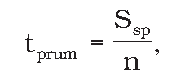
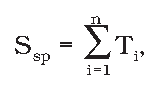
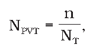

Príloha č. 2 k vyhláške č. 315/2008 Z. z.

SLEDOVANIE ŠTANDARDU KVALITY DODÁVANEJ ELEKTRINY A POSKYTOVANÝCH SLUŽIEB SÚVISIACICH S PRENOSOM ELEKTRINY

(1) Dodržiavanie plynulosti prenosu elektriny podľa § 2 písm. i) na rok 2...

Tabuľka č. 1

Sledovanie prerušenia prenosu elektriny z prenosovej sústavy za obdobie od .......... do .........

Poradové číslo | Napäťová úroveň [kV] | Začiatok prerušenia prenosu | | | Koniec prerušenia prenosu | | | Lokalita

| | Dátum | Hodina | Minúta | Dátum | Hodina | Minúta |

(2) Záznam o dosiahnutej úrovni plynulosti prenosu elektriny podľa § 2 písm. i) na rok 2...

Tabuľka č. 2

Priemerná doba trvania prerušenia

Napäťová úroveň [kV] | Priemerná doba prerušenia [min]

220 |

400 |

Tabuľka č. 3

Priemerný počet prerušení vzťahujúci sa na jeden transformátor okrem väzbových transformátorov 400/220 kV a záložných transformátorov 400/110 kV a 220/110 kV.

Napäťová úroveň [kV] | Priemerný počet prerušení

220 |

400 |

(3) Prerušenie prenosu elektriny z prenosovej sústavy sa sleduje a vyhodnocuje tak, že

a) ak po strate napätia na strane 110 kV transformátora 400/110 kV alebo 220/110 kV v jednej transformátorovni prenosovej sústavy je napájanie odberateľa elektriny obnovené dispečerom dispečingu prevádzkovateľa prenosovej sústavy manipuláciami v prenosovej sústave, dĺžka prerušenia prenosu elektriny z prenosovej sústavy sa hodnotí dobou od straty napájania po jeho obnovenie,

b) ak po strate napätia na strane 110 kV transformátora 400/110 kV alebo 220/110 kV v transformátorovni prenosovej sústavy nie je možné v tejto transformátorovni toto napájanie obnoviť a obnova napájania odberateľa elektriny je zabezpečovaná manipuláciami v distribučnej sústave prepínaním na susedné napájacie uzly z prenosovej sústavy, dĺžka prerušenia prenosu elektriny z prenosovej sústavy sa hodnotí dobou manipulácií v distribučnej sústave s pripočítaním doby do rozhodnutia o týchto manipuláciách; v dobách manipulácií v distribučnej sústave pre každý napájací uzol z prenosovej sústavy sú zohľadnené záujmy príslušných prevádzkovateľov sústav, technické podmienky dotknutej transformátorovne, susedných transformátorovní a náročnosť manipulácií v 110 kV sústave pri prevádzaní na susedné napájacie uzly.

(4) Prerušenie prenosu elektriny z prenosovej sústavy podľa miesta príčiny vzniku udalosti sa sleduje a vyhodnocuje tak, že

a) prerušenie prenosu elektriny z prenosovej sústavy, ktorá mala príčinu vzniku v prenosovej sústave, sa sleduje prevádzkovateľom prenosovej sústavy,

b) prerušenie prenosu elektriny z prenosovej sústavy, ktorá mala príčinu vzniku v distribučnej sústave, sa môže sledovať a vyhodnocovať osobitne.

(5) Ukazovateľ dodržiavania prenosu elektriny sa vypočíta ako

a) priemerná doba prerušení prenosu elektriny za kalendárny rok:

kde

tprum - priemerná doba prerušení v minútach,

kde

Ssp - súhrnná doba prerušenia prenosu elektriny vo všetkých rozvodniach prevádzkovateľa prenosovej sústavy za kalendárny rok,

n - celkový počet prerušení za obdobie,

Ti = t1 - t0,

kde

Ti - doba trvania i-teho prerušenia prenosu elektriny v hodinách alebo v minútach,

t0 - dátum a čas začiatku i-teho prerušenia prenosu elektriny v hodinách alebo v minútach,

t1- dátum a čas konca i-teho prerušenia prenosu elektriny v hodinách alebo v minútach,

Tj = dnm + drm,

kde

Tj- doba trvania j-teho prerušenia prenosu elektriny v hodinách alebo minútach,

dnm - doba manipulácie v hodinách alebo minútach,

drm - doba rozhodnutia o manipulácii v hodinách alebo minútach,

b) počet prerušení prenosu elektriny za obdobie vzťahujúce sa na jeden transformátor prenosovej spstavy okrem väzbových transformátorov 400/220 kV a záložných transformátorov 400/110 kV a 220/110 kV

kde

NPVT - počet prerušení prenosu elektriny vzťahujúcich sa na jeden transformátor,

n - celkový počet prerušení prenosu elektriny za kalendárny rok,

NT - celkový počet transformátorov v prenosovej sústave okrem väzbových transformátorov 400/200 kV a záložných transformátorov 400/110 kV a 220/110 kV.
