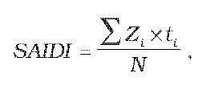
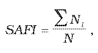
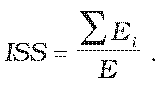

Príloha č. 4 k vyhláške č. 315/2008 Z. z.

SLEDOVANIE ŠTANDARDU KVALITY PRI DISTRIBÚCII ELEKTRINY

1. Evidencia dodržania lehoty na odoslanie stanoviska k podaniu týkajúcemu sa kvality elektriny podľa § 3 ods. 1 písm. a) a b)

Regulovaný subjekt:

Obdobie od do

Tabuľka č. 1

r. 1 | Počet zaznamenaných podaní (udalostí) v sledovanom období | | | | |

r. 2 | Počet neuzavretých podaní (udalostí) v sledovanom období | | | | |

r. 3 | Počet podaní (udalostí) z minulých období | | | | |

r. 4 | Počet podaní (udalostí) zaradených do hodnotenia za sledované obdobie (r. 4 = r. 1 – r. 2 + r. 3) | | | | |

Podania z riadka 4 | Oprávnené podanie | | | | |

| Neoprávnené podanie | | | | |

Číslo udalosti | Identifikačné údaje fyzickej osoby alebo právnickej osoby dotknutého odberného miesta a číslo odberného miesta | Dátum prijatia podania | Dátum odoslania stanoviska | Parameter elektriny mimo tolerancie uvedený v podaní | Podanie O / N | Vyhodnotenie 1 / 0

Podania (udalosti) zo sledovaného obdobia | | | | | |

Podania (udalosti) z minulých období | | | | | |

Vysvetlivky k tabuľke č. 1:

Ak je v podaní uvedených viacero parametrov elektriny mimo tolerancie, do riadkov v stĺpci „Parameter elektriny mimo tolerancie uvedený v podaní“ sa uvedie ten parameter, ktorý je najviac mimo povolenej tolerancie.

V stĺpci „Podanie O / N“ sa uvedie:

O – ak je podanie oprávnené,

N – ak podanie nie je oprávnené.

V stĺpci „Vyhodnotenie 1 / 0“ sa uvedie:

1 – v prípade dodržania ustanovenej lehoty,

0 – v prípade nedodržania ustanovenej lehoty.

Ak došlo ku zníženiu kvality elektriny udalosťou, ktorá nastala mimo distribučnej sústavy prevádzkovateľa distribučnej sústavy, do ktorej je dotknuté odberné miesto pripojené, štandard kvality nebol prevádzkovateľom tejto distribučnej sústavy porušený a podanie sa vyhodnotí ako neoprávnené.

2. Evidencia dodržania lehoty na odstránenie príčin zníženej kvality elektriny § 3 ods. 1 písm. c) a ods. 2 písm. a), b), c)

Regulovaný subjekt:

Obdobie od do

Tabuľka č. 2

r. 1 | Počet zaznamenaných udalostí v sledovanom období | | | | | |

r. 2 | Počet neuzavretých udalostí v sledovanom období | | | | | |

r. 3 | Počet udalostí z minulých období | | | | | |

r. 4 | Počet udalostí zaradených do hodnotenia za sledované obdobie (r. 4 = r. 1 – r. 2 + r. 3) | | | | | |

Udalosti z riadku 4 | Vybavené v lehote | | | | | |

| Vybavené mimo lehoty | | | | | |

| Nevybavené | | | | | |

Číslo udalosti | Dátum prijatia podania | Identifikačné údaje fyzickej osoby alebo právnickej osoby a číslo dotknutého odberného miesta | Parameter kvality elektriny mimo tolerancie | Lehota na odstránenie príčin zníženej kvality elektriny | Právoplatnosť stavebného povolenia | Dátum odstránenia zníženej kvality elektriny | Vyhodnotenie 1 / 0 / X

Udalosti zo sledovaného obdobia | | | | | | |

Udalosti z minulých období | | | | | | |

Vysvetlivky k tabuľke č. 2:

Do riadkov v stĺpci „Parameter kvality elektriny mimo tolerancie“ sa v prípade viacerých parametrov mimo tolerancie uvedie ten, ktorý najviac prekračuje povolenú toleranciu.

V stĺpci „Vyhodnotenie 1 / 0 / X“ sa uvedie:

1 – v prípade dodržania ustanovenej lehoty,

0 – v prípade nedodržania ustanovenej lehoty,

X – v prípade nedodržania ustanovenej lehoty alebo neodstránenia príčin zníženej kvality elektriny z dôvodu, že dotknutý účastník trhu s elektrinou neposkytne nevyhnutnú súčinnosť.

3. Evidencia uskutočnenia distribúcie elektriny v lehote podľa § 3 ods. 1 písm. d)

Regulovaný subjekt:

Obdobie od do

Tabuľka č. 3

r. 1 | Počet zaznamenaných udalostí v sledovanom období | | |

r. 2 | Počet neuzavretých udalostí v sledovanom období | | |

r. 3 | Počet udalostí z minulých období | | |

r. 4 | Počet udalostí zaradených do hodnotenia za sledované obdobie (r. 4 = r. 1 – r. 2 + r. 3) | | |

Udalosti z riadku 4 | Vybavené v lehote | | |

| Vybavené po lehote | | |

| Nevybavené | | |

Číslo udalosti | Identifikačné údaje fyzickej osoby alebo právnickej osoby, s ktorou je uzatvorená zmluva o dodávke a distribúcii elektriny | Dátum prijatia oznámenia o splnení podmienok | Dátum uskutočnenia distribúcie elektriny | Vyhodnotenie 1 / 0 / X

Udalosti zo sledovaného obdobia | | | |

Udalosti z minulých období | | | |

Vysvetlivky k tabuľke č. 3:

V stĺpci „Vyhodnotenie 1 / 0 / X“ sa uvedie:

1 – v prípade dodržania ustanovenej lehoty,

0 – v prípade nedodržania ustanovenej lehoty,

X – v prípade nedodržania ustanovenej lehoty alebo neuskutočnenia distribúcie elektriny z dôvodu, že dotknutý účastník trhu s elektrinou neposkytne súčinnosť.

4. Evidencia obnovenia distribúcie elektriny do odberného miesta do dvoch pracovných dní podľa § 3 ods. 1 písm. e)

Regulovaný subjekt:

Obdobie od do

Tabuľka č. 4

r. 1 | Počet zaznamenaných udalostí v sledovanom období | | | |

r. 2 | Počet neuzavretých udalostí v sledovanom období | | | |

r. 3 | Počet udalostí z minulých období | | | |

r. 4 | Počet udalostí zaradených do hodnotenia za sledované obdobie (r. 4 = r. 1 – r. 2 + r. 3) | | | |

Udalosti z riadku 4 | Vybavené v lehote | | | |

| Vybavené mimo lehoty | | | |

| Nevybavené | | | |

Číslo udalosti | Identifikačné údaje dotknutého koncového odberateľa alebo dodávateľa elektriny, alebo obchodníka s elektrinou | Dátum splnenia podmienok na obnovenie distribúcie elektriny podľa bodu č. 1 | Dátum splnenia podmienok na obnovenie distribúcie elektriny podľa bodu č. 2 | Dátum obnovenia distribúcie elektriny | Vyhodnotenie 1 / 0 / X

Udalosti zo sledovaného obdobia | | | | |

Udalosti z minulých období | | | | |

Vysvetlivky k tabuľke č. 4:

V stĺpci „Vyhodnotenie 1 / 0 / X“ sa uvedie:

1 – v prípade dodržania ustanovenej lehoty,

0 – v prípade nedodržania ustanovenej lehoty,

X – v prípade nedodržania ustanovenej lehoty alebo neobnovenia distribúcie elektriny z dôvodu, že dotknutý účastník trhu s elektrinou neposkytne súčinnosť.

5. Evidencia obnovenia distribúcie elektriny do odberného miesta do dvoch pracovných dní podľa § 3 ods. 1 písm. f)

Regulovaný subjekt:

Obdobie od do

Tabuľka č. 5

r. 1 | Počet zaznamenaných udalostí v sledovanom období | | |

r. 2 | Počet neuzavretých udalostí v sledovanom období | | |

r. 3 | Počet udalostí z minulých období | | |

r. 4 | Počet udalostí zaradených do hodnotenia za sledované obdobie (r. 4 = r. 1 – r. 2 + r. 3) | | |

Udalosti z riadku 4 | Vybavené v lehote | | |

| Vybavené mimo lehoty | | |

| Nevybavené | | |

Číslo udalosti | Identifikačné údaje dotknutého koncového odberateľa | Dátum doručenia žiadosti o obnovenie distribúcie elektriny | Dátum obnovenia distribúcie elektriny | Vyhodnotenie 1 / 0 / X

Udalosti zo sledovaného obdobia | | | |

Udalosti z minulých období | | | |

Vysvetlivky k tabuľke č. 5:

V stĺpci „Vyhodnotenie 1 / 0 / X“ sa uvedie:

1 – v prípade dodržania ustanovenej lehoty,

0 – v prípade nedodržania ustanovenej lehoty,

X – v prípade nedodržania ustanovenej lehoty alebo neobnovenia distribúcie elektriny z dôvodu, že dotknutý účastník trhu s elektrinou neposkytne súčinnosť.

6. Evidencia obnovenia distribúcie elektriny po poruche v distribučnej sústave podľa § 3 ods. 1 písm. g) prvého bodu

Regulovaný subjekt:

Obdobie od do

Tabuľka č. 6

r. 1 | Počet zaznamenaných udalostí v sledovanom období | | | | | | |

r. 2 | Počet neuzavretých udalostí v sledovanom období | | | | | | |

r. 3 | Počet udalostí z minulých období | | | | | | |

r. 4 | Počet udalostí zaradených do hodnotenia za sledované obdobie (r. 4 = r. 1 – r. 2 + r. 3) | | | | | | |

Udalosti z riadku 4 | Vybavené v lehote | | | | | | |

| Vybavené mimo lehoty | | | | | | |

| Nevybavené | | | | | | |

Číslo udalosti | Počet odberných miest dotknutých poruchou | Dátum a čas zistenia poruchy | | | Dátum a čas obnovenia distribúcie elektriny | | | Vyhodnotenie 1 / 0

| | Dátum | Hodina | Minúta | Dátum | Hodina | Minúta |

Udalosti zo sledovaného obdobia | | | | | | | |

Udalosti z minulých období | | | | | | | |

Vysvetlivky k tabuľke č. 6:

V stĺpci „Vyhodnotenie 1 / 0“ sa uvedie:

1 – v prípade dodržania ustanovenej lehoty,

0 – v ostatných prípadoch.

Údaje z tabuľky sa uvádzajú do prílohy č. 5 tabuľky č. 3, pričom sa počet odberných miest dotknutých poruchou považuje za počet udalostí.

V prípade predkladania údajov úradu sa do rozšírenej časti tabuľky uvedú udalosti s nedodržaným štandardom kvality.

7. Evidencia obnovenia distribúcie elektriny po poruche v distribučnej sústave podľa § 3 ods. 1 písm. g) druhého bodu

Regulovaný subjekt:

Prevádzkovateľ regionálnej sústavy:

Obdobie od do

Tabuľka č. 7

r. 1 | Počet zaznamenaných udalostí v sledovanom období | | | | | | |

r. 2 | Počet neuzavretých udalostí v sledovanom období | | | | | | |

r. 3 | Počet udalostí z minulých období | | | | | | |

r. 4 | Počet udalostí zaradených do hodnotenia za sledované obdobie (r. 4 = r. 1 – r. 2 + r. 3) | | | | | | |

Udalosti z riadku 4 | Vybavené v lehote | | | | | | |

| Vybavené mimo lehoty | | | | | | |

| Nevybavené | | | | | | |

Číslo udalosti | Počet odberných miest dotknutých poruchou | Dátum a čas zistenia poruchy | | | Dátum a čas obnovenia distribúcie elektriny | | | Vyhodnotenie 1 / 0

| | Dátum | Hodina | Minúta | Dátum | Hodina | Minúta |

Udalosti zo sledovaného obdobia | | | | | | | |

Udalosti z minulých období | | | | | | | |

Vysvetlivky k tabuľke č. 7:

V stĺpci „Vyhodnotenie 1 / 0“ sa uvedie:

1 – v prípade dodržania ustanovenej lehoty,

0 – v ostatných prípadoch.

Údaje z tabuľky sa uvádzajú do prílohy č. 5 tabuľky č. 3, pričom sa počet odberných miest dotknutých poruchou považuje za počet udalostí.

V prípade predkladania údajov úradu sa do rozšírenej časti tabuľky uvedú udalosti s nedodržaným štandardom kvality.

8. Evidencia obnovenia distribúcie elektriny do 24 hodín po odstránení poruchy na zariadení na výrobu elektriny podľa § 3 ods. 1 písm. h)

Regulovaný subjekt:

Obdobie od do

Tabuľka č. 8

r. 1 | Počet zaznamenaných udalostí v sledovanom období | | |

r. 2 | Počet neuzavretých udalostí v sledovanom období | | |

r. 3 | Počet udalostí z minulých období | | |

r. 4 | Počet udalostí zaradených do hodnotenia za sledované obdobie (r. 4 = r. 1 – r. 2 + r. 3) | | |

Udalosti z riadku 4 | Vybavené v lehote | | |

| Vybavené mimo lehoty | | |

| Nevybavené | | |

Číslo udalosti | Identifikačné údaje o zariadení na výrobu elektriny, z ktorého odberného miesta bola prerušená distribúcia elektriny | Dátum a čas odstránenia poruchy na zariadení na výrobu elektriny | Dátum a čas obnovenia distribúcie elektriny | Vyhodnotenie 1 / 0 / X

Udalosti zo sledovaného obdobia | | | |

Udalosti z minulých období | | | |

Vysvetlivky k tabuľke č. 8:

V stĺpci „Vyhodnotenie 1 / 0 / X“ sa uvedie:

1 – v prípade dodržania ustanovenej lehoty,

0 – v prípade nedodržania ustanovenej lehoty,

X – v prípade nedodržania ustanovenej lehoty alebo neobnovenia distribúcie elektriny z dôvodu, že dotknutý účastník trhu s elektrinou neposkytne súčinnosť.

9. Evidencia oznámenia termínu začatia a ukončenia plánovaného obmedzenia alebo prerušenia distribúcie elektriny dotknutým odberateľom elektriny podľa § 3 ods. 1 písm. i)

Regulovaný subjekt:

Obdobie od do

Tabuľka č. 9

r. 1 | Počet zaznamenaných udalostí v sledovanom období | | |

r. 2 | Počet neuzavretých udalostí v sledovanom období | | |

r. 3 | Počet udalostí z minulých období | | |

r. 4 | Počet udalostí zaradených do hodnotenia za sledované obdobie (r. 4 = r. 1 – r. 2 + r. 3) | | |

Udalosti z riadku 4 | Vybavené v lehote | | |

| Vybavené mimo lehoty | | |

| Nevybavené | | |

Číslo udalosti | Počet odberných miest dotknutých plánovaným obmedzením alebo prerušením distribúcie elektriny | Dátum oznámenia plánovaného prerušenia alebo obmedzenia distribúcie elektriny | Dátum začiatku plánovaného prerušenia alebo obmedzenia distribúcie elektriny | Vyhodnotenie 1 / 0

Udalosti zo sledovaného obdobia | | | |

Udalosti z minulých období | | | |

Vysvetlivky k tabuľke č. 9:

Pri vyplňovaní údajov v prílohe č. 5 tabuľke č. 3 sa počet odberných miest dotknutých plánovaným prerušením alebo obmedzením distribúcie považuje za počet udalostí.

V stĺpci „Vyhodnotenie 1 / 0“ sa uvedie:

1 – v prípade dodržania ustanovenej lehoty,

0 – v ostatných prípadoch.

V prípade predkladania údajov úradu sa do rozšírenej časti tabuľky uvedú udalosti s nedodržaným štandardom kvality.

10. Evidencia dodržania oznámeného termínu začatia a ukončenia plánovaného obmedzenia alebo prerušenia distribúcie elektriny dotknutým odberateľom elektriny podľa § 3 ods. 1 písm. j)

Regulovaný subjekt:

Obdobie od do

Tabuľka č. 10

r. 1 | Počet zaznamenaných udalostí v sledovanom období | | | | | | | | | | |

r. 2 | Počet neuzavretých udalostí v sledovanom období | | | | | | | | | | |

r. 3 | Počet udalostí z minulých období | | | | | | | | | | |

r. 4 | Počet udalostí zaradených do hodnotenia za sledované obdobie (r. 4 = r. 1 – r. 2 + r. 3) | | | | | | | | | | |

Udalosti z riadku 4 | Vybavené v lehote | | | | | | | | | | |

| Vybavené mimo lehoty | | | | | | | | | | |

| Nevybavené | | | | | | | | | | |

Číslo udalosti | Počet odberných miest dotknutých plánovaným obmedzením alebo prerušením distribúcie elektriny | Oznámený termín začiatku a ukončenia prerušenia alebo obmedzenia distribúcie el. | | | | Skutočný termín začiatku a ukončenia prerušenia alebo obmedzenia distribúcie el. | | | | Oznámenie, že prerušenie alebo obmedzenie distribúcie elektriny sa nekoná | | Vyhodn. 1 / 0

| | začiatok | | koniec | | začiatok | | koniec | | | |

| | dát. | hod. | dát. | hod. | dát. | hod. | dát. | hod. | dátum | hodina |

Udalosti zo sledovaného obdobia | | | | | | | | | | | |

Udalosti z minulých období | | | | | | | | | | | |

Vysvetlivky k tabuľke č. 10:

Pri vypĺňaní údajov v prílohe č. 5 tabuľke č. 3 sa počet odberných miest dotknutých plánovaným prerušením alebo obmedzením distribúcie považuje za počet udalostí.

V stĺpci „Vyhodn. 1 / 0“ sa uvedie:

1 – v prípade dodržania ustanovenej lehoty,

0 – v ostatných prípadoch.

V prípade predkladania údajov úradu sa do rozšírenej časti tabuľky uvedú udalosti s nedodržaným štandardom kvality.

11. Evidencia zabezpečenia preskúšania určeného meradla podľa § 3 ods. 1 písm. k)

Regulovaný subjekt:

Obdobie od do

Tabuľka č. 11

r. 1 | Počet zaznamenaných udalostí v sledovanom období | | |

r. 2 | Počet neuzavretých udalostí v sledovanom období | | |

r. 3 | Počet udalostí z minulých období | | |

r. 4 | Počet udalostí zaradených do hodnotenia za sledované obdobie (r. 4 = r. 1 – r. 2 + r. 3) | | |

Udalosti z riadku 4 | Vybavené v lehote | | |

| Vybavené mimo lehoty | | |

| Nevybavené | | |

Číslo udalosti | Identifikačné údaje fyzickej osoby alebo právnickej osoby, na ktorej odberné miesto sa vzťahuje žiadosť o preskúšanie meradla a číslo meradla | Dátum prijatia podania | Dátum odoslania meradla na preskúšanie | Vyhodnotenie 1 / 0 / X

Udalosti zo sledovaného obdobia | | | |

Udalosti z minulých období | | | |

Vysvetlivky k tabuľke č. 11:

V stĺpci „Vyhodnotenie 1 / 0 / X“ sa uvedie:

1 – v prípade dodržania ustanovenej lehoty,

0 – v prípade nedodržania ustanovenej lehoty,

X – v prípade nedodržania ustanovenej lehoty alebo nevybavenia podnetu z dôvodu, že dotknutý účastník trhu s elektrinou neposkytne súčinnosť.

12. Evidencia overenia správnosti vyúčtovania platby za distribúciu elektriny, odstránenie zistených nedostatkov vyúčtovania a odoslanie oznámenia, či je podanie oprávnené, alebo nie, v lehote podľa § 3 ods. 1 písm. l)

Regulovaný subjekt:

Obdobie od do

Tabuľka č. 12

r. 1 | Počet zaznamenaných udalostí v sledovanom období | | | |

r. 2 | Počet neuzavretých udalostí v sledovanom období | | | |

r. 3 | Počet udalostí z minulých období | | | |

r. 4 | Počet udalostí zaradených do hodnotenia za sledované obdobie (r. 4 = r. 1 – r. 2 + r. 3) | | | |

Udalosti z riadku 4 | Vybavené v lehote | | | |

| Vybavené mimo lehoty | | | |

| Nevybavené | | | |

Číslo udalosti | Identifikačné údaje fyzickej osoby alebo právnickej osoby, na ktorej odberné miesto sa vzťahuje žiadosť o overenie správnosti vyúčtovania | Dátum prijatia žiadosti o overenie vyúčtovania | Podanie O / N | Dátum odstránenia zistených nedostatkov a odoslania oznámenia | Vyhodnotenie 1 / 0 / X

Udalosti zo sledovaného obdobia | | | | |

Udalosti z minulých období | | | | |

Vysvetlivky k tabuľke č. 12:

V stĺpci „Podanie O / N“ sa uvedie:

O – ak je podanie oprávnené,

N – ak podanie nie je oprávnené.

V stĺpci „Vyhodnotenie 1 / 0 / X“ sa uvedie:

1 – v prípade dodržania ustanovenej lehoty na odstránenie zistených nedostatkov vo vyúčtovaní a odoslanie oznámenia, či je podanie oprávnené, alebo nie,

0 – prípade nedodržania ustanovenej lehoty,

X – v prípade nedodržania ustanovenej lehoty alebo nevybavenia podnetu z dôvodu, že dotknutý účastník trhu s elektrinou neposkytne súčinnosť.

13. Evidencia dodržania lehoty 30 kalendárnych dní na odoslanie stanoviska k žiadosti o pripojenie zariadenia žiadateľa k distribučnej sústave podľa § 3 ods. 1 písm. m)

Regulovaný subjekt:

Obdobie od do

Tabuľka č. 13

r. 1 | Počet zaznamenaných udalostí v sledovanom období | | |

r. 2 | Počet neuzavretých udalostí v sledovanom období | | |

r. 3 | Počet udalostí z minulých období | | |

r. 4 | Počet udalostí zaradených do hodnotenia za sledované obdobie (r. 4 = r. 1 – r. 2 + r. 3) | | |

Udalosti z riadku 4 | Vybavené v lehote | | |

| Vybavené mimo lehoty | | |

| Nevybavené | | |

Číslo udalosti | Identifikačné údaje žiadateľa alebo odosielateľa podania | Dátum prijatia žiadosti o pripojenie do sústavy | Dátum odoslania stanoviska | Vyhodnotenie 1 / 0

Udalosti zo sledovaného obdobia | | | |

Udalosti z minulých období | | | |

Vysvetlivky k tabuľke č. 13:

V stĺpci „Vyhodnotenie 1 / 0“ sa uvedie:

1 – v prípade dodržania ustanovenej lehoty,

0 – v ostatných prípadoch.

14. Dodržiavanie plynulosti distribúcie elektriny podľa § 3 ods. 1 písm. n)

Tabuľka č. 14.1

Priemerná doba neplánovaného prerušenia distribúcie elektriny na odberné miesto SAIDI (hodnota zaokrúhlená na dve desatinné miesta)

SAIDI [min] | | | | | | | | | | | |

1. mesiac | 2. mesiac | 3. mesiac | 4. mesiac | 5. mesiac | 6. mesiac | 7. mesiac | 8. mesiac | 9. mesiac | 10. mesiac | 11. mesiac | 12. mesiac | Spolu za rok

Vysvetlivky k tabuľke č. 14.1:

1. Priemerná doba neplánovaného prerušenia distribúcie elektriny na jedno odberné miesto SAIDI sa vypočíta podľa vzorca

kde

Zi – počet dotknutých odberných miest pri i-tom neplánovanom prerušení distribúcie elektriny,

ti– trvanie časového úseku pri i-tom neplánovanom prerušení distribúcie elektriny v minútach,

N – celkový počet odberných miest v danej distribučnej sústave.

2. Do SAIDI sa započítavajú všetky neplánované prerušenia distribúcie elektriny v sústave daného subjektu, ktoré mali za následok prerušenie distribúcie elektriny koncovým odberateľom elektriny vrátane koncových odberateľov elektriny z distribučnej sústavy pripojenej do sústavy, v ktorej nastala táto udalosť. Minimálne trvanie neplánovaného prerušenia distribúcie elektriny, ktoré sa započíta do SAIDI, je tri minúty.

3. Do SAIDI sa nezapočítava prerušenie distribúcie elektriny v sústave daného subjektu, ktoré bolo zapríčinené vznikom udalosti v prenosovej sústave alebo vznikom udalosti v nadradenej distribučnej sústave, alebo vznikom udalosti podľa § 5 písm. a), b) a c).

4. SAIDI sa sleduje mesačne a ročne takto:

a) dokumentácia sa vedie o udalostiach, následkom ktorých SAIDI ovplyvnilo mesačný ukazovateľ; pri každej udalosti je zaznamenaný dátum, čas vzniku, čas trvania neplánovaného prerušenia distribúcie, počet dotknutých odberných miest a príčina udalosti,

b) neplánované prerušenie distribúcie elektriny v danej distribučnej sústave, ktoré bolo zapríčinené vznikom udalostí podľa bodu 3, sa sleduje a vyhodnocuje osobitne a úradu sa štandardne nepredkladá.

Tabuľka č. 14.2

Priemerný počet neplánovaného prerušenia distribúcie elektriny na jedno odberné miesto SAIFI (hodnota zaokrúhlená na dve desatinné miesta)

SAIFI | | | | | | | | | | | |

1. mesiac | 2. mesiac | 3. mesiac | 4. mesiac | 5. mesiac | 6. mesiac | 7. mesiac | 8. mesiac | 9. mesiac | 10. mesiac | 11. mesiac | 12. mesiac | Spolu za rok

Vysvetlivky k tabuľke č. 14.2

1. Priemerný počet neplánovaných prerušení distribúcie elektriny na odberné miesto SAIFI sa vypočíta podľa vzorca

kde

Ni – počet dotknutých odberných miest pri i-tom neplánovanom prerušení distribúcie elektriny,

N– celkový počet odberných miest v spoločnosti.

2. Do SAIFI sa započítavajú všetky neplánované prerušenia distribúcie elektriny v spoločnosti, ktoré mali za následok prerušenie distribúcie elektriny koncovým odberateľom elektriny vrátane koncových odberateľov distribučnej sústavy pripojenej do sústavy, v ktorej nastala táto udalosť. Minimálne trvanie neplánovaného prerušenia distribúcie elektriny, ktoré sa započíta do SAIFI, je tri minúty.

3. Do SAIFI sa nezapočítavajú prerušenia distribúcie elektriny v sústave daného subjektu, ktoré boli zapríčinené vznikom udalosti v prenosovej sústave, vznikom udalosti v nadradenej distribučnej sústave alebo vznikom udalosti podľa § 5 písm. a), b) a c).

4. SAIFI sa sleduje mesačne a ročne takto:

a) dokumentácia sa vedie o udalostiach, následkom ktorých SAIFI ovplyvnilo mesačný ukazovateľ; pri každej udalosti je zaznamenaný dátum a čas vzniku, počet dotknutých odberných miest a príčina udalosti,

b) prerušenie distribúcie elektriny v danej distribučnej sústave, ktoré bolo zapríčinené vznikom udalostí podľa bodu 3, sa sleduje a vyhodnocuje osobitne a úradu sa štandardne nepredkladá.

Tabuľka č. 14.3

Pomer množstva elektriny nedodanej odberateľom elektriny z dôvodu vzniku poruchy v sústave k celkovému množstvu dodanej elektriny odberateľom elektriny počas kalendárneho roka ISS (hodnota zaokrúhlená na štyri desatinné miesta)

Mesiac | 1. | 2. | 3 | 4. | 5. | 6. | 7. | 8. | 9. | 10. | 11. | 12. | Spolu za rok

E [MWh] | | | | | | | | | | | | |

Σ Ei [MWh] | | | | | | | | | | | | |

ISS | | | | | | | | | | | | |

Vysvetlivky k tabuľke č. 14.3:

1. V tabuľke sa uvádzajú hodnoty E, Eia ĺ Ei zaokrúhlené na štyri desatinné miesta, pričom

E – celkové množstvo elektriny dodanej odberateľom elektriny pripojeným do sústavy v danom roku,

Ei– množstvo elektriny, ktorá nebola dodaná odberateľom elektriny pri i-tom neplánovanom prerušení distribúcie elektriny,

ĺEi – celkové množstvo elektriny, ktorá nebola dodaná odberateľom elektriny v danom roku z dôvodu vzniku neplánovaných prerušení distribúcie elektriny.

2. Pomer množstva elektriny nedodanej odberateľom elektriny z dôvodu vzniku poruchy v sústave k celkovému množstvu dodanej elektriny odberateľom elektriny počas kalendárneho roka ISS sa vypočíta podľa vzorca

3. Do ISS sa započítavajú všetky neplánované prerušenia distribúcie elektriny v spoločnosti, ktoré mali za následok prerušenie distribúcie elektriny koncovým odberateľom elektriny vrátane koncových odberateľov distribučnej sústavy pripojenej k sústave, v ktorej nastala táto udalosť. Minimálne trvanie neplánovaného prerušenia distribúcie elektriny, ktoré sa započíta do ISS, je tri minúty.

4. Do ISS sa nezapočítavajú prerušenia distribúcie elektriny v sústave daného subjektu, ktoré boli zapríčinené vznikom udalosti v prenosovej sústave, vznikom udalosti v nadradenej distribučnej sústave alebo vznikom udalosti podľa § 5 písm. a), b) a c).

5. ISS sa sleduje mesačne a ročne takto:

a) pri každej udalosti je zaznamenaný dátum a čas vzniku, čas trvania prerušenia distribúcie, množstvo elektriny nedodanej z dôvodu vzniku danej udalosti a príčina udalosti,

b) prerušenie distribúcie elektriny v danej distribučnej sústave, ktoré bolo zapríčinené vznikom udalostí podľa bodu 4, sa sleduje a vyhodnocuje osobitne a úradu sa štandardne nepredkladá.
