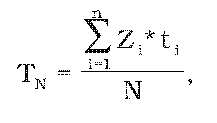

Príloha č. 5 k vyhláške č. 315/2008 Z. z.

SLEDOVANIE ŠTANDARDU KVALITY DODÁVANEJ ELEKTRINY A POSKYTOVANÝCH SLUŽIEB SÚVISIACICH S DISTRIBÚCIOU ELEKTRINY

DODRŽIAVANIE PLYNULOSTI DISTRIBÚCIE ELEKTRINY PODĽA § 3 ODS. 1 PÍSM. l) ZA KALENDÁRNY ROK

Tabuľka

Prevádzkovateľ distribučnej sústavy ........................................

Priemerná doba nedostupnosti distribúcie elektriny na odberné miesto podľa napäťovej úrovne – TN [ min] | | | | | | | | | | | | | | | | |

Napäťová úroveň | 1. mesiac | 2. mesiac | 3 mesiac | 1.-3. mesiac spolu | 4. mesiac | 5. mesiac | 6. mesiac | 1.-6. mesiac spolu | 7. mesiac | 8. mesiac | 9. mesiac | 1.-9. mesiac spolu | 10. mesiac | 11. mesiac | 12. mesiac | Rok | Index 2.../2...

vn | | | | | | | | | | | | | | | | |

nn | | | | | | | | | | | | | | | | |

Skutočnosť za kalendárny rok: | vn

| nn

1) Priemerná doba nedostupnosti distribúcie elektriny na odberné miesto podľa napäťovej úrovne vn, nn - TN sa vypočíta:

kde

Zi - počet dotknutých odberných miest v časovom úseku (i) pri prerušení distribúcie elektriny,

N - celkový počet odberných miest z napäťovej úrovne vn, nn v spoločnosti

ti - trvanie časového úseku (i) pri prerušení distribúcie elektriny v minútach.

(2) Udalosti, ktoré sa započítavajú do ukazovateľa TN, sú:

a) všetky prerušenia v distribúcii elektriny po vedeniach vn vrátane udalostí na napäťovej úrovni vvn, ktoré mali za následok prerušenie distribúcie elektriny koncovým odberateľom elektriny na odberných miestach napäťovej úrovne vn, nn,

b) udalosti na distribučných staniciach (vn/nn), ktoré nemali za následok vypnutie celého vývodu vn alebo jeho časti, sa do ukazovaťeľa nezahŕňajú,

c) minimálne trvanie udalosti vstupujúcej do ukazovateľa TN je tri minúty.

(3) Mesačný, kvartálny a ročný ukazovateľ sa sleduje tak, že

a) dokumentácia sa vedie o udalostiach, v ktorých TN vstúpilo do mesačného ukazovateľa; o každej udalosti je zaznamenaný dátum a čas vzniku, čas trvania prerušenia, počet dotknutých odberných miest, príčina udalosti,

b) v prípade živelnej udalosti sa hodnota ukazovateľa TNzníži za príslušný mesiac o hodnotu TNza príslušné udalosti vyvolané živelnou udalosťou,

c) prerušenie distribúcie elektriny z distribučnej sústavy, ktorá mala príčinu vzniku v prenosovej sústave alebo distribučnej sústave, sa môže sledovať a vyhodnocovať osobitne.
