Príloha k vyhláške č. 318/2008 Z. z.

- SPÔSOB A FORMA KONANIA MATURITNEJ SKÚŠKY

  - I. ČASŤ FORMY MATURITNEJ SKÚŠKY Z JEDNOTLIVÝCH PREDMETOV Por. číslo | Predmet | | Časť | | |

  - | | Úroveň | Externá | Interná a jej formy | |

  - | | | | Písomná | Ústna |

  - | | | | | príprava | odpoveď

  - 1 | anglický jazyk | C1 | 150´ | 90´ | 20´ | 20´

  - | | B2 | 120´ | 60´ | 20´ | 20´

  - | | B1 | 100´ | 60´ | 20´ | 20´

  - 2 | biológia | | – | – | 20´ | 20´

  - 3 | dejepis | | – | – | 20´ | 20´

  - 4 | francúzsky jazyk | C1 | 150´ | 90´ | 20´ | 20´

  - | | B2 | 120´ | 60´ | 20´ | 20´

  - | | B1 | 100´ | 60´ | 20´ | 20´

  - 5 | fyzika | | – | – | 20´ | 20´

  - 6 | geografia | | – | – | 20´ | 20´

  - 7 | chémia | | – | – | 20´ | 20´

  - 8 | informatika | | – | – | 30´ | 20´

  - 9 | maďarský jazyk a literatúra | | 100´ | 150´ | 20´ | 20´

  - 10 | matematika | | 150´ | | 20´ | 20´

  - 11 | náuka o spoločnosti | | – | – | 20´ | 20´

  - 12 | nemecký jazyk | C1 | 150´ | 90´ | 20´ | 20´

  - | | B2 | 120´ | 60´ | 20´ | 20´

  - | | B1 | 100´ | 60´ | 20´ | 20´

  - 13 | občianska náuka | | – | – | 20´ | 20´

  - 14 | ruský jazyk | C1 | 150´ | 90´ | 20´ | 20´

  - | | B2 | 120´ | 60´ | 20´ | 20´

  - | | B1 | 100´ | 60´ | 20´ | 20´

  - 15 | slovenský jazyk a literatúra | | 100´ | 150´ | 20´ | 20´

  - 16 | slovenský jazyk a slovenská literatúra4) | | 100´ | 90´ | 20´ | 20´

  - 17 | španielsky jazyk | C1 | 150´ | 90´ | 20´ | 20´

  - | | B2 | 120´ | 60´ | 20´ | 20´

  - | | B1 | 100´ | 60´ | 20´ | 20´

  - 18 | taliansky jazyk | C1 | 150´ | 90´ | 20´ | 20´

  - | | B2 | 120´ | 60´ | 20´ | 20´

  - | | B1 | 100´ | 60´ | 20´ | 20´

  - 19 | ukrajinský jazyk a literatúra | | 100´ | 150´ | 20´ | 20´

  - 20 | teoretická časť odbornej zložky | | – | – | 30´ | 30´

  - 21 | praktická časť odbornej zložky | | – | max. 24 hodín (príprava a výkon) | |

  - 22 | dejiny umenia5) | | – | – | 20´ | 20´

  - 23 | deskriptívna geometria5) | | – | – | 30´ | 20´

  - 24 | ekológia5) | | – | – | 20´ | 20´

  - 25 | ekonomika5) | | – | – | 20´ | 20´

  - 26 | estetika5) | | – | – | 20´ | 20´

  - 27 | evanjelické a. v. náboženstvo6) | | – | – | 20´ | 20´

  - 28 | kresťanská etika6) | | – | – | 20´ | 20´

  - 29 | latinčina | | – | – | 20´ | 20´

  - 30 | právo5) | | – | – | 20´ | 20´

  - 31 | psychológia5) | | – | – | 20´ | 20´

  - 32 | reformované náboženstvo6) | | – | – | 20´ | 20´

  - 33 | katolícke náboženstvo6) | | – | – | 20´ | 20´

  - 34 | stretnutia s ľudovou kultúrou5) | | – | – | 20´ | 20´

  - 35 | športový manažment | | – | – | 20´ | 20´

  - 36 | základy športovej prípravy | | – | – | 20´ | 20´

  - 37 | muzikál | | – | – | 20´ | 20´

  - 38 | literárna tvorba | | – | – | 20´ | 20´

  - 39 | poľský jazyk | | – | – | 20´ | 20´

  - 40 | chorvátsky jazyk | | – | – | 20´ | 20´

  - 41 | umenie a kultúra | | – | – | 20´ | 20´

  - 42 | rómsky jazyk a literatúra | | – | – | 20´ | 20´

  - II. ČASŤ PODROBNOSTI O SPÔSOBE KONANIA EXTERNEJ ČASTI A PÍSOMNEJ FORMY INTERNEJ ČASTI MATURITNEJ SKÚŠKY

    - 1. Cudzí jazyk – anglický jazyk, francúzsky jazyk, nemecký jazyk, ruský jazyk, talianska jazyk a španielsky jazyk.

      - Cudzí jazyk obsahom a úrovňou náročnosti zodpovedá jazykovej úrovni B2 alebo B1 Spoločného európskeho referenčného rámca. Predmet druhý vyučovací jazyk v bilingválnych triedach stredných škôl alebo v bilingválnych školách obsahom a náročnosťou zodpovedá úrovni C1 Spoločného európskeho referenčného rámca.Voliteľný predmet cudzí jazyk obsahom a úrovňou náročnosti zodpovedá jazykovej úrovni B1 alebo B2 Spoločného európskeho referenčného rámca.

      - Externá časť maturitnej skúšky z cudzieho jazyka pozostáva z centrálne vypracovanej, vo všetkých školách v rovnakom čase zadanej, pod externým dozorom konanej a externe vyhodnotenej písomnej skúšky – testu. Test overuje komunikačné kompetencie na úrovni B1 a B2 Spoločného európskeho referenčného rámca pre cudzie jazyky v častiach počúvanie s porozumením, čítanie s porozumením a použitie gramatiky a lexiky. Test obsahuje úlohy s výberom odpovede a úlohy s krátkou odpoveďou.

      - Externá časť maturitnej skúšky z druhého vyučovacieho jazyka pozostáva z centrálne vypracovanej, vo všetkých školách v rovnakom čase zadanej, pod externým dozorom konanej a externe vyhodnotenej písomnej skúšky – testu. Test overuje komunikačné kompetencie na úrovni C1 Spoločného európskeho referenčného rámca pre cudzie jazyky v častiach počúvanie s porozumením, čítanie s porozumením a použitie gramatiky a lexiky. Test obsahuje úlohy s výberom odpovede a úlohy s krátkou odpoveďou.

      - Úpravy pre žiakov so zdravotným znevýhodnením:

      - Test z cudzieho jazyka alebo z druhého vyučovacieho jazyka pre žiakov so sluchovým postihnutím neobsahuje úlohy na počúvanie s porozumením.

      - Písomnou formou internej časti maturitnej skúšky je vypracovanie štruktúrovaného centrálneho zadania v určenej žánrovej forme. Písomná forma internej časti maturitnej skúšky sa zadáva vo všetkých školách v rovnakom čase, koná sa pod externým dozorom a vyhodnocuje sa interne na základe centrálnych pokynov.

      - Charakteristika zadania písomnej formy internej časti maturitnej skúšky pre úroveň C1:

        - a) napísať jasný, detailný a správne kompozične a syntakticky členený text na zložité témy so spoločenskou alebo s odbornou tematikou,

        - b) písať podrobne, štylisticky a jazykovo správne o udalostiach, reálnych alebo fiktívnych zážitkoch,

        - c) napísať dobre zrozumiteľný príbeh, esej, recenziu,

        - d) napísať pozdrav, pozvanie, odkaz, blahoželanie, telegram,

        - e) napísať súkromný a formálny list, obchodný list, žiadosť, životopis, sťažnosť, reklamáciu, inzerát, odborný referát s využitím adekvátnych štylistických postupov a odbornej terminológie s prihliadnutím na cieľovú skupinu príjemcov,

        - f) opísať osobu, predmet, miesto, činnosť, situáciu, vytvoriť syntakticky správny opis a imaginatívny test,

        - g) napísať súvislý text, v ktorom žiak vyjadrí svoje názory, postoje, myšlienky, city a pomocou doplňujúcich argumentov a vhodných príkladov dokáže podrobne vysvetliť a podporiť svoje stanoviská a názory a vhodne ich ukončiť,

        - h) napísať referát, diskusný príspevok, správu, prejav a použiť zodpovedajúcu odbornú terminológiu,

        - i) vedieť aplikovať štylistické a kompozičné postupy náučného a populárno-náučného štýlu.

      - Charakteristika zadania písomnej formy internej časti maturitnej skúšky pre úroveň B2:

        - a) napísať jasný a detailný text na rôzne témy, ktoré žiaka zaujímajú,

        - b) písať podrobne, štylisticky a jazykovo správne o udalostiach, reálnych alebo fiktívnych zážitkoch,

        - c) napísať dobre zrozumiteľný príbeh,

        - d) napísať pozdrav, pozvanie, odkaz, blahoželanie, telegram,

        - e) napísať súkromný a formálny list, žiadosť, životopis, sťažnosť, reklamáciu, inzerát,

        - f) opísať osobu, predmet, miesto, činnosť, situáciu,

        - g) napísať súvislý text, v ktorom žiak vyjadrí svoje názory, postoje, myšlienky, city,

        - h) napísať referát, diskusný príspevok, správu, rozprávanie.

      - Charakteristika zadania písomnej formy internej časti maturitnej skúšky pre úroveň B1:

        - a) písať jednoducho a jasne o témach, ktoré sú žiakovi známe a zaujímajú ho,

        - b) vyjadriť svoj názor na témy, ktoré žiaka zaujímajú,

        - c) vyjadriť svoje pocity (ľútosť, radosť, záujem, súcit a pod.),

        - d) napísať pozdrav, pozvanie, odkaz, blahoželanie, telegram,

        - e) napísať súkromný a formálny list, žiadosť, životopis, sťažnosť, reklamáciu, inzerát,

        - f) opísať osobu, predmet, miesto, činnosť, situáciu.

    - 2. Maďarský jazyk a literatúra, ukrajinský jazyk a literatúra

      - Externá časť maturitnej skúšky z maďarského jazyka a literatúry, ukrajinského jazyka a literatúry sa skladá z centrálne vypracovanej, vo všetkých školách v rovnakom čase zadanej, pod externým dozorom konanej a externe vyhodnotenej písomnej skúšky – testu. Test sa skladá len z úloh s výberom odpovede a z úloh s krátkou odpoveďou.

      - Písomnou formou internej časti sú centrálne pripravené súbory štyroch tém, prípadne východiskové texty a určené žánrové formy. Žiak si vyberie a vypracuje iba jednu tému. Písomná práca sa vo všetkých školách zadáva v rovnakom čase, koná sa pod externým dozorom a vyhodnocuje sa interne na základe centrálnych pokynov.

      - Charakteristika úloh písomnej práce:

        - a) analýza a interpretácia umeleckého diela alebo vecného textu (jeho obsahová, kompozičná a štylistická analýza, argumentácia a hodnotenie),

        - b) vypracovanie zvolenej témy v určenej žánrovej forme,

        - c) porovnanie dvoch textov podľa zadania,

        - d) štýlová a žánrová transformácia textov.

    - 3. Matematika

      - Externú časť maturitnej skúšky z matematiky tvorí centrálne vypracovaná písomná skúška – test, ktorá sa vo všetkých školách zadáva v rovnakom čase, koná sa pod externým dozorom a externe sa vyhodnocuje. Test sa skladá iba z úloh s výberom odpovede a z úloh s krátkou odpoveďou.

    - 4. Slovenský jazyk a literatúra

      - Externú časť maturitnej skúšky zo slovenského jazyka a literatúry tvorí centrálne vypracovaná, vo všetkých školách v rovnakom čase zadaná, pod externým dozorom konaná a externe vyhodnotená písomná skúška – test. Test sa skladá len z úloh s výberom odpovede a z úloh s krátkou odpoveďou.

      - Písomnou formou internej časti sú centrálne pripravené súbory štyroch tém alebo východiskové texty a určené žánrové formy. Žiak si vyberie a vypracuje iba jednu tému. Žiak má preukázať komplexnosť ovládania spisovného jazyka, mieru tvorivosti v písomnom prejave a celkovú vzdelanosť a kultúrnosť v miere vychádzajúcej z cieľových požiadaviek. Písomná práca sa vo všetkých školách zadáva v rovnakom čase, koná sa pod externým dozorom a vyhodnocuje sa interne na základe centrálnych pokynov.

      - Charakteristika úloh písomnej práce:

        - a) analýza a interpretácia umeleckého diela alebo vecného textu (jeho obsahová, kompozičná a štylistická analýza, argumentácia a hodnotenie),

        - b) vypracovanie zvolenej témy v určenej žánrovej forme,

        - c) porovnanie dvoch textov podľa zadania,

        - d) štýlová a žánrová transformácia textov.

    - 5. Slovenský jazyk a slovenská literatúra

      - Externá časť maturitnej skúšky zo slovenského jazyka a slovenskej literatúry sa skladá z centrálne vypracovanej, vo všetkých školách v rovnakom čase zadanej, pod externým dozorom konanej a externe vyhodnotenej písomnej skúšky – testu. Test overuje komunikačné kompetencie v častiach počúvanie s porozumením, čítanie s porozumením a jazyk a literatúra. V rámci počúvania s porozumením sa preveruje, ako vedia žiaci efektívne počúvať hovorený prejav v slovenskom jazyku, porozumieť mu a získať z neho informácie, ktoré sú potrebné na splnenie úloh v teste. Test sa skladá len z úloh s výberom odpovede a z úloh s krátkou odpoveďou.

      - Písomnou formou internej časti maturitnej skúšky sú centrálne pripravené štyri témy s osnovou a určené žánrové formy podľa vzdelávacieho štandardu štátneho vzdelávacieho programu zo slovenského jazyka a slovenskej literatúry. Žiak si vyberie a vypracuje iba jednu tému. Písomná práca sa vo všetkých školách zadáva v rovnakom čase, koná sa pod externým dozorom a vyhodnocuje sa interne na základe centrálnych pokynov.

      - Úpravy pre žiakov so zdravotným znevýhodnením:

      - Test zo slovenského jazyka a slovenskej literatúry pre žiakov so sluchovým postihnutím neobsahuje úlohy na počúvanie s porozumením.

      - Charakteristika úloh písomnej práce:

        - a) analýza a interpretácia umeleckého diela alebo vecného textu (jeho obsahová, kompozičná a štylistická analýza, argumentácia a hodnotenie),

        - b) vypracovanie zvolenej témy v určenej žánrovej forme,

        - c) porovnanie dvoch textov podľa zadania,

        - d) štýlová a žánrová transformácia textov.

  - III. ČASŤ PODROBNOSTI O SPÔSOBE KONANIA A OBSAHU ÚSTNEJ FORMY INTERNEJ ČASTI MATURITNEJ SKÚŠKY VŠEOBECNÉ POKYNY

    - 1. Ústnu formu internej časti maturitnej skúšky tvorí ústna odpoveď žiaka pred predmetovou maturitnou komisiou, pričom si žiak žrebuje jedno zo schválených maturitných zadaní.

    - 2. Ústna forma internej časti maturitnej skúšky je verejná.

    - 3. Maturitné zadania a úlohy v nich vychádzajú z cieľových požiadaviek na vedomosti a zručnosti pre príslušný predmet maturitnej skúšky.

    - 4. Každé maturitné zadanie tvoria dve alebo tri samostatné úlohy, podľa možností a charakteru predmetu z viacerých tematických okruhov.

    - 5. Obsah maturitných zadaní zohľadňuje aj predpísaný čas určený na trvanie skúšky a jej prípravu.

    - 6. Maturitné zadania ústnej formy internej časti maturitnej skúšky pripravuje príslušná predmetová komisia školy. Maturitné zadania sa nezverejňujú.

    - 7. Minimálny počet zadaní je 30. Každé zadanie sa použije iba jedenkrát v danom dni.

    - 8. Pre každý maturitný predmet sa učebné pomôcky členia do dvoch skupín – všeobecné a konkrétne. Pod všeobecnými rozumieme pomôcky, ktoré má každý žiak na každej škole k dispozícii počas konania príslušnej časti alebo zložky skúšky. Konkrétne sú tie pomôcky, ktoré priamo súvisia s príslušným zadaním.

    - 9. Každá škola zabezpečí žiakovi prístup k všeobecným pomôckam v príslušnom predmete maturitnej skúšky.

    - 10. Súčasťou príslušného maturitného zadania je aj uvedenie konkrétnej učebnej pomôcky.

    - 11. Skúšajúci citlivo riadi rozhovor so žiakom, kladie pomocné a stimulačné otázky, vyjadruje súhlas alebo nesúhlas s tvrdeniami žiaka, pričom ho vedie k tomu, aby svoje názory podopieral argumentmi a využíval pri tom písomnú prípravu a tiež vlastné poznatky získané počas prípravy na maturitnú skúšku.

    - 12. Členovia predmetovej maturitnej komisie dbajú na to, aby žiak mohol na ich podnety reagovať plynulo a mal dosť času a pokoja na vyjadrenie svojich myšlienok.

    - ANGLICKÝ JAZYK

    - Každé zadanie pre všetky úrovne náročnosti sa skladá z troch úloh.

    - Tematické okruhy sú uvedené v cieľových požiadavkách z anglického jazyka.

    - Charakteristika úloh maturitných zadaní

    - Úloha č. 1 – Vizuálny podnet (napr. obrázok, fotografia, komiks, graf, schéma a pod.)

    - Žiak opíše predložený obrázok a hľadá súvislosti medzi obrázkom a príslušnou maturitnou úlohou. Komisia hodnotí súvislosť opisu predloženého podnetu, lineárnosť (postupnosť) vo vyjadrovaní a adekvátne jazykové prostriedky zodpovedajúce danej úrovni žiaka.

    - Úloha č. 2 – Tematický okruh

    - Úlohou žiaka je zaujať stanovisko k téme a odôvodniť ho v rozhovore so skúšajúcimi, ktorí vedú rozhovor podľa zásad uvedených v metodických pokynoch pre predmetové maturitné komisie. Komisia hodnotí, ako žiak dokáže zdôvodniť a vysvetliť svoje názory na príslušnú tému a argumentovať k problematike, výber faktov a informácií, gramatiku.

    - Úloha č. 3 – Situačná úloha, dialóg s rozdelenými úlohami (rôzne modelové situácie zohľadňujúce príslušný študijný odbor). Žiak dostane za úlohu vyriešiť konkrétnu situáciu, napríklad je na stanici a má sa informovať o najvýhodnejšom vlakovom spojení do nejakého mesta. Komisia sa zameriava na hodnotenie výberu a adekvátnosť použitia jazykových prostriedkov (v konkrétnej situácii z každodenného života v okruhu príslušných tém).

    - Všeobecné pomôcky

    - Obojstranný prekladový slovník obsahujúci najmenej 15 000 hesiel.

    - Hodnotenie

      - a) Základom hodnotenia je rozsah slovnej zásoby, používanie gramatických štruktúr, stupeň jazykovej pohotovosti, obsahová stránka prejavu a pod.

      - b) Predmetová maturitná komisia hodnotí obsahovú a jazykovú správnosť odpovede, štruktúru – začiatok, vedenie a skončenie rozhovoru.

      - c) Každá úloha maturitného zadania sa hodnotí stupňom prospechu 1 až 5.

      - d) Hodnotenie úlohy č. 1 sa skladá z dvoch samostatných hodnotení. Hodnotí sa

        - 1. obsahová primeranosť,

        - 2. jazyková správnosť.

      - e) Hodnotenie úlohy č. 2 sa skladá zo šiestich samostatných hodnotení. Hodnotí sa

        - 1. plynulosť vyjadrovania,

        - 2. výslovnosť a intonácia,

        - 3. obsah – náročnosť spracovania/kvalita rozhovoru,

        - 4. lexikálny rozsah,

        - 5. argumentácia,

        - 6. gramatická presnosť.

      - f) Hodnotenie úlohy č. 3 sa skladá z dvoch samostatných hodnotení. Hodnotí sa

        - 1. obsahová a jazyková správnosť,

        - 2. pohotovosť vyjadrovania.

      - g) Váha hodnotenia jednotlivých úloh ústnej zložky je 1 : 2 : 1. Pri výpočte váženého priemeru pre obe úrovne sa používa vzorec

      - 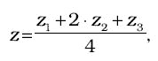

        - pričom z je po zaokrúhlení výsledný stupeň prospechu a zi je stupeň prospechu za úlohu č. i.

      - Úpravy pre žiakov so zdravotným znevýhodnením

      - Úloha č. 1

        - a) Ak ide o žiakov so zrakovým postihnutím, obrázky sa nahradia slovným opisom príslušnej situácie vo vyučovacom jazyku; grafy a schémy sa vynechajú.

        - b) Ak ide o žiakov so sluchovým postihnutím, nehodnotí sa jazyková správnosť.

      - Úloha č. 2

      - Ak ide o žiakov so sluchovým postihnutím, nehodnotí sa výslovnosť, intonácia a gramatická správnosť.

      - Trvanie skúšky: 30 minút

      - Čas na prípravu: 30 minút

      - BIOLÓGIA

      - Každé zadanie sa skladá z troch úloh.

      - Charakteristika úloh maturitných zadaní

      - Úloha č. 1 – Úloha je zameraná na reprodukciu a pochopenie stanoveného učiva (prevláda forma monológu).

      - Úloha č. 2 – Úloha je zameraná na porozumenie a hodnotenie poznatkov – špecifický transfer (prevláda forma dialógu s členmi predmetovej maturitnej komisie).

      - Úloha č. 3 – Úloha je zameraná na praktickú aplikáciu osvojených vedomostí, na interpretáciu pozorovaní a pokusov s dôrazom na schopnosť samostatne a tvorivo riešiť zadané problémy – nešpecifický transfer (prevláda forma dialógu s členmi predmetovej maturitnej komisie).

      - Zastúpenie jednotlivých tematických okruhov v úlohách maturitných zadaní je takéto:

      - biológia ako veda,

      - biológia bunky a všeobecné vlastnosti živých sústav,

      - nebunkové a prokaryotické organizmy,

      - biológia rastlín,

      - systém a fylogenéza rastlín,

      - huby a lišajníky,

      - biológia živočíchov,

      - systém a fylogenéza živočíchov,

      - biológia človeka,

      - genetika,

      - ekológia.

      - Všeobecné pomôcky

      - Kľúč na určovanie rastlín

      - Atlas rastlín

      - Atlas živočíchov

      - Anatomický atlas – ľudské telo

      - Encyklopédia prírody

      - Priesvitky k spätnému projektoru z anatómie človeka, stavovcov, genetiky

      - Kostra človeka

      - Torzo človeka

      - Anatomické obrazy (človek, stavovce)

      - Diapozitívy flóry, fauny

      - Mikroskop, mikroskopické preparáty

      - Vzorky častí rastlinného tela – model koreňa, stonky, listu, kvetu

      - Obrazový materiál živočíchov, rastlín

      - Hodnotenie

        - a) Každá úloha maturitného zadania sa hodnotí stupňom prospechu 1 až 5.

        - b) Váha hodnotenia jednotlivých úloh je 3 : 4 : 3. Pri výpočte váženého priemeru sa používa vzorec

      - 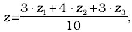

        - pričom z je po zaokrúhlení výsledný stupeň prospechu a zi je stupeň prospechu za úlohu č. i.

      - Úpravy pre žiakov so zdravotným znevýhodnením

      - Úloha č. 3 je upravená podľa druhu a stupňa postihnutia.

      - Trvanie skúšky: 30 minút

      - Čas na prípravu: 30 minút

      - DEJEPIS

      - Každé zadanie sa skladá z troch úloh.

      - Charakteristika úloh maturitných zadaní

      - Úloha č. 1 – Úloha je zameraná na vedomosti a porozumenie. V úlohe je presne určený pojem, fakt, definícia, historický jav alebo proces, o ktorom má žiak preukázať svoje vedomosti, a je určená učebná pomôcka a spôsob práce s ňou, napr. historická mapa a opis, čo má žiak urobiť (prevláda forma monológu).

      - Úloha č. 2 – Úloha je zameraná na aplikáciu a analýzu. V úlohe sa presne definuje, čo sa od žiaka očakáva, napr. klasifikovať historické udalosti, porovnať dva historické javy alebo procesy alebo viac historických javov alebo procesov, určiť príčiny alebo dôsledky jedného historického javu alebo procesu alebo viacerých historických javov alebo procesov a pod. K úlohe je určená aj učebná pomôcka (historická mapa, historický prameň, graf, karikatúra a pod.) a opis, čo má žiak urobiť (prevláda forma dialógu s členmi predmetovej maturitnej komisie).

      - Úloha č. 3 – Úloha je zameraná na syntézu historických javov, procesov a udalostí. Od žiaka sa požaduje kritické posúdenie uvedených historických obsahov a preukázanie schopnosti zovšeobecňovať a zaujať hodnotiace postoje k minulosti. Žiak má preukázať schopnosť pracovať s historickými prameňmi, zručnosti orientovania sa v čase a priestore.

      - Zastúpenie jednotlivých tematických okruhov v úlohách maturitných zadaní je takéto:

      - úvod do vyučovania dejepisu a pravek,

      - starovek,

      - stredovek,

      - novovek,

      - dejiny 20. storočia.

      - Zastúpenie uvedených jednotlivých častí učiva v súbore všetkých úloh v maturitných zadaniach je takéto:

        - a) svetové dejiny približne 55 %,

        - b) národné dejiny približne 45 %.

      - Všeobecné pomôcky

      - Atlas svetových dejín

      - Dejepisné atlasy pre základné školy a gymnáziá

      - Z prameňov našich dejín

      - Hodnotenie

        - a) Každá úloha maturitného zadania sa hodnotí stupňom prospechu 1 až 5.

        - b) Váha hodnotenia jednotlivých úloh je 3 : 4 : 3. Pri výpočte váženého priemeru sa používa vzorec

      - 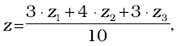

        - pričom z je po zaokrúhlení výsledný stupeň prospechu a zi je stupeň prospechu za úlohu č. i.

      - Úpravy pre žiakov so zdravotným znevýhodnením

      - Trvanie skúšky: 30 minút

      - Čas na prípravu: 30 minút

      - FRANCÚZSKY JAZYK

      - Každé zadanie pre všetky úrovne náročnosti sa skladá z troch úloh.

      - Tematické okruhy sú uvedené v cieľových požiadavkách z francúzskeho jazyka.

      - Charakteristika úloh maturitných zadaní

      - Úloha č. 1 – Vizuálny podnet (napr. obrázok, fotografia, komiks, graf, schéma a pod.). Žiak opíše predložený obrázok a nachádza súvislosti medzi obrázkom a príslušnou maturitnou témou. Komisia hodnotí súvislosť opisu predloženého podnetu, lineárnosť (postupnosť) vo vyjadrovaní a adekvátne jazykové prostriedky zodpovedajúce danej úrovni žiaka.

      - Úloha č. 2 – Tematický okruh

      - Úlohou žiaka je zaujať stanovisko k téme a odôvodniť ho v rozhovore so skúšajúcimi, ktorí vedú rozhovor podľa zásad uvedených v metodických pokynoch pre predmetové maturitné komisie. Komisia hodnotí, ako žiak dokáže zdôvodniť a vysvetliť svoje názory na príslušnú tému a argumentovať k problematike, výber faktov a informácií, gramatiku.

      - Úloha č. 3 – Situačná úloha, dialóg s rozdelenými úlohami (rôzne modelové situácie zohľadňujúce príslušný študijný odbor). Žiak dostane za úlohu vyriešiť konkrétnu situáciu, napr. je na stanici a má sa informovať o najvýhodnejšom vlakovom spojení do nejakého mesta. Komisia sa zameriava na hodnotenie výberu a adekvátnosť použitia jazykových prostriedkov (v konkrétnej situácii z každodenného života v okruhu príslušných tém).

      - Všeobecné pomôcky

      - Obojstranný prekladový slovník obsahujúci najmenej 15 000 hesiel

      - Hodnotenie

        - a) Základom hodnotenia je rozsah slovnej zásoby, používanie gramatických štruktúr, stupeň jazykovej pohotovosti, obsahová stránka prejavu a pod.

        - b) Predmetová maturitná komisia hodnotí obsahovú a jazykovú správnosť odpovede, štruktúru – začiatok, vedenie a skončenie rozhovoru.

        - c) Každá úloha maturitného zadania sa hodnotí stupňom prospechu 1 až 5.

        - d) Hodnotenie úlohy č. 1 sa skladá z dvoch samostatných hodnotení. Hodnotí sa

          - 1. obsahová primeranosť,

          - 2. jazyková správnosť.

        - e) Hodnotenie úlohy č. 2 sa skladá zo šiestich samostatných hodnotení. Hodnotí sa

          - 1. plynulosť vyjadrovania,

          - 2. výslovnosť a intonácia,

          - 3. obsah – náročnosť spracovania/kvalita rozhovoru,

          - 4. lexikálny rozsah,

          - 5. argumentácia,

          - 6. gramatická presnosť.

        - f) Hodnotenie úlohy č. 3 sa skladá z dvoch samostatných hodnotení. Hodnotí sa

          - 1. obsahová a jazyková správnosť,

          - 2. pohotovosť vyjadrovania.

        - g) Váha hodnotenia jednotlivých úloh ústnej zložky je 1 : 2 : 1. Pri výpočte váženého priemeru sa používa vzorec

      - 

        - pričom z je po zaokrúhlení výsledný stupeň prospechu a zi je stupeň prospechu za úlohu č. i.

      - Úpravy pre žiakov so zdravotným znevýhodnením

      - Úloha č. 1

        - a) Ak ide o žiakov so zrakovým postihnutím, obrázky sa nahradia slovným opisom príslušnej situácie vo vyučovacom jazyku; grafy a schémy sa vynechajú.

        - b) Ak ide o žiakov so sluchovým postihnutím, nehodnotí sa jazyková správnosť.

      - Úloha č. 2

      - Ak ide o žiakov so sluchovým postihnutím, nehodnotí sa výslovnosť, intonácia a gramatická správnosť.

      - Trvanie skúšky: 30 minút

      - Čas na prípravu: 30 minút

      - FYZIKA

      - Každé zadanie sa skladá z troch úloh.

      - Charakteristika úloh maturitných zadaní

      - Úloha č. 1 – Žiak teoreticky opíše fyzikálny jav, pojem, vzťah a podobne a rieši jednoduchú úlohu súvisiacu s témou (prevláda forma monológu).

      - Úloha č. 2 – Žiak rieši štruktúrovanú úlohu, v ktorej musí aplikovať teoretické poznatky z určitých tematických celkov (prevláda forma dialógu s členmi predmetovej maturitnej komisie).

      - Úloha č. 3 – Žiak obhajuje svoju experimentálnu prácu súvisiacu s témami zadania, pričom využíva svoj zošit laboratórnych cvičení (uplatňuje sa aj forma dialógu s členmi predmetovej maturitnej komisie).

      - Zastúpenie jednotlivých tematických okruhov v úlohách maturitných zadaní je takéto:

      - mechanika,

      - molekulová fyzika a termodynamika,

      - elektrický prúd a elektrické pole,

      - magnetické pole,

      - striedavý prúd,

      - mechanické kmitanie,

      - vlnenie,

      - základy fyziky mikrosveta.

      - Všeobecné pomôcky

      - Matematické, fyzikálne a chemické tabuľky, kalkulačka, ktorá by mala mať aspoň desaťmiestny displej, základné aritmetické operácie (sčítanie, odčítanie, násobenie, delenie, umocňovanie, odmocňovanie), goniometrické, exponenciálne a logaritmické funkcie a funkcie k nim inverzné, no nesmie mať grafický displej.

      - Hodnotenie

        - a) Každá úloha maturitného zadania sa hodnotí stupňom prospechu 1 až 5.

        - b) Váha hodnotenia jednotlivých úloh je 3 : 4 : 3. Pri výpočte váženého priemeru sa používa vzorec

      - 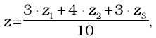

        - pričom z je po zaokrúhlení výsledný stupeň prospechu a zi je stupeň prospechu za úlohu č. i.

      - Úpravy pre žiakov so zdravotným znevýhodnením

      - Úloha č. 3 je upravená podľa druhu a stupňa postihnutia.

      - Trvanie skúšky: 30 minút

      - Čas na prípravu: 30 minút

      - GEOGRAFIA

      - Každé zadanie sa skladá z troch úloh.

      - Charakteristika úloh maturitných zadaní

      - Úloha č. 1 – Úloha je širšie koncipovaná, jej cieľom je preveriť žiakove vedomosti a zručnosti v danej oblasti, spôsob logickej prípravy a prezentácie odpovede na danú úlohu, výber faktov, pojmov a vzťahov. Cieľom je preveriť aj zručnosť práce so zdrojmi, ktoré bude mať žiak k dispozícii k danej otázke (prevláda forma monológu).

      - Úloha č. 2 – Úloha je formulovaná ako aplikačná úloha. Úlohou žiaka je predviesť najvhodnejší spôsob riešenia, obhájiť správnosť svojho postupu a vedieť argumentovať a komunikovať o príslušnom probléme. Pri odpovedi bude mať žiak k dispozícii geografické zdroje (prevláda forma dialógu s členmi predmetovej maturitnej komisie).

      - Úloha č. 3 – Úloha je formulovaná ako konkrétna problémová úloha na úrovni najvyšších myšlienkových operácií (analýza, syntéza, hodnotenie), pri ktorej riešení môžu žiaci uplatniť vedomosti a zručnosti získané počas celého štúdia, teda sformulovať geografickú otázku, správne vybrať údaje, analyzovať ich, organizovať získané údaje a hodnotiť ich, odpovedať na geografickú otázku. Žiak predvedie svoje riešenie problému a obhajuje správnosť riešenia na základe geografických zdrojov (prevláda forma dialógu s členmi predmetovej maturitnej komisie).

      - Zastúpenie jednotlivých tematických okruhov v úlohách maturitných zadaní je takéto:

      - Zem a zobrazovanie Zeme,

      - fyzická geografia (atmosféra, hydrosféra, litosféra, pedosféra, biosféra),

      - humánna geografia (obyvateľstvo, sídla, hospodárstvo sveta),

      - regionálna geografia sveta (politická mapa sveta, geografia Európy, Ameriky, Ázie, Afriky, Austrálie, Oceánie, Antarktídy a oceánov),

      - geografia Slovenskej republiky,

      - geoekológia a environmentalistika.

      - Všeobecné pomôcky

      - Všeobecno-zemepisné mapy

      - Tematické mapy

      - Hodnotenie

        - a) Každá úloha maturitného zadania sa hodnotí stupňom prospechu 1 až 5.

        - b) Váha hodnotenia jednotlivých úloh je 1 : 2 : 3. Pri výpočte váženého priemeru sa používa vzorec

      - 

      - pričom z je po zaokrúhlení výsledný stupeň prospechu a zi je stupeň prospechu za úlohu č. i.

      - Úpravy pre žiakov so zdravotným znevýhodnením

      - Požiadavka zručnosti a riešenia na základe geografických zdrojov je pre žiakov so zrakovým a telesným postihnutím vo všetkých úlohách jednotlivých zadaní upravená podľa druhu a stupňa postihnutia.

      - Zastúpenie jednotlivých tematických okruhov v úlohách maturitných zadaní pre žiakov so zrakovým postihnutím je takéto:

      - Zem a zobrazovanie Zeme,

      - fyzická geografia (atmosféra, hydrosféra, litosféra, pedosféra, biosféra),

      - humánna geografia (obyvateľstvo, sídla, hospodárstvo sveta),

      - regionálna geografia sveta (politická mapa sveta, geografia Európy, Ameriky, Ázie, Afriky, Austrálie,

      - Oceánie, Antarktídy a oceánov),

      - geografia Slovenskej republiky,

      - geoekológia a environmentalistika.

      - Trvanie skúšky: 30 minút

      - Čas na prípravu: 30 minút

      - CHÉMIA

      - Každé zadanie sa skladá z troch úloh.

      - Charakteristika úloh maturitných zadaní

      - Úloha č. 1 – Úloha na reprodukciu, pochopenie a jednoduché myšlienkové operácie, napr. jednoduché výpočty, názvoslovie, vlastnosti látok, zoradenie, zaradenie do skupiny, neúplný zápis reakcie a podobne, spojená s pokynmi typu definuj, pomenuj, vymenuj a podobne (prevláda forma monológu).

      - Úloha č. 2 – Úloha zameraná na zložitejšie myšlienkové operácie a tvorivé myslenie, na analýzu, porovnávanie, hodnotenie, aplikáciu osvojených poznatkov (prevláda forma dialógu s členmi predmetovej maturitnej komisie).

      - Úloha č. 3 – Úloha zameraná na laboratórnu skúsenosť žiaka, napr. opis alebo realizácia laboratórneho postupu, výpočet spojený s pokusom, vyslovenie hypotézy, hľadanie vhodných chemikálií, pomôcok, laboratórneho postupu, diskusia o výsledkoch pokusu a podobne, alebo na schopnosť žiaka pracovať s odborným textom, napr. analyzovať, vyhľadávať v texte, reagovať na otázky týkajúce sa textu a podobne.

      - Zastúpenie jednotlivých tematických okruhov v úlohách maturitných zadaní je takéto:

      - všeobecná chémia,

      - anorganická chémia,

      - organická chémia,

      - prírodné látky a základy biochémie.

      - Všeobecné pomôcky

      - Matematické, fyzikálne a chemické tabuľky

      - Jednoduchá kalkulačka (základné aritmetické, exponenciálne a logaritmické funkcie)

      - Stavebnica molekulových modelov

      - Modely kryštalických mriežok a orbitálov

      - Hodnotenie

        - a) Každá úloha maturitného zadania sa hodnotí stupňom prospechu 1 až 5.

        - b) Váha hodnotenia jednotlivých úloh je 1 : 2 : 2. Pri výpočte váženého priemeru sa používa vzorec

      - 

        - pričom z je po zaokrúhlení výsledný stupeň prospechu a zi je stupeň prospechu za úlohu č. i.

      - Úpravy pre žiakov so zdravotným znevýhodnením

      - Úloha č. 3 je upravená podľa druhu a stupňa postihnutia.

      - Trvanie skúšky: 30 minút

      - Čas na prípravu: 30 minút

      - INFORMATIKA

      - Každé zadanie sa skladá z dvoch úloh.

      - Charakteristika úloh maturitných zadaní

      - Úloha č. 1 – Riešenie algoritmického problému v konkrétnom programovacom jazyku

      - Úloha č. 2 – Riešenie praktickej úlohy alebo opísanie témy a uvedenie príkladov

      - Zastúpenie jednotlivých tematických okruhov v úlohách maturitných zadaní je takéto:

      - Úloha č. 1 – algoritmy a programovanie

      - Úloha č. 2 – informácie okolo nás, informačná spoločnosť, počítačové systémy, internet

      - 25 % až 40 % internet,

      - 25 % až 40 % aplikačný softvér.

      - Obsahom maturitných zadaní by mali byť praktické úlohy, ktoré sa dajú zvládnuť asi za 20 minút. V tomto časovom intervale sú žiaci schopní zvládnuť len čiastkové úlohy z tematických celkov, ako napríklad vytvorenie a odladenie podprogramu s požadovanou vlastnosťou, doplnenie tabuľky o požadované výpočty, vytvorenie vhodnej grafickej reprezentácie údajov z tabuľky, odoslanie a prijatie elektronickej pošty s prílohou, doplnenie počítačovej prezentácie o ďalšiu snímku so špecifikovaným obsahom, získanie požadovaných údajov z databázy v určenej forme, úpravu textu, tabuľky, prezentácie, databázy, úpravu obrázka na požadovaný tvar, vykonanie špecifikovaných systémových nastavení atď.

      - Cieľom zadania je predovšetkým preverenie praktických zručností žiaka pri používaní informačno-komunikačných technológií a preverenie jeho schopnosti aplikovať získané teoretické poznatky v praxi. Riešenie maturitného zadania sa musí realizovať prostriedkami informačno-komunikačných technológií.

      - Formulácia zadania by mala obsahovať cieľ, ktorý má študent dosiahnuť, ale nie prostriedky, ktorými ho má dosiahnuť. Výber prostriedkov a ich zvládnutie v procese riešenia zadania je súčasťou hodnotenia žiaka.

      - Všeobecné pomôcky

      - PC s pripojením na internet

      - Hodnotenie

        - a) Každá úloha maturitného zadania sa hodnotí stupňom prospechu 1 až 5.

        - b) Váha hodnotenia jednotlivých úloh je 1 : 1. Pri výpočte váženého priemeru sa používa vzorec

      - 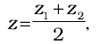

      - pričom z je po zaokrúhlení výsledný stupeň prospechu a zi je stupeň prospechu za úlohu č. i.

      - Úpravy pre žiakov so zdravotným znevýhodnením

      - Trvanie skúšky: 30 minút

      - Čas na prípravu: 30 minút

      - MAĎARSKÝ JAZYK A LITERATÚRA

      - Každé zadanie obsahuje dve úlohy a východiskový literárny text. Jedna z úloh musí obsahovať učivo z maďarského jazyka. Ak by literárny text neobsahoval vhodné podnety pre úlohu z jazyka, môže byť k tejto úlohe pripojený ešte špecifický text.

      - Charakteristika úloh maturitných zadaní

      - Úloha č. 1 – Úloha je zameraná na reprodukciu vedomostí z literárnej histórie a teórie literatúry (prevláda forma monológu) a na následnú schopnosť uplatniť tieto vedomosti pri interpretácii textu literárnej ukážky (prevláda forma dialógu s členmi predmetovej maturitnej komisie). Úloha môže mať tieto varianty:

        - a) variant – ak je úloha zameraná historicky, jej obsahom je priblíženie literárno-umeleckého obdobia a prehľad o najvýznamnejších autoroch (2 až 3) s ideovou, tematickou a umeleckou charakteristikou ich najdôležitejších diel a následná analýza a hodnotenie textu na základe argumentácie (dokazovanie vlastných tvrdení prvkami z textu),

        - b) variant – ak je úloha zameraná tematicky, jej obsahom je priblíženie odlišného stvárnenia danej témy v rôznych dielach a následná analýza a hodnotenie textu na základe argumentácie (dokazovanie vlastných tvrdení prvkami z textu),

        - c) variant – ak je úloha zameraná na problematiku žánrovej formy, jej obsahom je definovanie žánrovej formy, náčrt jej historického vývinu, resp. prehľad modifikácií žánru u rôznych autorov a následná analýza a hodnotenie textu na základe argumentácie (dokazovanie vlastných tvrdení prvkami z textu).

      - Úloha č. 2 – Úloha je zameraná tak, aby žiak pri odpovedi prejavil svoju pripravenosť demonštrovať znalosť teoretického systému maďarského jazyka určenú základnými pedagogickými dokumentmi a svoju schopnosť uplatniť tieto vedomosti pri vysvetľovaní konkrétnych jazykových javov, ktoré sa vyskytli v texte literárnej ukážky (prevláda forma dialógu s členmi predmetovej maturitnej komisie).

      - Zastúpenie jednotlivých tematických okruhov v úlohách maturitných zadaní je takéto:

      - Úlohy z literatúry

      - maďarská literatúra,

      - svetová literatúra,

      - teória literatúry.

      - Úlohy z jazyka

      - lexikológia a frazeológia,

      - morfológia,

      - zvuková a grafická stránka jazyka,

      - syntax,

      - práca s informáciami,

      - všeobecné poznatky o jazyku,

      - štylistika.

      - Všeobecné pomôcky

      - A magyar helyesírás szabályai vagy Helyesírási keziszótár – slovník

      - Hodnotenie

      - Predmetová maturitná komisia hodnotí obsahovú kvalitu a jazykovú správnosť odpovede, t. j. rozsah slovnej zásoby, gramatickú správnosť, štylistickú pôsobivosť a stupeň rečovej pohotovosti.

        - a) Každá úloha maturitného zadania sa hodnotí stupňom prospechu 1 až 5.

        - b) Váha hodnotenia jednotlivých úloh je 3 : 2. Pri výpočte váženého priemeru sa používa vzorec

      - 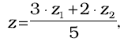

        - pričom z je po zaokrúhlení výsledný stupeň prospechu a zi je stupeň prospechu za úlohu č. i.

      - Úpravy pre žiakov so zdravotným znevýhodnením

      - Trvanie skúšky: 30 minút

      - Čas na prípravu: 40 minút

      - MATEMATIKA

      - Každé zadanie sa skladá z troch úloh.

      - Charakteristika úloh maturitných zadaní

      - Úloha č. 1 – Žiak objasní (definuje) dané pojmy, uvedie ich príklady a kontrapríklady, sformuluje ich vlastnosti a súvislosti medzi uvedenými pojmami (prevláda forma monológu).

      - Úloha č. 2 – Úloha je zameraná na argumentáciu a dôvodenie (prevláda forma dialógu s členmi predmetovej maturitnej komisie).

      - Úloha č. 3 – Úloha je zameraná na postup riešenia príslušnej úlohy s rôznymi alternatívami. Doplňujúce otázky budú zamerané na alternatívy pri iných číselných zadaniach.

      - Zastúpenie jednotlivých tematických okruhov v úlohách maturitných zadaní je takéto:

      - základy matematiky,

      - funkcie,

      - planimetria,

      - stereometria,

      - kombinatorika, pravdepodobnosť, štatistika.

      - Úlohy maturitných zadaní nemôžu byť z jedného tematického okruhu.

      - Všeobecné pomôcky

      - Matematické, fyzikálne a chemické tabuľky

      - Kalkulačka, ktorá by mala mať aspoň desaťmiestny displej, základné aritmetické operácie (sčítanie, odčítanie, násobenie, delenie, umocňovanie, odmocňovanie), goniometrické, exponenciálne a logaritmické funkcie a funkcie k nim inverzné, no nesmie mať grafický displej.

      - Hodnotenie

        - a) Každá úloha maturitného zadania sa hodnotí stupňom prospechu 1 až 5.

        - b) Váha hodnotenia jednotlivých úloh je 1 : 2 : 2. Pri výpočte váženého priemeru sa používa vzorec

      - 

        - pričom z je po zaokrúhlení výsledný stupeň prospechu a zi je stupeň prospechu za úlohu č. i.

      - Úpravy pre žiakov so zdravotným znevýhodnením

      - Zastúpenie jednotlivých tematických okruhov v úlohách maturitných zadaní pre žiakov so sluchovým postihnutím je takéto:

      - základy matematiky,

      - funkcie,

      - planimetria,

      - stereometria,

      - kombinatorika, pravdepodobnosť, štatistika.

      - Trvanie skúšky: 30 minút

      - Čas na prípravu: 30 minút

      - NÁUKA O SPOLOČNOSTI

      - Každé zadanie sa skladá z troch úloh.

      - Charakteristika úloh maturitných zadaní

      - Úloha č. 1 – Žiak má opísať (definovať) vybrané pojmy a uviesť súvislosti medzi nimi (prevláda forma monológu).

      - Úloha č. 2 – Úloha je zameraná na analýzu ukážky, resp. porovnanie ukážok textov alebo argumentáciu či zdôvodnenie (prevláda forma dialógu s členmi predmetovej maturitnej komisie).

      - Úloha č. 3 – Úloha je zameraná na riešenie určitého problému a jeho aplikáciu v praxi alebo na využitie medzipredmetových väzieb pri riešení problému (prevláda forma dialógu s členmi predmetovej maturitnej komisie).

      - Zastúpenie jednotlivých tematických okruhov v úlohách maturitných zadaní je takéto:

      - filozofia,

      - právo,

      - politológia,

      - ekonómia a ekonomika,

      - psychológia a sociológia.

      - Všeobecné pomôcky

      - Antológia z diel filozofov

      - Ústava Slovenskej republiky

      - Slovník spoločenských vied

      - Všeobecná deklarácia ľudských práv

      - Filozofický slovník

      - Dohovor k ľudským právam

      - Dohovor o právach detí

      - Hodnotenie

        - a) Každá úloha maturitného zadania sa hodnotí stupňom prospechu 1 až 5.

        - b) Váha hodnotenia jednotlivých úloh je 1 : 2 : 2. Pri výpočte váženého priemeru sa používa vzorec

      - 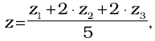

        - pričom z je po zaokrúhlení výsledný stupeň prospechu a zi je stupeň prospechu za úlohu č. i.

      - Úpravy pre žiakov so zdravotným znevýhodnením

      - Zastúpenie jednotlivých tematických okruhov v úlohách maturitných zadaní pre žiakov so sluchovým postihnutím je takéto:

      - 10 % až 40 % filozofia,

      - 10 % až 40 % právo,

      - 10 % až 40 % politológia,

      - 10 % až 40 % ekonómia a ekonomika,

      - 10 % až 40 % psychológia a sociológia.

      - Trvanie skúšky: 30 minút

      - Čas na prípravu: 30 minút

      - NEMECKÝ JAZYK

      - Každé zadanie pre všetky úrovne sa skladá z troch úloh. Tematické okruhy sú uvedené v cieľových požiadavkách z nemeckého jazyka.

      - Charakteristika úloh maturitných zadaní

      - Úloha č. 1 – Vizuálny podnet (napr. obrázok, fotografia, komiks, graf, schéma a pod.). Žiak opíše predložený obrázok a hľadá súvislosti medzi obrázkom a príslušnou maturitnou témou. Komisia hodnotí súvislosť opisu predloženého podnetu, lineárnosť (postupnosť) vo vyjadrovaní a adekvátne jazykové prostriedky zodpovedajúce danej úrovni žiaka.

      - Úloha č. 2 – Tematický okruh. Úlohou žiaka je zaujať stanovisko k téme a odôvodniť ho v rozhovore so skúšajúcimi, ktorí vedú rozhovor podľa zásad uvedených v metodických pokynoch pre predmetové maturitné komisie. Komisia hodnotí, ako žiak dokáže zdôvodniť a vysvetliť svoje názory na príslušnú tému a argumentovať k problematike, výber faktov a informácií, gramatiku.

      - Úloha č. 3 – Situačná úloha, dialóg s rozdelenými úlohami (stredné odborné školy aj rôzne modelové situácie zohľadňujúce príslušný študijný odbor). Žiak dostane za úlohu vyriešiť konkrétnu situáciu, napríklad je na stanici a má sa informovať o najvýhodnejšom vlakovom spojení do nejakého mesta. Komisia sa zameriava na hodnotenie výberu a adekvátnosť použitia jazykových prostriedkov (z konkrétnej situácie z každodenného života v okruhu príslušných tém).

      - Všeobecné pomôcky

      - Obojstranný prekladový slovník obsahujúci najmenej 15 000 hesiel

      - Hodnotenie

        - a) Základom hodnotenia je rozsah slovnej zásoby, používanie gramatických štruktúr, stupeň jazykovej pohotovosti, obsahová stránka prejavu a pod.

        - b) Predmetová maturitná komisia hodnotí obsahovú a jazykovú správnosť odpovede, štruktúru – začiatok, vedenie a ukončenie rozhovoru.

        - c) Každá úloha maturitného zadania sa hodnotí stupňom prospechu 1 až 5.

        - d) Hodnotenie úlohy č. 1 sa skladá z dvoch samostatných hodnotení. Hodnotí sa

          - 1. obsahová primeranosť,

          - 2. jazyková správnosť.

        - e) Hodnotenie úlohy č. 2 sa skladá zo šiestich samostatných hodnotení. Hodnotí sa

          - 1. plynulosť vyjadrovania,

          - 2. výslovnosť a intonácia,

          - 3. obsah – náročnosť spracovania/kvalita rozhovoru,

          - 4. lexikálny rozsah,

          - 5. argumentácia,

          - 6. gramatická presnosť.

        - f) Hodnotenie úlohy č. 3 sa skladá z dvoch samostatných hodnotení. Hodnotí sa

          - 1. obsahová a jazyková správnosť,

          - 2. pohotovosť vyjadrovania.

        - g) Váha hodnotenia jednotlivých úloh ústnej zložky je 1 : 2 : 1. Pri výpočte váženého priemeru pre obidve úrovne sa používa vzorec

      - 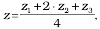

        - pričom z je po zaokrúhlení výsledný stupeň prospechu a zi je stupeň prospechu za úlohu č. i.

      - Úpravy pre žiakov so zdravotným znevýhodnením

      - Úloha č. 1

        - a) Ak ide o žiakov so zrakovým postihnutím, obrázky sa nahradia slovným opisom príslušnej situácie vo vyučovacom jazyku; grafy a schémy sa vynechajú.

        - b) Ak ide o žiakov so sluchovým postihnutím, nehodnotí sa jazyková správnosť.

      - Úloha č. 2

      - Ak ide o žiakov so sluchovým postihnutím, nehodnotí sa výslovnosť, intonácia a gramatická správnosť.

      - Trvanie skúšky: 30 minút

      - Čas na prípravu: 30 minút

      - OBČIANSKA NÁUKA

      - Každé zadanie sa skladá z troch úloh.

      - Charakteristika úloh maturitných zadaní

      - Úloha č. 1 – Žiak má opísať (definovať) vybrané pojmy a uviesť súvislosti medzi nimi (prevláda forma monológu).

      - Úloha č. 2 – Úloha je zameraná na analýzu ukážky, resp. porovnanie ukážok textov alebo argumentáciu či zdôvodnenie (prevláda forma dialógu s členmi predmetovej maturitnej komisie).

      - Úloha č. 3 – Úloha je zameraná na riešenie určitého problému a jeho aplikáciu v praxi alebo na využitie medzipredmetových väzieb pri riešení problému (prevláda forma dialógu s členmi predmetovej maturitnej komisie).

      - Zastúpenie jednotlivých tematických okruhov v úlohách maturitných zadaní je takéto:

      - filozofia,

      - právo,

      - politológia,

      - ekonómia a ekonomika,

      - psychológia a sociológia.

      - Všeobecné pomôcky

      - Antológia z diel filozofov

      - Ústava Slovenskej republiky

      - Slovník spoločenských vied

      - Všeobecná deklarácia ľudských práv

      - Filozofický slovník

      - Dohovor k ľudským právam

      - Dohovor o právach detí

      - Hodnotenie

        - a) Každá úloha maturitného zadania sa hodnotí stupňom prospechu 1 až 5.

        - b) Váha hodnotenia jednotlivých úloh je 1 : 2 : 2. Pri výpočte váženého priemeru sa používa vzorec

      - 

        - pričom z je po zaokrúhlení výsledný stupeň prospechu a zi je stupeň prospechu za úlohu č. i.

      - Úpravy pre žiakov so zdravotným znevýhodnením

      - Zastúpenie jednotlivých tematických okruhov v úlohách maturitných zadaní pre žiakov so sluchovým postihnutím je takéto:

      - 10 % až 40 % filozofia,

      - 10 % až 40 % právo,

      - 10 % až 40 % politológia,

      - 10 % až 40 % ekonómia a ekonomika,

      - 10 % až 40 % psychológia a sociológia.

      - Trvanie skúšky: 30 minút

      - Čas na prípravu: 30 minút

      - RUSKÝ JAZYK

      - Každé zadanie pre všetky úrovne sa skladá z troch úloh.

      - Tematické okruhy sú uvedené v cieľových požiadavkách z ruského jazyka.

      - Charakteristika úloh maturitných zadaní

      - Úloha č. 1 – Vizuálny podnet (napr. obrázok, fotografia, komiks, graf, schéma a pod.). Žiak opíše predložený obrázok a nachádza súvislosti medzi obrázkom a príslušnou maturitnou témou. Komisia hodnotí súvislosť opisu predloženého podnetu, lineárnosť (postupnosť) vo vyjadrovaní a adekvátne jazykové prostriedky zodpovedajúce danej úrovni žiaka.

      - Úloha č. 2 – Tematický okruh

      - Úlohou žiaka je zaujať stanovisko k téme a odôvodniť ho v rozhovore so skúšajúcimi, ktorí vedú rozhovor podľa zásad uvedených v metodických pokynoch pre predmetové maturitné komisie. Komisia hodnotí, ako žiak dokáže zdôvodniť a vysvetliť svoje názory na príslušnú tému a argumentovať k problematike, výber faktov a informácií, gramatiku.

      - Úloha č. 3 – Situačná úloha, dialóg s rozdelenými úlohami (stredné odborné školy aj rôzne modelové situácie zohľadňujúce príslušný študijný odbor). Žiak dostane za úlohu vyriešiť konkrétnu situáciu, napr. je na stanici a má sa informovať o najvýhodnejšom vlakovom spojení do nejakého mesta. Komisia sa zameriava na hodnotenie výberu a adekvátnosť použitia jazykových prostriedkov (v konkrétnej situácii z každodenného života v okruhu príslušných tém).

      - Všeobecné pomôcky

      - Obojstranný prekladový slovník obsahujúci najmenej 15 000 hesiel

      - Hodnotenie

        - a) Základom hodnotenia je rozsah slovnej zásoby, používanie gramatických štruktúr, stupeň jazykovej pohotovosti, obsahová stránka prejavu a pod.

        - b) Predmetová maturitná komisia hodnotí obsahovú a jazykovú správnosť odpovede, štruktúru – začiatok, vedenie a ukončenie rozhovoru.

        - c) Každá úloha maturitného zadania sa hodnotí stupňom prospechu 1 až 5.

        - d) Hodnotenie úlohy č. 1 sa skladá z dvoch samostatných hodnotení. Hodnotí sa

          - 1. obsahová primeranosť,

          - 2. jazyková správnosť.

        - e) Hodnotenie úlohy č. 2 sa skladá zo šiestich samostatných hodnotení. Hodnotí sa

          - 1. plynulosť vyjadrovania,

          - 2. výslovnosť a intonácia,

          - 3. obsah – náročnosť spracovania/kvalita rozhovoru,

          - 4. lexikálny rozsah,

          - 5. argumentácia,

          - 6. gramatická presnosť.

        - f) Hodnotenie úlohy č. 3 sa skladá z dvoch samostatných hodnotení. Hodnotí sa

          - 1. obsahová a jazyková správnosť,

          - 2. pohotovosť vyjadrovania.

        - g) Váha hodnotenia jednotlivých úloh ústnej zložky je 1 : 2 : 1. Pri výpočte váženého priemeru sa používa vzorec

        - 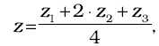

          - pričom z je po zaokrúhlení výsledný stupeň prospechu a zi je stupeň prospechu za úlohu č. i.

      - Úpravy pre žiakov so zdravotným znevýhodnením

      - Úloha č. 1

        - a) Ak ide o žiakov so zrakovým postihnutím, obrázky sa nahradia slovným opisom príslušnej situácie vo vyučovacom jazyku; grafy a schémy sa vynechajú.

        - b) Ak ide o žiakov so sluchovým postihnutím, nehodnotí sa jazyková správnosť.

      - Úloha č. 2

      - Ak ide o žiakov so sluchovým postihnutím, nehodnotí sa výslovnosť, intonácia a gramatická správnosť.

      - Trvanie skúšky: 30 minút

      - Čas na prípravu: 30 minút

      - SLOVENSKÝ JAZYK A LITERATÚRA

      - Každé maturitné zadanie obsahuje dve úlohy a súvisiace východiskové texty. Prvá úloha obsahuje učivo zo slovenského jazyka. Druhá úloha obsahuje učivo z literatúry.

      - Charakteristika úloh maturitných zadaní

      - Úloha č. 1 – Úloha je zameraná tak, aby žiak pri odpovedi prejavil pripravenosť komunikovať v štátnom jazyku, schopnosť jazykovo, kompozične a štylisticky analyzovať a interpretovať text a znalosť teoretického systému slovenského jazyka v rozsahu určenom katalógom cieľových požiadaviek a vzdelávacím štandardom. Zároveň má žiak preukázať schopnosť pohotovo reagovať na podnety, argumentovať a kriticky hodnotiť text; uplatňuje sa forma dialógu s členmi predmetovej maturitnej komisie.

      - Úloha č. 2 – Úloha je zameraná na schopnosť analyzovať, interpretovať a esteticky hodnotiť umelecký text a pritom uplatňovať vedomosti z literárnej teórie a literárnej histórie; uplatňuje sa forma dialógu s členmi predmetovej maturitnej komisie.

      - Zastúpenie jednotlivých tematických okruhov v úlohách maturitných zadaní je takéto:

      - Úlohy z jazyka

      - zvuková rovina jazyka a pravopis,

      - významová/lexikálna rovina jazyka,

      - tvarová/morfologická rovina jazyka,

      - skladobná/syntaktická rovina jazyka,

      - sloh,

      - jazykoveda,

      - jazyk a reč,

      - učenie sa,

      - práca s informáciami,

      - jazyková kultúra,

      - komunikácia.

      - Úlohy z literatúry

      - všeobecné pojmy,

      - literárne obdobia a smery,

      - literárne druhy,

      - literárne žánre,

      - štruktúra literárneho diela,

      - štylizácia textu,

      - metrika.

      - Všeobecné pomôcky

      - Krátky slovník slovenského jazyka

      - Synonymický slovník slovenčiny

      - Pravidlá slovenského pravopisu

      - Hodnotenie

        - a) Predmetová maturitná komisia hodnotí obsahovú kvalitu a úroveň jazykovej kultúry, t. j. jazykovú a gramatickú správnosť odpovede, rozsah slovnej zásoby, štylistickú pôsobivosť a stupeň rečovej pohotovosti.

        - b) Každá úloha maturitného zadania sa hodnotí stupňom prospechu 1 až 5.

        - c) Váha hodnotenia jednotlivých úloh je 3 : 2 alebo 1 : 1. Pri výpočte stupňa prospechu sa používa vzorec

      - 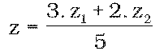

        - alebo vzorec

      - 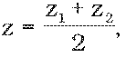

        - pričom z je po zaokrúhlení výsledný stupeň prospechu, z1 je známka za úlohu č. 1 a z2 je známka za úlohu č. 2. Príslušný vzorec je určený predmetovou komisiou pre jednotlivé triedy podľa formulácie maturitných zadaní.

        - d) Váha hodnotenia jednotlivých úloh pre gymnáziá s osemročným vzdelávacím programom môže byť aj v pomere 2 : 3. Pri výpočte stupňa prospechu sa používa vzorec

      - 

        - pričom z je po zaokrúhlení výsledný stupeň prospechu, z1 je známka za úlohu č. 1 a z2 je známka za úlohu č. 2.

      - Ustanovenie tohto písmena sa uplatňuje do 31. augusta 2015.

      - Úpravy pre žiakov so zdravotným znevýhodnením

      - Trvanie skúšky: 30 minút

      - Čas na prípravu: 40 minút.

      - SLOVENSKÝ JAZYK A SLOVENSKÁ LITERATÚRA

      - Každé zadanie obsahuje dve úlohy a východiskové texty.

      - Charakteristika úloh maturitných zadaní

      - Úloha č. 1 – Konverzácia

      - Aktualizovať a konkretizovať rozhovory, viesť rozhovor, ktorý nadväzuje na východiskový text, rozumieť tematickým okruhom z konverzácie, aktívne ovládať základnú slovnú zásobu konverzačných tém, zostaviť rozhovor na základe kľúčových slov alebo téz.

      - Úloha č. 2 – Literatúra

      - Prirodzená komunikácia o literárnom diele (kontextualita), schopnosť tvorivo interpretovať osvojené myšlienky a produkovať vlastné, objasňovať špecifiká, ktoré sú charakteristické pre slovenskú a maďarskú literatúru.

      - Zastúpenie jednotlivých tematických okruhov v úlohách maturitných zadaní je takéto:

      - konverzácia,

      - literatúra.

      - Všeobecné pomôcky

      - Slovník slovenského jazyka

      - Frazeologický slovník

      - Pravidlá slovenského pravopisu

      - Dvojjazyčné slovníky (slovensko-maďarský, maďarsko-slovenský)

      - Hodnotenie

        - a) Základom hodnotenia je rozsah slovnej zásoby, používanie gramatických štruktúr, stupeň jazykovej pohotovosti, obsahová stránka prejavu a pod.

        - b) Predmetová maturitná komisia hodnotí obsahovú a jazykovú správnosť odpovede, štruktúru – začiatok, vedenie a ukončenie rozhovoru.

        - c) Každá úloha maturitného zadania sa hodnotí stupňom prospechu 1 až 5.

        - d) Váha hodnotenia jednotlivých úloh je 3 : 2. Pri výpočte váženého priemeru sa používa vzorec

      - 

        - pričom z je po zaokrúhlení výsledný stupeň prospechu a zi je stupeň prospechu za úlohu č. i.

      - Úpravy pre žiakov so zdravotným znevýhodnením

      - Trvanie skúšky: 30 minút

      - Čas na prípravu: 40 minút

      - ŠPANIELSKY JAZYK

      - Každé zadanie pre všetky úrovne sa skladá z troch úloh.

      - Tematické okruhy sú uvedené v cieľových požiadavkách zo španielskeho jazyka.

      - Charakteristika úloh maturitných zadaní

      - Úloha č. 1 – Vizuálny podnet (napr. obrázok, fotografia, komiks, graf, schéma a pod.). Žiak opíše predložený obrázok a nachádza súvislosti medzi obrázkom a príslušnou maturitnou témou. Komisia hodnotí súvislosť opisu predloženého podnetu, lineárnosť (postupnosť) vo vyjadrovaní a adekvátne jazykové prostriedky zodpovedajúce danej úrovni žiaka.

      - Úloha č. 2 – Tematický okruh

      - Úlohou žiaka je zaujať stanovisko k téme a odôvodniť ho v rozhovore so skúšajúcimi, ktorí vedú rozhovor podľa zásad uvedených v metodických pokynoch pre predmetové maturitné komisie. Komisia hodnotí, ako žiak dokáže zdôvodniť a vysvetliť svoje názory na príslušnú tému a argumentovať k problematike, výber faktov a informácií, gramatiku.

      - Úloha č. 3 – Situačná úloha, dialóg s rozdelenými úlohami (stredné odborné školy aj rôzne modelové situácie zohľadňujúce príslušný študijný odbor). Žiak dostane za úlohu vyriešiť konkrétnu situáciu, napr. je na stanici a má sa informovať o najvýhodnejšom vlakovom spojení do nejakého mesta. Komisia sa zameriava na hodnotenie výberu a adekvátnosť použitia jazykových prostriedkov (v konkrétnej situácii z každodenného života v okruhu príslušných tém).

      - Všeobecné pomôcky

      - Obojstranný prekladový slovník obsahujúci najmenej 15 000 hesiel

      - Hodnotenie

        - a) Základom hodnotenia je rozsah slovnej zásoby, používanie gramatických štruktúr, stupeň jazykovej pohotovosti, obsahová stránka prejavu a pod.

        - b) Predmetová maturitná komisia hodnotí obsahovú a jazykovú správnosť odpovede, štruktúru – začiatok, vedenie a ukončenie rozhovoru.

        - c) Každá úloha maturitného zadania sa hodnotí stupňom prospechu 1 až 5.

        - d) Hodnotenie úlohy č. 1 sa skladá z dvoch samostatných hodnotení. Hodnotí sa

          - 1. obsahová primeranosť,

          - 2. jazyková správnosť.

        - e) Hodnotenie úlohy č. 2 sa skladá zo šiestich samostatných hodnotení. Hodnotí sa

          - 1. plynulosť vyjadrovania,

          - 2. výslovnosť a intonácia,

          - 3. obsah – náročnosť spracovania/kvalita rozhovoru,

          - 4. lexikálny rozsah,

          - 5. argumentácia,

          - 6. gramatická presnosť.

        - f) Hodnotenie úlohy č. 3 sa skladá z dvoch samostatných hodnotení.

      - Hodnotí sa

        - 1. obsahová a jazyková správnosť,

        - 2. pohotovosť vyjadrovania.

        - g) Váha hodnotenia jednotlivých úloh ústnej zložky je 1 : 2 : 1. Pri výpočte váženého priemeru sa používa vzorec

      - 

        - pričom z je po zaokrúhlení výsledný stupeň prospechu a zi je stupeň prospechu za úlohu č. i.

      - Úpravy pre žiakov so zdravotným znevýhodnením

      - Úloha č. 1

        - a) Ak ide o žiakov so zrakovým postihnutím, obrázky sa nahradia slovným opisom príslušnej situácie vo vyučovacom jazyku; grafy a schémy sa vynechajú.

        - b) Ak ide o žiakov so sluchovým postihnutím, nehodnotí sa jazyková správnosť.

      - Úloha č. 2

      - Ak ide o žiakov so sluchovým postihnutím, nehodnotí sa výslovnosť, intonácia a gramatická správnosť.

      - Trvanie skúšky: 30 minút

      - Čas na prípravu: 30 minút

      - TALIANSKY JAZYK

      - Každé zadanie pre všetky úrovne sa skladá z troch úloh.

      - Tematické okruhy sú uvedené v cieľových požiadavkách z talianskeho jazyka.

      - Charakteristika úloh maturitných zadaní

      - Úloha č. 1 – Vizuálny podnet (napr. obrázok, fotografia, komiks, graf, schéma a pod.). Žiak opíše predložený obrázok a nachádza súvislosti medzi obrázkom a príslušnou maturitnou témou. Komisia hodnotí súvislosť opisu predloženého podnetu, lineárnosť (postupnosť) vo vyjadrovaní a adekvátne jazykové prostriedky zodpovedajúce danej úrovni žiaka.

      - Úloha č. 2 – Tematický okruh

      - Úlohou žiaka je zaujať stanovisko k téme a odôvodniť ho v rozhovore so skúšajúcimi, ktorí vedú rozhovor podľa zásad uvedených v metodických pokynoch pre predmetové maturitné komisie. Komisia hodnotí, ako žiak dokáže zdôvodniť a vysvetliť svoje názory na príslušnú tému a argumentovať k problematike, výber faktov a informácií, gramatiku.

      - Úloha č. 3 – Situačná úloha, dialóg s rozdelenými úlohami (stredné odborné školy aj rôzne modelové situácie zohľadňujúce príslušný študijný odbor). Žiak dostane za úlohu vyriešiť konkrétnu situáciu, napr. je na stanici a má sa informovať o najvýhodnejšom vlakovom spojení do nejakého mesta. Komisia sa zameriava na hodnotenie výberu a adekvátnosť použitia jazykových prostriedkov (v konkrétnej situácii z každodenného života v okruhu príslušných tém).

      - Všeobecné pomôcky

      - Obojstranný prekladový slovník obsahujúci najmenej 15 000 hesiel

      - Hodnotenie

        - a) Základom hodnotenia je rozsah slovnej zásoby, používanie gramatických štruktúr, stupeň jazykovej pohotovosti, obsahová stránka prejavu a pod.

        - b) Predmetová maturitná komisia hodnotí obsahovú a jazykovú správnosť odpovede, štruktúru – začiatok, vedenie a ukončenie rozhovoru.

        - c) Každá úloha maturitného zadania sa hodnotí stupňom prospechu 1 až 5.

        - d) Hodnotenie úlohy č. 1 sa skladá z dvoch samostatných hodnotení. Hodnotí sa

          - 1. obsahová primeranosť,

          - 2. jazyková správnosť.

        - e) Hodnotenie úlohy č. 2 sa skladá zo šiestich samostatných hodnotení. Hodnotí sa

          - 1. plynulosť vyjadrovania,

          - 2. výslovnosť a intonácia,

          - 3. obsah – náročnosť spracovania/kvalita rozhovoru,

          - 4. lexikálny rozsah,

          - 5. argumentácia,

          - 6. gramatická presnosť.

        - f) Hodnotenie úlohy č. 3 sa skladá z dvoch samostatných hodnotení. Hodnotí sa

          - 1. obsahová a jazyková správnosť,

          - 2. pohotovosť vyjadrovania.

        - g) Váha hodnotenia jednotlivých úloh ústnej zložky je 1 : 2 : 1. Pri výpočte váženého priemeru sa používa vzorec

      - 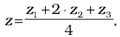

        - pričom z je po zaokrúhlení výsledný stupeň prospechu a zi je stupeň prospechu za úlohu č. i.

      - Úpravy pre žiakov so zdravotným znevýhodnením

      - Úloha č. 1

        - a) Ak ide o žiakov so zrakovým postihnutím, obrázky sa nahradia slovným opisom príslušnej situácie vo vyučovacom jazyku; grafy a schémy sa vynechajú.

        - b) Ak ide o žiakov so sluchovým postihnutím, nehodnotí sa jazyková správnosť.

      - Úloha č. 2

      - Ak ide o žiakov so sluchovým postihnutím, nehodnotí sa výslovnosť, intonácia a gramatická správnosť.

      - Trvanie skúšky: 30 minút

      - Čas na prípravu: 30 minút

      - UKRAJINSKÝ JAZYK A LITERATÚRA

      - Každé zadanie obsahuje dve úlohy a východiskový literárny text. Jedna z úloh musí obsahovať učivo z ukrajinského jazyka.

      - Ak by literárny text neobsahoval vhodné podnety pre úlohu z jazyka, môže byť k tejto úlohe pripojený ešte špecifický text.

      - Charakteristika úloh maturitných zadaní

      - Úloha č. 1 – Úloha je zameraná na reprodukciu vedomostí z literárnej histórie a teórie literatúry (prevláda forma monológu) a na následnú schopnosť uplatniť tieto vedomosti pri interpretácii textu literárnej ukážky (prevláda forma dialógu s členmi predmetovej maturitnej komisie). Úloha môže mať tieto varianty:

        - a) variant – ak je úloha zameraná historicky, jej obsahom je priblíženie literárno-umeleckého obdobia a prehľad o najvýznamnejších autoroch (2 až 3) s ideovou, tematickou a umeleckou charakteristikou ich najdôležitejších diel a následná analýza a hodnotenie textu na základe argumentácie (dokazovanie vlastných tvrdení prvkami z textu),

        - b) variant – ak je úloha zameraná tematicky, jej obsahom je priblíženie odlišného stvárnenia príslušnej témy v rôznych dielach a následná analýza a hodnotenie textu na základe argumentácie (dokazovanie vlastných tvrdení prvkami z textu),

        - c) variant – ak je úloha zameraná na problematiku žánrovej formy, jej obsahom je definovanie žánrovej formy, náčrt jej historického vývinu, resp. prehľad modifikácií žánru u rôznych autorov a následná analýza a hodnotenie textu na základe argumentácie (dokazovanie vlastných tvrdení prvkami z textu).

      - Úloha č. 2 – Úloha je zameraná tak, aby žiak pri odpovedi prejavil svoju pripravenosť demonštrovať znalosť teoretického systému ukrajinského jazyka určenú základnými pedagogickými dokumentmi a svoju schopnosť uplatniť tieto vedomosti pri vysvetľovaní konkrétnych jazykových javov, ktoré sa vyskytli v texte literárnej ukážky (prevláda forma dialógu s členmi predmetovej maturitnej komisie).

      - Zastúpenie jednotlivých tematických okruhov v úlohách maturitných zadaní je takéto:

      - Úlohy z literatúry

      - ukrajinská literatúra,

      - svetová literatúra,

      - teória literatúry.

      - Úlohy z jazyka

      - lexikológia a frazeológia,

      - morfológia,

      - zvuková a grafická stránka jazyka,

      - syntax,

      - práca s informáciami,

      - všeobecné poznatky o jazyku,

      - štylistika.

      - Všeobecné pomôcky

      - Slovensko-ukrajinský slovník

      - Hodnotenie

        - a) Predmetová maturitná komisia hodnotí obsahovú kvalitu a jazykovú správnosť odpovede, t. j. rozsah slovnej zásoby, gramatickú správnosť, štylistickú pôsobivosť a stupeň rečovej pohotovosti.

        - b) Každá úloha maturitného zadania sa hodnotí stupňom prospechu 1 až 5.

        - c) Váha hodnotenia jednotlivých úloh je 3 : 2. Pri výpočte váženého priemeru sa používa vzorec

      - 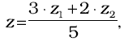

        - pričom z je po zaokrúhlení výsledný stupeň prospechu a zi je stupeň prospechu za úlohu č. i.

      - Úpravy pre žiakov so zdravotným znevýhodnením

      - Trvanie skúšky: 30 minút

      - Čas na prípravu: 40 minút

      - DEJINY UMENIA

      - Charakteristika úloh maturitných zadaní

      - Úloha č. 1 – Úloha je zameraná na vysvetlenie základných znakov daného obdobia a ich odrazu v umení, konkrétne najmä v architektúre ako najmocnejšom nástroji každej vlády v oblasti umenia. Obvykle sa v tejto časti otázky vyžaduje aj vysvetlenie základných znakov architektúry, jej najvýznamnejších predstaviteľov a ich diela. K úlohe patrí aj učebná pomôcka. Ide najmä o obrazové materiály, prostredníctvom ktorých žiak dokumentuje znaky daného obdobia (prevláda forma dialógu s členmi predmetovej maturitnej komisie).

      - Úloha č. 2 – Úloha je obvykle zameraná na vysvetlenie a opísanie prevládajúcich druhov umenia v danom období (najčastejšie ide o maľbu a plastiku). K úlohe patrí aj učebná pomôcka (obrazový materiál týkajúci sa umeleckých predmetov z oblasti maliarstva a sochárstva). Žiak prostredníctvom obrazového materiálu opíše základné znaky maľby a plastiky v danom období (prevláda forma dialógu s členmi predmetovej maturitnej komisie).

      - Úloha č. 3 – Úloha je obvykle zameraná na encyklopedické vedomosti žiaka. Ide v nej o vymenovanie najvýznamnejších osobností a ich diel daného obdobia (prevláda forma monológu). Zastúpenie jednotlivých tematických okruhov v úlohách maturitných zadaní je takéto:

      - periodizácia dejín umenia, základné rozdelenie umeleckých druhov, umenie praveku,

      - staroveké umenie,

      - stredoveké umenie,

      - umenie novoveku,

      - umenie 20. storočia.

      - Zastúpenie uvedených jednotlivých častí učiva v súbore všetkých otázok v maturitných zadaniach je takéto: približne 90 % svetové dejiny umenia, približne 10 % národné dejiny umenia.

      - Všeobecné pomôcky

      - Dejiny umenia, Pijoan 1 až 10

      - Učebnica Dejiny umenia pre stredné školy

      - Učebnica Estetická výchova pre stredné školy

      - Hodnotenie

        - a) Každá úloha maturitného zadania sa hodnotí stupňom prospechu 1 až 5.

        - b) Hodnotením maturitnej skúšky z dejín umenia bude stupeň prospechu, ktorý vznikne ako vážený priemer stupňov prospechu z odpovedí na jednotlivé úlohy maturitného zadania.

        - c) Váha hodnotenia jednotlivých úloh je 3 : 4 : 3. Pri výpočte váženého priemeru sa používa vzorec

        - 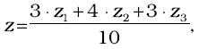

          - pričom z je po zaokrúhlení výsledný stupeň prospechu a zi je stupeň prospechu za úlohu č. i.

      - Úpravy pre žiakov so zdravotným znevýhodnením

      - Trvanie skúšky: 30 minút

      - Čas na prípravu: 30 minút

      - DESKRIPTÍVNA GEOMETRIA

      - Charakteristika úloh maturitných zadaní

      - Úloha č. 1 – Žiak teoreticky opíše presne určený pojem, vzťah súvisiaci s príslušnou témou. Podľa povahy úlohy môže žiak používať učebnú pomôcku (prevláda forma monológu).

      - Úloha č. 2 – Žiak rieši konkrétnu úlohu, v ktorej aplikuje získané teoretické vedomosti z určitých tematických celkov a pri riešení úlohy pracuje s rysovacími pomôckami (prevláda samostatná práca, v ktorej sa hodnotí aj technické riešenie úlohy).

      - Zastúpenie jednotlivých tematických okruhov v úlohách maturitných zadaní je takéto:

      - základné pojmy zo stereometrie,

      - základné pojmy pri premietaní a druhy zobrazovaní,

      - kolmé premietanie na dve priemetne,

      - kolmá axonometria,

      - kolmé premietanie na jednu priemetňu,

      - stredové premietanie,

      - počítačová grafika.

      - Všeobecné pomôcky

      - Modely geometrických telies

      - Rysovacie potreby (ceruzka, kružidlo, lineárne pravítko, trojuholník s ryskou, guma)

      - Papier na rysovanie

      - PC

      - Hodnotenie

        - a) Každá úloha maturitného zadania sa hodnotí stupňom prospechu 1 až 5.

        - b) Hodnotenie úlohy č. 1 predstavuje stupeň prospechu z1.

        - c) Hodnotenie úlohy č. 2 sa skladá z dvoch samostatných hodnotení. Hodnotí sa

          - 1. samostatné riešenie úlohy, čo predstavuje stupeň prospechu z2,

          - 2. technické riešenie úlohy, čo predstavuje stupeň prospechu z3, pričom váha hodnotenia tejto úlohy je v pomere 2 : 1.

        - d) Hodnotením maturitnej skúšky z deskriptívnej geometrie bude stupeň prospechu, ktorý vznikne ako vážený priemer stupňov prospechu z odpovedí na jednotlivé úlohy maturitného zadania.

        - e) Váha hodnotenia jednotlivých úloh je 2 : 2 : 1. Pri výpočte váženého priemeru sa používa vzorec

        - 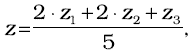

          - pričom z je po zaokrúhlení výsledný stupeň prospechu.

      - Úpravy pre žiakov so zdravotným znevýhodnením

      - Trvanie skúšky: 30 minút

      - Čas na prípravu: 30 minút

      - EKOLÓGIA

      - Charakteristika úloh maturitných zadaní

      - Úloha č. 1 – Úloha je zameraná na reprodukciu základných teoretických vedomostí, prehľad a orientáciu v problematike (prevláda forma monológu).

      - Úloha č. 2 – Úloha je zameraná na praktickú aplikáciu osvojených vedomostí, najmä s dôrazom na otázky zdravia človeka, ekologickú a environmentálnu problematiku (prevláda forma dialógu s členmi predmetovej maturitnej komisie).

      - Zastúpenie jednotlivých tematických okruhov v úlohách maturitných zadaní je takéto:

      - ekológia ako vedná disciplína,

      - vzťahy medzi organizmami a prostredím,

      - populácia,

      - biologické spoločenstvo,

      - ekosystémy,

      - lesný ekosystém,

      - lúčny ekosystém,

      - poľný ekosystém,

      - vodný ekosystém,

      - ochrana prírody,

      - prostredie človeka a jeho zdravie,

      - ekológia, etológia.

      - Všeobecné pomôcky

      - Červené knihy ohrozených druhov

      - Atlas chránených rastlín

      - Atlas chránených živočíchov

      - Agenda 21

      - Trvalo udržateľný rozvoj

      - Zelená budúcnosť

      - Ekologické značky

      - Mapy chránených oblastí Slovenska

      - Publikácie o národných parkoch

      - Zákon o ochrane prírody

      - Správa o stave životného prostredia Slovenskej republiky (Ministerstvo životného prostredia Slovenskej republiky)

      - Hodnotenie

        - a) Každá úloha maturitného zadania sa hodnotí stupňom prospechu 1 až 5.

        - b) Hodnotením maturitnej skúšky z ekológie bude stupeň prospechu, ktorý vznikne ako vážený priemer stupňov prospechu z odpovedí na jednotlivé úlohy maturitného zadania.

        - c) Váha hodnotenia jednotlivých úloh je 2 : 3. Pri výpočte váženého priemeru sa používa vzorec

        - 

          - pričom z je po zaokrúhlení výsledný stupeň prospechu a zi je stupeň prospechu za úlohu č. i.

      - Úpravy pre žiakov so zdravotným znevýhodnením

      - Trvanie skúšky: 30 minút

      - Čas na prípravu: 30 minút

      - EKONOMIKA

      - Charakteristika úloh maturitných zadaní

      - Úloha č. 1 – Úloha je zameraná na vedomosti a porozumenie. Žiak má preukázať znalosť pojmového aparátu a uviesť súvislosti. V úlohe je presne stanovený pojem, fakt, definícia, ekonomický jav alebo proces, ktorého znalosti má žiak odpoveďou preukázať (prevláda forma monológu).

      - Úloha č. 2 – Úloha je zameraná na aplikáciu a analýzu.

      - Žiak v tejto úlohe preukáže schopnosť aplikovať získané poznatky z ekonómie a ekonomiky v praktickom živote. Posúdi a zváži rôzne alternatívy riešenia ekonomických problémov, zdôvodní a obháji vlastný prístup k ich riešeniu. V úlohe sa presne definujú požiadavky na žiakovu odpoveď, napr. zaradiť do sociálnych a politických súvislostí ekonomické problémy, určiť dôsledky jedného alebo viacerých ekonomických javov či procesov, analyzovať príčiny, porovnať rôzne názory na príslušný problém či zdôvodniť vlastný názor (prevláda forma dialógu s členmi predmetovej maturitnej komisie).

      - Zastúpenie jednotlivých tematických okruhov v úlohách maturitných zadaní je takéto:

      - historická podmienenosť ekonomiky,

      - trhový mechanizmus a jeho pôsobenie,

      - trh výrobných činiteľov,

      - organizácia a formy podnikania,

      - makroekonomické pojmy a vzťahy,

      - peniaze a bankový systém,

      - ekonomická úloha štátu,

      - svetové hospodárstvo.

      - Všeobecné pomôcky

      - Obchodný zákonník

      - Zákon o živnostenskom podnikaní

      - Zákon o Národnej banke Slovenska

      - Občiansky zákonník

      - Ekonomický slovník

      - Hodnotenie

        - a) Každá úloha maturitného zadania sa hodnotí stupňom prospechu 1 až 5.

        - b) Hodnotením maturitnej skúšky z ekonomiky bude stupeň prospechu, ktorý vznikne ako vážený priemer stupňov prospechu z odpovedí na jednotlivé úlohy maturitného zadania.

        - c) Váha hodnotenia jednotlivých úloh je 2 : 3. Pri výpočte váženého priemeru sa používa vzorec

        - 

          - pričom z je po zaokrúhlení výsledný stupeň prospechu a zi je stupeň prospechu za úlohu č. i.

      - Úpravy pre žiakov so zdravotným znevýhodnením

      - Trvanie skúšky: 30 minút

      - Čas na prípravu: 30 minút

      - ESTETIKA

      - Charakteristika úloh maturitných zadaní

      - Úloha č. 1 – Úloha je zameraná na vedomosti a porozumenie.

      - Žiak má preukázať znalosť pojmového aparátu a uviesť súvislosti. V úlohe je presne stanovený pojem, fakt, definícia, estetický jav alebo proces, ktorého znalosti má žiak odpoveďou preukázať (prevláda forma monológu).

      - Úloha č. 2 – Úloha je zameraná na aplikáciu a analýzu. Žiak v tejto úlohe preukáže orientáciu v zadanej úlohe, charakterizuje základné znaky zvoleného druhu umenia, osobností a ich diel. Ako názornú pomôcku a argument používa odbornú literatúru, hudobné ukážky, no najmä archív vlastných prác. Sú to kópie typických pamiatok architektúry, sochárstva, maliarstva, eseje a úvahy, pokusy o scenár, divadelný výstup, remeslo či dizajn, testy na estetický vnem a vlastná tvorba. Žiak je pripravený na dialóg s členmi predmetovej maturitnej komisie a dokáže zdôvodniť vlastné názory a estetický súd.

      - Zastúpenie jednotlivých tematických okruhov v úlohách maturitných zadaní je takéto:

      - problematika estetiky a estetickej výchovy,

      - úžitkové umenie,

      - populárne a zábavné žánre,

      - estetika architektúry,

      - estetika sochárstva,

      - estetika maliarstva,

      - estetika hudby,

      - estetika fotografie a filmu,

      - estetika divadla,

      - estetika tanca a baletu,

      - estetika ľudového umenia a insity,

      - galérie a múzeá.

      - Všeobecné pomôcky

      - Dejiny výtvarných umení a ostatných druhov umenia

      - Monografie umelcov

      - Hudobné ukážky

      - Bulletiny, katalógy, pohľadnice, fotografie

      - Hodnotenie

        - a) Každá úloha maturitného zadania sa hodnotí stupňom prospechu 1 až 5.

        - b) Hodnotením maturitnej skúšky z estetiky bude stupeň prospechu, ktorý vznikne ako vážený priemer stupňov prospechu z odpovedí na jednotlivé úlohy maturitného zadania.

        - c) Váha hodnotenia jednotlivých úloh je 2 : 3. Pri výpočte váženého priemeru sa používa vzorec

        - 

          - pričom z je po zaokrúhlení výsledný stupeň prospechu a zi je stupeň prospechu za úlohu č. i.

      - Úpravy pre žiakov so zdravotným znevýhodnením

      - Trvanie skúšky: 30 minút

      - Čas na prípravu: 30 minút

      - EVANJELICKÉ A. V. NÁBOŽENSTVO

      - Charakteristika úloh maturitných zadaní

      - Úloha č. 1 – Úloha je zameraná viac na vedomosti a porozumenie. V úlohe je presne určená a definovaná pravda, historický jav, o ktorých má žiak preukázať svoje vedomosti (prevláda forma monológu).

      - Úloha č. 2 – Úloha je zameraná viac na aplikáciu niektorej pravdy alebo prikázania v praktickom živote. Žiak v nej má zaujať stanovisko k danej problematike a podložiť ho učením cirkvi, vie sa vyjadrovať k aktuálnym otázkam z tejto oblasti (prevláda forma dialógu s členmi predmetovej maturitnej komisie).

      - Zastúpenie jednotlivých tematických okruhov v úlohách maturitných zadaní je takéto:

      - človek hľadá Boha, Boh hľadá človeka,

      - život v spoločenstve,

      - život človeka ako odpoveď na lásku Boha k nám.

      - Všeobecné pomôcky

      - Biblia

      - Biblický slovník

      - Symbolické knihy

      - Evanjelický spevník

      - Mapy, atlasy, obrazový materiál, ukážky textov, kartotečné lístky (škola si pripraví sama).

      - Hodnotenie

        - a) Každá úloha maturitného zadania sa hodnotí stupňom prospechu 1 až 5.

        - b) Hodnotením maturitnej skúšky z evanjelického a. v. náboženstva bude stupeň prospechu, ktorý vznikne ako vážený priemer stupňov prospechu z odpovedí na jednotlivé úlohy maturitného zadania.

        - c) Váha hodnotenia jednotlivých úloh je 1 : 2. Pri výpočte váženého priemeru sa používa vzorec

        - 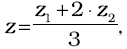

          - pričom z je po zaokrúhlení výsledný stupeň prospechu a zi je stupeň prospechu za úlohu č. i.

      - Úpravy pre žiakov so zdravotným znevýhodnením

      - Trvanie skúšky: 30 minút

      - Čas na prípravu: 30 minút

      - KRESANSKÁ ETIKA

      - Charakteristika úloh maturitných zadaní

      - Úloha č. 1 – Úloha je zameraná viac na vedomosti a porozumenie. V úlohe je presne určený etický problém, historický jav, stanovisko cirkvi, o ktorých má žiak preukázať vedomosti (prevláda forma monológu).

      - Úloha č. 2 – Úloha je zameraná viac na aplikáciu problému, javu, stanoviska v praktickom živote. Žiak vie zaujať stanovisko k problému a podložiť ho učením cirkvi, vie sa vyjadrovať k aktuálnym otázkam z tejto oblasti (prevláda forma dialógu s členmi predmetovej maturitnej komisie).

      - Zastúpenie jednotlivých tematických okruhov v úlohách maturitných zadaní je takéto:

      - základné pojmy a princípy etiky a morálky,

      - základná orientácia vo svetových náboženstvách,

      - nebezpečenstvo a prevencia drogovej závislosti,

      - vzťah muža a ženy, základy sexuálnej etiky,

      - rodina, jej význam a úlohy v spoločnosti,

      - prehľad hlavných etických smerov v dejinách,

      - základné princípy sociálnej etiky,

      - špeciálne etické problémy súčasnosti.

      - Všeobecné pomôcky

      - Sväté Písmo

      - Dokumenty katolíckej cirkvi

      - Ukážky textov k rôznym etickým otázkam, etické diela filozofov

      - Hodnotenie

        - a) Každá úloha maturitného zadania sa hodnotí stupňom prospechu 1 až 5.

        - b) Hodnotením maturitnej skúšky z kresťanskej etiky bude stupeň prospechu, ktorý vznikne ako vážený priemer stupňov prospechu z odpovedí na jednotlivé úlohy maturitného zadania.

        - c) Váha hodnotenia jednotlivých úloh je 1 : 2. Pri výpočte váženého priemeru sa používa vzorec

        - 

          - pričom z je po zaokrúhlení výsledný stupeň prospechu a zi je stupeň prospechu za úlohu č. i.

      - Úpravy pre žiakov so zdravotným znevýhodnením

      - Trvanie skúšky: 30 minút

      - Čas na prípravu: 30 minút

      - LATINČINA

      - Charakteristika úloh maturitných zadaní

      - Úloha č. 1 – Úloha je zameraná na prečítanie a preklad súvislého jednoduchšieho textu v rozsahu 3 – 8 viet (podľa obťažnosti). Pod textom odporúčame uviesť neznáme slovíčka, ktoré nie sú v slovnej zásobe, ktorú žiak študoval. Žiak má vysvetliť určené gramatické a syntaktické javy v texte (prevláda forma monológu).

      - Úloha č. 2 – Úloha je zameraná na vysvetlenie významu 2 až 3 cudzích slov a ich odvodenie, poukázanie na výskyt v inom cudzom jazyku. Žiak v tejto úlohe preukáže schopnosť preložiť a vysvetliť význam živých latinských slov (prevláda forma monológu).

      - Úloha č. 3 – Úloha je zameraná na prezentáciu základných informácií z jedného tematického okruhu (prevláda forma dialógu s členmi predmetovej maturitnej komisie).

      - Všeobecné pomôcky

      - Latinsko-slovenský slovník

      - Školský atlas dejín

      - Latinské texty

      - Hodnotenie

        - a) Každá úloha maturitného zadania sa hodnotí stupňom prospechu 1 až 5.

        - b) Hodnotením maturitnej skúšky z latinčiny bude stupeň prospechu, ktorý vznikne ako vážený priemer stupňov prospechu z odpovedí na jednotlivé úlohy maturitného zadania.

        - c) Váha hodnotenia jednotlivých úloh je 5 : 2 : 3. Pri výpočte váženého priemeru sa používa vzorec

        - 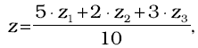

          - pričom z je po zaokrúhlení výsledný stupeň prospechu a zi je stupeň prospechu za úlohu č. i.

      - Úpravy pre žiakov so zdravotným znevýhodnením

      - Trvanie skúšky: 30 minút

      - Čas na prípravu: 30 minút

      - PRÁVO

      - Charakteristika úloh maturitných zadaní

      - Úloha č. 1 – Úloha je zameraná na vedomosti a porozumenie. Žiak má preukázať znalosť pojmového aparátu a uviesť súvislosti. V úlohe je presne stanovený pojem, fakt, definícia, jav alebo proces, ktorého znalosti má žiak odpoveďou preukázať (prevláda forma monológu).

      - Úloha č. 2 – Úloha je zameraná na analýzu vybraných úloh a zodpovedanie podotázok viažucich sa na text. Žiak v tejto úlohe preukáže schopnosť aplikovať získané poznatky z práva v praktickom živote. Posúdi a zváži rôzne alternatívy riešenia právnických problémov, zdôvodní a obháji vlastný prístup k ich riešeniu (prevláda forma dialógu s členmi predmetovej maturitnej komisie).

      - Zastúpenie jednotlivých tematických okruhov v úlohách maturitných zadaní je takéto:

      - právo a jeho úloha v spoločnosti,

      - právny systém,

      - odvetvia práva,

      - rodinné právo,

      - občianske právo,

      - obchodné právo,

      - trestné právo,

      - pracovné právo,

      - finančné právo,

      - právo životného prostredia,

      - správne právo,

      - medzinárodné právo.

      - Všeobecné pomôcky

      - Ústava Slovenskej republiky

      - Občiansky zákonník

      - Občiansky súdny poriadok

      - Obchodný zákonník

      - Trestný zákon

      - Zákonník práce

      - Colný zákon

      - Zákon o poisťovníctve

      - Hodnotenie

        - a) Každá úloha maturitného zadania sa hodnotí stupňom prospechu 1 až 5.

        - b) Hodnotením maturitnej skúšky z práva bude stupeň prospechu, ktorý vznikne ako vážený priemer stupňov prospechu z odpovedí na jednotlivé úlohy maturitného zadania.

        - c) Váha hodnotenia jednotlivých úloh je 1 : 2. Pri výpočte váženého priemeru sa používa vzorec

        - 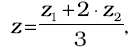

          - pričom z je po zaokrúhlení výsledný stupeň prospechu a zi je stupeň prospechu za úlohu č. i.

      - Úpravy pre žiakov so zdravotným znevýhodnením

      - Trvanie skúšky: 30 minút

      - Čas na prípravu: 30 minút

      - PSYCHOLÓGIA

      - Charakteristika úloh maturitných zadaní

      - Úloha č. 1 – Úloha je zameraná na vedomosti a porozumenie.

      - V úlohe je presne určený pojem, fakt, definícia, jav alebo proces, o ktorom má žiak preukázať svoje vedomosti, a je určená učebná pomôcka i spôsob práce s ňou, napr. schéma, mapa a opis, ilustrácia (prevláda forma monológu).

      - Úloha č. 2 – Úloha je zameraná na aplikáciu a analýzu. V úlohe sa presne definuje, čo sa od žiaka očakáva, napr. klasifikovať javy, udalosti, porovnať dva alebo viac javov alebo procesov, určiť príčiny alebo dôsledky jedného alebo viacerých javov či procesov a pod. K úlohe je určená aj učebná pomôcka (schéma, piktogram, mapa, literárny prameň, graf, karikatúra a pod.) a opis, čo má žiak urobiť (prevláda forma dialógu s členmi predmetovej maturitnej komisie).

      - Zastúpenie jednotlivých tematických okruhov v úlohách maturitných zadaní je takéto:

      - všeobecná psychológia,

      - psychológia osobnosti,

      - sociálna psychológia.

      - Hodnotenie

        - a) Každá úloha maturitného zadania sa hodnotí stupňom prospechu 1 až 5.

        - b) Hodnotením maturitnej skúšky zo psychológie bude stupeň prospechu, ktorý vznikne ako vážený priemer stupňov prospechu z odpovedí na jednotlivé úlohy maturitného zadania.

        - c) Váha hodnotenia jednotlivých úloh je 2 : 3. Pri výpočte váženého priemeru sa používa vzorec

        - 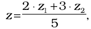

          - pričom z je po zaokrúhlení výsledný stupeň prospechu a zi je stupeň prospechu za úlohu č. i.

      - Úpravy pre žiakov so zdravotným znevýhodnením

      - Trvanie skúšky: 30 minút

      - Čas na prípravu: 30 minút

      - REFORMOVANÉ NÁBOŽENSTVO

      - Charakteristika úloh maturitných zadaní

      - Úloha č. 1 – Úloha je zameraná na vedomosti a porozumenie.

      - V úlohe je presne určená a definovaná pravda, historický jav, biblický príbeh, osobnosť alebo učenie, o ktorých má žiak preukázať svoje vedomosti (prevláda forma monológu).

      - Úloha č. 2 – Úloha je zameraná na aplikáciu a analýzu.

      - Žiak vykoná analýzu príslušnej problematiky na základe učenia Písma Svätého a symbolických kníh a aplikuje ju v kontexte súčasnosti a dejín cirkví (prevláda forma dialógu s členmi predmetovej maturitnej komisie).

      - Zastúpenie jednotlivých tematických okruhov v úlohách maturitných zadaní je takéto:

      - Boží plán spásy v Písme Svätom,

      - dejiny cirkvi,

      - reformovaná dogmatika a etika.

      - Všeobecné pomôcky

      - Biblia

      - Biblický slovník

      - Symbolické knihy

      - Spevník Reformovanej kresťanskej cirkvi

      - Mapy, atlasy, obrazový materiál

      - Hodnotenie

        - a) Každá úloha maturitného zadania sa hodnotí stupňom prospechu 1 až 5.

        - b) Hodnotením maturitnej skúšky z reformovaného náboženstva bude stupeň prospechu, ktorý vznikne ako vážený priemer stupňov prospechu z odpovedí na jednotlivé úlohy maturitného zadania.

        - c) Váha hodnotenia jednotlivých úloh je 2 : 3. Pri výpočte váženého priemeru sa používa vzorec

        - 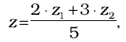

          - pričom z je po zaokrúhlení výsledný stupeň prospechu a zi je stupeň prospechu za úlohu č. i.

      - Úpravy pre žiakov so zdravotným znevýhodnením

      - Trvanie skúšky: 30 minút

      - Čas na prípravu: 30 minút

      - KATOLÍCKE NÁBOŽENSTVO

      - Charakteristika úloh maturitných zadaní

      - Úloha č. 1 – Úloha je zameraná viac na vedomosti a porozumenie. V úlohe je presne určená a definovaná pravda, historický jav, o ktorých má žiak preukázať svoje vedomosti (prevláda forma monológu).

      - Úloha č. 2 – Úloha je zameraná viac na aplikáciu niektorej pravdy alebo prikázania v praktickom živote. Žiak v nej má zaujať stanovisko k problematike a podložiť ho učením cirkvi, vie sa vyjadrovať k aktuálnym otázkam z tejto oblasti (prevláda forma dialógu s členmi predmetovej maturitnej komisie).

      - Zastúpenie jednotlivých tematických okruhov v úlohách maturitných zadaní je takéto:

      - vyznanie viery,

      - sviatosť viery,

      - život z viery,

      - modlitba v živote viery.

      - Všeobecné pomôcky

      - Sväté písmo, mapy, atlasy, obrazový materiál a ukážky textov

      - Hodnotenie

        - a) Každá úloha maturitného zadania sa hodnotí stupňom prospechu 1 až 5.

        - b) Hodnotením maturitnej skúšky z katolíckeho náboženstva bude stupeň prospechu, ktorý vznikne ako vážený priemer stupňov prospechu z odpovedí na jednotlivé úlohy maturitného zadania.

        - c) Váha hodnotenia jednotlivých úloh je 1 : 2. Pri výpočte váženého priemeru sa používa vzorec

        - 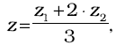

          - pričom z je po zaokrúhlení výsledný stupeň prospechu a zi je stupeň prospechu za úlohu č. i.

      - Úpravy pre žiakov so zdravotným znevýhodnením

      - Trvanie skúšky: 30 minút

      - Čas na prípravu: 30 minút

      - STRETNUTIA S ĽUDOVOU KULTÚROU

      - Charakteristika úloh maturitných zadaní

      - Úloha č. 1 – Úloha je zameraná na vysvetlenie základných znakov daného obdobia a ich odrazu v umení, architektúre, maliarstve, sochárstve, umeleckých remeslách, teórii výtvarného umenia, technike. K úlohe patrí učebná pomôcka – obrazová príloha (prevláda forma dialógu s členmi predmetovej maturitnej komisie).

      - Úloha č. 2 – Úloha je zameraná na vysvetlenie základných znakov, technologických postupov v ľudovej kultúre – porovnanie, opis chronológie vývoja, reprodukovanie základných pojmov a definícií. K úlohe je určená učebná pomôcka – obrazová príloha, výrobky ľudovej kultúry, ktorými žiak dokumentuje znaky daného remesla, technológie atď. (prevláda forma dialógu s členmi predmetovej maturitnej komisie).

      - Úloha č. 3 – Úloha je zameraná na analýzu a rozbor vybraných umeleckých ukážok, na encyklopedické vedomosti žiaka. Ide o schopnosť žiaka porovnať a zaradiť ukážky do jednotlivých smerov a slohov (prevláda forma monológu).

      - Zastúpenie uvedených jednotlivých častí učiva v súbore všetkých otázok v maturitných zadaniach je takéto:

      - ľudová kultúra,

      - dejiny umenia a umeleckoremeselná práca.

      - Všeobecné pomôcky

      - Obrazové prílohy

      - Výrobky ľudovej kultúry

      - Hodnotenie

        - a) Každá úloha maturitného zadania sa hodnotí stupňom prospechu 1 až 5.

        - b) Hodnotením maturitnej skúšky zo stretnutia s ľudovou kultúrou bude stupeň prospechu, ktorý vznikne ako vážený priemer stupňov prospechu z odpovedí na jednotlivé úlohy maturitného zadania.

        - c) Váha hodnotenia jednotlivých úloh v základnej úrovni je 3 : 4 : 3. Pri výpočte váženého priemeru sa používa vzorec

        - 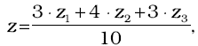

          - pričom z je po zaokrúhlení výsledný stupeň prospechu a zi je stupeň prospechu za úlohu č. i.

      - Úpravy pre žiakov so zdravotným znevýhodnením

      - Trvanie skúšky: 30 minút

      - Čas na prípravu: 30 minút

      - ŠPORTOVÝ MANAŽMENT

      - Charakteristika úloh maturitných zadaní

      - Úloha č. 1 – Úloha je zameraná na vedomosti a porozumenie.

      - V úlohe je presne určený pojem, fakt, definícia, historický jav alebo proces, o ktorom má žiak preukázať svoje vedomosti (prevláda forma monológu).

      - Úloha č. 2 – Úloha je zameraná na aplikáciu a analýzu. V úlohe žiak prezentuje vlastné argumentačné schopnosti pri riešení problematiky, ako aj potrebnú aplikačnú asociáciu z pohľadu nižšieho riadiaceho pracovníka v športe (prevláda forma dialógu s členmi predmetovej maturitnej komisie).

      - Zastúpenie uvedených jednotlivých častí učiva v súbore všetkých otázok v maturitných zadaniach je takéto:

      - 30 % oblasť športového manažmentu sa zaoberá definovaním športového manažmentu, aplikáciou východísk, princípov a zákonitostí manažmentu na šport a ekonomickou charakteristikou športu; poskytuje orientáciu v terminológii a formuluje základné východiská športového manažmentu,

      - 30 % riadením zdrojov v športe sa riešia otázky identifikácie, rozvoja a akumulácie zdrojov v športovom manažmente; vychádza sa z analýzy športového priemyslu a z jeho vnútorných i vonkajších zdrojov,

      - 40 % športový marketing definuje trh v športe a úlohu marketingu; zaoberá sa využívaním marketingových mechanizmov v športe; vychádza predovšetkým z poznatkov, ktoré žiaci získali v predmete ekonomika (kapitola Marketing) a vysvetľuje ich aplikáciu v športe; zároveň dopĺňa poznatky o špeciálne marketingové činnosti viazané na oblasť športu.

      - Všeobecné pomôcky

      - Atlas svetových a domácich dejín

      - Olympijská charta a Stanovy Slovenského olympijského výboru

      - Anatomické obrazy

      - Pedagogická dokumentácia športového tréningu

      - Encyklopédia telesnej výchovy a športu

      - Dokumentácia športových marketingových projektov

      - Hodnotenie

        - a) Každá úloha maturitného zadania sa hodnotí stupňom prospechu 1 až 5.

        - b) Hodnotením maturitnej skúšky zo športového manažmentu bude stupeň prospechu, ktorý vznikne ako vážený priemer stupňov prospechu z odpovedí na jednotlivé úlohy maturitného zadania.

        - c) Váha hodnotenia jednotlivých úloh je 2 : 3. Pri výpočte váženého priemeru sa používa vzorec

        - 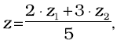

          - pričom z je po zaokrúhlení výsledný stupeň prospechu a zi je stupeň prospechu za úlohu č. i.

      - Úpravy pre žiakov so zdravotným znevýhodnením

      - Trvanie skúšky: 30 minút

      - Čas na prípravu: 30 minút

      - ZÁKLADY ŠPORTOVEJ PRÍPRAVY

      - Charakteristika úloh maturitných zadaní

      - Úloha č. 1 – Úloha je zameraná na vedomosti a porozumenie.

      - V úlohe je presne určený pojem, fakt, definícia, historický jav alebo proces, o ktorom má žiak preukázať svoje vedomosti (prevláda forma monológu).

      - Úloha č. 2 – Úloha je zameraná na aplikáciu a analýzu. V úlohe žiak prezentuje vlastné argumentačné schopnosti pri riešení problematiky, ako aj potrebnú aplikačnú asociáciu z pohľadu účastníka športového a tréningového procesu (prevláda forma dialógu s členmi predmetovej maturitnej komisie).

      - Zastúpenie uvedených jednotlivých častí učiva v súbore všetkých otázok v maturitných zadaniach je takéto:

      - teória telesnej kultúry a prierezových vedných odborov (dejiny, anatómia, biochémia, biomechanika, psychológia, pedagogika...),

      - teória a didaktika športového tréningu.

      - Všeobecné pomôcky

      - Atlas svetových a domácich dejín

      - Olympijská charta a Stanovy Slovenského olympijského výboru

      - Anatomické obrazy

      - Pedagogická dokumentácia športového tréningu

      - Testovacie batérie tréningového procesu

      - Testovacie batérie lekársko-pedagogických sledovaní

      - Hodnotenie

        - a) Každá úloha maturitného zadania sa hodnotí stupňom prospechu 1 až 5.

        - b) Hodnotením maturitnej skúšky zo základov športovej prípravy bude stupeň prospechu, ktorý vznikne ako vážený priemer stupňov prospechu z odpovedí na jednotlivé úlohy maturitného zadania.

        - c) Váha hodnotenia jednotlivých úloh je 2 : 3. Pri výpočte váženého priemeru sa používa vzorec

        - 

          - pričom z je po zaokrúhlení výsledný stupeň prospechu a zi je stupeň prospechu za úlohu č. i.

      - Úpravy pre žiakov so zdravotným znevýhodnením

      - Trvanie skúšky: 30 minút

      - Čas na prípravu: 30 minút

      - MUZIKÁL

      - Charakteristika úloh maturitných zadaní

      - Úloha č. 1 – Úloha je zameraná na vedomosti a porozumenie historickej i teoretickej oblasti divadla, hudby a tanca. Žiak má preukázať znalosť pojmového aparátu a uviesť súvislosti. V úlohe je stanovený pojem, fakt, definícia, umelecký jav alebo proces, ktorého znalosť žiak má v odpovedi preukázať (prevláda forma monológu).

      - Úloha č. 2 – Úloha je zameraná na aplikáciu a analýzu.

      - Žiak v tejto úlohe preukáže orientáciu v zadanej úlohe, charakterizuje základné znaky herectva, spevu a tanca. Ako názornú pomôcku používa odbornú literatúru, hudobné ukážky, divadelný výstup, pokusy o vlastnú tvorbu. Žiak je pripravený na dialóg s členmi predmetovej maturitnej komisie a dokáže zdôvodniť vlastné názory a svoj umelecký prejav.

      - Zastúpenie jednotlivých tematických okruhov v úlohách maturitných zadaní je takéto:

      - herectvo (dejiny divadla, teória hereckej tvorby, rečový prejav – technika reči, divadelný výstup),

      - spev (hudobná história, hudobná teória, intonácia a rytmus, spevácka technika, hudobná ukážka),

      - tanec (dejiny tanca a teória klasického tanca, džezového a moderného tanca, ľudového tanca, stepu, tanečná ukážka).

      - Všeobecné pomôcky

      - Bulletiny, katalógy, fotografie

      - Obrazové prílohy

      - Hudobné ukážky

      - Divadelné rekvizity

      - Hodnotenie

        - a) Každá úloha maturitného zadania sa hodnotí stupňom prospechu 1 až 5.

        - b) Hodnotením maturitnej skúšky z muzikálu bude stupeň prospechu, ktorý vznikne ako vážený priemer stupňov prospechu z odpovedí na jednotlivé úlohy maturitného zadania.

        - c) Váha hodnotenia jednotlivých úloh je 2 : 3. Pri výpočte váženého priemeru sa používa vzorec

        - 

          - pričom z je po zaokrúhlení výsledný stupeň prospechu a zi je stupeň prospechu za úlohu č. i.

      - Úpravy pre žiakov so zdravotným znevýhodnením

      - Trvanie skúšky: 30 minút

      - Čas na prípravu: 30 minút

      - LITERÁRNA TVORBA

      - Charakteristika úloh maturitných zadaní

      - Úloha č. 1 – Úloha je zameraná na teoretické vedomosti z prozódie, verzológie a ich aplikovanie v praxi. V úlohe je presne stanovený pojem, fakt, definícia, proces, ktorých znalosti má žiak v odpovedi preukázať (prevláda forma monológu).

      - Úloha č. 2 – Úloha je zameraná na praktickú aplikáciu teoretických poznatkov z rétoriky. Žiak má obhájiť svoju maturitnú prácu, ktorej ťažisko tvorí literárna komparácia (obdobia, smery, autori, diela, postavy...), a využiť prvky rečníckeho štýlu. V ďalšej časti žiak odpovedá na otázky členov komisie, ktoré sa týkajú práce.

      - Ako názornú pomôcku používa svoju maturitnú prácu, archívne materiály, zvukové nahrávky a videonahrávky (prevláda forma dialógu s členmi predmetovej maturitnej komisie).

      - Zastúpenie jednotlivých tematických okruhov v úlohách maturitných zadaní je takéto:

      - literárne dielo ako ideovo-estetická štruktúra,

      - verš, rytmus, rým, strofa,

      - lyrika,

      - epika,

      - dráma.

      - Všeobecné pomôcky

      - Literárne rukoväte

      - Literárne slovníky

      - Literárne lexikóny

      - Odborné literárne časopisy

      - Hodnotenie

        - a) Každá úloha maturitného zadania sa hodnotí stupňom prospechu 1 až 5.

        - b) Hodnotením maturitnej skúšky z literárnej tvorby bude stupeň prospechu, ktorý vznikne ako vážený priemer stupňov prospechu z odpovedí na jednotlivé úlohy maturitného zadania.

        - c) Váha hodnotenia jednotlivých úloh je 2 : 3. Pri výpočte váženého priemeru sa používa vzorec

        - 

          - pričom z je po zaokrúhlení výsledný stupeň prospechu a zi je stupeň prospechu za úlohu č. i.

      - Úpravy pre žiakov so zdravotným znevýhodnením

      - Trvanie skúšky: 30 minút

      - Čas na prípravu: 30 minút

      - POĽSKÝ JAZYK

      - Charakteristika úloh maturitných zadaní

      - Úloha č. 1 – Vizuálny podnet (napr. obrázok, fotografia, komiks, graf, schéma a pod.). Žiak opíše predložený obrázok a nachádza súvislosti medzi obrázkom a príslušnou maturitnou témou. Komisia hodnotí súvislosť opisu predloženého podnetu, lineárnosť (postupnosť) vo vyjadrovaní a adekvátne jazykové prostriedky zodpovedajúce danej úrovni žiaka (prevláda forma monológu).

      - Úloha č. 2 – Úlohou žiaka je zaujať stanovisko k téme a odôvodniť ho v rozhovore s členmi predmetovej maturitnej komisie, ktorá vedie rozhovor podľa zásad uvedených v metodických pokynoch pre predmetové maturitné komisie. Komisia hodnotí, ako žiak dokáže zdôvodniť a vysvetliť svoje názory na príslušnú tému a argumentovať k problematike, výber faktov a informácií, gramatiku (prevláda forma dialógu s členmi predmetovej maturitnej komisie).

      - Úloha č. 3 – Situačná úloha, dialóg s rozdelenými úlohami (rôzne modelové situácie zohľadňujúce príslušný študijný odbor). Žiak dostane za úlohu vyriešiť konkrétnu situáciu z každodenného života v okruhu príslušných tém. Komisia sa zameriava na hodnotenie výberu a adekvátnosť použitia jazykových prostriedkov (prevláda forma dialógu s členmi predmetovej maturitnej komisie).

      - Všeobecné pomôcky

      - Obojstranný prekladový slovník obsahujúci najmenej 15 000 hesiel

      - Hodnotenie

        - a) Základom hodnotenia je rozsah slovnej zásoby, používanie gramatických štruktúr, stupeň jazykovej pohotovosti, obsahová stránka prejavu a pod.

        - b) Predmetová maturitná komisia hodnotí obsahovú a jazykovú správnosť odpovede, štruktúru – začiatok, vedenie a ukončenie rozhovoru.

        - c) Každá úloha maturitného zadania sa hodnotí stupňom prospechu 1 až 5.

        - d) Hodnotenie úlohy č. 1 sa skladá z dvoch samostatných hodnotení. Hodnotí sa

          - 1. obsahová primeranosť,

          - 2. jazyková správnosť.

        - e) Hodnotenie úlohy č. 2 sa skladá zo šiestich samostatných hodnotení. Hodnotí sa

          - 1. plynulosť vyjadrovania,

          - 2. výslovnosť a intonácia,

          - 3. obsah – náročnosť spracovania/kvalita rozhovoru,

          - 4. lexikálny rozsah,

          - 5. argumentácia,

          - 6. gramatická presnosť.

        - f) Hodnotenie úlohy č. 3 sa skladá z dvoch samostatných hodnotení. Hodnotí sa

          - 1. obsahová a jazyková správnosť,

          - 2. pohotovosť vyjadrovania.

        - g) Váha hodnotenia jednotlivých úloh ústnej zložky je 1 : 2 : 1. Pri výpočte váženého priemeru sa používa vzorec

        - 

        - pričom z je po zaokrúhlení výsledný stupeň prospechu a zi je stupeň prospechu za úlohu č. i.

      - Úpravy pre žiakov so zdravotným znevýhodnením

      - Úloha č. 1

        - a) Ak ide o žiakov so zrakovým postihnutím, obrázky sa nahradia slovným opisom príslušnej situácie vo vyučovacom jazyku; grafy a schémy sa vynechajú.

        - b) Ak ide o žiakov so sluchovým postihnutím, nehodnotí sa jazyková správnosť.

      - Úloha č. 2

      - Ak ide o žiakov so sluchovým postihnutím, nehodnotí sa výslovnosť, intonácia a gramatická správnosť.

      - Trvanie skúšky: 30 minút

      - Čas na prípravu: 30 minút

      - CHORVÁTSKY JAZYK

      - Charakteristika úloh maturitných zadaní

      - Úloha č. 1 – Vizuálny podnet (napr. obrázok, fotografia, komiks, graf, schéma a pod.). Žiak opíše predložený obrázok a nachádza súvislosti medzi obrázkom a príslušnou maturitnou témou. Komisia hodnotí súvislosť opisu predloženého podnetu, lineárnosť (postupnosť) vo vyjadrovaní a adekvátne jazykové prostriedky zodpovedajúce danej úrovni žiaka (prevláda forma monológu).

      - Úloha č. 2 – Úlohou žiaka je zaujať stanovisko k téme a odôvodniť ho v rozhovore s členmi predmetovej maturitnej komisie, ktorí vedú rozhovor podľa zásad uvedených v metodických pokynoch pre predmetové maturitné komisie. Komisia hodnotí, ako žiak dokáže zdôvodniť a vysvetliť svoje názory na príslušnú tému a argumentovať k problematike, výber faktov a informácií, gramatiku (prevláda forma dialógu s členmi predmetovej maturitnej komisie).

      - Úloha č. 3 – Situačná úloha, dialóg s rozdelenými úlohami (rôzne modelové situácie zohľadňujúce príslušný študijný odbor). Žiak dostane za úlohu vyriešiť konkrétnu situáciu z každodenného života v okruhu príslušných tém. Komisia sa zameriava na hodnotenie výberu a adekvátnosť použitia jazykových prostriedkov (prevláda forma dialógu s členmi predmetovej maturitnej komisie).

      - Všeobecné pomôcky

      - Obojstranný prekladový slovník obsahujúci najmenej 15 000 hesiel

      - Hodnotenie

        - a) Základom hodnotenia je rozsah slovnej zásoby, používanie gramatických štruktúr, stupeň jazykovej pohotovosti, obsahová stránka prejavu a pod.

        - b) Predmetová maturitná komisia hodnotí obsahovú a jazykovú správnosť odpovede, štruktúru – začiatok, vedenie a ukončenie rozhovoru.

        - c) Každá úloha maturitného zadania sa hodnotí stupňom prospechu 1 až 5.

        - d) Hodnotenie úlohy č. 1 sa skladá z dvoch samostatných hodnotení. Hodnotí sa

          - 1. obsahová primeranosť,

          - 2. jazyková správnosť.

        - e) Hodnotenie úlohy č. 2 sa skladá zo šiestich samostatných hodnotení. Hodnotí sa

          - 1. plynulosť vyjadrovania,

          - 2. výslovnosť a intonácia,

          - 3. obsah – náročnosť spracovania/kvalita rozhovoru,

          - 4. lexikálny rozsah,

          - 5. argumentácia,

          - 6. gramatická presnosť.

        - f) Hodnotenie úlohy č. 3 sa skladá z dvoch samostatných hodnotení. Hodnotí sa

          - 1. obsahová a jazyková správnosť,

          - 2. pohotovosť vyjadrovania.

        - g) Váha hodnotenia jednotlivých úloh je 1 : 2 : 1. Pri výpočte váženého priemeru sa používa vzorec

        - 

        - pričom z je po zaokrúhlení výsledný stupeň prospechu a zi je stupeň prospechu za úlohu č. i.

      - Úpravy pre žiakov so zdravotným znevýhodnením

      - Úloha č. 1

        - a) Ak ide o žiakov so zrakovým postihnutím, obrázky sa nahradia slovným opisom príslušnej situácie vo vyučovacom jazyku; grafy a schémy sa vynechajú.

        - b) Ak ide o žiakov so sluchovým postihnutím, nehodnotí sa jazyková správnosť.

      - Úloha č. 2

      - Ak ide o žiakov so sluchovým postihnutím, nehodnotí sa výslovnosť, intonácia a gramatická správnosť.

      - Trvanie skúšky: 30 minút

      - Čas na prípravu: 30 minút

      - UMENIE a KULTÚRA

      - Charakteristika úloh maturitných zadaní

      - Úloha č. 1 – Úloha je zameraná na schopnosti riešenia problémov. Žiak má preukázať schopnosi samostatne riešiť problémy týkajúce sa kultúry a umenia, ako aj schopnosti tvoriť vlastné projekty na riešenie modelových situácií. V úlohe má určené, akých kultúrnych artefaktov alebo situácií sa problém týka, prípadne sa zadáva modelová situácia. Predpokladá sa, že v úlohe bude pracovať s literatúrou a s ukážkami. Prevláda metóda prezentácie riešenia. Ak je súčasťou úlohy prezentácia vlastných názorov a estetických súdov, žiak v dialógu s členmi maturitnej komisie prezentuje schopnosť argumentácie.

      - Úloha č. 2 – Úloha je zameraná na aplikáciu. Žiak má preukázať, ako v riešení z prvej úlohy aplikoval poznatky a vedomosti, ako prepája teoretické poznatky o kultúre so skutočným životom, prípadne ako by riešenie z prvej úlohy aplikoval v novej situácii. Žiak preukazuje schopnosti aplikácie, ako aj schopnosti reflektovať túto aplikáciu. V dialógu s členmi komisie prezentuje schopnosť argumentácie.

      - Úloha č. 3 – Úloha je zameraná na poznanie a vedomosti. Žiak má preukázať osvojené poznanie, vedomosti a informácie, s ktorými pracoval v prvých úlohách.

      - Všeobecné pomôcky

      - Dejiny rôznych druhov umenia a kultúry

      - Všeobecné encyklopédie

      - Monografie umelcov, ukážky tvorby z rôznych umeleckých druhov

      - Mapy sveta, Európy, Slovenskej republiky

      - Hodnotenie

        - a) Každá úloha maturitného zadania sa hodnotí stupňom prospechu 1 až 5.

        - b) Váha hodnotenia jednotlivých úloh je 1 : 1 : 1. Pri výpočte váženého priemeru sa používa vzorec

        - 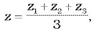

        - pričom z je po zaokrúhlení výsledná známka a zi je známka za úlohu č. i.

      - Úpravy pre žiakov so zdravotným znevýhodnením

      - Trvanie skúšky: 30 minút

      - Čas na prípravu: 30 minút

      - RÓMSKY JAZYK A LITERATÚRA

      - Charakteristika úloh maturitných zadaní

      - Úloha č. 1 – Úloha je zameraná na čítanie textu v rómskom jazyku v rozsahu minimálne troch a maximálne šiestich viet publicistického alebo beletristického žánru. Žiak má vedieť text reprodukovať, prerozprávať obsah. Predmetová maturitná komisia hodnotí obsahovú a jazykovú presnosť, súvislosť prejavu, využívanie neologizmov, lineárnosť vo vyjadrovaní a snahu používať adekvátne jazykové prostriedky zodpovedajúce danej úrovni žiaka (prevláda forma monológu).

      - Úloha č. 2 – Úlohou žiaka je zaujať stanovisko k téme a odôvodniť ho v rozhovore s členmi predmetovej maturitnej komisie, ktorá vedie rozhovor podľa zásad uvedených v metodických pokynoch pre predmetové maturitné komisie. Predmetová maturitná komisia hodnotí, ako žiak dokáže zdôvodniť a vysvetliť svoje názory na príslušnú tému a argumentovať k problematike, výber faktov a informácií, gramatickú presnosť, lexikálny rozsah, náročnosť spracovania rozhovoru, argumentáciu, plynulosť a súvislosť vyjadrovania (prevláda forma dialógu s členmi predmetovej maturitnej komisie).

      - Úloha č. 3 – Úloha je zameraná na vyriešenie konkrétnej situácie z každodenného života v okruhu príslušných tém. Predmetová maturitná komisia sa zameriava na hodnotenie výberu a adekvátnosť použitia jazykových prostriedkov, pohotovosť vyjadrovania, jazykovú a obsahovú správnosť (prevláda forma dialógu s členmi predmetovej maturitnej komisie).

      - Všeobecné pomôcky

      - Prekladový slovník

      - Hodnotenie

        - a) Každá úloha maturitného zadania sa hodnotí stupňom prospechu 1 až 5.

        - b) Váha hodnotenia jednotlivých úloh je 1 : 2 : 1. Pri výpočte váženého priemeru sa používa vzorec

        - 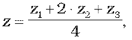

        - pričom z je po zaokrúhlení výsledná známka a zi je známka za úlohu č. i.

      - Úpravy pre žiakov so zdravotným znevýhodnením

      - Trvanie skúšky: 30 minút

      - Čas na prípravu: 30 minút

  - IV. ČASŤ PODROBNOSTI O SPÔSOBE KONANIA A OBSAHU TEORETICKEJ ČASTI ODBORNEJ ZLOŽKY MATURITNEJ SKÚŠKY A PRAKTICKEJ ČASTI ODBORNEJ ZLOŽKY MATURITNEJ SKÚŠKY VŠEOBECNÉ POKYNY

    - 1. Teoretická časť odbornej zložky maturitnej skúšky je verejná.

    - 2. Maturitné témy pre teoretickú časť odbornej zložky maturitnej skúšky vychádzajú z výkonových štandardov pre teoretické vzdelávanie pre príslušný študijný odbor alebo študijný odbor a jeho zameranie uvedené v štátnom vzdelávacom programe pre odborné vzdelávanie a prípravu, podľa ktorého žiak štúdium začal.

    - 3. Maturitné témy pre praktickú časť odbornej zložky maturitnej skúšky vychádzajú z výkonových štandardov pre praktickú prípravu pre príslušný študijný odbor alebo študijný odbor a jeho zameranie uvedené v štátnom vzdelávacom programe pre odborné vzdelávanie a prípravu, podľa ktorého žiak štúdium začal.

    - 4. Maturitné témy pre teoretickú časť odbornej zložky maturitnej skúšky a praktickú časť odbornej zložky maturitnej skúšky pripravuje príslušná predmetová maturitná komisia školy. Maturitné témy sa nezverejňujú okrem ich predloženia na vyjadrenie stavovskej organizácii a profesijnej organizácii k obsahu teoretickej časti odbornej zložky maturitnej skúšky a obsahu praktickej časti odbornej zložky maturitnej skúšky.

    - 5. Skúšajúci citlivo riadi rozhovor so žiakmi, kladie pomocné a stimulačné otázky, vyjadruje súhlas alebo nesúhlas s tvrdeniami žiaka, pričom ho vedie k tomu, aby svoje názory odôvodňoval relevantnými argumentmi a využíval pri tom písomnú prípravu a tiež vlastné poznatky získané počas prípravy na maturitnú skúšku.

    - 6. Členovia predmetovej maturitnej komisie dbajú na to, aby žiak mohol na ich podnety reagovať plynulo a mal primeraný čas a pokoj na vyjadrenie svojich myšlienok.

    - TEORETICKÁ ČASŤ ODBORNEJ ZLOŽKY MATURITNEJ SKÚŠKY

    - Kritériá hodnotenia

      - a) porozumenie téme,

      - b) používanie odbornej terminológie,

      - c) samostatnosť prejavu,

      - d) schopnosť aplikácie,

      - e) správnosť a vecnosť odpovede.

    - PRAKTICKÁ ČASŤ ODBORNEJ ZLOŽKY MATURITNEJ SKÚŠKY

    - Charakteristika foriem

    - PRAKTICKÁ REALIZÁCIA A PREDVEDENIE KOMPLEXNEJ ÚLOHY

    - Rozsah a obsah úloh: aplikácia teoretických vedomostí a zručností získaných praktickým vyučovaním v príslušnom študijnom odbore alebo v študijnom odbore a jeho zameraní.

    - Kritériá hodnotenia

      - a) pochopenie úlohy,

      - b) analýza úlohy,

      - c) voľba postupu,

      - d) voľba a použitie pomôcok, špeciálnych zariadení, prístrojov a materiálov,

      - e) organizácia práce,

      - f) dodržiavanie zásad bezpečnosti a ochrany zdravia,

      - g) ochrana životného prostredia,

      - h) výsledok práce.

    - OBHAJOBA VLASTNÉHO PROJEKTU

    - Komplexná odborná práca alebo projekt sa rieši počas štúdia individuálne alebo skupinovo. Práca je obsahovo zameraná podľa príslušného študijného odboru alebo študijného odboru a jeho zamerania a potrieb praxe.

    - Kritériá hodnotenia

      - a) odborná úroveň projektu,

      - b) grafická úroveň projektu,

      - c) vlastná obhajoba autora – úroveň prezentácie,

      - d) používanie odbornej terminológie,

      - e) využitie odbornej literatúry.

    - REALIZÁCIA A OBHAJOBA EXPERIMENTU

    - Rozsah: 20 strán textu, tabuľky, nákresy, grafy, obrazový a fotografický materiál.

    - Kritériá hodnotenia

      - a) odborná úroveň projektu,

      - b) grafická úroveň projektu,

      - c) vlastná obhajoba autora – úroveň prezentácie,

      - d) používanie odbornej terminológie,

      - e) využitie odbornej literatúry.

    - OBHAJOBA ÚSPEŠNÝCH SÚŤAŽNÝCH PRÁC

    - Predvedenie a obhajoba úspešných odborných prác, ktoré sa umiestnili na prvom až treťom mieste v krajskom kole alebo na prvom až piatom mieste v celoštátnom kole súťaže žiakov stredných škôl v Slovenskej republike registrovanej Ministerstvom školstva, vedy výskumu a športu Slovenskej republiky.

    - Kritériá hodnotenia

      - a) správna voľba postupu,

      - b) využitie zariadení a materiálov,

      - c) používanie odbornej terminológie,

      - d) samostatnosť prejavu,

      - e) schopnosť aplikácie,

      - f) možnosť využitia v odbore.

    - PREDVEDENIE UMELECKÉHO VÝKONU

    - 1. V hudobnom odbore tvorí túto časť maturitnej skúšky individuálna forma predvedenia umeleckých diel.

    - 2. V hudobno-dramatickom odbore tvorí túto časť maturitnej skúšky individuálna a skupinová forma predvedenia umeleckých diel.

    - 3. V tanečnom odbore tvorí túto časť maturitnej skúšky frontálna a individuálna forma predvedenia tanečnej techniky v príslušnom odbornom zameraní.

    - 4. Vo výtvarných odboroch tvorí túto časť maturitnej skúšky spracovanie zadanej témy v technologických, výtvarných a materiálových súvislostiach v podobe návrhu, odbornej dokumentácie a realizácie návrhu v odbornej maturitnej práci.

  - V. ČASŤ ÚPRAVY MATURITNEJ SKÚŠKY PRE ŽIAKOV S JEDNOTLIVÝMI DRUHMI POSTIHNUTÍ

    - I. skupina – ľahký stupeň obmedzenia

      - Žiaci v tejto skupine môžu pracovať s testami a so zadaniami pre intaktnú populáciu, ak majú možnosť pracovať v predĺženom čase a používať kompenzačné pomôcky.

      - Úpravy pre žiakov s jednotlivými druhmi postihnutí

      - A. Žiaci so sluchovým postihnutím:

        - 1. predĺženie času skúšky najviac o 50 %,

        - 2. možnosť použitia kompenzačných pomôcok podľa potrieb žiakov.

      - B. Žiaci so zrakovým postihnutím:

        - 1. predĺženie času skúšky najviac o 75 %,

        - 2. možnosť použitia kompenzačných pomôcok podľa potrieb žiakov.

      - C. Žiaci s telesným postihnutím:

        - 1. predĺženie času skúšky najviac o 75 %,

        - 2. možnosť použitia kompenzačných pomôcok podľa potrieb žiakov.

      - D. Žiaci chorí a zdravotne oslabení:

        - Predĺženie času skúšky najviac o 50 %.

      - E. Žiaci s vývinovými poruchami učenia:

        - 1. predĺženie času skúšky najviac o 25 %,

        - 2. možnosť použitia kompenzačných pomôcok podľa potrieb žiakov.

      - F. Žiaci s poruchami aktivity a pozornosti:

        - Predĺženie času skúšky najviac o 25 %.

      - G. Žiaci s poruchami správania:

        - Predĺženie času skúšky najviac o 25 %.

      - H. Žiaci s narušenou komunikačnou schopnosťou:

        - 1. predĺženie času skúšky najviac o 25 %

        - 2. možnosť použitia kompenzačných pomôcok podľa potrieb žiakov.

      - I. Žiaci s autizmom alebo ďalšími pervazívnymi vývinovými poruchami:

        - 1. predĺženie času skúšky najviac o 50 %,

        - 2. úprava podmienok a priebehu maturitnej skúšky podľa odporučenia špeciálneho pedagóga, ktorý má žiaka vo svojej odbornej starostlivosti.

      - J. Žiaci s viacnásobným postihnutím:

        - Podľa úprav uvedených v písmene A až I na základe primárneho postihnutia.

    - II. skupina – stredný stupeň obmedzenia

      - Žiaci zaradení do tejto skupiny sú schopní vypracovať zadania len s uvedenými úpravami.

      - Úpravy pre žiakov s jednotlivými druhmi postihnutí

      - A. Žiaci so sluchovým postihnutím:

        - 1. predĺženie času skúšky najviac o 75 %,

        - 2. písmo Arial, veľkosť písma 12, riadkovanie 1,5,

        - 3. zápis odpovede priamo do testového zošita, uvedenie synoným pri vybraných (vytipovaných) slovách,

        - 4. úprava a nahradenie niektorých úloh založených na jazykovom cite,

        - 5. vylúčenie úloh na počúvanie s porozumením z cudzieho jazyka,

        - 6. možnosť použitia kompenzačných pomôcok podľa potrieb žiakov.

      - B. Žiaci so zrakovým postihnutím:

        - 1. predĺženie času skúšky najviac o 100 %,

        - 2. písmo Arial, veľkosť písma 14 – 24 – 36 podľa potreby, riadkovanie 1,5 alebo 2,0, formát A4 alebo A3, voliteľné testy v Braillovom písme a elektronickej verzii (CD),

        - 3. členenie testového hárka tak, aby umožňoval orientáciu,

        - 4. zápis odpovede priamo do testového zošita (zakrúžkovanie variantu alebo zapísanie odpovede do riadka),

        - 5. možnosť zápisu odpovede na samostatný list papiera,

        - 6. zvýraznené oddelenie otázok,

        - 7. úprava a nahradenie niektorých úloh,

        - 8. možnosť použitia kompenzačných pomôcok podľa potrieb žiakov,

        - 9. zvuková nahrávka textov k otázkam.

      - C. Žiaci s telesným postihnutím:

        - 1. predĺženie času skúšky najviac o 100 %,

        - 2. písmo Arial, veľkosť písma 14 – 18 podľa potreby, riadkovanie 1,5 alebo 2,0, voliteľné testy v elektronickej verzii (CD),

        - 3. členenie testového hárka tak, aby uľahčoval orientáciu,

        - 4. zápis odpovedí priamo do testového zošita (zakrúžkovanie odpovede alebo zapísanie odpovede do riadka),

        - 5. kompenzačné pomôcky podľa potreby žiaka.

      - D. Žiaci chorí a zdravotne oslabení:

        - 1. predĺženie času skúšky najviac o 75 %,

        - 2. prestávka, ktorá sa nepočíta do času skúšky (pre diabetikov, kardiakov a pod.),

        - 3. prítomnosť zdravotníckeho personálu, ktorý pomáha pri prípadných zdravotných problémoch.

      - E. Žiaci s vývinovými poruchami učenia:

        - 1. predĺženie času skúšky najviac o 50 %,

        - 2. písmo Arial, veľkosť písma 14, riadkovanie 1,5,

        - 3. zvýraznenie podstaty úlohy (napr. podčiarknutím, tučným písmom a pod.),

        - 4. členenie testového hárka tak, aby uľahčoval orientáciu,

        - 5. zvýraznené oddelenie otázok,

        - 6. zápis odpovedí priamo do testového zošita (zakrúžkovanie odpovede alebo zapísanie odpovede do riadka).

      - F. Žiaci s poruchami aktivity a pozornosti:

        - 1. predĺženie času skúšky najviac o 50 %,

        - 2. zápis odpovedí priamo do testového zošita (zakrúžkovanie odpovede alebo zapísanie odpovede do riadka).

      - G. Žiaci s poruchami správania:

        - Predĺženie času skúšky najviac o 50 %.

      - H. Žiaci s narušenou komunikačnou schopnosťou:

        - 1. predĺženie času skúšky najviac o 50 %,

        - 2. písmo Arial, veľkosť písma 12, riadkovanie 1,5,

        - 3. zvýraznenie podstaty úlohy (napr. podčiarknutím, tučným písmom a pod.),

        - 4. členenie testového hárka tak, aby uľahčoval orientáciu,

        - 5. zvýraznené oddelenie otázok,

        - 6. zápis odpovedí priamo do testového zošita (zakrúžkovanie odpovede alebo zapísanie odpovede do riadka).

      - I. Žiaci s autizmom alebo ďalšími pervazívnymi poruchami:

        - 1. úprava podmienok a priebehu maturitnej skúšky podľa odporučenia špeciálneho pedagóga, v ktorého starostlivosti žiak je,

        - 2. prítomnosť špeciálneho pedagóga, ktorý pomáha pri prípadných ťažkostiach počas skúšky,

        - 3. predĺženie času skúšky najviac o 50 %.

      - J. Žiaci s viacnásobným postihnutím:

        - Podľa úprav uvedených v písmene A až I na základe primárneho postihnutia.

    - III. skupina – ťažký stupeň obmedzenia

      - A. Žiaci zaradení do tretej skupiny sú schopní absolvovať maturitnú skúšku s úpravami uvedenými v II. skupine s pomocou asistenta alebo tlmočníka posunkovej reči.

      - B. Žiaci s viacnásobným postihnutím zaradení do tretej skupiny, ktorým sa v priebehu vzdelávania zmenil zdravotný stav tak, že nie sú schopní absolvovať písomnú formu internej časti maturitnej skúšky podľa písmena A, vykonajú iba externú časť a ústnu formu internej časti maturitnej skúšky podľa písmena A.

      - Úpravy pre žiakov s viacnásobným postihnutím podľa písmena B

      - Predĺženie času skúšky podľa individuálnej potreby s prihliadnutím na aktuálny zdravotný stav.
