Príloha k vyhláške č. 318/2008 Z. z.

- SPÔSOB A FORMA KONANIA MATURITNEJ SKÚŠKY

  - I. ČASŤ FORMY MATURITNEJ SKÚŠKY Z JEDNOTLIVÝCH PREDMETOV Por. číslo | Predmet | | Časť | | |

  - | | Úroveň | Externá | Interná a jej formy | |

  - | | | | Písomná | Ústna |

  - | | | | | príprava | odpoveď

  - 1 | anglický jazyk | C1 | 120´ | 60´ | 20´ | 20´

  - | | B2 | 120´ | 60´ | 20´ | 20´

  - | | B1 | 100´ | 60´ | 20´ | 20´

  - 2 | biológia | | – | – | 20´ | 20´

  - 3 | dejepis | | – | – | 20´ | 20´

  - 4 | francúzsky jazyk | C1 | 120´ | 60´ | 20´ | 20´

  - | | B2 | 120´ | 60´ | 20´ | 20´

  - | | B1 | 100´ | 60´ | 20´ | 20´

  - 5 | fyzika | | – | – | 20´ | 20´

  - 6 | geografia | | – | – | 20´ | 20´

  - 7 | chémia | | – | – | 20´ | 20´

  - 8 | informatika | | – | – | 30´ | 20´

  - 9 | maďarský jazyk a literatúra | | 90´ | 150´ | 20´ | 20´

  - 10 | matematika | | 120´ | – | 20´ | 20´

  - 11 | náuka o spoločnosti | | – | – | 20´ | 20´

  - 12 | nemecký jazyk | C1 | 120´ | 60´ | 20´ | 20´

  - | | B2 | 120´ | 60´ | 20´ | 20´

  - | | B1 | 100´ | 60´ | 20´ | 20´

  - 13 | občianska náuka | | – | – | 20´ | 20´

  - 14 | ruský jazyk | C1 | 120´ | 60´ | 20´ | 20´

  - | | B2 | 120´ | 60´ | 20´ | 20´

  - | | B1 | 100´ | 60´ | 20´ | 20´

  - 15 | slovenský jazyk a literatúra | | 90´ | 150´ | 20´ | 20´

  - 16 | slovenský jazyk a slovenská literatúra4) | | 90´ | 150´ | 20´ | 20´

  - 17 | španielsky jazyk | C1 | 120´ | 60´ | 20´ | 20´

  - | | B2 | 120´ | 60´ | 20´ | 20´

  - | | B1 | 100´ | 60´ | 20´ | 20´

  - 18 | taliansky jazyk | C1 | 120´ | 60´ | 20´ | 20´

  - | | B2 | 120´ | 60´ | 20´ | 20´

  - | | B1 | 100´ | 60´ | 20´ | 20´

  - 19 | ukrajinský jazyk a literatúra | | 90´ | 150´ | 20´ | 20´

  - 20 | teoretická časť odbornej zložky | | – | – | 30´ | 30´

  - 21 | praktická časť odbornej zložky | | – | max. 24 hodín (príprava a výkon) | |

  - 22 | dejiny umenia5) | | – | – | 20´ | 20´

  - 23 | deskriptívna geometria5) | | – | – | 30´ | 20´

  - 24 | ekológia5) | | – | – | 20´ | 20´

  - 25 | ekonomika5) | | – | – | 20´ | 20´

  - 26 | estetika5) | | – | – | 20´ | 20´

  - 27 | evanjelické a. v. náboženstvo6) | | – | – | 20´ | 20´

  - 28 | kresťanská etika6) | | – | – | 20´ | 20´

  - 29 | latinčina | | – | – | 20´ | 20´

  - 30 | právo5) | | – | – | 20´ | 20´

  - 31 | psychológia5) | | – | – | 20´ | 20´

  - 32 | reformované náboženstvo6) | | – | – | 20´ | 20´

  - 33 | katolícke náboženstvo6) | | – | – | 20´ | 20´

  - 34 | stretnutia s ľudovou kultúrou5) | | – | – | 20´ | 20´

  - 35 | športový manažment | | – | – | 20´ | 20´

  - 36 | základy športovej prípravy | | – | – | 20´ | 20´

  - 37 | muzikál | | – | – | 20´ | 20´

  - 38 | literárna tvorba | | – | – | 20´ | 20´

  - 39 | poľský jazyk | | – | – | 20´ | 20´

  - 40 | chorvátsky jazyk | | – | – | 20´ | 20´

  - 41 | umenie a kultúra | | – | – | 20´ | 20´

  - 42 | rómsky jazyk a literatúra | | – | – | 20´ | 20´

  - II. ČASŤ PODROBNOSTI O SPÔSOBE KONANIA EXTERNEJ ČASTI A PÍSOMNEJ FORMY INTERNEJ ČASTI MATURITNEJ SKÚŠKY

    - 1. Cudzí jazyk – anglický jazyk, francúzsky jazyk, nemecký jazyk, ruský jazyk, talianska jazyk a španielsky jazyk.

      - Cudzí jazyk obsahom a úrovňou náročnosti zodpovedá jazykovej úrovni B2 alebo B1 Spoločného európskeho referenčného rámca. Predmet druhý vyučovací jazyk v bilingválnych triedach stredných škôl alebo v bilingválnych školách obsahom a náročnosťou zodpovedá úrovni C1 Spoločného európskeho referenčného rámca.Voliteľný predmet cudzí jazyk obsahom a úrovňou náročnosti zodpovedá jazykovej úrovni B1 alebo B2 Spoločného európskeho referenčného rámca.

      - Externá časť maturitnej skúšky z cudzieho jazyka pozostáva z centrálne vypracovanej, vo všetkých školách v rovnakom čase zadanej, pod externým dozorom konanej a externe vyhodnotenej písomnej skúšky – testu. Test overuje komunikačné kompetencie na úrovni B1 a B2 Spoločného európskeho referenčného rámca pre cudzie jazyky v častiach počúvanie s porozumením, čítanie s porozumením a použitie gramatiky a lexiky. Test obsahuje úlohy s výberom odpovede a úlohy s krátkou odpoveďou.

      - Externá časť maturitnej skúšky z druhého vyučovacieho jazyka pozostáva z centrálne vypracovanej, vo všetkých školách v rovnakom čase zadanej, pod externým dozorom konanej a externe vyhodnotenej písomnej skúšky – testu. Test overuje komunikačné kompetencie na úrovni C1 Spoločného európskeho referenčného rámca pre cudzie jazyky v častiach počúvanie s porozumením, čítanie s porozumením a použitie gramatiky a lexiky. Test obsahuje úlohy s výberom odpovede a úlohy s krátkou odpoveďou.

      - Úpravy pre žiakov so zdravotným znevýhodnením:

      - Test z cudzieho jazyka alebo z druhého vyučovacieho jazyka pre žiakov so sluchovým postihnutím neobsahuje úlohy na počúvanie s porozumením.

      - Písomnou formou internej časti maturitnej skúšky je vypracovanie centrálne zadanej témy v určenej žánrovej forme. Písomná forma internej časti maturitnej skúšky sa zadáva vo všetkých školách v rovnakom čase, koná sa pod externým dozorom a vyhodnocuje sa interne na základe centrálnych pokynov.

      - Charakteristika témy písomnej formy internej časti maturitnej skúšky pre úroveň C1:

        - a) napísať jasný, detailný a správne kompozične a syntakticky členený text na zložité témy so spoločenskou alebo s odbornou tematikou,

        - b) písať podrobne, štylisticky a jazykovo správne o udalostiach, reálnych alebo fiktívnych zážitkoch,

        - c) napísať dobre zrozumiteľný príbeh, esej, recenziu,

        - d) napísať pozdrav, pozvanie, odkaz, blahoželanie, telegram,

        - e) napísať súkromný a formálny list, obchodný list, žiadosť, životopis, sťažnosť, reklamáciu, inzerát, odborný referát s využitím adekvátnych štylistických postupov a odbornej terminológie s prihliadnutím na cieľovú skupinu príjemcov,

        - f) opísať osobu, predmet, miesto, činnosť, situáciu, vytvoriť syntakticky správny opis a imaginatívny test,

        - g) napísať súvislý text, v ktorom žiak vyjadrí svoje názory, postoje, myšlienky, city a pomocou doplňujúcich argumentov a vhodných príkladov dokáže podrobne vysvetliť a podporiť svoje stanoviská a názory a vhodne ich ukončiť,

        - h) napísať referát, diskusný príspevok, správu, prejav a použiť zodpovedajúcu odbornú terminológiu,

        - i) vedieť aplikovať štylistické a kompozičné postupy náučného a populárno-náučného štýlu.

      - Charakteristika témy písomnej formy internej časti maturitnej skúšky pre úroveň B2:

        - a) napísať jasný a detailný text na rôzne témy, ktoré žiaka zaujímajú,

        - b) písať podrobne, štylisticky a jazykovo správne o udalostiach, reálnych alebo fiktívnych zážitkoch,

        - c) napísať dobre zrozumiteľný príbeh,

        - d) napísať pozdrav, pozvanie, odkaz, blahoželanie, telegram,

        - e) napísať súkromný a formálny list, žiadosť, životopis, sťažnosť, reklamáciu, inzerát,

        - f) opísať osobu, predmet, miesto, činnosť, situáciu,

        - g) napísať súvislý text, v ktorom žiak vyjadrí svoje názory, postoje, myšlienky, city,

        - h) napísať referát, diskusný príspevok, správu, rozprávanie.

      - Charakteristika témy písomnej formy internej časti maturitnej skúšky pre úroveň B1:

        - a) písať jednoducho a jasne o témach, ktoré sú žiakovi známe a zaujímajú ho,

        - b) vyjadriť svoj názor na témy, ktoré žiaka zaujímajú,

        - c) vyjadriť svoje pocity (ľútosť, radosť, záujem, súcit a pod.),

        - d) napísať pozdrav, pozvanie, odkaz, blahoželanie, telegram,

        - e) napísať súkromný a formálny list, žiadosť, životopis, sťažnosť, reklamáciu, inzerát,

        - f) opísať osobu, predmet, miesto, činnosť, situáciu.

    - 2. Maďarský jazyk a literatúra, ukrajinský jazyk a literatúra

      - Externá časť maturitnej skúšky z maďarského jazyka a literatúry, ukrajinského jazyka a literatúry sa skladá z centrálne vypracovanej, vo všetkých školách v rovnakom čase zadanej, pod externým dozorom konanej a externe vyhodnotenej písomnej skúšky – testu. Test sa skladá len z úloh s výberom odpovede a z úloh s krátkou odpoveďou.

      - Písomnou formou internej časti sú centrálne pripravené súbory štyroch tém, prípadne východiskové texty a určené žánrové formy. Žiak si vyberie a vypracuje iba jednu tému. Písomná práca sa vo všetkých školách zadáva v rovnakom čase, koná sa pod externým dozorom a vyhodnocuje sa interne na základe centrálnych pokynov.

      - Charakteristika úloh písomnej práce:

        - a) analýza a interpretácia umeleckého diela alebo vecného textu (jeho obsahová, kompozičná a štylistická analýza, argumentácia a hodnotenie),

        - b) vypracovanie zvolenej témy v určenej žánrovej forme,

        - c) porovnanie dvoch textov podľa zadania,

        - d) štýlová a žánrová transformácia textov.

    - 3. Matematika

      - Externú časť maturitnej skúšky z matematiky tvorí centrálne vypracovaná písomná skúška – test, ktorá sa vo všetkých školách zadáva v rovnakom čase, koná sa pod externým dozorom a externe sa vyhodnocuje. Test sa skladá iba z úloh s výberom odpovede a z úloh s krátkou odpoveďou.

    - 4. Slovenský jazyk a literatúra

      - Externú časť maturitnej skúšky zo slovenského jazyka a literatúry tvorí centrálne vypracovaná, vo všetkých školách v rovnakom čase zadaná, pod externým dozorom konaná a externe vyhodnotená písomná skúška – test. Test sa skladá len z úloh s výberom odpovede a z úloh s krátkou odpoveďou.

      - Písomnou formou internej časti sú centrálne pripravené súbory štyroch tém alebo východiskové texty a určené žánrové formy. Žiak si vyberie a vypracuje iba jednu tému. Žiak má preukázať komplexnosť ovládania spisovného jazyka, mieru tvorivosti v písomnom prejave a celkovú vzdelanosť a kultúrnosť v miere vychádzajúcej z cieľových požiadaviek. Písomná práca sa vo všetkých školách zadáva v rovnakom čase, koná sa pod externým dozorom a vyhodnocuje sa interne na základe centrálnych pokynov.

      - Charakteristika úloh písomnej práce:

        - a) analýza a interpretácia umeleckého diela alebo vecného textu (jeho obsahová, kompozičná a štylistická analýza, argumentácia a hodnotenie),

        - b) vypracovanie zvolenej témy v určenej žánrovej forme,

        - c) porovnanie dvoch textov podľa zadania,

        - d) štýlová a žánrová transformácia textov.

    - 5. Slovenský jazyk a slovenská literatúra

      - Externá časť maturitnej skúšky zo slovenského jazyka a slovenskej literatúry sa skladá z centrálne vypracovanej, vo všetkých školách v rovnakom čase zadanej, pod externým dozorom konanej a externe vyhodnotenej písomnej skúšky – testu. Test sa skladá len z úloh s výberom odpovede a z úloh s krátkou odpoveďou.

      - Písomnou formou internej časti sú centrálne pripravené súbory štyroch tém, prípadne východiskové texty a určené žánrové formy. Žiak si vyberie a vypracuje iba jednu tému. Písomná práca sa vo všetkých školách zadáva v rovnakom čase, koná sa pod externým dozorom a vyhodnocuje sa interne na základe centrálnych pokynov.

      - Charakteristika úloh písomnej práce:

        - a) analýza a interpretácia umeleckého diela alebo vecného textu (jeho obsahová, kompozičná a štylistická analýza, argumentácia a hodnotenie),

        - b) vypracovanie zvolenej témy v určenej žánrovej forme,

        - c) porovnanie dvoch textov podľa zadania,

        - d) štýlová a žánrová transformácia textov.

  - III. ČASŤ PODROBNOSTI O SPÔSOBE KONANIA A OBSAHU ÚSTNEJ FORMY INTERNEJ ČASTI MATURITNEJ SKÚŠKY VŠEOBECNÉ POKYNY

    - 1. Ústnu formu internej časti maturitnej skúšky tvorí ústna odpoveď žiaka pred predmetovou maturitnou komisiou, pričom si žiak žrebuje jedno zo schválených maturitných zadaní.

    - 2. Ústna forma internej časti maturitnej skúšky je verejná.

    - 3. Maturitné zadania a úlohy v nich vychádzajú z cieľových požiadaviek na vedomosti a zručnosti pre príslušný predmet maturitnej skúšky.

    - 4. Každé maturitné zadanie tvoria dve alebo tri samostatné úlohy, podľa možností a charakteru predmetu z viacerých tematických okruhov.

    - 5. Obsah maturitných zadaní zohľadňuje aj predpísaný čas určený na trvanie skúšky a jej prípravu.

    - 6. Maturitné zadania ústnej formy internej časti maturitnej skúšky pripravuje príslušná predmetová komisia školy. Maturitné zadania sa nezverejňujú.

    - 7. Minimálny počet zadaní je 30. Každé zadanie sa použije iba jedenkrát v danom dni.

    - 8. Pre každý maturitný predmet sa učebné pomôcky členia do dvoch skupín – všeobecné a konkrétne. Pod všeobecnými rozumieme pomôcky, ktoré má každý žiak na každej škole k dispozícii počas konania príslušnej časti alebo zložky skúšky. Konkrétne sú tie pomôcky, ktoré priamo súvisia s príslušným zadaním.

    - 9. Každá škola zabezpečí žiakovi prístup k všeobecným pomôckam v príslušnom predmete maturitnej skúšky.

    - 10. Súčasťou príslušného maturitného zadania je aj uvedenie konkrétnej učebnej pomôcky.

    - 11. Skúšajúci citlivo riadi rozhovor so žiakom, kladie pomocné a stimulačné otázky, vyjadruje súhlas alebo nesúhlas s tvrdeniami žiaka, pričom ho vedie k tomu, aby svoje názory podopieral argumentmi a využíval pri tom písomnú prípravu a tiež vlastné poznatky získané počas prípravy na maturitnú skúšku.

    - 12. Členovia predmetovej maturitnej komisie dbajú na to, aby žiak mohol na ich podnety reagovať plynulo a mal dosť času a pokoja na vyjadrenie svojich myšlienok.

    - ANGLICKÝ JAZYK

    - Každé zadanie pre všetky úrovne náročnosti sa skladá z troch úloh.

    - Tematické okruhy sú uvedené v cieľových požiadavkách z anglického jazyka.

    - Charakteristika úloh maturitných zadaní

    - Úloha č. 1 – Vizuálny podnet (napr. obrázok, fotografia, komiks, graf, schéma a pod.)

    - Žiak opíše predložený obrázok a hľadá súvislosti medzi obrázkom a príslušnou maturitnou úlohou. Komisia hodnotí súvislosť opisu predloženého podnetu, lineárnosť (postupnosť) vo vyjadrovaní a adekvátne jazykové prostriedky zodpovedajúce danej úrovni žiaka.

    - Úloha č. 2 – Tematický okruh

    - Úlohou žiaka je zaujať stanovisko k téme a odôvodniť ho v rozhovore so skúšajúcimi, ktorí vedú rozhovor podľa zásad uvedených v metodických pokynoch pre predmetové maturitné komisie. Komisia hodnotí, ako žiak dokáže zdôvodniť a vysvetliť svoje názory na príslušnú tému a argumentovať k problematike, výber faktov a informácií, gramatiku.

    - Úloha č. 3 – Situačná úloha, dialóg s rozdelenými úlohami (rôzne modelové situácie zohľadňujúce príslušný študijný odbor). Žiak dostane za úlohu vyriešiť konkrétnu situáciu, napríklad je na stanici a má sa informovať o najvýhodnejšom vlakovom spojení do nejakého mesta. Komisia sa zameriava na hodnotenie výberu a adekvátnosť použitia jazykových prostriedkov (v konkrétnej situácii z každodenného života v okruhu príslušných tém).

    - Všeobecné pomôcky

    - Obojstranný prekladový slovník obsahujúci najmenej 15 000 hesiel.

    - Hodnotenie

      - a) Základom hodnotenia je rozsah slovnej zásoby, používanie gramatických štruktúr, stupeň jazykovej pohotovosti, obsahová stránka prejavu a pod.

      - b) Predmetová maturitná komisia hodnotí obsahovú a jazykovú správnosť odpovede, štruktúru – začiatok, vedenie a skončenie rozhovoru.

      - c) Každá úloha maturitného zadania sa hodnotí stupňom prospechu 1 až 5.

      - d) Hodnotenie úlohy č. 1 sa skladá z dvoch samostatných hodnotení. Hodnotí sa

        - 1. obsahová primeranosť,

        - 2. jazyková správnosť.

      - e) Hodnotenie úlohy č. 2 sa skladá zo šiestich samostatných hodnotení. Hodnotí sa

        - 1. plynulosť vyjadrovania,

        - 2. výslovnosť a intonácia,

        - 3. obsah – náročnosť spracovania/kvalita rozhovoru,

        - 4. lexikálny rozsah,

        - 5. argumentácia,

        - 6. gramatická presnosť.

      - f) Hodnotenie úlohy č. 3 sa skladá z dvoch samostatných hodnotení. Hodnotí sa

        - 1. obsahová a jazyková správnosť,

        - 2. pohotovosť vyjadrovania.

      - g) Váha hodnotenia jednotlivých úloh ústnej zložky je 1 : 2 : 1. Pri výpočte váženého priemeru pre obe úrovne sa používa vzorec

      - 

        - pričom z je po zaokrúhlení výsledný stupeň prospechu a zi je stupeň prospechu za úlohu č. i.

      - Úpravy pre žiakov so zdravotným znevýhodnením

      - Úloha č. 1

        - a) Ak ide o žiakov so zrakovým postihnutím, obrázky sa nahradia slovným opisom príslušnej situácie vo vyučovacom jazyku; grafy a schémy sa vynechajú.

        - b) Ak ide o žiakov so sluchovým postihnutím, nehodnotí sa jazyková správnosť.

      - Úloha č. 2

      - Ak ide o žiakov so sluchovým postihnutím, nehodnotí sa výslovnosť, intonácia a gramatická správnosť.

      - Trvanie skúšky: 30 minút

      - Čas na prípravu: 30 minút

      - BIOLÓGIA

      - Každé zadanie sa skladá z troch úloh.

      - Charakteristika úloh maturitných zadaní

      - Úloha č. 1 – Úloha je zameraná na reprodukciu a pochopenie stanoveného učiva (prevláda forma monológu).

      - Úloha č. 2 – Úloha je zameraná na porozumenie a hodnotenie poznatkov – špecifický transfer (prevláda forma dialógu s členmi predmetovej maturitnej komisie).

      - Úloha č. 3 – Úloha je zameraná na praktickú aplikáciu osvojených vedomostí, na interpretáciu pozorovaní a pokusov s dôrazom na schopnosť samostatne a tvorivo riešiť zadané problémy – nešpecifický transfer (prevláda forma dialógu s členmi predmetovej maturitnej komisie).

      - Zastúpenie jednotlivých tematických okruhov v úlohách maturitných zadaní je takéto:

      - biológia ako veda,

      - biológia bunky a všeobecné vlastnosti živých sústav,

      - nebunkové a prokaryotické organizmy,

      - biológia rastlín,

      - systém a fylogenéza rastlín,

      - huby a lišajníky,

      - biológia živočíchov,

      - systém a fylogenéza živočíchov,

      - biológia človeka,

      - genetika,

      - ekológia.

      - Všeobecné pomôcky

      - Kľúč na určovanie rastlín

      - Atlas rastlín

      - Atlas živočíchov

      - Anatomický atlas – ľudské telo

      - Encyklopédia prírody

      - Priesvitky k spätnému projektoru z anatómie človeka, stavovcov, genetiky

      - Kostra človeka

      - Torzo človeka

      - Anatomické obrazy (človek, stavovce)

      - Diapozitívy flóry, fauny

      - Mikroskop, mikroskopické preparáty

      - Vzorky častí rastlinného tela – model koreňa, stonky, listu, kvetu

      - Obrazový materiál živočíchov, rastlín

      - Hodnotenie

        - a) Každá úloha maturitného zadania sa hodnotí stupňom prospechu 1 až 5.

        - b) Váha hodnotenia jednotlivých úloh je 3 : 4 : 3. Pri výpočte váženého priemeru sa používa vzorec

      - 

        - pričom z je po zaokrúhlení výsledný stupeň prospechu a zi je stupeň prospechu za úlohu č. i.

      - Úpravy pre žiakov so zdravotným znevýhodnením

      - Úloha č. 3 je upravená podľa druhu a stupňa postihnutia.

      - Trvanie skúšky: 30 minút

      - Čas na prípravu: 30 minút

      - DEJEPIS

      - Každé zadanie sa skladá z troch úloh.

      - Charakteristika úloh maturitných zadaní

      - Úloha č. 1 – Úloha je zameraná na vedomosti a porozumenie. V úlohe je presne určený pojem, fakt, definícia, historický jav alebo proces, o ktorom má žiak preukázať svoje vedomosti, a je určená učebná pomôcka a spôsob práce s ňou, napr. historická mapa a opis, čo má žiak urobiť (prevláda forma monológu).

      - Úloha č. 2 – Úloha je zameraná na aplikáciu a analýzu. V úlohe sa presne definuje, čo sa od žiaka očakáva, napr. klasifikovať historické udalosti, porovnať dva historické javy alebo procesy alebo viac historických javov alebo procesov, určiť príčiny alebo dôsledky jedného historického javu alebo procesu alebo viacerých historických javov alebo procesov a pod. K úlohe je určená aj učebná pomôcka (historická mapa, historický prameň, graf, karikatúra a pod.) a opis, čo má žiak urobiť (prevláda forma dialógu s členmi predmetovej maturitnej komisie).

      - Úloha č. 3 – Úloha je zameraná na syntézu historických javov, procesov a udalostí. Od žiaka sa požaduje kritické posúdenie uvedených historických obsahov a preukázanie schopnosti zovšeobecňovať a zaujať hodnotiace postoje k minulosti. Žiak má preukázať schopnosť pracovať s historickými prameňmi, zručnosti orientovania sa v čase a priestore.

      - Zastúpenie jednotlivých tematických okruhov v úlohách maturitných zadaní je takéto:

      - úvod do vyučovania dejepisu a pravek,

      - starovek,

      - stredovek,

      - novovek,

      - dejiny 20. storočia.

      - Zastúpenie uvedených jednotlivých častí učiva v súbore všetkých úloh v maturitných zadaniach je takéto:

        - a) svetové dejiny približne 55 %,

        - b) národné dejiny približne 45 %.

      - Všeobecné pomôcky

      - Atlas svetových dejín

      - Dejepisné atlasy pre základné školy a gymnáziá

      - Z prameňov našich dejín

      - Hodnotenie

        - a) Každá úloha maturitného zadania sa hodnotí stupňom prospechu 1 až 5.

        - b) Váha hodnotenia jednotlivých úloh je 3 : 4 : 3. Pri výpočte váženého priemeru sa používa vzorec

      - 

        - pričom z je po zaokrúhlení výsledný stupeň prospechu a zi je stupeň prospechu za úlohu č. i.

      - Úpravy pre žiakov so zdravotným znevýhodnením

      - Trvanie skúšky: 30 minút

      - Čas na prípravu: 30 minút

      - FRANCÚZSKY JAZYK

      - Každé zadanie pre všetky úrovne náročnosti sa skladá z troch úloh.

      - Tematické okruhy sú uvedené v cieľových požiadavkách z francúzskeho jazyka.

      - Charakteristika úloh maturitných zadaní

      - Úloha č. 1 – Vizuálny podnet (napr. obrázok, fotografia, komiks, graf, schéma a pod.). Žiak opíše predložený obrázok a nachádza súvislosti medzi obrázkom a príslušnou maturitnou témou. Komisia hodnotí súvislosť opisu predloženého podnetu, lineárnosť (postupnosť) vo vyjadrovaní a adekvátne jazykové prostriedky zodpovedajúce danej úrovni žiaka.

      - Úloha č. 2 – Tematický okruh

      - Úlohou žiaka je zaujať stanovisko k téme a odôvodniť ho v rozhovore so skúšajúcimi, ktorí vedú rozhovor podľa zásad uvedených v metodických pokynoch pre predmetové maturitné komisie. Komisia hodnotí, ako žiak dokáže zdôvodniť a vysvetliť svoje názory na príslušnú tému a argumentovať k problematike, výber faktov a informácií, gramatiku.

      - Úloha č. 3 – Situačná úloha, dialóg s rozdelenými úlohami (rôzne modelové situácie zohľadňujúce príslušný študijný odbor). Žiak dostane za úlohu vyriešiť konkrétnu situáciu, napr. je na stanici a má sa informovať o najvýhodnejšom vlakovom spojení do nejakého mesta. Komisia sa zameriava na hodnotenie výberu a adekvátnosť použitia jazykových prostriedkov (v konkrétnej situácii z každodenného života v okruhu príslušných tém).

      - Všeobecné pomôcky

      - Obojstranný prekladový slovník obsahujúci najmenej 15 000 hesiel

      - Hodnotenie

        - a) Základom hodnotenia je rozsah slovnej zásoby, používanie gramatických štruktúr, stupeň jazykovej pohotovosti, obsahová stránka prejavu a pod.

        - b) Predmetová maturitná komisia hodnotí obsahovú a jazykovú správnosť odpovede, štruktúru – začiatok, vedenie a skončenie rozhovoru.

        - c) Každá úloha maturitného zadania sa hodnotí stupňom prospechu 1 až 5.

        - d) Hodnotenie úlohy č. 1 sa skladá z dvoch samostatných hodnotení. Hodnotí sa

          - 1. obsahová primeranosť,

          - 2. jazyková správnosť.

        - e) Hodnotenie úlohy č. 2 sa skladá zo šiestich samostatných hodnotení. Hodnotí sa

          - 1. plynulosť vyjadrovania,

          - 2. výslovnosť a intonácia,

          - 3. obsah – náročnosť spracovania/kvalita rozhovoru,

          - 4. lexikálny rozsah,

          - 5. argumentácia,

          - 6. gramatická presnosť.

        - f) Hodnotenie úlohy č. 3 sa skladá z dvoch samostatných hodnotení. Hodnotí sa

          - 1. obsahová a jazyková správnosť,

          - 2. pohotovosť vyjadrovania.

        - g) Váha hodnotenia jednotlivých úloh ústnej zložky je 1 : 2 : 1. Pri výpočte váženého priemeru sa používa vzorec

      - 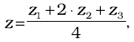

        - pričom z je po zaokrúhlení výsledný stupeň prospechu a zi je stupeň prospechu za úlohu č. i.

      - Úpravy pre žiakov so zdravotným znevýhodnením

      - Úloha č. 1

        - a) Ak ide o žiakov so zrakovým postihnutím, obrázky sa nahradia slovným opisom príslušnej situácie vo vyučovacom jazyku; grafy a schémy sa vynechajú.

        - b) Ak ide o žiakov so sluchovým postihnutím, nehodnotí sa jazyková správnosť.

      - Úloha č. 2

      - Ak ide o žiakov so sluchovým postihnutím, nehodnotí sa výslovnosť, intonácia a gramatická správnosť.

      - Trvanie skúšky: 30 minút

      - Čas na prípravu: 30 minút

      - FYZIKA

      - Každé zadanie sa skladá z troch úloh.

      - Charakteristika úloh maturitných zadaní

      - Úloha č. 1 – Žiak teoreticky opíše fyzikálny jav, pojem, vzťah a podobne a rieši jednoduchú úlohu súvisiacu s témou (prevláda forma monológu).

      - Úloha č. 2 – Žiak rieši štruktúrovanú úlohu, v ktorej musí aplikovať teoretické poznatky z určitých tematických celkov (prevláda forma dialógu s členmi predmetovej maturitnej komisie).

      - Úloha č. 3 – Žiak obhajuje svoju experimentálnu prácu súvisiacu s témami zadania, pričom využíva svoj zošit laboratórnych cvičení (uplatňuje sa aj forma dialógu s členmi predmetovej maturitnej komisie).

      - Zastúpenie jednotlivých tematických okruhov v úlohách maturitných zadaní je takéto:

      - mechanika,

      - molekulová fyzika a termodynamika,

      - elektrický prúd a elektrické pole,

      - magnetické pole,

      - striedavý prúd,

      - mechanické kmitanie,

      - vlnenie,

      - základy fyziky mikrosveta.

      - Všeobecné pomôcky

      - Matematické, fyzikálne a chemické tabuľky, kalkulačka, ktorá by mala mať aspoň desaťmiestny displej, základné aritmetické operácie (sčítanie, odčítanie, násobenie, delenie, umocňovanie, odmocňovanie), goniometrické, exponenciálne a logaritmické funkcie a funkcie k nim inverzné, no nesmie mať grafický displej.

      - Hodnotenie

        - a) Každá úloha maturitného zadania sa hodnotí stupňom prospechu 1 až 5.

        - b) Váha hodnotenia jednotlivých úloh je 3 : 4 : 3. Pri výpočte váženého priemeru sa používa vzorec

      - 

        - pričom z je po zaokrúhlení výsledný stupeň prospechu a zi je stupeň prospechu za úlohu č. i.

      - Úpravy pre žiakov so zdravotným znevýhodnením

      - Úloha č. 3 je upravená podľa druhu a stupňa postihnutia.

      - Trvanie skúšky: 30 minút

      - Čas na prípravu: 30 minút

      - GEOGRAFIA

      - Každé zadanie sa skladá z troch úloh.

      - Charakteristika úloh maturitných zadaní

      - Úloha č. 1 – Úloha je širšie koncipovaná, jej cieľom je preveriť žiakove vedomosti a zručnosti v danej oblasti, spôsob logickej prípravy a prezentácie odpovede na danú úlohu, výber faktov, pojmov a vzťahov. Cieľom je preveriť aj zručnosť práce so zdrojmi, ktoré bude mať žiak k dispozícii k danej otázke (prevláda forma monológu).

      - Úloha č. 2 – Úloha je formulovaná ako aplikačná úloha. Úlohou žiaka je predviesť najvhodnejší spôsob riešenia, obhájiť správnosť svojho postupu a vedieť argumentovať a komunikovať o príslušnom probléme. Pri odpovedi bude mať žiak k dispozícii geografické zdroje (prevláda forma dialógu s členmi predmetovej maturitnej komisie).

      - Úloha č. 3 – Úloha je formulovaná ako konkrétna problémová úloha na úrovni najvyšších myšlienkových operácií (analýza, syntéza, hodnotenie), pri ktorej riešení môžu žiaci uplatniť vedomosti a zručnosti získané počas celého štúdia, teda sformulovať geografickú otázku, správne vybrať údaje, analyzovať ich, organizovať získané údaje a hodnotiť ich, odpovedať na geografickú otázku. Žiak predvedie svoje riešenie problému a obhajuje správnosť riešenia na základe geografických zdrojov (prevláda forma dialógu s členmi predmetovej maturitnej komisie).

      - Zastúpenie jednotlivých tematických okruhov v úlohách maturitných zadaní je takéto:

      - Zem a zobrazovanie Zeme,

      - fyzická geografia (atmosféra, hydrosféra, litosféra, pedosféra, biosféra),

      - humánna geografia (obyvateľstvo, sídla, hospodárstvo sveta),

      - regionálna geografia sveta (politická mapa sveta, geografia Európy, Ameriky, Ázie, Afriky, Austrálie, Oceánie, Antarktídy a oceánov),

      - geografia Slovenskej republiky,

      - geoekológia a environmentalistika.

      - Všeobecné pomôcky

      - Všeobecno-zemepisné mapy

      - Tematické mapy

      - Hodnotenie

        - a) Každá úloha maturitného zadania sa hodnotí stupňom prospechu 1 až 5.

        - b) Váha hodnotenia jednotlivých úloh je 1 : 2 : 3. Pri výpočte váženého priemeru sa používa vzorec

      - 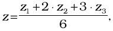

      - pričom z je po zaokrúhlení výsledný stupeň prospechu a zi je stupeň prospechu za úlohu č. i.

      - Úpravy pre žiakov so zdravotným znevýhodnením

      - Požiadavka zručnosti a riešenia na základe geografických zdrojov je pre žiakov so zrakovým a telesným postihnutím vo všetkých úlohách jednotlivých zadaní upravená podľa druhu a stupňa postihnutia.

      - Zastúpenie jednotlivých tematických okruhov v úlohách maturitných zadaní pre žiakov so zrakovým postihnutím je takéto:

      - Zem a zobrazovanie Zeme,

      - fyzická geografia (atmosféra, hydrosféra, litosféra, pedosféra, biosféra),

      - humánna geografia (obyvateľstvo, sídla, hospodárstvo sveta),

      - regionálna geografia sveta (politická mapa sveta, geografia Európy, Ameriky, Ázie, Afriky, Austrálie,

      - Oceánie, Antarktídy a oceánov),

      - geografia Slovenskej republiky,

      - geoekológia a environmentalistika.

      - Trvanie skúšky: 30 minút

      - Čas na prípravu: 30 minút

      - CHÉMIA

      - Každé zadanie sa skladá z troch úloh.

      - Charakteristika úloh maturitných zadaní

      - Úloha č. 1 – Úloha na reprodukciu, pochopenie a jednoduché myšlienkové operácie, napr. jednoduché výpočty, názvoslovie, vlastnosti látok, zoradenie, zaradenie do skupiny, neúplný zápis reakcie a podobne, spojená s pokynmi typu definuj, pomenuj, vymenuj a podobne (prevláda forma monológu).

      - Úloha č. 2 – Úloha zameraná na zložitejšie myšlienkové operácie a tvorivé myslenie, na analýzu, porovnávanie, hodnotenie, aplikáciu osvojených poznatkov (prevláda forma dialógu s členmi predmetovej maturitnej komisie).

      - Úloha č. 3 – Úloha zameraná na laboratórnu skúsenosť žiaka, napr. opis alebo realizácia laboratórneho postupu, výpočet spojený s pokusom, vyslovenie hypotézy, hľadanie vhodných chemikálií, pomôcok, laboratórneho postupu, diskusia o výsledkoch pokusu a podobne, alebo na schopnosť žiaka pracovať s odborným textom, napr. analyzovať, vyhľadávať v texte, reagovať na otázky týkajúce sa textu a podobne.

      - Zastúpenie jednotlivých tematických okruhov v úlohách maturitných zadaní je takéto:

      - všeobecná chémia,

      - anorganická chémia,

      - organická chémia,

      - prírodné látky a základy biochémie.

      - Všeobecné pomôcky

      - Matematické, fyzikálne a chemické tabuľky

      - Jednoduchá kalkulačka (základné aritmetické, exponenciálne a logaritmické funkcie)

      - Stavebnica molekulových modelov

      - Modely kryštalických mriežok a orbitálov

      - Hodnotenie

        - a) Každá úloha maturitného zadania sa hodnotí stupňom prospechu 1 až 5.

        - b) Váha hodnotenia jednotlivých úloh je 1 : 2 : 2. Pri výpočte váženého priemeru sa používa vzorec

      - 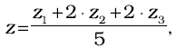

        - pričom z je po zaokrúhlení výsledný stupeň prospechu a zi je stupeň prospechu za úlohu č. i.

      - Úpravy pre žiakov so zdravotným znevýhodnením

      - Úloha č. 3 je upravená podľa druhu a stupňa postihnutia.

      - Trvanie skúšky: 30 minút

      - Čas na prípravu: 30 minút

      - INFORMATIKA

      - Každé zadanie sa skladá z dvoch úloh.

      - Charakteristika úloh maturitných zadaní

      - Úloha č. 1 – Riešenie algoritmického problému v konkrétnom programovacom jazyku

      - Úloha č. 2 – Riešenie praktickej úlohy alebo opísanie témy a uvedenie príkladov

      - Zastúpenie jednotlivých tematických okruhov v úlohách maturitných zadaní je takéto:

      - Úloha č. 1 – algoritmy a programovanie

      - Úloha č. 2 – informácie okolo nás, informačná spoločnosť, počítačové systémy, internet

      - 25 % až 40 % internet,

      - 25 % až 40 % aplikačný softvér.

      - Obsahom maturitných zadaní by mali byť praktické úlohy, ktoré sa dajú zvládnuť asi za 20 minút. V tomto časovom intervale sú žiaci schopní zvládnuť len čiastkové úlohy z tematických celkov, ako napríklad vytvorenie a odladenie podprogramu s požadovanou vlastnosťou, doplnenie tabuľky o požadované výpočty, vytvorenie vhodnej grafickej reprezentácie údajov z tabuľky, odoslanie a prijatie elektronickej pošty s prílohou, doplnenie počítačovej prezentácie o ďalšiu snímku so špecifikovaným obsahom, získanie požadovaných údajov z databázy v určenej forme, úpravu textu, tabuľky, prezentácie, databázy, úpravu obrázka na požadovaný tvar, vykonanie špecifikovaných systémových nastavení atď.

      - Cieľom zadania je predovšetkým preverenie praktických zručností žiaka pri používaní informačno-komunikačných technológií a preverenie jeho schopnosti aplikovať získané teoretické poznatky v praxi. Riešenie maturitného zadania sa musí realizovať prostriedkami informačno-komunikačných technológií.

      - Formulácia zadania by mala obsahovať cieľ, ktorý má študent dosiahnuť, ale nie prostriedky, ktorými ho má dosiahnuť. Výber prostriedkov a ich zvládnutie v procese riešenia zadania je súčasťou hodnotenia žiaka.

      - Všeobecné pomôcky

      - PC s pripojením na internet

      - Hodnotenie

        - a) Každá úloha maturitného zadania sa hodnotí stupňom prospechu 1 až 5.

        - b) Váha hodnotenia jednotlivých úloh je 1 : 1. Pri výpočte váženého priemeru sa používa vzorec

      - 

      - pričom z je po zaokrúhlení výsledný stupeň prospechu a zi je stupeň prospechu za úlohu č. i.

      - Úpravy pre žiakov so zdravotným znevýhodnením

      - Trvanie skúšky: 30 minút

      - Čas na prípravu: 30 minút

      - MAĎARSKÝ JAZYK A LITERATÚRA

      - Každé zadanie obsahuje dve úlohy a východiskový literárny text. Jedna z úloh musí obsahovať učivo z maďarského jazyka. Ak by literárny text neobsahoval vhodné podnety pre úlohu z jazyka, môže byť k tejto úlohe pripojený ešte špecifický text.

      - Charakteristika úloh maturitných zadaní

      - Úloha č. 1 – Úloha je zameraná na reprodukciu vedomostí z literárnej histórie a teórie literatúry (prevláda forma monológu) a na následnú schopnosť uplatniť tieto vedomosti pri interpretácii textu literárnej ukážky (prevláda forma dialógu s členmi predmetovej maturitnej komisie). Úloha môže mať tieto varianty:

        - a) variant – ak je úloha zameraná historicky, jej obsahom je priblíženie literárno-umeleckého obdobia a prehľad o najvýznamnejších autoroch (2 až 3) s ideovou, tematickou a umeleckou charakteristikou ich najdôležitejších diel a následná analýza a hodnotenie textu na základe argumentácie (dokazovanie vlastných tvrdení prvkami z textu),

        - b) variant – ak je úloha zameraná tematicky, jej obsahom je priblíženie odlišného stvárnenia danej témy v rôznych dielach a následná analýza a hodnotenie textu na základe argumentácie (dokazovanie vlastných tvrdení prvkami z textu),

        - c) variant – ak je úloha zameraná na problematiku žánrovej formy, jej obsahom je definovanie žánrovej formy, náčrt jej historického vývinu, resp. prehľad modifikácií žánru u rôznych autorov a následná analýza a hodnotenie textu na základe argumentácie (dokazovanie vlastných tvrdení prvkami z textu).

      - Úloha č. 2 – Úloha je zameraná tak, aby žiak pri odpovedi prejavil svoju pripravenosť demonštrovať znalosť teoretického systému maďarského jazyka určenú základnými pedagogickými dokumentmi a svoju schopnosť uplatniť tieto vedomosti pri vysvetľovaní konkrétnych jazykových javov, ktoré sa vyskytli v texte literárnej ukážky (prevláda forma dialógu s členmi predmetovej maturitnej komisie).

      - Zastúpenie jednotlivých tematických okruhov v úlohách maturitných zadaní je takéto:

      - Úlohy z literatúry

      - maďarská literatúra,

      - svetová literatúra,

      - teória literatúry.

      - Úlohy z jazyka

      - lexikológia a frazeológia,

      - morfológia,

      - zvuková a grafická stránka jazyka,

      - syntax,

      - práca s informáciami,

      - všeobecné poznatky o jazyku,

      - štylistika.

      - Všeobecné pomôcky

      - A magyar helyesírás szabályai vagy Helyesírási keziszótár – slovník

      - Hodnotenie

      - Predmetová maturitná komisia hodnotí obsahovú kvalitu a jazykovú správnosť odpovede, t. j. rozsah slovnej zásoby, gramatickú správnosť, štylistickú pôsobivosť a stupeň rečovej pohotovosti.

        - a) Každá úloha maturitného zadania sa hodnotí stupňom prospechu 1 až 5.

        - b) Váha hodnotenia jednotlivých úloh je 3 : 2. Pri výpočte váženého priemeru sa používa vzorec

      - 

        - pričom z je po zaokrúhlení výsledný stupeň prospechu a zi je stupeň prospechu za úlohu č. i.

      - Úpravy pre žiakov so zdravotným znevýhodnením

      - Trvanie skúšky: 30 minút

      - Čas na prípravu: 40 minút

      - MATEMATIKA

      - Každé zadanie sa skladá z troch úloh.

      - Charakteristika úloh maturitných zadaní

      - Úloha č. 1 – Žiak objasní (definuje) dané pojmy, uvedie ich príklady a kontrapríklady, sformuluje ich vlastnosti a súvislosti medzi uvedenými pojmami (prevláda forma monológu).

      - Úloha č. 2 – Úloha je zameraná na argumentáciu a dôvodenie (prevláda forma dialógu s členmi predmetovej maturitnej komisie).

      - Úloha č. 3 – Úloha je zameraná na postup riešenia príslušnej úlohy s rôznymi alternatívami. Doplňujúce otázky budú zamerané na alternatívy pri iných číselných zadaniach.

      - Zastúpenie jednotlivých tematických okruhov v úlohách maturitných zadaní je takéto:

      - základy matematiky,

      - funkcie,

      - planimetria,

      - stereometria,

      - kombinatorika, pravdepodobnosť, štatistika.

      - Úlohy maturitných zadaní nemôžu byť z jedného tematického okruhu.

      - Všeobecné pomôcky

      - Matematické, fyzikálne a chemické tabuľky

      - Kalkulačka, ktorá by mala mať aspoň desaťmiestny displej, základné aritmetické operácie (sčítanie, odčítanie, násobenie, delenie, umocňovanie, odmocňovanie), goniometrické, exponenciálne a logaritmické funkcie a funkcie k nim inverzné, no nesmie mať grafický displej.

      - Hodnotenie

        - a) Každá úloha maturitného zadania sa hodnotí stupňom prospechu 1 až 5.

        - b) Váha hodnotenia jednotlivých úloh je 1 : 2 : 2. Pri výpočte váženého priemeru sa používa vzorec

      - 

        - pričom z je po zaokrúhlení výsledný stupeň prospechu a zi je stupeň prospechu za úlohu č. i.

      - Úpravy pre žiakov so zdravotným znevýhodnením

      - Zastúpenie jednotlivých tematických okruhov v úlohách maturitných zadaní pre žiakov so sluchovým postihnutím je takéto:

      - základy matematiky,

      - funkcie,

      - planimetria,

      - stereometria,

      - kombinatorika, pravdepodobnosť, štatistika.

      - Trvanie skúšky: 30 minút

      - Čas na prípravu: 30 minút

      - NÁUKA O SPOLOČNOSTI

      - Každé zadanie sa skladá z troch úloh.

      - Charakteristika úloh maturitných zadaní

      - Úloha č. 1 – Žiak má opísať (definovať) vybrané pojmy a uviesť súvislosti medzi nimi (prevláda forma monológu).

      - Úloha č. 2 – Úloha je zameraná na analýzu ukážky, resp. porovnanie ukážok textov alebo argumentáciu či zdôvodnenie (prevláda forma dialógu s členmi predmetovej maturitnej komisie).

      - Úloha č. 3 – Úloha je zameraná na riešenie určitého problému a jeho aplikáciu v praxi alebo na využitie medzipredmetových väzieb pri riešení problému (prevláda forma dialógu s členmi predmetovej maturitnej komisie).

      - Zastúpenie jednotlivých tematických okruhov v úlohách maturitných zadaní je takéto:

      - filozofia,

      - právo,

      - politológia,

      - ekonómia a ekonomika,

      - psychológia a sociológia.

      - Všeobecné pomôcky

      - Antológia z diel filozofov

      - Ústava Slovenskej republiky

      - Slovník spoločenských vied

      - Všeobecná deklarácia ľudských práv

      - Filozofický slovník

      - Dohovor k ľudským právam

      - Dohovor o právach detí

      - Hodnotenie

        - a) Každá úloha maturitného zadania sa hodnotí stupňom prospechu 1 až 5.

        - b) Váha hodnotenia jednotlivých úloh je 1 : 2 : 2. Pri výpočte váženého priemeru sa používa vzorec

      - 

        - pričom z je po zaokrúhlení výsledný stupeň prospechu a zi je stupeň prospechu za úlohu č. i.

      - Úpravy pre žiakov so zdravotným znevýhodnením

      - Zastúpenie jednotlivých tematických okruhov v úlohách maturitných zadaní pre žiakov so sluchovým postihnutím je takéto:

      - 10 % až 40 % filozofia,

      - 10 % až 40 % právo,

      - 10 % až 40 % politológia,

      - 10 % až 40 % ekonómia a ekonomika,

      - 10 % až 40 % psychológia a sociológia.

      - Trvanie skúšky: 30 minút

      - Čas na prípravu: 30 minút

      - NEMECKÝ JAZYK

      - Každé zadanie pre všetky úrovne sa skladá z troch úloh. Tematické okruhy sú uvedené v cieľových požiadavkách z nemeckého jazyka.

      - Charakteristika úloh maturitných zadaní

      - Úloha č. 1 – Vizuálny podnet (napr. obrázok, fotografia, komiks, graf, schéma a pod.). Žiak opíše predložený obrázok a hľadá súvislosti medzi obrázkom a príslušnou maturitnou témou. Komisia hodnotí súvislosť opisu predloženého podnetu, lineárnosť (postupnosť) vo vyjadrovaní a adekvátne jazykové prostriedky zodpovedajúce danej úrovni žiaka.

      - Úloha č. 2 – Tematický okruh. Úlohou žiaka je zaujať stanovisko k téme a odôvodniť ho v rozhovore so skúšajúcimi, ktorí vedú rozhovor podľa zásad uvedených v metodických pokynoch pre predmetové maturitné komisie. Komisia hodnotí, ako žiak dokáže zdôvodniť a vysvetliť svoje názory na príslušnú tému a argumentovať k problematike, výber faktov a informácií, gramatiku.

      - Úloha č. 3 – Situačná úloha, dialóg s rozdelenými úlohami (stredné odborné školy aj rôzne modelové situácie zohľadňujúce príslušný študijný odbor). Žiak dostane za úlohu vyriešiť konkrétnu situáciu, napríklad je na stanici a má sa informovať o najvýhodnejšom vlakovom spojení do nejakého mesta. Komisia sa zameriava na hodnotenie výberu a adekvátnosť použitia jazykových prostriedkov (z konkrétnej situácie z každodenného života v okruhu príslušných tém).

      - Všeobecné pomôcky

      - Obojstranný prekladový slovník obsahujúci najmenej 15 000 hesiel

      - Hodnotenie

        - a) Základom hodnotenia je rozsah slovnej zásoby, používanie gramatických štruktúr, stupeň jazykovej pohotovosti, obsahová stránka prejavu a pod.

        - b) Predmetová maturitná komisia hodnotí obsahovú a jazykovú správnosť odpovede, štruktúru – začiatok, vedenie a ukončenie rozhovoru.

        - c) Každá úloha maturitného zadania sa hodnotí stupňom prospechu 1 až 5.

        - d) Hodnotenie úlohy č. 1 sa skladá z dvoch samostatných hodnotení. Hodnotí sa

          - 1. obsahová primeranosť,

          - 2. jazyková správnosť.

        - e) Hodnotenie úlohy č. 2 sa skladá zo šiestich samostatných hodnotení. Hodnotí sa

          - 1. plynulosť vyjadrovania,

          - 2. výslovnosť a intonácia,

          - 3. obsah – náročnosť spracovania/kvalita rozhovoru,

          - 4. lexikálny rozsah,

          - 5. argumentácia,

          - 6. gramatická presnosť.

        - f) Hodnotenie úlohy č. 3 sa skladá z dvoch samostatných hodnotení. Hodnotí sa

          - 1. obsahová a jazyková správnosť,

          - 2. pohotovosť vyjadrovania.

        - g) Váha hodnotenia jednotlivých úloh ústnej zložky je 1 : 2 : 1. Pri výpočte váženého priemeru pre obidve úrovne sa používa vzorec

      - 

        - pričom z je po zaokrúhlení výsledný stupeň prospechu a zi je stupeň prospechu za úlohu č. i.

      - Úpravy pre žiakov so zdravotným znevýhodnením

      - Úloha č. 1

        - a) Ak ide o žiakov so zrakovým postihnutím, obrázky sa nahradia slovným opisom príslušnej situácie vo vyučovacom jazyku; grafy a schémy sa vynechajú.

        - b) Ak ide o žiakov so sluchovým postihnutím, nehodnotí sa jazyková správnosť.

      - Úloha č. 2

      - Ak ide o žiakov so sluchovým postihnutím, nehodnotí sa výslovnosť, intonácia a gramatická správnosť.

      - Trvanie skúšky: 30 minút

      - Čas na prípravu: 30 minút

      - OBČIANSKA NÁUKA

      - Každé zadanie sa skladá z troch úloh.

      - Charakteristika úloh maturitných zadaní

      - Úloha č. 1 – Žiak má opísať (definovať) vybrané pojmy a uviesť súvislosti medzi nimi (prevláda forma monológu).

      - Úloha č. 2 – Úloha je zameraná na analýzu ukážky, resp. porovnanie ukážok textov alebo argumentáciu či zdôvodnenie (prevláda forma dialógu s členmi predmetovej maturitnej komisie).

      - Úloha č. 3 – Úloha je zameraná na riešenie určitého problému a jeho aplikáciu v praxi alebo na využitie medzipredmetových väzieb pri riešení problému (prevláda forma dialógu s členmi predmetovej maturitnej komisie).

      - Zastúpenie jednotlivých tematických okruhov v úlohách maturitných zadaní je takéto:

      - filozofia,

      - právo,

      - politológia,

      - ekonómia a ekonomika,

      - psychológia a sociológia.

      - Všeobecné pomôcky

      - Antológia z diel filozofov

      - Ústava Slovenskej republiky

      - Slovník spoločenských vied

      - Všeobecná deklarácia ľudských práv

      - Filozofický slovník

      - Dohovor k ľudským právam

      - Dohovor o právach detí

      - Hodnotenie

        - a) Každá úloha maturitného zadania sa hodnotí stupňom prospechu 1 až 5.

        - b) Váha hodnotenia jednotlivých úloh je 1 : 2 : 2. Pri výpočte váženého priemeru sa používa vzorec

      - 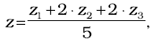

        - pričom z je po zaokrúhlení výsledný stupeň prospechu a zi je stupeň prospechu za úlohu č. i.

      - Úpravy pre žiakov so zdravotným znevýhodnením

      - Zastúpenie jednotlivých tematických okruhov v úlohách maturitných zadaní pre žiakov so sluchovým postihnutím je takéto:

      - 10 % až 40 % filozofia,

      - 10 % až 40 % právo,

      - 10 % až 40 % politológia,

      - 10 % až 40 % ekonómia a ekonomika,

      - 10 % až 40 % psychológia a sociológia.

      - Trvanie skúšky: 30 minút

      - Čas na prípravu: 30 minút

      - RUSKÝ JAZYK

      - Každé zadanie pre všetky úrovne sa skladá z troch úloh.

      - Tematické okruhy sú uvedené v cieľových požiadavkách z ruského jazyka.

      - Charakteristika úloh maturitných zadaní

      - Úloha č. 1 – Vizuálny podnet (napr. obrázok, fotografia, komiks, graf, schéma a pod.). Žiak opíše predložený obrázok a nachádza súvislosti medzi obrázkom a príslušnou maturitnou témou. Komisia hodnotí súvislosť opisu predloženého podnetu, lineárnosť (postupnosť) vo vyjadrovaní a adekvátne jazykové prostriedky zodpovedajúce danej úrovni žiaka.

      - Úloha č. 2 – Tematický okruh

      - Úlohou žiaka je zaujať stanovisko k téme a odôvodniť ho v rozhovore so skúšajúcimi, ktorí vedú rozhovor podľa zásad uvedených v metodických pokynoch pre predmetové maturitné komisie. Komisia hodnotí, ako žiak dokáže zdôvodniť a vysvetliť svoje názory na príslušnú tému a argumentovať k problematike, výber faktov a informácií, gramatiku.

      - Úloha č. 3 – Situačná úloha, dialóg s rozdelenými úlohami (stredné odborné školy aj rôzne modelové situácie zohľadňujúce príslušný študijný odbor). Žiak dostane za úlohu vyriešiť konkrétnu situáciu, napr. je na stanici a má sa informovať o najvýhodnejšom vlakovom spojení do nejakého mesta. Komisia sa zameriava na hodnotenie výberu a adekvátnosť použitia jazykových prostriedkov (v konkrétnej situácii z každodenného života v okruhu príslušných tém).

      - Všeobecné pomôcky

      - Obojstranný prekladový slovník obsahujúci najmenej 15 000 hesiel

      - Hodnotenie

        - a) Základom hodnotenia je rozsah slovnej zásoby, používanie gramatických štruktúr, stupeň jazykovej pohotovosti, obsahová stránka prejavu a pod.

        - b) Predmetová maturitná komisia hodnotí obsahovú a jazykovú správnosť odpovede, štruktúru – začiatok, vedenie a ukončenie rozhovoru.

        - c) Každá úloha maturitného zadania sa hodnotí stupňom prospechu 1 až 5.

        - d) Hodnotenie úlohy č. 1 sa skladá z dvoch samostatných hodnotení. Hodnotí sa

          - 1. obsahová primeranosť,

          - 2. jazyková správnosť.

        - e) Hodnotenie úlohy č. 2 sa skladá zo šiestich samostatných hodnotení. Hodnotí sa

          - 1. plynulosť vyjadrovania,

          - 2. výslovnosť a intonácia,

          - 3. obsah – náročnosť spracovania/kvalita rozhovoru,

          - 4. lexikálny rozsah,

          - 5. argumentácia,

          - 6. gramatická presnosť.

        - f) Hodnotenie úlohy č. 3 sa skladá z dvoch samostatných hodnotení. Hodnotí sa

          - 1. obsahová a jazyková správnosť,

          - 2. pohotovosť vyjadrovania.

        - g) Váha hodnotenia jednotlivých úloh ústnej zložky je 1 : 2 : 1. Pri výpočte váženého priemeru sa používa vzorec

        - 

          - pričom z je po zaokrúhlení výsledný stupeň prospechu a zi je stupeň prospechu za úlohu č. i.

      - Úpravy pre žiakov so zdravotným znevýhodnením

      - Úloha č. 1

        - a) Ak ide o žiakov so zrakovým postihnutím, obrázky sa nahradia slovným opisom príslušnej situácie vo vyučovacom jazyku; grafy a schémy sa vynechajú.

        - b) Ak ide o žiakov so sluchovým postihnutím, nehodnotí sa jazyková správnosť.

      - Úloha č. 2

      - Ak ide o žiakov so sluchovým postihnutím, nehodnotí sa výslovnosť, intonácia a gramatická správnosť.

      - Trvanie skúšky: 30 minút

      - Čas na prípravu: 30 minút

      - SLOVENSKÝ JAZYK A LITERATÚRA

      - Každé maturitné zadanie obsahuje dve úlohy a súvisiace východiskové texty. Prvá úloha obsahuje učivo zo slovenského jazyka. Druhá úloha obsahuje učivo z literatúry.

      - Charakteristika úloh maturitných zadaní

      - Úloha č. 1 – Úloha je zameraná tak, aby žiak pri odpovedi prejavil pripravenosť komunikovať v štátnom jazyku, schopnosť jazykovo, kompozične a štylisticky analyzovať a interpretovať text a znalosť teoretického systému slovenského jazyka v rozsahu určenom katalógom cieľových požiadaviek a vzdelávacím štandardom. Zároveň má žiak preukázať schopnosť pohotovo reagovať na podnety, argumentovať a kriticky hodnotiť text; uplatňuje sa forma dialógu s členmi predmetovej maturitnej komisie.

      - Úloha č. 2 – Úloha je zameraná na schopnosť analyzovať, interpretovať a esteticky hodnotiť umelecký text a pritom uplatňovať vedomosti z literárnej teórie a literárnej histórie; uplatňuje sa forma dialógu s členmi predmetovej maturitnej komisie.

      - Zastúpenie jednotlivých tematických okruhov v úlohách maturitných zadaní je takéto:

      - Úlohy z jazyka

      - zvuková rovina jazyka a pravopis,

      - významová/lexikálna rovina jazyka,

      - tvarová/morfologická rovina jazyka,

      - skladobná/syntaktická rovina jazyka,

      - sloh,

      - jazykoveda,

      - jazyk a reč,

      - učenie sa,

      - práca s informáciami,

      - jazyková kultúra,

      - komunikácia.

      - Úlohy z literatúry

      - všeobecné pojmy,

      - literárne obdobia a smery,

      - literárne druhy,

      - literárne žánre,

      - štruktúra literárneho diela,

      - štylizácia textu,

      - metrika.

      - Všeobecné pomôcky

      - Krátky slovník slovenského jazyka

      - Synonymický slovník slovenčiny

      - Pravidlá slovenského pravopisu

      - Hodnotenie

        - a) Predmetová maturitná komisia hodnotí obsahovú kvalitu a úroveň jazykovej kultúry, t. j. jazykovú a gramatickú správnosť odpovede, rozsah slovnej zásoby, štylistickú pôsobivosť a stupeň rečovej pohotovosti.

        - b) Každá úloha maturitného zadania sa hodnotí stupňom prospechu 1 až 5.

        - c) Váha hodnotenia jednotlivých úloh je 3 : 2 alebo 1 : 1. Pri výpočte stupňa prospechu sa používa vzorec

      - 

        - alebo vzorec

      - 

        - pričom z je po zaokrúhlení výsledný stupeň prospechu, z1 je známka za úlohu č. 1 a z2 je známka za úlohu č. 2. Príslušný vzorec je určený predmetovou komisiou pre jednotlivé triedy podľa formulácie maturitných zadaní.

        - d) Váha hodnotenia jednotlivých úloh pre gymnáziá s osemročným vzdelávacím programom môže byť aj v pomere 2 : 3. Pri výpočte stupňa prospechu sa používa vzorec

      - 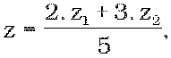

        - pričom z je po zaokrúhlení výsledný stupeň prospechu, z1 je známka za úlohu č. 1 a z2 je známka za úlohu č. 2.

      - Ustanovenie tohto písmena sa uplatňuje do 31. augusta 2015.

      - Úpravy pre žiakov so zdravotným znevýhodnením

      - Trvanie skúšky: 30 minút

      - Čas na prípravu: 40 minút.

      - SLOVENSKÝ JAZYK A SLOVENSKÁ LITERATÚRA

      - Každé zadanie obsahuje dve úlohy a východiskové texty.

      - Charakteristika úloh maturitných zadaní

      - Úloha č. 1 – Konverzácia

      - Aktualizovať a konkretizovať rozhovory, viesť rozhovor, ktorý nadväzuje na východiskový text, rozumieť tematickým okruhom z konverzácie, aktívne ovládať základnú slovnú zásobu konverzačných tém, zostaviť rozhovor na základe kľúčových slov alebo téz.

      - Úloha č. 2 – Literatúra

      - Prirodzená komunikácia o literárnom diele (kontextualita), schopnosť tvorivo interpretovať osvojené myšlienky a produkovať vlastné, objasňovať špecifiká, ktoré sú charakteristické pre slovenskú a maďarskú literatúru.

      - Zastúpenie jednotlivých tematických okruhov v úlohách maturitných zadaní je takéto:

      - konverzácia,

      - literatúra.

      - Všeobecné pomôcky

      - Slovník slovenského jazyka

      - Frazeologický slovník

      - Pravidlá slovenského pravopisu

      - Dvojjazyčné slovníky (slovensko-maďarský, maďarsko-slovenský)

      - Hodnotenie

        - a) Základom hodnotenia je rozsah slovnej zásoby, používanie gramatických štruktúr, stupeň jazykovej pohotovosti, obsahová stránka prejavu a pod.

        - b) Predmetová maturitná komisia hodnotí obsahovú a jazykovú správnosť odpovede, štruktúru – začiatok, vedenie a ukončenie rozhovoru.

        - c) Každá úloha maturitného zadania sa hodnotí stupňom prospechu 1 až 5.

        - d) Váha hodnotenia jednotlivých úloh je 3 : 2. Pri výpočte váženého priemeru sa používa vzorec

      - 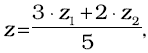

        - pričom z je po zaokrúhlení výsledný stupeň prospechu a zi je stupeň prospechu za úlohu č. i.

      - Úpravy pre žiakov so zdravotným znevýhodnením

      - Trvanie skúšky: 30 minút

      - Čas na prípravu: 40 minút

      - ŠPANIELSKY JAZYK

      - Každé zadanie pre všetky úrovne sa skladá z troch úloh.

      - Tematické okruhy sú uvedené v cieľových požiadavkách zo španielskeho jazyka.

      - Charakteristika úloh maturitných zadaní

      - Úloha č. 1 – Vizuálny podnet (napr. obrázok, fotografia, komiks, graf, schéma a pod.). Žiak opíše predložený obrázok a nachádza súvislosti medzi obrázkom a príslušnou maturitnou témou. Komisia hodnotí súvislosť opisu predloženého podnetu, lineárnosť (postupnosť) vo vyjadrovaní a adekvátne jazykové prostriedky zodpovedajúce danej úrovni žiaka.

      - Úloha č. 2 – Tematický okruh

      - Úlohou žiaka je zaujať stanovisko k téme a odôvodniť ho v rozhovore so skúšajúcimi, ktorí vedú rozhovor podľa zásad uvedených v metodických pokynoch pre predmetové maturitné komisie. Komisia hodnotí, ako žiak dokáže zdôvodniť a vysvetliť svoje názory na príslušnú tému a argumentovať k problematike, výber faktov a informácií, gramatiku.

      - Úloha č. 3 – Situačná úloha, dialóg s rozdelenými úlohami (stredné odborné školy aj rôzne modelové situácie zohľadňujúce príslušný študijný odbor). Žiak dostane za úlohu vyriešiť konkrétnu situáciu, napr. je na stanici a má sa informovať o najvýhodnejšom vlakovom spojení do nejakého mesta. Komisia sa zameriava na hodnotenie výberu a adekvátnosť použitia jazykových prostriedkov (v konkrétnej situácii z každodenného života v okruhu príslušných tém).

      - Všeobecné pomôcky

      - Obojstranný prekladový slovník obsahujúci najmenej 15 000 hesiel

      - Hodnotenie

        - a) Základom hodnotenia je rozsah slovnej zásoby, používanie gramatických štruktúr, stupeň jazykovej pohotovosti, obsahová stránka prejavu a pod.

        - b) Predmetová maturitná komisia hodnotí obsahovú a jazykovú správnosť odpovede, štruktúru – začiatok, vedenie a ukončenie rozhovoru.

        - c) Každá úloha maturitného zadania sa hodnotí stupňom prospechu 1 až 5.

        - d) Hodnotenie úlohy č. 1 sa skladá z dvoch samostatných hodnotení. Hodnotí sa

          - 1. obsahová primeranosť,

          - 2. jazyková správnosť.

        - e) Hodnotenie úlohy č. 2 sa skladá zo šiestich samostatných hodnotení. Hodnotí sa

          - 1. plynulosť vyjadrovania,

          - 2. výslovnosť a intonácia,

          - 3. obsah – náročnosť spracovania/kvalita rozhovoru,

          - 4. lexikálny rozsah,

          - 5. argumentácia,

          - 6. gramatická presnosť.

        - f) Hodnotenie úlohy č. 3 sa skladá z dvoch samostatných hodnotení.

      - Hodnotí sa

        - 1. obsahová a jazyková správnosť,

        - 2. pohotovosť vyjadrovania.

        - g) Váha hodnotenia jednotlivých úloh ústnej zložky je 1 : 2 : 1. Pri výpočte váženého priemeru sa používa vzorec

      - 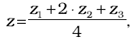

        - pričom z je po zaokrúhlení výsledný stupeň prospechu a zi je stupeň prospechu za úlohu č. i.

      - Úpravy pre žiakov so zdravotným znevýhodnením

      - Úloha č. 1

        - a) Ak ide o žiakov so zrakovým postihnutím, obrázky sa nahradia slovným opisom príslušnej situácie vo vyučovacom jazyku; grafy a schémy sa vynechajú.

        - b) Ak ide o žiakov so sluchovým postihnutím, nehodnotí sa jazyková správnosť.

      - Úloha č. 2

      - Ak ide o žiakov so sluchovým postihnutím, nehodnotí sa výslovnosť, intonácia a gramatická správnosť.

      - Trvanie skúšky: 30 minút

      - Čas na prípravu: 30 minút

      - TALIANSKY JAZYK

      - Každé zadanie pre všetky úrovne sa skladá z troch úloh.

      - Tematické okruhy sú uvedené v cieľových požiadavkách z talianskeho jazyka.

      - Charakteristika úloh maturitných zadaní

      - Úloha č. 1 – Vizuálny podnet (napr. obrázok, fotografia, komiks, graf, schéma a pod.). Žiak opíše predložený obrázok a nachádza súvislosti medzi obrázkom a príslušnou maturitnou témou. Komisia hodnotí súvislosť opisu predloženého podnetu, lineárnosť (postupnosť) vo vyjadrovaní a adekvátne jazykové prostriedky zodpovedajúce danej úrovni žiaka.

      - Úloha č. 2 – Tematický okruh

      - Úlohou žiaka je zaujať stanovisko k téme a odôvodniť ho v rozhovore so skúšajúcimi, ktorí vedú rozhovor podľa zásad uvedených v metodických pokynoch pre predmetové maturitné komisie. Komisia hodnotí, ako žiak dokáže zdôvodniť a vysvetliť svoje názory na príslušnú tému a argumentovať k problematike, výber faktov a informácií, gramatiku.

      - Úloha č. 3 – Situačná úloha, dialóg s rozdelenými úlohami (stredné odborné školy aj rôzne modelové situácie zohľadňujúce príslušný študijný odbor). Žiak dostane za úlohu vyriešiť konkrétnu situáciu, napr. je na stanici a má sa informovať o najvýhodnejšom vlakovom spojení do nejakého mesta. Komisia sa zameriava na hodnotenie výberu a adekvátnosť použitia jazykových prostriedkov (v konkrétnej situácii z každodenného života v okruhu príslušných tém).

      - Všeobecné pomôcky

      - Obojstranný prekladový slovník obsahujúci najmenej 15 000 hesiel

      - Hodnotenie

        - a) Základom hodnotenia je rozsah slovnej zásoby, používanie gramatických štruktúr, stupeň jazykovej pohotovosti, obsahová stránka prejavu a pod.

        - b) Predmetová maturitná komisia hodnotí obsahovú a jazykovú správnosť odpovede, štruktúru – začiatok, vedenie a ukončenie rozhovoru.

        - c) Každá úloha maturitného zadania sa hodnotí stupňom prospechu 1 až 5.

        - d) Hodnotenie úlohy č. 1 sa skladá z dvoch samostatných hodnotení. Hodnotí sa

          - 1. obsahová primeranosť,

          - 2. jazyková správnosť.

        - e) Hodnotenie úlohy č. 2 sa skladá zo šiestich samostatných hodnotení. Hodnotí sa

          - 1. plynulosť vyjadrovania,

          - 2. výslovnosť a intonácia,

          - 3. obsah – náročnosť spracovania/kvalita rozhovoru,

          - 4. lexikálny rozsah,

          - 5. argumentácia,

          - 6. gramatická presnosť.

        - f) Hodnotenie úlohy č. 3 sa skladá z dvoch samostatných hodnotení. Hodnotí sa

          - 1. obsahová a jazyková správnosť,

          - 2. pohotovosť vyjadrovania.

        - g) Váha hodnotenia jednotlivých úloh ústnej zložky je 1 : 2 : 1. Pri výpočte váženého priemeru sa používa vzorec

      - 

        - pričom z je po zaokrúhlení výsledný stupeň prospechu a zi je stupeň prospechu za úlohu č. i.

      - Úpravy pre žiakov so zdravotným znevýhodnením

      - Úloha č. 1

        - a) Ak ide o žiakov so zrakovým postihnutím, obrázky sa nahradia slovným opisom príslušnej situácie vo vyučovacom jazyku; grafy a schémy sa vynechajú.

        - b) Ak ide o žiakov so sluchovým postihnutím, nehodnotí sa jazyková správnosť.

      - Úloha č. 2

      - Ak ide o žiakov so sluchovým postihnutím, nehodnotí sa výslovnosť, intonácia a gramatická správnosť.

      - Trvanie skúšky: 30 minút

      - Čas na prípravu: 30 minút

      - UKRAJINSKÝ JAZYK A LITERATÚRA

      - Každé zadanie obsahuje dve úlohy a východiskový literárny text. Jedna z úloh musí obsahovať učivo z ukrajinského jazyka.

      - Ak by literárny text neobsahoval vhodné podnety pre úlohu z jazyka, môže byť k tejto úlohe pripojený ešte špecifický text.

      - Charakteristika úloh maturitných zadaní

      - Úloha č. 1 – Úloha je zameraná na reprodukciu vedomostí z literárnej histórie a teórie literatúry (prevláda forma monológu) a na následnú schopnosť uplatniť tieto vedomosti pri interpretácii textu literárnej ukážky (prevláda forma dialógu s členmi predmetovej maturitnej komisie). Úloha môže mať tieto varianty:

        - a) variant – ak je úloha zameraná historicky, jej obsahom je priblíženie literárno-umeleckého obdobia a prehľad o najvýznamnejších autoroch (2 až 3) s ideovou, tematickou a umeleckou charakteristikou ich najdôležitejších diel a následná analýza a hodnotenie textu na základe argumentácie (dokazovanie vlastných tvrdení prvkami z textu),

        - b) variant – ak je úloha zameraná tematicky, jej obsahom je priblíženie odlišného stvárnenia príslušnej témy v rôznych dielach a následná analýza a hodnotenie textu na základe argumentácie (dokazovanie vlastných tvrdení prvkami z textu),

        - c) variant – ak je úloha zameraná na problematiku žánrovej formy, jej obsahom je definovanie žánrovej formy, náčrt jej historického vývinu, resp. prehľad modifikácií žánru u rôznych autorov a následná analýza a hodnotenie textu na základe argumentácie (dokazovanie vlastných tvrdení prvkami z textu).

      - Úloha č. 2 – Úloha je zameraná tak, aby žiak pri odpovedi prejavil svoju pripravenosť demonštrovať znalosť teoretického systému ukrajinského jazyka určenú základnými pedagogickými dokumentmi a svoju schopnosť uplatniť tieto vedomosti pri vysvetľovaní konkrétnych jazykových javov, ktoré sa vyskytli v texte literárnej ukážky (prevláda forma dialógu s členmi predmetovej maturitnej komisie).

      - Zastúpenie jednotlivých tematických okruhov v úlohách maturitných zadaní je takéto:

      - Úlohy z literatúry

      - ukrajinská literatúra,

      - svetová literatúra,

      - teória literatúry.

      - Úlohy z jazyka

      - lexikológia a frazeológia,

      - morfológia,

      - zvuková a grafická stránka jazyka,

      - syntax,

      - práca s informáciami,

      - všeobecné poznatky o jazyku,

      - štylistika.

      - Všeobecné pomôcky

      - Slovensko-ukrajinský slovník

      - Hodnotenie

        - a) Predmetová maturitná komisia hodnotí obsahovú kvalitu a jazykovú správnosť odpovede, t. j. rozsah slovnej zásoby, gramatickú správnosť, štylistickú pôsobivosť a stupeň rečovej pohotovosti.

        - b) Každá úloha maturitného zadania sa hodnotí stupňom prospechu 1 až 5.

        - c) Váha hodnotenia jednotlivých úloh je 3 : 2. Pri výpočte váženého priemeru sa používa vzorec

      - 

        - pričom z je po zaokrúhlení výsledný stupeň prospechu a zi je stupeň prospechu za úlohu č. i.

      - Úpravy pre žiakov so zdravotným znevýhodnením

      - Trvanie skúšky: 30 minút

      - Čas na prípravu: 40 minút

      - DEJINY UMENIA

      - Charakteristika úloh maturitných zadaní

      - Úloha č. 1 – Úloha je zameraná na vysvetlenie základných znakov daného obdobia a ich odrazu v umení, konkrétne najmä v architektúre ako najmocnejšom nástroji každej vlády v oblasti umenia. Obvykle sa v tejto časti otázky vyžaduje aj vysvetlenie základných znakov architektúry, jej najvýznamnejších predstaviteľov a ich diela. K úlohe patrí aj učebná pomôcka. Ide najmä o obrazové materiály, prostredníctvom ktorých žiak dokumentuje znaky daného obdobia (prevláda forma dialógu s členmi predmetovej maturitnej komisie).

      - Úloha č. 2 – Úloha je obvykle zameraná na vysvetlenie a opísanie prevládajúcich druhov umenia v danom období (najčastejšie ide o maľbu a plastiku). K úlohe patrí aj učebná pomôcka (obrazový materiál týkajúci sa umeleckých predmetov z oblasti maliarstva a sochárstva). Žiak prostredníctvom obrazového materiálu opíše základné znaky maľby a plastiky v danom období (prevláda forma dialógu s členmi predmetovej maturitnej komisie).

      - Úloha č. 3 – Úloha je obvykle zameraná na encyklopedické vedomosti žiaka. Ide v nej o vymenovanie najvýznamnejších osobností a ich diel daného obdobia (prevláda forma monológu). Zastúpenie jednotlivých tematických okruhov v úlohách maturitných zadaní je takéto:

      - periodizácia dejín umenia, základné rozdelenie umeleckých druhov, umenie praveku,

      - staroveké umenie,

      - stredoveké umenie,

      - umenie novoveku,

      - umenie 20. storočia.

      - Zastúpenie uvedených jednotlivých častí učiva v súbore všetkých otázok v maturitných zadaniach je takéto: približne 90 % svetové dejiny umenia, približne 10 % národné dejiny umenia.

      - Všeobecné pomôcky

      - Dejiny umenia, Pijoan 1 až 10

      - Učebnica Dejiny umenia pre stredné školy

      - Učebnica Estetická výchova pre stredné školy

      - Hodnotenie

        - a) Každá úloha maturitného zadania sa hodnotí stupňom prospechu 1 až 5.

        - b) Hodnotením maturitnej skúšky z dejín umenia bude stupeň prospechu, ktorý vznikne ako vážený priemer stupňov prospechu z odpovedí na jednotlivé úlohy maturitného zadania.

        - c) Váha hodnotenia jednotlivých úloh je 3 : 4 : 3. Pri výpočte váženého priemeru sa používa vzorec

        - 

          - pričom z je po zaokrúhlení výsledný stupeň prospechu a zi je stupeň prospechu za úlohu č. i.

      - Úpravy pre žiakov so zdravotným znevýhodnením

      - Trvanie skúšky: 30 minút

      - Čas na prípravu: 30 minút

      - DESKRIPTÍVNA GEOMETRIA

      - Charakteristika úloh maturitných zadaní

      - Úloha č. 1 – Žiak teoreticky opíše presne určený pojem, vzťah súvisiaci s príslušnou témou. Podľa povahy úlohy môže žiak používať učebnú pomôcku (prevláda forma monológu).

      - Úloha č. 2 – Žiak rieši konkrétnu úlohu, v ktorej aplikuje získané teoretické vedomosti z určitých tematických celkov a pri riešení úlohy pracuje s rysovacími pomôckami (prevláda samostatná práca, v ktorej sa hodnotí aj technické riešenie úlohy).

      - Zastúpenie jednotlivých tematických okruhov v úlohách maturitných zadaní je takéto:

      - základné pojmy zo stereometrie,

      - základné pojmy pri premietaní a druhy zobrazovaní,

      - kolmé premietanie na dve priemetne,

      - kolmá axonometria,

      - kolmé premietanie na jednu priemetňu,

      - stredové premietanie,

      - počítačová grafika.

      - Všeobecné pomôcky

      - Modely geometrických telies

      - Rysovacie potreby (ceruzka, kružidlo, lineárne pravítko, trojuholník s ryskou, guma)

      - Papier na rysovanie

      - PC

      - Hodnotenie

        - a) Každá úloha maturitného zadania sa hodnotí stupňom prospechu 1 až 5.

        - b) Hodnotenie úlohy č. 1 predstavuje stupeň prospechu z1.

        - c) Hodnotenie úlohy č. 2 sa skladá z dvoch samostatných hodnotení. Hodnotí sa

          - 1. samostatné riešenie úlohy, čo predstavuje stupeň prospechu z2,

          - 2. technické riešenie úlohy, čo predstavuje stupeň prospechu z3, pričom váha hodnotenia tejto úlohy je v pomere 2 : 1.

        - d) Hodnotením maturitnej skúšky z deskriptívnej geometrie bude stupeň prospechu, ktorý vznikne ako vážený priemer stupňov prospechu z odpovedí na jednotlivé úlohy maturitného zadania.

        - e) Váha hodnotenia jednotlivých úloh je 2 : 2 : 1. Pri výpočte váženého priemeru sa používa vzorec

        - 

          - pričom z je po zaokrúhlení výsledný stupeň prospechu.

      - Úpravy pre žiakov so zdravotným znevýhodnením

      - Trvanie skúšky: 30 minút

      - Čas na prípravu: 30 minút

      - EKOLÓGIA

      - Charakteristika úloh maturitných zadaní

      - Úloha č. 1 – Úloha je zameraná na reprodukciu základných teoretických vedomostí, prehľad a orientáciu v problematike (prevláda forma monológu).

      - Úloha č. 2 – Úloha je zameraná na praktickú aplikáciu osvojených vedomostí, najmä s dôrazom na otázky zdravia človeka, ekologickú a environmentálnu problematiku (prevláda forma dialógu s členmi predmetovej maturitnej komisie).

      - Zastúpenie jednotlivých tematických okruhov v úlohách maturitných zadaní je takéto:

      - ekológia ako vedná disciplína,

      - vzťahy medzi organizmami a prostredím,

      - populácia,

      - biologické spoločenstvo,

      - ekosystémy,

      - lesný ekosystém,

      - lúčny ekosystém,

      - poľný ekosystém,

      - vodný ekosystém,

      - ochrana prírody,

      - prostredie človeka a jeho zdravie,

      - ekológia, etológia.

      - Všeobecné pomôcky

      - Červené knihy ohrozených druhov

      - Atlas chránených rastlín

      - Atlas chránených živočíchov

      - Agenda 21

      - Trvalo udržateľný rozvoj

      - Zelená budúcnosť

      - Ekologické značky

      - Mapy chránených oblastí Slovenska

      - Publikácie o národných parkoch

      - Zákon o ochrane prírody

      - Správa o stave životného prostredia Slovenskej republiky (Ministerstvo životného prostredia Slovenskej republiky)

      - Hodnotenie

        - a) Každá úloha maturitného zadania sa hodnotí stupňom prospechu 1 až 5.

        - b) Hodnotením maturitnej skúšky z ekológie bude stupeň prospechu, ktorý vznikne ako vážený priemer stupňov prospechu z odpovedí na jednotlivé úlohy maturitného zadania.

        - c) Váha hodnotenia jednotlivých úloh je 2 : 3. Pri výpočte váženého priemeru sa používa vzorec

        - 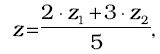

          - pričom z je po zaokrúhlení výsledný stupeň prospechu a zi je stupeň prospechu za úlohu č. i.

      - Úpravy pre žiakov so zdravotným znevýhodnením

      - Trvanie skúšky: 30 minút

      - Čas na prípravu: 30 minút

      - EKONOMIKA

      - Charakteristika úloh maturitných zadaní

      - Úloha č. 1 – Úloha je zameraná na vedomosti a porozumenie. Žiak má preukázať znalosť pojmového aparátu a uviesť súvislosti. V úlohe je presne stanovený pojem, fakt, definícia, ekonomický jav alebo proces, ktorého znalosti má žiak odpoveďou preukázať (prevláda forma monológu).

      - Úloha č. 2 – Úloha je zameraná na aplikáciu a analýzu.

      - Žiak v tejto úlohe preukáže schopnosť aplikovať získané poznatky z ekonómie a ekonomiky v praktickom živote. Posúdi a zváži rôzne alternatívy riešenia ekonomických problémov, zdôvodní a obháji vlastný prístup k ich riešeniu. V úlohe sa presne definujú požiadavky na žiakovu odpoveď, napr. zaradiť do sociálnych a politických súvislostí ekonomické problémy, určiť dôsledky jedného alebo viacerých ekonomických javov či procesov, analyzovať príčiny, porovnať rôzne názory na príslušný problém či zdôvodniť vlastný názor (prevláda forma dialógu s členmi predmetovej maturitnej komisie).

      - Zastúpenie jednotlivých tematických okruhov v úlohách maturitných zadaní je takéto:

      - historická podmienenosť ekonomiky,

      - trhový mechanizmus a jeho pôsobenie,

      - trh výrobných činiteľov,

      - organizácia a formy podnikania,

      - makroekonomické pojmy a vzťahy,

      - peniaze a bankový systém,

      - ekonomická úloha štátu,

      - svetové hospodárstvo.

      - Všeobecné pomôcky

      - Obchodný zákonník

      - Zákon o živnostenskom podnikaní

      - Zákon o Národnej banke Slovenska

      - Občiansky zákonník

      - Ekonomický slovník

      - Hodnotenie

        - a) Každá úloha maturitného zadania sa hodnotí stupňom prospechu 1 až 5.

        - b) Hodnotením maturitnej skúšky z ekonomiky bude stupeň prospechu, ktorý vznikne ako vážený priemer stupňov prospechu z odpovedí na jednotlivé úlohy maturitného zadania.

        - c) Váha hodnotenia jednotlivých úloh je 2 : 3. Pri výpočte váženého priemeru sa používa vzorec

        - 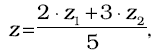

          - pričom z je po zaokrúhlení výsledný stupeň prospechu a zi je stupeň prospechu za úlohu č. i.

      - Úpravy pre žiakov so zdravotným znevýhodnením

      - Trvanie skúšky: 30 minút

      - Čas na prípravu: 30 minút

      - ESTETIKA

      - Charakteristika úloh maturitných zadaní

      - Úloha č. 1 – Úloha je zameraná na vedomosti a porozumenie.

      - Žiak má preukázať znalosť pojmového aparátu a uviesť súvislosti. V úlohe je presne stanovený pojem, fakt, definícia, estetický jav alebo proces, ktorého znalosti má žiak odpoveďou preukázať (prevláda forma monológu).

      - Úloha č. 2 – Úloha je zameraná na aplikáciu a analýzu. Žiak v tejto úlohe preukáže orientáciu v zadanej úlohe, charakterizuje základné znaky zvoleného druhu umenia, osobností a ich diel. Ako názornú pomôcku a argument používa odbornú literatúru, hudobné ukážky, no najmä archív vlastných prác. Sú to kópie typických pamiatok architektúry, sochárstva, maliarstva, eseje a úvahy, pokusy o scenár, divadelný výstup, remeslo či dizajn, testy na estetický vnem a vlastná tvorba. Žiak je pripravený na dialóg s členmi predmetovej maturitnej komisie a dokáže zdôvodniť vlastné názory a estetický súd.

      - Zastúpenie jednotlivých tematických okruhov v úlohách maturitných zadaní je takéto:

      - problematika estetiky a estetickej výchovy,

      - úžitkové umenie,

      - populárne a zábavné žánre,

      - estetika architektúry,

      - estetika sochárstva,

      - estetika maliarstva,

      - estetika hudby,

      - estetika fotografie a filmu,

      - estetika divadla,

      - estetika tanca a baletu,

      - estetika ľudového umenia a insity,

      - galérie a múzeá.

      - Všeobecné pomôcky

      - Dejiny výtvarných umení a ostatných druhov umenia

      - Monografie umelcov

      - Hudobné ukážky

      - Bulletiny, katalógy, pohľadnice, fotografie

      - Hodnotenie

        - a) Každá úloha maturitného zadania sa hodnotí stupňom prospechu 1 až 5.

        - b) Hodnotením maturitnej skúšky z estetiky bude stupeň prospechu, ktorý vznikne ako vážený priemer stupňov prospechu z odpovedí na jednotlivé úlohy maturitného zadania.

        - c) Váha hodnotenia jednotlivých úloh je 2 : 3. Pri výpočte váženého priemeru sa používa vzorec

        - 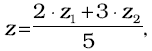

          - pričom z je po zaokrúhlení výsledný stupeň prospechu a zi je stupeň prospechu za úlohu č. i.

      - Úpravy pre žiakov so zdravotným znevýhodnením

      - Trvanie skúšky: 30 minút

      - Čas na prípravu: 30 minút

      - EVANJELICKÉ A. V. NÁBOŽENSTVO

      - Charakteristika úloh maturitných zadaní

      - Úloha č. 1 – Úloha je zameraná viac na vedomosti a porozumenie. V úlohe je presne určená a definovaná pravda, historický jav, o ktorých má žiak preukázať svoje vedomosti (prevláda forma monológu).

      - Úloha č. 2 – Úloha je zameraná viac na aplikáciu niektorej pravdy alebo prikázania v praktickom živote. Žiak v nej má zaujať stanovisko k danej problematike a podložiť ho učením cirkvi, vie sa vyjadrovať k aktuálnym otázkam z tejto oblasti (prevláda forma dialógu s členmi predmetovej maturitnej komisie).

      - Zastúpenie jednotlivých tematických okruhov v úlohách maturitných zadaní je takéto:

      - človek hľadá Boha, Boh hľadá človeka,

      - život v spoločenstve,

      - život človeka ako odpoveď na lásku Boha k nám.

      - Všeobecné pomôcky

      - Biblia

      - Biblický slovník

      - Symbolické knihy

      - Evanjelický spevník

      - Mapy, atlasy, obrazový materiál, ukážky textov, kartotečné lístky (škola si pripraví sama).

      - Hodnotenie

        - a) Každá úloha maturitného zadania sa hodnotí stupňom prospechu 1 až 5.

        - b) Hodnotením maturitnej skúšky z evanjelického a. v. náboženstva bude stupeň prospechu, ktorý vznikne ako vážený priemer stupňov prospechu z odpovedí na jednotlivé úlohy maturitného zadania.

        - c) Váha hodnotenia jednotlivých úloh je 1 : 2. Pri výpočte váženého priemeru sa používa vzorec

        - 

          - pričom z je po zaokrúhlení výsledný stupeň prospechu a zi je stupeň prospechu za úlohu č. i.

      - Úpravy pre žiakov so zdravotným znevýhodnením

      - Trvanie skúšky: 30 minút

      - Čas na prípravu: 30 minút

      - KRESANSKÁ ETIKA

      - Charakteristika úloh maturitných zadaní

      - Úloha č. 1 – Úloha je zameraná viac na vedomosti a porozumenie. V úlohe je presne určený etický problém, historický jav, stanovisko cirkvi, o ktorých má žiak preukázať vedomosti (prevláda forma monológu).

      - Úloha č. 2 – Úloha je zameraná viac na aplikáciu problému, javu, stanoviska v praktickom živote. Žiak vie zaujať stanovisko k problému a podložiť ho učením cirkvi, vie sa vyjadrovať k aktuálnym otázkam z tejto oblasti (prevláda forma dialógu s členmi predmetovej maturitnej komisie).

      - Zastúpenie jednotlivých tematických okruhov v úlohách maturitných zadaní je takéto:

      - základné pojmy a princípy etiky a morálky,

      - základná orientácia vo svetových náboženstvách,

      - nebezpečenstvo a prevencia drogovej závislosti,

      - vzťah muža a ženy, základy sexuálnej etiky,

      - rodina, jej význam a úlohy v spoločnosti,

      - prehľad hlavných etických smerov v dejinách,

      - základné princípy sociálnej etiky,

      - špeciálne etické problémy súčasnosti.

      - Všeobecné pomôcky

      - Sväté Písmo

      - Dokumenty katolíckej cirkvi

      - Ukážky textov k rôznym etickým otázkam, etické diela filozofov

      - Hodnotenie

        - a) Každá úloha maturitného zadania sa hodnotí stupňom prospechu 1 až 5.

        - b) Hodnotením maturitnej skúšky z kresťanskej etiky bude stupeň prospechu, ktorý vznikne ako vážený priemer stupňov prospechu z odpovedí na jednotlivé úlohy maturitného zadania.

        - c) Váha hodnotenia jednotlivých úloh je 1 : 2. Pri výpočte váženého priemeru sa používa vzorec

        - 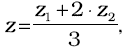

          - pričom z je po zaokrúhlení výsledný stupeň prospechu a zi je stupeň prospechu za úlohu č. i.

      - Úpravy pre žiakov so zdravotným znevýhodnením

      - Trvanie skúšky: 30 minút

      - Čas na prípravu: 30 minút

      - LATINČINA

      - Charakteristika úloh maturitných zadaní

      - Úloha č. 1 – Úloha je zameraná na prečítanie a preklad súvislého jednoduchšieho textu v rozsahu 3 – 8 viet (podľa obťažnosti). Pod textom odporúčame uviesť neznáme slovíčka, ktoré nie sú v slovnej zásobe, ktorú žiak študoval. Žiak má vysvetliť určené gramatické a syntaktické javy v texte (prevláda forma monológu).

      - Úloha č. 2 – Úloha je zameraná na vysvetlenie významu 2 až 3 cudzích slov a ich odvodenie, poukázanie na výskyt v inom cudzom jazyku. Žiak v tejto úlohe preukáže schopnosť preložiť a vysvetliť význam živých latinských slov (prevláda forma monológu).

      - Úloha č. 3 – Úloha je zameraná na prezentáciu základných informácií z jedného tematického okruhu (prevláda forma dialógu s členmi predmetovej maturitnej komisie).

      - Všeobecné pomôcky

      - Latinsko-slovenský slovník

      - Školský atlas dejín

      - Latinské texty

      - Hodnotenie

        - a) Každá úloha maturitného zadania sa hodnotí stupňom prospechu 1 až 5.

        - b) Hodnotením maturitnej skúšky z latinčiny bude stupeň prospechu, ktorý vznikne ako vážený priemer stupňov prospechu z odpovedí na jednotlivé úlohy maturitného zadania.

        - c) Váha hodnotenia jednotlivých úloh je 5 : 2 : 3. Pri výpočte váženého priemeru sa používa vzorec

        - 

          - pričom z je po zaokrúhlení výsledný stupeň prospechu a zi je stupeň prospechu za úlohu č. i.

      - Úpravy pre žiakov so zdravotným znevýhodnením

      - Trvanie skúšky: 30 minút

      - Čas na prípravu: 30 minút

      - PRÁVO

      - Charakteristika úloh maturitných zadaní

      - Úloha č. 1 – Úloha je zameraná na vedomosti a porozumenie. Žiak má preukázať znalosť pojmového aparátu a uviesť súvislosti. V úlohe je presne stanovený pojem, fakt, definícia, jav alebo proces, ktorého znalosti má žiak odpoveďou preukázať (prevláda forma monológu).

      - Úloha č. 2 – Úloha je zameraná na analýzu vybraných úloh a zodpovedanie podotázok viažucich sa na text. Žiak v tejto úlohe preukáže schopnosť aplikovať získané poznatky z práva v praktickom živote. Posúdi a zváži rôzne alternatívy riešenia právnických problémov, zdôvodní a obháji vlastný prístup k ich riešeniu (prevláda forma dialógu s členmi predmetovej maturitnej komisie).

      - Zastúpenie jednotlivých tematických okruhov v úlohách maturitných zadaní je takéto:

      - právo a jeho úloha v spoločnosti,

      - právny systém,

      - odvetvia práva,

      - rodinné právo,

      - občianske právo,

      - obchodné právo,

      - trestné právo,

      - pracovné právo,

      - finančné právo,

      - právo životného prostredia,

      - správne právo,

      - medzinárodné právo.

      - Všeobecné pomôcky

      - Ústava Slovenskej republiky

      - Občiansky zákonník

      - Občiansky súdny poriadok

      - Obchodný zákonník

      - Trestný zákon

      - Zákonník práce

      - Colný zákon

      - Zákon o poisťovníctve

      - Hodnotenie

        - a) Každá úloha maturitného zadania sa hodnotí stupňom prospechu 1 až 5.

        - b) Hodnotením maturitnej skúšky z práva bude stupeň prospechu, ktorý vznikne ako vážený priemer stupňov prospechu z odpovedí na jednotlivé úlohy maturitného zadania.

        - c) Váha hodnotenia jednotlivých úloh je 1 : 2. Pri výpočte váženého priemeru sa používa vzorec

        - 

          - pričom z je po zaokrúhlení výsledný stupeň prospechu a zi je stupeň prospechu za úlohu č. i.

      - Úpravy pre žiakov so zdravotným znevýhodnením

      - Trvanie skúšky: 30 minút

      - Čas na prípravu: 30 minút

      - PSYCHOLÓGIA

      - Charakteristika úloh maturitných zadaní

      - Úloha č. 1 – Úloha je zameraná na vedomosti a porozumenie.

      - V úlohe je presne určený pojem, fakt, definícia, jav alebo proces, o ktorom má žiak preukázať svoje vedomosti, a je určená učebná pomôcka i spôsob práce s ňou, napr. schéma, mapa a opis, ilustrácia (prevláda forma monológu).

      - Úloha č. 2 – Úloha je zameraná na aplikáciu a analýzu. V úlohe sa presne definuje, čo sa od žiaka očakáva, napr. klasifikovať javy, udalosti, porovnať dva alebo viac javov alebo procesov, určiť príčiny alebo dôsledky jedného alebo viacerých javov či procesov a pod. K úlohe je určená aj učebná pomôcka (schéma, piktogram, mapa, literárny prameň, graf, karikatúra a pod.) a opis, čo má žiak urobiť (prevláda forma dialógu s členmi predmetovej maturitnej komisie).

      - Zastúpenie jednotlivých tematických okruhov v úlohách maturitných zadaní je takéto:

      - všeobecná psychológia,

      - psychológia osobnosti,

      - sociálna psychológia.

      - Hodnotenie

        - a) Každá úloha maturitného zadania sa hodnotí stupňom prospechu 1 až 5.

        - b) Hodnotením maturitnej skúšky zo psychológie bude stupeň prospechu, ktorý vznikne ako vážený priemer stupňov prospechu z odpovedí na jednotlivé úlohy maturitného zadania.

        - c) Váha hodnotenia jednotlivých úloh je 2 : 3. Pri výpočte váženého priemeru sa používa vzorec

        - 

          - pričom z je po zaokrúhlení výsledný stupeň prospechu a zi je stupeň prospechu za úlohu č. i.

      - Úpravy pre žiakov so zdravotným znevýhodnením

      - Trvanie skúšky: 30 minút

      - Čas na prípravu: 30 minút

      - REFORMOVANÉ NÁBOŽENSTVO

      - Charakteristika úloh maturitných zadaní

      - Úloha č. 1 – Úloha je zameraná na vedomosti a porozumenie.

      - V úlohe je presne určená a definovaná pravda, historický jav, biblický príbeh, osobnosť alebo učenie, o ktorých má žiak preukázať svoje vedomosti (prevláda forma monológu).

      - Úloha č. 2 – Úloha je zameraná na aplikáciu a analýzu.

      - Žiak vykoná analýzu príslušnej problematiky na základe učenia Písma Svätého a symbolických kníh a aplikuje ju v kontexte súčasnosti a dejín cirkví (prevláda forma dialógu s členmi predmetovej maturitnej komisie).

      - Zastúpenie jednotlivých tematických okruhov v úlohách maturitných zadaní je takéto:

      - Boží plán spásy v Písme Svätom,

      - dejiny cirkvi,

      - reformovaná dogmatika a etika.

      - Všeobecné pomôcky

      - Biblia

      - Biblický slovník

      - Symbolické knihy

      - Spevník Reformovanej kresťanskej cirkvi

      - Mapy, atlasy, obrazový materiál

      - Hodnotenie

        - a) Každá úloha maturitného zadania sa hodnotí stupňom prospechu 1 až 5.

        - b) Hodnotením maturitnej skúšky z reformovaného náboženstva bude stupeň prospechu, ktorý vznikne ako vážený priemer stupňov prospechu z odpovedí na jednotlivé úlohy maturitného zadania.

        - c) Váha hodnotenia jednotlivých úloh je 2 : 3. Pri výpočte váženého priemeru sa používa vzorec

        - 

          - pričom z je po zaokrúhlení výsledný stupeň prospechu a zi je stupeň prospechu za úlohu č. i.

      - Úpravy pre žiakov so zdravotným znevýhodnením

      - Trvanie skúšky: 30 minút

      - Čas na prípravu: 30 minút

      - KATOLÍCKE NÁBOŽENSTVO

      - Charakteristika úloh maturitných zadaní

      - Úloha č. 1 – Úloha je zameraná viac na vedomosti a porozumenie. V úlohe je presne určená a definovaná pravda, historický jav, o ktorých má žiak preukázať svoje vedomosti (prevláda forma monológu).

      - Úloha č. 2 – Úloha je zameraná viac na aplikáciu niektorej pravdy alebo prikázania v praktickom živote. Žiak v nej má zaujať stanovisko k problematike a podložiť ho učením cirkvi, vie sa vyjadrovať k aktuálnym otázkam z tejto oblasti (prevláda forma dialógu s členmi predmetovej maturitnej komisie).

      - Zastúpenie jednotlivých tematických okruhov v úlohách maturitných zadaní je takéto:

      - vyznanie viery,

      - sviatosť viery,

      - život z viery,

      - modlitba v živote viery.

      - Všeobecné pomôcky

      - Sväté písmo, mapy, atlasy, obrazový materiál a ukážky textov

      - Hodnotenie

        - a) Každá úloha maturitného zadania sa hodnotí stupňom prospechu 1 až 5.

        - b) Hodnotením maturitnej skúšky z katolíckeho náboženstva bude stupeň prospechu, ktorý vznikne ako vážený priemer stupňov prospechu z odpovedí na jednotlivé úlohy maturitného zadania.

        - c) Váha hodnotenia jednotlivých úloh je 1 : 2. Pri výpočte váženého priemeru sa používa vzorec

        - 

          - pričom z je po zaokrúhlení výsledný stupeň prospechu a zi je stupeň prospechu za úlohu č. i.

      - Úpravy pre žiakov so zdravotným znevýhodnením

      - Trvanie skúšky: 30 minút

      - Čas na prípravu: 30 minút

      - STRETNUTIA S ĽUDOVOU KULTÚROU

      - Charakteristika úloh maturitných zadaní

      - Úloha č. 1 – Úloha je zameraná na vysvetlenie základných znakov daného obdobia a ich odrazu v umení, architektúre, maliarstve, sochárstve, umeleckých remeslách, teórii výtvarného umenia, technike. K úlohe patrí učebná pomôcka – obrazová príloha (prevláda forma dialógu s členmi predmetovej maturitnej komisie).

      - Úloha č. 2 – Úloha je zameraná na vysvetlenie základných znakov, technologických postupov v ľudovej kultúre – porovnanie, opis chronológie vývoja, reprodukovanie základných pojmov a definícií. K úlohe je určená učebná pomôcka – obrazová príloha, výrobky ľudovej kultúry, ktorými žiak dokumentuje znaky daného remesla, technológie atď. (prevláda forma dialógu s členmi predmetovej maturitnej komisie).

      - Úloha č. 3 – Úloha je zameraná na analýzu a rozbor vybraných umeleckých ukážok, na encyklopedické vedomosti žiaka. Ide o schopnosť žiaka porovnať a zaradiť ukážky do jednotlivých smerov a slohov (prevláda forma monológu).

      - Zastúpenie uvedených jednotlivých častí učiva v súbore všetkých otázok v maturitných zadaniach je takéto:

      - ľudová kultúra,

      - dejiny umenia a umeleckoremeselná práca.

      - Všeobecné pomôcky

      - Obrazové prílohy

      - Výrobky ľudovej kultúry

      - Hodnotenie

        - a) Každá úloha maturitného zadania sa hodnotí stupňom prospechu 1 až 5.

        - b) Hodnotením maturitnej skúšky zo stretnutia s ľudovou kultúrou bude stupeň prospechu, ktorý vznikne ako vážený priemer stupňov prospechu z odpovedí na jednotlivé úlohy maturitného zadania.

        - c) Váha hodnotenia jednotlivých úloh v základnej úrovni je 3 : 4 : 3. Pri výpočte váženého priemeru sa používa vzorec

        - 

          - pričom z je po zaokrúhlení výsledný stupeň prospechu a zi je stupeň prospechu za úlohu č. i.

      - Úpravy pre žiakov so zdravotným znevýhodnením

      - Trvanie skúšky: 30 minút

      - Čas na prípravu: 30 minút

      - ŠPORTOVÝ MANAŽMENT

      - Charakteristika úloh maturitných zadaní

      - Úloha č. 1 – Úloha je zameraná na vedomosti a porozumenie.

      - V úlohe je presne určený pojem, fakt, definícia, historický jav alebo proces, o ktorom má žiak preukázať svoje vedomosti (prevláda forma monológu).

      - Úloha č. 2 – Úloha je zameraná na aplikáciu a analýzu. V úlohe žiak prezentuje vlastné argumentačné schopnosti pri riešení problematiky, ako aj potrebnú aplikačnú asociáciu z pohľadu nižšieho riadiaceho pracovníka v športe (prevláda forma dialógu s členmi predmetovej maturitnej komisie).

      - Zastúpenie uvedených jednotlivých častí učiva v súbore všetkých otázok v maturitných zadaniach je takéto:

      - 30 % oblasť športového manažmentu sa zaoberá definovaním športového manažmentu, aplikáciou východísk, princípov a zákonitostí manažmentu na šport a ekonomickou charakteristikou športu; poskytuje orientáciu v terminológii a formuluje základné východiská športového manažmentu,

      - 30 % riadením zdrojov v športe sa riešia otázky identifikácie, rozvoja a akumulácie zdrojov v športovom manažmente; vychádza sa z analýzy športového priemyslu a z jeho vnútorných i vonkajších zdrojov,

      - 40 % športový marketing definuje trh v športe a úlohu marketingu; zaoberá sa využívaním marketingových mechanizmov v športe; vychádza predovšetkým z poznatkov, ktoré žiaci získali v predmete ekonomika (kapitola Marketing) a vysvetľuje ich aplikáciu v športe; zároveň dopĺňa poznatky o špeciálne marketingové činnosti viazané na oblasť športu.

      - Všeobecné pomôcky

      - Atlas svetových a domácich dejín

      - Olympijská charta a Stanovy Slovenského olympijského výboru

      - Anatomické obrazy

      - Pedagogická dokumentácia športového tréningu

      - Encyklopédia telesnej výchovy a športu

      - Dokumentácia športových marketingových projektov

      - Hodnotenie

        - a) Každá úloha maturitného zadania sa hodnotí stupňom prospechu 1 až 5.

        - b) Hodnotením maturitnej skúšky zo športového manažmentu bude stupeň prospechu, ktorý vznikne ako vážený priemer stupňov prospechu z odpovedí na jednotlivé úlohy maturitného zadania.

        - c) Váha hodnotenia jednotlivých úloh je 2 : 3. Pri výpočte váženého priemeru sa používa vzorec

        - 

          - pričom z je po zaokrúhlení výsledný stupeň prospechu a zi je stupeň prospechu za úlohu č. i.

      - Úpravy pre žiakov so zdravotným znevýhodnením

      - Trvanie skúšky: 30 minút

      - Čas na prípravu: 30 minút

      - ZÁKLADY ŠPORTOVEJ PRÍPRAVY

      - Charakteristika úloh maturitných zadaní

      - Úloha č. 1 – Úloha je zameraná na vedomosti a porozumenie.

      - V úlohe je presne určený pojem, fakt, definícia, historický jav alebo proces, o ktorom má žiak preukázať svoje vedomosti (prevláda forma monológu).

      - Úloha č. 2 – Úloha je zameraná na aplikáciu a analýzu. V úlohe žiak prezentuje vlastné argumentačné schopnosti pri riešení problematiky, ako aj potrebnú aplikačnú asociáciu z pohľadu účastníka športového a tréningového procesu (prevláda forma dialógu s členmi predmetovej maturitnej komisie).

      - Zastúpenie uvedených jednotlivých častí učiva v súbore všetkých otázok v maturitných zadaniach je takéto:

      - teória telesnej kultúry a prierezových vedných odborov (dejiny, anatómia, biochémia, biomechanika, psychológia, pedagogika...),

      - teória a didaktika športového tréningu.

      - Všeobecné pomôcky

      - Atlas svetových a domácich dejín

      - Olympijská charta a Stanovy Slovenského olympijského výboru

      - Anatomické obrazy

      - Pedagogická dokumentácia športového tréningu

      - Testovacie batérie tréningového procesu

      - Testovacie batérie lekársko-pedagogických sledovaní

      - Hodnotenie

        - a) Každá úloha maturitného zadania sa hodnotí stupňom prospechu 1 až 5.

        - b) Hodnotením maturitnej skúšky zo základov športovej prípravy bude stupeň prospechu, ktorý vznikne ako vážený priemer stupňov prospechu z odpovedí na jednotlivé úlohy maturitného zadania.

        - c) Váha hodnotenia jednotlivých úloh je 2 : 3. Pri výpočte váženého priemeru sa používa vzorec

        - 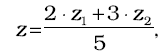

          - pričom z je po zaokrúhlení výsledný stupeň prospechu a zi je stupeň prospechu za úlohu č. i.

      - Úpravy pre žiakov so zdravotným znevýhodnením

      - Trvanie skúšky: 30 minút

      - Čas na prípravu: 30 minút

      - MUZIKÁL

      - Charakteristika úloh maturitných zadaní

      - Úloha č. 1 – Úloha je zameraná na vedomosti a porozumenie historickej i teoretickej oblasti divadla, hudby a tanca. Žiak má preukázať znalosť pojmového aparátu a uviesť súvislosti. V úlohe je stanovený pojem, fakt, definícia, umelecký jav alebo proces, ktorého znalosť žiak má v odpovedi preukázať (prevláda forma monológu).

      - Úloha č. 2 – Úloha je zameraná na aplikáciu a analýzu.

      - Žiak v tejto úlohe preukáže orientáciu v zadanej úlohe, charakterizuje základné znaky herectva, spevu a tanca. Ako názornú pomôcku používa odbornú literatúru, hudobné ukážky, divadelný výstup, pokusy o vlastnú tvorbu. Žiak je pripravený na dialóg s členmi predmetovej maturitnej komisie a dokáže zdôvodniť vlastné názory a svoj umelecký prejav.

      - Zastúpenie jednotlivých tematických okruhov v úlohách maturitných zadaní je takéto:

      - herectvo (dejiny divadla, teória hereckej tvorby, rečový prejav – technika reči, divadelný výstup),

      - spev (hudobná história, hudobná teória, intonácia a rytmus, spevácka technika, hudobná ukážka),

      - tanec (dejiny tanca a teória klasického tanca, džezového a moderného tanca, ľudového tanca, stepu, tanečná ukážka).

      - Všeobecné pomôcky

      - Bulletiny, katalógy, fotografie

      - Obrazové prílohy

      - Hudobné ukážky

      - Divadelné rekvizity

      - Hodnotenie

        - a) Každá úloha maturitného zadania sa hodnotí stupňom prospechu 1 až 5.

        - b) Hodnotením maturitnej skúšky z muzikálu bude stupeň prospechu, ktorý vznikne ako vážený priemer stupňov prospechu z odpovedí na jednotlivé úlohy maturitného zadania.

        - c) Váha hodnotenia jednotlivých úloh je 2 : 3. Pri výpočte váženého priemeru sa používa vzorec

        - 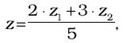

          - pričom z je po zaokrúhlení výsledný stupeň prospechu a zi je stupeň prospechu za úlohu č. i.

      - Úpravy pre žiakov so zdravotným znevýhodnením

      - Trvanie skúšky: 30 minút

      - Čas na prípravu: 30 minút

      - LITERÁRNA TVORBA

      - Charakteristika úloh maturitných zadaní

      - Úloha č. 1 – Úloha je zameraná na teoretické vedomosti z prozódie, verzológie a ich aplikovanie v praxi. V úlohe je presne stanovený pojem, fakt, definícia, proces, ktorých znalosti má žiak v odpovedi preukázať (prevláda forma monológu).

      - Úloha č. 2 – Úloha je zameraná na praktickú aplikáciu teoretických poznatkov z rétoriky. Žiak má obhájiť svoju maturitnú prácu, ktorej ťažisko tvorí literárna komparácia (obdobia, smery, autori, diela, postavy...), a využiť prvky rečníckeho štýlu. V ďalšej časti žiak odpovedá na otázky členov komisie, ktoré sa týkajú práce.

      - Ako názornú pomôcku používa svoju maturitnú prácu, archívne materiály, zvukové nahrávky a videonahrávky (prevláda forma dialógu s členmi predmetovej maturitnej komisie).

      - Zastúpenie jednotlivých tematických okruhov v úlohách maturitných zadaní je takéto:

      - literárne dielo ako ideovo-estetická štruktúra,

      - verš, rytmus, rým, strofa,

      - lyrika,

      - epika,

      - dráma.

      - Všeobecné pomôcky

      - Literárne rukoväte

      - Literárne slovníky

      - Literárne lexikóny

      - Odborné literárne časopisy

      - Hodnotenie

        - a) Každá úloha maturitného zadania sa hodnotí stupňom prospechu 1 až 5.

        - b) Hodnotením maturitnej skúšky z literárnej tvorby bude stupeň prospechu, ktorý vznikne ako vážený priemer stupňov prospechu z odpovedí na jednotlivé úlohy maturitného zadania.

        - c) Váha hodnotenia jednotlivých úloh je 2 : 3. Pri výpočte váženého priemeru sa používa vzorec

        - 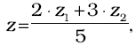

          - pričom z je po zaokrúhlení výsledný stupeň prospechu a zi je stupeň prospechu za úlohu č. i.

      - Úpravy pre žiakov so zdravotným znevýhodnením

      - Trvanie skúšky: 30 minút

      - Čas na prípravu: 30 minút

      - POĽSKÝ JAZYK

      - Charakteristika úloh maturitných zadaní

      - Úloha č. 1 – Vizuálny podnet (napr. obrázok, fotografia, komiks, graf, schéma a pod.). Žiak opíše predložený obrázok a nachádza súvislosti medzi obrázkom a príslušnou maturitnou témou. Komisia hodnotí súvislosť opisu predloženého podnetu, lineárnosť (postupnosť) vo vyjadrovaní a adekvátne jazykové prostriedky zodpovedajúce danej úrovni žiaka (prevláda forma monológu).

      - Úloha č. 2 – Úlohou žiaka je zaujať stanovisko k téme a odôvodniť ho v rozhovore s členmi predmetovej maturitnej komisie, ktorá vedie rozhovor podľa zásad uvedených v metodických pokynoch pre predmetové maturitné komisie. Komisia hodnotí, ako žiak dokáže zdôvodniť a vysvetliť svoje názory na príslušnú tému a argumentovať k problematike, výber faktov a informácií, gramatiku (prevláda forma dialógu s členmi predmetovej maturitnej komisie).

      - Úloha č. 3 – Situačná úloha, dialóg s rozdelenými úlohami (rôzne modelové situácie zohľadňujúce príslušný študijný odbor). Žiak dostane za úlohu vyriešiť konkrétnu situáciu z každodenného života v okruhu príslušných tém. Komisia sa zameriava na hodnotenie výberu a adekvátnosť použitia jazykových prostriedkov (prevláda forma dialógu s členmi predmetovej maturitnej komisie).

      - Všeobecné pomôcky

      - Obojstranný prekladový slovník obsahujúci najmenej 15 000 hesiel

      - Hodnotenie

        - a) Základom hodnotenia je rozsah slovnej zásoby, používanie gramatických štruktúr, stupeň jazykovej pohotovosti, obsahová stránka prejavu a pod.

        - b) Predmetová maturitná komisia hodnotí obsahovú a jazykovú správnosť odpovede, štruktúru – začiatok, vedenie a ukončenie rozhovoru.

        - c) Každá úloha maturitného zadania sa hodnotí stupňom prospechu 1 až 5.

        - d) Hodnotenie úlohy č. 1 sa skladá z dvoch samostatných hodnotení. Hodnotí sa

          - 1. obsahová primeranosť,

          - 2. jazyková správnosť.

        - e) Hodnotenie úlohy č. 2 sa skladá zo šiestich samostatných hodnotení. Hodnotí sa

          - 1. plynulosť vyjadrovania,

          - 2. výslovnosť a intonácia,

          - 3. obsah – náročnosť spracovania/kvalita rozhovoru,

          - 4. lexikálny rozsah,

          - 5. argumentácia,

          - 6. gramatická presnosť.

        - f) Hodnotenie úlohy č. 3 sa skladá z dvoch samostatných hodnotení. Hodnotí sa

          - 1. obsahová a jazyková správnosť,

          - 2. pohotovosť vyjadrovania.

        - g) Váha hodnotenia jednotlivých úloh ústnej zložky je 1 : 2 : 1. Pri výpočte váženého priemeru sa používa vzorec

        - 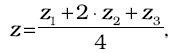

        - pričom z je po zaokrúhlení výsledný stupeň prospechu a zi je stupeň prospechu za úlohu č. i.

      - Úpravy pre žiakov so zdravotným znevýhodnením

      - Úloha č. 1

        - a) Ak ide o žiakov so zrakovým postihnutím, obrázky sa nahradia slovným opisom príslušnej situácie vo vyučovacom jazyku; grafy a schémy sa vynechajú.

        - b) Ak ide o žiakov so sluchovým postihnutím, nehodnotí sa jazyková správnosť.

      - Úloha č. 2

      - Ak ide o žiakov so sluchovým postihnutím, nehodnotí sa výslovnosť, intonácia a gramatická správnosť.

      - Trvanie skúšky: 30 minút

      - Čas na prípravu: 30 minút

      - CHORVÁTSKY JAZYK

      - Charakteristika úloh maturitných zadaní

      - Úloha č. 1 – Vizuálny podnet (napr. obrázok, fotografia, komiks, graf, schéma a pod.). Žiak opíše predložený obrázok a nachádza súvislosti medzi obrázkom a príslušnou maturitnou témou. Komisia hodnotí súvislosť opisu predloženého podnetu, lineárnosť (postupnosť) vo vyjadrovaní a adekvátne jazykové prostriedky zodpovedajúce danej úrovni žiaka (prevláda forma monológu).

      - Úloha č. 2 – Úlohou žiaka je zaujať stanovisko k téme a odôvodniť ho v rozhovore s členmi predmetovej maturitnej komisie, ktorí vedú rozhovor podľa zásad uvedených v metodických pokynoch pre predmetové maturitné komisie. Komisia hodnotí, ako žiak dokáže zdôvodniť a vysvetliť svoje názory na príslušnú tému a argumentovať k problematike, výber faktov a informácií, gramatiku (prevláda forma dialógu s členmi predmetovej maturitnej komisie).

      - Úloha č. 3 – Situačná úloha, dialóg s rozdelenými úlohami (rôzne modelové situácie zohľadňujúce príslušný študijný odbor). Žiak dostane za úlohu vyriešiť konkrétnu situáciu z každodenného života v okruhu príslušných tém. Komisia sa zameriava na hodnotenie výberu a adekvátnosť použitia jazykových prostriedkov (prevláda forma dialógu s členmi predmetovej maturitnej komisie).

      - Všeobecné pomôcky

      - Obojstranný prekladový slovník obsahujúci najmenej 15 000 hesiel

      - Hodnotenie

        - a) Základom hodnotenia je rozsah slovnej zásoby, používanie gramatických štruktúr, stupeň jazykovej pohotovosti, obsahová stránka prejavu a pod.

        - b) Predmetová maturitná komisia hodnotí obsahovú a jazykovú správnosť odpovede, štruktúru – začiatok, vedenie a ukončenie rozhovoru.

        - c) Každá úloha maturitného zadania sa hodnotí stupňom prospechu 1 až 5.

        - d) Hodnotenie úlohy č. 1 sa skladá z dvoch samostatných hodnotení. Hodnotí sa

          - 1. obsahová primeranosť,

          - 2. jazyková správnosť.

        - e) Hodnotenie úlohy č. 2 sa skladá zo šiestich samostatných hodnotení. Hodnotí sa

          - 1. plynulosť vyjadrovania,

          - 2. výslovnosť a intonácia,

          - 3. obsah – náročnosť spracovania/kvalita rozhovoru,

          - 4. lexikálny rozsah,

          - 5. argumentácia,

          - 6. gramatická presnosť.

        - f) Hodnotenie úlohy č. 3 sa skladá z dvoch samostatných hodnotení. Hodnotí sa

          - 1. obsahová a jazyková správnosť,

          - 2. pohotovosť vyjadrovania.

        - g) Váha hodnotenia jednotlivých úloh je 1 : 2 : 1. Pri výpočte váženého priemeru sa používa vzorec

        - 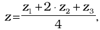

        - pričom z je po zaokrúhlení výsledný stupeň prospechu a zi je stupeň prospechu za úlohu č. i.

      - Úpravy pre žiakov so zdravotným znevýhodnením

      - Úloha č. 1

        - a) Ak ide o žiakov so zrakovým postihnutím, obrázky sa nahradia slovným opisom príslušnej situácie vo vyučovacom jazyku; grafy a schémy sa vynechajú.

        - b) Ak ide o žiakov so sluchovým postihnutím, nehodnotí sa jazyková správnosť.

      - Úloha č. 2

      - Ak ide o žiakov so sluchovým postihnutím, nehodnotí sa výslovnosť, intonácia a gramatická správnosť.

      - Trvanie skúšky: 30 minút

      - Čas na prípravu: 30 minút

      - UMENIE a KULTÚRA

      - Charakteristika úloh maturitných zadaní

      - Úloha č. 1 – Úloha je zameraná na schopnosti riešenia problémov. Žiak má preukázať schopnosi samostatne riešiť problémy týkajúce sa kultúry a umenia, ako aj schopnosti tvoriť vlastné projekty na riešenie modelových situácií. V úlohe má určené, akých kultúrnych artefaktov alebo situácií sa problém týka, prípadne sa zadáva modelová situácia. Predpokladá sa, že v úlohe bude pracovať s literatúrou a s ukážkami. Prevláda metóda prezentácie riešenia. Ak je súčasťou úlohy prezentácia vlastných názorov a estetických súdov, žiak v dialógu s členmi maturitnej komisie prezentuje schopnosť argumentácie.

      - Úloha č. 2 – Úloha je zameraná na aplikáciu. Žiak má preukázať, ako v riešení z prvej úlohy aplikoval poznatky a vedomosti, ako prepája teoretické poznatky o kultúre so skutočným životom, prípadne ako by riešenie z prvej úlohy aplikoval v novej situácii. Žiak preukazuje schopnosti aplikácie, ako aj schopnosti reflektovať túto aplikáciu. V dialógu s členmi komisie prezentuje schopnosť argumentácie.

      - Úloha č. 3 – Úloha je zameraná na poznanie a vedomosti. Žiak má preukázať osvojené poznanie, vedomosti a informácie, s ktorými pracoval v prvých úlohách.

      - Všeobecné pomôcky

      - Dejiny rôznych druhov umenia a kultúry

      - Všeobecné encyklopédie

      - Monografie umelcov, ukážky tvorby z rôznych umeleckých druhov

      - Mapy sveta, Európy, Slovenskej republiky

      - Hodnotenie

        - a) Každá úloha maturitného zadania sa hodnotí stupňom prospechu 1 až 5.

        - b) Váha hodnotenia jednotlivých úloh je 1 : 1 : 1. Pri výpočte váženého priemeru sa používa vzorec

        - 

        - pričom z je po zaokrúhlení výsledná známka a zi je známka za úlohu č. i.

      - Úpravy pre žiakov so zdravotným znevýhodnením

      - Trvanie skúšky: 30 minút

      - Čas na prípravu: 30 minút

      - RÓMSKY JAZYK A LITERATÚRA

      - Charakteristika úloh maturitných zadaní

      - Úloha č. 1 – Úloha je zameraná na čítanie textu v rómskom jazyku v rozsahu minimálne troch a maximálne šiestich viet publicistického alebo beletristického žánru. Žiak má vedieť text reprodukovať, prerozprávať obsah. Predmetová maturitná komisia hodnotí obsahovú a jazykovú presnosť, súvislosť prejavu, využívanie neologizmov, lineárnosť vo vyjadrovaní a snahu používať adekvátne jazykové prostriedky zodpovedajúce danej úrovni žiaka (prevláda forma monológu).

      - Úloha č. 2 – Úlohou žiaka je zaujať stanovisko k téme a odôvodniť ho v rozhovore s členmi predmetovej maturitnej komisie, ktorá vedie rozhovor podľa zásad uvedených v metodických pokynoch pre predmetové maturitné komisie. Predmetová maturitná komisia hodnotí, ako žiak dokáže zdôvodniť a vysvetliť svoje názory na príslušnú tému a argumentovať k problematike, výber faktov a informácií, gramatickú presnosť, lexikálny rozsah, náročnosť spracovania rozhovoru, argumentáciu, plynulosť a súvislosť vyjadrovania (prevláda forma dialógu s členmi predmetovej maturitnej komisie).

      - Úloha č. 3 – Úloha je zameraná na vyriešenie konkrétnej situácie z každodenného života v okruhu príslušných tém. Predmetová maturitná komisia sa zameriava na hodnotenie výberu a adekvátnosť použitia jazykových prostriedkov, pohotovosť vyjadrovania, jazykovú a obsahovú správnosť (prevláda forma dialógu s členmi predmetovej maturitnej komisie).

      - Všeobecné pomôcky

      - Prekladový slovník

      - Hodnotenie

        - a) Každá úloha maturitného zadania sa hodnotí stupňom prospechu 1 až 5.

        - b) Váha hodnotenia jednotlivých úloh je 1 : 2 : 1. Pri výpočte váženého priemeru sa používa vzorec

        - 

        - pričom z je po zaokrúhlení výsledná známka a zi je známka za úlohu č. i.

      - Úpravy pre žiakov so zdravotným znevýhodnením

      - Trvanie skúšky: 30 minút

      - Čas na prípravu: 30 minút

  - IV. ČASŤ PODROBNOSTI O SPÔSOBE KONANIA A OBSAHU TEORETICKEJ ČASTI ODBORNEJ ZLOŽKY MATURITNEJ SKÚŠKY A PRAKTICKEJ ČASTI ODBORNEJ ZLOŽKY MATURITNEJ SKÚŠKY VŠEOBECNÉ POKYNY

    - 1. Teoretická časť odbornej zložky maturitnej skúšky je verejná.

    - 2. Maturitné témy vychádzajú z cieľových požiadaviek na vedomosti a zručnosti pre príslušný predmet maturitnej skúšky príslušného študijného odboru v oblasti odborného vzdelávania.

    - 3. Maturitné témy pre teoretickú časť odbornej zložky maturitnej skúšky a praktickú časť odbornej zložky maturitnej skúšky pripravuje príslušná predmetová komisia školy. Maturitné témy sa nezverejňujú, okrem ich predloženia na vyjadrenie stavovskej organizácii a profesijnej organizácii k obsahu teoretickej časti odbornej zložky maturitnej skúšky a obsahu praktickej časti odbornej zložky maturitnej skúšky.

    - 4. Skúšajúci citlivo riadi rozhovor so žiakmi, kladie pomocné a stimulačné otázky, vyjadruje súhlas alebo nesúhlas s tvrdeniami žiaka, pričom ho vedie k tomu, aby svoje názory podopieral argumentmi a využíval pri tom písomnú prípravu a tiež vlastné poznatky získané počas prípravy na maturitnú skúšku.

    - 5. Členovia predmetovej maturitnej komisie dbajú na to, aby žiak mohol na ich podnety reagovať plynulo a mal dosť času a pokoja na vyjadrenie svojich myšlienok.

    - TEORETICKÁ ČASŤ ODBORNEJ ZLOŽKY

    - Kritériá hodnotenia

      - a) porozumenie téme,

      - b) používanie odbornej terminológie,

      - c) samostatnosť prejavu,

      - d) schopnosť aplikácie,

      - e) správnosť a vecnosť odpovede.

    - 11 Fyzikálno-matematické vedy

    - Cieľové požiadavky

    - Žiak má

      - a) poznať odbornú terminológiu z oblasti astronómie a jej príbuzných vied (meteorológia, kozmológia...),

      - b) poznať históriu astronómie a súvislosti explanácie javov v astronómii,

      - c) poznať vývoj, tvorbu a používanie jednotlivých druhov katalógov a hviezdnych máp,

      - d) poznať základné rezortné predpisy a technologické návody používané pri príprave a spracúvaní astronomických pozorovaní,

      - e) poznať princíp, charakteristiku, použitie, spôsob manipulácie, merania a údržby pozorovacej techniky, prístrojov a pomôcok používaných v astronómii,

      - f) poznať základné výpočty v oblasti astrometrie a fotometrie pozorovaných objektov,

      - g) poznať metódy vizuálneho záznamu pozorovania, fotografovania objektov, získavania videozáznamov v priebehu dlhšie trvajúcich astronomických úkazov,

      - h) poznať základné typy záznamových prístrojov a používaných materiálov a pomôcok,

      - i) poznať princípy práce s vyhodnocovacími prístrojmi,

      - j) poznať zásady a metódy zberu, spracovania a vyhodnotenia informácií na účely tvorby informačných systémov v astronómii,

      - k) poznať klasifikáciu pozorovaných objektov v astronómii,

      - l) poznať základy určovania presných polôh pozorovacích miest,

      - m) poznať metódy zberu a spracovania výsledkov diaľkového prieskumu zeme, prístroje a zariadenia na získavanie záznamov a nosiče záznamových zariadení,

      - n) poznať organizácie koordinujúce jednotlivé astronomické pozorovateľské programy,

      - o) poznať problematiku kozmickej astronómie, pozorovacie metódy a možnosti ich záznamu,

      - p) poznať právne predpisy a ostatné predpisy na zaistenie bezpečnosti a ochrany zdravia pri práci, zásady bezpečnej práce, hygieny práce, protipožiarnej aj environmentálnej ochrany.

    - Materiálne podmienky

    - Potrebné prístroje a pomôcky, počítač s nutným aplikačným softvérom, tlačiareň.

    - Priestorové podmienky

    - Odborná učebňa s možnosťou zatemnenia, dielne, laboratóriá, učebne a pracoviská.

    - Pomôcky

    - Kalkulačka, odborná literatúra, modely, priesvitky, učebné pomôcky, odborné periodiká, dátové súbory na elektronických nosičoch, dokumenty textového a grafického charakteru v ručnej, tlačenej a elektronickej podobe.

    - 21 Baníctvo, geológia a geotechnika

    - Cieľové požiadavky

    - Žiak má

      - a) poznať odbornú terminológiu používanú v geológii, baníctve, kamenárstve a príbuzných odboroch (stavebníctvo),

      - b) poznať základné druhy technického kreslenia (stavebné, strojárske, elektrotechnické, geologické a pod.),

      - c) orientovať sa v projektovej dokumentácii stavieb a diel v geológii, baníctve a kamenárstve,

      - d) poznať druhy a vlastnosti hornín, minerálov, stavebných látok, kamenárskych výrobkov,

      - e) poznať zásady vhodného skladovania jednotlivých druhov materiálov a výrobkov v jednotlivých odboroch,

      - f) poznať základy technickej mechaniky, geomechaniky a mechaniky zemín,

      - g) poznať princípy navrhovania a posudzovania banských a geologických diel, banských, geologických prác a kamenárskych prevádzok,

      - h) mať základný prehľad o strojových zariadeniach a strojoch používaných v príslušnom odbore,

      - i) poznať zásady jednoduchej architektonickej tvorby, urbanizmu, územného plánovania a pamiatkovej starostlivosti najmä z hľadiska využitia prírodného dekoračného kameňa,

      - j) poznať základy geodézie a princípy základných meračských prác,

      - k) poznať základné ekonomické pojmy spojené s ekonomikou podniku, drobným podnikaním a so zakladaním firmy,

      - l) poznať princípy podnikateľskej činnosti a finančného hospodárenia,

      - m) aplikovať zákonitosti ekonomiky v pracovnom procese,

      - n) poznať právne predpisy a ostatné predpisy na zaistenie bezpečnosti a ochrany zdravia pri práci, zásady bezpečnej práce, hygieny práce, protipožiarnej ochrany, zaobchádzať s protipožiarnym zariadením,

      - o) poznať zásady ochrany životného prostredia pri vykonávaní stavebnej činnosti.

    - Materiálne podmienky

    - Potrebné prístroje a pomôcky, počítač s nutným aplikačným softvérom, tlačiareň.

    - Priestorové podmienky

    - Odborná učebňa s možnosťou zatemnenia, dielne, laboratóriá, učebne a pracoviská.

    - Pomôcky

    - Kalkulačka, odborná literatúra, modely, priesvitky, učebné pomôcky, odborné periodiká, dátové súbory na elektronických nosičoch, dokumenty textového a grafického charakteru v ručnej, tlačenej a elektronickej podobe.

    - 22 Hutníctvo

    - Cieľové požiadavky

    - Žiak má

      - a) poznať odbornú terminológiu z oblasti hutníctva, zlievarenstva a strojárstva,

      - b) zobrazovať strojové súčiastky a jednoduché celky, zhotovovať technické výkresy,

      - c) poznať strojové súčiastky, stroje a mechanizmy,

      - d) poznať elektrické stroje, prístroje a elektrické zariadenia,

      - e) vykonávať technické výpočty, vedieť používať tabuľky a normy,

      - f) mať základné vedomosti a zručnosti potrebné na používanie výpočtovej techniky,

      - g) poznať základné technologické a konštrukčné postupy pri jednotlivých výrobách,

      - h) poznať technologický tok hutníckych výrob, mať vedomosti o základných metalurgických procesoch výroby železných a neželezných kovov, ich zliatin a následné spracúvanie,

      - i) poznať základné a nové materiály, ich vlastnosti a použitie,

      - j) poznať konštrukciu a funkciu taviacich pecí, výrobných agregátov a výsledky technologického vývoja,

      - k) poznať metalografickú prípravu, pozorovanie a ohodnotenie štruktúry vzoriek ocelí, liatin a neželezných kovov,

      - l) poznať suroviny, medziprodukty, výrobky ťažkého a spotrebného priemyslu, energetické zdroje pre výrobné a spracovateľské technológie,

      - m) poznať súčasné technológie výroby dôležitých výrobkov, vývojové a výrobné tendencie a súvisiace spôsoby vzniku, spracúvania a využívania odpadov,

      - n) orientovať sa v trhovej ekonomike a vykonávať základné činnosti súvisiace s podnikateľskou činnosťou, mať prehľad o činnosti väčšieho podniku,

      - o) mať zodpovedajúce poznatky a návyky z oblasti bezpečnosti a ochrany zdravia pri práci, hygieny práce a ochrany životného prostredia,

      - p) poznať základnú terminológiu v oblasti životného prostredia a ochrany prírody, jej význam pri posudzovaní vplyvov ľudských aktivít na základné prírodné zložky prostredia,

      - q) mať prehľad o regulačnej a číslicovej technike a o možnostiach automatického riadenia výrobných procesov.

    - Materiálne podmienky

    - Tvrdomery, mikroskopy.

    - Priestorové podmienky

    - Učebňa.

    - Pomôcky

    - Strojnícke tabuľky, kalkulačky, pravítka, výpočtová technika.

    - 23 Strojárstvo a ostatná kovospracúvacia výroba I, 24 Strojárstvo a ostatná kovospracúvacia výroba II

    - Cieľové požiadavky

    - Žiak má

      - a) s istotou ovládať odbornú terminológiu typickú pre strojárstvo a ostatnú kovospracujúcu výrobu a využívať všeobecné poznatky, pojmy, pravidlá a princípy pri riešení praktických úloh,

      - b) vedieť zobrazovať strojové súčiastky a jednoduché celky,

      - c) mať vedomosti o strojových súčiastkach a mechanizmoch používaných v strojárstve, konštruovať jednoduché strojárske celky,

      - d) mať prehľad o elektrických strojoch, prístrojoch a elektrických zariadeniach používaných v strojárstve, ovládať bežné metódy základných elektrotechnických meraní,

      - e) ovládať technické výpočty s použitím technických tabuliek a noriem,

      - f) mať základné vedomosti a zručnosti potrebné na používanie výpočtovej techniky pri grafickom projektovaní,

      - g) mať prehľad o regulačnej a číslicovej technike a o možnostiach automatického riadenia výrobných procesov,

      - h) poznať základné druhy materiálov a polotovarov používaných v strojárstve, ich technologické vlastnosti, metódy tepelného spracovania a povrchových úprav,

      - i) poznať základné strojárske technológie, mať vedomosti o používaných strojoch, nástrojoch a prípravkoch, mať prehľad o navrhovaní jednoduchých výrobných pomôcok,

      - j) orientovať sa v trhovej ekonomike a vykonávať základné činnosti súvisiace s podnikateľskou činnosťou, mať prehľad o činnosti väčšieho podniku,

      - k) mať zodpovedajúce poznatky a návyky z oblasti bezpečnosti a ochrany zdravia pri práci, hygieny práce a ochrany životného prostredia,

      - l) dodržiavať zásady ochrany pred účinkom elektrického prúdu.

    - Materiálne podmienky

    - Nástroje, pomôcky, meradlá.

    - Priestorové podmienky

    - Učebňa.

    - Pomôcky

    - Tabuľky, odborná literatúra, odborné časopisy, internet, vlastné práce žiaka, kalkulačka, modely, priesvitky, obrazy, učebné pomôcky.

    - 26 Elektrotechnika

    - Cieľové požiadavky

    - Žiak má

      - a) poznať teoretické základy odboru a jeho použitie na riešenie problému s uplatnením základných matematických, fyzikálnych a technických hľadísk,

      - b) poznať druhy technických materiálov, ich použitie a posúdenie z hľadiska princípu, technológie, spracovania a hospodárnosti,

      - c) poznať základné pojmy z ekonomiky podniku, trhový mechanizmus, riadenie podniku a závodu, organizáciu dielenskej výroby, mzdovú problematiku, oceňovanie a predaj hotových výrobkov, zásady hospodárnosti,

      - d) poznať princípy elektrotechnických zariadení a informačných systémov,

      - e) poznať podstatu technológie výroby elektrotechnických a informačných systémov,

      - f) poznať obsah, tvorbu a použitie technickej dokumentácie a normalizácie,

      - g) poznať základy informatiky a riadiacich systémov,

      - h) poznať ekonomické zákonitosti výroby, právnych a legislatívnych súvislostí vo výrobe, v predaji a servise produktov,

      - i) vhodnú orientáciu vo vzťahoch k životnému prostrediu,

      - j) ovládať základné strojové súčiastky a ich sústavy, ako aj spôsoby zobrazovania súčiastok, elektrických a elektronických zariadení a spôsoby zobrazovania elektrických schém týchto zariadení,

      - k) ovládať odbornú terminológiu typickú pre oblasť elektrotechniky a informačných technológií,

      - l) poznať princípy a pojmy automatizačnej techniky,

      - m) poznať základné pojmy z ekonomiky podniku, trhový mechanizmus, riadenie podniku a závodu, organizáciu dielenskej výroby, mzdovú problematiku, oceňovanie a predaj hotových výrobkov, zásady hospodárnosti,

      - n) ovládať zásady bezpečnosti a ochrany zdravia pri práci a získané vedomosti využívať pri ochrane životného prostredia.

    - Materiálne podmienky

    - Počítač s nutným aplikačným softvérom, prístup na internet, spätný projektor, skener, tlačiareň, elektronické médiá.

    - Priestorové podmienky

    - Odborné učebne, dielne, elektrotechnické laboratórium, učebne.

    - Pomôcky

    - Odborná literatúra, odborné časopisy, internet, tabuľky, vlastné práce žiaka, kalkulačka, modely, priesvitky, obrazy, učebné pomôcky.

    - 27 Technická chémia silikátov, 28 Technická a aplikovaná chémia, 29 Potravinárstvo

    - Cieľové požiadavky

    - Žiak má

      - a) poznať charakter, postavenie, význam a úlohy aplikovanej chémie (sklárstvo, chemická výroba, potravinárstvo),

      - b) poznať chemickú symboliku, názvoslovie, chemické reakcie, odborné pojmy, zákony a zákonitosti všeobecnej, anorganickej, organickej chémie, fyzikálnej a analytickej chémie, biochémie, mikrobiológie a odborných predmetov podľa príslušného odboru,

      - c) poznať vlastnosti a charakter chemikálií, materiálov, surovín a produktov príslušných technologických procesov, ich význam a použitie v aplikovanej chémii,

      - d) poznať princípy technologických a analytických postupov,

      - e) poznať chemické a technologické výpočty podľa príslušného odboru,

      - f) poznať základy ekonomiky a manažmentu,

      - g) poznať zásady bezpečnosti a ochrany zdravia pri práci a získané vedomosti využívať pri ochrane životného prostredia.

    - Materiálne podmienky

    - Potrebné prístroje, pomôcky, nástroje, materiály, stroje.

    - Priestorové podmienky

    - Odborné učebne, laboratóriá.

    - Pomôcky

    - Tabuľky, kalkulačka, odborná literatúra a odborné časopisy, vlastné písomné práce žiakov vypracované počas štúdia a protokoly, internet, počítačové programy, príslušné normy.

    - 31 Textil a odevníctvo

    - Cieľové požiadavky

    - Žiak má

      - a) poznať odbornú terminológiu svojho odboru,

      - b) využívať a vypracúvať technickú dokumentáciu a technické výkresy,

      - c) poznať činnosť strojového zariadenia, prístrojov, nástroje a pomôcky, ktoré sa používajú v danom odbore,

      - d) poznať technológie, pracovné postupy v danom odbore,

      - e) poznať činnosť strojového zariadenia, prístrojov, nástroje a pomôcky, ktoré sa používajú v danom odbore,

      - f) ovládať zásady bezpečnosti a ochrany zdravia pri práci, protipožiarne predpisy, predpisy hygieny a ochrany životného prostredia,

      - g) poznať vlastnosti používaných prírodných materiálov a syntetických materiálov z hľadiska ich dokonalého a účelného využitia vrátane spôsobov ich uskladňovania, udržiavania a odborného zaobchádzania s nimi,

      - h) poznať základné pracovnoprávne predpisy, základy ekonomiky a jej zákonitostí,

      - i) ovládať zásady ekologického prístupu k životnému prostrediu,

      - j) vykonávať jednoduché operácie na zariadeniach výpočtovej techniky.

    - Materiálne podmienky

    - Pomôcky, materiály, špeciálne zariadenia pre konkrétny odbor.

    - Priestorové podmienky

    - Primerané priestory určené na výučbu.

    - Pomôcky

    - Odborná literatúra, dátové súbory na elektronických nosičoch, kalkulačka, názorné učebné pomôcky, počítač.

    - 32 Spracúvanie kože, plastov a gumy a výroba obuvi

    - Cieľové požiadavky

    - Žiak má

      - a) ovládať aktívne odbornú terminológiu svojho odboru,

      - b) využívať a vypracúvať technickú dokumentáciu a technické výkresy,

      - c) poznať činnosť strojového zariadenia, prístrojov, nástroje a pomôcky, ktoré sa používajú v danom odbore,

      - d) poznať technológie, pracovné postupy v danom odbore,

      - e) ovládať zásady bezpečnosti a ochrany zdravia pri práci, protipožiarne predpisy, predpisy hygieny a ochrany životného prostredia,

      - f) poznať vlastnosti používaných prírodných a syntetických materiálov z hľadiska ich dokonalého a účelného využitia vrátane spôsobov ich uskladňovania, udržiavania a odborného zaobchádzania s nimi,

      - g) poznať základné pracovnoprávne predpisy, základy ekonomiky a jej zákonitostí,

      - h) ovládať zásady ekologického prístupu k životnému prostrediu,

      - i) vykonávať jednoduché operácie na zariadeniach výpočtovej techniky.

    - Materiálne podmienky

    - Pomôcky, materiály, špeciálne zariadenia pre konkrétny odbor.

    - Priestorové podmienky

    - Primerané priestory určené na výučbu.

    - Pomôcky

    - Odborná literatúra, dátové súbory na elektronických nosičoch, kalkulačka, názorné učebné pomôcky, počítač.

    - 33 Spracúvanie dreva a výroba hudobných nástrojov

    - Cieľové požiadavky

    - Žiak má

      - a) poznať odborné pojmy a terminológiu v odbore,

      - b) poznať zobrazovanie a spracovanie technickej dokumentácie podľa noriem v odbore,

      - c) poznať základy zobrazovania, funkciu a problematiku namáhania základných strojových súčiastok a mechanizmov,

      - d) poznať technológiu výroby a konštrukciu výrobkov s dôrazom na členenie výrobného procesu v odbore,

      - e) poznať materiály, ich druhy, vlastnosti, skladovanie, povrchovú úpravu a použitie v odbore,

      - f) poznať stroje a zariadenia, ich funkciu a nastavovanie parametrov na spracúvanie dreva a výrobu drevárskych výrobkov,

      - g) poznať konštrukcie drevárskych výrobkov, spájacie prostriedky a spôsoby ich montáže,

      - h) poznať princípy merania, kontroly, hodnotenia a regulácie technických a technologických parametrov a ich praktické uplatnenie,

      - i) poznať princípy práce s výpočtovou technikou a so získavaním informácií prostredníctvom internetu,

      - j) poznať ekonomiku výroby v podmienkach trhového hospodárstva, ekonomické zákonitosti výroby a vedieť ich uplatňovať pri usmerňovaní, riadení a kalkulácii výroby, oceňovaní a predaji hotových výrobkov, zásady hospodárnosti,

      - k) poznať princípy marketingu a jeho úlohy v podnikaní,

      - l) poznať právne predpisy a ostatné predpisy na zaistenie bezpečnosti a ochrany zdravia pri práci, zásady bezpečnej práce, hygieny práce, protipožiarnej ochrany, ekológie a ochrany životného prostredia pri vykonávaní odbornej činnosti.

    - Materiálne podmienky

    - Pomôcky, počítač s nutným aplikačným softvérom, tlačiareň.

    - Priestorové podmienky

    - Odborná učebňa s možnosťou zatemnenia, dielne, laboratóriá, učebne a pracoviská.

    - Pomôcky

    - Kalkulačka, odborná literatúra, modely, priesvitky, učebné pomôcky, odborné periodiká, dátové súbory na elektronických nosičoch.

    - 34 Polygrafia a médiá

    - Cieľové požiadavky

    - Žiak má

      - a) poznať teoretické základy odboru, princípy a podstatu procesov a dejov s ich aplikáciami v konkrétnom študijnom odbore,

      - b) poznať spôsoby technickej prípravy a technologické postupy výroby,

      - c) poznať druhy hlavných a pomocných materiálov používaných v oblasti polygrafie a obalovej techniky, ich vlastnosti a spôsoby ovplyvňovania a skúšania týchto vlastností,

      - d) poznať princípy funkcie prístrojov, strojov, zariadení a liniek používaných v príslušnom odbore,

      - e) poznať požiadavky a normy hygieny a estetiky prostredia, bezpečnej práce, protipožiarnej ochrany a tvorby a ochrany životného prostredia,

      - f) poznať ekonomické zákonitosti výroby a príslušné právne predpisy, princípy marketingu a manažmentu a základy podnikateľskej činnosti,

      - g) poznať zásady bezpečnosti a ochrany zdravia pri práci a získané vedomosti využívať pri ochrane životného prostredia.

    - Materiálne podmienky

    - Prístroje, stroje, pomôcky, nástroje a materiály.

    - Priestorové podmienky

    - Odborné učebne, dielne, školské účelové zariadenia, laboratóriá, pracovisko praxe, pracovisko organizácie, kde žiak absolvoval praktické vyučovanie.

    - Pomôcky

    - Odborná literatúra, odborné časopisy, internet, tabuľky, vlastné práce žiaka vypracované počas štúdia a protokoly, kalkulačka, počítačové programy, internet, príslušné predpisy.

    - 36 Stavebníctvo, geodézia a kartografia

    - stavebníctvo a vodohospodárstvo

    - Cieľové požiadavky

    - Žiak má

      - a) poznať používanú odbornú terminológiu v odbore,

      - b) poznať projektovú dokumentáciu stavieb, prípravu a zariadenia staveniska,

      - c) poznať druhy, vlastnosti, zásady vhodného skladovania a používania stavebných materiálov a stavebných prvkov,

      - d) poznať skúšky stavebných látok a dielcov,

      - e) poznať základy stavebnej mechaniky,

      - f) poznať princípy navrhovania a posúdenia prvkov stavebných konštrukcií podľa platných noriem,

      - g) poznať zásady navrhovania jednoduchých stavebných objektov,

      - h) poznať stroje a strojové zariadenia používané v odbore,

      - i) poznať správne technologické postupy a pracovné metódy pri realizácii prác v odbore,

      - j) poznať príčiny porúch na stavebných objektoch a spôsoby ich odstránenia,

      - k) poznať zásady jednoduchej architektonickej tvorby, urbanizmu, územného plánovania a pamiatkovej starostlivosti,

      - l) poznať základy geodézie, princípy základných meračských prác a geodetické prístroje používané v stavebníctve,

      - m) poznať princípy práce s výpočtovou technikou a so získavaním informácií prostredníctvom internetu,

      - n) poznať základné ekonomické pojmy spojené s ekonomikou podniku, drobným podnikaním a so zakladaním firmy, princípy podnikateľskej činnosti a finančného hospodárenia,

      - o) poznať princípy na zostavenie jednoduchého rozpočtu a kalkulácie stavebného diela,

      - p) poznať právne predpisy a ostatné predpisy na zaistenie bezpečnosti a ochrany zdravia pri práci, zásady bezpečnej práce, protipožiarnej ochrany aj základy environmentálnej ochrany,

      - q) poznať zásady ochrany životného prostredia pri vykonávaní stavebnej činnosti.

    - Materiálne podmienky

    - Potrebné prístroje a pomôcky, počítač s nutným aplikačným softvérom, tlačiareň.

    - Priestorové podmienky

    - Odborná učebňa s možnosťou zatemnenia, dielne, laboratóriá, učebne a pracoviská.

    - Pomôcky

    - Kalkulačka, odborná literatúra, modely, priesvitky, učebné pomôcky, odborné periodiká, dátové súbory na elektronických nosičoch, dokumenty textového a grafického charakteru v ručnej, tlačenej a elektronickej podobe.

    - geodézia, kartografia a kataster

    - Cieľové požiadavky

    - Žiak má

      - a) poznať odbornú terminológiu z oblasti geodézie, kartografie a katastra, územných informačných a geoinformačných systémov,

      - b) poznať základné právne predpisy z oblasti geodézie, kartografie a katastra, ochrany poľnohospodárskeho a lesného fondu a pozemkových úprav,

      - c) poznať základné rezortné predpisy, smernice a technologické návody, ktoré sa používajú pri výkone geodetických a kartografických prác,

      - d) poznať STN z oblasti presnosti meraní, tvorby máp, mapových značiek a znázorňovania objektov v praktických činnostiach,

      - e) poznať princíp, charakteristiku a presnosť základných typov geodetických prístrojov a pomôcok,

      - f) poznať princíp základných geodetických výpočtov v oblasti polohových a výškových bodových polí, mapovacích úloh, výpočtov výmer a kubatúr a transformácií súradníc,

      - g) poznať fotogrametrické metódy, základné typy fotogrametrických prístrojov a používaných materiálov a pomôcok,

      - h) poznať zásady a metódy zberu, spracovania a vyhodnotenia informácií na účely tvorby informačných systémov o území,

      - i) poznať klasifikáciu polohových a výškových bodových polí, metódy ich spracovania a zobrazovania,

      - j) poznať základy družicovej geodézie, špeciálne prístroje na príjem a spracovanie družicových signálov, parametre svetového geodetického a európskeho terestrického referenčného systému,

      - k) poznať metódy zberu a spracovania výsledkov diaľkového prieskumu zeme, prístroje a zariadenia na získavanie záznamov a nosiče záznamových zariadení,

      - l) poznať predmet a obsah katastra nehnuteľností, ako aj zápis vlastníckeho práva do katastra nehnuteľností,

      - m) ovládať základné princípy platné v právnych, ekonomických a organizačných vzťahoch medzi štátnou geodetickou sférou a komerčnou geodetickou sférou,

      - n) poznať zákonitosti terénnych tvarov, kartografických zobrazení a metódy ich spracovania a zobrazovania,

      - o) poznať rôzne technológie polygrafického spracovania mapových diel,

      - p) poznať základné ekonomické pojmy spojené s ekonomikou podniku, drobným podnikaním a so zakladaním firmy, princípy podnikateľskej činnosti a finančného hospodárenia,

      - q) poznať právne predpisy a ostatné predpisy na zaistenie bezpečnosti a ochrany zdravia pri práci, zásady bezpečnej práce, protipožiarnej ochrany aj základy environmentálnej ochrany.

    - Materiálne podmienky

    - Potrebné prístroje a pomôcky, počítač s nutným aplikačným softvérom, tlačiareň.

    - Priestorové podmienky

    - Odborná učebňa s možnosťou zatemnenia, dielne, laboratóriá, učebne a pracoviská.

    - Pomôcky

    - Kalkulačka, odborná literatúra, modely, priesvitky, učebné pomôcky, odborné periodiká, dátové súbory na elektronických nosičoch, dokumenty textového a grafického charakteru v ručnej, tlačenej a elektronickej podobe.

    - 37 Doprava, pošty a telekomunikácie

    - Cieľové požiadavky

    - Žiak má

      - a) poznať teoretické základy odboru a ich aplikácie v konkrétnom študijnom odbore,

      - b) poznať konštrukčné uzly a konštrukčné časti technických zariadení v príslušnom odbore a ich bezpečné prevádzkovanie,

      - c) poznať základné normy v príslušnom odbore,

      - d) poznať systém organizácie a riadenia v príslušnom odbore,

      - e) mať vedomosti o obsahu odbornej dokumentácie,

      - f) poznať ekonomické zákonitosti, právne súvislosti, princípy marketingu a manažmentu, základy podnikania,

      - g) mať znalosti o zásadách bezpečnosti a ochrany zdravia pri práci a protipožiarnej ochrany, základy ekológie a ochrany životného prostredia.

    - Materiálne podmienky

    - Prístroje, nástroje, pomôcky, meradlá.

    - Priestorové podmienky

    - Odborné učebne, dielne, laboratóriá, externé pracoviská.

    - Pomôcky

    - Odborná literatúra, odborné časopisy, vlastné práce žiaka vypracované počas štúdia, protokoly, kalkulačka, počítačové programy, internet, príslušné normy, modely, priesvitky, obrazy, učebné pomôcky.

    - 39 Špeciálne technické odbory

    - životné prostredie

    - Cieľové požiadavky

    - Žiak má

      - a) poznať ekologickú a environmentálnu terminológiu,

      - b) rozumieť podstate vzťahov medzi živými organizmami v krajinnom systéme životného prostredia,

      - c) poznať bežné druhy používaných materiálov, ich vlastnosti a vplyv na kvalitu životného prostredia,

      - d) orientovať sa v základných smeroch environmentálnej politiky,

      - e) poznať základné princípy environmentálnej etiky pri posudzovaní kvality životného prostredia,

      - f) dodržiavať environmentálnu technologickú pracovnú disciplínu a uplatňovať zásadu zodpovednosti za výsledky vlastnej pracovnej činnosti,

      - g) poznať najdôležitejšie zákony a predpisy, ktoré súvisia s ekologickým a environmentálnym posudzovaním ochranných opatrení v životnom prostredí,

      - h) poznať globálne problémy životného prostredia,

      - i) poznať základné technológie ochrany životného prostredia, čistenie odpadových vôd, skládkovanie odpadov, kompostovanie, alternatívne zdroje energie,

      - j) poznať základné druhy rastlín a živočíchov a pôdne druhy,

      - k) poznať základy monitoringu životného prostredia,

      - l) vedieť posúdiť negatívne vplyvy jednotlivých odvetví hospodárstva na krajinu a nájsť možnosti ich riešenia.

    - Materiálne podmienky

    - Prístroje, nástroje, pomôcky, meradlá.

    - Priestorové podmienky

    - Učebne, laboratóriá.

    - Pomôcky

    - Matematicko-chemicko-fyzikálne tabuľky, odborná literatúra a odborné časopisy, internet, vlastné práce žiaka, kalkulačka, modely, priesvitky, obrazy, učebné pomôcky, protokoly, atlasy, Phmeter, konduktomer, zákony a vyhlášky z oblasti životného prostredia, zbierka prírodnín.

    - technické a informatické služby

    - Cieľové požiadavky

    - Žiak má

      - a) poznať teoretické základy odboru a ich aplikáciu v príslušnom odbornom zameraní,

      - b) mať znalosti základných noriem pre príslušné odborné zameranie,

      - c) poznať technologické postupy spojené s príslušným odborným zameraním,

      - d) poznať organizáciu a riadenie procesov alebo výroby podľa príslušného odborného zamerania,

      - e) mať základy práva, personalistiky a sociológie,

      - f) poznať zákonitosti fungovania trhovej ekonomiky, marketingu a manažmentu,

      - g) poznať základy podnikania a súvisiacich predpisov a zákonov,

      - h) poznať proces realizácie zmluvných vzťahov, fakturácie a daňovníctva,

      - i) ovládať zásady jednoduchého a podvojného účtovníctva,

      - j) ovládať zásady bezpečnej práce, protipožiarnej ochrany, princípy ekológie a ochrany životného prostredia.

    - Materiálne podmienky

    - PC s možnosťou tlače, ostatné potrebné prístroje, nástroje, stroje, pomôcky a meradlá.

    - Priestorové podmienky

    - Učebne, odborné učebne, laboratóriá.

    - Pomôcky

    - Tabuľky, odborná literatúra a odborné časopisy, internet, vlastné práce žiaka, kalkulačka, modely, priesvitky, obrazy, učebné pomôcky.

    - 42 Poľnohospodárstvo, lesné hospodárstvo a rozvoj vidieka I, 43 Veterinárske vedy, 45 Poľnohospodárstvo, lesné hospodárstvo a rozvoj vidieka II

    - Cieľové požiadavky

    - Žiak má

      - a) poznať nové technické, technologické, biotechnologické a ekonomické výsledky vedeckého poznania v odbore štúdia,

      - b) ovládať odbornú terminológiu, princípy, pravidlá a postupy riešenia odborných úloh špecifické pre konkrétny odbor,

      - c) poznať stavbu, zloženie a funkcie organizmov, rastlín a zvierat, biologickú a chemickú podstatu procesov v živých sústavách,

      - d) poznať fyzikálne, mechanické a technické princípy činnosti strojov a zariadení uplatňovaných v odbore,

      - e) poznať bežné druhy materiálov, ich charakteristiku a spôsoby používania, príslušné strojové súčiastky, mechanizmy, stroje a zariadenia,

      - f) poznať metódy a zásady pestovania rastlín a lesov, chovu zvierat, uplatňovanie biotechnologických princípov a alternatívnej (ekologickej) výroby produktov,

      - g) ovládať podstatu a princípy ochrany a prevencie chorôb rastlín, lesov a zvierat v príslušnom odbore,

      - h) ovládať bežné metódy zisťovania stavu prostredia pre rastliny a zvieratá, metódy určovania kvality produktov v príslušnom odbore,

      - i) poznať zásady a postupy tvorby a ochrany životného prostredia,

      - j) ovládať ekonomické princípy, zákonitosti a zásady podnikania v odbore,

      - k) poznať základy marketingu a manažmentu podniku,

      - l) poznať základy práva, technické, technologické normy a príslušnú legislatívu súvisiace s odborom,

      - m) ovládať zásady, normy a pravidlá hygieny, bezpečnej práce a ochrany zdravia pri práci.

    - Materiálne podmienky

    - Počítač s nutným aplikačným softvérom, prístup na internet, spätný projektor, tlačiareň, elektronické médiá, technické, technologické normy a právne predpisy.

    - Priestorové podmienky

    - Trieda s možnosťou zatemnenia, učebňa informatiky.

    - Pomôcky

    - Učebné pomôcky podľa odboru, odborná literatúra, odborné časopisy, písomné práce žiakov počas štúdia, kalkulačka.

    - 53 Zdravotnícke odbory vzdelávania na stredných zdravotníckych školách

    - asistent (zdravotnícky asistent, masér, masér pre zrakovo hendikepovaných, asistent výživy, zdravotnícky záchranár)

    - Cieľové požiadavky

    - Žiak má

      - a) poznať základné atribúty zdravia, jeho zachovania, upevňovania a obnovovania a faktorov, ktoré ovplyvňujú zdravotný stav,

      - b) poznať základy anatómie, fyziológie, patológie človeka a kliniky chorôb, prostredníctvom ktorých chápe stavbu, funkciu, vývoj organizmu a prejavy chorobných procesov v ľudskom organizme,

      - c) mať poznatky o osobnosti človeka vo vývoji, v zdraví a chorobe, najmä jeho prežívanie, správanie a konanie, o metódach a prostriedkoch výchovného pôsobenia na človeka,

      - d) poznať základné princípy zdravotníckej etiky,

      - e) mať poznatky o prvej pomoci pri úrazoch a stavoch ohrozujúcich život,

      - f) mať poznatky o bio-psycho-sociálnych potrebách človeka a ich uspokojovaní, o základných metódach pozorovania, zbere informácií v zdravotníctve a sociálnej starostlivosti, o základných ošetrovateľských postupoch, o zdravotníckej administratíve, dokumentácii, štatistike a účtovníctve (zdravotnícky asistent),

      - g) mať poznatky o podstate fyzikálnych podnetov, ich fyziologických účinkoch, mechanizme pôsobenia v organizme a ich liečebnom využití v prevencii a terapii, o vlastnostiach a účinkoch prírodných liečivých zdrojov, o princípoch aplikácie a aplikačných technikách masáží (masér, masér pre zrakovo hendikepovaných),

      - h) mať poznatky o všeobecných vlastnostiach požívatín, o fyziológii výživy, spracúvaní živín a metabolizme, o liečebnej výžive a modifikáciách dietoterapie pri narušenom zdraví, chorobe a pri rizikových faktoroch ochorení (asistent výživy),

      - i) mať poznatky o urgentnej medicíne prvého kontaktu a záchrane postihnutých v rôznych situáciách nemocničnej a prednemocničnej záchrannej služby, hlavne v rýchlej zdravotníckej pomoci nemocníc, leteckej záchrannej službe, horskej službe, požiarnej ochrane, vo vodnej záchrannej službe, v banskej a cestnej záchrannej službe, o organizácii, technických prostriedkoch a pomôckach (zdravotnícky záchranár),

      - j) poznať zásady bezpečnosti a ochrany zdravia pri práci, požiarnej ochrany a ochrany životného prostredia.

    - Materiálne podmienky

    - Prístroje, nástroje, pomôcky, meradlá.

    - Priestorové podmienky

    - Odborné učebne, laboratóriá, externé pracoviská.

    - Pomôcky

    - Odborná literatúra, odborné časopisy, vlastné práce žiaka vypracované počas štúdia, protokoly, kalkulačka, počítačové programy, internet, modely, priesvitky, obrazy.

    - laborant (zdravotnícky laborant, farmaceutický laborant)

    - Cieľové požiadavky

    - Žiak má

      - a) poznať základy anatómie, fyziológie, patológie človeka a kliniky chorôb, prostredníctvom ktorých chápe stavbu, funkciu, vývoj organizmu a prejavy chorobných procesov v ľudskom organizme,

      - b) poznať základné princípy zdravotníckej etiky,

      - c) mať poznatky o prvej pomoci pri úrazoch a stavoch ohrozujúcich život,

      - d) mať poznatky o vyšetrovacích metódach klinickej biochémie, hematológie a transfúziológie, histológie a mikrobiológie, o prístrojovom vybavení laboratórií a o manipulácii s ním, o klinickom význame stanovovaných parametrov a ich referenčných intervaloch a patologických odchýlkach, o metódach a postupoch odberu biologického materiálu na laboratórne vyšetrenie, o pomôckach, materiáloch, chemikáliách, vyšetrovacích setoch (zdravotnícky laborant),

      - e) mať poznatky o jednotlivých farmakologických skupinách, hlavných účinných látkach, ich mechanizme účinku, nežiaducich účinkoch, interakciách a základných kontraindikáciách, o pracovných postupoch prípravy jednotlivých liekových foriem, o spôsoboch správnej adjustácie, uchovávaní, kontrole, vydávaní a aplikácii liekových foriem, o druhoch zdravotníckych potrieb, ich vlastnostiach a spôsobe použitia (farmaceutický laborant),

      - f) poznať zásady bezpečnosti a ochrany zdravia pri práci, požiarnej ochrany a ochrany životného prostredia.

    - Materiálne podmienky

    - Prístroje, nástroje, pomôcky, meradlá.

    - Priestorové podmienky

    - Odborné učebne, laboratóriá, externé pracoviská.

    - Pomôcky

    - Odborná literatúra, odborné časopisy, vlastné práce žiaka vypracované počas štúdia, protokoly, kalkulačka, počítačové programy, internet, modely, priesvitky, obrazy.

    - technik (ortopedický technik, zubný technik, očný optik)

    - Cieľové požiadavky

    - Žiak má

      - a) mať základy anatómie, fyziológie, patológie človeka a kliniky chorôb, prostredníctvom ktorých chápe stavbu, funkciu, vývoj organizmu a prejavy chorobných procesov v ľudskom organizme,

      - b) poznať základné princípy zdravotníckej etiky,

      - c) mať poznatky o prvej pomoci pri úrazoch a stavoch ohrozujúcich život,

      - d) mať poznatky z ortopédie, o technologických spôsoboch spracovania, pracovných postupoch a metódach v ortopedickej protetike, o materiáloch používaných na výrobu ortopedicko-protetických pomôcok, o zásadách kótovania, označovania presnosti, akosti, materiáloch na technických výkresoch, o nástrojoch, strojoch a zariadeniach používaných pri výrobe pomôcok (ortopedický technik),

      - e) mať poznatky zo stomatológie, o indikáciách, konštrukcii a zhotovovaní rôznych typov stomatologických protéz, o prístrojovej technike, materiáloch, pomôckach, technologickom spracovaní materiálov, o pravidlách bezpečnosti v zubnom laboratóriu (zubný technik),

      - f) mať poznatky z oftalmológie, o geometrickej optike, okuliarovej optike, prístrojovej a okuliarovej technike, materiáloch, pomôckach, technologickom spracovaní materiálov, o pravidlách bezpečnosti v optickom laboratóriu (očný optik).

    - Materiálne podmienky

    - Prístroje, nástroje, pomôcky, meradlá.

    - Priestorové podmienky

    - Odborné učebne, laboratóriá, externé pracoviská.

    - Pomôcky

    - Odborná literatúra, odborné časopisy, vlastné práce žiaka vypracované počas štúdia, protokoly, kalkulačka, počítačové programy, internet, modely, priesvitky, obrazy.

    - 62 Ekonomické vedy, 63 Ekonomika a organizácia, obchod a služby I, 64 Ekonomika a organizácia, obchod a služby II

    - ekonomika a organizácia

    - Cieľové požiadavky

    - Žiak má

      - a) aktívne používať ekonomické pojmy a ovládať ich súvislosti,

      - b) chápať príčiny a dôsledky stavu a vývoja ekonomických javov a procesov,

      - c) poznať podstatu a princípy výrobného a obchodného podniku a podnikateľskej činnosti,

      - d) mať poznatky z ekonomiky a riadenia podnikovej činnosti,

      - e) mať poznatky o základných spôsoboch dosiahnutia podnikateľských cieľov organizácie,

      - f) orientovať sa v právnych predpisoch, v platnom právnom poriadku a základných ustanoveniach obchodného, živnostenského, občianskeho, rodinného a pracovného práva,

      - g) ovládať vecne, štylisticky, gramaticky a formálne správne normalizovanú úpravu písomností,

      - h) poznať techniky spoločenskej komunikácie, komunikácie na pracovisku a komunikácie s obchodnými, bankovými a ďalšími partnermi vrátane zahraničných,

      - i) poznať úlohu podnikového manažmentu v riadiacom procese,

      - j) ovládať zásady bezpečnosti a ochrany zdravia pri práci.

    - Materiálne podmienky

    - Prístroje, nástroje, stroje, zariadenia, reštauračný inventár, pomôcky, suroviny a materiály, počítač s nutným aplikačným softvérom, prístup na internet, spätný projektor, tlačiareň, elektronické médiá.

    - Priestorové podmienky

    - Trieda, odborné učebne, učebňa informatiky.

    - Pomôcky

    - Pracovný odev, štatistické tabuľky, normatívy, odborná literatúra a časopisy, právne predpisy, dátové súbory na elektronických nosičoch, dokumenty evidenčného charakteru v tlačenej podobe a elektronickej podobe, kalkulačka.

    - obchod

    - Cieľové požiadavky

    - Žiak má

      - a) aktívne používať ekonomické pojmy a ovládať ich súvislosti,

      - b) chápať príčiny a dôsledky stavu a vývoja ekonomických javov a procesov,

      - c) poznať podstatu a princípy výrobného a obchodného podniku a podnikateľskej činnosti,

      - d) mať poznatky z ekonomiky a riadenia podnikovej činnosti,

      - e) mať poznatky o základných spôsoboch dosiahnutia podnikateľských cieľov organizácie,

      - f) ovládať podstatu a princípy finančného hospodárenia a rozbor finančného hospodárenia,

      - g) orientovať sa v právnych predpisoch, ktoré sa vzťahujú na výkon povolania,

      - h) ovládať vecne, štylisticky, gramaticky a formálne správne normalizovanú úpravu písomností,

      - i) mať základné znalosti o výskume a prieskume trhu, chápať ich význam pre marketing a manažment,

      - j) mať základné poznatky z manažmentu, predovšetkým v oblasti riadenia obchodných firiem,

      - k) ovládať profesijnú etiku,

      - l) poznať techniky spoločenskej komunikácie, komunikácie na pracovisku a komunikácie s obchodnými, bankovými a ďalšími partnermi vrátane zahraničných,

      - m) mať estetické cítenie,

      - n) ovládať zásady bezpečnosti a ochrany zdravia pri práci.

    - Materiálne podmienky

    - Prístroje, nástroje, stroje, zariadenia, reštauračný inventár, pomôcky, suroviny a materiály, počítač s nutným aplikačným softvérom, prístup na internet, spätný projektor, tlačiareň, elektronické médiá.

    - Priestorové podmienky

    - Trieda, odborné učebne, učebňa informatiky.

    - Pomôcky

    - Pracovný odev, štatistické tabuľky, normatívy, odborná literatúra a časopisy, právne predpisy, dátové súbory na elektronických nosičoch, dokumenty evidenčného charakteru v tlačenej a elektronickej podobe, kalkulačka.

    - služby

    - Cieľové požiadavky

    - Žiak má

      - a) aktívne používať ekonomické pojmy a ovládať ich súvislosti,

      - b) chápať príčiny a dôsledky stavu a vývoja ekonomických javov a procesov,

      - c) poznať podstatu a princípy výrobného podniku, podniku služieb a podnikateľskej činnosti,

      - d) mať poznatky z ekonomiky a riadenia podnikovej činnosti,

      - e) mať poznatky o základných spôsoboch dosiahnutia podnikateľských cieľov organizácie,

      - f) ovládať podstatu a princípy finančného hospodárenia,

      - g) mať vedomosti o materiáloch a prípravkoch, ovládať odbornú terminológiu a využívať osvojené pojmy, princípy a zásady pri riešení praktických úloh,

      - h) mať primerané estetické cítenie,

      - i) mať zodpovedajúce poznatky a návyky z oblasti osobnej a prevádzkovej hygieny, bezpečnosti a ochrany zdravia pri práci a ochrany životného prostredia.

    - Materiálne podmienky

    - Prístroje, nástroje, stroje, zariadenia, reštauračný inventár, pomôcky, suroviny a materiály, počítač s nutným aplikačným softvérom, prístup na internet, spätný projektor, tlačiareň, elektronické médiá.

    - Priestorové podmienky

    - Trieda, odborné učebne, učebňa informatiky.

    - Pomôcky

    - Pracovný odev, štatistické tabuľky, normatívy, odborná literatúra a časopisy, právne predpisy, dátové súbory na elektronických nosičoch, dokumenty evidenčného charakteru v tlačenej a elektronickej podobe, kalkulačka.

    - spoločné stravovanie a cestovný ruch

    - Cieľové požiadavky

    - Žiak má

      - a) aktívne používať ekonomické pojmy a ovládať ich súvislosti,

      - b) chápať príčiny a dôsledky stavu a vývoja ekonomických javov a procesov,

      - c) poznať podstatu a princípy výrobného podniku, podniku spoločného stravovania a cestovného ruchu a podnikateľskej činnosti,

      - d) mať poznatky z ekonomiky a riadenia podnikovej činnosti a poznať základné spôsoby dosiahnutia podnikateľských cieľov organizácie,

      - e) ovládať podstatu a princípy finančného hospodárenia,

      - f) orientovať sa v základných právnych normách, predpisoch a ustanoveniach obchodného, živnostenského, občianskeho a pracovného práva,

      - g) mať poznatky z oblasti osobnej aj prevádzkovej hygieny a bezpečnosti a ochrany zdravia pri práci,

      - h) dbať na estetickú úroveň pracovného prostredia,

      - i) mať osvojené základy spoločenského správania, komunikácie,

      - j) mať vedomosti o potravinách, nápojoch, surovinách, o ich zložení, akosti, poznať princípy technológie ich výroby a spracovania v súlade s uplatnením vedomostí o normovaní prípravy pokrmov a nápojov,

      - k) chápať význam správneho skladovania a manipulácie s potravinami, posúdiť vhodnosť ich použitia s ohľadom na zdravie človeka,

      - l) poznať gastronomickú techniku, strojové a technické vybavenie prevádzok hotelov a zariadení spoločného stravovania, vedieť ich efektívne využívať a ošetrovať,

      - m) mať vedomosti o výžive človeka v jednotlivých vekových kategóriách a uplatňovať zásady správnej výživy,

      - n) poznať problematiku cestovného ruchu,

      - o) mať zodpovedajúce poznatky a návyky z oblasti osobnej a prevádzkovej hygieny, bezpečnosti a ochrany zdravia pri práci a ochrany životného prostredia.

    - Materiálne podmienky

    - Prístroje, nástroje, stroje, zariadenia, reštauračný inventár, pomôcky, suroviny a materiály, počítač s nutným aplikačným softvérom, prístup na internet, spätný projektor, tlačiareň, elektronické médiá.

    - Priestorové podmienky

    - Trieda, odborné učebne, učebňa informatiky.

    - Pomôcky

    - Pracovný odev, štatistické tabuľky, normatívy, odborná literatúra a časopisy, právne predpisy, dátové súbory na elektronických nosičoch, dokumenty evidenčného charakteru v tlačenej a elektronickej podobe, kalkulačka.

    - 68 Právne vedy

    - Cieľové požiadavky

    - Žiak má

      - a) ovládať základy pedagogických a psychologických disciplín,

      - b) mať vedomosti o princípoch a nástrojoch sociálnej politiky štátu, o organizácii a riadení sociálneho zabezpečenia,

      - c) orientovať sa v právnom poriadku, poznať základy pracovného práva, základné právne normy sociálneho zabezpečenia, všeobecné ľudské práva, práva dieťaťa,

      - d) poznať etiku sociálnej práce,

      - e) mať vedomosti zo zdravovedy,

      - f) poznať základné formy a metódy sociálnej práce,

      - g) poznať metódy a techniky sebapoznania, sebaregulácie, sebavýchovy, zvládnutia stresov a rizík povolania,

      - h) poznať základy bezpečnosti a ochrany zdravia pri práci.

    - Materiálne podmienky

    - Prístroje, pomôcky, nástroje, materiály, špeciálne zariadenia.

    - Priestorové podmienky

    - Trieda; nie sú potrebné špeciálne učebne ani priestory.

    - Pomôcky

    - Odborná literatúra, periodiká, internet, právne normy, tabuľky, kalkulačka.

    - 72 Publicistika, knihovníctvo a vedecké informácie

    - Cieľové požiadavky

    - Žiak má

      - a) poznať tendencie vývoja vedy, techniky, ekonomiky a kultúry v širokých spoločenských súvislostiach a vzťahoch,

      - b) poznať základy ekonomiky a manažmentu,

      - c) poznať odbornú terminológiu z oblasti knižničnej a informačnej teórie a praxe,

      - d) poznať právne predpisy, štandardy a pravidlá z oblasti knižničnej a informačnej činnosti,

      - e) poznať organizáciu systému knižničných a informačných služieb a organizáciu knižničného systému Slovenskej republiky,

      - f) poznať typológiu informačných systémov a zdrojov,

      - g) poznať metódy a formy analýzy informačných systémov,

      - h) poznať spôsoby a metódy akvizície, spracovania, uchovávania a ochrany informačných prameňov,

      - i) ovládať postupy budovania, spracovania a sprístupňovania knižničných a informačných fondov,

      - j) poznať technológiu vytvárania databáz,

      - k) dodržiavať zásady profesijnej etiky,

      - l) poznať techniky sociálnej komunikácie, pestovať kultúru hovoreného aj písaného prejavu,

      - m) poznať zásady bezpečnosti a ochrany zdravia pri práci.

    - Materiálne podmienky

    - Počítač s nutným aplikačným softvérom, prístup na internet, spätný projektor, skener, tlačiareň, elektronické médiá.

    - Priestorové podmienky

    - Trieda s možnosťou zatemnenia, učebňa informatiky.

    - Pomôcky

    - Odborné monografie a periodiká, právne predpisy, dátové súbory na elektronických nosičoch, dokumenty evidenčného charakteru v tlačenej a elektronickej podobe, kalkulačka.

    - 76 Učiteľstvo

    - Cieľové požiadavky

    - Žiak má

      - a) ovládať základy pedagogických a psychologických disciplín,

      - b) mať prehľad v trendoch výchovy doma i v zahraničí,

      - c) poznať zákonitosti psychohygieny a tvorby duševného zdravia,

      - d) poznať zásady profesijnej etiky a dodržiavať ich v praxi,

      - e) poznať ľudské práva, práva dieťaťa, základné právne predpisy odboru,

      - f) osvojiť si základné vedomosti z anatómie, fyziológie človeka a starostlivosti o zdravie,

      - g) osvojiť si základné vedomosti o adaptácii a integrácii postihnutých jedincov,

      - h) projektovať, realizovať a analyzovať vlastnú činnosť, hodnotiť svoju prácu i prácu kolegov,

      - i) ovládať zásady bezpečnosti a ochrany zdravia pri práci, zásady hygieny práce.

    - Materiálne podmienky

    - Prístroje, pomôcky, nástroje, materiály.

    - Priestorové podmienky

    - Trieda; nie sú potrebné špeciálne učebne a priestory.

    - Pomôcky

    - Odborná literatúra, periodiká, internet.

    - 82 Umenie a umeleckoremeselná tvorba I, 85 Umenie a umeleckoremeselná tvorba II

    - Cieľové požiadavky

    - Žiak má

      - a) poznať historické, výtvarné a estetické zákonitosti vo vývoji spoločnosti a prejavy jej kultúry v oblasti výtvarného, úžitkového, hudobného, divadelného, tanečného, kinematografického a audiovizuálneho umenia až po súčasnosť,

      - b) aktívne ovládať odbornú terminológiu svojho odboru,

      - c) poznať strojové zariadenie, nástroje a pomôcky, ktoré sa používajú v danom odbore,

      - d) poznať technológie, pracovné postupy v príslušnom odbore,

      - e) ovládať zásady bezpečnosti a ochrany zdravia pri práci, protipožiarne predpisy, predpisy hygieny a ochrany životného prostredia,

      - f) poznať vlastnosti používaných materiálov z hľadiska ich dokonalého a účelného využitia vrátane spôsobov ich uskladňovania, udržiavania a odborného zaobchádzania s nimi,

      - g) poznať základné pracovnoprávne predpisy, základy ekonomiky a jej zákonitosti,

      - h) ovládať zručnosti a techniky, ktoré umožňujú presne s výtvarným a hudobným cítením vykonávať postupy výtvarnej, divadelnej, kinematografickej, hudobnej a tanečnej kreácie,

      - i) ovládať výtvarné a technické zručnosti na vytvorenie odbornej dokumentácie na samostatné uplatnenie svojho návrhu aj iných realizátorov v oblasti výtvarnej tvorby, hudobného, kinematografického, audiovizuálneho, tanečného, ako aj javiskového prejavu.

    - Materiálne podmienky

    - Pomôcky, publikácie, materiály, špeciálne zariadenia.

    - Priestorové podmienky

    - Primerané priestory, koncertná sála alebo javisko, resp. dielňa na realizáciu maturitnej skúšky.

    - Pomôcky

    - Odborná literatúra, dátové súbory na elektronických nosičoch.

    - PRAKTICKÁ ČASŤ ODBORNEJ ZLOŽKY

    - Témy sú v súlade s cieľovými požiadavkami na absolventa príslušného študijného odboru v oblasti odborného vzdelania.

    - Charakteristika foriem

    - PRAKTICKÁ REALIZÁCIA A PREDVEDENIE KOMPLEXNEJ ÚLOHY

    - Rozsah a obsah úloh: aplikácia teoretických vedomostí a zručností získaných praktickými zložkami výučby podľa konkrétneho odboru.

    - Kritériá hodnotenia

      - a) pochopenie úlohy,

      - b) analýza úlohy,

      - c) voľba postupu,

      - d) voľba a použitie pomôcok, špeciálnych zariadení, prístrojov, materiálov,

      - e) organizácia práce na pracovisku,

      - f) dodržiavanie zásad bezpečnosti a ochrany zdravia,

      - g) ochrana životného prostredia,

      - h) výsledok práce.

    - OBHAJOBA VLASTNÉHO PROJEKTU

    - Komplexná odborná práca alebo projekt sa rieši počas štúdia individuálne alebo v tíme. Práca je obsahovo zameraná podľa odboru štúdia a potrieb praxe.

    - Kritériá hodnotenia

      - a) odborná úroveň projektu,

      - b) grafická úroveň projektu,

      - c) vlastná obhajoba autora – úroveň prezentácie,

      - d) používanie odbornej terminológie,

      - e) využitie odbornej literatúry.

    - REALIZÁCIA A OBHAJOBA EXPERIMENTU

    - Rozsah: 20 strán textu, tabuľky, nákresy, grafy, obrazový a fotografický materiál.

    - Kritériá hodnotenia

      - a) odborná úroveň projektu,

      - b) grafická úroveň projektu,

      - c) vlastná obhajoba autora – úroveň prezentácie,

      - d) používanie odbornej terminológie,

      - e) využitie odbornej literatúry.

    - OBHAJOBA ÚSPEŠNÝCH SÚŤAŽNÝCH PRÁC

    - Predvedenie a obhajoba úspešných odborných prác, ktoré sa umiestnili na 1. až 3. mieste v krajskom kole alebo na 1. až 5. mieste v celoštátnom kole súťaže žiakov stredných škôl v Slovenskej republike registrovanej Ministerstvom školstva Slovenskej republiky.

    - Kritériá hodnotenia

      - a) správna voľba postupu,

      - b) využitie zariadení a materiálov,

      - c) používanie odbornej terminológie,

      - d) samostatnosť prejavu,

      - e) schopnosť aplikácie,

      - f) možnosť využitia v odbore.

    - PREDVEDENIE UMELECKÉHO VÝKONU

      - a) ak ide o hudobný odbor, túto časť maturitnej skúšky tvorí individuálna forma predvedenia umeleckých diel,

      - b) ak ide o hudobno-dramatický odbor, túto časť maturitnej skúšky tvorí individuálna a skupinová forma predvedenia umeleckých diel,

      - c) ak ide o tanečný odbor, túto časť maturitnej skúšky tvorí frontálna a individuálna forma predvedenia tanečnej techniky v príslušnom odbornom zameraní,

      - d) ak ide o výtvarné odbory, túto časť maturitnej skúšky tvorí spracovanie zadanej témy v technologických, vo výtvarných a v materiálových súvislostiach v podobe návrhu, odbornej dokumentácie a tiež realizácie návrhu v odbornej maturitnej práci.

    - 11 Fyzikálno-matematické vedy

    - Cieľové požiadavky

    - Žiak vie

      - a) vykonávať základné pozorovania,

      - b) používať jednotlivé druhy astronomických prístrojov a pomôcok,

      - c) používať aktuálne platné katalógy pre astronomické pozorovacie metódy,

      - d) používať výpočtovú techniku a informačné systémy na prípravu a spracúvanie astronomických pozorovaní,

      - e) zbierať, spracúvať a vyhodnocovať získané informácie v astronómii,

      - f) ovládať princíp práce planetária, tvorby programov a seminárov pre verejnosť,

      - g) poznať základy družicovej geodézie, špeciálne prístroje na príjem a spracovanie družicových signálov, aj parametre svetového geodetického a európskeho terestrického referenčného systému,

      - h) poznať prácu s jednotlivými hviezdnymi mapami a orientovať sa na oblohe a v kozmickej astronómii,

      - i) používať materiálové a výkonové normy a normatívy,

      - j) aplikovať ekonomické zákonitosti v pracovnom procese,

      - k) dodržiavať právne predpisy a ostatné predpisy na zaistenie bezpečnosti a ochrany zdravia pri práci, zásady bezpečnej práce, hygieny práce a protipožiarnej ochrany.

    - Materiálne podmienky

    - Potrebné prístroje a pomôcky, počítač s nutným aplikačným softvérom, tlačiareň.

    - Priestorové podmienky

    - Odborná učebňa s možnosťou zatemnenia, dielne, laboratóriá, učebne a pracoviská.

    - Pomôcky

    - Kalkulačka, odborná literatúra, modely, priesvitky, učebné pomôcky, odborné periodiká, dátové súbory na elektronických nosičoch, dokumenty textového a grafického charakteru v ručnej, tlačenej a elektronickej podobe.

    - 21 Baníctvo a banícka geológia

    - Cieľové požiadavky

    - Žiak vie

      - a) zostrojiť jednoduché technické výkresy v príslušnom odbore,

      - b) orientovať sa v projektovej dokumentácii stavieb a diel v geológii, baníctve a kamenárstve,

      - c) posúdiť a vybrať vhodný druh materiálov, určiť potrebné množstvo materiálov podľa rozsahu a druhov zadaných prác v danom odbore a vzhľadom na zvolený pracovný postup,

      - d) vykonať a vyhodnotiť skúšky hornín, minerálov, stavebných látok a kamenárskych výrobkov podľa príslušných STN,

      - e) pracovať s odbornou literatúrou,

      - f) vypracovať a uplatňovať správne technologické postupy a pracovné metódy pri realizácii odborných prác v príslušnom odbore,

      - g) zhotoviť produkt (kamenársky výrobok) pri uplatňovaní vhodného výberu materiálu, pracovných postupov, prístrojov a nástrojov na zhotovenie a pri dodržiavaní bezpečnostných predpisov pri práci,

      - h) diagnostikovať poruchy a príčiny porúch na banských dielach a geologických dielach a v banských a kamenárskych prevádzkach,

      - i) obsluhovať základné typy geodetických prístrojov na vytyčovanie stavieb,

      - j) hospodárne využívať zverené materiálové hodnoty, šetriť energiou, používať materiálové a výkonové normy,

      - k) ovládať kancelársku techniku a využiť výpočtovú techniku pri svojej práci v odbore,

      - l) aplikovať základné ekonomické pojmy spojené s ekonomikou podniku, drobným podnikaním a so zakladaním firmy,

      - m) aplikovať princípy podnikateľskej činnosti a finančného hospodárenia,

      - n) vyhotoviť jednoduchú kalkuláciu a rozpočet stavby,

      - o) aplikovať zákonitosti ekonomiky v pracovnom procese,

      - p) uplatňovať a dodržiavať právne predpisy a ostatné predpisy na zaistenie bezpečnosti a ochrany zdravia pri práci, zásady bezpečnej práce, hygieny práce, protipožiarnej ochrany, zaobchádzať s protipožiarnym zariadením,

      - q) uplatniť zásady ochrany životného prostredia pri vykonávaní stavebnej činnosti.

    - Materiálne podmienky

    - Potrebné prístroje a pomôcky, počítač s nutným aplikačným softvérom, tlačiareň.

    - Priestorové podmienky

    - Odborná učebňa s možnosťou zatemnenia, dielne, laboratóriá, učebne a pracoviská.

    - Pomôcky

    - Kalkulačka, odborná literatúra, modely, priesvitky, učebné pomôcky, odborné periodiká, dátové súbory na elektronických nosičoch, dokumenty textového a grafického charakteru v ručnej, tlačenej a elektronickej podobe.

    - 22 Hutníctvo

    - Cieľové požiadavky

    - Žiak vie

      - a) zisťovať vlastnosti materiálov, ich štruktúru, možnosti kombinácie a využívania v priemysle,

      - b) navrhovať technologické postupy výroby jednotlivých materiálov podľa konkrétneho odboru,

      - c) vykonať technické výpočty pri riešení komplexných odborných úloh, využívať diagramy, tabuľky, normogramy a normy v jednotlivých odboroch, zdôvodniť vlastné návrhy,

      - d) vykonať ekonomické hodnotenia navrhovanej technológie, materiálov, postupov, navrhovať organizačnú štruktúru a spôsoby riadenia, manažment a marketing,

      - e) posúdiť vplyv príslušnej výroby na zaťaženie životného prostredia, bezpečnosť a ochranu zdravia v jednotlivých výrobách podľa konkrétneho odboru,

      - f) samostatne rozhodovať a riadiť menší kolektív pracovníkov.

    - Materiálne podmienky

    - Trhací stroj, Charpyho kladivko, tvrdomery, meradlá, piecky, leštičky, brúsky, mikroskopy, fotokomora, rôzne chemikálie.

    - Priestorové podmienky

    - Metalografické laboratórium, chemické laboratórium, zlievačská dielňa, zváračská, kováčska dielňa.

    - Pomôcky

    - Strojnícke tabuľky, kalkulačky, pravítka, výpočtová technika.

    - 23 Strojárstvo a ostatná kovospracúvacia výroba, 24 Strojárstvo a ostatná kovospracúvacia výroba

    - Cieľové požiadavky

    - Žiak vie

      - a) vyhotoviť základnú výrobnú dokumentáciu v elektronickej podobe,

      - b) zhotoviť technické výkresy podľa štátnej normy,

      - c) navrhnúť výrobné a technologické postupy, technologické podmienky výroby a kontroly na riešenie komplexných odborných úloh aj so zdôvodnením návrhov a realizovať ich podľa konkrétneho študijného odboru,

      - d) ovládať základné spôsoby ručného a strojného spracovania materiálov,

      - e) navrhnúť prípravu výroby, riadenia a usmernenia technologických procesov, vykonávať ekonomickú evidenciu výroby,

      - f) vhodne používať informačné technológie a informačné zdroje,

      - g) dodržiavať zásady bezpečnosti práce, princípy ochrany životného prostredia a ekologické zásady,

      - h) urobiť kontrolu rozmerov a tvarov výrobkov a kontrolu kvality vykonaných prác s použitím vhodných meradiel a meracích prístrojov,

      - i) rozhodovať a samostatne riadiť menší kolektív pracovníkov,

      - j) poskytnúť prvú pomoc pri úraze elektrickým prúdom.

    - Materiálne podmienky

    - Prístroje, nástroje, stroje, pomôcky a meradlá.

    - Priestorové podmienky

    - Odborné učebne, dielne, laboratóriá.

    - Pomôcky

    - Strojnícke tabuľky, odborná literatúra, odborné časopisy, internet, vlastné práce žiaka, kalkulačka, modely, priesvitky, obrazy.

    - 26 Elektrotechnika

    - Cieľové požiadavky

    - Žiak vie

      - a) dodržiavať zásady profesijnej etiky,

      - b) ovládať základné strojové súčiastky a ich sústavy, ako aj spôsoby zobrazovania súčiastok, elektrických a elektronických zariadení a spôsoby zobrazovania elektrických schém týchto zariadení,

      - c) zhotovovať technické výkresy a dokumentáciu energetických zariadení, resp. v slaboprúdovej elektrotechnike príslušných zariadení a systémov,

      - d) využiť materiály a ich vlastnosti v elektrotechnike, aplikovať spôsoby výberu a voľby vhodných materiálov na konštruovanie častí i celkov elektronických zariadení,

      - e) skonštruovať elektrotechnické a elektronické obvody,

      - f) zostrojiť dosku plošných spojov a pozná technológiu ich výroby,

      - g) zvoliť si elektrotechnický materiál s ohľadom na technické a ekonomické požiadavky, správne technologické postupy,

      - h) využívať aplikačné programy na spracovanie textu, databáz, grafiky a technickej dokumentácie v elektrotechnike a príbuzných odboroch,

      - i) komunikovať v počítačovej sieti internetu a využívať jeho aplikácie,

      - j) pracovať s operačnými systémami a zvláda základy programovania vo vyššom programovacom jazyku,

      - k) používať základnú meraciu techniku, princípy a metódy merania a vyhodnocovania,

      - l) pracovať s pojmami a pozná princípy a metódy merania a vyhodnocovania,

      - m) poskladať časti PC a správne ich konfigurovať,

      - n) aplikovať elektrotechnické predpisy, zásady ochrany pred účinkami elektrického prúdu, vie poskytnúť prvú pomoc pri úraze elektrickým prúdom, vykonávať profesné činnosti samostatne v zmysle vyhlášky o odbornej spôsobilosti v elektrotechnike,

      - o) aplikovať právne predpisy a ostatné predpisy na zaistenie bezpečnosti a ochrany zdravia pri práci, zásady bezpečnej práce, hygieny práce, tvorby a ochrany životného prostredia,

      - p) pracovať s odbornou literatúrou.

    - Materiálne podmienky

    - Počítač s nutným aplikačným softvérom, prístup na internet, spätný projektor, skener, tlačiareň, elektronické médiá.

    - Priestorové podmienky

    - Odborné učebne, dielne, elektrotechnické laboratórium, učebne.

    - Pomôcky

    - Odborná literatúra, odborné časopisy, internet, tabuľky, vlastné práce žiaka, kalkulačka, modely, priesvitky, obrazy, učebné pomôcky.

    - 27 Technická chémia silikátov, 28 Aplikovaná chémia, 29 Potravinárstvo

    - Cieľové požiadavky

    - Žiak vie

      - a) využívať chemickú symboliku, názvoslovie, chemické reakcie, odborné pojmy, zákony a zákonitosti všeobecnej, anorganickej, organickej chémie, fyzikálnej a analytickej chémie, biochémie, mikrobiológie a odborných predmetov podľa príslušného odboru,

      - b) vykonávať analytické a technologické postupy podľa príslušného odboru,

      - c) kontrolovať chemické, biochemické a biologické procesy,

      - d) orientovať sa v záznamoch a vyhodnocovať ich, samostatne viesť príslušnú dokumentáciu,

      - e) aplikovať chemické a technologické výpočty,

      - f) pripraviť a obsluhovať aparatúry, prístroje a zariadenia podľa príslušného odboru,

      - g) aplikovať informačné a komunikačné technológie pri spracovaní a sprístupňovaní údajov,

      - h) dodržiavať právne predpisy a ostatné predpisy na zaistenie bezpečnosti a ochrany zdravia pri práci, zásady bezpečnej práce.

    - Materiálne podmienky

    - Potrebné prístroje, pomôcky, nástroje, materiály, stroje.

    - Priestorové podmienky

    - Odborné učebne, laboratóriá.

    - Pomôcky

    - Tabuľky, kalkulačka, odborná literatúra a odborné časopisy, vlastné písomné práce žiakov vypracované počas štúdia a protokoly, internet, počítačové programy, príslušné normy.

    - 31 Textil a odevníctvo

    - Cieľové požiadavky

    - Žiak vie

      - a) ovládať činnosť strojového zariadenia, prístrojov, nástroje a pomôcky, ktoré sa používajú v príslušnom odbore,

      - b) určiť technologický postup, vykonať konštrukčné riešenie a ekonomické zhodnotenie,

      - c) vypracovať technickú dokumentáciu a technické výkresy,

      - d) vykonávať samostatne technologické operácie, postupy v príprave výroby,

      - e) kontrolovať práce a operácie, vyhodnotiť úroveň kvality a zhodnotenia výrobku,

      - f) ovládať právne predpisy a ostatné predpisy na zaistenie bezpečnosti a ochrany zdravia pri práci, zásady bezpečnej práce, protipožiarne predpisy, predpisy hygieny a ochrany životného prostredia,

      - g) viesť malý kolektív pracovníkov, riešiť jednoduché pracovné problémy,

      - h) hospodárne využívať materiál, energie, zariadenia a ľudský potenciál.

    - Materiálne podmienky

    - Pomôcky, materiály, špeciálne zariadenia pre konkrétny odbor.

    - Priestorové podmienky

    - Primerané priestory určené na výučbu.

    - Pomôcky

    - Odborná literatúra, dátové súbory na elektronických nosičoch, kalkulačka, názorné učebné pomôcky, počítač.

    - 32 Spracúvanie kože, plastov a gumy a výroba obuvi

    - Cieľové požiadavky

    - Žiak vie

      - a) ovládať činnosť strojového zariadenia, prístrojov, nástroje a pomôcky, ktoré sa používajú v príslušnom odbore,

      - b) určiť technologický postup, vykonať konštrukčné riešenie a ekonomické zhodnotenie,

      - c) vypracovať technickú dokumentáciu a technické výkresy,

      - d) vykonávať samostatne technologické operácie, postupy v príprave výroby,

      - e) kontrolovať práce a operácie, vyhodnotiť úroveň kvality a zhodnotenia výrobku,

      - f) ovládať právne predpisy a ostatné predpisy na zaistenie bezpečnosti a ochrany zdravia pri práci, zásady bezpečnej práce, protipožiarne predpisy, predpisy hygieny a ochrany životného prostredia,

      - g) viesť malý kolektív pracovníkov, riešiť jednoduché pracovné problémy,

      - h) hospodárne využívať materiál, energie, zariadenia a ľudský potenciál.

    - Materiálne podmienky

    - Pomôcky, materiály, špeciálne zariadenia pre konkrétny odbor.

    - Priestorové podmienky

    - Primerané priestory určené na výučbu.

    - Pomôcky

    - Odborná literatúra, dátové súbory na elektronických nosičoch, kalkulačka, názorné učebné pomôcky, počítač.

    - 33 Spracúvanie dreva a výroba hudobných nástrojov

    - Cieľové požiadavky

    - Žiak vie

      - a) používať odborné pojmy a terminológiu v odbore,

      - b) zhotovovať technické výkresy, zobrazovať a spracúvať technickú dokumentáciu podľa noriem v odbore,

      - c) posúdiť a vybrať vhodné materiály, určiť ich potrebné množstvo, vhodne ich skladovať a povrchovo upraviť,

      - d) navrhnúť technológiu výroby a posúdiť jej kvalitu v odbore,

      - e) ovládať obsluhu, nastavovanie parametrov a údržbu strojov a zariadení používaných v odbore,

      - f) ovládať konštrukcie, ich technologické procesy výroby a montáže v odbore,

      - g) ovládať princípy merania, kontroly, hodnotenia a regulácie technických a technologických parametrov a prakticky ich uplatniť v odbore,

      - h) ovládať výpočtovú techniku a používať ju pri riešení úloh v odbore,

      - i) samostatne a zodpovedne pripraviť, usmerniť a riadiť technologický proces s použitím príslušnej technickej dokumentácie, komplexne riešiť úlohy a viesť menšie kolektívy,

      - j) ovládať spôsoby kalkulácie ceny výrobku, základy normovania práce v odbore,

      - k) ovládať ekonomiku výroby v podmienkach trhového hospodárstva, ekonomické zákonitosti výroby a vedieť ich uplatňovať pri usmerňovaní, riadení a kalkulácii výroby v odbore,

      - l) ovládať princípy marketingu a jeho úlohy v podnikaní,

      - m) dodržiavať právne predpisy a ostatné predpisy na zaistenie bezpečnosti a ochrany zdravia pri práci, zásady bezpečnej práce a hygienickej práce, princípy ekológie a ochrany životného prostredia pri praktických činnostiach v odbore.

    - Materiálne podmienky

    - Pomôcky, počítač s nutným aplikačným softvérom, tlačiareň.

    - Priestorové podmienky

    - Odborná učebňa s možnosťou zatemnenia, dielne, laboratóriá, učebne a pracoviská.

    - Pomôcky

    - Kalkulačka, odborná literatúra, modely, priesvitky, učebné pomôcky, odborné periodiká, dátové súbory na elektronických nosičoch.

    - 34 Polygrafia a médiá

    - Cieľové požiadavky

    - Žiak vie

      - a) dodržiavať zásady profesijnej etiky,

      - b) aplikovať získané vedomosti z odboru a technologickú dokumentáciu,

      - c) čítať prevádzkovú a technologickú dokumentáciu,

      - d) pracovať podľa určených technologických postupov,

      - e) používať rôzne návrhárske techniky, skĺbiť normalizáciou viazané riešenia s originalitou,

      - f) pripravovať materiál, nastavovať a využívať prístroje, stroje a zariadenia,

      - g) spracovať predlohy a vstupné dáta pomocou hardvéru a softvéru,

      - h) uplatňovať v práci platné legislatívne predpisy a technické normy,

      - i) využívať súčasné komunikačné a informačné technológie,

      - j) uskutočňovať ekonomické hodnotenia a marketingové činnosti,

      - k) aplikovať právne predpisy a ostatné predpisy na zaistenie bezpečnosti a ochrany zdravia pri práci, zásady bezpečnej práce a požiarnej ochrany, ochrany a tvorby životného prostredia.

    - Materiálne podmienky

    - Prístroje, stroje, pomôcky, nástroje a materiály.

    - Priestorové podmienky

    - Odborné učebne, dielne, školské účelové zariadenia, laboratóriá, pracovisko praxe, pracovisko organizácie, kde žiak absolvoval praktické vyučovanie.

    - Pomôcky

    - Odborná literatúra, odborné časopisy, internet, tabuľky, vlastné práce žiaka vypracované počas štúdia a protokoly, kalkulačka, počítačové programy, príslušné normy.

    - 36 Stavebníctvo, geodézia a kartografia

    - stavebníctvo a vodohospodárstvo

    - Cieľové požiadavky

    - Žiak vie

      - a) uplatňovať odbornú terminológiu, ovláda prácu s odbornou literatúrou, platnými normami používanými v stavebníctve a vodohospodárstve,

      - b) navrhovať, zhotovovať a čítať stavebné výkresy jednoduchých stavieb, orientovať sa v projektovej dokumentácii stavieb,

      - c) vykonať potrebné výpočty týkajúce sa základných statických úloh, návrhu hospodárnych prierezov jednoduchých konštrukčných prvkov z betónu, oceľobetónu podľa STN,

      - d) posúdiť a vybrať vhodné stavebné materiály a výrobky, určiť ich potrebné množstvo, vhodne ich skladovať a vykonať základné skúšky stavebných látok a dielcov,

      - e) ovládať druhy a využitie strojných zariadení a strojov používaných v príslušnom odbore,

      - f) ovládať a uplatňovať správne technologické postupy a pracovné metódy pri realizácii odborných prác na stavbe,

      - g) diagnostikovať poruchy a ich príčiny a navrhnúť spôsoby ich odstránenia na stavebných objektoch,

      - h) ovládať zásady jednoduchej architektonickej tvorby, urbanizmu, územného plánovania a pamiatkovej starostlivosti,

      - i) ovládať prácu so základnými geodetickými prístrojmi a základné meračské práce pri vytyčovaní stavieb,

      - j) hospodárne využívať zverené materiálové hodnoty, šetriť energiu, používať materiálové a výkonové normy a normatívy,

      - k) používať kancelársku a výpočtovú techniku pri svojej práci v odbore,

      - l) ovládať základné ekonomické pojmy spojené s ekonomikou podniku, drobným podnikaním a so zakladaním firmy a aplikovať zákonitosti ekonomiky v zadaní,

      - m) ovládať princípy podnikateľskej činnosti a finančného hospodárenia, aplikovať ekonomické zákonitosti v pracovnom procese,

      - n) vyhotoviť jednoduchú kalkuláciu a rozpočet stavby,

      - o) ovládať predprojektovú a projektovú prípravu stavieb podľa stavebného zákona,

      - p) samostatne sa rozhodovať s vyšším stupňom zručnosti, riadiť menší kolektív pracovníkov,

      - q) dodržiavať právne predpisy a ostatné predpisy na zaistenie bezpečnosti a ochrany zdravia pri práci, zásady bezpečnej práce, hygieny práce, ochrany pred požiarom a zaobchádzať s protipožiarnym zariadením,

      - r) aplikovať zásady ochrany životného prostredia pri vykonávaní stavebnej činnosti.

    - Materiálne podmienky

    - Potrebné prístroje a pomôcky, počítač s nutným aplikačným softvérom, tlačiareň.

    - Priestorové podmienky

    - Odborná učebňa s možnosťou zatemnenia, dielne, laboratóriá, učebne a pracoviská.

    - Pomôcky

    - Kalkulačka, odborná literatúra, modely, priesvitky, učebné pomôcky, odborné periodiká, dátové súbory na elektronických nosičoch, textové a grafické dokumenty v ručnej, tlačenej a elektronickej podobe.

    - geodézia, kartografia a kataster

    - Cieľové požiadavky

    - Žiak vie

      - a) používať odbornú terminológiu a základné právne predpisy z oblasti geodézie, kartografie a katastra, územných informačných systémov a geoinformačných systémov,

      - b) aplikovať STN v oblasti meraní, tvorby máp vo veľkej mierke, mapových značiek a znázorňovania objektov pri praktických činnostiach,

      - c) používať a udržiavať základné typy geodetických prístrojov, fotogrametrických prístrojov, materiálov a pomôcok a špeciálne účelové prístroje na príjem a spracovanie družicových signálov v praxi,

      - d) vykonávať geodetické zameriavacie, vytyčovacie a kontrolné práce pri realizácii stavieb,

      - e) vykonávať základné geodetické výpočty v oblasti polohových a výškových bodových polí, mapovacích úloh, výpočtov výmer a kubatúr a transformácií súradníc,

      - f) aplikovať zásady a metódy zberu, spracovania a vyhodnotenia informácií na účely tvorby informačných systémov o území,

      - g) ovládať klasifikáciu polohových a výškových bodových polí z hľadiska ich presnosti, označovania, stabilizácie a dokumentácie,

      - h) ovládať metódy zberu a spracovania výsledkov diaľkového prieskumu zeme, prístroje a zariadenia na získavanie záznamov a nosiče záznamových zariadení,

      - i) vykonávať práce súvisiace s katastrom nehnuteľností – s verejnými knihami, identifikáciou parciel, so zápisom vlastníckeho práva do katastra nehnuteľností,

      - j) ovládať kartografické zobrazenia, charakteristiku ich skreslení, zemepisné, kartografické a sférické súradnice a zásady odvodzovania kladov mapových listov,

      - k) aplikovať základné ekonomické pojmy spojené s ekonomikou podniku, drobným podnikaním a so zakladaním firmy, princípy podnikateľskej činnosti a finančného hospodárenia,

      - l) aplikovať ekonomické zákonitosti v pracovnom procese,

      - m) aplikovať právne predpisy a ostatné predpisy na zaistenie bezpečnosti a ochrany zdravia pri práci, zásady bezpečnej práce, hygieny práce, ochrany pred požiarom a zaobchádzať s protipožiarnym zariadením.

    - Materiálne podmienky

    - Potrebné prístroje a pomôcky, počítač s nutným aplikačným softvérom, tlačiareň.

    - Priestorové podmienky

    - Odborná učebňa s možnosťou zatemnenia, dielne, laboratóriá, učebne a pracoviská.

    - Pomôcky

    - Kalkulačka, odborná literatúra, modely, priesvitky, učebné pomôcky, odborné periodiká, dátové súbory na elektronických nosičoch, textové a grafické dokumenty v ručnej, tlačenej a elektronickej podobe.

    - 37 Doprava, pošty a telekomunikácie

    - Cieľové požiadavky

    - Žiak vie

      - a) dodržiavať zásady profesijnej etiky,

      - b) zhotovovať technickú a ekonomickú dokumentáciu s využitím informačných technológií,

      - c) vhodne zvoliť metódu a technologický postup v odbore,

      - d) pracovať s evidenciou, kontrolou a hodnotiť pracovné operácie, analyzovať a využívať technické a prevádzkovo-ekonomické informácie,

      - e) používať informačné technológie a iné informačné zdroje,

      - f) aplikovať právne predpisy a ostatné predpisy na zaistenie bezpečnosti a ochrany zdravia pri práci, zásady bezpečnej práce, požiarnej ochrany, ochrany a tvorby životného prostredia, ekologické zásady.

    - Materiálne podmienky

    - Prístroje, nástroje, pomôcky, meradlá.

    - Priestorové podmienky

    - Odborné učebne, dielne, laboratóriá, externé pracoviská.

    - Pomôcky

    - Odborná literatúra, odborné časopisy, vlastné práce žiaka vypracované počas štúdia, protokoly, kalkulačka, počítačové programy, internet, príslušné normy, modely, priesvitky, obrazy, učebné pomôcky.

    - 39 Špeciálne technické odbory

    - životné prostredie

    - Cieľové požiadavky

    - Žiak vie

      - a) využívať všeobecné poznatky, pojmy, pravidlá a princípy starostlivosti o životné prostredie a dokáže ich aplikovať v tímovej práci pri riešení ekologických a environmentálnych praktických úloh v príslušnom odbore,

      - b) synteticky spracúvať a využívať podstatu vzťahov medzi živými organizmami v krajinnom systéme životného prostredia v príslušnom odbore, pri riešení jednoduchých problémových situácií a pri štúdiu vzťahov k prostrediu z hľadiska trvalo udržateľného rozvoja,

      - c) využiť poznatky z ekonomiky a zásady koncepcie trvalo udržateľného rozvoja pri nákupe surovín,

      - d) evidovať a dokumentovať využívanie prírodných zdrojov a tieto podklady zapracúvať do návrhov bežných organizačných opatrení na príslušných úsekoch,

      - e) využívať možnosti operačného systému počítača, pracovať so základným aplikačným programovým vybavením,

      - f) organizovať ekologicky a environmentálne zameranú osvetovú činnosť,

      - g) posúdiť negatívne vplyvy jednotlivých odvetví hospodárstva na krajinu a nájsť možnosti riešenia.

    - Materiálne podmienky

    - Prístroje, nástroje, stroje, pomôcky, meradlá.

    - Priestorové podmienky

    - Učebne, laboratóriá, školské lesy.

    - Pomôcky

    - Lesohospodársky plán, mapy, aktuálne zákony, vyhlášky a iné predpisy v oblasti životného prostredia a lesného hospodárstva.

    - technické a informatické služby

    - Cieľové požiadavky

    - Žiak vie

      - a) využívať sociálno-ekonomické informácie pre potreby riadenia (zbieranie, triedenie, spracúvanie, hodnotenie a využívanie) pri riešení konkrétnych situácií prostredníctvom informačných a komunikačných technológií,

      - b) vyhotovovať hospodárske písomnosti a komplexne vykonávať administratívne práce,

      - c) užívateľsky ovládať osobný počítač vrátane periférnych zariadení, písať desaťprstovou hmatovou metódou a používať dostupnú kancelársku techniku,

      - d) úplne spracovať údaje v jednoduchom a podvojnom účtovníctve,

      - e) zohľadniť konštrukčné, technologické, procesné, organizačné, ekonomické a iné činnosti podľa odborného zamerania,

      - f) vhodne používať informačné technológie a informačné zdroje,

      - g) dodržiavať protipožiarnu ochranu, princípy ochrany životného prostredia a ekologické zásady, bezpečnosť práce.

    - Materiálne podmienky

    - PC s možnosťou tlače, ostatné potrebné prístroje, nástroje, stroje, pomôcky a meradlá.

    - Priestorové podmienky

    - Učebne, odborné učebne, laboratóriá, dielne, externé pracoviská.

    - Pomôcky

    - Tabuľky, odborná literatúra a odborné časopisy, internet, vlastné práce žiaka, kalkulačka, modely, priesvitky, obrazy, učebné pomôcky.

    - 42 Poľnohospodárstvo, lesné hospodárstvo a rozvoj vidieka, 43 Veterinárske vedy, 45 Poľnohospodárstvo, lesné hospodárstvo a rozvoj vidieka

    - Cieľové požiadavky

    - Žiak vie

      - a) navrhovať, pripraviť a realizovať technologické postupy, technologické opatrenia a riešiť jednoduché problémové situácie v odborných činnostiach svojho odboru,

      - b) uplatňovať technické, technologické normy, pravidlá a legislatívu v príslušných technologických procesoch a pri hodnotení výsledkov výroby,

      - c) vykonávať technickú, technologickú a ekonomickú evidenciu podľa platných noriem a predpisov,

      - d) uplatňovať ekonomické princípy a zákonitosti výroby a podnikania, dodržiavanie technologickej disciplíny, hospodárnosti a zodpovednosti za výsledky pracovnej činnosti,

      - e) uplatňovať metódy a postupy ochrany a prevencie chorôb rastlín, lesov a zvierat,

      - f) ovládať prácu na počítači a pracovať s aplikačným programovým vybavením,

      - g) posúdiť vplyv globálnych problémov (kyslé dažde, znečisťovanie ovzdušia, pôdy a vody) na produkciu rastlinnej a živočíšnej výroby a lesného hospodárstva,

      - h) riadiť motorové vozidlá (traktor, automobil, mechanizáciu podľa požiadaviek profilu absolventa),

      - i) uplatňovať princípy alternatívneho poľnohospodárstva, presadzovať ekologizáciu výroby,

      - j) dodržiavať zásady hygieny, bezpečnosti a ochrany zdravia pri práci,

      - k) uplatňovať zásady tvorby a ochrany životného prostredia.

    - Materiálne podmienky

    - Materiály, nástroje, prístroje, stroje, zvieratá a rastliny.

    - Priestorové podmienky

    - Odborné učebne, laboratórium, pitevňa, školský majetok, polesie.

    - Pomôcky

    - Kalkulačka, odborná literatúra a časopisy, príslušné normy, počítačové programy, internet.

    - 53 Zdravotníctvo asistent

    - zdravotnícky asistent, masér, masér pre zrakovo hendikepovaných, asistent výživy, zdravotnícky záchranár

    - Cieľové požiadavky

    - Žiak vie

      - a) zvládnuť kvalifikovanú prvú pomoc pri úrazoch ohrozujúcich život,

      - b) profesionálne komunikovať v pracovných činnostiach,

      - c) manipulovať so základnou zdravotníckou a výpočtovou technikou,

      - d) viesť dokumentáciu a vykonávať administratívne práce spojené s hospitalizáciou pacienta a prevádzkou pracoviska,

      - e) dodržiavať zásady hygieny, bezpečnosti a ochrany životného prostredia a pracovného prostredia a prevencie ochorení a úrazov,

      - f) zvládnuť základné ošetrovateľské postupy v hygienickej starostlivosti o pacienta, o prostredie a pomôcky, dezinfekciu a sterilizáciu, asistovať a spolupracovať pri komplexnej ošetrovateľskej starostlivosti, pripraviť štatistické podklady a podklady na archiváciu, zabezpečovať práce s účtovníctvom, materiálno-technickým vybavením a inventarizáciou (zdravotnícky asistent),

      - g) zvládnuť sústavu masážnych hmatov aplikovaných v zostavách jednotlivých druhov masáží, pripraviť a aplikovať jednotlivé procedúry fyzikálnej terapie, sledovať, posudzovať a zaznamenávať účinky podnetov na organizmus pacienta (masér, masér pre zrakovo hendikepovaných),

      - h) zvládnuť technologický postup spracovania potravín a prípravy diétnej stravy, plánovať liečebnú výživu pri ochoreniach jednotlivých systémov, zostaviť jedálny lístok pre racionálnu stravu, hodnotiť potraviny z dietetického hľadiska, výpočet jedálneho lístka podľa výživových hodnôt (asistent výživy),

      - i) rozpoznať, zhodnotiť, zabezpečiť zdravie a život zachraňujúce urgentné opatrenia a postupy, realizovať jednotlivé techniky vyšetrení a terapie – anestéziu, resuscitáciu a iné postupy záchrannej služby (zdravotnícky záchranár).

    - Materiálne podmienky

    - Prístroje, nástroje, pomôcky, meradlá.

    - Priestorové podmienky

    - Odborné učebne, laboratóriá, externé pracoviská.

    - Pomôcky

    - Odborná literatúra, odborné časopisy, vlastné práce žiaka vypracované počas štúdia, protokoly, kalkulačka, počítačové programy, internet, modely, priesvitky, obrazy.

    - laborant (zdravotnícky laborant, farmaceutický laborant)

    - Cieľové požiadavky

    - Žiak vie

      - a) zvládnuť kvalifikovanú prvú pomoc pri úrazoch ohrozujúcich život,

      - b) profesionálne komunikovať v pracovných činnostiach,

      - c) manipulovať so základnou zdravotníckou a výpočtovou technikou,

      - d) viesť dokumentáciu a vykonávať administratívne práce spojené s pacientom a prevádzkou pracoviska,

      - e) dodržiavať zásady hygieny, bezpečnosti a ochrany životného a pracovného prostredia a prevencie ochorení a úrazov,

      - f) zvládnuť technologický postup histologických vyšetrovacích metód, biochemických analýz, vyšetrení v hematológii a transfúziológii a mikrobiologických laboratórnych techník, zvládnuť odber biologického materiálu a bezpečnú manipuláciu s ním (zdravotnícky laborant),

      - g) zvládnuť prípravu jednotlivých liekových foriem, výdaj voľnopredajných liekov a zdravotníckych potrieb, správne uskladnenie liečiv, liečivých prípravkov, liekov, pomocných látok a sledovanie ich expirácie a dobu použitia (farmaceutický laborant).

    - Materiálne podmienky

    - Prístroje, nástroje, pomôcky, meradlá.

    - Priestorové podmienky

    - Odborné učebne, laboratóriá, externé pracoviská.

    - Pomôcky

    - Odborná literatúra, odborné časopisy, vlastné práce žiaka vypracované počas štúdia, protokoly, kalkulačka, počítačové programy, internet, modely, priesvitky, obrazy.

    - technik (ortopedický technik, zubný technik, očný optik)

    - Cieľové požiadavky

    - Žiak vie

      - a) zvládnuť kvalifikovanú prvú pomoc pri úrazoch ohrozujúcich život,

      - b) profesionálne komunikovať v pracovných činnostiach,

      - c) manipulovať so základnou zdravotníckou a výpočtovou technikou,

      - d) viesť dokumentáciu a vykonávať administratívne práce spojené s pacientom a prevádzkou pracoviska,

      - e) dodržiavať zásady hygieny, bezpečnosti a ochrany životného a pracovného prostredia a prevencie ochorení a úrazov,

      - f) zhotoviť výrobný výkres a výrobnú dokumentáciu, zvládnuť prácu podľa merných podkladov, dodržiavať ekonomické a ergonomické zretele práce, zvoliť vhodný materiál, správny postup a technológiu zhotovenia ortopedicko-protetickej pomôcky alebo jej časti (ortopedický technik),

      - g) zvládnuť odlievanie otlačkov a zhotovovanie modelov, šablón, modelovanie a opracovanie pomôcok, zvládnuť technologický postup spracovania jednotlivých materiálov pri samostatnom zhotovovaní stomatologických protéz (zubný technik),

      - h) zaobchádzať so špeciálnymi prístrojmi, s meracími prístrojmi a pomôckami pri zhotovovaní korekčných a liečebných pomôcok, opravovať a robiť preventívnu údržbu, robiť výpočet konvergencie a divergencie, merať zornice a ostatné tvárové rozmery potrebné na zhotovovanie okuliarov, správny postup a prispôsobovanie okluzorov (očný optik).

    - Materiálne podmienky

    - Prístroje, nástroje, pomôcky, meradlá.

    - Priestorové podmienky

    - Odborné učebne, laboratóriá, externé pracoviská.

    - Pomôcky

    - Odborná literatúra, odborné časopisy, vlastné práce žiaka vypracované počas štúdia, protokoly, kalkulačka, počítačové programy, internet, modely, priesvitky, obrazy.

    - 63 Ekonomika a organizácia, obchod a služby, 64 Ekonomika a organizácia, obchod a služby

    - ekonomika a organizácia

    - Cieľové požiadavky

    - Žiak vie

      - a) aplikovať podstatu a princípy finančného hospodárenia a vykonávať rozbory finančného hospodárenia,

      - b) využívať jednoduché a podvojné účtovníctvo a získané informácie vyhodnotiť z hľadiska možnosti ich využitia pri finančnom riadení podniku,

      - c) aktívne využívať výpočtovú techniku v organizačnej, riadiacej práci a pri vedení rôznej agendy,

      - d) písať na stroji desaťprstovou hmatovou metódou a používať pri vybavovaní agendy prostriedky štandardnej kancelárskej techniky,

      - e) podľa noriem, vecne, štylisticky, gramaticky a formálne správne upraviť písomnosti,

      - f) uplatňovať techniky spoločenskej komunikácie, komunikácie na pracovisku a komunikácie s obchodnými, bankovými a ďalšími partnermi vrátane zahraničných,

      - g) aplikovať princípy marketingu v riadiacom procese,

      - h) kultivovane komunikovať v písomnom i ústnom styku,

      - i) hospodárne a ekologicky využívať pracovné prostriedky so snahou dosiahnuť efektívny ekonomický výsledok,

      - j) organizovať prácu, riadiť menší kolektív pracovníkov a koordinovať prácu v tíme,

      - k) aplikovať zásady bezpečnosti a ochrany zdravia pri práci.

    - Materiálne podmienky

    - Prístroje, nástroje, stroje, zariadenia, reštauračný inventár, pomôcky, suroviny a materiály, počítač s nutným aplikačným softvérom, prístup na internet, spätný projektor, tlačiareň, elektronické médiá.

    - Priestorové podmienky

    - Trieda, odborné učebne, učebňa informatiky.

    - Pomôcky

    - Pracovný odev, štatistické tabuľky, normatívy, odborná literatúra a časopisy, právne predpisy, dátové súbory na elektronických nosičoch, evidenčné dokumenty v tlačenej a elektronickej podobe, kalkulačka.

    - obchod

    - Cieľové požiadavky

    - Žiak vie

      - a) vytvoriť podnikateľský zámer a jednoduchý plán podnikania malého podniku,

      - b) aplikovať podstatu a princípy finančného hospodárenia a vykonávať rozbor finančného hospodárenia,

      - c) využívať jednoduché a podvojné účtovníctvo, vyhodnotiť získané informácie z hľadiska možnosti ich využitia pri finančnom riadení obchodného podniku,

      - d) aktívne využívať výpočtovú techniku v organizačnej, riadiacej práci a pri vedení rôznej agendy,

      - e) písať na stroji desaťprstovou hmatovou metódou a pri vybavovaní agendy používať prostriedky štandardnej kancelárskej techniky,

      - f) podľa noriem, vecne, štylisticky, gramaticky a formálne správne upraviť písomnosti,

      - g) zabezpečovať predajné a propagačné akcie,

      - h) používať profesijnú etiku,

      - i) používať techniku spoločenskej komunikácie, komunikácie na pracovisku a komunikácie s obchodnými, bankovými a ďalšími partnermi vrátane zahraničných,

      - j) uplatňovať estetické hľadiská,

      - k) organizovať prácu, riadiť menší kolektív pracovníkov, koordinovať prácu v tíme,

      - l) aplikovať zásady bezpečnosti a ochrany zdravia pri práci.

    - Materiálne podmienky

    - Prístroje, nástroje, stroje, zariadenia, reštauračný inventár, pomôcky, suroviny a materiály, počítač s nutným aplikačným softvérom, prístup na internet, spätný projektor, tlačiareň, elektronické médiá.

    - Priestorové podmienky

    - Trieda, odborné učebne, učebňa informatiky.

    - Pomôcky

    - Pracovný odev, štatistické tabuľky, normatívy, odborná literatúra a časopisy, právne predpisy, dátové súbory na elektronických nosičoch, dokumenty evidenčného charakteru v tlačenej a elektronickej podobe, kalkulačka.

    - služby

    - Cieľové požiadavky

    - Žiak vie

      - a) aplikovať náročné technologické postupy používané v odbore,

      - b) používať výpočtovú techniku na bežnej užívateľskej úrovni,

      - c) ovládať administratívne činnosti súvisiace s prevádzkou firmy,

      - d) samostatne a s vyšším stupňom zodpovednosti rozhodovať, organizovať prácu na pracovisku a riadiť menší kolektív pracovníkov,

      - e) uplatňovať poznatky a návyky z oblasti osobnej a prevádzkovej hygieny, bezpečnosti a ochrany zdravia pri práci a ochrany životného prostredia,

      - f) poskytovať odborné poradenské služby v odbore,

      - g) uplatňovať estetické princípy pracovného prostredia,

      - h) uplatniť zásady správneho skladovania a manipulácie s tovarom.

    - Materiálne podmienky

    - Prístroje, nástroje, stroje, zariadenia, reštauračný inventár, pomôcky, suroviny a materiály, počítač s nutným aplikačným softvérom, prístup na internet, spätný projektor, tlačiareň, elektronické médiá.

    - Priestorové podmienky

    - Trieda, odborné učebne, učebňa informatiky.

    - Pomôcky

    - Pracovný odev, štatistické tabuľky, normatívy, odborná literatúra a časopisy, právne predpisy, dátové súbory na elektronických nosičoch, evidenčné dokumenty v tlačenej a elektronickej podobe, kalkulačka.

    - spoločné stravovanie a cestovný ruch

    - Cieľové požiadavky

    - Žiak vie

      - a) ovládať základy jednoduchého a podvojného účtovníctva,

      - b) používať výpočtovú techniku na bežnej užívateľskej úrovni,

      - c) ovládať technologické postupy prípravy jedál a nápojov s využívaním poznatkov o technologických normách,

      - d) používať prostriedky z oblasti osobnej, prevádzkovej hygieny a bezpečnosti a ochrany zdravia pri práci,

      - e) používať zásady správneho stolovania, techniky a pravidlá jednoduchej aj zložitej obsluhy a stolovania,

      - f) uplatňovať estetické princípy pracovného prostredia,

      - g) získavať a poskytovať informácie,

      - h) riadiť menší pracovný kolektív a uplatňovať hlavné zásady organizácie práce na pracovisku,

      - i) aplikovať osvojené návyky z oblasti osobnej aj prevádzkovej hygieny a bezpečnosti a ochrany zdravia pri práci,

      - j) uplatňovať administratívne činnosti súvisiace s gastronomickou prevádzkou a uplatňovať normalizovanú úpravu písomností,

      - k) uplatniť zásady správneho skladovania a manipulácie s potravinami, posúdiť vhodnosť ich použitia so zreteľom na zdravie človeka,

      - l) efektívne využívať a ošetrovať gastronomickú techniku, strojové a technické vybavenie prevádzok hotelov a zariadení spoločného stravovania,

      - m) aplikovať vedomosti z oblasti cestovného ruchu v priamom kontakte s klientmi.

    - Materiálne podmienky

    - Prístroje, nástroje, stroje, zariadenia, reštauračný inventár, pomôcky, suroviny a materiály, počítač s nutným aplikačným softvérom, prístup na internet, spätný projektor, tlačiareň, elektronické médiá.

    - Priestorové podmienky

    - Trieda, odborné učebne, učebňa informatiky.

    - Pomôcky

    - Pracovný odev, štatistické tabuľky, normatívy, odborná literatúra a časopisy, právne predpisy, dátové súbory na elektronických nosičoch, evidenčné dokumenty v tlačenej a elektronickej podobe, kalkulačka.

    - 68 Právne vedy

    - Cieľové požiadavky

    - Žiak vie

      - a) uplatniť v práci s klientmi rôznych vekových kategórií vedomosti zo psychológie a z pedagogiky,

      - b) dodržiavať etiku sociálnej práce,

      - c) aplikovať základné formy a metódy sociálnej práce,

      - d) uplatňovať vedomosti zo zdravovedy v starostlivosti o svoje zdravie, ako aj o zdravie klienta,

      - e) taktne a kultivovane komunikovať s klientmi, uplatňovať v práci empatiu, toleranciu, takt, ochotu, asertivitu,

      - f) aplikovať základnú orientáciu v špeciálnej pedagogike na komplexnú starostlivosť o ľudí so špeciálnymi potrebami,

      - g) pracovať samostatne aj v tíme, spolupracovať s kolegami aj ostatnými odborníkmi,

      - h) poskytnúť základnú prvú pomoc pri ochorení, poranení,

      - i) uplatňovať zásady bezpečnosti a ochrany zdravia pri práci,

      - j) pracovať s odbornou literatúrou a inými zdrojmi informácií,

      - k) využívať prostriedky kancelárskej a výpočtovej techniky, spracúvať a viesť príslušnú úradnú dokumentáciu.

    - Materiálne podmienky

    - Prístroje, pomôcky, nástroje, materiály, špeciálne zariadenia.

    - Priestorové podmienky

    - Trieda; nie sú potrebné špeciálne učebne a priestory.

    - Pomôcky

    - Odborná literatúra, periodiká, internet, právne predpisy, tabuľky, kalkulačka.

    - 72 Publicistika, knihovníctvo a vedecké informácie

    - Cieľové požiadavky

    - Žiak vie

      - a) uplatňovať právne predpisy, štandardy a pravidlá z oblasti knižničnej a informačnej činnosti,

      - b) aplikovať spôsoby a metódy akvizície, spracovania, uchovávania a ochrany informačných prameňov,

      - c) vykonávať analýzu informačných potrieb jednotlivých kategórií používateľov informácií,

      - d) aplikovať postupy budovania, spracovania a sprístupňovania knižničných a informačných fondov,

      - e) uplatňovať metódy a postupy informačného prieskumu,

      - f) aplikovať informačné a komunikačné technológie pri spracovaní a sprístupňovaní údajov,

      - g) ovládať administratívne technológie,

      - h) dodržiavať zásady profesijnej etiky,

      - i) ovládať techniky sociálnej komunikácie, pestovať kultúru hovoreného aj písaného prejavu,

      - j) dodržiavať zásady bezpečnosti a ochrany zdravia pri práci.

    - Materiálne podmienky

    - Počítač s nutným aplikačným softvérom, prístup na internet, spätný projektor, skener, tlačiareň, elektronické médiá.

    - Priestorové podmienky

    - Trieda s možnosťou zatemnenia, učebňa informatiky.

    - Pomôcky

    - Odborné monografie a periodiká, právne predpisy, dátové súbory na elektronických nosičoch, evidenčné dokumenty v tlačenej podobe a elektronickej podobe, kalkulačka.

    - 76 Učiteľstvo

    - Cieľové požiadavky

    - Žiak vie

      - a) uplatniť zásady profesijnej etiky a dodržiavať ich v praxi,

      - b) poskytnúť prvú pomoc pri úrazoch,

      - c) aplikovať metodiky činností vo výchovno-vzdelávacom procese,

      - d) uplatňovať komunikatívne zručnosti v interpersonálnych vzťahoch, správať sa kultúrne, pestovať kultúru hovoreného a písaného prejavu,

      - e) pracovať v tíme, riešiť každodenné, aj záťažové situácie,

      - f) projektovať, realizovať a analyzovať vlastnú činnosť, hodnotiť svoju prácu i prácu kolegov,

      - g) rýchle vyhľadávať informácie,

      - h) uplatňovať zásady bezpečnosti a ochrany zdravia pri práci, zásady hygieny práce,

      - i) aplikovať získané vedomosti a spôsobilosti zo všetkých predmetov v praxi.

    - Materiálne podmienky

    - Prístroje, pomôcky, nástroje, materiály, špeciálne zariadenia.

    - Priestorové podmienky

    - Trieda, pracovisko praxe.

    - Pomôcky

    - Učebné pomôcky a didaktická technika.

    - 82 Umenie a umeleckoremeselná výroba, 85 Umenie a umeleckoremeselná výroba

    - Cieľové požiadavky

    - Žiak vie

      - a) spracovať zadanú tému v technologických, vo výtvarných a v materiálových súvislostiach v podobe návrhu, odbornej dokumentácie a tiež realizovať návrh v odbornej maturitnej práci,

      - b) vlastnú umeleckú tvorbu konfrontovať s poznatkami dejinných súvislostí a hmotnými dokladmi kultúry spoločnosti v rámci dejín úžitkovej tvorby, výtvarného, divadelného, kinematografického, hudobného, speváckeho a tanečného umenia,

      - c) invenčne prezentovať vlastný výtvarný, hudobný, spevácky, pohybový (tanečný) a javiskový prejav a obhájiť samostatnú prácu,

      - d) používať odbornú terminológiu svojho odboru,

      - e) pracovať s počítačom tvorivo, najmä v oblasti počítačovej grafiky, multimediálnej tvorby,

      - f) ovládať na patričnej úrovni zručnosti, techniky, technológie, ktoré umožňujú vykonávať jednotlivé postupy výtvarnej, divadelnej, kinematografickej, audiovizuálnej, hudobnej alebo tanečnej kreácie,

      - g) samostatne konať, pohotovo rozhodovať, iniciatívne a operatívne riešiť úlohy na pracovisku,

      - h) získať potrebné informácie slúžiace na odborný rast,

      - i) dodržiavať zásady bezpečnosti a ochrany zdravia pri práci.

    - Materiálne podmienky

    - Pomôcky, publikácie, materiály, špeciálne zariadenia.

    - Priestorové podmienky

    - Primerané priestory, koncertná sála alebo javisko, resp. dielňa na realizáciu maturitnej skúšky.

    - Pomôcky

    - Odborná literatúra, dátové súbory na elektronických nosičoch.

  - V. ČASŤ ÚPRAVY MATURITNEJ SKÚŠKY PRE ŽIAKOV S JEDNOTLIVÝMI DRUHMI POSTIHNUTÍ

    - I. skupina – ľahký stupeň obmedzenia

      - Žiaci v tejto skupine môžu pracovať s testami a so zadaniami pre intaktnú populáciu, ak majú možnosť pracovať v predĺženom čase a používať kompenzačné pomôcky.

      - Úpravy pre žiakov s jednotlivými druhmi postihnutí

      - A. Žiaci so sluchovým postihnutím:

        - 1. predĺženie času skúšky najviac o 50 %,

        - 2. možnosť použitia kompenzačných pomôcok podľa potrieb žiakov.

      - B. Žiaci so zrakovým postihnutím:

        - 1. predĺženie času skúšky najviac o 75 %,

        - 2. možnosť použitia kompenzačných pomôcok podľa potrieb žiakov.

      - C. Žiaci s telesným postihnutím:

        - 1. predĺženie času skúšky najviac o 75 %,

        - 2. možnosť použitia kompenzačných pomôcok podľa potrieb žiakov.

      - D. Žiaci chorí a zdravotne oslabení:

        - Predĺženie času skúšky najviac o 50 %.

      - E. Žiaci s vývinovými poruchami učenia:

        - 1. predĺženie času skúšky najviac o 25 %,

        - 2. možnosť použitia kompenzačných pomôcok podľa potrieb žiakov.

      - F. Žiaci s poruchami aktivity a pozornosti:

        - Predĺženie času skúšky najviac o 25 %.

      - G. Žiaci s poruchami správania:

        - Predĺženie času skúšky najviac o 25 %.

      - H. Žiaci s narušenou komunikačnou schopnosťou:

        - 1. predĺženie času skúšky najviac o 25 %

        - 2. možnosť použitia kompenzačných pomôcok podľa potrieb žiakov.

      - I. Žiaci s autizmom alebo ďalšími pervazívnymi vývinovými poruchami:

        - Úprava podmienok a priebehu maturitnej skúšky podľa odporučenia špeciálneho pedagóga, ktorý má žiaka vo svojej odbornej starostlivosti.

      - J. Žiaci s viacnásobným postihnutím:

        - Podľa úprav uvedených v písmene A až I na základe primárneho postihnutia.

    - II. skupina – stredný stupeň obmedzenia

      - Žiaci zaradení do tejto skupiny sú schopní vypracovať zadania len s uvedenými úpravami.

      - Úpravy pre žiakov s jednotlivými druhmi postihnutí

      - A. Žiaci so sluchovým postihnutím:

        - 1. predĺženie času skúšky najviac o 75 %,

        - 2. písmo Arial, veľkosť písma 12, riadkovanie 1,5,

        - 3. zápis odpovede priamo do testového zošita, uvedenie synoným pri vybraných (vytipovaných) slovách,

        - 4. úprava a nahradenie niektorých úloh založených na jazykovom cite,

        - 5. vylúčenie úloh na počúvanie s porozumením z cudzieho jazyka,

        - 6. možnosť použitia kompenzačných pomôcok podľa potrieb žiakov.

      - B. Žiaci so zrakovým postihnutím:

        - 1. predĺženie času skúšky najviac o 100 %,

        - 2. písmo Arial, veľkosť písma 14 – 24 – 36 podľa potreby, riadkovanie 1,5 alebo 2,0, formát A4 alebo A3, voliteľné testy v Braillovom písme a elektronickej verzii (CD),

        - 3. členenie testového hárka tak, aby umožňoval orientáciu,

        - 4. zápis odpovede priamo do testového zošita (zakrúžkovanie variantu alebo zapísanie odpovede do riadka),

        - 5. možnosť zápisu odpovede na samostatný list papiera,

        - 6. zvýraznené oddelenie otázok,

        - 7. úprava a nahradenie niektorých úloh,

        - 8. možnosť použitia kompenzačných pomôcok podľa potrieb žiakov,

        - 9. zvuková nahrávka textov k otázkam.

      - C. Žiaci s telesným postihnutím:

        - 1. predĺženie času skúšky najviac o 100 %,

        - 2. písmo Arial, veľkosť písma 14 – 18 podľa potreby, riadkovanie 1,5 alebo 2,0, voliteľné testy v elektronickej verzii (CD),

        - 3. členenie testového hárka tak, aby uľahčoval orientáciu,

        - 4. zápis odpovedí priamo do testového zošita (zakrúžkovanie odpovede alebo zapísanie odpovede do riadka),

        - 5. kompenzačné pomôcky podľa potreby žiaka.

      - D. Žiaci chorí a zdravotne oslabení:

        - 1. predĺženie času skúšky najviac o 75 %,

        - 2. prestávka, ktorá sa nepočíta do času skúšky (pre diabetikov, kardiakov a pod.),

        - 3. prítomnosť zdravotníckeho personálu, ktorý pomáha pri prípadných zdravotných problémoch.

      - E. Žiaci s vývinovými poruchami učenia:

        - 1. predĺženie času skúšky najviac o 50 %,

        - 2. písmo Arial, veľkosť písma 14, riadkovanie 1,5,

        - 3. zvýraznenie podstaty úlohy (napr. podčiarknutím, tučným písmom a pod.),

        - 4. členenie testového hárka tak, aby uľahčoval orientáciu,

        - 5. zvýraznené oddelenie otázok,

        - 6. zápis odpovedí priamo do testového zošita (zakrúžkovanie odpovede alebo zapísanie odpovede do riadka).

      - F. Žiaci s poruchami aktivity a pozornosti:

        - 1. predĺženie času skúšky najviac o 50 %,

        - 2. zápis odpovedí priamo do testového zošita (zakrúžkovanie odpovede alebo zapísanie odpovede do riadka).

      - G. Žiaci s poruchami správania:

        - Predĺženie času skúšky najviac o 50 %.

      - H. Žiaci s narušenou komunikačnou schopnosťou:

        - 1. predĺženie času skúšky najviac o 50 %,

        - 2. písmo Arial, veľkosť písma 12, riadkovanie 1,5,

        - 3. zvýraznenie podstaty úlohy (napr. podčiarknutím, tučným písmom a pod.),

        - 4. členenie testového hárka tak, aby uľahčoval orientáciu,

        - 5. zvýraznené oddelenie otázok,

        - 6. zápis odpovedí priamo do testového zošita (zakrúžkovanie odpovede alebo zapísanie odpovede do riadka).

      - I. Žiaci s autizmom alebo ďalšími pervazívnymi poruchami:

        - 1. úprava podmienok a priebehu maturitnej skúšky podľa odporučenia špeciálneho pedagóga, v ktorého starostlivosti žiak je,

        - 2. prítomnosť špeciálneho pedagóga, ktorý pomáha pri prípadných ťažkostiach počas skúšky.

      - J. Žiaci s viacnásobným postihnutím:

        - Podľa úprav uvedených v písmene A až I na základe primárneho postihnutia.

    - III. skupina – ťažký stupeň obmedzenia

      - A. Žiaci zaradení do tretej skupiny sú schopní absolvovať maturitnú skúšku s úpravami uvedenými v II. skupine s pomocou asistenta alebo tlmočníka posunkovej reči.

      - B. Žiaci s viacnásobným postihnutím zaradení do tretej skupiny, ktorým sa v priebehu vzdelávania zmenil zdravotný stav tak, že nie sú schopní absolvovať písomnú formu internej časti maturitnej skúšky podľa písmena A, vykonajú iba externú časť a ústnu formu internej časti maturitnej skúšky podľa písmena A.

      - Úpravy pre žiakov s viacnásobným postihnutím podľa písmena B

      - Predĺženie času skúšky podľa individuálnej potreby s prihliadnutím na aktuálny zdravotný stav.
