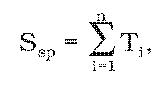
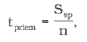
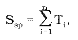
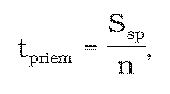
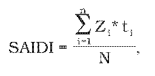
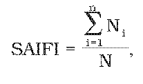

# § 7 Sledovanie, vyhodnocovanie a zverejňovanie štandardov kvality regulovaným subjektom

(1) Štandardy kvality sa sledujú a vyhodnocujú regulovaným subjektom v rozsahu uvedenom v prílohách č. 1 až 8 za každý kalendárny rok alebo jeho časť, počas ktorej regulovaný subjekt vykonával regulovanú činnosť na základe podaní účastníkov trhu s plynom a informácií zistených z vlastnej činnosti regulovaného subjektu. Udalosti a podania, ktorým lehota na vybavenie neuplynula do konca kalendárneho roka, v ktorom nastali, zaradia sa do vyhodnotenia štandardov kvality za kalendárny rok, v ktorom uplynie lehota na ich vybavenie.

(2) Na účely sledovania štandardov kvality sa prevádzkovateľom zásobníka, prevádzkovateľom prepravnej siete, prevádzkovateľom distribučnej siete a dodávateľom plynu vyhotovuje sumárny záznam, ktorý obsahuje najmä

- a) identifikačné údaje regulovaného subjektu, a to

  - 1. obchodné meno a miesto podnikania fyzickej osoby – podnikateľa,

  - 2. obchodné meno, právnu formu, sídlo a identifikačné číslo právnickej osoby,

- b) identifikačné údaje účastníka trhu s plynom, a to

  - 1. meno, priezvisko a trvalý pobyt fyzickej osoby,

  - 2. obchodné meno a miesto podnikania fyzickej osoby – podnikateľa,

  - 3. obchodné meno, právnu formu, sídlo a identifikačné číslo právnickej osoby,

- c) názov, číslo a adresu odberného miesta alebo odovzdávaco-preberacieho bodu,

- d) dátum, čas a spôsob oznámenia udalosti alebo zistenia nedodržania štandardu kvality,

- e) opis udalosti,

- f) príčinu nedodržania štandardu kvality,

- g) dátum a spôsob vybavenia udalosti,

- h) podpis s uvedením mena, priezviska a funkcie oprávnenej osoby regulovaného subjektu.

(3) Údaje v zázname podľa odseku 2 písm. b) a c) sa nevyžadujú pri sledovaní štandardu kvality podľa § 2 písm. h), i) a j).

(4) Prevádzkovateľom zásobníka sa na účely vyhodnotenia štandardu kvality v prílohe č. 1 tabuľka č. 2 sleduje

- a) súhrnná doba prerušení uskladňovania plynu, ktorú tvorí súčet všetkých dôb trvania prerušení služieb uskladňovania plynu pri pevnej uskladňovacej kapacite, ktoré neboli zavinené prevádzkovateľom zásobníka, sú v súlade so zmluvou o uskladňovaní alebo neboli vopred oznámené v lehote podľa § 2 písm. f), ktorá sa za kalendárny rok vypočíta podľa vzorca

kde

Ssp – súhrnná doba prerušení služieb uskladňovania plynu v hodinách,

Ti – doba trvania i-tého prerušenia služieb uskladňovania plynu v hodinách,

- b) doba trvania i-tého prerušenia služieb uskladňovania plynu v hodinách, ktorá sa vypočíta podľa vzorca

Ti = t1 – t0,

kde

t0 – dátum a čas začiatku i-tého prerušenia služieb uskladňovania plynu,

t1 – dátum a čas konca i-tého prerušenia služieb uskladňovania plynu,

- c) priemerná doba trvania prerušenia služieb uskladňovania plynu pri pevnej uskladňovacej kapacite za kalendárny rok, ktorá sa vypočíta podľa vzorca

kde

tpriem – priemerná doba trvania prerušenia uskladňovania plynu v hodinách,

n – počet prerušení celkom.

(5) Prevádzkovateľom prepravnej siete sa na účely vyhodnotenia štandardu kvality v prílohe č. 2 tabuľke č. 2 sleduje

- a) súhrnná doba nedodržania plynulosti prepravy plynu, ktorú tvorí súčet všetkých dôb trvania nedodržaní plynulosti prepravy plynu za kalendárny rok, ktorá sa vypočíta podľa vzorca

kde

Ssp – súhrnná doba nedodržania plynulosti prepravy plynu v hodinách,

Ti – doba trvania i-tého nedodržania plynulosti prepravy plynu v hodinách,

- b) doba i-tého nedodržania plynulosti prepravy plynu v hodinách, ktorá sa vypočíta podľa vzorca

Ti = t1 – t0,

kde

t0 – dátum a čas začiatku i-tého nedodržania plynulosti prepravy plynu,

t1 – dátum a čas konca i-tého nedodržania plynulosti prepravy plynu,

- c) priemerná doba trvania nedodržania plynulosti prepravy plynu za kalendárny rok, ktorá sa vypočíta podľa vzorca

kde

tpriem – priemerná doba trvania nedodržania plynulosti v hodinách,

n – počet prerušení celkom,

(6) Prevádzkovateľom distribučnej siete sa na účely vyhodnotenia štandardu kvality v prílohe č. 3 tabuľkách č. 2 a 3 sleduje

- a) priemerná doba prerušenia distribúcie plynu, ktorá sa vypočíta podľa vzorca

kde

SAIDI – priemerná doba prerušenia distribúcie plynu,

Zi– počet dotknutých odberných miest pri i-tom prerušení distribúcie plynu,

N – celkový počet odberných miest prevádzkovateľa distribučnej siete,

ti – doba trvania i-tého prerušenia distribúcie plynu v hodinách,

- 1. do priemernej doby prerušenia distribúcie plynu vstupujú všetky neplánované prerušenia distribúcie plynu prevádzkovateľa distribučnej siete, ktoré mali za následok prerušenie distribúcie plynu odberateľom plynu na odberných miestach v trvaní viac ako jedna hodina,

- 2. do priemernej doby prerušenia distribúcie plynu nevstupujú prerušenia distribúcie plynu prevádzkovateľa distribučnej siete, ktoré boli zapríčinené vznikom udalosti v nadradenej distribučnej sieti, prepravnej sieti alebo živelnej udalosti,

- 3. priemerná doba prerušenia distribúcie plynu sa sleduje mesačne, o každej udalosti je zaznamenaný dátum a čas vzniku, doba trvania prerušenia distribúcie plynu, počet dotknutých odberných miest a príčina vzniku udalosti; prerušenie distribúcie plynu v danej distribučnej sieti, ktoré bolo zapríčinené vznikom udalosti podľa bodu 2, sa sleduje a vyhodnocuje osobitne a úradu sa predkladá len na vyžiadanie,

- b) priemerný počet prerušení distribúcie plynu, ktorá sa vypočíta podľa vzorca

kde

SAIFI – priemerný počet prerušení distribúcie plynu,

Ni – počet dotknutých odberných miest pri i-tom prerušení distribúcie plynu,

N – celkový počet odberných miest prevádzkovateľa distribučnej siete.

- 1. do priemerného počtu prerušení distribúcie plynu vstupujú všetky neplánované prerušenia distribúcie plynu prevádzkovateľa distribučnej siete, ktoré mali za následok prerušenie distribúcie plynu odberateľom plynu na odberných miestach v trvaní viac ako jedna hodina,

- 2. do priemerného počtu prerušení distribúcie plynu nevstupujú prerušenia distribúcie plynu u prevádzkovateľa distribučnej siete, ktoré boli zapríčinené vznikom udalosti v nadradenej distribučnej sieti, prepravnej sieti alebo živelnej udalosti,

- 3. priemerný počet prerušení distribúcie plynu sa sleduje mesačne, o každej udalosti je zaznamenaný dátum a čas vzniku, doba trvania prerušenia distribúcie plynu, počet dotknutých odberných miest a príčina vzniku udalosti; prerušenie distribúcie plynu v danej distribučnej sieti, ktoré bolo zapríčinené vznikom udalosti podľa bodu 2, sa sleduje a vyhodnocuje osobitne a úradu sa predkladá len na vyžiadanie.

(7) Štandardy kvality podľa § 6 sa vyhodnocujú samostatne podľa dôvodu vzniku udalosti v rozsahu údajov

- a) dátum a čas vzniku udalosti,

- b) dátum a čas skončenia udalosti,

- c) počet dotknutých účastníkov trhu s plynom,

- d) celkové množstvo nedodaného plynu.

(8) Vyhodnotenie štandardov kvality za rok t-1 v rozsahu podľa príloh č. 1 až 8 sa zverejňuje do 28. februára roku t po dobu najmenej 12 mesiacov na internetovej stránke regulovaného subjektu alebo vo výročnej správe regulovaného subjektu alebo iným obvyklým spôsobom, ak regulovaný subjekt nemá zriadenú internetovú stránku alebo nevydáva výročnú správu.

(9) Vyhodnotenie štandardov kvality za rok t-1 v rozsahu podľa príloh č. 1 až 8 sa predkladá úradu podľa osobitného predpisu11) do 28. februára roku t.
