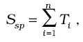
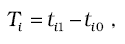
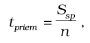
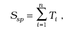
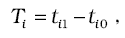
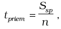
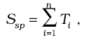
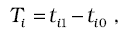
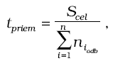
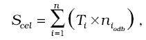

# § 7 Sledovanie, vyhodnocovanie a zverejňovanie štandardov kvality regulovaným subjektom

(1) Štandardy kvality sa sledujú a vyhodnocujú v rozsahu uvedenom v prílohách č. 1 až 7 za každý kalendárny rok.

(2) Na účely sledovania a vyhodnocovania štandardu kvality sa vyhotovuje záznam, ktorý obsahuje najmä

- a) identifikačné údaje regulovaného subjektu

  - 1. meno, priezvisko, miesto podnikania a identifikačné číslo fyzickej osoby – podnikateľa,

  - 2. obchodné meno, právnu formu, sídlo a identifikačné číslo právnickej osoby,

- b) identifikačné údaje účastníka trhu s plynom

  - 1. meno, priezvisko a trvalý pobyt fyzickej osoby,

  - 2. meno, priezvisko, miesto podnikania a identifikačné číslo fyzickej osoby – podnikateľa,

  - 3. obchodné meno, právnu formu, sídlo a identifikačné číslo právnickej osoby,

- c) názov, číslo odberného miesta a predávajúceho miesta,

- d) dátum, čas a spôsob oznámenia udalosti alebo zistenia nedodržania štandardu kvality,

- e) opis udalosti,

- f) príčinu nedodržania štandardu kvality,

- g) dátum a spôsob vybavenia udalosti,

- h) podpis s uvedením mena, priezviska a funkcie oprávnenej osoby regulovaného subjektu.

(3) Na účely sledovania a vyhodnocovania štandardu kvality v prílohe č. 2 sa

- a) súhrnná doba prerušení uskladňovania plynu, ktorú tvorí súčet všetkých dôb trvania prerušení uskladňovania plynu pri pevnej uskladňovacej kapacite, ktoré neboli vopred oznámené v lehote podľa § 2 písm. f) za kalendárny rok, vypočíta podľa vzorca

pričom

Ssp – súhrnná doba prerušení uskladňovania plynu v hodinách,

Ti – doba trvania v hodinách,

- b) doba trvania i-tého prerušenia uskladňovania plynu v hodinách vypočíta podľa vzorca

pričom

ti0 – dátum a čas začiatku i-tého prerušenia uskladňovania plynu,

ti1 – dátum a čas konca i-tého prerušenia uskladňovania plynu,

- c) priemerná doba trvania prerušenia uskladňovania plynu pri pevnej uskladňovacej kapacite za kalendárny rok vypočíta podľa vzorca

pričom

tpriem – priemerná doba trvania prerušenia v hodinách,

n – počet prerušení celkom.

(4) Na účely sledovania a vyhodnocovania štandardu kvality v prílohe č. 4 sa

- a) súhrnná doba prerušení prepravy plynu, ktorú tvorí súčet všetkých dôb trvania prerušení prepravy plynu za kalendárny rok, vypočíta podľa vzorca

pričom

Ssp– súhrnná doba prerušení prepravy plynu v hodinách,

Ti– doba trvania i-tého prerušenia prepravy plynu v hodinách,

- b) doba i-tého prerušenia prepravy plynu v hodinách vypočíta podľa vzorca

pričom

ti0– dátum a čas začiatku i-tého prerušenia prepravy plynu,

ti1 – dátum a čas konca i-tého prerušenia prepravy plynu,

- c) priemerná doba trvania prerušenia prepravy plynu za kalendárny rok vypočíta podľa vzorca

pričom

tpriem – priemerná doba trvania prerušenia v hodinách,

n – počet prerušení celkom.

(5) Na účely sledovania a vyhodnocovania štandardu kvality v prílohe č. 6 sa

- a) súhrnná doba prerušení distribúcie plynu, ktorú tvorí súčet všetkých dôb trvania prerušení distribúcie plynu za kalendárny rok, vypočíta podľa vzorca

pričom

Ssp – súhrnná doba prerušení distribúcie plynu v hodinách,

Ti – doba trvania i-tého prerušenia distribúcie plynu v hodinách,

- b) doba trvania i-tého prerušenia distribúcie plynu v hodinách vypočíta podľa vzorca

pričom

ti0 – dátum a čas začiatku i-tého prerušenia distribúcie plynu,

ti1 – dátum a čas konca i-tého prerušenia distribúcie plynu,

- c) priemerná doba trvania prerušenia distribúcie plynu na jedného odberateľa plynu za kalendárny rok vypočíta podľa vzorca

pričom

tpriem – priemerná doba prerušenia v hodinách na jedného odberateľa plynu,

Scel – celkový počet hodín pre všetkých odberateľov plynu,

- d) celkový počet hodín prerušenia distribúcie plynu pre všetkých odberateľov plynu vypočíta podľa vzorca

pričom

niobt– počet odberateľov plynu i-tého prerušenia.

(6) Vyhodnotenie štandardov kvality za celý predchádzajúci kalendárny rok podľa odseku 1 sa zverejňuje na internetovej stránke regulovaného subjektu do 28. februára za predchádzajúci kalendárny rok alebo vo výročnej správe regulovaného subjektu, alebo iným obvyklým spôsobom do 28. februára za predchádzajúci kalendárny rok, ak regulovaný subjekt nemá zriadenú internetovú stránku alebo nevydáva výročnú správu.

(7) Vyhodnotenie štandardov kvality za celý predchádzajúci kalendárny rok podľa odseku 1 sa predkladá úradu podľa osobitného predpisu11) do 28. februára za predchádzajúci kalendárny rok.
