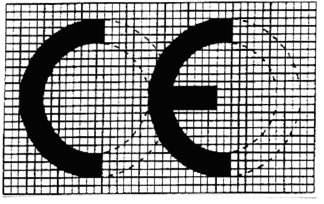

Príloha č. 3 k nariadeniu vlády č. 35/2008 Z. z.

- OZNAČENIE CE

  - 1. Označenie CE pozostáva z iniciálok „CE“ v takejto forme:

  - 

  - 2. Ak sa označenie CE zmenší alebo zväčší, musia sa rešpektovať proporcie dané v hore uvedenom náčrte.

  - 3. Zvislé rozmery jednotlivých častí označenia CE musia byť rovnaké a nie menšie ako 5 mm. Od tohto minimálneho rozmeru sa môže upustiť v prípade malorozmerných osobných ochranných prostriedkov.
