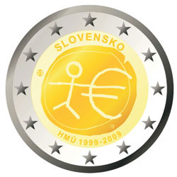

## 359

OZNÁMENIE

Národnej banky Slovenska

z 2. septembra 2008

o vydaní pamätných obehových euromincí v nominálnej hodnote 2 eurá pri príležitosti 10. výročia Hospodárskej a menovej únie

1. Úvodné ustanovenia

- a) Národná banka Slovenska vydáva podľa § 17h ods. 1 zákona Národnej rady Slovenskej republiky č. 566/1992 Zb. o Národnej banke Slovenska v znení neskorších predpisov a podľa § 1 ods. 2 písm. d) zákona Národnej rady Slovenskej republiky č. 1/1993 Z. z. o Zbierke zákonov Slovenskej republiky v znení zákona č. 275/2002 Z. z. oznámenie o vydaní pamätných obehových euromincí v nominálnej hodnote 2 eurá pri príležitosti 10. výročia Hospodárskej a menovej únie (ďalej len „pamätná eurominca“).

- b) Pri príležitosti 10. výročia Hospodárskej a menovej únie ministri Euroskupiny rozhodli, že členské štáty eurozóny vyrazia pamätné euromince v nominálnej hodnote 2 eurá, ktoré majú rovnaké technické parametre ako obehové euromince,1) a na ich národnej strane bude použitý spoločný motív [bod 2 písm. b)].

- c) Pamätná eurominca má v celej eurozóne štatút zákonného platidla.

2. Vzhľad pamätnej euromince

- a) Pamätná eurominca sa vydáva s novou spoločnou európskou stranou.2)

- b) Na národnej strane pamätnej euromince je vyobrazená štylizovaná postava človeka, ktorého ľavá ruka plynule prechádza do symbolu eura. V hornej časti pamätnej euromince je v opise vnútorného kruhu zľava doprava nápis „SLOVENSKO“ a v spodnej časti pamätnej euromince nápis „HMÚ 1999-2009“. Iniciálky autora výtvarného návrhu národnej strany pamätnej euromince Georgea Stamatopoulosa „Г∑“ sú umiestnené pod symbolom eura. Značka Mincovne Kremnica, štátny podnik, „MK“, medzi dvoma razidlami je umiestnená vľavo od štylizovanej postavy človeka. Pri okraji pamätnej euromince je 12 do kruhu umiestnených hviezd Európskej únie.

- c) Na hrane pamätnej euromince je nápis „SLOVENSKÁ REPUBLIKA“. Začiatok a koniec nápisu je oddelený dvoma hviezdami, medzi ktorými je lipový list.

Štát vydania: Slovenská republika

Začiatok vydávania: január 2009

Ivan Šramko v. r.
