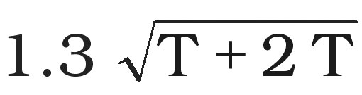
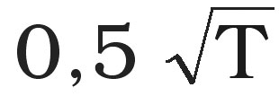

Príloha č. 1 k vyhláške č. 370/2008 Z. z.

- DRUHOVÉ NÁZVY A OPISY TEXTILNÝCH VLÁKEN Č. pol. | Názov | Opis vlákna

- 1 | Vlna1) | vlákno z ovčieho alebo jahňacieho rúna (Ovis aries)

- 2 | Alpaka, lama, fava, kašmír, mohér, angora, vikuňa, jak, guanaco cashgora, bobor, vydra vrátane slova „vlna“ alebo „srsť“ alebo bez týchto slov1) | srsť týchto zvierat: alpaka, lama, ťava, kašmírska koza, angorská koza, angorský králik, vikuňa, jak, guanaco koza cashgora, bobor, vydra

- 3 | Zvieracie chlpy alebo vlásie s uvedením druhu zvieraťa alebo bez tejto špecifikácie (napr. hovädzie chlpy, kozia srsť, konské vlásie) | srsť rôznych zvierat neuvedených v položke č. 1 alebo č. 2

- 4 | Hodváb | vlákno získané zo snovacích žliaz hmyzu

- 5 | Bavlna | vlákno získané z toboliek bavlníka (Gossypium)

- 6 | Kapok | vlákno získané z plodu kapoku (Ceiba Pentandra)

- 7 | Ľan | vlákno získané z lyka ľanu (Linium usitatissimum)

- 8 | Pravé konope | vlákno získané z lyka konopí (Cannabis sativa)

- 9 | Juta | vlákno získané z lyka Corchorus olitorius a Corchorus capsularis. Na účely tejto vyhlášky sa do pojmu juta zahŕňajú aj lykové vlákna z druhov Hibiscus canabinus, Hibiscus sabdariffa, Abultilon avicennae, Urena lobata, Urena sinuata

- 10 | Abaka (manilské konope) | vlákno získané z listov Musa textilis

- 11 | Alfa | vlákno získané z listov Stipa tenacissima

- 12 | Kokos | vlákno získané z plodov Cocos nucifera

- 13 | Broom | vlákno získané z lyka Cytisus scoparius a/alebo Sparftium junceum

- 14 | Ramia | vlákno získané z lyka Boehmeria nivea a Boehineria tenacissima

- 15 | Sisal | vlákno získané z listov Agave sisalana

- 16 | Bengálske konope | vlákno získané z lyka Crotalaria juncea

- 17 | Henequén | vlákno získané z lyka Agave Kourcroydes

- 18 | Maguey | vlákno získané z lyka Agave Cantala

- 19 | Acetát | vlákno z acetátu celulózy, v ktorom je najmenej 74 % a najviac 92 % acetylovaných hydroxylových skupín

- 20 | Alginát | vlákno získané z kovových solí kyseliny algínovej

- 21 | Meďnaté vlákno | regenerované celulózové vlákno získané medňatoamoniakálnym procesom

- 22 | Modal | vlákno z regenerovanej celulózy získané modifikovaným viskózovým procesom s vysokou pevnosťou v prietrhu a vysokým modulom za mokra. Tržná pevnosť Bc v klimatizovanom stave a sila BM potrebná na predĺženie o 5 % v mokrom stave sa rovná: Bc (cN) , BM (cN) , kde T je priemerná dĺžková hmotnosť v dtex

- 23 | Proteín1) | vlákno získané z prírodných proteínových látok, regenerované a stabilizované pomocou chemických činidiel

- 24 | Triacetát | vlákno z acetátu celulózy, v ktorom je najmenej 92 % acetylovaných hydroxylových skupín

- 25 | Viskóza | regenerované celulózové vlákno získané kontinuálnym a diskontinuálnym viskózovým postupom

- 26 | Akryl1) | vlákno z lineárnych makromolekúl, ktoré majú v reťazci najmenej 85 % (hmotnostných) a krylonitrilových jednotiek

- 27 | Chloridové vlákno | vlákno z lineárnych makromolekúl, ktoré majú v reťazci viac ako 50 % hmotnostných chlórovaných vinylových alebo vinylidénových jednotiek

- 28 | Fluóretylén | vlákno z lineárnych makromolekúl vyrobených z fluórovaných alifatických uhľovodíkových monomérov

- 29 | Modakryl2) | vlákno z lineárnych makromolekúl, ktoré majú v reťazci min. 50 % a max. 85 % (hmotnostných) akrylonitrilových jednotiek

- 30 | Polyamid alebo nylon2) | vlákno z lineárnych makromolekúl, ktoré majú v reťazci opakujúce sa amidové skupiny; najmenej 85 % z nich je pripojených k alifatickým alebo cykloalifatickým jednotkám

- 31 | Aramid | vlákno skladajúce sa z lineárnych makromolekúl zložených z aromatických skupín, spojených amidovými alebo imidovými väzbami, z ktorých najmenej 85 % je napojených priamo na dva aromatické cykly, a s počtom imidových väzieb nepresahujúcim počet amidových väzieb

- 32 | Polyimid | vlákno skladajúce sa zo syntetických lineárnych makromolekúl majúcich v reťazci opakujúce sa imidové jednotky

- 33 | Lyocell3) | vlákno z regenerovanej celulózy získané rozpúšťaním a procesom spriadania v organickom rozpúšťadle bez tvorby derivátov

- 33a | Polylaktid | vlákno z lineárnych makromolekúl, ktoré majú v reťazci najmenej 85 % hmotných esterových jednotiek kyseliny mliečnej získaných z prírodných cukrov s teplotou topenia najmenej 135oC

- 34 | Polyester | vlákno z lineárnych makromolekúl, ktoré majú v reťazci min. 85 % (hmotnostných) esteru diolu a kyseliny tereftálovej

- 35 | Polyetylén2) | vlákno z nesubstituovaných alifatických nasýtených uhľovodíkových lineárnych makromolekúl

- 36 | Polypropylén2) | vlákno z alifatických nasýtených uhľovodíkových lineárnych makromolekúl, v ktorých jeden z dvoch atómov uhlíka má metylovú bočnú skupinu v izotaktickom usporiadaní bez ďalších substituentov

- 37 | Polykarbamid | vlákno z lineárnych makromolekúl, ktoré majú v reťazci opakujúcu sa funkčnú skupinu (NH-CO-NH)

- 38 | Polyuretán | vlákno z lineárnych makromolekúl zložených z reťazcov s opakujúcou sa uretánovou funkčnou skupinou

- 39 | Vinylal | vlákno z lineárnych makromolekúl, ktorých reťazec je vytvorený z polyvinylalkoholu s rôznym stupňom acetalizácie

- 40 | TrivinyI2) | vlákno na báze terpolyméru zloženého z akrylonitrilu, chlórovaného vinylového monoméru a vinylového monoméru, z ktorých žiadny nie je zastúpený väčším obsahom ako 50 % z celkovej hmotnosti

- 41 | Elastodién2) | pružné vlákno vytvorené z prírodného alebo zo syntetického polyizoprénu alebo vytvorené z jedného diénu alebo z viacerých diénov polymerizovaných s jedným vinylovým monomérom alebo s niekoľkými vinylovými monomérmi alebo bez nich a ktoré, keď je pretiahnuté až na trojnásobok svojej dĺžky a uvoľnené, sa rýchlo regeneruje v podstate na svoju pôvodnú dĺžku

- 42 | Elastan | pružné vlákno, ktoré najmenej z 85 % (hmotnostných) tvorí segmentový polyuretán a ktoré, keď je pretiahnuté až na trojnásobok svojej dĺžky a uvoľnené, sa rýchlo regeneruje v podstate na svoju pôvodnú dĺžku

- 43 | Sklené vlákno | vlákno vyrobené zo skla

- 44 | Názov zodpovedajúci materiálu, z ktorého je vlákno zložené | vlákno získané z rôznorodých alebo nových materiálov, iných, ako sú skôr uvedené, napríklad kovové (metalické, metalizované), azbestové, papierové, a to vrátane slov „niť“ alebo „vlákno“, alebo bez nich

- 45 | Elastomultiester | vlákno vytvorené interakciou dvoch alebo viacerých chemicky rozdielnych lineárnych makromolekúl, ktoré obsahuje esterové skupiny ako dominantnú funkčnú jednotku (najmenej 85 %) v dvoch alebo viacerých rozdielnych fázach (ktoré nepresahujú 85 % hmoty) a ktoré sa po vhodnej úprave natiahne na jedenapolnásobok pôvodnej dĺžky a po uvoľnení sa rýchlo stiahne takmer na pôvodnú dĺžku

- 46 | Elastolefín | vlákno zložené najmenej z 95 % (ako hmotnostné percento) makromolekúl vytvorených z etylénu a aspoň jedného ďalšieho olefínu a čiastočne zosieťovaných, ktoré po natiahnutí na jeden- apolnásobok svojej pôvodnej dĺžky a po následnom uvoľnení rýchlo a výrazne nadobudne svoju pôvodnú dĺžku
