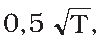

Príloha č. 1 k vyhláške č. 370/2008 Z. z.

- DRUHOVÉ NÁZVY A OPISY TEXTILNÝCH VLÁKEN Č. pol. | Názov | Opis vlákna

- 1 | Vlna | vlákno z ovčieho alebo jahňacieho rúna (Ovis aries) Názov „vlna“ môže byť použitý na označenie zmesi vláken z rúna oviec a jahniat a srsti uvedenej v časti „Opis vlákna“ položke č. 2. Toto ustanovenie je uplatniteľné na textilné výrobky uvedené v § 4 a 5 za predpokladu, že tieto textilné výrobky sú čiastočne zložené z vláken uvedených v položkách č. 1 a 2.

- 2 | Alpaka lama, ťava, kašmír, mohér, angora, vikuňa, jak, guanako, kašgora, bobor, vydra vrátane slova „vlna“ alebo „srsť“ alebo bez týchto slov | srsť týchto zvierat: alpaka lama, ťava, kašmírska koza, angorská koza, angorský králik, vikuňa, jak, guanako, kašgorská koza, bobor, vydra

- 3 | Zvieracie chlpy alebo vlásie s uvedením druhu zvieraťa alebo bez tejto špecifikácie (napr. hovädzie chlpy, kozia srsť, konské vlásie) | srsť rôznych zvierat neuvedených v položke č. 1 alebo č. 2

- 4 | Hodváb | vlákno získané zo snovacích žliaz hmyzu

- 5 | Bavlna | vlákno získané z toboliek bavlníka (Gossypium)

- 6 | Kapok | vlákno získané z plodu kapoku (Ceiba pentandra)

- 7 | Ľan | vlákno získané z lyka ľanu (Linium usitatissimum)

- 8 | Pravé konope | vlákno získané z lyka konopí (Cannabis sativa)

- 9 | Juta | vlákno získané z lyka Corchorus olitorius a Corchorus capsularis; na účely tejto vyhlášky sa do pojmu juta zahŕňajú aj lykové vlákna z druhov Hibiscus canabinus, Hibiscus sabdariffa, Abutilon avicennae, Urena lobata, Urena sinuata

- 10 | Abaka (manilské konope) | vlákno získané z listov Musa textilis

- 11 | Alfa | vlákno získané z listov Stipa tenacissima

- 12 | Kokos | vlákno získané z plodov Cocos nucifera

- 13 | Broom | vlákno získané z lyka Cytisus scoparius a/alebo Spartium junceum

- 14 | Ramia | vlákno získané z lyka Boehmeria nivea a Boehmeria tenacissima

- 15 | Sisal | vlákno získané z listov Agave sisalana

- 16 | Bengálske konope | vlákno získané z lyka Crotalaria juncea

- 17 | Henequén | vlákno získané z lyka Agave fourcroydes

- 18 | Maguey | vlákno získané z lyka Agave cantala

- 19 | Acetát | vlákno z acetátu celulózy, v ktorom je najmenej 74 % a najviac 92 % acetylovaných hydroxylových skupín

- 20 | Alginát | vlákno získané z kovových solí kyseliny algínovej

- 21 | Meďnaté vlákno | regenerované celulózové vlákno získané medňatoamoniakálnym procesom

- 22 | Modal | vlákno z regenerovanej celulózy získané modifikovaným viskózovým procesom s vysokou pevnosťou v prietrhu a vysokým modulom za mokra; tržná pevnosť Bcv klimatizovanom stave a sila Bm potrebná na predĺženie o 5 % v mokrom stave sa rovná Bc (KN), Bm (KN), kde T je priemerná dĺžková hmotnosť v dtex

- 23 | Proteín | vlákno získané z prírodných proteínových látok, regenerované a stabilizované pomocou chemických činidiel

- 24 | Triacetát | vlákno z acetátu celulózy, v ktorom je najmenej 92 % acetylovaných hydroxylových skupín

- 25 | Viskóza | regenerované celulózové vlákno získané kontinuálnym a diskontinuálnym viskózovým postupom

- 26 | Akryl | vlákno z lineárnych makromolekúl, ktoré majú v reťazci najmenej 85 hmotnostných % a akrylonitrilových jednotiek

- 27 | Chloridové vlákno | vlákno z lineárnych makromolekúl, ktoré majú v reťazci viac ako 50 hmotnostných % chlórovaných vinylových alebo vinylidénových jednotiek

- 28 | Fluóretylén | vlákno z lineárnych makromolekúl vyrobených z fluórovaných alifatických uhľovodíkových monomérov

- 29 | Modakryl | vlákno z lineárnych makromolekúl, ktoré majú v reťazci najmenej 50 a najviac 85 hmotnostných % akrylonitrilových jednotiek

- 30 | Polyamid alebo nylon | vlákno zo syntetických lineárnych makromolekúl, ktoré majú v reťazci opakujúce sa amidové väzby; najmenej 85 % z nich je pripojených k alifatickým alebo cykloalifatickýrn jednotkám

- 31 | Aramid | vlákno zo syntetických lineárnych makromolekúl zložených z aromatických skupín spojených amidovými alebo imidovými väzbami, z ktorých najmenej 85 % je pripojených priamo na dve aromatické jadrá, a ak sa vyskytujú imidové väzby, ich počet nepresahuje počet amidových väzieb

- 32 | Polyimid | vlákno skladajúce sa zo syntetických lineárnych makromolekúl majúcich v reťazci opakujúce sa imidové jednotky

- 33 | Lyocell | vlákno z regenerovanej celulózy získané rozpúšťaním a procesom spriadania v organickom rozpúšťadle bez tvorby derivátov Organické rozpúšťadlo je v podstate zmes organických chemikálií a vody.

- 34 | Polylaktid | vlákno z lineárnych makromolekúl, ktoré majú v reťazci najmenej 85 hmotnostných % esterových jednotiek kyseliny mliečnej získaných z prírodných cukrov s teplotou topenia najmenej 135 °C

- 35 | Polyester | vlákno z lineárnych makromolekúl, ktoré majú v reťazci najmenej 85 hmotnostných % esteru diolu a kyseliny tereftalovej

- 36 | Polyetylén | vlákno z nesubstidovaných alifatických nasýtených uhľovodíkových lineárnych makromolekúl

- 37 | Polypropylén | vlákno z alifatických nasýtených uhľovodíkových lineárnych makromolekúl, v ktorých jeden z dvoch atómov uhlíka má metylovú bočnú skupinu v izotaktickom usporiadaní bez ďalších substituentov

- 38 | Polykarbamid | vlákno z lineárnych makromolekúl, ktoré majú v reťazci opakujúcu sa funkčnú skupinu (NH-CO-NH)

- 39 | Polyuretán | vlákno z lineárnych makromolekúl zložených z reťazcov s opakujúcou sa uretánovou funkčnou skupinou

- 40 | Vinylal | vlákno z lineárnych makromolekúl, ktorých reťazec je vytvorený z polyvinylalkoholu s rôznym stupňom acetalizácie

- 41 | TrivinyI | vlákno na báze terpolyméru zloženého z akrylonitrilu, chlórovaného vinylového monoméru a vinylového monoméru, z ktorých žiadny nie je zastúpený väčším obsahom ako 50 % z celkovej hmotnosti

- 42 | Elastodién | pružné vlákno vytvorené z prírodného alebo zo syntetického polyizoprénu alebo vytvorené z jedného diénu alebo z viacerých diénov polymerizovaných s jedným vinylovým monomérom alebo s niekoľkými vinylovými monomérmi, alebo bez nich a ktoré, keď je pretiahnuté až na trojnásobok svojej dĺžky a uvoľnené, sa rýchlo regeneruje v podstate na svoju pôvodnú dĺžku

- 43 | Elastan | pružné vlákno, ktoré najmenej z 85 hmotnostných % tvorí segmentový polyuretán a ktoré, keď je pretiahnuté až na trojnásobok svojej dĺžky a uvoľnené, sa rýchlo regeneruje v podstate na svoju pôvodnú dĺžku

- 44 | Sklené vlákno | vlákno vyrobené zo skla

- 45 | Názov zodpovedajúci materiálu, z ktorého je vlákno zložené | vlákno získané z rôznorodých alebo nových materiálov, iných, ako sú už uvedené, napríklad kovové (metalické, metalizované), azbestové, papierové, a to vrátane slov „niť“ alebo „vlákno“ alebo bez nich

- 46 | Elastomultiester | vlákno vytvorené interakciou dvoch alebo viacerých chemicky rozdielnych lineárnych makromolekúl, ktoré obsahuje esterové skupiny ako dominantnú funkčnú jednotku (najmenej 85 %) v dvoch alebo viacerých rozdielnych fázach (ktoré nepresahujú 85 hmotnostných %) a ktoré sa po vhodnej úprave natiahne na jedenapolnásobok pôvodnej dĺžky a po uvoľnení sa rýchlo stiahne takmer na pôvodnú dĺžku

- 47 | Elastolefín | vlákno zložené najmenej z 95 hmotnostných % makromolekúl, vytvorených z etylénu a aspoň jedného ďalšieho olefínu a čiastočne zosieťovaných, ktoré po natiahnutí na jedenapolnásobok svojej pôvodnej dĺžky a po následnom uvoľnení rýchlo a výrazne nadobudne svoju pôvodnú dĺžku

- 48 | Melamín | vlákno, ktorého najmenej 85 hmotnostných % predstavujú zosieťované makromolekuly tvorené derivátmi melamínu

- 49 | Polypropylénové/polyamidové dvojzložkové vlákno | dvojzložkové vlákno, v ktorom 10 % až 25 % hmotnosti tvoria polyamidové vlákna uložené v polypropylénovej štruktúre
