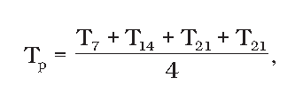

Príloha č. 6 k vyhláške č. 459/2008 Z. z.

SPÔSOB PODROBNÉHO URČENIA ZÁKLADNÉHO ODBEROVÉHO STUPŇA A OBMEDZUJÚCICH ODBEROVÝCH STUPŇOV, ZÁKLADNEJ VYKUROVACEJ KRIVKY A OBMEDZUJÚCICH VYKUROVACÍCH KRIVIEK

I. Spôsob podrobného určenia základného odberového stupňa a obmedzujúcich odberových stupňov pre odberateľa nezávislého od vonkajšej teploty ovzdušia

Odberateľ so zmluvným množstvom odberu nad 4 220 MWh alebo 400 000 m3

Stanovenie základného odberového stupňa Denné množstvo plynu odberateľa počas vyhlásenia obmedzujúcich opatrení so zmluvným množstvom odberu plynu nad 4 220 MWh sa stanoví ako súčin najvyššej mesačnej váhy v percentách a zmluvne dohodnutého množstva plynu odberateľa v kWh vydeleného počtom dní v mesiaci s najvyššou váhou; pre mesiace s rovnakou najvyššou váhou sa zoberie do úvahy mesiac s najmenším počtom dní. Toto množstvo sa prepočíta na objemové jednotky v mł. Na účely prepočtu sa používa hodnota spaľovacieho tepla objemového vo výške 10,55 kWh/m3. Ak má oprávnený odberateľ uzatvorenú zmluvu na distribúciu plynu, dohodne výslednú hodnotu odberového stupňa 3 uplatňujúceho sa počas vyhlásenia obmedzujúcich opatrení s prevádzkovateľom distribučnej siete pri uzavretí zmluvy o distribúcii plynu. Denné množstvo plynu odberateľa so zmluvným množstvom odberu plynu nad 4 220 MWh je limitované hraničnou hodnotou najvyššieho zmluvne dohodnutého denného množstva plynu pre odberné miesta odberateľadohodnutou s odberateľom v zmluve o dodávke plynu. Údaj o mesačnej váhe v percentách je stanovený v zmluve o dodávke plynu a predstavuje percentuálne podiely odberu plynu zo zmluvného množstva, ktoré pripadá na jednotlivé kalendárne mesiace.

Stanovenie obmedzujúcich odberových stupňov Obmedzujúci odberový stupeň 8 predstavuje dennú hodnotu odberu plynu v m3 stanovenú odberateľom plynu podľa § 4 ods. 4 písm. d). Denná hodnota odberu v m3pri obmedzujúcom odberovom stupni 5 je stanovená tak, že rozdiel hodnoty odberu pri odberovom stupni 3 a odberovom stupni 8 sa rozdelí na tretiny a od odberového stupňa 3 sa odpočíta jedna tretina. Denná hodnota odberu v m3pri obmedzujúcom odberovom stupni 7 je stanovená tak, že rozdiel hodnoty odberu pri odberovom stupni 3 a odberovom stupni 8 sa rozdelí na tretiny a od odberového stupňa 3 sa odpočítajú dve tretiny. Tento spôsob stanovenia dennej hodnoty odberu pri odberovom stupni 5 a 7 sa neuplatňuje v prípade, ak by takto stanovené denné hodnoty odberu znamenali pre odberateľa zastavenie výroby. Denné hodnoty odberu pri odberovom stupni 5 a 7 v takomto prípade dohodne dodávateľ plynu s odberateľom plynu na základe preukázateľných technologických potrieb. Denné hodnoty odberov v mł pri obmedzujúcom odberovom stupni 5 a 7 sa stanovia zo základného odberového stupňa, ktorý je uplatňovaný počas vyhlásenia obmedzujúcich opatrení v plynárenstve. Obmedzujúci odberový stupeň 9 predstavuje dennú hodnotu odberu plynu v mł stanovenú odberateľom plynu podľa § 4 ods. 4 písm. e). Obmedzujúci odberový stupeň 4 a 6 predstavuje dennú hodnotu odberu plynu v m3 stanovenú odberateľom plynu podľa § 4 ods. 4 písm. b).

Odberateľ so zmluvným množstvom odberu od 633 MWh alebo 60 000 m3do 4 220 MWh alebo 400 000 m3

Stanovenie základného odberového stupňa Denné množstvo plynu odberateľa so zmluvným množstvom odberu od 633 MWh do 4 220 MWh sa stanoví ako súčin najvyššej mesačnej váhy v percentách a zmluvne dohodnutého množstva plynu odberateľa v kWh vydeleného počtom dní v mesiaci s najvyššou váhou. Toto množstvo sa prepočíta na objemové jednotky m3. Na účely prepočtu sa použije hodnota spaľovacieho tepla objemového vo výške 10,55 kWh/m3. Denné množstvo plynu odberateľa so zmluvným množstvom odberu od 633 MWh do 4 220 MWh je limitované hraničnou hodnotou najvyššieho zmluvne dohodnutého denného množstva plynu pre odberné miesta odberateľa dohodnutou s odberateľom v zmluve o dodávke plynu. Údaj o mesačnej váhe v percentách je uvedený v zmluve o dodávke plynu; predstavuje percentuálne podiely odberu plynu zo zmluvného množstva pripadajúce na jednotlivé kalendárne mesiace.

Stanovenie obmedzujúcich odberových stupňov Obmedzujúci odberový stupeň 8 predstavuje dennú hodnotu odberu plynu v m3stanovenú odberateľom plynu podľa § 4 ods. 4 písm. d). Obmedzujúci odberový stupeň 9 predstavuje dennú hodnotu odberu plynu v m3stanovenú odberateľom plynu podľa § 4 ods. 4 písm. e).

II. Spôsob podrobného určenia základnej vykurovacej krivky a obmedzujúcich vykurovacích kriviek pre odberateľa závislého od vonkajšej teploty ovzdušia

Rozdelenie odberateľov 1. skupina – zdravotnícke zariadenia a tepelné energetické zariadenia zabezpečujúce vykurovanie zdravotníckych zariadení 2. skupina – tepelné energetické zariadenia zabezpečujúce vykurovanie bytov, objektov škôl a objektov, v ktorých sa nachádza technika nevyhnutná na záchranu majetku, zdravia a života ľudí 3. skupina – ostatní odberatelia

Stanovenie priemernej dennej teploty Priemerná denná teplota ovzdušia slúžiaca pre potreby zistenia hodnoty prislúchajúceho odberu z vykurovacej tabuľky sa vypočíta podľa vzorca:  kde: Tp – priemerná teplota ovzdušia T7– teplota ovzdušia meraná o 7.00 hod. T14– teplota ovzdušia meraná o 14.00 hod. T21– teplota ovzdušia meraná o 21.00 hod.

Stanovenie základnej vykurovacej krivky Základnou vykurovacou krivkou je prvá vykurovacia krivka, ktorá predstavuje denné hodnoty odberov v m3na odbernom mieste odberateľa v závislosti od dennej teploty ovzdušia v stupňoch Celzia; tie sa uvádzajú vo vykurovacej tabuľke odberateľa plynu. Základná vykurovacia krivka je limitovaná hraničnou hodnotou najvyššieho zmluvne dohodnutého denného množstva plynu pre odberné miesta odberateľa dohodnutou s odberateľom v zmluve o dodávke plynu. Dodávateľ plynu odsúhlasí v zmluve o dodávke plynu s odberateľom plynu vykurovaciu tabuľku pre základnú vykurovaciu krivku. Stanovenie obmedzujúcich vykurovacích kriviek Denné hodnoty odberov v m3pre druhú a tretiu vykurovaciu krivku sa stanovia percentuálnym znížením odberu na odberných miestach odberateľa voči základnej vykurovacej krivke podľa § 5 ods. 4 písm. a) a b) a § 5 ods. 5. Dodávateľ plynu odsúhlasí v zmluve o dodávke plynu s odberateľom plynu vykurovaciu tabuľku pre odberné miesta odberateľa vzťahujúce sa na druhú a tretiu vykurovaciu krivku. Qletné je denné množstvo plynu slúžiace na ohrev teplej vody mimo vykurovacej sezóny počas letných mesiacov. Vykurovacia tabuľka odberateľa plynu zahŕňa hodnoty odberov podľa odberných miest odberateľa pre základnú vykurovaciu krivku a obmedzujúce vykurovacie krivky v rozmedzí –25 až +16 oC pre odberateľov zaradených do 1. skupiny, hodnoty odberov pre základnú vykurovaciu krivku a obmedzujúce vykurovacie krivky v rozmedzí –25 až +13oC pre odberateľov zaradených do 2. a 3. skupiny v členení po 1oC a Qletné, prislúchajúce k teplotám nad +17 oC pre odberateľov zaradených do 1. skupiny a teplotám nad +14oC pre odberateľov zaradených do 2. a 3. skupiny.
