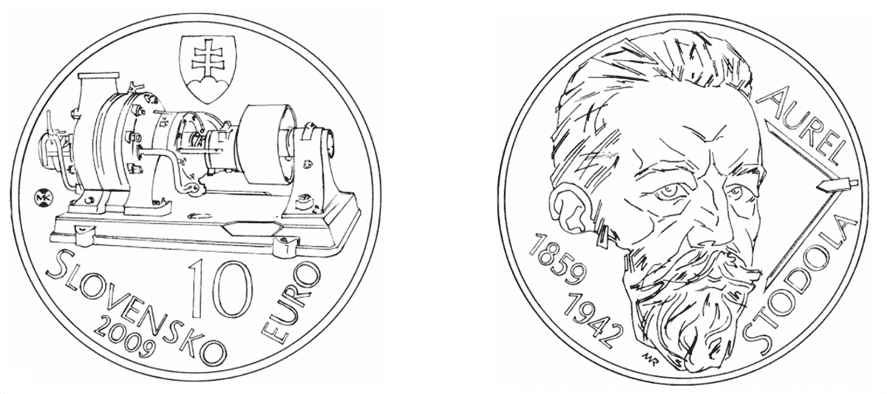

## 494

OZNÁMENIE

Národnej banky Slovenska

z 11. novembra 2008

o vydaní strieborných zberateľských mincí v nominálnej hodnote 10 eur pri príležitosti 150. výročia narodenia Aurela Stodolu

1. Úvodné ustanovenia

- a) Národná banka Slovenska vydáva podľa § 17h ods. 1 zákona Národnej rady Slovenskej republiky č. 566/1992 Zb. o Národnej banke Slovenska v znení neskorších predpisov a podľa § 1 ods. 2 písm. d) zákona Národnej rady Slovenskej republiky č. 1/1993 Z. z. o Zbierke zákonov Slovenskej republiky v znení zákona č. 275/2002 Z. z. oznámenie o vydaní strieborných zberateľských mincí v nominálnej hodnote 10 eur pri príležitosti 150. výročia narodenia Aurela Stodolu.

- b) Pri príležitosti 150. výročia narodenia univerzitného profesora, konštruktéra a vynálezcu Aurela Stodolu sa vydávajú do obehu strieborné zberateľské mince v nominálnej hodnote 10 eur (ďalej len „minca“).

- c) Minca má štatút zákonného platidla len v Slovenskej republike.

- d) Minca sa razí zo zliatiny obsahujúcej 900 dielov striebra a 100 dielov medi; jej hmotnosť je 18 g a priemer 34 mm. Pri razbe mince je povolená horná a dolná odchýlka v priemere 0,1 mm; povolená horná odchýlka v hmotnosti je 0,4 g a v obsahu striebra 10/1000.

2. Vzhľad mince

- a) Na líci mince je uprostred mincového poľa vyobrazený dobový turbogenerátor, nad ktorým je štátny znak Slovenskej republiky. Názov štátu „SLOVENSKO“ je umiestnený v ľavej spodnej časti mincového poľa šikmo zhora nadol. Pod ním je šikmo zhora nadol letopočet „2009“. Označenie nominálnej hodnoty mince „10 EURO“ je umiestnené pod turbogenerátorom tak, že číslovka „10“ je vodorovne a vpravo od nej je slovo „EURO“ šikmo zdola nahor. Značka Mincovne Kremnica, štátny podnik, „MK“, medzi dvoma razidlami je umiestnená vľavo od turbogenerátora.

- b) Na rube mince je v strede mincového poľa vyobrazený portrét Aurela Stodolu. Vpravo od portrétu je vyobrazené dobové odpichovadlo s roztvorenými ramenami používané pri rysovaní technických výkresov. Rovnobežne s ramenami odpichovadla je zľava doprava meno a priezvisko „AUREL STODOLA“. V ľavej spodnej časti sú v dvoch riadkoch šikmo zhora nadol letopočty označujúce rok jeho narodenia a úmrtia „1859“, „1942“. Pri spodnom okraji mince sú umiestnené šikmo zhora nadol štylizované iniciálky mena a priezviska autora výtvarného návrhu Miroslava Ronaia „MR“.

- c) Na hrane mince je nápis do hĺbky „– KONŠTRUKTÉR – VYNÁLEZCA – PEDAGÓG“.

Štát vydania: Slovenská republika

Začiatok vydávania: apríl 2009

Ivan Šramko v. r.
