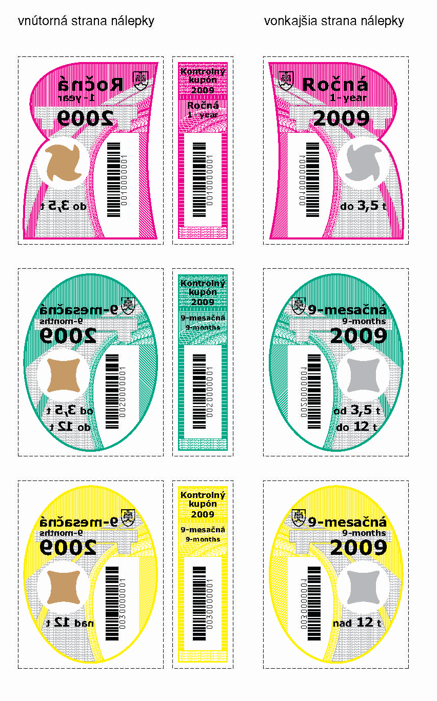
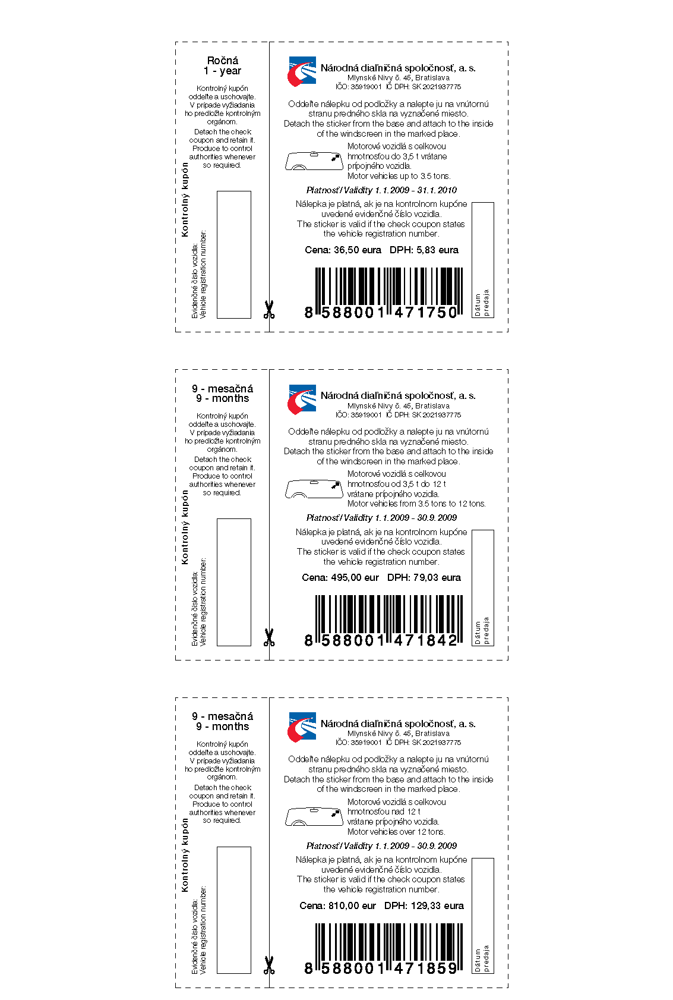
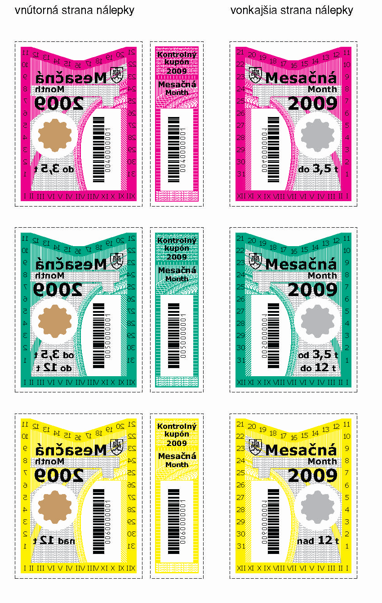
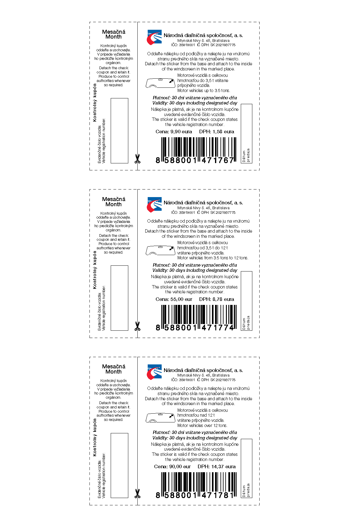
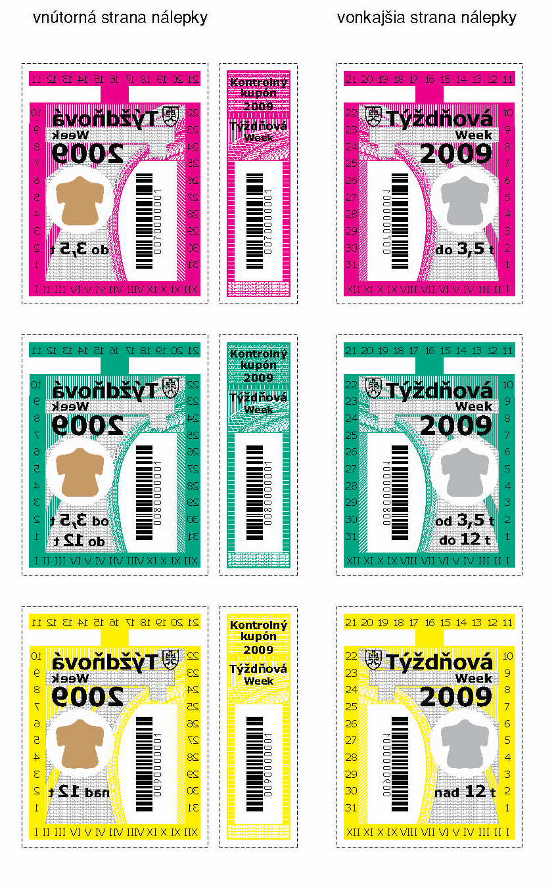
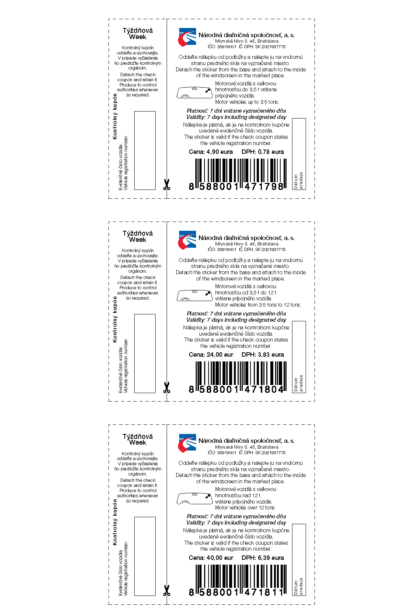
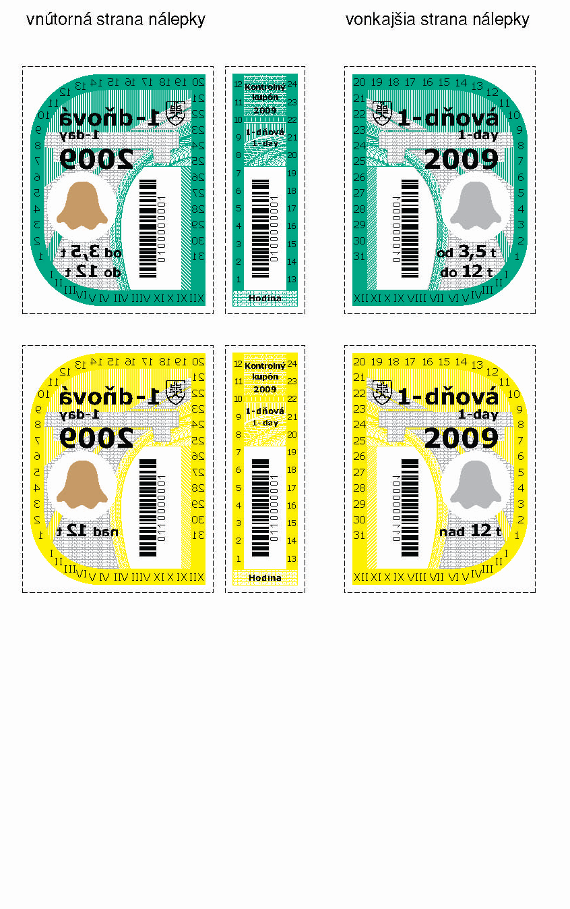
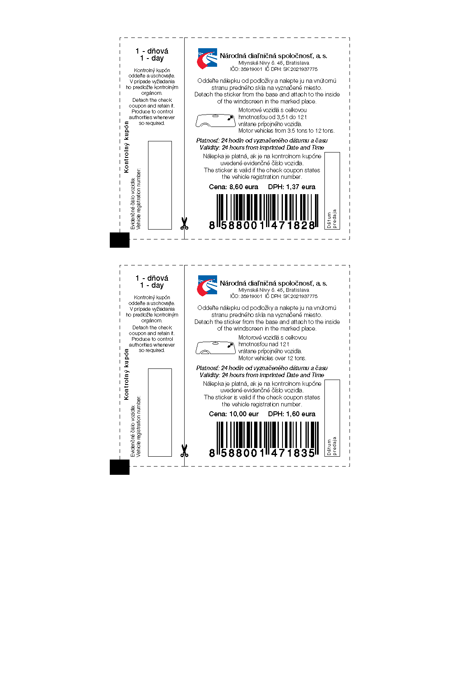

# Čl. I

Vyhláška Ministerstva dopravy, pôšt a telekomunikácií Slovenskej republiky č.734/2004 Z. z., ktorou sa ustanovuje spôsob označenia úsekov diaľnic, ciest pre motorové vozidlá a ciest I. triedy, ktorých užívanie podlieha úhrade, vzor nálepky a spôsob jej umiestnenia na motorovom vozidle v znení vyhlášky č. 645/2005 Z. z., vyhlášky č. 662/2006 Z. z. a vyhlášky č. 603/2007 Z. z. sa mení a dopĺňa takto:

- 1. V § 7 odsek 1 znie:

- „(1)

- Nálepka s ročnou platnosťou a nálepka s deväťmesačnou platnosťou sú platné v čase vyznačenom na zadnej strane nálepky.“.

- 2. Prílohy č. 2 až 5 znejú:

- „Príloha č. 2 k vyhláške č. 734/2004 Z. z.

- VZORY NÁLEPIEK s ročnou platnosťou a s deväťmesačnou platnosťou

- 

- VZORY TEXTOV NA PAPIEROVEJ PODLOŽKE NÁLEPIEK s ročnou platnosťou a s deväťmesačnou platnosťou

- 

- Príloha č. 3 k vyhláške č. 734/2004 Z. z.

- VZORY NÁLEPIEK s mesačnou platnosťou

- 

- VZORY TEXTOV NA PAPIEROVEJ PODLOŽKE NÁLEPIEK s mesačnou platnosťou

- 

- Príloha č. 4 k vyhláške č. 734/2004 Z. z.

- VZORY NÁLEPIEK s týždňovou platnosťou

- 

- VZORY TEXTOV NA PAPIEROVEJ PODLOŽKE NÁLEPIEK s týždňovou platnosťou

- 

- Príloha č. 5 k vyhláške č. 734/2004 Z. z.

- VZORY NÁLEPIEK s jednodňovou platnosťou

- 

- VZORY TEXTOV NA PAPIEROVEJ PODLOŽKE NÁLEPIEK s jednodňovou platnosťou

- 
