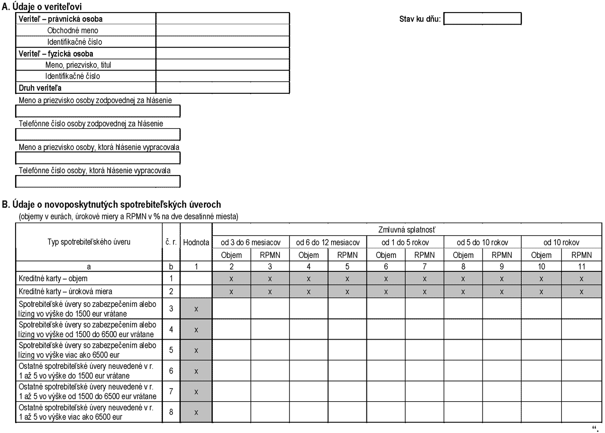

# Čl. I

Vyhláška Ministerstva financií Slovenskej republiky č. 660/2007 Z. z. o predkladaní údajov veriteľmi poskytujúcimi spotrebiteľské úvery sa mení a dopĺňa takto:

- 1. Za § 2 sa vkladá § 2a, ktorý vrátane nadpisu znie:

- 㤠2a

- Prechodné ustanovenie k úpravám účinným od 1. januára 2009

- Hlásenie za štvrtý štvrťrok 2008 sa predkladá podľa prílohy v znení účinnom do 31. decembra 2008.“.

- 2. V prílohe vzor hlásenia o novoposkytnutých spotrebiteľských úveroch znie:

- „VZOR

- Hlásenie o novoposkytnutých úveroch“.

- 

- 3. V prílohe vo vysvetlivkách na vypĺňanie hlásenia o novoposkytnutých spotrebiteľských úveroch prvom bode sa na konci pripájajú tieto slová: „a druh veriteľa v tomto členení:

  - a) banka alebo pobočka zahraničnej banky,3)

  - b) lízingová spoločnosť,4)

  - c) spoločnosť splátkového financovania,5)

  - d) iné spoločnosti poskytujúce spotrebiteľské úvery“.

- Poznámky pod čiarou k odkazom 3 až 5 znejú:

- „3)

- § 2 ods. 1, 5 a 8 zákona č. 483/2001 Z. z. o bankách a o zmene a doplnení niektorých zákonov v znení neskorších predpisov.

- 4)

- § 1 písm. c) opatrenia Národnej banky Slovenska zo 4. novembra 2008 č. 22/2008 o predkladaní výkazov faktoringovými spoločnosťami, spoločnosťami splátkového financovania a lízingovými spoločnosťami na štatistické účely (oznámenie č. 457/2008 Z. z.).

- 5)

- § 1 písm. b) opatrenia zo 4. novembra 2008 č. 22/2008 (oznámenie č. 457/2008 Z. z.).“.

- 4. V prílohe vo vysvetlivkách na vypĺňanie hlásenia o novoposkytnutých spotrebiteľských úveroch tretí bod znie:

- „3.

- Objemy novoposkytnutých spotrebiteľských úverov sa vykazujú v eurách, a to za novoposkytnuté spotrebiteľské úvery, ktoré veriteľ poskytol počas uplynulého kalendárneho štvrťroka. Vykazuje sa celková suma spotrebiteľského úveru dohodnutá v zmluve o spotrebiteľskom úvere, a to bez ohľadu na to, či sa spotrebiteľský úver čerpá naraz alebo po častiach. Spotrebiteľské úvery sa vykazujú neznížené o opravné položky, ktoré k nim boli vytvorené. Spotrebiteľské úvery v cudzej mene sa prepočítajú na eurá podľa referenčného výmenného kurzu určeného a vyhláseného Európskou centrálnou bankou alebo podľa referenčného výmenného kurzu určeného a vyhláseného Národnou bankou Slovenska, ak ide o menu, pre ktorú Európska centrálna banka neurčuje a nevyhlasuje výmenný kurz, platného ku dňu zostavenia hlásenia; Európska centrálna banka a Národná banka Slovenska určujú a vyhlasujú referenčné výmenné kurzy k cudzím menám na základe čl. 111 ods. 1 a 3 Zmluvy o založení Európskeho spoločenstva a čl. 12 ods. 12.1 Protokolu o Štatúte Európskeho systému centrálnych bánk a Európskej centrálnej banky pripojeného k Zmluve o založení Európskeho spoločenstva (Ú. v. EÚ C 321E, 29. 12. 2006) alebo na základe § 28 ods. 2 zákona Národnej rady Slovenskej republiky č. 566/1992 Zb. o Národnej banke Slovenska v znení neskorších predpisov. Pri pohľadávkach z lízingu nie je do objemu novoposkytnutých spotrebiteľských úverov zahrnutá akontácia.“.

- 5. V prílohe vo vysvetlivkách na vypĺňanie hlásenia o novoposkytnutých spotrebiteľských úveroch sa v časti „Použité skratky“ vypúšťajú slová „tis. – tisíc“ a slová „Sk – Slovenská koruna“.
