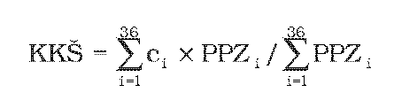

Príloha č. 12 k nariadeniu vlády č. 630/2008 Z. z.

- ČASŤ A

  - Vzorec na výpočet hodnoty koeficientu kvalifikačnej štruktúry pedagogických zamestnancov školy

  - 

  - Vysvetlivky:

  - i – pedagogický zamestnanec zaradený v platovej triede a pracovnej triede s príslušným kreditovým príplatkom

  - ci – koeficient na pedagogického zamestnanca pre príslušnú platovú triedu a pracovnú triedu s príslušným kreditovým príplatkom „i“

  - PPZi – prepočítaný počet pedagogických zamestnancov zaradených v platovej triede a pracovnej triede s príslušným kreditovým príplatkom

- ČASŤ B

  - Koeficienty na výpočet hodnoty koeficientu kvalifikačnej štruktúry pedagogických zamestnancov školy podľa zaradenia pedagogického zamestnanca do platovej triedy a pracovnej triedy s príslušným kreditovým príplatkom

- | Pedagogický zamestnanec podľa platovej triedy a výšky kreditového príplatku | Koeficient pre pracovnú triedu jedna | Koeficient pre pracovnú triedu dva

- 1. | 7. platová trieda bez kreditového príplatku | 0,74 | 0,79

- 2. | 7. platová trieda s kreditovým príplatkom 6 % | 0,78 | 0,84

- 3. | 7. platová trieda s kreditovým príplatkom 12 % | 0,83 | 0,89

- 4. | 8. platová trieda bez kreditového príplatku | 0,82 | 0,87

- 5. | 8. platová trieda s kreditovým príplatkom 6 % | 0,87 | 0,93

- 6. | 8. platová trieda s kreditovým príplatkom 12 % | 0,92 | 0,98

- 7. | 9. platová trieda bez kreditového príplatku | 0,92 | 0,98

- 8. | 9. platová trieda s kreditovým príplatkom 6 % | 0,97 | 1,04

- 9. | 9. platová trieda s kreditovým príplatkom 12 % | 1,03 | 1,10

- 10. | 10. platová trieda bez kreditového príplatku | 1,00 | 1,07

- 11. | 10. platová trieda s kreditovým príplatkom 6 % | 1,06 | 1,13

- 12. | 10. platová trieda s kreditovým príplatkom 12 % | 1,12 | 1,20

- 13. | 11. platová trieda bez kreditového príplatku | 1,12 | 1,20

- 14. | 11. platová trieda s kreditovým príplatkom 6 % | 1,19 | 1,27

- 15. | 11. platová trieda s kreditovým príplatkom 12 % | 1,26 | 1,34

- 16. | 12. platová trieda bez kreditového príplatku | 1,26 | 1,34

- 17. | 12. platová trieda s kreditovým príplatkom 6 % | 1,33 | 1,42

- 18. | 12. platová trieda s kreditovým príplatkom 12 % | 1,41 | 1,50
