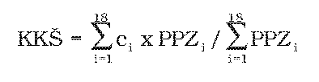

Príloha č. 12 k nariadeniu vlády č. 630/2008 Z. z.

- ČASŤ A

  - VZOREC na výpočet hodnoty koeficientu kvalifikačnej štruktúry pedagogických zamestnancov školy

  - 

  - Vysvetlivky:

  - i – pedagogický zamestnanec zaradený v platovej triede s príslušným kreditovým príplatkom

  - ci – koeficient na pedagogického zamestnanca pre príslušnú platovú triedu s príslušným kreditovým príplatkom „i“

  - PPZi – prepočítaný počet pedagogických zamestnancov zaradených v platovej triede s príslušným kreditovým príplatkom

- ČASŤ B

  - Koeficienty pre výpočet hodnoty koeficientu kvalifikačnej štruktúry pedagogických zamestnancov školy podľa zaradenia pedagogického zamestnanca do platovej triedy s príslušným kreditovým príplatkom

- | Pedagogický zamestnanec podľa platovej triedy a výšky kreditového príplatku | Koeficient

- 1. | 7. platová trieda bez kreditového príplatku | 0,74

- 2. | 7. platová trieda s kreditovým príplatkom 6 % | 0,78

- 3. | 7. platová trieda s kreditovým príplatkom 12 % | 0,83

- 4. | 8. platová trieda bez kreditového príplatku | 0,82

- 5. | 8. platová trieda s kreditovým príplatkom 6 % | 0,87

- 6. | 8. platová trieda s kreditovým príplatkom 12 % | 0,92

- 7. | 9. platová trieda bez kreditového príplatku | 0,92

- 8. | 9. platová trieda s kreditovým príplatkom 6 % | 0,98

- 9. | 9. platová trieda s kreditovým príplatkom 12 % | 1,03

- 10. | 10. platová trieda bez kreditového príplatku | 1

- 11. | 10. platová trieda s kreditovým príplatkom 6 % | 1,06

- 12. | 10. platová trieda s kreditovým príplatkom 12 % | 1,12

- 13. | 11. platová trieda bez kreditového príplatku | 1,07

- 14. | 11. platová trieda s kreditovým príplatkom 6 % | 1,13

- 15. | 11. platová trieda s kreditovým príplatkom 12 % | 1,2

- 16. | 12. platová trieda bez kreditového príplatku | 1,17

- 17. | 12. platová trieda s kreditovým príplatkom 6 % | 1,24

- 18. | 12. platová trieda s kreditovým príplatkom 12 % | 1,31
