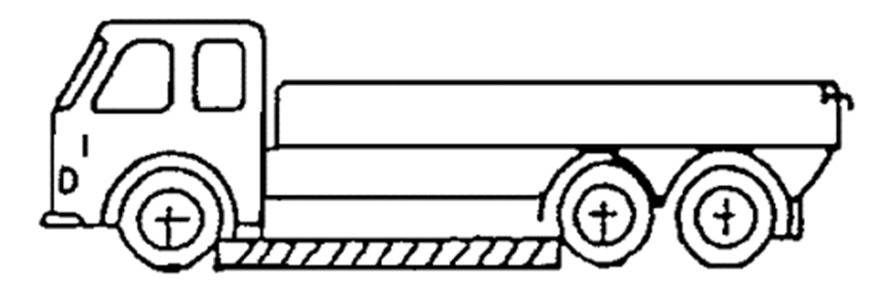
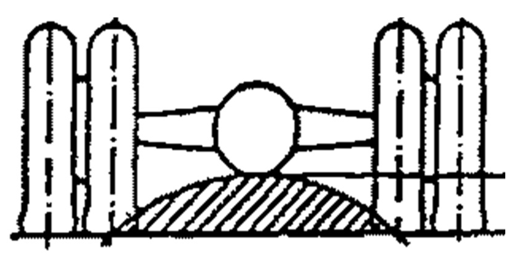

Príloha č. 1 k nariadeniu vlády č. 140/2009 Z. z.

- VYMEDZENIE KATEGÓRIÍ VOZIDIEL A TYPOV VOZIDIEL

  - A. VYMEDZENIE KATEGÓRIE VOZIDLA

    - 1. Kategória M: Motorové vozidlá najmenej so štyrmi kolesami projektované a konštruované na prepravu osôb.

      - a) Kategória M1: Vozidlá projektované a konštruované na prepravu osôb najviac s ôsmimi sedadlami okrem sedadla pre vodiča.

      - b) Kategória M2: Vozidlá projektované a konštruované na prepravu osôb s viac ako ôsmimi sedadlami okrem sedadla pre vodiča a s najväčšou prípustnou celkovou hmotnosťou neprevyšujúcou 5 000 kg.

      - c) Kategória M3: Vozidlá projektované a konštruované na prepravu osôb s viac ako ôsmimi sedadlami okrem sedadla pre vodiča a s najväčšou prípustnou celkovou hmotnosťou prevyšujúcou 5 000 kg.

        - Typy karosérie a kódovanie zodpovedajúce vozidlám kategórie M sú na účel uvedený v tejto časti vymedzené v odseku 1 (vozidlá kategórie M1) a v odseku 2 (vozidlá kategórií M2 a M3) v časti C tejto prílohy.

    - 2. Kategória N: Motorové vozidlá najmenej so štyrmi kolesami projektované a konštruované na prepravu tovaru.

      - Kategória N1: Vozidlá projektované a konštruované na prepravu tovaru s najväčšou prípustnou celkovou hmotnosťou nepresahujúcou 3 500 kg.

        - Kategória N2: Vozidlá projektované a konštruované na prepravu tovaru s najväčšou prípustnou celkovou hmotnosťou prevyšujúcou 3 500 kg, ale neprevyšujúcou 12 000 kg.

        - Kategória N3: Vozidlá projektované a konštruované na prepravu tovaru s najväčšou prípustnou celkovou hmotnosťou prevyšujúcou 12 000 kg.

        - V prípade ťažného vozidla určeného na spojenie s návesom alebo prívesom so stredovou nápravou sa za hmotnosť na účely klasifikácie vozidla považuje hmotnosť ťažného vozidla v prevádzkovom stave zvýšená o hmotnosť zodpovedajúcu najväčšiemu statickému vertikálnemu zaťaženiu prenášanému na ťažné vozidlo návesom alebo prívesom so stredovou nápravou a prípadne o najväčšiu hmotnosť nákladu ťažného vozidla.

        - Typy karosérie a kódovanie zodpovedajúce vozidlám kategórie N sú na účel uvedený v tejto časti vymedzené v odseku 3 v časti C tejto prílohy.

    - 3. Kategória O: Prípojné vozidlá (vrátane návesov)

      - Kategória O1: Prípojné vozidlá s najväčšou prípustnou celkovou hmotnosťou neprevyšujúcou 750 kg.

        - Kategória O2: Prípojné vozidlá s najväčšou prípustnou celkovou hmotnosťou prevyšujúcou 750 kg, ale neprevyšujúcou 3 500 kg.

        - Kategória O3: Prípojné vozidlá s najväčšou prípustnou celkovou hmotnosťou prevyšujúcou 3 500 kg, ale neprevyšujúcou 10 000 kg.

        - Kategória O4: Prípojné vozidlá s najväčšou prípustnou celkovou hmotnosťou prevyšujúcou 10 000 kg.

        - V prípade návesu alebo prívesu so stredovou nápravou sa za najväčšiu hmotnosť na účely klasifikácie prípojného vozidla považuje hmotnosť zodpovedajúca vertikálnemu statickému zaťaženiu prenášanému na vozovku nápravou alebo nápravami plne naloženého návesu alebo prívesu so stredovou nápravou pripojeného k ťažnému vozidlu.

        - Typy karosérie a kódovanie zodpovedajúce vozidlám kategórie O sú na účel uvedený v tejto časti vymedzené v odseku 4 v časti C tejto prílohy.

      - 4. Terénne vozidlá (symbol G)

      - 4.1. Vozidlá kategórie N1 s najväčšou prípustnou celkovou hmotnosťou neprevyšujúcou 2 000 kg a vozidlá kategórie M1 sa považujú za terénne vozidlá, ak majú

        - a) najmenej jednu prednú nápravu a najmenej jednu zadnú nápravu konštruované tak, že môžu byť poháňané súčasne vrátane vozidiel, pri ktorých môže byť vypnutý pohon jednej nápravy,

        - b) najmenej jeden uzáver diferenciálu alebo najmenej jedno zariadenie, ktorým sa dosiahne podobný účinok, a ak vypočítaná stúpavosť vozidla je najmenej 30 %.

          - Okrem toho musí byť splnených aspoň päť z nasledujúcich šiestich požiadaviek:

        - a) predný nájazdový uhol musí byť najmenej 25 stupňov,

        - b) zadný nájazdový uhol musí byť najmenej 20 stupňov,

        - c) prechodový uhol musí byť najmenej 20 stupňov,

        - d) svetlá výška pod prednou nápravou musí byť najmenej 180 mm,

        - e) svetlá výška pod zadnou nápravou musí byť najmenej 180 mm,

        - f) svetlá výška medzi nápravami musí byť najmenej 200 mm.

      - 4.2. Vozidlá kategórie N1 s najväčšou prípustnou celkovou hmotnosťou prevyšujúcou 2 000 kg alebo kategórie N2, M2 alebo M3 s najväčšou prípustnou celkovou hmotnosťou do 12 000 kg sa považujú za terénne vozidlá, ak sú buď všetky ich kolesá poháňané súčasne vrátane vozidiel, ktoré môžu mať vypnutý pohon jednej nápravy, alebo ak sú splnené tieto tri požiadavky:

        - a) najmenej jedna predná náprava a najmenej jedna zadná náprava sú konštruované tak, aby boli poháňané súčasne vrátane vozidiel, pri ktorých môže byť vypnutý pohon jednej nápravy,

        - b) sú vybavené najmenej jedným uzáverom diferenciálu alebo najmenej jedným zariadením s podobným účinkom,

        - c) vypočítaná stúpavosť pre vozidlo je najmenej 25 %.

      - 4.3. Vozidlá kategórie M3 s najväčšou prípustnou celkovou hmotnosťou prevyšujúcou 12 000 kg alebo vozidlá kategórie N3 sa považujú za terénne vozidlá, ak sú buď ich kolesá poháňané súčasne vrátane vozidiel, ktoré môžu mať vypnutý pohon jednej nápravy, alebo ak sú splnené tieto požiadavky:

        - a) najmenej polovica kolies je poháňaná,

        - b) sú vybavené najmenej jedným uzáverom diferenciálu alebo najmenej jedným zariadením s podobným účinkom,

        - c) vypočítaná stúpavosť pre sólo vozidlo je najmenej 25 %.

          - Z týchto šiestich požiadaviek sú splnené najmenej štyri:

        - a) predný nájazdový uhol musí byť najmenej 25 stupňov,

        - b) zadný nájazdový uhol musí byť najmenej 25 stupňov,

        - c) prechodový uhol musí byť najmenej 25 stupňov,

        - d) svetlá výška pod prednou nápravou musí byť najmenej 250 mm,

        - e) svetlá výška pod zadnou nápravou musí byť najmenej 250 mm,

        - f) svetlá výška medzi nápravami musí byť najmenej 300 mm.

      - 4.4. Podmienky zaťaženia a overenia

      - 4.4.1. Vozidlá kategórie N1 s najväčšou prípustnou celkovou hmotnosťou neprevyšujúcou 2 000 kg a vozidlá kategórie M1 musia byť v prevádzkovom stave, t. j. s chladiacou kvapalinou, mazivom, palivom, náradím, náhradným kolesom a vodičom.

      - 4.4.2. Motorové vozidlá iné ako tie, ktoré sú uvedené v bode 4.4.1, musia byť naložené na najväčšiu prípustnú celkovú hmotnosť stanovenú výrobcom.

      - 4.4.3. Požadovaná stúpavosť (25 % a 30 %) sa overí výpočtom. Vo výnimočných prípadoch však môže technická služba požadovať predvedenie vozidla príslušného typu na praktický test.

      - 4.4.4. Pri meraní predného a zadného nájazdového uhla sa berie do úvahy ochranné zariadenie proti podbehnutiu.

      - 4.5. Vymedzenie svetlej výšky

      - 4.5.1. Svetlá výška medzi nápravami je najkratšia vzdialenosť medzi rovinou vozovky a najnižším pevným bodom vozidla. Združené nápravy sa považujú za jedinú nápravu.

      - 

      - 4.5.2. Svetlá výška pod nápravou je vzdialenosť vrcholu kruhového oblúka prechádzajúceho stredom stôp kolies jednej nápravy na vozovke (pri dvojitých kolesách sa rozumejú vnútorné kolesá) a dotýkajúca sa najnižšieho bodu vozidla medzi kolesami od základne.

        - Žiadna pevná časť vozidla nesmie zasahovať do šrafovanej plochy na náčrte. V prípade potreby sa uvádza svetlá výška pod niekoľkými nápravami podľa ich poradia, napríklad 280/250/250.

      - 

      - 4.6. Kombinované označenie

        - Symbol „G“ sa kombinuje so symbolom „M“ alebo „N“. Napríklad vozidlo kategórie N1, ktoré sa môže používať ako terénne vozidlo, sa označí symbolom N1G.

      - 5. Vozidlá na špeciálne účely sú vozidlá určené na vykonávanie funkcie, ktorá si vyžaduje špeciálnu úpravu karosérie a/alebo špeciálne vybavenie. Do tejto kategórie patria vozidlá na prepravu osôb na vozíku pre telesne postihnuté osoby.

      - 5.1. Obytný automobil je vozidlo na špeciálne účely kategórie M konštruované tak, aby umožňovalo ubytovanie osôb, ktoré obsahuje aspoň túto výbavu:

        - a) sedadlá a stôl,

        - b) zariadenie na spanie, ktoré sa môže vytvoriť zo sedadiel,

        - c) zariadenie na varenie a

        - d) skladovacie zariadenia.

          - Toto vybavenie je v obytnom priestore pevne prichytené; stôl však môže byť konštruovaný tak, aby sa dal ľahko odstrániť.

      - 5.2. Pancierové vozidlá sú vozidlá určené na ochranu prepravovaných osôb a/alebo tovaru spĺňajúce požiadavky pancierovania a nepriestrelnosti.

      - 5.3. Sanitné vozidlá sú motorové vozidlá kategórie M určené na prepravu chorých alebo ranených osôb, ktoré sú na tento účel špeciálne vybavené.

      - 5.4. Pohrebné vozidlá sú motorové vozidlá kategórie M určené na prepravu zosnulých osôb, ktoré sú na tento účel špeciálne vybavené.

      - 5.5. Vozidlá na prepravu osôb na vozíku pre telesne postihnuté osoby sú vozidlá kategórie M1, osobitne konštruované alebo upravené tak, aby zodpovedali potrebám jednej osoby alebo viacerých osôb sediacich počas jazdy na svojom vozíku pre telesne postihnuté osoby.

      - 5.6. Obytný príves definovaný podľa normy ISO 3833: 1977, definícia č. 3.2.1.3.

      - 5.7. Samohybný žeriav je vozidlo na špeciálne účely kategórie N3, ktoré nie je zariadené na prepravu tovaru a je vybavené žeriavom, ktorého moment bremena sa rovná 400 kNm alebo je vyšší.

      - 5.8. Ostatné vozidlá na špeciálne účely sú vozidlá vymedzené v bode 5 s výnimkou vozidiel uvedených v bodoch 5.1 až 5.6.

        - Kódovanie zodpovedajúce vozidlám na špeciálne účely je vymedzené v odseku 5 v časti C tejto prílohy a použije sa na účely uvedené v tejto časti.

  - B. VYMEDZENIE TYPU VOZIDLA

    - 1. Na účely kategórie M1

      - Typ tvoria vozidlá, ktoré sa nelíšia aspoň v týchto podstatných znakoch:

      - a) výrobca,

      - b) typové označenie výrobcu,

      - c) dôležité konštrukčné a tvarové znaky:

        - 1. podvozok/podlahová časť (zjavné a základné rozdiely),

        - 2. hnacia jednotka (spaľovací/elektrický/hybridný motor).

      - Variant typu tvoria vozidlá jedného typu, ktoré sa nelíšia aspoň v týchto podstatných znakoch:

      - a) typ karosérie (napríklad sedan, hatchback, kupé, kabriolet, kombi, viacúčelové vozidlo),

      - b) hnacia jednotka:

        - 1. pracovný princíp,

        - 2. počet a usporiadanie valcov,

        - 3. rozdiel výkonu väčší ako 30 % (najvyšší výkon je vyšší ako 1,3-násobok najnižšieho výkonu),

        - 4. rozdiel v objeme valcov väčší ako 20 % (najväčší objem je vyšší ako 1,2-násobok najmenšieho objemu),

      - c) hnacie nápravy (počet, umiestnenie, spojenie),

      - d) riadené nápravy (počet a umiestnenie).

      - Verziu variantu tvoria vozidlá, ktoré sú tvorené povolenými kombináciami bodov uvedených v informačnom zväzku.

      - V rámci jednej verzie sa nesmú kombinovať viacnásobné údaje týchto parametrov:

      - a) najväčšia technicky prípustná hmotnosť v naloženom stave,

      - b) zdvihový objem,

      - c) najväčší výkon motora,

      - d) typ prevodovky a počet prevodových stupňov,

      - e) najväčší počet miest na sedenie.

    - 2. Na účely kategórií M2 a M3

      - Typ tvoria vozidlá, ktoré sa nelíšia aspoň v týchto podstatných znakoch:

      - a) výrobca,

      - b) typové označenie výrobcu,

      - c) kategória,

      - d) dôležité konštrukčné a tvarové znaky:

        - 1. podvozok/samonosná karoséria/jednopodlažný/dvojpodlažný, pevný/kĺbový (zjavné a základné rozdiely),

        - 2. počet náprav,

        - 3. hnacia jednotka (spaľovací/elektrický/hybridný motor).

      - Variant typu tvoria vozidlá jedného typu, ktoré sa nelíšia aspoň v týchto podstatných znakoch:

      - a) trieda vozidla (podľa smernice 2001/85/ES19) - len pre dokončené vozidlá),

      - b) etapa konštrukcie (napríklad dokončené, nedokončené),

      - c) hnacia jednotka:

        - 1. pracovný princíp,

        - 2. počet a usporiadanie valcov,

        - 3. rozdiel výkonu väčší ako 50 % (najvyšší výkon je vyšší ako 1,5-násobok najnižšieho výkonu),

        - 4. rozdiel v objeme valcov väčší ako 50 % (najväčší objem je vyšší ako 1,5-násobok najmenšieho objemu),

        - 5. umiestnenie (vpredu, v strede, vzadu),

      - d) rozdiely technicky prípustnej najväčšej hmotnosti v naloženom stave väčšie ako 20 % (najväčšia hmotnosť je vyššia ako 1,2-násobok najmenšej hmotnosti),

      - e) hnacie nápravy (počet, umiestnenie, spojenie),

      - f) riadené nápravy (počet a umiestnenie).

      - Verziu variantu tvoria vozidlá, ktoré sú tvorené povolenými kombináciami bodov uvedených v informačnom zväzku podľa prílohy VIII smernice.

    - 3. Na účely kategórií N1, N2 a N3

      - Typ tvoria vozidlá, ktoré sa nelíšia aspoň v týchto podstatných znakoch:

      - a) výrobca,

      - b) typové označenie výrobcu,

      - c) kategória,

      - d) dôležité konštrukčné a tvarové znaky:

        - 1. podvozok/podlahová časť (zjavné a základné rozdiely),

        - 2. počet náprav,

        - 3. hnacia jednotka (spaľovací/elektrický/hybridný motor).

      - Variant typu tvoria vozidlá jedného typu, ktoré sa nelíšia aspoň v týchto podstatných znakoch:

      - a) konštrukčná koncepcia karosérie (napríklad valník/sklápač/cisterna/návesový ťahač) (len pre dokončené vozidlá),

      - b) etapa konštrukcie (napríklad dokončené, nedokončené),

      - c) hnacia jednotka:

        - 1. pracovný princíp,

        - 2. počet a usporiadanie valcov,

        - 3. rozdiel výkonu väčší ako 50 % (najvyšší výkon je vyšší ako 1,5-násobok najnižšieho výkonu),

        - 4. rozdiel v objeme valcov väčší ako 50 % (najväčší objem je vyšší ako 1,5-násobok najmenšieho objemu),

      - d) rozdiely technicky prípustnej najväčšej hmotnosti v naloženom stave väčšie ako 20 % (najväčšia hmotnosť je vyššia ako 1,2-násobok najmenšej hmotnosti),

      - e) hnacie nápravy (počet, umiestnenie, spojenie),

      - f) riadené nápravy (počet a umiestnenie).

      - Verziu variantu tvoria vozidlá, ktoré sú tvorené povolenými kombináciami bodov uvedených v informačnom zväzku v súlade s požiadavkami prílohy VIII smernice.

    - 4. Na účely kategórií O1, O2, O3 a O4

      - Typ tvoria vozidlá, ktoré sa nelíšia aspoň v týchto podstatných znakoch:

      - a) výrobca,

      - b) typové označenie výrobcu,

      - c) kategória,

      - d) dôležité konštrukčné a tvarové znaky:

        - 1. podvozok/samonosná karoséria (zjavné a základné rozdiely),

        - 2. počet náprav,

        - 3. ojový príves/náves/príves so stredovou nápravou,

        - 4. typ brzdového systému (napríklad nebrzdený/nájazdový/s posilnením).

      - Variant typu tvoria vozidlá jedného typu, ktoré sa nelíšia aspoň v týchto podstatných znakoch:

      - a) etapa konštrukcie (napríklad dokončené, nedokončené),

      - b) typ karosérie (napríklad obytný príves/valník/cisterna; len pre dokončené/dokončované vozidlá),

      - c) rozdiely technicky prípustnej najväčšej hmotnosti v naloženom stave väčšie ako 20 % (najväčšia hmotnosť je vyššia ako 1,2-násobok najmenšej hmotnosti),

      - d) riadené nápravy (počet a umiestnenie).

      - Verziu variantu tvoria vozidlá, ktoré sú tvorené povolenými kombináciami bodov uvedených v informačnom zväzku.

    - 5. Pre všetky kategórie

      - Úplná identifikácia vozidla len z označenia typu, variantu a verzie sa musí zhodovať s jedinou presnou definíciou všetkých technických charakteristík, ktoré sú potrebné na uvedenie vozidla do prevádzky v premávke.

  - C. VYMEDZENIE TYPOV KAROSÉRIE (len pre dokončené/dokončované vozidlá)

    - Typ karosérie uvedený v prílohe I smernice, v prílohe III smernice časti 1 v bode 9.1. a v prílohe IX smernice v bode 37 sa označí týmito kódmi:

    - 1. Osobné automobily M1

      - AA Sedan podľa normy ISO 3833: 1977, definícia č. 3.1.1.1, ale vrátane vozidiel s viac ako štyrmi bočnými oknami.

      - AB Hatchback Sedan (AA) s dverami v zadnej časti vozidla.

      - AC Kombi podľa normy ISO 3833: 1977, definícia č. 3.1.1.4 (osobné kombi).

      - AD Kupé podľa normy ISO 3833: 1977, definícia č. 3.1.1.5.

      - AE Kabriolet podľa normy ISO 3833: 1977, definícia č. 3.1.1.6.

      - AF Viacúčelové vozidlo – motorové vozidlo iné ako vozidlá uvedené v AA až AE určené na prepravu osôb a ich batožiny v jedinom vnútornom priestore. Ak však také vozidlo spĺňa obidve z nasledujúcich podmienok:

      - i) počet miest na sedenie okrem sedadla pre vodiča nie je väčší ako šesť; miesto na sedenie sa považuje za existujúce, ak je vozidlo vybavené prístupnými ukotveniami sedadiel; prístupné sú také ukotvenia, ktoré sa môžu používať; aby sa zabránilo prístupu k ukotveniam, výrobca fyzicky zamedzí ich použitie napríklad navarením krycej platne alebo namontovaním trvalého pevného zariadenia, ktoré nemožno odstrániť použitím bežne dostupných nástrojov, a

      - ii) P – (M + N 68) > N 68

        - keď

        - technicky prípustná najväčšia hmotnosť v naloženom stave v kg,

        - hmotnosť v prevádzkovom stave v kg,

        - počet miest na sedenie okrem sedadla pre vodiča,

        - toto vozidlo sa nepovažuje za vozidlo kategórie M1.

    - 2. Motorové vozidlá kategórie M2 alebo M3

      - Vozidlá triedy I (podľa smernice 2001/85/ES)

      - CA Jednopodlažné

      - CB Dvojpodlažné

      - CC Kĺbové jednopodlažné

      - CD Kĺbové dvojpodlažné

      - CE Jednopodlažné so zníženou podlahou

      - CF Dvojpodlažné so zníženou podlahou

      - CG Kĺbové jednopodlažné so zníženou podlahou

      - CH Kĺbové dvojpodlažné so zníženou podlahou

      - Vozidlá triedy II (podľa smernice 2001/85/ES)

      - CI Jednopodlažné

      - CJ Dvojpodlažné

      - CK Kĺbové jednopodlažné

      - CL Kĺbové dvojpodlažné

      - CM Jednopodlažné so zníženou podlahou

      - CN Dvojpodlažné so zníženou podlahou

      - CO Kĺbové jednopodlažné so zníženou podlahou

      - CP Kĺbové dvojpodlažné so zníženou podlahou

      - Vozidlá triedy III (podľa smernice 2001/85/ES)

      - CQ Jednopodlažné

      - CR Dvojpodlažné

      - CS Kĺbové jednopodlažné

      - CT Kĺbové dvojpodlažné

      - Vozidlá triedy A (podľa smernice 2001/85/ES)

      - CU Jednopodlažné

      - CV Jednopodlažné so zníženou podlahou

      - Vozidlá triedy B

      - CW Jednopodlažné

    - 3. Motorové vozidlá kategórie N

      - BA Nákladný automobil (podľa bodu 2.1.1 prílohy I smernice 97/27/ES20)

      - BB Dodávkové vozidlo nákladný automobil s kabínou integrovanou do karosérie

      - BC ažné vozidlo návesu (podľa bodu 2.1.1 prílohy I smernice 97/27/ES)

      - BD ažné vozidlo prívesu (ťahač prívesu) (podľa bodu 2.1.1 prílohy I smernice 97/27/ES)

      - Ak však vozidlo definované ako BB s technicky prípustnou najväčšou hmotnosťou neprevyšujúcou 3 500 kg

      - a) má viac ako šesť miest na sedenie okrem sedadla pre vodiča alebo

      - b) spĺňa obidve tieto požiadavky:

        - i) počet miest na sedenie okrem sedadla pre vodiča nie je väčší ako šesť a

        - ii) P – (M + N 68) N 68,

        - toto vozidlo sa nepovažuje za vozidlo kategórie N.

      - Ak však vozidlo definované ako BA, BB s technicky prípustnou najväčšou hmotnosťou nad 3 500 kg alebo

      - BC, alebo BD spĺňa jednu z týchto požiadaviek:

        - i) počet miest na sedenie okrem sedadla pre vodiča nie je väčší ako osem alebo

        - ii) P – (M + N 68) N 68,

        - toto vozidlo sa nepovažuje za vozidlo kategórie N.

    - 4. Vozidlá kategórie O

      - DA Náves (podľa bodu 2.2.2 prílohy I smernice 97/27/ES)

      - DB Ojový príves (podľa bodu 2.2.3 prílohy I smernice 97/27/ES)

      - DC Príves so stredovou nápravou (podľa bodu 2.2.4 prílohy I smernice 97/27/ES)

    - 5. Vozidlá na špeciálne účely

      - SA Obytné automobily (podľa bodu 5.1 prílohy II A smernice)

      - SB Pancierové vozidlá (podľa bodu 5.2 prílohy II A smernice)

      - SC Sanitné vozidlá (podľa bodu 5.3 prílohy II A smernice)

      - SD Pohrebné vozidlá (podľa bodu 5.4 prílohy II A smernice)

      - SE Obytné prívesy (podľa bodu 5.6 prílohy II A smernice)

      - SF Samohybné žeriavy (podľa bodu 5.7 prílohy II A smernice)

      - SG Iné vozidlá na špeciálne účely (podľa bodu 5.8 prílohy II A smernice)

      - SH Vozidlo na prepravu osôb na vozíku pre telesne postihnuté osoby (podľa bodu 5.5 prílohy II A smernice)
