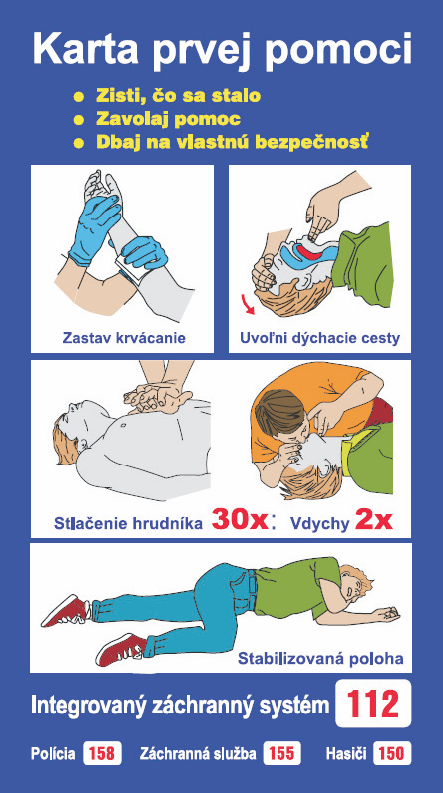

Príloha č. 2 k vyhláške č. 143/2009 Z. z.

- Vzor karty prvej pomoci

  - 1. Predná strana karty prvej pomoci:

  - 

  - 2. Zadná strana karty prvej pomoci:

    - 1. Krvácanie

      - Ranu zakry sterilnou gázou a pevne obviaž obväzom. Ak obväz rýchlo presakuje, stlač rukou, končatinu nadvihni. Pri krvácaní z nosa alebo z úst daj hlavu do polohy na boku!

    - 2. Bezvedomie

      - Zisti, či dýcha. Ak nedýcha, uvoľni mu dýchacie cesty a začni s nepriamou masážou srdca a následne záchrannými dychmi (pozri OBRÁZOK) v pomere 30 : 2. U detí sa začína 5 záchrannými dychmi, následne ako u dospelých. Ak dýcha a nie je podozrenie na poranenie chrbtice a iné vážne poranenia, daj raneného do stabilizovanej polohy.

    - 3. Podozrenie na poranenie chrbtice

      - Ranenému znehybni hlavu, a ak to nie je nevyhnutné, viac ním nehýb.

    - 4. Poranenie hrudníka a brucha

      - Poranenie zakry sterilnou gázou. Zabodnuté predmety nevyťahuj! Zraneného prikry. Nepodávaj mu jesť a piť!

    - 5. Zlomeniny

      - Končatinu nenaprávaj. Znehybni ju pevným materiálom (kĺb nad a pod zlomeninou). Otvorenú zlomeninu prekry sterilnou gázou.

    - 6. Popáleniny

      - Popálených miest sa nikdy nedotýkaj! Prilepené šatstvo z rany neodstraňuj! Postihnuté miesta sterilne prekry.
