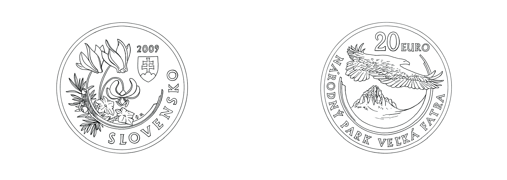

## 177

OZNÁMENIE

Národnej banky Slovenska

z 21. apríla 2009

## o vydaní strieborných zberateľských mincí v nominálnej hodnote 20 eur s tematikou ochrany prírody a krajiny – Národný park Veľká Fatra

1. Úvodné ustanovenia

- a) Národná banka Slovenska podľa § 17h ods. 1 zákona Národnej rady Slovenskej republiky č. 566/1992 Zb. o Národnej banke Slovenska v znení neskorších predpisov a podľa § 1 ods. 2 písm. d) zákona Národnej rady Slovenskej republiky č. 1/1993 Z. z. o Zbierke zákonov Slovenskej republiky v znení zákona č. 275/2002 Z. z. oznamuje, že vydáva do obehu strieborné zberateľské mince v nominálnej hodnote 20 eur s tematikou ochrany prírody a krajiny – Národný park Veľká Fatra (ďalej len „minca“).

- b) Minca má štatút zákonného platidla len v Slovenskej republike.

- c) Minca sa razí zo zliatiny obsahujúcej 925 dielov striebra a 75 dielov medi; jej hmotnosť je 33,63 g a priemer 40 mm. Pri razbe mince je povolená horná a dolná odchýlka v priemere 0,1 mm; povolená horná odchýlka v hmotnosti je 0,4 g a v obsahu striebra 10/1000.

2. Vzhľad mince

- a) Na líci mince je uprostred mincového poľa v kompozícii rastlín vyobrazený cyklámen fatranský, horec Clusiov a tis obyčajný. Vpravo od kompozície rastlín je v hornej časti mince štátny znak Slovenskej republiky, nad ktorým je umiestnený letopočet „2009“. Názov štátu „SLOVENSKO“ je v opise zľava doprava od spodného okraja mince. Značka Mincovne Kremnica, štátny podnik, „MK“, medzi dvoma razidlami a štylizované iniciálky mena a priezviska autora výtvarného návrhu Romana Lugára „LR“ sú umiestnené vpravo od vyobrazenia kvetu horca Clusiovho.

- b) Na rube mince je uprostred mincového poľa kompozícia letiaceho orla skalného a Kráľovej skaly. Označenie nominálnej hodnoty mince „20 EURO“ je umiestnené nad orlom skalným v hornej časti mince. Názov národného parku „NÁRODNÝ PARK VEĽKÁ FATRA“ je v opise zľava doprava od horného okraja mince smerom nadol.

- c) Na hrane mince je reliéfny nápis „OCHRANA PRÍRODY A KRAJINY“. Začiatok a koniec textu je oddelený vyobrazením štylizovaného kvetu.

Štát vydania: Slovenská republika

Začiatok vydávania: jún 2009

Ivan Šramko v. r.
