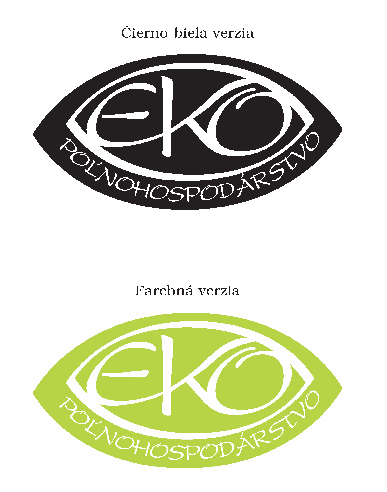

Príloha k zákonu č. 189/2009 Z. z.

- GRAFICKÝ ZNAK EKOLOGICKEJ POĽNOHOSPODÁRSKEJ VÝROBY

  - Značka – opis farieb a písma

- 

  - Použité písmo – President

  - Špecifikácia použitých farieb

  - 1. pre ofset: zelená farba: PANTONE č. 375 CV (CMYK: C-30, M-0, Y-100, K-0)

  - 2. na aplikáciu fólií: zelená farba

  - Pri čierno-bielej alebo jednofarebnej tlači je logo možné používať aj v inej farbe ako definovanej, v pozitívnom alebo negatívnom variante. Podmienkou je dostatočný kontrast medzi pozadím a logom, čo zabezpečuje čitateľnosť a viditeľnosť textu loga.
