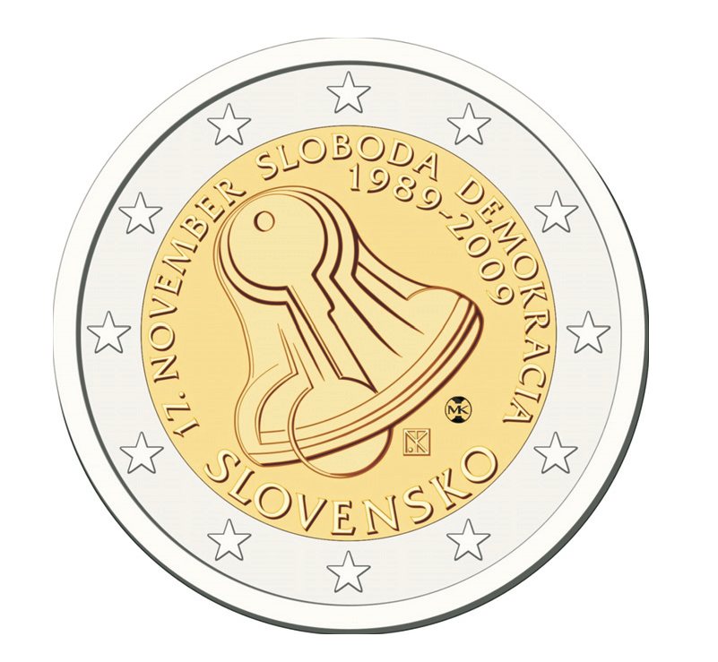

## 254

OZNÁMENIE

Národnej banky Slovenska

z 9. júna 2009

o vydaní pamätných obehových euromincí v nominálnej hodnote 2 eurá pri príležitosti 20. výročia udalostí zo 17. novembra 1989

1. Úvodné ustanovenia

a) Národná banka Slovenska podľa § 17h ods. 1 zákona Národnej rady Slovenskej republiky č. 566/1992 Zb. o Národnej banke Slovenska v znení neskorších predpisov a podľa § 1 ods. 2 písm. d) zákona Národnej rady Slovenskej republiky č. 1/1993 Z. z. o Zbierke zákonov Slovenskej republiky v znení zákona č. 275/2002 Z. z. oznamuje, že vydáva do obehu pamätné obehové euromince v nominálnej hodnote 2 eurá pri príležitosti 20. výročia udalostí zo 17. novembra 1989 (ďalej len „pamätná eurominca“).

b) Pamätná eurominca má rovnaké technické parametre ako obehové euromince1) a na jej národnej strane bude použitý pamätný motív [bod 2 písm. b)].

c) Pamätná eurominca má v celej eurozóne štatút zákonného platidla.

2. Vzhľad pamätnej euromince

- a) Pamätná eurominca sa vydáva s novou spoločnou európskou stranou.2)

- b) Na národnej strane pamätnej euromince je ako symbol slobody a demokracie vyobrazený štylizovaný zvon skomponovaný zo zväzku kľúčov, ktorých zvonenie bolo v revolučnom období po 17. novembri 1989 charakteristickým prejavom nesúhlasu verejnosti s existujúcim komunistickým režimom. V spodnej časti pamätnej euromince je v opise vnútorného kruhu zľava doprava nápis „SLOVENSKO“ a vedľa neho je v opise zľava doprava v dvoch riadkoch text „17. NOVEMBER SLOBODA DEMOKRACIA“ a letopočet „1989 – 2009“. Štylizované iniciálky autora výtvarného návrhu národnej strany pamätnej euromince Pavla Károlyho „PK“ a značka Mincovne Kremnica, štátny podnik, „MK“, medzi dvoma razidlami sú umiestnené v pravej spodnej časti pamätnej euromince. Pri okraji pamätnej euromince je dvanásť do kruhu umiestnených hviezd Európskej únie.

- c) Na hrane pamätnej euromince je nápis „SLOVENSKÁ REPUBLIKA“. Začiatok a koniec nápisu je oddelený dvoma hviezdami, medzi ktorými je lipový list.

Štát vydania: Slovenská republika

Začiatok vydávania: november 2009

Ivan Šramko v. r.
