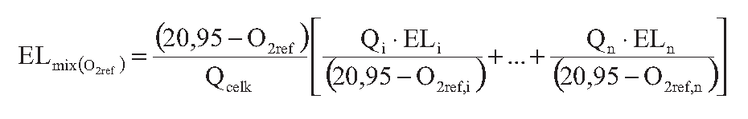
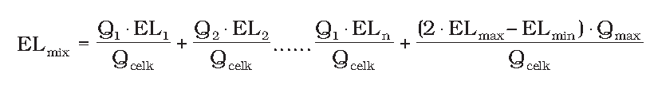
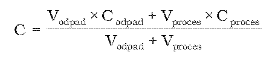

Príloha č. 4 k vyhláške č. 338/2009 Z. z.

- ŠPECIFICKÉ EMISNÉ LIMITY A TECHNICKÉ POŽIADAVKY A VŠEOBECNÉ PODMIENKY PREVÁDZKOVANIA ZDROJOV ZNEČISŤOVANIA

  - I. PALIVOVO-ENERGETICKÝ PRIEMYSEL

    - 1. Technologické celky obsahujúce stacionárne zariadenia na spaľovanie palív (teplárne, elektrárne, výhrevne a zariadenia na nepriamy procesný ohrev)

    - 1.1 Zariadenia na spaľovanie palív

      - Zariadenie na spaľovanie palív je zariadenie, ktoré slúži na oxidáciu palív na účely výroby energie v súlade s vymedzením ustanoveným v bode 1.3.

    - Požiadavky na spaľovacie zariadenia uvedené v bode 1 sa nevzťahujú na

      - a) zariadenia, v ktorých sa produkty spaľovania používajú na priame vykurovanie, sušenie alebo iné tepelné spracovanie materiálov a predmetov (ďalej len „priamy ohrev“),

      - b) koncové spaľovacie zariadenia, t. j. zariadenia, ktoré sú určené na čistenie odpadových plynov spaľovaním, ak nie sú prevádzkované ako samostatné zariadenia na spaľovanie palív,

      - c) zariadenia na regeneráciu katalyzátorov pre katalytické krakovanie,

      - d) zariadenia na premenu sírovodíka na síru,

      - e) reaktory používané v chemickom priemysle okrem zariadení na nepriamy procesný ohrev,

      - f) koksárenské pece,

      - g) ohrievače vetra,

      - h) technické zariadenia používané na pohon vozidiel, lodí a lietadiel,

      - i) plynové turbíny,

      - j) stacionárne piestové motory.

    - 1.2 Členenie zariadení na spaľovanie palív vo vzťahu k uplatňovaniu emisných limitov

    - 1.2.1 Zariadenia zdrojov, pre ktoré bolo vydané stavebné povolenie, alebo ak také nie je, povolenie na užívanie do 30. júna 1987.

    - 1.2.2 Zariadenia zdrojov, pre ktoré bolo vydané stavebné povolenie, alebo ak také nie je, povolenie na užívanie od 1. júla 1987 do 31. marca 1998, alebo bolo vydané stavebné povolenie do 31. marca 1998 a povolenie na užívanie do 31. marca 2001.

    - 1.2.3 Zariadenia zdrojov, pre ktoré bolo vydané stavebné povolenie od 31. marca 2001 do 27. novembra 2002 a ktoré boli uvedené do prevádzky do 27. novembra 2003.

    - 1.2.4 Zariadenia zdrojov, pre ktoré sa začalo konanie o vydanie súhlasu na povolenie od 27. novembra 2002, alebo zariadenia zdrojov, ktoré sú uvedené do prevádzky od 27. novembra 2003.

    - 1.3 Vymedzenie zariadenia na spaľovanie palív pre priradenie emisných limitov

    - 1.3.1 Agregačné pravidlá

    - Ak odpadové plyny z dvoch alebo viacerých samostatných spaľovacích zariadení

      - a) sú vypúšťané cez spoločný komín alebo

      - b) podľa posúdenia orgánu ochrany ovzdušia pri výstavbe zariadenia po zohľadnení technických a ekonomických faktorov mohli by byť odpadové plyny vypúšťané cez spoločný komín,

    - pre priradenie emisných limitov sa zariadenie vymedzuje ako jeden celok v závislosti od celkového menovitého príkonu.

    - 1.3.2 Zariadenie s celkovým menovitým príkonom 50 MW a viac

      - Ak celkový súčet menovitých tepelných príkonov kotlov je 50 MW a viac, pre priradenie emisných limitov sa príkony spočítavajú bez ohľadu na druh spaľovaného paliva.

    - 1.3.3 Zariadenia s celkovým menovitým príkonom od 0,3 MW do 50 MW

      - Ak celkový súčet menovitých tepelných príkonov kotlov je v rozmedzí od 0,3 do 50 MW, pre priradenie emisných limitov sa spočítavajú príkony kotlov spaľujúcich palivo rovnakého typu: tuhé, kvapalné, plynné. Pri viacpalivovom systéme sa pripočítava príkon kotla k ostatným kotlom podľa prevládajúceho paliva. V prípade, že do jedného komína sú zaústené len kotly s viacpalivovým systémom, spočítajú sa ich príkony bez ohľadu na prevládajúce palivo. Osobitne sa spočítavajú príkony kotlov s cirkulujúcou fluidnou a pretlakovou vrstvou a osobitne kotlov s výtavným ohniskom.

    - 1.3.4 Zariadenia s celkovým menovitým príkonom do 0,3 MW

      - Kotly alebo iné technické jednotky na spaľovanie palív s menovitým tepelným príkonom do 0,3 MW sa považujú za samostatné zariadenia a nespočítavajú sa navzájom ani s ostatnými kotlami. Emisné limity podľa I. časti bodu 1.5 sa na ne nevzťahujú.

    - 1.3.5 Zariadenia na núdzovú prevádzku

      - Pre zariadenia na spaľovanie palív s menovitým tepelným príkonom do 50 MW, ktoré sa podľa dokumentácie používajú na núdzovú a inú obdobnú prevádzku, ktorá má trvanie najviac 240 h/rok, sa emisné limity neuplatňujú. Emisie z takýchto zariadení majú zodpovedať požiadavkám podľa technických noriem a iných obdobných špecifikácií, ktoré sa na príslušné zariadenia vzťahujú.

    - 1.3.6 Zariadenia s ukončením prevádzky do 20 000 hodín

      - Sú to zariadenia uvedené v bode 1.2.1, ktoré na základe písomného záväzku prevádzkovateľa predloženého orgánu ochrany ovzdušia do 15. januára 2008 budú v období od 1. januára 2008 do 31. decembra 2015 prevádzkované najviac 20 000 hodín do ukončenia prevádzky. Emisné limity sa na tieto zariadenia neuplatňujú. Správu o počte využitých prevádzkových hodín za uplynulý rok a o počte prevádzkových hodín, ktoré ostávajú do vyčerpania časového limitu tohto zariadenia, prevádzkovateľ predkladá príslušnému orgánu ochrany ovzdušia a Slovenskej inšpekcii životného prostredia každoročne do 15. februára počnúc rokom 2009.

    - 1.3.7 Zariadenia s obmedzeným prevádzkovým režimom

    - Zariadenie s obmedzeným prevádzkovým režimom je zariadenie, ktoré nie je v prevádzke viac ako

      - a) 2 000 hodín ročne do konca roku 2015,

      - b) 1 500 hodín ročne od 1. januára 2016

    - priemerne v období 5 rokov.

    - 1.3.8 Zariadenie na nepriamy procesný ohrev

      - Zariadenie na nepriamy procesný ohrev je zariadenie na spaľovanie palív, ktoré je využívané na technologický ohrev, pričom spalinový prúd je od ďalšej technológie oddelený pevnou teplovýmennou plochou a množstvo a zloženie emisií je závislé len od množstva a zloženia paliva. Pre špecifické technologické pece, kde spôsob spaľovania vplýva na zloženie emisií, napríklad pekárenské cyklotermické pece, téglikové taviace pece a ohrevy taviacich vaní, s celkovým príkonom do 50 MW, emisné limity určí orgán ochrany ovzdušia individuálne.

    - 1.3.9 Uplatňovanie emisných limitov pri rozširovaní kapacity a pri zmenách zariadenia

      - Ak sa kapacita zariadenia na spaľovanie palív rozšíri o menovitý príkon 50 MW a viac, pre novú časť sa uplatňuje emisný limit pre zariadenia uvedené v bode 1.2.4 podľa tepelného príkonu celého zariadenia; to sa nevzťahuje na prípady uvedené v bode 1.3.11. Ak sa na zariadení na spaľovanie palív vykoná podstatná zmena podľa osobitného predpisu,8) na predmetnú časť sa uplatňujú emisné limity pre zariadenia uvedené v bode 1.2.4.

    - 1.3.10 Uplatňovanie emisných limitov pre viacpalivové zariadenia

    - 1.3.10.1 Viacpalivové zariadenie na spaľovanie palív je zariadenie, ktoré môže spaľovať súčasne alebo striedavo dva druhy alebo viac druhov palív.

    - 1.3.10.2 Spaľovanie viacerých druhov palív v jednom zariadení striedavo

      - Pri spaľovaní viacerých druhov palív v jednom spaľovacom zariadení tak, že je spaľovaný vždy len jeden druh paliva, platí emisný limit pre spaľovaný druh paliva.

    - 1.3.10.3 Spaľovanie viacerých druhov palív súčasne v jednom zariadení

      - a) Pri spaľovaní viacerých druhov palív súčasne v jednom zariadení sa emisný limit určí takto:

        - 1. pre každé palivo a danú znečisťujúcu látku sa určí emisný limit zodpovedajúci celkovému menovitému tepelnému príkonu zariadenia,

        - 2. vypočíta sa vážený podiel emisných limitov pre jednotlivé palivá; tieto hodnoty sa získajú vynásobením hodnoty emisného limitu platného pre uvedené palivo menovitým tepelným príkonom dodaným týmto palivom a tento súčin sa vydelí celkovým menovitým príkonom zariadenia,

        - 3. modifikovaný vážený priemer emisných limitov sa určí ako súčet vážených podielov emisných limitov jednotlivých palív po prepočte na zodpovedajúci obsah kyslíka.

      - Postup výpočtu modifikovaného váženého priemeru emisných limitov vyjadruje vzťah:

      - 

        - kde:

        - ELmix(O2ref) – celkový emisný limit,

        - ELi – emisný limit pre dané palivo po prepočte na O2ref, zodpovedajúci celkovému MTP

        - zariadenia,

        - O2 ref – referenčný obsah kyslíka pre prevládajúce palivo podľa príkonu v % objemu,

        - O2 ref,i – referenčný obsah kyslíka pre i-te palivo v % objemu,

        - Qi – tepelný príkon v i-tom palive,

        - Qcelk – celkový tepelný príkon.

      - b) Pre zariadenia s celkovým menovitým tepelným príkonom do 50 MW.

        - Ak podiel tepelného príkonu jedného paliva je 70 % a viac, platí emisný limit podľa prevládajúceho paliva.

    - 1.3.11 Osobitné podmienky spaľovania viacerých druhov palív v jednom zariadení platné v rafinériách

    - 1.3.11.1 Pri spaľovaní destilačných zvyškov alebo zvyškov z konverzie z rafinérskej výroby samostatne alebo v zmesi s inými palivami vo vlastných zariadeniach na spaľovanie palív sa určuje emisný limit podľa určujúceho paliva, t. j. palivo, pre ktoré je určený najvyšší emisný limit, ak tepelný príkon tohto paliva je najmenej 50 % z celkového tepelného príkonu privedeného do zariadenia všetkými palivami.

  - Ak je tepelný príkon určujúceho paliva menší ako 50 %, vypočíta sa emisný limit podľa tohto postupu:

    - a) určí sa emisný limit pre každé palivo a znečisťujúcu látku podľa tepelného príkonu zariadenia,

    - b) vypočíta sa emisný limit pre určujúce palivo, alebo v prípade dvoch palív s rovnakým emisným limitom, pre palivo s najväčším tepelným príkonom; táto hodnota sa získa vynásobením hodnoty emisného limitu platného pre uvedené palivo dvoma a odčítaním hodnoty emisného limitu pre palivo s najnižším emisným limitom,

    - c) vypočíta sa vážený podiel emisných limitov pre jednotlivé palivá; tieto hodnoty sa získajú, keď vypočítanú hodnotu emisného limitu určujúceho paliva vynásobíme príkonom určujúceho paliva a hodnoty emisných limitov ostatných palív vynásobíme príkonom dodaným každým palivom a tieto jednotlivé násobky vydelíme celkovým príkonom,

    - d) modifikovaný vážený priemer emisných limitov sa určí ako súčet vážených podielov emisných limitov jednotlivých palív.

  - Uvedený postup možno vyjadriť nasledovným matematickým vzťahom:

  - 

    - 1.3.11.2 Odchylne od bodu 1.3.11.1 môže orgán ochrany ovzdušia za podmienok, ak nedôjde k celkovému zvýšeniu množstva emisií, upraviť emisný limit pre SO2 takto:

    - a) 1 000 mg/m3 v priemere pre všetky zariadenia na spaľovanie palív uvedené v bodoch 1.2.1 + 1.2.2 + 1.2.3 v rámci jednej rafinérie,

    - b) 600 mg/m3 v priemere pre zariadenia uvedené v bode 1.2.4 v rámci jednej rafinérie s výnimkou plynových turbín.

    - 1.3.12 Zariadenia, pre ktoré sa uplatňujú rôzne emisné limity

      - Ak ide o zariadenie, na ktoré sa vzťahujú rôzne emisné limity z dôvodu rozšírenia alebo zmeny podľa bodu 1.3.9 alebo z dôvodu rôzneho spôsobu spaľovania, emisný limit sa vypočíta podľa bodu 1.3.10.

    - 1.3.13 Uplatňovanie emisných limitov pre zariadenia s celkovým menovitým tepelným príkonom 50 MW a viac, pre ktoré bolo vydané stavebné povolenie do 31. augusta 2009 – prechodné obdobie

      - Pre zariadenia s celkovým menovitým tepelným príkonom 50 MW a viac, pre ktoré bolo vydané stavebné povolenie do 31. augusta 2009, platí vymedzenie zariadenia ustanovené v bode 1.3.2 od 1. júla 2011. Do tohto termínu môžu tieto zariadenia uplatňovať emisné limity podľa vymedzenia v bode 1.3.3 alebo podľa prevládajúceho paliva podľa bodu 1.3.10 písm. b).

    - 1.3.14 Podmienky prevádzkovania zariadení počas mimoriadnych stavov

    - 1.3.14.1 Podmienky prevádzkovania

      - Zariadenie na spaľovanie palív možno prevádzkovať pri výpadku zariadenia na čistenie odpadových plynov najdlhšie 24 hodín, potom treba obmedziť prevádzku, prípadne ju úplne odstaviť. Prevádzkovateľ oznámi výpadok alebo poruchu zariadenia na čistenie odpadových plynov orgánu ochrany ovzdušia a Slovenskej inšpekcii životného prostredia do 48 hodín. Za žiadnych okolností nesmie celkový čas prevádzkovania zariadenia bez odlučovača presiahnuť v akomkoľvek dvanásťmesačnom období 120 hodín.

    - 1.3.14.2 Odchylne od bodu 1.3.14.1 môže orgán ochrany ovzdušia povoliť iný čas,

      - a) ak preváži potreba zabezpečenia dodávky energie,

      - b) ak by bolo odstavené zariadenie na spaľovanie palív na obmedzený čas nahradené iným zariadením, ktorého prevádzka by spôsobila celkové zvýšenie emisií.

    - 1.3.14.3 Pre zariadenie, ktoré spaľuje palivo s takým obsahom síry, že emisný limit sa zabezpečuje bez odsírenia, možno z dôvodu prerušenia dodávky takéhoto paliva pre jeho vážny nedostatok povoliť na obmedzený čas, najviac však na šesť mesiacov, vyššie emisie SO2, ako sú určené emisné limity.

    - 1.3.14.4 Pre zariadenia, ktoré za normálnych podmienok spaľujú výlučne plynné palivo, možno z dôvodu náhleho výpadku dodávky plynu povoliť na obmedzený čas vyššie emisie znečisťujúcich látok, ako sú určené emisné limity, najviac však na desať dní, s výnimkou, ak z dôvodu prevažujúcej potreby prednostnej dodávky energie je nutné spaľovať iné palivo, ktoré si na dodržanie emisných limitov vyžaduje odlučovanie.

    - 1.4 Palivá

      - Palivo je každá tuhá, kvapalná alebo plynná látka používaná na spaľovanie v zariadeniach na spaľovanie palív okrem odpadov a odpadových olejov, na ktoré sa vzťahujú ustanovenia V. časti tejto prílohy. Sú to fosílne palivá a palivá z nich vyrobené, najmä hnedé a čierne palivové uhlie, lignit, rašelina, koks, brikety, nafta, vykurovacie oleje a ťažké ropné frakcie štandardizovanej kvality spaľované v rafinériách ako vlastná produkcia, zemný plyn naftový a skvapalnené uhľovodíkové plyny, ďalej biomasa, bioplyn, prípadne priemyselné plyny, ak zodpovedajú týmto požiadavkám:

      - Biomasa

      - Biomasa používaná ako palivo sú produkty pozostávajúce z rastlinnej hmoty alebo časti rastlinnej hmoty pochádzajúce z poľnohospodárstva alebo lesného hospodárstva, ktoré možno využiť na výrobu energie. Drevný odpad a rastlinný odpad sú tiež biomasou, ak sú uvedené v V. časti bode 1.1.1 písm. b) v bodoch 1 až 5.

      - Zemný plyn

      - Zemný plyn je prírodný metán, ktorý neobsahuje viac ako 20 % objemu inertných plynov alebo iných zložiek.

      - Skvapalnené uhľovodíkové plyny

      - Skvapalnené uhľovodíkové plyny určené na vykurovanie sú zložené z plynných uhľovodíkov a ich zmesí a zodpovedajú požiadavkám noriem.9)

      - Bioplyn

      - Bioplyn je produkt biologickej fermentácie v anaeróbnych podmienkach, napríklad skládkový plyn a kalový plyn a iné druhy.

      - Priemyselné plyny

      - Priemyselné plyny sú plyny uvedené v bode 1.5.3.

    - 1.5 Stacionárne zariadenia na spaľovanie palív so súhrnným menovitým tepelným príkonom 0,3 MW a vyšším

    - 1.5.1 Tuhé palivá

      - A. Emisné limity pre zariadenia uvedené v bodoch 1.2.1 + 1.2.2 + 1.2.3

      - Podmienky platnosti emisných limitov | Štandardné stavové podmienky, suchý plyn, 6 % objemu | | | | |

      - | Spaľovanie biomasy v zariadeniach s MTP < 50 MW: O2 ref: 11 % objemu | | | | |

      - | Emisie CO pre zariadenia s MTP (0,3 – 7) MW vrátane nesmú prekročiť ustanovenú hodnotu hmotnostného toku alebo koncentrácie. | | | | |

      - | Ak vzhľadom na vlastnosti paliva nemožno dosiahnuť emisný limit SO2 vyjadrený ako koncentrácia, uplatňuje sa stupeň odsírenia. | | | | |

      - Menovitý tepelný príkon MTP [MW] | | Emisný limit [mg/m3] | | | |

      - od | do | TZL | SO2 | NOx | CO | TOC1)

      - > 0,3 | < 1 | 250 | 2 5002) | 650 1 2003) | 850 | 100

      - > 1 | < 2,5 | 250 | 2 5002) | 650 1 2003) | 850 | 50

      - > 2,5 | < 7 | 150 fluid:100 | 2 5002) | 650, 1 2003) fluid: 400 | 850 | 50

      - > 7 | < 50 | 150 fluid:100 | 2 5002) | 650, 1 2003) fluid: 400 | 250 | 50

      - ≥ 50 | < 100 | 100 | 2 000, 2001) | 600 1 2003) | 250 | 50

      - ≥100 | < 500 | 100 | 2 000 – 4004) 800,5) 2001) | 600 1 2003) | 250 | 50

      - ≥ 500 | – | 50 1006) | 400, 8005) 2001) | 500, 6007),8) 1 2003) | 250 | 50

      - od 1. januára 2016: | | | | | |

      - 500 | – | 50 1006) | 400, 8005) 2001) | 200, 4508) 1 2003) | 250 | 50

      - | Hmotnostný tok [kg/h] | | | | |

      - ≥ 0,3 | < 7 | | 10 | | 5 |

      - | | Typ zariadenia | Stupeň odsírenia [%] | | |

      - > 2,5 | < 300 | fluid | 85 | | |

      - > 50 | <100 | ostatné zariadenia | 60 | | |

      - > 100 | < 300 | | 75 | | |

      - > 300 | < 500 | | 90 | | |

      - > 500 | – | | 94, 929) | | |

        - 1) Platí pre spaľovanie biomasy.

        - 2) Pre spaľovanie biomasy s MTP L 2,5 MW a emisný limit pre TOC pre zariadenia s MTP L 1 MW, pre ktoré bolo vydané stavebné povolenie do 31. augusta 2009.

        - 3) Platí pre palivá s nižším obsahom VOC ako 10 % hmotnosti, pre zariadenia, ktoré začali prevádzku s takýmto palivom do 31. decembra 2000 s platnosťou do 1. januára 2018.

        - 4) Emisný limit sa vypočíta podľa vzťahu EL = 2 400 – 4 x MTP.

        - 5) Platí pre zariadenia s obmedzeným prevádzkovým režimom s MTP 400 MW.

        - 6) Pre zariadenia uvedené v bode 1.2.1, ktoré spaľujú tuhé palivo s výhrevnosťou nižšou ako 5 800 kJ/kg, s obsahom vody vyšším ako 45 % hmotnosti, s kombinovaným obsahom vody a popola vyšším ako 60 % hmotnosti a s obsahom CaO vyšším ako 10 % hmotnosti.

        - 7) Platí pre zariadenia s MTP = 500 MW.

        - 8) Platí pre zariadenia uvedené v bode 1.2.1 s obmedzeným prevádzkovým režimom.

        - 9) Platí, ak odsírovacie zariadenie bolo uvedené do prevádzky do 31. decembra 2000.

      - B. Emisné limity pre zariadenia uvedené v bode 1.2.4

      - Podmienky platnosti emisných limitov | Štandardné stavové podmienky, suchý plyn, O2ref: 6 % objemu | | | | |

      - | Spaľovanie biomasy v zariadeniach s MTP < 50 MW: O2 ref: 11 % objemu | | | | |

      - | Emisné limity SO2 a CO pre zariadenia s vymedzeným MTP nesmú prekročiť ustanovenú hodnotu hmotnostného toku alebo koncentrácie. | | | | |

      - | Ak vzhľadom na vlastnosti paliva nemožno dosiahnuť určený emisný limit SO2 vyjadrený ako koncentrácia, uplatňuje sa emisný limit vyjadrený ako stupeň odsírenia. | | | | |

      - Menovitý tepelný príkon [MW] | | Emisný limit [mg/m3] | | | |

      - od | do | TZL | SO2 | NOx | CO | TOC1)

      - ≥ 0,3 | < 2,5 | 150, 2503) | 2 5002) | 650 | 850 | 50, 1003)

      - > 2,5 | < 7 | 150, 2503) fluid: 100 | 2 5002) | 650 fluid: 400 | 850 | 50

      - > 7 | < 50 | 150 fluid:100 | 2 5002) | 650 fluid: 400 | 250 | 50

      - ≥ 50 | < 100 | 50 | 850 | 400 | 250 | 50

      - ≥ 100 | < 300 | 30 | 200 | 200, 3001) | 250 | 50

      - ≥ 300 | – | 30 | 200 | 200 | 250 | 50

      - | Hmotnostný tok [kg/h] | | | | |

      - ≥ 0,3 | < 50 | | 10 | | |

      - ≥ 0,3 | ≤ 7 | | | | 5 |

      - | | Stupeň odsírenia [%] | | | |

      - >100 | ≤ 300 | 92 % alebo koncentrácia SO2 ≤ 300 mg/m3 | | | |

      - > 300 | – | 95 % a súčasne koncentrácia SO2 ≤ 400 mg/m3 | | | |

        - 1) Platí len pre spaľovanie biomasy.

        - 2) Pre spaľovanie biomasy s MTP

        - 3) Emisný limit pre TZL pre zariadenia s MTP Ł 2,5 MW a emisný limit pre TOC pre zariadenia s MTP Ł 1 MW, pre ktoré bolo vydané stavebné povolenie do 31. augusta 2009.

      - Emisné limity pre ostatné znečisťujúce látky uvedené v prílohe č. 1

      - Emisné limity pre ostatné znečisťujúce látky sa neurčujú a neuplatňujú sa ani všeobecne platné emisné limity. Pritom však treba využiť dostupné opatrenia s prihliadnutím na primeranosť nákladov na obmedzenie ich emisií.

    - 1.5.2 Kvapalné palivá

      - A. Emisné limity pre zariadenia uvedené v bodoch 1.2.1 + 1.2.2 + 1.2.3

      - Podmienky platnosti emisných limitov | Štandardné stavové podmienky, suchý plyn, O2 ref: 3 % objemu | | | |

      - | Ak sa emisné limity pre TZL dosahujú bez odlučovania, všeobecné emisné limity podľa prílohy č. 3 pre tuhé anorganické znečisťujúce látky zaradené v 2. skupine sa neuplatňujú. | | | |

      - Menovitý tepelný príkon [MW] | | Emisný limit [mg/m3] | | |

      - od | do | TZL | SO2 | NOx | CO

      - ≥ 0,3 | < 7 | 100 | – | 500 | 175

      - > 7 | < 50 | 100 | 1 700 | 450 | 175

      - ≥ 50 | < 300 | 50, 1001) | 1 700 | 450 | 175

      - > 300 | < 500 | 50, 1001) | 1 700 – 4002) | 450 | 175

      - > 500 | – | 50 | 400 | 400 | 175

        - 1) Platí pre zariadenia spaľujúce palivo s obsahom popola > 0,06 % hmotnosti.

        - 2) Emisný limit sa vypočíta podľa vzťahu: EL = 3 650 – 6,5 x MTP.

      - B. Emisné limity pre zariadenia uvedené v bode 1.2.4

      - Podmienky platnosti emisných limitov | Štandardné stavové podmienky, suchý plyn, O2ref: 3 % objemu | | | |

      - | Ak sa emisné limity pre TZL dosahujú bez odlučovania, všeobecné emisné limity podľa prílohy č. 3 pre tuhé anorganické znečisťujúce látky zaradené v 2. skupine sa neuplatňujú. | | | |

      - Menovitý tepelný príkon [MW] | | Emisný limit [mg/m3] | | |

      - od | do | TZL | SO2 | NOx | CO

      - > 0,3 | < 7 | 100 | – | 500 | 175

      - > 7 | < 50 | 100 | 1 700 | 450 | 175

      - > 50 | | 50 | 850 | 400 | 175

      - > 100 | < 300 | 30 | 400 – 2001) | 200 | 175

      - > 300 | – | 30 | 200 | 200 | 175

        - 1) Emisný limit sa vypočíta podľa vzťahu EL = 500 – 1 x MTP.

      - C. Všeobecná podmienka prevádzkovania

        - V zariadeniach na spaľovanie kvapalných palív s príkonom (0,3 – 7) MW vrátane sa nesmie spaľovať palivo s obsahom síry vyšším ako 1 % hmotnosti.

    - 1.5.3 Plynné palivá

      - A. Emisné limity pre zariadenia uvedené v bodoch 1.2.1 + 1.2.2 + 1.2.3

      - Podmienky platnosti emisných limitov | Štandardné stavové podmienky, suchý plyn, O2 ref: 3 % objemu | | | | |

      - Druh paliva | Menovitý tepelný príkon [MW] | | Emisný limit [mg/m3] | | |

      - | od | do | TZL | SO2 | NOx | CO

      - Všeobecne | ≥ 0,3 | 50 | 51) | 351) | 200 | 100

      - | ≥ 50 | – | 5 | 35 | 200 | 100

      - Skvapalnené uhľovodíkové plyny | ≥ 0,3 | < 50 | 51) | 351) | 300 | 100

      - | ≥ 50 | – | 5 | 5 | 300 | 100

      - Rafinérske plyny | ≥ 0,3 | – | 5 | 100 | 200 | 100

      - Priemyselné plyny | ≥ 0,3 | – | všeobecne: 5 vysokopecný plyn: 10 plyny z výroby ocele: 50 | všeobecne: 35 8002) | 200 | 100

        - 1) Pre zariadenia, ktoré spaľujú zemný plyn z verejnej distribučnej siete alebo skvapalnené uhľovodíkové plyny, sa emisný limit pre TZL a SO2 neurčuje a neuplatňujú sa ani všeobecné emisné limity.

        - 2) Platí pre nízkovýhrevné priemyselné plyny, napríklad nízkokalorický plyn zo splynovania rafinérskych zvyškov, vysokopecný plyn, koksárenský plyn a ich zmesi.

      - B. Emisné limity pre zariadenia uvedené v bode 1.2.4

      - Podmienky platnosti emisných limitov | Štandardné stavové podmienky, suchý plyn, O2 ref: 3 % objemu | | | | |

      - Druh paliva | Menovitý tepelný príkon [MW] | | Emisný limit [mg/m3] | | |

      - | od | do | TZL | SO2 | NOx | CO

      - Všeobecne | > 0,3 | – | 5 | 35 | 200 | 100

      - Zemný plyn | ≥ 0,3 | < 50 | 51) | 351) | 200 | 100

      - | ≥ 50 | < 300 | 5 | 35 | 150 | 100

      - | > 300 | – | 5 | 35 | 100 | 100

      - Skvapalnené uhľovodíkové plyny | ≥ 0,3 | < 50 | 51) | 51) | 300 | 100

      - | ≥ 50 | – | 5 | 5 | 200 | 100

      - Rafinérske plyny | ≥ 0,3 | < 50 | 5 | 100 | 200 | 100

      - | ≥ 50 | – | 5 | 35 | 200 | 100

      - Priemyselné plyny2) | ≥ 0,3 | < 50 | všeobecne: 5 vysokopecný plyn: 10 plyny z výroby ocele: 30 | všeobecne: 35 8003) | 200 | 100

      - | > 50 | – | | všeobecne: 35 koksárenský plyn3): 400 vysokepecné plyny3): 200 | 200 | 100

        - 1) Pre zariadenia, ktoré spaľujú zemný plyn z verejnej distribučnej siete alebo skvapalnené uhľovodíkové plyny, sa emisný limit pre TZL a SO2 neurčuje a neuplatňuje sa ani všeobecný emisný limit.

        - 2) Napríklad vysokopecný, koksárenský, kalový plyn a ich zmesi.

        - 3) Nízkovýhrevné priemyselné plyny.

    - 1.5.4 Kombinovaná výroba tepla a elektriny

      - Pri príprave výstavby zariadení uvedených v bode 1.2.4 alebo pri rozširovaní zariadení uvedených v bodoch 1.2.1 až 1.2.3 podľa bodu 1.3.7 treba preskúmať technické a ekonomické podmienky kombinovanej výroby tepla a elektriny. Ak sa ukážu trhové a distribučné možnosti, treba kombinovanú výrobu tepla a elektriny realizovať.

    - 1.6 ZARIADENIA S MENOVITÝM TEPELNÝM PRÍKONOM NIŽŠÍM AKO 0,3 MW

      - 1. Všeobecná podmienka prevádzkovania

        - a) Spaľovanie uhlia

          - V zariadeniach na spaľovanie tuhých palív sa môže spaľovať len palivo, ktoré spĺňa požiadavky na kvalitu palív podľa osobitného predpisu.10)

        - b) Spaľovanie biomasy

          - V kotloch s menovitým tepelným príkonom do 0,3 MW sa môže spaľovať len čisté nekontaminované prírodné drevo mechanicky upravené podľa požiadaviek výrobcu kotla, napríklad kusové drevo, brikety, štiepky, pelety, prípadne iná prírodná biomasa upravená na palivo podľa požiadaviek výrobcu kotla, napríklad slama, trstina.

        - c) Spaľovanie kvapalných palív

          - V zariadeniach na spaľovanie kvapalných palív sa môže spaľovať len palivo, ktoré spĺňa požiadavku na kvalitu palív podľa osobitného predpisu.10)

      - 2. Požiadavky na tmavosť dymu

      - Druh paliva | Prevádzkový stav | Emisný limit | Doba

      - Tuhé palivo | Bežná prevádzka | 2. stupeň podľa Ringelmana |

      - | Rozkurovanie zo studeného stavu | 3.stupeň podľa Ringelmana alebo 60 % opacity | najviac 3 hodiny

      - | Odstavovanie | | najviac 30 minút

      - Kvapalné palivo | Bežná prevádzka | 4. stupeň podľa Bacharacha pre žiaden z troch po sebe idúcich testoch a súčasne 3. stupeň podľa Bacharacha pre dva z troch po sebe idúcich testov |

      - | Rozkurovanie | – |

    - 2. PLYNOVÉ TURBÍNY

    - 2.1 Plynová turbína je rotujúci stroj, ktorý premieňa tepelnú energiu na mechanickú prácu, a jej hlavnými strojnotechnologickými prvkami sú kompresor, spaľovacia komora, v ktorej sa palivo spaľuje na vyhriatie pracovného média, a turbína.

    - 2.2 Emisný limit pre znečisťujúce látky

      - A. Zariadenie, pre ktoré sa začalo konanie o vydanie súhlasu na povolenie stavby do 27. novembra 2002 alebo ktoré je uvedené do prevádzky do 27. novembra 2003

      - Podmienky platnosti emisných limitov | Štandardné stavové podmienky, suchý plyn, O2ref: 15 % objemu | | | |

      - | Tepelný príkon, účinnosť, základné zaťaženie plynových turbín sa uplatňuje podľa ISO normy. | | | |

      - | Emisné limity platia pre jednotlivé turbíny pri základnom zaťažení vyššom ako 70 %. | | | |

      - | Emisné limity neplatia pre plynové turbíny používané výlučne na núdzovú prevádzku do 500 h/rok. | | | |

      - Menovitý tepelný príkon alebo objemový tok spalín | Druh paliva | Emisný limit | | |

      - | | Tmavosť dymu [stupne Bacharacha] | | Koncentrácia [mg/m3] |

      - | | TZL1) | SO22) | NOx | CO

      - < 20MW alebo < 60 000 m3/h | plynné | – | – | 3503) | 100

      - | kvapalné | všetky stavy: 4. st. | 600 1 7004) | 3503) | 100

      - ≥ 20 MW alebo ≥ 60 000 m3/h | plynné | – | – | 3003) | 100

      - | kvapalné | trvalá prevádzka: 2. st. nábeh: 3. st. | 600 1 7004) | 3003) | 100

        - 1) Emisný limit pre TZL ustanovený pre nábeh sa preukazuje v intervale ustanovenom osobitným predpisom5) len vtedy, ak sa v tomto intervale nábeh uskutočňuje.

        - 2) Pri spaľovaní plynového oleja alebo motorovej nafty s obsahom síry do 0,1 % hmotnosti sa emisný limit pre SO2 neuplatňuje.

        - 3) Emisné limity platia pre jednotlivé plynové turbíny s tepelnou účinnosťou do 30 % vrátane. Pre plynové turbíny s účinnosťou viac ako 30 % sa emisný limit koriguje vynásobením hodnotou podielu h/30, kde h je skutočná účinnosť v %.

        - 4) Platí pre turbíny, ktoré boli uvedené do prevádzky do 31. marca 1998 alebo pre ktoré bolo vydané stavebné povolenie alebo obdobné povolenie do 31. marca 1998 a ktoré boli uvedené do prevádzky do 31. marca 2001.

      - B. Zariadenie, pre ktoré sa začalo konanie o vydanie súhlasu na povolenie stavby od 27. novembra 2002 alebo ktoré je uvedené do prevádzky od 27. novembra 2003

      - Podmienky platnosti emisných limitov | | Štandardné stavové podmienky, suchý plyn, O2 ref: 15 % objemu | | |

      - | | Tepelný príkon, účinnosť, základné zaťaženie plynových turbín sa uplatňuje podľa ISO normy. | | |

      - | | Emisné limity platia pre jednotlivé turbíny pri základnom zaťažení vyššom ako 70 %. | | |

      - | | Emisné limity neplatia pre plynové turbíny používané výlučne na núdzovú prevádzku do 500 h/rok. | | |

      - Menovitý tepelný príkon [MW] | Druh paliva | Emisný limit | | |

      - | | Tmavosť dymu [stupne Bacharacha] | Koncentrácia [mg/m3] | |

      - | | TZL | SO2 | NOx | CO

      - < 20 | plynné | – | – | 1503) | 100

      - | kvapalné | všetky stavy: 4. st. | 6002) | 2003) | 100

      - 20 – 50 | plynné | – | – | 1503) | 100

      - | kvapalné | trvalá prevádzka: 2. st. nábeh: 3. st .1) | 6002) | 2003) | 100

      - > 50 | zemný plyn | – | 354) | 50, 755) | 100

      - | iné plynné | – | 5,6) 2007) 4008) | 120 | 100

      - | kvapalné | trvalá prevádzka: 2. st. nábeh: 3. st.1) | 6002) | 1209) | 100

        - 1) Emisný limit pre TZL ustanovený pre nábeh sa preukazuje v intervale ustanovenom osobitným predpisom5) len vtedy, ak sa v tomto intervale nábeh uskutočňuje.

        - 2) Pri spaľovaní plynového oleja alebo motorovej nafty s obsahom síry do 0,1 % hmotnosti sa emisný limit pre SO2 neuplatňuje.

        - 3) Emisné limity platia pre jednotlivé plynové turbíny s tepelnou účinnosťou do 30 % vrátane. Pre plynové turbíny s účinnosťou viac ako 30 % sa emisný limit koriguje vynásobením hodnotou podielu h/30, kde h je skutočná účinnosť v % .

        - 4) Pre zariadenia postavené do 31. augusta 2009 sa emisný limit pre SO2 do 30. júna 2011 neuplatňuje.

        - 5) Emisný limit 75 mg/m3 platí pre plynové turbíny použité

        - – v kombinovanej výrobe tepla a elektriny s celkovou účinnosťou viac ako 75 %,

        - – v zariadeniach s kombinovanými cyklami s celkovou elektrickou účinnosťou viac ako 55 % v ročnom priemere,

        - – na mechanický pohon.

        - Pre jednostupňové plynové turbíny, ktoré nepatria do žiadnej z uvedených kategórií a ktoré majú účinnosť vyššiu ako 35 % – pri základnom zaťažení určenom podľa podmienok ISO, sa emisný limit vypočíta podľa vzťahu:

        - EL = 50 x h/35,

        - kde h je účinnosť plynovej turbíny v % pri základnom zaťažení podľa ISO.

        - 6) Platí pre skvapalnené uhľovodíkové plyny. Pre zariadenia postavené do 31. augusta 2009 sa emisný limit pre SO2 do 30. júna 2011 neuplatňuje.

        - 7) Platí pre nízkovýhrevné vysokopecné plyny. Pre zariadenia postavené do 31. augusta 2009 sa emisný limit pre SO2 do 30. júna 2011 neuplatňuje.

        - 8) Platí pre nízkovýhrevné koksárenské plyny. Pre zariadenia postavené do 31. augusta 2009 sa emisný limit pre SO2 do 30. júna 2011 neuplatňuje.

        - 9) Emisný limit platí pre plynový olej a motorovú naftu.

    - 2.3 Integrácia kotla s plynovou turbínou

      - V prípade zaradenia spalinového kotla za plynovú turbínu platia emisné limity a podmienky ich platnosti ako pre plynové turbíny. V prípade prikurovania spalinového kotla sa počíta emisný limit ako vážený priemer emisného limitu pre plynovú turbínu a spalinový kotol podľa vzťahu uvedeného v bode 1.3.9.

    - 3. STACIONÁRNE PIESTOVÉ SPAĽOVACIE MOTORY

    - 3.1 Všeobecné podmienky prevádzkovania – obmedzenie obsahu síry v palive

      - V stacionárnych spaľovacích motoroch možno spaľovať len plynné palivá a kvapalné palivá s obsahom síry najviac 0,1 % hmotnosti.

    - 3.2 Emisné limity

      - A. Emisné limity pre jestvujúce zdroje

      - Podmienky platnosti emisného limitu | | | | Štandardné stavové podmienky, suchý plyn, O2 ref: 5 % objemu | |

      - | | | | Emisné limity neplatia pre zariadenia používané výlučne na núdzovú prevádzku do 500 h/rok. | |

      - Typ motora | | Menovitý tepelný príkon [MW] | | Emisný limit [mg/m3] | |

      - | | od | do | TZL | NOx | CO

      - Vznetové motory | všetky | > 0,3 | < 3 | 1301) | 4 000 | 650

      - | všetky | > 3 | – | 1301) | 2 000 | 650

      - Ostatné motory, napríklad zážihové | štvortaktné | > 0,3 | – | | 500 | 650

      - | dvojtaktné | > 0,3 | – | | 800 | 650, 1 3002)

        - 1) Platí pre spaľovanie kvapalných palív.

        - 2) Platí pre spaľovanie bioplynu.

      - B. Emisné limity pre nové zdroje

      - Podmienky platnosti emisného limitu | | | | Štandardné stavové podmienky, suchý plyn, O2 ref: 5 % objemu | |

      - | | | | Emisné limity neplatia pre zariadenia používané výlučne na núdzovú prevádzku do 500 h/rok. | |

      - Typ motora | | Menovitý tepelný príkon [MW] | | Emisný limit [mg/m3] | |

      - | | od | do | TZL | NOx | CO

      - Vznetové motory | všetky | > 0,3 | < 3 | 1301) | 1 000 | 650

      - | všetky | > 3 | – | 202) | 500 | 650

      - Ostatné motory, napríklad zážihové | štvortaktné | > 0,3 | – | 1301) | 500 | 650

      - | dvojtaktné | > 0,3 | – | 1301) | 800 | 650, 1 3003)

        - 1) Platí pre spaľovanie kvapalných palív a bioplynu.

        - 2) Platí pre spaľovanie kvapalných palív.

        - 3) Platí pre spaľovanie bioplynu.

    - 4. ZARIADENIA NA SUŠENIE ALEBO INÉ TEPELNÉ ÚPRAVY, PRI KTORÝCH DOCHÁDZA K PRIAMEMU STYKU SPALÍN ALEBO PLAMEŇA S OHRIEVANÝM MÉDIOM

    - 4.1 Platnosť všeobecných podmienok prevádzkovania a emisných limitov

      - Všeobecné podmienky prevádzkovania podľa bodu 4.2 a emisné limity podľa bodu 4.3 platia pre všetky kategórie zdrojov, ak nie je ďalej v tejto prílohe ustanovené inak.

    - 4.2 Všeobecné podmienky prevádzkovania pre nové zdroje

      - V zariadeniach na sušenie alebo na iné tepelné úpravy možno spaľovať len plynné palivá, skvapalnené uhľovodíkové plyny, kvapalné palivá s obsahom síry najviac 1 % hmotnosti alebo tuhé palivá s mernou sírnatosťou najviac 0,5 g/MJ.

    - 4.3 Emisné limity

      - Ak ide o zariadenie na sušenie alebo iné tepelné úpravy, uplatňujú sa emisné limity pre znečisťujúce látky, ktorých emisie závisia len od paliva a od spôsobu spaľovania, ktoré platia pre príslušné zariadenie na spaľovanie palív podľa menovitého tepelného príkonu zariadenia a druhu paliva, pri štandardných podmienkach po prepočte na suchý plyn a referenčný obsah kyslíka 17 % objemu, ak nie je pre predmetnú technológiu ustanovené inak.

    - 5. TRIEDENIE A ÚPRAVA UHLIA, BRIKETÁRNE

    - 5.1 Emisné limity pre nové zdroje

    - Podmienky platnosti emisných limitov | Štandardné stavové podmienky, – triedenie uhlia: suchý plyn – tepelná úprava: vlhký plyn |

    - Technologický uzol | Emisný limit [mg/m3] |

    - | TZL | TOC

    - Triedenie a iná studená úprava uhlia | 100 |

    - Tepelná úprava uhlia (briketárne, nízkoteplotná karbonizácia, sušenie) | 100 | 50

    - 6. VÝROBA KOKSU

    - 6.1 Technické požiadavky a všeobecné podmienky prevádzkovania

    - 6.1.1 Vykurovanie koksárenských batérií

      - Koncentrácia H2S vo vykurovacom plyne nesmie prekročiť hodnotu 500 mg/m3.

    - 6.1.2 Príprava koksárenskej vsádzky

      - Emisie TZL zo všetkých zariadení a miest vzniku sa musia podľa technických možností s prihliadnutím na primeranosť nákladov obmedziť, napríklad odsávaním, odprašovaním, hermetizáciou.

    - 6.1.3 Plnenie koksovacích komôr

      - a) Plniace plyny treba zaviesť do technologického plynu alebo do inej koksovacej komory, ak je taký odvod s ohľadom na ďalšie spracovanie surového dechtu možný. V opačnom prípade sa musia spaľovať.

      - b) Všetky otvory koksárenských batérií musia byť utesnené tak, aby v uzavretom stave pri vizuálnej kontrole podiel dymiacich otvorov oproti celkovému počtu otvorov na koksovacej batérii nebol vyšší ako 10 %.

    - 6.1.4 Vytláčanie koksu

      - Vytláčať možno len úplne skoksovanú vsádzku. Pri vytláčaní koksu sa musia odpadové plyny odviesť do odprašovacieho zariadenia.

    - 6.1.5 Chladenie koksu

      - Pri chladení koksu treba zaviesť procesy s nízkymi emisiami TZL, napríklad suché chladenie koksu.

    - 6.1.6 Triediarne koksu

      - Zariadenia na drvenie a triedenie koksu sa musia odsávať a odprašovať.

    - 6.1.7 Chemické prevádzky koksární

      - a) Zariadenia chemických prevádzok musia byť zabezpečené proti únikom prchavých látok do ovzdušia.

      - b) Odpadové vody z priameho chladenia plynu nesmú byť v priamom styku s ovzduším.

      - c) Koksárenský plyn na výstupe z chemických prevádzok môže obsahovať najviac 500 mg/m3 H2S.

      - d) Koksárenský plyn sa nesmie priamo vypúšťať do ovzdušia.

    - 6.2 Technické požiadavky a všeobecné podmienky prevádzkovania pre zdroje povolené do 31. marca 1998 a uvedené do prevádzky do 31. marca 2001

      - Technické požiadavky a všeobecné podmienky prevádzkovania pre uvedené zdroje podľa bodu 6.1.5 budú platiť od 1. januára 2015 a podľa bodov 6.1.1, 6.1.7 písm. b) a 6.1.7 písm. c) budú platiť od 1. januára 2011.

    - 6.3 Emisné limity

    - Podmienky platnosti emisných limitov | | Štandardné stavové podmienky, – TZL: suchý plyn, – NOx: suchý plyn, O2 ref: 5 % objemu |

    - Technologická časť | | Emisný limit [mg/m3] |

    - | | TZL | NOx

    - Príprava koksárenskej vsádzky | | 50 |

    - Plnenie koksovacích komôr – odplyny zo spaľovania plniacich plynov | | 50 |

    - Triediarne koksu | | 50 |

    - | | Tmavosť dymu |

    - Ohrev koksárenských batérií – dym z koksárenskej batérie | | 2. stupeň1) | 500

    - | | Limitný emisný faktor TZL |

    - Vytláčanie koksu – celkové emisie | | 0,035 kg/t koksu2) |

    - Chladenie koksu | – suché chladenie | 0,02 kg/t koksu2) |

    - | – mokré chladenie | 0,1 kg/t koksu3) |

      - 1) Ringelmanovej stupnice.

      - 2) Platí v mesačnom priemere.

      - 3) Platí v ročnom priemere.

  - II. VÝROBA A SPRACOVANIE KOVOV A POVRCHOVÁ ÚPRAVA KOVOV

    - 1. ÚPRAVA ŽELEZNEJ RUDY

      - Príprava vsádzky pre aglomeráciu, aglomerácia, chladenie, drvenie, triedenie a manipulácia s aglomerátom.

    - 1.1 Technické požiadavky a všeobecné podmienky prevádzkovania

      - Emisie TZL zo všetkých zariadení a miest vzniku sa musia podľa technických možností s prihliadnutím na primeranosť nákladov obmedziť, napríklad odsávaním, odprašovaním, hermetizáciou.

    - 1.2 Emisné limity

      - A. Emisné limity pre jestvujúce zdroje

      - Podmienky platnosti emisných limitov | Štandardné stavové podmienky – pre aglomeráciu, praženie a peletizáciu: suchý plyn O2ref: 19 % objemu – ostatné časti: suchý plyn | | | |

      - | Magnetizačné praženie rúd a ich peletizácia v rotačných peciach: Ak nemožno dosiahnuť hodnotu emisného limitu vyjadreného ako koncentrácia bez odsírenia, platí stupeň odsírenia. | | | |

      - Časť zdroja | Emisný limit [mg/m3] | | | |

      - | TZL | SOx | NOx | CO | Hg1)

      - Príprava vsádzky pre aglomeráciu | 50 | | | |

      - Aglomerácia | 100 | 400 1 0002) | 400 | 6 000 8 0003) | 1

      - Magnetizačné praženie rúd a ich peletizácia v rotačných peciach | 100 | 2 500 | | |

      - Manipulácia s pražencom: drvenie, mletie, triedenie chladenie | 50 100 | | | |

      - | Stupeň odsírenia | | | |

      - Aglomerácia a peletizácia | 40 % | | | |

        - 1) Platí aj pre Hg v plynnom skupenstve.

        - 2) Platí pri spracovaní sulfidických rúd.

        - 3) Platí pri spracovaní karbonátových rúd.

      - B. Emisné limity pre nové zdroje

      - Podmienky platnosti emisných limitov | Štandardné stavové podmienky, suchý plyn – pre aglomeráciu, praženie a peletizáciu: suchý plyn, O2ref: 19 % objemu – ostatné časti: suchý plyn | | | |

      - | Peletizácia: Ak nemožno hodnotu emisného limitu vyjadreného ako koncentrácia SO2 dosiahnuť bez odsírenia, platí stupeň odsírenia. | | | |

      - Časť zdroja | Emisný limit [mg/m3] | | | |

      - | TZL | SOx | NOx | CO | Hg

      - Príprava vsádzky pre aglomeráciu | 50 | | | |

      - Aglomerácia | 100 501) | 400 1 0002) | 400 | 6 000 8 0003) | 1

      - Peletizácia vrátane magnetizačného praženia | 100 251) | 2 500 | | |

      - Manipulácia s pražencom: drvenie, mletie, triedenie a sušenie | 50, 251) | | | |

      - | Limitný emisný faktor TZL | | | |

      - Peletizácia vrátane triedenia, drvenia, sušenia | 40 g/t vyrobených peliet | | | |

      - | Stupeň odsírenia | | | |

      - Peletizácia | 40 % | | | |

        - 1) Platí pre zariadenia s kapacitou:

        - > 150 t/deň aglomerátu pre železnú rudu alebo koncentrát,

        - > 30 t/deň aglomerátu pre praženie rudy s obsahom Cu, Pb alebo Zn alebo pre akékoľvek spracovanie rudy s obsahom Au a Hg.

        - 2) Platí pri spracovaní sulfidických rúd.

        - 3) Platí pri spracovaní karbonátových rúd.

    - 2. VÝROBA SUROVÉHO ŽELEZA, VYSOKÉ PECE

      - Tento bod zahŕňa požiadavky na výrobu železa z prvotných alebo druhotných surovín vrátane kontinuálneho liatia.

    - 2.1 Technické požiadavky a všeobecné podmienky prevádzkovania

    - 2.1.1 Emisie TZL zo všetkých zariadení a miest vzniku je potrebné podľa technických možností a s prihliadnutím na primeranosť nákladov obmedziť, napríklad odsávaním, odprašovaním, hermetizáciou zariadenia.

    - 2.1.2 Nové zdroje: vysokopecné plyny musia byť energeticky využívané. Ak využívanie vysokopecných plynov nie je možné z dôvodu bezpečnosti, ako aj v núdzových prípadoch, musia byť odvedené na poľný horák.

    - 2.2 Emisné limity

      - A. Emisné limity pre jestvujúce zdroje

      - Podmienky platnosti emisných limitov | Štandardné stavové podmienky, suchý plyn – ohrievače vetra: suchý plyn, O2ref: 7 % objemu – ostatné časti zdroja: suchý plyn |

      - Časť zdroja | Emisný limit [mg/m3] |

      - | TZL | CO

      - Doprava a manipulácia s vysokopecnou vsádzkou | 50 |

      - Odlievanie | 100 |

      - Ohrievače vetra (kaupre) | 100 | 6 000

      - B. Emisné limity pre nové zdroje

      - Podmienky platnosti emisných limitov | Štandardné stavové podmienky, suchý plyn – ohrievače vetra: suchý plyn, O2ref: 7 % objemu – ostatné časti zdroja: suchý plyn | | |

      - Časť zdroja | Emisný limit [mg/m3] | | |

      - | TZL | SOx | NOx | CO

      - Doprava a manipulácia s vysokopecnou vsádzkou | 50 | | |

      - Odlievanie | 50, 1001) | | 400 |

      - Ohrievače vetra (kaupre) | 50, 1001) | 2 500 | 400 | 4 000 6 0001)

        - 1) Platí pre zariadenia, ktoré majú vydané stavebné povolenie do 31. augusta 2009.

    - 3. VÝROBA OCELE

    - 3.1 Technické požiadavky a všeobecné podmienky prevádzkovania

    - 3.1.1 Emisie TZL zo všetkých zariadení a miest vzniku sa musia podľa technických možností s prihliadnutím na primeranosť nákladov obmedziť, napríklad odsávaním, odprašovaním, hermetizáciou zariadenia.

    - 3.1.2 Konvertorový plyn a ostatné odpadové plyny s obsahom CO je potrebné podľa možnosti zachytávať na ďalšie využitie alebo zneškodniť spaľovaním. Ak sa odpadové plyny privádzajú na dodatočné spaľovanie, orgán ochrany ovzdušia určí podmienky spaľovania, najmä účinnosť spaľovania, koncentráciu CO, teplotu spaľovania a potrebnú zdržnú dobu.

    - 3.1.3 Pri delení ťažkého kovového odpadu na vsádzku – rezanie kyslíkom je potrebné podľa technických možností s prihliadnutím na primeranosť nákladov zabezpečiť odsávanie a odprášenie odpadových plynov.

    - 3.2 Emisné limity

      - A. Emisné limity pre jestvujúce zdroje

      - Podmienky platnosti emisných limitov | Štandardné stavové podmienky, suchý plyn |

      - | Ak sa odvádzajú vyčistené odpadové plyny na koncové spaľovanie, platia emisné limity pre TZL pred spaľovaním. |

      - Časť zdroja | Emisný limit [mg/m3] |

      - | TZL | NOx

      - Doprava a manipulácia so vsádzkou alebo produktom a delenie kovového odpadu rezaním kyslíkom | 50 |

      - Kyslíkové konvertory | 50 |

      - Elektrické oblúkové pece a indukčné pece < 20 t vsádzky ≥ 20 t vsádzky | 75 50 | 400 400

      - B. Emisné limity pre nové zdroje

      - Podmienky platnosti emisných limitov | Štandardné stavové podmienky, suchý plyn | | |

      - | Ak sa odvádzajú vyčistené odpadové plyny na koncové spaľovanie, platia emisné limity pre TZL pred spaľovaním. | | |

      - Časť zdroja | Emisný limit [mg/m3] | | |

      - | TZL | SOx | NOx | CO

      - Doprava a manipulácia so vsádzkou alebo produktom a delenie kovového odpadu rezaním kyslíkom | 50 | | |

      - Kyslíkové konvertory | 50 | 400 | 400 |

      - Nistejové pece s intenzifikáciou kyslíkom | 50 | 400 | 400 |

      - Elektrické oblúkové pece | 20 | | 400 | 1 000

      - Elektrické indukčné pece s výkonom > 2,5 t | 50 | | 400 | 1 000

      - Panvové pece | 50 | | 400 | 1 000

      - | Limitný emisný faktor CO1) | | |

      - Kyslíkové konvertory | 8 kg/t tekutej ocele | | |

      - Nistejové pece | 16 kg/t tekutej ocele | | |

        - 1) Platí v ročnom priemere.

    - 4. ZLIEVARENSKÉ TECHNOLÓGIE

    - 4.1 Technické požiadavky a všeobecné podmienky prevádzkovania

    - 4.1.1 Emisie TZL zo všetkých zariadení a miest vzniku sa musia podľa technických možností a s prihliadnutím na primeranosť nákladov obmedziť, napríklad odsávaním, odprašovaním, hermetizáciou zariadenia.

    - 4.1.2 Pri výrobe jadier a foriem je potrebné vznikajúce organické znečisťujúce látky odsávať a zachytávať.

    - 5. VÝROBA LIATINY

    - 5.1 Technické požiadavky a všeobecné podmienky prevádzkovania

    - 5.1.1 Emisie znečisťujúcich látok zo všetkých zariadení a miest vzniku je potrebné podľa technických možností s prihliadnutím na primeranosť nákladov obmedziť, napríklad odsávaním, odprašovaním, hermetizáciou zariadenia, využívaním alebo spaľovaním CO.

    - 5.1.2 Ak sa odpadové plyny privádzajú na dodatočné spaľovanie, orgán ochrany ovzdušia určí podmienky spaľovania, najmä účinnosť spaľovania, koncentráciu CO, teplotu spaľovania a potrebnú zdržnú dobu.

    - 5.2 Emisné limity

      - A. Emisné limity pre jestvujúce zdroje

      - Podmienky platnosti emisných limitov | Štandardné stavové podmienky, suchý plyn |

      - Časť zdroja | Emisný limit [mg/m3] |

      - | TZL | CO

      - Kuplové pece – s výkonom < 10 t/h – s výkonom ≥ 10 t/h a viac | 100 75 | 1 0001) 1 0001)

      - Odsávanie z dopravy a manipulácie | 50 |

        - 1) Platí pre horúcoveterné kuplové pece s rekuperátorom.

      - B. Emisné limity pre nové zdroje

      - Podmienky platnosti emisných limitov | | Štandardné stavové podmienky, suchý plyn | | |

      - Časť zdroja | | Emisný limit [mg/m3] | | |

      - | | TZL | NOx | CO | HF

      - Doprava a manipulácia so vsádzkou alebo produktom1) | | 50 | | |

      - Elektrické oblúkové pece | | 20 | 400 | 1 000 |

      - Elektrické indukčné pece | | 50 | | |

      - Kuplové pece | | 20 | 1 0002) | 1 000 |

      - Rotačné bubnové pece | plynné palivá | 20 | 400 | 200 |

      - | kvapalné palivá | 30 | 400 | 300 |

      - Elektrické pretavovanie trosky | | | | | 1

        - 1) Platí vrátane ostatných technologických uzlov, ako sú úpravárenské zariadenia, výroba foriem a jadier, odlievanie, vytĺkanie foriem, čistenie odliatkov, dokončievacie operácie.

        - 2) Platí pre horúcoveterné kuplové pece s rekuperátorom.

    - 6. HUTNÍCKA DRUHOVÝROBA

    - 6.1. Emisné limity

      - A. Emisné limity pre jestvujúce zdroje

      - Podmienky platnosti emisných limitov | Štandardné stavové podmienky, suchý plyn, O2 ref: 5 % objemu | |

      - Časť zdroja | Emisný limit [mg/m3] | |

      - | TZL | SOx | NOx

      - Valcovne, drôtovne, kováčovne | 50 | 8001) | 400 8002)

        - 1) Platí pre vykurovací plyn ako zmes vysokopecného a koksárenského plynu.

        - 2) Platí pre zariadenia s predhrievaním vzduchu.

      - B. Emisné limity pre nové zdroje

      - Podmienky platnosti emisných limitov | Štandardné stavové podmienky, suchý plyn | | |

      - Časť zdroja | Emisný limit [mg/m3] | | |

      - | TZL | SOx | NOx | CO

      - Valcovne, drôtovne, kováčovne | 50 | 500 | 400 | 800

    - 7. VÝROBA A SPRACOVANIE NEŽELEZNÝCH KOVOV A FEROZLIATIN

      - Ustanovenia uvedené v bode 7 sa netýkajú výroby a spracúvania ortuti a hliníka.

    - 7.1 Technické požiadavky a všeobecné podmienky prevádzkovania

      - Emisie TZL zo všetkých zariadení a miest vzniku sa musia podľa technických možností s prihliadnutím na primeranosť nákladov obmedziť, napríklad odsávaním, odprašovaním, hermetizáciou zariadenia.

    - 7.2 Emisné limity

      - A. Emisné limity pre jestvujúce zdroje

      - Podmienky platnosti emisných limitov | Štandardné stavové podmienky, suchý plyn |

      - Časť zdroja | Emisný limit [mg/m3] |

      - | TZL | SOx

      - Spaliny z pecných agregátov | 50 |

      - Odpadové plyny z odsávania z dopravy a manipulácie | 50 |

      - Spracovanie odpadových plynov na H2SO4pri výrobe Cu | 100 | 1 5001)

        - 1) Pri zabezpečení opatrení na obmedzenie emisií SO3.

      - B. Emisné limity pre nové zdroje

      - Podmienky platnosti emisných limitov | | Štandardné stavové podmienky, suchý plyn | |

      - Časť zdroja | | Emisný limit [mg/m3] | |

      - | | TZL | SOx | NOx

      - Doprava a manipulácia so surovinou alebo produktom | | 50 | |

      - Pecné agregáty1) | Výroba olova | 102) 20 | | 400

      - | Výroba medi a zinku | 50 202) | 1 5003) |

      - | Ostatné vroby | 50 | |

      - Pretavovanie a odlievanie neželezných kovov a zliatin | | 10 | |

        - 1) Platí vrátane pecí typu Imperial Smelting.

        - 2) Platí pre zariadenia na výrobu Cu, Pb a Zn z rúd, koncentrátov alebo druhotných surovín metalurgickými procesmi s kapacitou spracovania kovu: pre primárne zariadenia > 30 t/deň, pre sekundárne zariadenia > 15 t/deň.

        - 3) Platí pre spracovanie odplynov na H2SO4 pri výrobe Cu, pri zabezpečení opatrení na obmedzenie emisií SO3.

    - 8. VÝROBA ORTUTI

    - 8.1 Emisné limity

    - Podmienky platnosti emisných limitov | Štandardné stavové podmienky, suchý plyn | | |

    - Časť zdroja | Emisný limit [mg/m3] | | |

    - | TZL | As | Hg | Sb + Cu

    - Výroba ortuti na báze tetraedritových koncentrátov | 50 | 4 | 7 | 19

    - 9. VÝROBA HLINÍKA

    - 9.1 Všeobecné podmienky prevádzkovania pre nové zdroje

    - 9.1.1 Na úpravu taveniny sa nesmie používať hexachlóretán.

    - 9.1.2 V zariadeniach na sušenie možno spaľovať len zemný plyn naftový, skvapalnené uhľovodíkové plyny, kvapalné palivá s obsahom síry najviac 1 % hmotnosti alebo tuhé palivá s mernou sírnatosťou najviac 0,5 g/MJ.

    - 9.2 Emisné limity

    - Podmienky platnosti emisných limitov | | Štandardné stavové podmienky, suchý plyn | | |

    - Časť zdroja | | Emisný limit [mg/m3] | | |

    - | | TZL | SOx | NOx | HF

    - Elektrolýza | odpadový plyn odsávaný z elektolyzérov | 30 | | | 2

    - | odsávanie z výrobných priestorov | | | | 1

    - Výroba oxidu hlinitého | všetky operácie | 50 | | |

    - Výroba uhlíkatých elektród | rotačné pece s využitím tepla spalín | 50 | 400 | 1 300 |

    - | rotačné pece bez využitia tepla spalín | 50 | 400 | 1 800 |

    - Pretavovanie a odlievanie hliníka – nové zdroje | | 10 | | 5001) |

    - Technológia | | Limitný emisný faktor | | |

    - | | TZL2) | | HF2) |

    - Elektrolýza vrátane odsávania výrobných priestorov | | 5 kg/t hliníka | | 0,5 kg/t hliníka |

      - 1) Platí pre rotačné bubnové pece s kyslíkovopalivovými horákmi.

      - 2) Platí v dennom priemere.

    - 10. NANÁŠANIE OCHRANNÝCH POVLAKOV KOVOV

      - (žiarové)

    - 10.1 Technické požiadavky a všeobecné podmienky prevádzkovania pre nové zdroje

      - Pri žiarovom pozinkovaní je potrebné odpadové plyny od pozinkovacích vaní odvádzať na čistenie.

    - 10.2 Emisné limity

      - A. Emisné limity pre jestvujúce zdroje

      - Podmienky platnosti emisných limitov | Štandardné stavové podmienky, – TZL, SOx, NOx: suchý plyn, O2 ref: 5 % objemu – Zn: suchý plyn, O2ref: 19 % objemu | |

      - Časť zdroja | Emisný limit [mg/m3] | |

      - | SOx | NOx | Zn

      - Žiarové pozinkovanie | 8001) | 400 8002) | 20

        - 1) Platí pre vykurovací plyn ako zmes vysokopecného a koksárenského plynu.

        - 2) Platí pre zariadenia s predhrievaním vzduchu.

      - B. Emisné limity pre nové zdroje

      - Podmienky platnosti emisných limitov | Štandardné stavové podmienky, – SO2, NOx: suchý plyn, O2ref: 5 % objemu – Zn: suchý plyn, O2 ref: 19 % objemu | |

      - Časť zdroja | Emisný limit [mg/m3] | |

      - | SOx | NOx | Zn

      - Žiarové pozinkovanie | 8001) | 400 8002) | 10

        - 1) Platí pre vykurovací plyn ako zmes vysokopecného a koksárenského plynu.

        - 2) Platí pre zariadenia s predhrievaním vzduchu.

    - 11. ZARIADENIE PRE POVRCHOVÚ ÚPRAVU KOVOV

      - Tento bod sa uplatňuje na zariadenia s použitím chemických a elektrolytických postupov, ako sú morenie, leptanie, leštenie, pasivácia, brunírovanie, galvanizovanie a iné technológie, okrem úprav s použitím organických rozpúšťadiel a práškového lakovania.

    - 11.1 Emisné limity

      - Emisné limity pre nové zdroje

    - Podmienky platnosti emisných limitov | Štandardné stavové podmienky, vlhký plyn

    - Povrchové úpravy | Emisný limit [mg/m3]

    - | HCl

    - S použitím HCl | 10

    - 12. ČISTENIE NÁRADIA, NÁSTROJOV ALEBO INÝCH KOVOVÝCH PREDMETOV TERMICKÝMI POSTUPMI

    - 12.1 Emisné limity

      - Emisné limity pre nové zdroje

    - Podmienky platnosti emisných limitov | Štandardné stavové podmienky, vlhký plyn, O2ref: 11 % objemu

    - Časť zdroja | Emisný limit [mg/m3]

    - | TOC

    - Termické procesy okrem koncového katalytického spaľovania | 20

  - III. VÝROBA NEKOVOVÝCH MINERÁLNYCH PRODUKTOV

    - 1. VÝROBA CEMENTU

    - 1.1 Technické požiadavky a všeobecné podmienky prevádzkovania pre nové zdroje

    - 1.1.1 Všetok sypký slinovací materiál musí byť skladovaný v silách alebo v uzavretých priestoroch.

    - 1.1.2 Odpadové plyny zo síl treba odsávať a odvádzať na odprášenie.

    - 1.2 Emisné limity

      - A. Emisný limit pre jestvujúce zdroje

      - Podmienky platnosti emisných limitov | Štandardné stavové podmienky, suchý plyn, O2 ref: 11 % objemu | |

      - Časť zdroja | Emisný limit [mg/m3] | |

      - | TZL | SOx | NOx

      - Všetky operácie | 50 | |

      - Výpal slinku | | |

      - Rotačné pece s disperzným predohrievačom | 50 | 400 | 1 300

      - Ostatné pece | 50 | 400 | 1 500

      - | Limitný emisný faktor TZL1) | |

      - Všetky operácie | 1,5 kg/t vypáleného slinku | |

        - 1) Platí v mesačnom priemere.

      - B. Emisný limit pre nové zdroje

      - Podmienky platnosti emisných limitov | Štandardné stavové podmienky, suchý plyn, O2 ref: 10 % objemu | |

      - Časť zdroja | Emisný limit [mg/m3] | |

      - | TZL | SOx | NOx

      - Všetky operácie | 50 | |

      - Výpal slinku | | |

      - Suché pece | 50 | 400 | 500 1 2001)

      - Ostatné pece | 50 | 400 | 800 1 2001)

      - | Limitný emisný faktor TZL2) | |

      - Všetky operácie | 1,5 kg/t vypáleného slinku | |

        - 1) Platí pre pece, pre ktoré bolo vydané stavebné povolenie do 31. decembra 2005.

        - 2) Platí v mesačnom priemere.

    - 2. VÝROBA VÁPNA

    - 2.1 Všeobecné podmienky prevádzkovania pre nové zdroje

      - Pri výrobe vápna v šachtových peciach nesmie byť v odpadových plynoch obsah CO vyšší ako 2 % objemu.

    - 2.2 Emisné limity

    - Podmienky platnosti emisných limitov | Suchý spôsob výroby: štandardné stavové podmienky, suchý plyn, – jestvujúce zdroje: O2ref: 11 % objemu, – nové zdroje: O2ref: 10 % objemu |

    - | Mokrý spôsob výroby: štandardné stavové podmienky, vlhký plyn – jestvujúce zdroje: O2 ref: 11 % objemu – nové zdroje: O2 ref: 10 % objemu |

    - | Hydrátor vápna: štandardné stavové podmienky, vlhký plyn |

    - Časť zdroja | Emisný limit [mg/m3] |

    - | TZL | NOx

    - Všetky operácie | 501) |

    - Vypaľovacie pece | 50 | 1 500

    - | Limitný emisný faktor TZL1) |

    - Všetky operácie vrátane hydrátora vápna | 1,5 kg/t vypáleného vápna |

      - 1) Platí v mesačnom priemere.

    - 3. VÝROBA MAGNEZITU

    - 3.1 Technické požiadavky a všeobecné podmienky prevádzkovania

    - 3.1.1 Pri vypaľovaní slinku z tuhých prachových a briketovaných odpadov z čistenia odpadových plynov a pri vypaľovaní žiaruvzdorných tvárnic sa môžu použiť kvapalné palivá s obsahom síry najviac 1 % hmotnosti.

    - 3.1.2 Pri používaní plastifikátorov s obsahom síry viac ako 0,18 % hmotnosti je potrebné využiť všetky dostupné riešenia na použitie plastifikátorov s nižším obsahom síry zodpovedajúce možnostiam najlepšej dostupnej techniky.

    - 3.1.3 Nové zdroje: odpadové plyny z procesu sušenia tvárnic pred vypaľovaním je potrebné spaľovať.

    - 3.2 Emisné limity

    - Podmienky platnosti emisných limitov | Štandardné stavové podmienky, suchý plyn, O2ref: 11 % objemu | |

    - Časť zdroja | Emisný limit [mg/m3] | |

    - | TZL | SOx | NOx

    - Všetky operácie a všetky suroviny | 50 | |

    - Výroba slinku | | |

    - Výpal slinku z vyťažených (primárnych) magnezitových surovín | 50 | 400 | 1 500

    - Výpal slinku z tuhých prachových a briketovaných odpadov z čistenia odpadových plynov | 50 | – | 1 500 2 5001)

    - Výroba žiaruvzdorných tvárnic | | |

    - Sušenie tvárnic pred vypaľovaním | 50 | |

    - Vypaľovanie žiaruvzdorných tvárnic | 50 | 500 1 5002) | 1 500

    - | Limitný emisný faktor TZL3) | |

    - Všetky operácie a všetky suroviny | 1,5 kg/t vypáleného magnezitu | |

      - 1) Platí do 31. decembra 2011 pre zariadenia a zdroje, ktoré boli uvedené do prevádzky do 31. marca 1998 alebo pre ktoré bolo vydané stavebné povolenie alebo obdobné povolenie do 31. marca 1998 a ktoré boli uvedené do prevádzky do 31. marca 2001.

      - 2) Platí pri použití plastifikátorov s obsahom síry > 0,18 % hmotnosti.

      - 3) Platí v mesačnom priemere; nevzťahuje sa na zdroje uvedené v odkaze 1).

    - 4. OBAĽOVNE BITÚMENOVÝCH ZMESÍ A MIEŠIARNE BITÚMENOV

    - 4.1 Technické požiadavky a všeobecné podmienky prevádzkovania

    - 4.1.1 Pri výrobe bitúmenových zmesí sa nesmie používať kvapalné palivo s obsahom síry vyšším ako 1 % alebo tuhé palivo s mernou sírnatosťou vyššou ako 0,5 g/mJ.

    - 4.1.2 Nové zdroje: odpadové plyny obsahujúce organické látky z bitúmenových zmesí napríklad od miešačky a z dopravníkových pásov je potrebné odvádzať na čistenie, napríklad zavedením znečisteného vzduchu na spaľovanie do sušiaceho bubna.

    - 4.2 Emisné limity

    - Podmienky platnosti emisných limitov | Technológia, priamy ohrev: štandardné stavové podmienky, suchý plyn, O2 ref: 17 % objemu | |

    - Časť zdroja | Emisný limit [mg/m3] | |

    - | TZL | CO | TOC

    - Technológia, priamy ohrev | 30, 501) | 5002) | 502)

      - 1) Pre zariadenia, ktoré boli uvedené do prevádzky do 31. marca 2001.

      - 2) Pre zariadenia, ktoré boli povolené do 31. decembra 2003, sa emisný limit pre CO a TOC neuplatňuje.

    - 5. VÝROBA SKLA, SKLÁRSKYCH VÝROBKOV VRÁTANE SKLENÝCH VLÁKEN

      - Požiadavky platia pre výrobu skla, sklárskych výrobkov vrátane sklených vláken vrátane pretavovania z polotovarov a črepov.

    - 5.1 Emisné limity

    - Podmienky platnosti emisných limitov | Štandardné stavové podmienky, suchý plyn, O2ref: – kontinuálne taviace agregáty 13 % objemu – diskontinuálne taviace agregáty 17 % objemu | | | | | |

    - | Pri vykurovaní zmesou paliva a kyslíka orgán ochrany ovzdušia určí osobitné podmienky. | | | | | |

    - | Pri nitrátovom čerení koncentrácia NOxnesmie prekročiť dvojnásobok uvedených hodnôt. | | | | | |

    - | V prípade elektrického vykurovania taviacich pecí orgán ochrany ovzdušia určí emisné limity pre SO2a NOx individuálne. | | | | | |

    - | Emisie ťažkých kovov nesmú prekročiť ustanovenú hodnotu hmotnostného toku alebo koncentrácie. | | | | | |

    - Emisný limit [mg/m3] | | | | | | |

    - | TZL | SOx | NOx | ťažké kovy | | HF | HCL

    - | | | | súčet: As,Cr, Cd,Co, Ni, Se | súčet: Sb, Sn, Mn,Cu, Pb, V | |

    - Výroba skla, sklárskych výrobkov vrátane sklených vláken | 50 | 5001) 1 7502) | 1 6003) 2 5004) 1 1005) | 1 | 5 | 7 | 30

    - | Hmotnostný tok [kg/h] | | | | | |

    - | | | | 0,005 | 0,025 | |

      - 1) Platí pre zemný plyn.

      - 2) Platí pre generátorový plyn.

      - 3) Platí pre rekuperatívne kontinuálne taviace agregáty.

      - 4) Platí pre regeneratívne kontinuálne taviace agregáty.

      - 5) Platí pre diskontinuálne taviace agregáty.

    - 6. ZARIADENIA NA TAVENIE MINERÁLNYCH LÁTOK VRÁTANE SPRACOVANIA TAVENINY

    - 6.1 Tavenie minerálnych látok – emisné limity

      - A. Emisné limity pre zdroje, pre ktoré sa začalo konanie o vydanie súhlasu na povolenie stavby do 31. decembra 2005 s platnosťou do 31. decembra 2010

      - Podmienky platnosti emisných limitov | Štandardné stavové podmienky, suchý plyn, O2ref: 13 % objemu | | | | |

      - | Emisie NOxnesmú prekročiť ustanovenú hodnotu hmotnostného toku alebo koncentrácie | | | | |

      - Časť zdroja | Emisný limit [mg/m3] | | | | |

      - | TZL | SOx | NOx | CO | HF | H2S

      - Manipulácia so vsádzkou, doprava | 50 | | | | |

      - Kuplové pece | 1001) 75 | 1 800 | 500 | 1 000 | 5 | 5

      - | Hmotnostný tok NOx | | | | |

      - Kuplové pece | 5 kg/h | | | | |

        - 1) Platí pre taviaci výkon pece < 10 t/h.

      - B. Emisné limity pre zdroje alebo zariadenia, pre ktoré sa začalo konanie o vydanie súhlasu na povolenie stavby od 1. januára 2006, a pre zariadenia, pre ktoré sa začalo konanie o vydanie súhlasu na povolenie stavby do 31. decembra 2005 s platnosťou od 1. januára 2011

      - Podmienky platnosti emisných limitov | Štandardné stavové podmienky, suchý plyn – jestvujúce zdroje ustanovené v bode A: O2ref: 13 % objemu – ostatné zdroje: O2ref: 8 % objemu | | | | |

      - Časť zdroja | Emisný limit [mg/m3] | | | | |

      - | TZL | SOx | NOx | CO | HF | H2S

      - Manipulácia so vsádzkou, doprava | 50 | | | | |

      - Kuplové pece, ak sa používa surovina | | | | | |

      - Len prírodný kameň alebo zmesi kameňov | 1001) 7 5 | 600 | 500 3502) | 1 000 | 5 | 5

      - MVTK < 45 % hmot. | 1001) 75 | 1 100 | 500 3502) | 1 000 | 5 | 5

      - MVTK ≥ 45 % hmot. a pri kompletnej recyklácii odfiltrovaného prachu | 1001) 75 | 1 500 | 500 3502) | 1 000 | 5 | 5

        - MVTK – obsah minerálne viazaného tvarovacieho kameniva v zmesi.

        - 1) Platí pre taviaci výkon pece < 10 t/h.

        - 2) Platí pre termické dopaľovanie odpadových plynov.

    - 6.2 Usadzovanie, vytvrdzovanie a sušenie minerálnych a sklených vláken s organickými spájadlami – emisné limity

      - A. Emisné limity pre jestvujúce zdroje

      - Podmienky platnosti emisných limitov | Štandardné stavové podmienky, suchý plyn | | | |

      - Časť zdroja | Emisný limit [mg/m3] | | | |

      - | TZL | SOx | NOx | ∑ Fenol a formaldehyd | NH3

      - Zberná komora | 75, 801) | 500 | 350, 5001) | 30, 401) | 802)

      - Vytvrdzovacia komora | 75, 801) | 500 | 350, 5001) | 30, 401) | 803)

      - Píla a ostatné zariadenia | 20, 501) | – | – | 30, 401) | –

        - 1) Platí pre zariadenia, pre ktoré sa začalo konanie o vydanie súhlasu na povolenie stavby do 31. decembra 2005 s platnosťou do 31. decembra 2010.

        - 2) Platí pre nanášanie vrstiev na tkaninu.

        - 3) Platí pre impregnáciu a sušenie.

      - B. Emisné limity pre nové zdroje

      - Podmienky platnosti emisných limitov | Štandardné stavové podmienky, suchý plyn | | | |

      - Časť zdroja | Emisný limit [mg/m3] | | | |

      - | TZL | SOx | NOx | ∑ Fenol a formaldehyd | NH3

      - Zberná komora | 50 | 100 | 250 | 30 | 801)

      - Vytvrdzovacia komora | 50 | 100 | 250 | 30 | 652)

      - Píla a ostatné zariadenia | 20 | – | – | 30 | –

        - 1) Platí pre nanášanie vrstiev na tkaninu.

        - 2) Platí pre impregnáciu a sušenie.

    - 7. ZARIADENIA NA VYPAĽOVANIE KERAMICKÝCH VÝROBKOV PRI POUŽITÍ HLINY AKO SUROVINY

      - Napríklad výroba tehál, krytinových tašiek, obkladačiek, kameniny.

    - 7.1 Emisné limity

      - A. Emisné limity pre jestvujúce zdroje

      - Podmienky platnosti emisných limitov | Štandardné stavové podmienky, suchý plyn, O2ref: 18 % objemu |

      - | Emisie SO2nesmú prekročiť ustanovenú hodnotu hmotnostného toku alebo koncentrácie. |

      - Druh suroviny | Emisný limit [mg/m3] |

      - | TZL | SOx

      - S obsahom síry < 0,12 % | 50 | 500

      - S obsahom síry ≥ 0,12 % | 50 | 1 500

      - | Hmotnostný tok [kg/h] |

      - Vypaľovanie keramických výrobkov | | 10

      - B. Emisné limity pre nové zdroje

      - Podmienky platnosti emisných limitov | Štandardné stavové podmienky, suchý plyn, O2ref: 17 % objemu | | |

      - | Emisie SO2a emisie HF pri diskontinuálnej prevádzke nesmú prekročiť ustanovené hodnoty hmotnostného toku alebo koncentrácie. | | |

      - Druh suroviny | Emisný limit [mg/m3] | | |

      - | TZL | SOx | NOx | HF

      - S obsahom síry < 0,12 % | 40 | 500 | 500 | 51)

      - S obsahom síry ≥ 0,12 % | 40 | 1 500 | 500 | 102)

      - | Hmotnostný tok [kg/h] | | |

      - Vypaľovacie pece | | 10 | | 303)

        - 1) Platí pre kontinuálnu prevádzku.

        - 2) Platí pre diskontinuálnu prevádzku.

    - 8. ZARIADENIE NA EXPANDOVANIE PERLITU, BRIDLICE A HLINY

    - 8.1 Emisné limity pre nové zdroje

    - Podmienky platnosti emisných limitov | Štandardné stavové podmienky, vlhký plyn, O2ref: 14 % objemu | |

    - Časť zdroja | Emisný limit [mg/m3] | |

    - | TZL | SOx | NOx

    - Zariadenie na expandovanie perlitu, hliny alebo bridlice | 40 | 750 | 500

    - 9. OSTATNÉ ZDROJE PRIEMYSLU VÝROBY NEKOVOVÝCH MINERÁLNYCH PRODUKTOV

    - 9.1 Technické požiadavky a všeobecné podmienky prevádzkovania

      - Emisie TZL zo všetkých zariadení a miest vzniku sa musia podľa technických možností s prihliadnutím na primeranosť nákladov obmedziť, napríklad odsávaním, odprašovaním, hermetizáciou.

    - 9.2 Emisný limit

      - A. Emisný limit pre jestvujúce zdroje

      - Podmienky platnosti emisných limitov | Štandardné stavové podmienky, suchý plyn

      - Technológia | Emisný limit [mg/m3]

      - | TZL

      - Ostatné zdroje priemyslu výroby nekovových minerálnych produktov | 50

      - B. Emisný limit pre nové zdroje

      - Podmienky platnosti emisných limitov | Štandardné stavové podmienky, suchý plyn

      - Technológia | Emisný limit [mg/m3]

      - | TZL

      - Kameňolomy | 50

      - Ťažba a spracovanie silikátových a iných surovín | 20

      - Priemyselná výroba betónu a malty alebo iných stavebných materiálov | 20

      - Ostatné priemyselné výroby nekovových minerálnych produktov a ostatné zariadenia zdrojov podľa bodov 1 – 8 | 20

  - IV. CHEMICKÝ PRIEMYSEL

    - 1. VÝROBA CHLÓRU

    - 1.1 Technické požiadavky a všeobecné podmienky prevádzkovania

    - 1.1.1 Všetky druhy koncových, technologických a iných odpadových plynov obsahujúcich chlór sa musia zaviesť do vhodného zariadenia na odstránenie chlóru.

    - 1.1.2 Z pracovného priestoru elektrolýzy je potrebné zabezpečiť centrálne odsávanie a odvádzanie odpadových plynov alebo vykonať iné účinné opatrenia obmedzujúce úniky ortuti do pracovného priestoru.

    - 1.2 Emisné limity

      - A. Emisné limity pre jestvujúce zdroje

      - Podmienky platnosti emisných limitov | Štandardné stavové podmienky, suchý plyn

      - Časť zdroja | Emisný limit [mg/m3]

      - | Cl2

      - Odchlórovacie zariadenie | 6

      - | Limitný emisný faktor Hg

      - Odpadový plyn odsávaný z priestoru elektrolýzy | 1,5 g/t vyrobeného Cl21)

        - 1) Platí v ročnom priemere.

      - B. Emisné limity pre nové zdroje

      - Podmienky platnosti emisných limitov | Štandardné stavové podmienky, suchý plyn

      - | Pre jestvujúce zdroje s alkalickým spôsobom výroby Cl2platia emisné limity podľa bodu A na dožitie.

      - Časť zdroja | Emisný limit [mg/m3]

      - | Cl2

      - Odchlórovacie zariadenie | 3

      - | Limitný emisný faktor Hg

      - Odpadový plyn odsávaný z priestoru elektrolýzy | 0,01 g/t vyrobeného Cl21)

        - 1) Platí v ročnom priemere.

    - 2. VÝROBA CHLOROVODÍKA A KYSELINY CHLOROVODÍKOVEJ

    - 2.1 Emisné limity

    - Podmienky platnosti emisných limitov | Štandardné stavové podmienky, suchý plyn

    - Časť zdroja | Emisný limit [mg/m3]

    - | HCl

    - Spaľovanie Cl2v H2 | 25

    - Reakcie solí s H2SO4 (Mannheimov proces, sulfátový proces) | 25

    - Chlorácia organických zlúčenín | 25

    - | Limitný emisný faktor HCl

    - Celková výroba HCl | 0,05 kg/t vyrobenej 36 % HCl1)

      - 1) Platí v mesačnom priemere.

    - 3. VÝROBA SÍRY (CLAUSOV PROCES)

    - 3.1 Technické požiadavky a všeobecné podmienky prevádzkovania pre nové zdroje

      - Odpadové plyny s obsahom H2S sa musia dodatočne spaľovať.

    - 3.2 Emisné limity

      - A. Emisné limity pre jestvujúce zdroje

      - Podmienky platnosti emisných limitov | Štandardné stavové podmienky, suchý plyn |

      - Projektovaná kapacita zariadenia [t/deň] | Emisný stupeň síry | Emisný limit [mg/m3]

      - | | H2S

      - ≤ 10 | 6 % | 10

      - > 10 – 20 | 3 % | 10

      - > 20 – 50 | 2 % | 10

      - > 50 | 1 % | 10

      - B. Emisné limity pre nové zdroje

      - Podmienky platnosti emisných limitov | Štandardné stavové podmienky, suchý plyn |

      - Projektovaná kapacita zariadenia [t/deň] | Stupeň odsírenia | Emisný limit [mg/m3]

      - | | H2S

      - ≤ 10 | 94 % | 10

      - > 10 – 20 | 97 % | 10

      - > 20 – 50 | 98 % | 10

      - > 50 | 99,5 % | 10

    - 4. VÝROBA KYSELINY SÍROVEJ

    - 4.1 Emisný limit

    - Technológia | Limitný emisný faktor SO2

    - Výroba H2SO4 | 2,2 kg/t vyrobenej H2SO41)

      - 1) Platí v ročnom priemere po prepočítaní na 100 %-nú H2SO4.

    - 5. VÝROBA AMONIAKU

    - 5.1 Emisný limit

    - Technológia | Limitný emisný faktor NH3

    - Výroba amoniaku | 0,2 kg/t vyrobeného NH31)

      - 1) Platí v mesačnom priemere.

    - 6. VÝROBA KYSELINY DUSIČNEJ A JEJ SOLÍ

    - 6.1 Emisné limity

      - A. Emisné limity pre jestvujúce zdroje

      - Podmienky platnosti emisných limitov | Štandardné stavové podmienky, suchý plyn |

      - Časť zdroja | Emisný limit [mg/m3] |

      - | NOx | NH3

      - Výroba kyseliny HNO31) | 300 |

      - Katalytická redukcia oxidov dusíka amoniakom | | 300

        - 1) Ak HNO3 vzniká ako vedľajší produkt absorpcie pri odlučovaní odpadových plynov, emisné limity uvedené v tomto bode sa neuplatňujú.

      - B. Emisné limity pre nové zdroje

      - Podmienky platnosti emisných limitov | Štandardné stavové podmienky, suchý plyn |

      - Časť zdroja | Emisný limit [mg/m3] |

      - | NOx | NH3

      - Výroba HNO3 a jej solí1) | 200, 3002) |

      - Katalytická redukcia oxidov dusíka amoniakom | | 300

      - | Limitný emisný faktor NOx |

      - Výroba HNO3 a jej solí1) | 1,6 kg/t vyrobenej HNO3 |

        - 1) Ak HNO3 vzniká ako vedľajší produkt absorpcie pri odlučovaní odpadových plynov, emisné limity uvedené v tomto bode sa neuplatňujú.

        - 2) Platí pre zariadenia, ktoré boli uvedené do prevádzky do 31. augusta 2009.

    - 7. VÝROBA HNOJÍV

    - 7.1 Emisné limity

      - A. Emisné limity pre jestvujúce zdroje

      - Podmienky platnosti emisných limitov | Štandardné stavové podmienky, suchý plyn |

      - Technológia | Emisné limity [mg/m3] |

      - | TZL | NH3

      - Výroba močoviny | 50 751) | 50 1001)

      - Výroba ostatných hnojív (okrem močoviny) | 75 |

        - 1) Platí pre zariadenie, pre ktoré sa začalo konanie o vydanie súhlasu na povolenie stavby do 31. decembra 2002.

      - B. Emisné limity pre nové zdroje

      - Podmienky platnosti emisných limitov | Štandardné stavové podmienky, suchý plyn |

      - | Emisný limit TZL platí ako ustanovená hodnota hmotnostného toku alebo koncentrácie. |

      - Časť zdroja | Emisné limity [mg/m3] |

      - | TZL | NH3

      - Výroba močoviny | 50 751) | 50 1001)

      - Výroba ostatných hnojív (okrem močoviny) | 50 |

      - Mletie, miešanie, balenie, prebaľovanie | 52) |

      - | Hmotnostný tok [g/h] |

      - Mletie, miešanie, balenie, prebaľovanie | 52) |

        - 1) Platí pre zariadenie, pre ktoré sa začalo konanie o vydanie súhlasu na povolenie stavby do 31. decembra 2002.

        - 2) Platí pre celkový prach vrátane ťažko odbúrateľných a vysokotoxických organických látok.

    - 8. VÝROBA OXIDU TITANIČITÉHO

    - 8.1 Sulfátový proces výroby oxidu titaničitého

    - 8.1.1 Technické požiadavky a všeobecné podmienky prevádzkovania

      - Pri všetkých operáciách, pri ktorých môžu unikať do ovzdušia kvapôčky H2SO4, je potrebné inštalovať odlučovače kvapiek.

      - S cieľom zníženia emisií SOX pri zariadeniach na praženie solí vznikajúcich pri úprave odpadov sa musí voliť najlepšia dostupná technika pri zohľadnení primeranosti nákladov.

    - 8.1.2 Emisné limity

    - Podmienky platnosti emisných limitov | Štandardné stavové podmienky, vlhký plyn |

    - Časť zdroja | Emisné limity [mg/m3] |

    - | TZL1) | SOx2)

    - Hlavné technologické operácie | 50 |

    - Ostatné operácie | 150 |

    - Zariadenie na zahusťovanie kyslého odpadu | | 500

    - | Limitný emisný faktor SOx2)3) |

    - Rozklad a kalcinácia | 10 kg/t vyrobeného TiO2 |

      - 1) Platí pre všetky TZL z výrobného zariadenia, najmä rudný prach, prachový pigment a prach zo zuhoľnatených zvyškov.

      - 2) Platí vrátane kvapiek H2SO4 pre rôzne štádiá výrobného procesu a procesu úpravy inertného odpadu.

      - 3) Meranie koncentrácie a objemového prietoku odpadových plynov je potrebné vykonať v rovnakom čase a za rovnakých podmienok teploty a vlhkosti.

    - 8.2 Chlórový proces výroby oxidu titaničitého

    - 8.2.1 Emisné limity

    - Podmienky platnosti emisných limitov | Štandardné stavové podmienky, vlhký plyn |

    - Časť zdroja | Emisné limity [mg/m3] |

    - | TZL1) | Cl2

    - Hlavné technologické operácie | 50 | 52), 403)

    - Ostatné operácie | 150 |

      - 1) Platí pre všetky TZL z výrobného zariadenia, najmä rudný prach, prachový pigment a prach zo zuhoľnatených zvyškov.

      - 2) Platí v dennom priemere.

      - 3) Platí pre každú nameranú hodnotu.

    - 9. RAFINÉRIE ROPY, PETROCHEMICKÉ SPRACOVANIE ROPY

    - 9.1 Technické požiadavky a všeobecné podmienky prevádzkovania pre nové zdroje

      - Emisie prchavých organických látok je potrebné obmedzovať.

      - Opatrenia na obmedzovanie emisií prchavých organických látok s tlakom pár vyšším ako 1,32 kPa pri teplote 0 °C do 76 kPa pri pracovnej teplote

      - Opatrenia uvedené v bodoch A.1 a B.1 sa vzťahujú na každú skladovú nádrž s objemom >1 000 m3 alebo pre ročný obrat >10 000 m3 a viac.

      - A. Skladovanie

        - 1. Pri skladovaní je potrebné

          - a) používať skladové nádrže s plávajúcou strechou vybavené účinným tesnením okrajov strechy,

          - b) vybaviť nádrže s pevnou strechou vnútornou plávajúcou membránou s tesnením,

          - c) zabezpečiť odvod pár z nádrží s pevnou strechou na spätné získavanie alebo na zneškodňovanie,

          - d) vykonať iné opatrenia, ktoré sa uvedeným metódam vyrovnajú.

            - Tieto opatrenia musia zabezpečiť zníženie emisií aspoň o 90 % v porovnaní s nádržou s pevnou strechou bez plávajúceho zakrytia hladiny.

            - V prípade odvádzania pár na zneškodňovanie alebo na spätné získavanie nesmie byť emisný stupeň vyšší ako 5 %, t. j. účinnosť zariadenia musí dosahovať najmenej 95 %.

            - Pre zariadenia, ktoré boli uvedené do prevádzky do 31. marca 1998 alebo pre ktoré bolo vydané stavebné povolenie alebo obdobné povolenie do 31. marca 1998 a ktoré boli uvedené do prevádzky do 31. marca 2001, platí ustanovenie tohto bodu od 1. januára 2010.

            - Pri skladovaní kvapalín, ktoré obsahujú látky 1. podskupiny 1. skupiny z prílohy č. 1 vo väčšom množstve ako 10 mg/kg alebo látky 2. a 3. podskupiny 1. skupiny a látky 1. podskupiny 4. skupiny podľa prílohy č.1 vo väčšom množstve ako 5 % v nádrži s pevnou strechou s núteným dýchaním, je potrebné odvádzané plyny a pary zaviesť do zberného systému plynov alebo na spaľovanie, ak očakávané hodnoty emisných hmotnostných tokov prekročia hodnoty uvedené v prílohe č. 3.

        - 2. Dýchanie nádrží je potrebné eliminovať na čo najmenšiu mieru, napríklad znížením teplotných výkyvov obsahu nádrže, jej vhodnou izoláciou alebo reflexným náterom s celkovou odrazovosťou sálavého tepla 70 %.

      - B. Prečerpávanie

        - 1. Pri prečerpávaní, napríklad pri stáčaní z automobilových alebo zo železničných cisterien, pri plnení cisterien zo skladových nádrží, je potrebné použiť osobitné opatrenia, ako napríklad recirkulovanie plynnej fázy alebo odvádzanie vytláčaných plynov do zneškodňovacieho zariadenia.

          - Emisný stupeň uhľovodíkov zo zariadenia na ich zneškodňovanie alebo na spätné získavanie nesmie byť vyšší ako 5 %, t. j. účinnosť zariadenia musí dosahovať najmenej 95 %.

        - 2. Na prečerpávanie je potrebné používať tesné čerpadlá bez odkvapov, napríklad čerpadlá mechanickou upchávkou.

        - 3. Technické podrobnosti pri skladovaní a prečerpávaní benzínov v distribučných skladoch a na čerpacích staniciach sú určené osobitným predpisom.7)

        - 4. Armatúry na odľahčenie tlaku a vyprázdňovacie zariadenia

          - Plyny a pary, ktoré vystupujú zo zariadení na odľahčenie tlaku a z vyprázdňovacích zariadení, je potrebné odvádzať do zberného systému plynov. To neplatí pre prípady havárií a požiarov alebo pre prípady, keď môže nastať zvýšenie tlaku následkom polymerizácie alebo z iných obdobných dôvodov. Zachytené plyny je potrebné spaľovať v procesných peciach; ak to nie je možné, je potrebné ich odviesť na poľný horák.

      - C. Odvádzanie odpadových plynov

        - Odpadové plyny z procesných zariadení, ktoré odchádzajú pri bežnej prevádzke, ako aj odpadové plyny a pary vznikajúce pri regenerácii katalyzátorov je potrebné odviesť na koncové spaľovanie alebo realizovať obdobné účinné opatrenie na zníženie emisií.

      - D. Nábeh a odstavenie výroby

        - Plyny, ktoré odchádzajú pri nábehu a odstavení výroby, je potrebné zaviesť do zberného systému plynov. Ak to nie je možné, je potrebné ich odviesť na poľný horák. Poľný horák musí byť skonštruovaný a nastavený tak, aby bolo zabezpečené bezdymové spaľovanie.

      - E. Odpadové plyny s obsahom H2S

        - a) Plyny z odsírovacích zariadení alebo z iných zdrojov s obsahom H2S väčším ako 0,4 % objemu a pri hmotnostnom toku H2S väčšom ako 2 t/deň je potrebné spracovať.

        - b) Plyny, ktoré sa nebudú ďalej spracúvať, je potrebné odviesť na koncové spaľovanie, pričom koncentrácia H2S v odvádzaných plynoch nesmie prekročiť 10 mg/m3.

        - c) Odpadové vody a technologické vody s obsahom H2S sa musia odvádzať tak, aby sa zabránilo jeho úniku do ovzdušia.

      - F. Technologické odpadové vody

        - Čistiarne odpadových vôd pre technologické odpadové vody s kapacitou 200 m3/h a viac je potrebné zakryť a odsávané plyny odvádzať na čistenie. Emisný stupeň prchavých organických látok nesmie byť vyšší ako 20 %, t. j. účinnosť zariadenia na čistenie plynov musí byť najmenej 80 %.

      - G. Kontrola úniku pár organických látok

        - V technologických prevádzkach je potrebné vykonávať pravidelnú kontrolu únikov prchavých organických látok najmä z čerpadiel a armatúr a pri zistení únikov operatívne vykonať nápravu.

    - 9.2 Emisné limity

    - Podmienky platnosti emisných limitov | Štandardné stavové podmienky, suchý plyn | |

    - Časť zdroja | Emisný limit [mg/m3] | |

    - | TZL | SOx | NOx

    - Spaľovanie plynov1)z vákuotvorných systémov v technologických peciach | | 800 |

    - Regenerácia katalyzátora z katalytického štiepenia na fluidnom lôžku | 50 | 1 700 | 700

      - 1) Plyny s obsahom H2S a zapáchajúcich heterocyklických zlúčenín síry a dusíka.

    - 10. VÝROBA CELULÓZY

    - 10.1 Technické požiadavky a všeobecné podmienky prevádzkovania pre nové zdroje

      - Pri výrobe celulózy je potrebné využiť dostupné technické možnosti s prihliadnutím na primeranosť nákladov na zachytávanie a likvidáciu pachových látok, najmä zlúčenín obsahujúcich redukovanú síru, z jednotlivých zariadení, ako sú varne, odparky, vyvarovacie kolóny, lokálnym alebo centrálnym odsávaním do zariadení na ich zachytávanie a likvidáciu.

    - 10.2 Emisné limity

    - Podmienky platnosti emisných limitov | Štandardné stavové podmienky, suchý plyn, O2ref: 11 % objemu | | |

    - Výroba buničiny (spaľovanie lúhov) | Emisné limity [mg/m3] | | |

    - | TZL | SO2 | NOx | H2S

    - Sulfitový spôsob a neutrálsulfitový spôsob výroby | 100 | 700 | 400 | 40

    - Sulfátový spôsob výroby | 100 | 450 | 300 | 201)

    - Sódno-antrachinónový spôsob výroby | 50 | 35 | 300 |

      - 1) Platí pre zlúčeniny obsahujúce redukovanú síru vyjadrené ako H2S.

    - 11. VÝROBA A SPRACOVANIE VISKÓZY

    - 11.1 Technické požiadavky a všeobecné podmienky prevádzkovania

      - Odpadové plyny z výroby a spracovania viskózy je potrebné podľa technických možností a primeranosti nákladov odvádzať na zneškodňovanie alebo regeneráciu.

    - 11.2 Emisné limity

    - Podmienky platnosti emisných limitov | Štandardné stavové podmienky, suchý plyn |

    - Časť zdroja | Emisný limit [mg/m3] |

    - | H2S | CS2

    - Odpadové plyny | 10 | 100

    - Celkové emisie vrátane odsávania výrobných priestorov a prídavného odsávania zvlákňovacích strojov | |

    - Výroba striže, textilného hodvábu a fólie | 50 | 150

    - Výroba kordového hodvábu | 50 | 400

    - 12. VÝROBA KYSLÍKATÝCH DERIVÁTOV UHĽOVODÍKOV

    - 12.1 Emisný limit

      - Emisný limit pre nové zdroje

    - Podmienky platnosti emisných limitov | Štandardné stavové podmienky, suchý plyn

    - Časť zdroja | Emisný limit [mg/m3]

    - | Benzén

    - Zariadenie na oxidáciu cyklohexánu | 3

    - 13. VÝROBA DUSÍKATÝCH DERIVÁTOV UHĽOVODÍKOV

    - 13. 1 Technické požiadavky a všeobecné podmienky prevádzkovania pre nové zdroje

    - 13.1.1 Pri výrobe akrylonitrilu odpadové plyny z reakčného systému a absorbéru musia byť odvádzané do spaľovacieho zariadenia. Odpadové plyny vznikajúce pri čistení produktov reakcie a pri procese doplňovania materiálu musia byť odvádzané do práčky plynov.

    - 13.1.2 Spriadanie vlákien

    - 13.1.3 Všetky plyny s obsahom akrylonitrilu pri spriadaní vlákien, plyny z reaktorov, zberných nádob na suspenzie a prepieracích filtrov, ktoré obsahujú akrylonitril a butadién, je potrebné odviesť do zariadenia na obmedzovanie emisií.

    - 13.2 Emisné limity

      - Emisné limity pre nové zdroje

    - Podmienky platnosti emisných limitov | Štandardné stavové podmienky, vlhký plyn |

    - Technológia | Emisné limity [mg/m3] |

    - | Kaprolaktám | Akrylonitril

    - Výroba kaprolaktámu | 100 |

    - Výroba akrylonitrilu | | 0,2

      - 1) Platí pre zariadenia na znižovanie emisií spaľovaním.

    - 14. VÝROBA POLYVINYLCHLORIDU

    - 14.1 Technické požiadavky a všeobecné podmienky prevádzkovania

    - 14.1.1 Odpadové plyny s obsahom vinylchloridu je potrebné odvádzať na čistenie alebo zneškodnenie.

    - 14.1.2 Na mieste prechodu z uzatvoreného systému na úpravu alebo na sušenie v otvorenom systéme zvyškový obsah vinylchloridu nesmie prekročiť nasledujúce hodnoty:

    - Zvyškový obsah vinylchloridu1) |

    - v hotovom výrobku | 10 mg VC/kg PVC

    - v suspenzii homopolyméru | 100 mg VC/kg PVC

    - v suspenzii kopolyméru | 400 mg VC/kg kopolyméru

    - v suspenzii mikropolyméru a emulzii polyméru | 1 500 mg VC/kg PVC

      - VC – vinylchlorid

      - 1) Platí v mesačnom priemere.

    - 14.2 Emisný limit

    - Podmienky platnosti emisných limitov | Štandardné stavové podmienky, suchý plyn

    - Časť zdroja | Emisný limit [mg/m3]

    - | vinylchlorid

    - Odpadové plyny z čistenia a zneškodnenia | 5

    - 15. SPRACOVANIE ŽIVÍC A PLASTOV

    - 15.1 Technické požiadavky a všeobecné podmienky prevádzkovania

    - 15.1.1 Je potrebné vykonať všetky dostupné technické opatrenia s prihliadnutím na primeranosť nákladov na ďalšie zníženie emisií styrénu pod hodnotu uvedenú v bode 15.2, napríklad použitím živíc s nízkym obsahom styrénu alebo bez styrénu. Pre zdroje, pre ktoré sa začalo konanie o vydanie súhlasu na povolenie stavby do 31. decembra 2005, platí táto požiadavka od 1. januára 2011.

    - 15.1.2 Nové zdroje: pri výrobe penového polystyrénu je potrebné používať najmenej 50-percentný podiel nadúvadiel s obsahom pentánu alebo iných uhľovodíkov najviac do 5 %.

    - 15.2 Emisné limity

      - A. Emisný limit pre jestvujúce zdroje

      - Podmienky platnosti emisných limitov | Štandardné stavové podmienky, vlhký plyn

      - | Pre zdroje, pre ktoré sa začalo konanie o vydanie súhlasu na povolenie stavby do 31. decembra 2005, platia emisné limity od 1. januára 2011.

      - Technológia | Emisný limit [mg/m3]

      - | TOC

      - Spracovanie nenasýtených polyesterových živíc s prísadou styrénu alebo spracovanie kvapalných epoxidových živíc s prísadou amínov | 85

      - B. Emisné limity pre nové zdroje

      - Podmienky platnosti emisných limitov | Štandardné stavové podmienky, – NH3: suchý plyn; – TOC: vlhký plyn |

      - Technológia | Emisný limit [mg/m3] |

      - | TOC | NH3

      - Spracovanie nenasýtených polyesterových živíc s prísadou styrénu alebo kvapalných epoxidových živíc s prísadou amínov | 85 |

      - Tepelné spracovanie aminoplastov alebo fenoplastov, ako sú furánové, močovinoformaldehydové, fenolové alebo xylénové živice | 501) | 50

        - 1) V prípade emisií znečisťujúcich látok 1. podskupiny 4. skupiny, napríklad fenolu, formaldehydu, alkylakrylátov, 2-furaldehydu, orgán ochrany ovzdušia určí emisný limit individuálne.

    - 16. ZARIADENIA NA VÝROBU A SPRACOVANIE UHLÍKATÝCH MATERIÁLOV

    - 16.1 Technické požiadavky a všeobecné podmienky prevádzkovania

    - 16.1.1 Emisie organických znečisťujúcich látok z tepelných procesov pri výrobe uhlíkatých materiálov je potrebné podľa technických možností s prihliadnutím na primeranosť nákladov obmedzovať, napríklad odsávať a zneškodňovať.

    - 16.1.2 Nové zdroje: odpadové plyny vznikajúce pri výrobe sadzí a dreveného uhlia je potrebné dodatočne spaľovať.

    - 16.2 Emisné limity pre výrobu priemyselných sadzí

      - Emisné limity pre nové zdroje

    - Podmienky platnosti emisných limitov | Štandardné stavové podmienky, suchý plyn, O2 ref: 3 % objemu | | |

    - Časť zdroja | Emisné limity [mg/m3] | | |

    - | SOx | NOx | TOC | Benzén

    - Koncové spaľovacie zariadenie | 850 | 600 | 100 | 5

    - 16.3 Emisné limity pre výrobu dreveného uhlia

      - Emisné limity pre nové zdroje

    - Podmienky platnosti emisných limitov | Štandardné stavové podmienky, vlhký plyn | |

    - Projektovaná kapacita výroby dreveného uhlia [kg/deň] | Emisný limit [mg/m3] | |

    - | TZL | CO | TOC

    - < 1 000 | 50 | 800 | 100

    - ≥ 1 000 | 50 | 800 | 50

    - 16.4 Emisné limity pre výrobu uhlíkatých materiálov vypaľovaním

    - Podmienky platnosti emisných limitov | | Štandardné stavové podmienky, suchý plyn | |

    - Časť zdroja | | Emisné limity [mg/m3] | |

    - | | TZL | SOx | TOC

    - Všetky operácie s možnosťou vzniku TZL | | 50 | |

    - Miešanie a tvarovanie s použitím smoly, dechtov a podobných organických prchavých látok ako spájadla | | 50 | | 100

    - Vypaľovanie | komorové a tunelové pece | 50 | | 50

    - | kruhové pece na vypaľovanie grafitových a uhlíkatých elektród | 50 | | 200

    - | rotačné pece pri vypaľovaní surového antracitu | 50 | 2 500 | 200

    - Impregnácia | | 50 | | 50

    - 17. ZARIADENIE NA VÝROBU OLOVENÝCH AKUMULÁTOROV

    - 17.1 Technické požiadavky a všeobecné podmienky prevádzkovania pre nové zdroje

      - Pary H2SO4 vznikajúce pri formovaní musia byť zachytávané a odvádzané do zariadenia na čistenie odpadových plynov.

    - 17.2 Emisné limity

      - Emisný limit pre nové zdroje

    - Podmienky platnosti emisných limitov | Štandardné stavové podmienky, suchý plyn

    - Časť zdroja | Emisný limit [mg/m3]

    - | SOx1)

    - Operácie s možnosťou vzniku výparov H2SO4 | 1

      - 1) Platí vrátane kvapiek H2SO4.

  - V. SPAĽOVANIE, SPOLUSPAĽOVANIE A SPRACOVANIE ODPADOV

    - 1. SPAĽOVANIE A SPOLUSPAĽOVANIE ODPADOV

    - 1.1 Rozsah platnosti

    - 1.1.1 Ustanovenia bodu 1 časti V tejto prílohy platia pre spaľovne odpadov a zariadenia na spoluspaľovanie odpadov okrem

      - a) experimentálnych zariadení používaných na výskum, vývoj a testovanie spaľovacích procesov, ak nespaľujú viac ako 50 t/rok odpadu,

      - b) spaľovacích zariadení, v ktorých sa nakladá len s týmito odpadmi:

        - 1. rastlinný odpad z poľnohospodárstva a lesného hospodárstva,

        - 2. rastlinný odpad z potravinárskeho priemyslu, ak sa teplo zo spaľovania využíva na výrobu energie,

        - 3. vláknitý drevný odpad z prvotnej výroby celulózy a výroby papiera z celulózy, ak je spoluspaľovaný v mieste vzniku a teplo zo spaľovania sa využíva na výrobu energie,

        - 4. drevný odpad okrem drevného odpadu, ktorý by v dôsledku ošetrenia konzervačnými látkami alebo ochrannými nátermi mohol obsahovať halogénované organické zlúčeniny alebo ťažké kovy, a takto ošetreného drevného odpadu pochádzajúceho zo stavebných a búracích prác,

        - 5. korkový odpad,

        - 6. plynné odpady vypúšťané do ovzdušia,

        - 7. rádioaktívny odpad,

        - 8. telá mŕtvych zvierat,

        - 9. odpad, ktorý pochádza z prieskumu nálezísk ropy a plynu a ich ťažby, ak sa ťažba zabezpečuje z ťažobných ostrovov, kde sa odpad aj spaľuje.

    - 1.2 Technické požiadavky a všeobecné podmienky prevádzkovania na spaľovanie odpadov a spoluspaľovanie odpadov

    - 1.2.1 Pri prevádzkovaní spaľovní odpadov a zariadení na spoluspaľovanie odpadov sa musia vykonať všetky preventívne opatrenia, aby sa pri dodávke a príjme a medziskladovaní odpadov zabránilo znečisťovaniu životného prostredia, a ak to nie je možné, treba v najväčšej miere obmedziť najmä znečistenie ovzdušia, obťažovanie zápachom, ako aj priame ohrozenie zdravia ľudí.

    - 1.2.2 Spaľovne odpadov musia byť prevádzkované s takou účinnosťou spaľovania, aby obsah TOC vo zvyškovej škváre a spodnom popole z pece, t. j. strata žíhaním, bol nižší ako 3 % alebo spáliteľný podiel bol nižší ako 5 % suchej hmotnosti spaľovaných odpadov. Ak je to potrebné, musí sa odpad pred spálením vopred vhodne upraviť.

    - 1.2.3 Každé zariadenie na spaľovanie odpadov musí byť navrhnuté, vybavené, vybudované a prevádzkované tak, aby teplota spalín za posledným prívodom spaľovacieho vzduchu riadeným a rovnomerným spôsobom aj pri najnepriaznivejších podmienkach dosahovala počas najmenej dvoch sekúnd hodnotu

      - a) 850 °C,

      - b) 1 100 °C, ak sa spaľujú nebezpečné odpady s obsahom organických zlúčenín chlóru viac ako 1 % vyjadrených ako Cl2.

      - Teplota sa musí merať v blízkosti vnútornej steny spaľovacej komory alebo na inom reprezentatívnom mieste v súlade s povolením orgánu ochrany ovzdušia.

    - 1.2.4 Každá spaľovacia linka spaľovne odpadov musí byť vybavená najmenej jedným prídavným horákom, ktorý

      - a) sa automaticky uvedie do prevádzky, ak teplota spalín po poslednom prívode spaľovacieho vzduchu klesne pod hodnotu uvedenú v bode 1.2.3 v závislosti od druhu spaľovaných odpadov,

      - b) bude v prevádzke aj počas nábehu a odstavovania, aby teplota v žiadnom intervale spaľovania neklesla pod hodnotu uvedenú v bode 1.2.3 v závislosti od druhu spaľovaných odpadov, po celý čas, kým sa v spaľovacom priestore nachádza ešte nespálený odpad,

      - c) počas nábehu a odstavovania, pokým teplota spalín nedosiahne hodnotu uvedenú v bode 1.2.3 v závislosti od druhu spaľovaných odpadov, môže spaľovať len zemný plyn, skvapalnené uhľovodíkové plyny alebo kvapalné palivá, pri ktorých nebudú vyššie emisie ako pri spaľovaní plynového oleja s obsahom síry najviac 0,1 % hmotnosti.

    - 1.2.5 Zariadenia na spoluspaľovanie odpadov musia byť navrhnuté, vybavené, vybudované a prevádzkované tak, aby teplota spalín pri spaľovaní odpadov za posledným prívodom spaľovacieho vzduchu riadeným a rovnomerným spôsobom aj pri najnepriaznivejších podmienkach počas najmenej dvoch sekúnd dosahovala hodnotu

      - a) 850 °C,

      - b) 1 100 °C, ak sa spoluspaľuje nebezpečný odpad s obsahom organických zlúčenín chlóru viac ako 1 % vyjadrených ako chlór.

    - 1.2.6 Spaľovne odpadov a zariadenia na spoluspaľovanie odpadov musia byť vybavené automatickým systémom, ktorý zabezpečí odstavenie prísunu odpadu

      - a) pri nábehu, keď ešte teplota nedosiahla hodnotu 850 °C alebo 1 100 °C podľa druhu spaľovaných odpadov alebo hodnotu určenú orgánom ochrany ovzdušia v zmysle bodov 1.2.7 a 1.2.8,

      - b) pri každom poklese teploty pod hodnotu 850 °C alebo 1 100 °C podľa druhu spaľovaných odpadov alebo pod hodnotu určenú orgánom ochrany ovzdušia v zmysle bodov 1.2.7 a 1.2.8,

      - c) v každom prípade, keď kontinuálne meranie zabudované podľa podmienok osobitného predpisu5) ukáže, že v dôsledku poruchy zariadenia na čistenie odpadových plynov boli prekročené emisné limity.

    - 1.2.7 Orgán ochrany ovzdušia môže pre určité kategórie odpadov alebo určité tepelné procesy špecifikované v povolení povoliť aj iné prevádzkové podmienky, ako sú uvedené bode 1.2.3. Odlišné prevádzkové podmienky však nesmú spôsobiť vyššiu tvorbu zvyškov zo spaľovania alebo vyšší obsah organického uhlíka vo zvyškoch, ako je uvedené v bode 1.2.2.

    - 1.2.8 Orgán ochrany ovzdušia môže pre určité kategórie odpadov alebo určité tepelné procesy, ktoré musia byť vyšpecifikované v povolení, povoliť aj iné prevádzkové podmienky, ako sú uvedené v bode 1.2.5, za podmienok, že emisné limity pre TOC a CO v odpadových plynoch nebudú prekročené.

    - Pri spaľovaní vlastných odpadov z priemyslu výroby celulózy a papiera v kotli na drevnú kôru v mieste vzniku odpadu je podmienkou udelenia takého povolenia dodržanie emisného limitu pre plynné organické látky vyjadrené ako TOC podľa bodu 1.3.

    - 1.2.9 Infekčný nemocničný odpad sa podáva do spaľovacieho zariadenia bez predbežného zmiešania s inými druhmi odpadov a bez priameho kontaktu obsluhy.

    - 1.2.10 Spaľovne odpadov a zariadenia na spoluspaľovanie odpadov musia byť navrhnuté, vybavené, vybudované a prevádzkované tak, aby emisie vypúšťané do ovzdušia nespôsobili významné znečistenie prízemného ovzdušia; osobitne je potrebné odpadové plyny kontrolovane vypúšťať cez komín za podmienok dodržania kvality ovzdušia podľa osobitného predpisu.11) Výška komína sa musí voliť tak, aby sa zaručila ochrana zdravia ľudí a životného prostredia v súlade s prílohou č. 6.

    - 1.2.11 Teplo vznikajúce pri spaľovaní alebo spoluspaľovaní odpadov musí byť podľa možnosti využité.

    - 1.3 Emisné limity pre spaľovne odpadov

    - Podmienky platnosti emisných limitov | Štandardné stavové podmienky, suchý plyn, O2ref: 11 % objemu | |

    - | Ak sa výlučne spaľuje odpadový olej:1) štandardné stavové podmienky, suchý plyn, O2ref: 3 % objemu. | |

    - | Ak sa odpad spaľuje v atmosfére obohatenej kyslíkom, môže orgán ochrany ovzdušia určiť iný O2ref, ktorý zodpovedá daným podmienkam. | |

    - | Ak sa spaľujú nebezpečné odpady v zariadení so zabudovaným čistením odpadových plynov, prepočet na O2 ref sa vykoná len v prípade, ak skutočná koncentrácia O2, ktorá je meraná v rovnakom intervale, ako je príslušná znečisťujúca látka spaľovaná, je vyššia ako hodnota určeného O2 ref. | |

    - Znečisťujúca látka | Emisný limit [mg/m3] | |

    - | Denný priemer | Polhodinový priemer |

    - | | A (100 %) | B (97 %)

    - TZL | 10 | 30 | 10

    - SO2 | 50 | 200 | 50

    - NOx | 2002) | 4003) | 2003)

    - TOC | 10 | 20 | 10

    - HCl | 10 | 60 | 10

    - HF | 1 | 4 | 2

    - CO | 50 | 1004) | Krátkodobý priemer5) C (95 %)

    - | | | 150

    - Ťažké kovy6) | Priemerná hodnota trvanie odberu vzoriek najmenej 30 min a najviac 8 h | |

    - Tl + Cd | spolu 0,05 | |

    - Hg | 0,05 | |

    - Sb + As + Pb + Cr + Co + Cu + Mn + Ni + V | spolu 0,5 | |

    - | Priemerná hodnota trvanie odberu vzoriek najmenej 6 h a najviac 8 h | |

    - PCDD + PCDF | 0,1 ng/m3 | |

    - Ďalšie znečisťujúce látky z prílohy č. 1 | neurčujú sa a neuplatňujú sa ani všeobecné emisné limity | |

      - 1) Podľa § 42 zákona č. 223/2001 Z. z. o odpadoch a o zmene a doplnení niektorých zákonov v znení neskorších predpisov.

      - 2) Pre spaľovne odpadov s kapacitou od 6 t/h do 16 t/h vrátane, pre ktoré sa začalo konanie o vydanie súhlasu na povolenie stavby do 31. decembra 2001, možno povoliť výnimku z emisného limitu pre NOx a TZL s platnosťou do 31. decembra 2009 za predpokladu, že povolená koncentrácia NOxneprekročí hodnotu 400 mg/m3.

      - 3) Pre spaľovne odpadov s kapacitou do 6 t/h, pre ktoré sa začalo konanie o vydanie súhlasu na povolenie stavby do 31. decembra 2001, sa emisné limity NOx neuplatňujú.

      - 4) Orgán ochrany ovzdušia môže určiť pre spaľovne odpadov na princípe fluidného lôžka iné emisné limity CO, nie však vyššie ako 100 mg/m3 určené ako hodinový priemer.

      - 5) Platí pre 10-minútové priemery.

      - 6) Platí aj pre emisie ťažkých kovov a ich zlúčenín v plynnom skupenstve.

    - 1.4 Emisné limity pre spoluspaľovanie odpadu

    - 1.4.1 Emisné limity pre zariadenia na spoluspaľovanie odpadov

      - Pre spoluspaľovanie odpadov sú emisné limity príslušných znečisťujúcich látok ustanovené ako celkový emisný limit „C“. Ak nie je pre jednotlivé technológie uvedený celkový emisný limit „C“, použije sa na výpočet emisného limitu pre každú príslušnú znečisťujúcu látku v odpadových plynoch nasledujúci zmesový vzťah:

    - Podmienky platnosti emisných limitov | Štandardné stavové podmienky, suchý plyn, O2 ref: určený pre daný proces alebo zariadenie

    - | Ak pre daný proces alebo zariadenie nie je určený O2 ref, treba vziať za základ skutočný obsah O2 v odpadových plynoch bez zriedenia vzduchom, prípadne inertným plynom, ktorý pre proces nie je potrebný.

    - | Ak sa odpad spoluspaľuje v atmosfére obohatenej kyslíkom, môže orgán ochrany ovzdušia určiť iný O2ref, ktorý zodpovedá daným podmienkam.

    - | Ak sa spoluspaľujú nebezpečné odpady v zariadení so zabudovaným čistením odpadových plynov, prepočet na O2ref sa vykoná len v prípade, ak skutočná koncentrácia O2 meraná v rovnakom intervale, ako je príslušná znečisťujúca látka spaľovaná, je vyššia ako hodnota určeného O2 ref.

    - | Ak sa v zariadení na spoluspaľovanie odpadov a) získa viac ako 40 % energie zo spaľovania nebezpečných odpadov alebo b) spaľuje neupravený zmesový komunálny odpad,1) platia emisné limity ako pre spaľovne odpadov podľa bodu 1.3; ustanovenia tohto bodu sa neuplatňujú.

    -  |

    - C: | Celková hodnota emisného limitu a O2 ref určeného pre vybrané technológie alebo vypočítaného podľa uvedeného vzťahu, ktorá nahradí určené emisné limity.

    - Vodpad: | Objem spalín výlučne zo spaľovania odpadov určený podľa odpadu s najnižšou výhrevnosťou uvedenou v povolení a vztiahnutý na podmienky tejto vyhlášky.

    - | Pokiaľ je uvoľnené teplo zo spaľovania odpadu < 10 % z celkového uvoľneného tepla, vypočíta sa hodnota Vodpad z takého predpokladaného množstva odpadu, ktorého spálením by sa uvoľnilo 10 % z celkového uvoľneného tepla.

    - Codpad: | Emisné limity pre relevantné znečisťujúce látky platné pre spaľovne odpadov podľa bodu 1.3.

    - Vproces: | Objem odpadových plynov zo zariadenia príslušného procesu vrátane spaľovania povolených a v procese bežne používaných palív okrem odpadov pri zohľadnení O2ref určeného pre daný proces alebo zariadenie.

    - Cproces: | Emisné limity pre vybrané technologické procesy uvedené v bode 1.4.3 alebo emisné limity pre iné technologické procesy spaľovania štandardných povolených palív okrem odpadov. Ak takéto emisné limity nie sú určené právnym predpisom, použijú sa emisné limity určené v povolení.

    - | Ak v povolení nie sú určené emisné limity, použijú sa skutočné emisné koncentrácie.

      - 1) Zmesový komunálny odpad je odpad z domácností alebo komerčný priemyselný odpad, ktorý je v dôsledku svojej povahy a zloženia podobný odpadu z domácností okrem skupín odpadu 2001 a 2002 podľa osobitného predpisu.12)

    - 1.4.2 Osobitné podmienky na spoluspaľovanie odpadov v cementárskej rotačnej peci

    - 1.4.2.1 C – celkové emisné limity pre cementárske pece

    - Podmienky platnosti emisných limitov | Štandardné stavové podmienky, suchý plyn, O2 ref: 10 % objemu

    - Znečisťujúca látka | C – celkové emisné limity [mg/m3]

    - TZL | 30

    - SO2 | 502)

    - NOx | 500, 8001)

    - CO | orgán ochrany ovzdušia môže určiť EL pre CO

    - TOC | 102)

    - HF | 1

    - HCl | 10

    - Cd + Tl | 0,05

    - Hg | 0,05

    - Sb + As + Pb + Cr + Co + Cu + Mn + Ni+ V | 0,5

    - PCDD + PCDF | 0,1 ng/m3

      - 1) Emisný limit pre cementárske rotačné pece, ktoré boli uvedené do prevádzky do 31. decembra 2001, aj keď začali spoluspaľovanie od 29. decembra 2004.

      - 2) Ak SO2 alebo TOC nepochádza zo spaľovania odpadov, môže orgán ochrany ovzdušia určiť inú hodnotu emisného limitu.

    - 1.4.3 Osobitné podmienky na spoluspaľovanie odpadov v kotloch na spaľovanie palív

      - Spoluspaľovať odpady možno len v kotloch na spaľovanie palív s tepelným príkonom 5 MW a viac. Ak nehrozí riziko ohrozenia životného prostredia, možno spoluspaľovanie povoliť aj v kotli s tepelným príkonom od 0,3 MW do 5 MW v závislosti od druhu, zloženia a množstva odpadu.

    - 1.4.3.1 Cproces – pre tuhé palivá

    - Referenčné podmienky pre Cproces | | | Štandardné stavové podmienky, suchý plyn, O2 ref: 6 % objemu |

    - Menovitý tepelný príkon [MW] | | Cproces[mg/m3] | |

    - od | do | TZL | SO2 | NOx

    - 5 | < 50 | 50 | 1) | 1)

    - > 50 | ≤ 100 | 50 | 850 alebo stupeň odsírenia ≥ 90 % biomasa: 200 | 400 biomasa: 350

    - > 100 | ≤ 300 | 30 | 850 – 200 alebo stupeň odsírenia ≥ 92 % biomasa: 200 | 300 biomasa: 300

    - > 300 | – | 30 | 200 alebo stupeň odsírenia ≥ 95 % biomasa: 200 | 200 biomasa: 300

      - 1) Pre SO2 a NOx platia emisné limity podľa časti I bodu 1.5.1.

    - 1.4.3.2 Cproces – pre kvapalné palivá

    - Referenčné podmienky pre Cproces | | | Štandardné stavové podmienky, suchý plyn, O2ref: 3 % objemu |

    - Menovitý tepelný príkon [MW] | | Cproces[mg/m3] | |

    - Od | do | TZL | SO2 | NOx

    - – | < 50 | 50 | 1) | 1)

    - > 50 | ≤ 100 | 50 | 850 | 400

    - > 100 | ≤ 300 | 30 | 400 | 300

    - > 300 | – | 30 | 50 | 200

      - 1) Pre SO2 a NOx platia emisné limity podľa časti I bodu 1.5.2.

    - 1.4.3.3 C – celkové emisné limity pre ťažké kovy, PCDD a PCDF

    - Podmienky platnosti emisného limitu | Štandardné stavové podmienky, suchý plyn, O2 ref: 6 % objemu

    - Znečisťujúca látka | C – celkový emisný limit [mg/m3]

    - Cd + Tl1) | 0,05

    - Hg1) | 0,05

    - Sb + As + Pb + Cr + Co + Cu + Mn + Ni + V1) | 0,5

    - PCDD + PCDF2) | 0,1 ng/m3

      - 1) Všetky priemerné hodnoty počas odberu vzorky v trvaní najmenej 30 minút a najviac 8 hodín.

      - 2) Všetky priemerné hodnoty počas odberu vzorky v trvaní najmenej 6 hodín a najviac 8 hodín.

    - 1.4.4 Osobitné podmienky pre ostatné neuvedené technologické procesy

      - C – celkové emisné limity pre ťažké kovy, PCDD a PCDF

    - Znečisťujúca látka | C – celkový emisný limit [mg/m3]

    - Cd + Tl1) | 0,05

    - Hg1) | 0,05

    - PCDD + PCDF2) | 0,1 ng/m3

      - 1) Všetky priemerné hodnoty počas odberu vzorky v trvaní najmenej 30 minút a najviac 8 hodín.

      - 2) Všetky priemerné hodnoty počas odberu vzorky v trvaní najmenej 6 hodín a najviac 8 hodín.

    - 1.5 Zvyšky

      - Zvyškami sú všetky kvapalné a tuhé látky vrátane roštového popola a škváry, kotlového a filtračného popolčeka, tuhých reakčných produktov z čistenia spalín, kalov z čistenia odpadových vôd, použitých katalyzátorov a aktívneho uhlia, ktoré vznikajú pri spaľovaní, čistení spalín, čistení odpadových vôd alebo pri iných procesoch v rámci spaľovania odpadu.

      - Pri prevádzke spaľovne odpadov alebo zariadenia na spoluspaľovanie odpadov je potrebné predchádzať tvorbe zvyškov alebo ich tvorbu podľa množstva a škodlivosti obmedziť v najväčšom rozsahu. Zvyšky sa musia podľa možnosti zhodnotiť priamo v zariadení na spaľovanie odpadov alebo mimo neho pri dodržaní osobitných predpisov. Suché zvyšky vo forme prachu, napríklad kotlový popolček a vysušené zvyšky z čistenia spalín, sa musia dopravovať a medziskladovať tak, aby sa zamedzilo ich rozprašovaniu do prostredia, napríklad v uzavretých kontajneroch.

      - Pri zneškodňovaní alebo zužitkovaní zvyškov zo spaľovania alebo spoluspaľovania odpadov sa postupuje podľa osobitných predpisov.

    - 1.6 Mimoriadne prevádzkové stavy

      - V prípade poruchy je potrebné prevádzku v čo najkratšom čase obmedziť alebo odstaviť, pokiaľ sa parametre prevádzky nedostanú do riadneho prevádzkového stavu.

      - Ak dôjde k prekročeniu emisného limitu, nemôžu sa odpady v spaľovni alebo v zariadení na spoluspaľovanie odpadov bez prerušenia ďalej spaľovať alebo spaľovacie linky ďalej neprerušene prevádzkovať viac ako štyri hodiny; celkový čas takého stavu počas roka nesmie prekročiť 60 hodín.

      - Priemerná polhodinová koncentrácia TZL v emisiách nesmie v žiadnom prípade prekročiť hodnotu 150 mg/m3; emisný limit CO a TOC nesmie byť prekročený. Všetky ostatné prevádzkové podmienky a požiadavky podľa bodu 1.2 a požiadavky týkajúce sa emisií CO sa musia dodržať.

    - 2. ZARIADENIA NA SPAĽOVANIE TIEL MŔTVYCH ZVIERAT

      - Ustanovenia bodu 2 platia pre spaľovacie zariadenia s kapacitou do 50 kg/h a pre zariadenia s kapacitou od 50 kg/h vrátane do 10 t/deň vrátane.

      - Pre zariadenia s kapacitou viac ako10 t/deň a pre zariadenia situované v areáli bitúnku, ktorý je veľkým zdrojom, sa uplatňujú emisné limity tak ako pre spaľovne odpadov.

    - 2.1 Technické požiadavky a všeobecné podmienky prevádzkovania

    - 2.1.1 Spaľované materiály

    - V spaľovacom zariadení s kapacitou do 10 t/deň vrátane možno spaľovať len

      - a) celé telá mŕtvych zvierat spaľované v areáloch veľkochovov hospodárskych zvierat,

      - b) časti tiel zvierat – zvyšky zo spracovania – v pôvodnom prirodzenom stave v areáloch bitúnkov mäsokombinátov a hydinárskych závodov, ktoré sú stredným zdrojom,

      - c) celé telá mŕtvych laboratórnych zvierat a domácich zvierat držaných na iné ako poľnohospodárske účely.13)

    - V zariadení na spaľovanie tiel mŕtvych zvierat nemožno spaľovať obaly na mŕtve zvieratá, ktoré obsahujú chlór, fluór, kovy alebo impregnačné látky, ako je decht a gumoasfalt, ani odpadové drevo, handry a podobne.

    - 2.1.2 Palivá pre spaľovanie tiel mŕtvych zvierat

    - Palivá, ktoré je povolené spaľovať v zaradeniach na spaľovanie tiel mŕtvych zvierat:

      - a) zemný plyn naftový,

      - b) skvapalnené uhľovodíkové plyny,

      - c) plynový olej,

      - d) benzín,

      - e) motorová nafta,

      - f) bionafta,

      - g) iné kvapalné biopalivá,14)

      - h) nízkovýhrevné plyny, ako je bioplyn a ďalšie.

    - 2.1.3 Obmedzovanie vzniku pachových látok pri prevádzke zariadenia

    - Pri vlastnej sanácii je potrebné zabezpečiť obmedzovanie vzniku pachových látok najmä

      - a) dokonalým spálením organického materiálu a čo najrýchlejším dosiahnutím prevádzkovej teploty uvedenej v písmene b),

      - b) zabezpečením, aby teplota spalín na výstupe zo spaľovacieho priestoru za posledným prívodom vzduchu dosahovala hodnotu 850 °C počas najmenej dvoch sekúnd,

      - c) s použitím sekundárnej dopaľovacej komory so sekundárnym horákom alebo iným obmedzovaním pachových látok.

    - 2.2 Umiestnenie zariadenia

    - 2.1.1 Zariadenia na spaľovanie tiel mŕtvych zvierat v prípade chovov/bitúnkov možno umiestňovať len v areáli príslušného veľkochovu, bitúnka alebo hydinárskych závodov, kde dochádza k úhynu/zabitiu a spracovaniu zvierat.

    - 2.1.2 S prihliadnutím na miestne dispozičné podmienky a na smer prevládajúcich vetrov sa spaľovacie zariadenie má podľa možnosti umiestniť v čo možno najväčšom odstupe od iných objektov, najmä administratívnych a obytných, a od verejne dostupného priestoru, napríklad verejných komunikácií a podobne.

    - 2.3 Emisné limity

    - Podmienky platnosti emisných limitov | Štandardné stavové podmienky, – TZL, SO2,NOxa CO: suchý plyn, O2ref: 11 % objemu – TOC: vlhký plyn O2ref: 11 % objemu | | | |

    - | Prepočet na O2ref sa vykoná len v prípade, ak skutočný obsah kyslíka je vyšší ako 11 % objemu. | | | |

    - Menovitý tepelný príkon [MW] | Emisný limit [mg/m3] | | | |

    - | TZL | SO2 | NOx | CO | TOC

    - < 0,3 MW nízkoemisný horák | 1001) | 5002) | 3) | 3) | 10

    - ≥ 0,3 MW | | | 850 | 250 | 10

      - 1) Platí pre zariadenia s kapacitou ≥ 50 kg/h do ≤ 10 t/deň; pre zariadenia s kapacitou 50 kg/h sa emisný limit neuplatňuje.

      - 2) Pre palivá podľa bodu 4.1.2 písm h); pre ostatné palivá sa emisný limit neuplatňuje.

      - 3) Emisné limity pre NOx a CO sa neuplatňujú; požiadavky na emisie sa uplatňujú podľa aktuálnej technickej normy pre horák alebo spaľovacie zariadenie pre príslušné palivo.

    - 3. KREMATÓRIÁ

    - 3.1 Technické požiadavky a všeobecné podmienky prevádzkovania

    - 3.1.1 Na kremáciu je možné použiť výlučne rakvy, ktorých materiál, dekoračné prvky a prípravky, ktorými sú impregnované alebo inak chemicky ošetrené, nesmú obsahovať halogenované organické zlúčeniny alebo ťažké kovy.

    - 3.1.2 V krematóriách sa môže spaľovať len zemný plyn naftový, skvapalnené uhľovodíkové plyny alebo plynový olej s obsahom síry do 1 000 mg/kg.

    - 3.1.3 V spaľovacom priestore za posledným prívodom vzduchu je potrebné udržovať teplotu najmenej 850 °C, ktorá zabezpečí termickú a oxidačnú deštrukciu, pri zdržnej dobe najmenej 1 sekundu.

    - 3.2 Emisné limity pre nové zdroje

    - Podmienky platnosti emisných limitov | Štandardné stavové podmienky, suchý plyn, O2 ref: 17 % objemu | | | | |

    - | Emisný limit [mg/m3] | | | | |

    - | TZL | NOx | CO | TOC | HF | HCl

    - Kremačná pec | 50 | 350 | 100 | 15 | 30 | 30

    - 4. ZARIADENIA NA VÝROBU KOMPOSTU

    - 4.1 Technické požiadavky a všeobecné podmienky prevádzkovania

    - 4.1.1 Pachové látky emitované pri vykládke a z násypných bunkrov musia byť vzhľadom na dostupné technické možnosti obmedzované v čo najväčšom rozsahu. Ak ide o kompostovanie v uzavretých halách alebo zakrytých priestoroch, musia byť odvádzané k biologickému filtru alebo na iné čistenie odpadových plynov.

    - 4.1.2 Emisie TZL je potrebné čo najviac obmedzovať, t. j. pri všetkých operáciách vzhľadom na technické možnosti uplatňovať opatrenia na zníženie prašnosti, ako sú kompostovanie v uzavretých priestoroch, vodné clony, skrápanie, zahmlievanie alebo odprašovanie.

    - 4.1.3 Skondenzovaná para a voda vznikajúca pri kompostovaní môže byť v stavebne neuzatvorených a nezakrytých zariadeniach na výrobu kompostu používaná na vlhčenie, iba ak nedôjde k obťažovaniu obyvateľstva zápachom.

    - 5. ZARIADENIA NA SUŠENIE ODPADOV A ČISTIARENSKÝCH KALOV

    - 5.1 Technické požiadavky a všeobecné podmienky prevádzkovania

    - 5.1.1 Pre príjem odpadov je potrebné zriadiť uzavreté násypné bunkre s komorou pre vozidlá. Pri vykládke musia byť plyny z bunkrov odsávané a odvádzané do zariadenia na čistenie odpadových plynov.

    - 5.1.2 Odpadové plyny je potrebné zachytávať v mieste vzniku a odvádzať ich na čistenie.

    - 5.1.3 Množstvo odpadových plynov je potrebné obmedzovať napríklad viacnásobným využitím v procese sušenia po znížení obsahu vody alebo inými opatreniami.

    - 5.2 Emisné limity

      - Emisné limity pre nové zdroje

    - Podmienky platnosti emisných limitov | Štandardné stavové podmienky, vlhký plyn | | |

    - | Emisie NH3 a HCl nesmú prekročiť ustanovenú hodnotu hmotnostného toku alebo koncentrácie. | | |

    - Časť zdroja | Emisný limit [mg/m3] | | |

    - | TZL | TOC | NH3 | HCl

    - Zariadenie na sušenie | 20 | 20 | 20 | 20

    - | Hmotnostný tok [g/h] | | |

    - Zariadenie na sušenie | | | 100 | 100

  - VI. OSTATNÝ PRIEMYSEL A ZARIADENIA

    - 1. SPRACOVANIE DREVA

    - 1.1 Emisné limity

      - A. Emisné limity pre jestvujúce zdroje

      - Podmienky platnosti emisných limitov | Štandardné stavové podmienky, – sušiarne: vlhký plyn – ostatné časti: suchý plyn | |

      - Časť zdroja | Emisný limit [mg/m3] | |

      - | TZL | TOC | ∑ znečisťujúcich látok 1. podskupiny 4. skupiny

      - Spracovanie dreva | | |

      - Operácie s možnosťou vzniku TZL | 50 | |

      - Brúsenie vo výrobe dýh, preglejok, dosák a nábytku | 10 | |

      - Výroba drevotrieskových a drevovláknitých dosák | | |

      - Zariadenie na brúsenie | 10 | |

      - Sušiarne triesok a pilín1) s nepriamym procesným ohrevom | 20 | 300 |

      - Sušiarne s priamym procesným ohrevom2) | 20 | 300 | 25 ako súčet koncentrácií

      - | Limitný emisný faktor ZL 1. podskupiny 4. skupiny | |

      - Lisy | 0,06 kg/m3 vyrobených dosák | |

        - 1) Platí pre odpadový plyn, t. j. vzdušninu zo sušiaceho priestoru.

        - 2) Emisné limity a všeobecné podmienky prevádzkovania pre znečisťujúce látky SO2, NOx a CO platia podľa časti I bodu 4.

      - B. Emisné limity pre nové zdroje

      - Podmienky platnosti emisných limitov | Štandardné stavové podmienky, – sušiarne: vlhký plyn – ostatné časti: suchý plyn | |

      - Časť zdroja | Emisný limit [mg/m3] | |

      - | TZL | TOC | ∑ znečisťujúcich látok 1. podskupiny 4. skupiny

      - Spracovanie dreva | | |

      - Operácie s možnosťou vzniku TZL | 50 | |

      - Brúsenie vo výrobe dýh, preglejok, dosák a nábytku | 10 | |

      - Výroba drevotrieskových a drevovláknitých dosák | | |

      - Zariadenie na brúsenie | 10 | |

      - Sušiarne triesok a pilín1)s nepriamym procesným ohrevom | 20 | 150 |

      - Sušiarne s priamym procesným ohrevom2) | 20 | 150 | 25 (ako súčet koncentrácií)

      - | Limitný emisný faktor znečisťujúcich látok 1. podskupiny 4. skupiny | |

      - Lisy | 0,06 kg/m3vyrobených dosák | |

        - 1) Platí pre odpadový plyn, t. j. vzdušninu zo sušiaceho priestoru.

        - 2) Emisné limity a všeobecné podmienky prevádzkovania pre znečisťujúce látky SO2, NOx a CO platia podľa časti I bodu 4.

    - 2. VÝROBA A RAFINÁCIA CUKRU

    - 2.1 Emisné limity

      - A. Emisné limity pre jestvujúce zdroje

      - Podmienky platnosti emisných limitov | Štandardné stavové podmienky, vlhký plyn

      - Časť zdroja | Emisný limit [mg/m3]

      - | TZL

      - Operácie s možnosťou vzniku TZL | 75

    - 3. SUŠIARNE POĽNOHOSPODÁRSKYCH PRODUKTOV

    - 3.1 Všeobecné podmienky prevádzkovania

      - V zariadeniach na sušenie možno spaľovať len zemný plyn naftový, skvapalnené uhľovodíkové plyny, kvapalné palivá s obsahom síry najviac 1 % hmotnosti alebo tuhé palivá s mernou sírnatosťou najviac 0,5 g/MJ.

    - 3.2 Emisné limity

      - A. Emisné limity pre jestvujúce zdroje

      - Podmienky platnosti emisných limitov | Štandardné stavové podmienky, vlhký plyn, O2 ref: 17 % objemu | |

      - Sušenie zelených krmív | Emisný limit [mg/m3] | |

      - | TZL | NOx | CO

      - Sušenie s priamym procesným ohrevom | 150 | podľa bodu 4 časti I | orgán ochrany ovzdušia určí EL individuálne

      - Sušenie1)s nepriamym procesným ohrevom | 150 | |

        - 1) Platí pre odpadový plyn, t. j. vzdušninu zo sušiaceho priestoru.

      - B. Emisné limity pre nové zdroje

      - Podmienky platnosti emisných limitov | Štandardné stavové podmienky, vlhký plyn, O2 ref: 17 % objemu | |

      - Sušenie poľnohospodárskych produktov | Emisný limit [mg/m3] | |

      - | TZL | NOx | CO

      - Sušenie s priamym procesným ohrevom | 75 | EL podľa bodu 4 časti I | orgán ochrany ovzdušia určí EL individuálne

      - Sušenie s nepriamym procesným ohrevom | 751) | |

      - Sušenie | Limitný emisný faktor TOC | |

      - | 0,25 kg/t vodnej pary | |

        - 1) Platí pre odpadový plyn, t. j. vzdušninu zo sušiaceho priestoru.

    - 4. ZARIADENIA NA PRAŽENIE A BALENIE KÁVY, KÁVOVÍN, KAKAOVÝCH BÔBOV ALEBO ORIEŠKOV

    - 4.1 Technické požiadavky a všeobecné podmienky prevádzkovania

    - 4.1.1 Technologické zariadenia vrátane skladovania materiálov, pri ktorých môžu vznikať emisie pachových látok, je potrebné umiestniť do uzavretých priestorov. Odpadové plyny s obsahom pachových látok je potrebné zachytávať a odvádzať na čistenie alebo realizovať iné rovnocenné opatrenia.

    - 4.1.2 Pri spaľovaní odpadových plynov určí orgán ochrany ovzdušia podmienky spaľovania, najmä teplotu spaľovania a potrebnú zdržnú dobu.

    - 4.2 Emisné limity

    - Podmienky platnosti emisných limitov | Štandardné stavové podmienky, vlhký plyn

    - | Jestvujúce zdroje – praženie kakaových bôbov a orieškov: emisné limity platia od 1. januára 2016

    - Časť zdroja | Emisný limit [mg/m3]

    - | TOC

    - Spaľovanie odpadových plynov – zneškodňovanie pachových látok | 50

    - 5. ZARIADENIA NA ÚDENIE MÄSA A RÝB

    - 5.1 Technické požiadavky a všeobecné podmienky prevádzkovania

      - Na obmedzenie emisií pachových látok je potrebné odpadové plyny z procesu údenia zachytávať a odvádzať na čistenie alebo realizovať iné rovnocenné opatrenia.

    - 6. PRÁŠKOVÉ LAKOVNE

    - 6.1 A. Emisné limity

    - Podmienky platnosti emisných limitov | Štandardné stavové podmienky, – TZL: suchý plyn – TOC: vlhký plyn |

    - Časť zdroja | Emisný limit [mg/m3] |

    - | TZL | TOC

    - Nanášanie plastov | 15 |

    - Vytvrdzovanie | | 50

    - 7. KONCOVÉ SPAĽOVACIE ZARIADENIA NA ČISTENIE ODPADOVÝCH PLYNOV

      - Termické alebo katalytické koncové spaľovacie zariadenie je zariadením na znižovanie množstva alebo škodlivosti emisií znečisťujúcich látok v odpadových plynoch spaľovaním, s využitím alebo bez využitia tepla.

    - 7.1 Technické požiadavky a všeobecné podmienky prevádzkovania

    - 7.1.1 Technické požiadavky na konštrukčné riešenia pre povoľovanie zdrojov

    - 7.1.1.1 Konštrukcia koncového spaľovacieho zariadenia musí zabezpečovať optimálne vedenie spaľovacieho procesu.

    - 7.1.1.2 Ak sa z dôvodu kolísania množstva alebo výhrevnosti spolu s odpadovým plynom spoluspaľuje stabilizačné palivo, v takom prípade je potrebné spaľovacie zariadenie vybaviť reguláciou na stálu optimalizáciu pomeru stabilizačného paliva, odpadového plynu a spaľovacieho vzduchu.

    - 7.1.1.3 Orgán ochrany ovzdušia určí podmienky spaľovania, najmä účinnosť spaľovania, teplotu spaľovania a potrebnú zdržnú dobu.

    - 7.1.2 Ako stabilizačné palivo je možné použiť len zemný plyn naftový alebo skvapalnené uhľovodíkové plyny.

    - 7.2 Emisné limity pre nové zdroje

    - Podmienky platnosti emisných limitov | Štandardné stavové podmienky, O2ref: 17 % objemu – TZL, NOx, CO: suchý plyn – TOC: vlhký plyn | | |

    - | Ak pre predmetnú technológiu je v prílohe č. 4 alebo v osobitnom predpise1)ustanovený špecifický emisný limit pre TZL alebo TOC, uplatňuje sa aj na spaliny z koncového spaľovacieho zariadenia. | | |

    - Časť zdroja | Emisný limit [mg/m3] | | |

    - | TZL | NOx | CO | TOC

    - Termické alebo katalytické koncové spaľovacie zariadenie | 20 | 2001) | 100 | 20

      - 1) Ak sa v spaľovanom odpadovom plyne nachádzajú dusíkaté látky, orgán ochrany ovzdušia určí emisný limit individuálne; jeho hodnota nesmie presiahnuť 350 mg/m3.

    - 8. POĽNÉ HORÁKY

    - Poľný horák je zariadenie na znižovanie množstva alebo škodlivosti emisií znečisťujúcich látok spaľovaním, ktoré sa využíva

      - a) pri havarijnom odvode odpadových plynov,

      - b) pri trvalej tvorbe inak ťažko spracovateľných odpadových plynov.

    - 8.1 Technické požiadavky a všeobecné podmienky prevádzkovania pre nové zdroje

    - 8.1.1 Technické požiadavky na konštrukčné riešenia pre povoľovanie zdrojov

    - 8.1.1.1 Pri povoľovaní dávať prednosť asistovaným horákom, t.j. horákom, ktoré majú konštrukčnú možnosť ovplyvňovať množstvo privádzaného vzduchu a teplotu spaľovania.

    - 8.1.1.2 Emisný stupeň TOC nesmie prekročiť 0,1 %. Pre poľné horáky spaľujúce odpadové plyny z prevádzkových porúch a z bezpečnostných ventilov emisný stupeň TOC nesmie prekročiť 1 %. Táto požiadavka sa nevzťahuje na spaľovanie bioplynu a rafinérie.

    - 8.1.1.3 Prevádzková teplota plameňa má dosiahnuť

      - a) pre bioplyn a iné odpadové plyny zo spracovania odpadov najmenej 1 000 °C,

      - b) pre spaľovanie ostatných odpadových plynov najmenej 850 °C s výnimkou poľných horákov na spaľovanie plynov z prevádzkových porúch a bezpečnostných ventilov.

    - 8.1.1.4 Ak je potrebné s odpadovým plynom spoluspaľovať stabilizačné palivo z dôvodu kolísania výhrevnosti alebo množstva odpadového plynu, v takom prípade je potrebné spaľovacie zariadenie vybaviť reguláciou na stálu optimalizáciu pomeru stabilizačného paliva, spaľovacieho vzduchu a odpadového plynu.

    - 8.1.2 Ako stabilizačné palivo je možné použiť len zemný plyn naftový alebo skvapalnené uhľovodíkové plyny.

    - 8.1.3 Pre odpadové plyny s obsahom halogenovaných zlúčenín je potrebné zvoliť iný spôsob znižovania emisií ako spaľovanie na poľných horákoch.

    - 9. CHOVY HOSPODÁRSKYCH ZVIERAT

    - 9.1 Technické požiadavky a všeobecné podmienky prevádzkovania pre nové zdroje

    - 9.1.1 Chov hospodárskych zvierat je potrebné prevádzkovať v súlade so zásadami správnej poľnohospodárskej praxe s prihliadnutím na primeranosť nákladov.

    - 9.1.2 Ak ide o veľký zdroj znečisťovania ovzdušia, je potrebné obmedzovať emisie amoniaku zavedením nízkoemisných systémov a techník s cieľom dosiahnuť takéto zníženie emisií amoniaku:

    - Proces | Zníženie emisií NH3

    - Ustajnenie | ≥ 20 %

    - Skladovanie hnoja, hnojovice a trusu | ≥ 40 %

    - Aplikácia do pôdy | ≥ 30 %

      - Zníženie emisií sa posudzuje voči emisiám NH3 z daného procesu bez použitia nízkoemisných techník.

    - 9.1.3 Pri výstavbe veľkých zdrojov je potrebné riešiť obmedzovanie emisií amoniaku komplexne, aby amoniak zachytený v jednom stupni nespôsobil zvýšenie emisií v ďalšom stupni spracovávania hnoja.

    - 9.2 Opatrenia na obmedzovanie emisií amoniaku z chovov hospodárskych zvierat – zásady správnej poľnohospodárskej praxe

      - Celkové zníženie emisií amoniaku zo živočíšnej výroby je možné dosiahnuť aplikáciou nasledujúcich nízkoemisných techník. Dosiahnuté zníženie emisií amoniaku je potrebné hodnotiť individuálne. Najvyššie hodnoty, aké sa realizáciou predmetnej nízkoemisnej technológie môžu dosiahnuť, sú uvedené vo vestníku.15)

    - 9.2.1 Správna stratégia kŕmenia

      - Prísun proteínov v krmive musí zodpovedať produkčnej úrovni zvierat, čím sa dosiahne zníženie obsahu nadbytočného dusíka v exkrementoch. Stratégia kŕmenia poskytuje nákladovo najúčinnejšie možnosti znižovania emisií, keďže prináša efekt v každom stupni, kde sa amoniak môže uvoľňovať.

    - Na zníženie nadbytočných dávok proteínov sa odporúča využiť najmä tieto opatrenia:

      - a) zloženie krmiva prispôsobiť požiadavkám stavu jednotlivých zvierat, napríklad podľa veku a váhy zvieraťa, štádia chovu,

      - b) náhrada časti čerstvej trávy vlákninou s nižším obsahom proteínov, napríklad kukuričnou silážou, senom, slamou a pod.,

      - c) vylúčenie intenzívneho hnojenia trávnych porastov určených na skrmovanie,

      - d) zvýšenie podielu pasenia,

      - e) primiešavanie biotechnologických prípravkov do krmiva.

    - 9.2.2 Ustajnenie zvierat

    - 9.2.2.1 Opatrenia pre ošipárne

      - Opatrenia pre ošipárne s produkciou hnojovice sú najmä:

    - Pri výstavbe zdrojov

      - a) riešiť podlahy ako čiastočne roštované, t. j. partially slatted floors,

      - b) zmenšiť plochu exponovanú hnojovicou pod roštmi, napríklad kanáliky so zúženou plochou povrchu a zošikmenými stenami,

      - c) obmedziť uvoľňovanie amoniaku z povrchu hnojovice v zberných kanáloch prekrytím alebo zmenšením voľného povrchu,

      - d) zlepšenie návykov zvierat a riešenie výbehov.

    - Opatrenia pre ošipárne so slamenou podstielkou sú najmä:

      - a) pravidelná výmena podstielky, zabezpečenie suchého ležoviska,

      - b) predchádzanie vlhkosti – zabezpečiť, aby žľaby a napájadlá nepretekali.

    - 9.2.2.2 Opatrenia pre kravíny

    - Opatrenia pre kravíny sú najmä:

      - a) čistenie a denná údržba kravínov, dvorov a priechodov podľa pracovného poriadku,

      - b) pri nových stavbách riešiť obmedzovanie emisií amoniaku rýchlym odvodom močovky do záchytných nádrží, napríklad spádovaním, realizáciou hrebeňových, vrúbkovaných alebo žliabkovitých podláh.

    - 9.2.2.3 Opatrenia pre hydinárne

    - Výrazné obmedzenie emisie amoniaku sa dosiahne, keď obsah sušiny v truse a v podstielke je vyšší ako 60 %. Vhodné opatrenia sú najmä:

      - a) predchádzanie vlhkosti, napríklad pretekaniu napájadiel, a pri nových stavbách aj s použitím vysúšacích mechanizmov,

      - b) obmedzovanie emisií amoniaku pri nakladaní s trusom, ako je:

        - 1. zber trusu na pás a následne vysúšanie trusu,

        - 2. ukladanie trusu do komôr pod klietkami uloženými v radoch, t. j. stilt houses, alebo voliérovým systémom.

    - 9.2.3 Skladovanie

    - 9.2.3.1 Skladovanie hnojovice a iných tekutých organických hnojív

    - Pri skladovaní hnojovice je potrebné zabezpečiť najmä

      - a) dostatočnú kapacitu nádrže vzhľadom na vhodný čas aplikácie,

      - b) prekrytie povrchu nádrží, napríklad plávajúce kryty z plastových fólií, prekrytie povrchu slamou alebo materiálom LECA,

      - c) v prípade, ak povrch chráni prirodzená kôra, obmedziť manipulačné zásahy, aby sa zabránilo jej poškodeniu.

    - 9.2.3.2 Skladovanie tuhých organických hnojív zo živočíšnej výroby

    - Pri skladovaní tuhých organických hnojív je potrebné zabezpečiť najmä

      - a) zmenšenie plochy povrchu – kopa tvaru písmena A,

      - b) prikrytie povrchu,

      - c) použitie biotechnologických prípravkov viažucich amoniak,

      - d) použitie bioreaktorov.

    - 9.2.4 Aplikácia hnojovice a hnoja do pôdy

      - Dávku a čas hnojenia treba zosúladiť s požiadavkami porastu na dusík. Použiť vhodnú aplikačnú techniku na zabránenie vyplavovaniu živín a šíreniu zápachu. Pred aplikáciou zabezpečiť vhodné riedenie tekutých organických hnojív alebo mechanickú separáciu tekutej zložky organických hnojív.

    - 9.2.4.1 Nízkoemisné techniky pre hnojovice a iné tekuté organické hnojivá

    - Najúčinnejším spôsobom znižovania emisií amoniaku z tekutých organických hnojív je použitie vhodnej techniky aplikácie, ako sú:

      - a) injektory

        - Injektory redukujú emisie amoniaku tým, že umiestňujú organické hnojivo pod povrch pôdy. Používajú sa

        - 1. plytké alebo brázdové injektory – úzke brázdy s hĺbkou 4 – 6 cm vo vzdialenostiach 25 – 30 cm,

        - 2. hĺbkové injektory – aplikácia tekutých organických hnojív do pôdy pomocou injekčných vidlíc v hĺbke 12 – 30 cm vo vzdialenostiach 50 cm,

        - 3. zaorávacie injektory – pružinové alebo pevné vidlicové kultivátory; sú použiteľné len na ornej pôde,

      - b) pásové rozdeľovače

        - Pásové rozdeľovače znižujú emisie z hnojovice zmenšením povrchovej plochy styku hnojiva so vzduchom, čím sa zamedzuje prevzdušňovaniu. Používajú sa techniky:

        - 1. trailing hoses – aplikácia močoviny pomocou série ohybných hadíc na povrch medzi riadkami pooranej pôdy,

        - 2. trailing shoes – aplikácia močoviny cez pevné trubky ukončené kovovými „podkovami“ vedenými nad povrchom pôdy mimo porastu.

    - B. Znižovanie emisií z tuhého podielu organického hnojiva

      - Organické hnojivo je potrebné čo najrýchlejšie, najneskôr do 48 hodín, po jeho aplikácii na pôdu zaorať.
