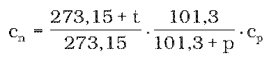
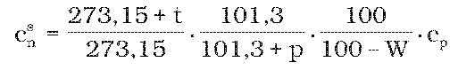
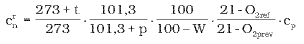
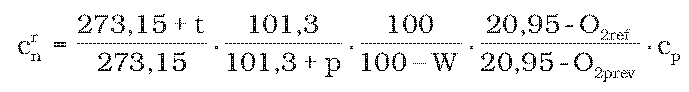

Príloha č. 5 k vyhláške č. 338/2009 Z. z.

- VELIČINY, JEDNOTKY A PREPOČTOVÉ VZŤAHY, KTORÝMI SÚ VYJADRENÉ EMISNÉ LIMITY A POUŽITÉ SKRATKY

  - I. VELIČINY A JEDNOTKY EMISIÍ A EMISNÝCH LIMITOV

  - Na vyjadrenie emisií a emisných limitov sa používajú tieto veličiny a jednotky:

    - 1. Hmotnostná koncentrácia

      - Hmotnostná koncentrácia je hmotnosť znečisťujúcej látky vztiahnutá na jednotku objemu odpadového plynu. Vyjadruje sa najmä v jednotkách ng/m3, mg/m3 alebo g/m3 po prepočítaní na štandardné stavové podmienky na určený suchý alebo vlhký plyn a na referenčný obsah kyslíka, ak je určený.

      - Ak ide o všeobecné emisné limity a špecifické emisné limity, pre ktoré nie je určený referenčný obsah kyslíka, koncentrácia sa vyjadruje pri obsahu kyslíka, ktorý vyplýva z podstaty technologického procesu. Množstvo vzduchu alebo inertného plynu privádzané do zariadenia na riedenie odpadových plynov alebo na ich ochladzovanie, alebo na zabezpečenie bezpečnosti sa pri zisťovaní koncentrácie odpočítava.

      - Určený referenčný obsah kyslíka pri špecifickom emisnom limite pre vybranú technológiu alebo zariadenie platí aj pre všeobecné emisné limity, ak sa pre danú technológiu uplatňujú.

    - 2. Hmotnostný tok

      - Hmotnostný tok je hmotnosť znečisťujúcej látky v odpadovom plyne vztiahnutá na jednotku času po prepočítaní na štandardné stavové podmienky a suchý plyn, ak nie je určené inak. Vyjadruje sa najmä v jednotkách kg/h, g/s, t/rok, ak nie je určené inak.

    - 3. Limitný emisný faktor

      - Limitný emisný faktor je emisný limit vyjadrený ako pomer hmotnosti znečisťujúcej látky vypúšťanej zo zdroja alebo z časti zdroja k jednotke hmotnosti alebo k inej jednotke množstva výrobku, polotovaru, suroviny alebo výkonu zdroja. Je údajom charakterizujúcim pomerné množstvo emisií vystupujúcich z daného technologického procesu vrátane zariadenia na obmedzenie emisií do ovzdušia. Vyjadruje sa najmä v jednotkách kg/t, kg/GJ.

    - 4. Emisný stupeň

      - Emisný stupeň je emisný limit vyjadrený ako pomer hmotnosti znečisťujúcej látky vypúšťanej zo zdroja, z jeho časti alebo zo zariadenia na obmedzovanie emisií k hmotnosti tejto látky privedenej do procesu. Vyjadruje sa v percentách.

    - 5. Stupeň odsírenia

      - Stupeň odsírenia je emisný limit vyjadrený ako pomer množstva síry, ktorá sa za určitú časovú jednotku zo zariadenia nevypustí do ovzdušia, k množstvu síry, ktorá sa za tú istú časovú jednotku privedie vo vstupe, napríklad v palive. Vyjadruje sa v percentách.

    - 6. Tmavosť dymu

      - Tmavosť dymu je optická vlastnosť dymu vyvolaná pohltením svetla. Pri spaľovaní tuhých palív sa vyjadruje v stupňoch podľa Ringelmanna (0 až 5) alebo opacitou v percentách. Opacita vyjadrená v percentách sa na stupne podľa Ringelmanna prepočíta delením číslom 20. Ak sa pri spaľovaní kvapalných palív kontroluje obsah sadzí meraním tmavosti škvrny na filtri z odsatej vzorky podľa Bacharacha, vyjadruje sa v stupňoch (0 až 9).

  - II. PODROBNOSTI O ŠPECIFIKOVANÍ TUHÝCH ZNEČISŤUJÚCICH LÁTOK A PLYNNÝCH ZNEČISŤUJÚCICH LÁTOK

    - Podrobnosti o špecifikovaní tuhých znečisťujúcich látok a plynných znečisťujúcich látok určujú v poradí európske technické normy EN, medzinárodné technické normy ISO, slovenské technické normy STN, ak sú vydané, a technické špecifikácie alebo iné zodpovedajúce dokumenty v dokumentácii na stanovenie emisie príslušnej znečisťujúcej látky v závislosti od vlastnosti látky a charakteru odpadového plynu, ak orgán ochrany ovzdušia príslušný pre povolenie zdroja neurčí inak.

  - III. PREPOČTOVÉ VZŤAHY

  - Ak sú koncentrácie zistené za iných než štandardných stavových podmienok, použijú sa na prepočet na štandardné stavové podmienky alebo na referenčný obsah kyslíka tieto prepočtové vzťahy:

  - A. | prepočet koncentrácií na štandardné stavové podmienky, vlhký plyn:

  - | 

  - B. | prepočet koncentrácií na štandardné stavové podmienky, suchý plyn:

  - | 

  - C. | prepočet koncentrácií na ustanovené stavové podmienky, suchý plyn a referenčný obsah kyslíka v spalinách pre spaľovne odpadov a zariadeniach na spoluspaľovanie odpadov, napríklad cementárske pece:

  - | 

  - D. | prepočet koncentrácií na štandardné stavové podmienky, suchý plyn a referenčný obsah kyslíka pre ostatné zdroje:

  - | 

  - Význam symbolov v uvedených vzťahoch: |

  - cn | koncentrácia po prepočte na štandardný stav vo vlhkom plyne

  - cns | koncentrácia po prepočte na štandardný stav v suchom plyne

  - cnr | koncentrácia po prepočte na štandardný stav v suchom plyne a referenčné podmienky dané obsahom kyslíka O2 ref

  - cp | koncentrácia zodpovedajúca prevádzkovým podmienkam zistená meraním

  - t | teplota odpadového plynu pri prevádzkových podmienkach (°C)

  - p | tlaková diferencia oproti štandardnému tlaku zodpovedajúca prevádzkovým podmienkam uvedená v kPa

  - W | obsah vody v spalinách uvedený v % objemu

  - O2 ref | referenčný obsah kyslíka v spalinách uvedený v % objemu

  - O2 prev | obsah kyslíka v spalinách zodpovedajúci prevádzkovým podmienkam, zistený meraním, uvedený v % objemu
