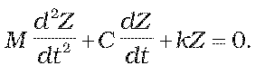
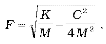
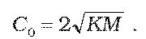
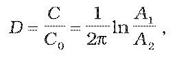
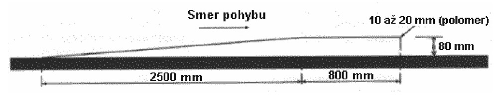
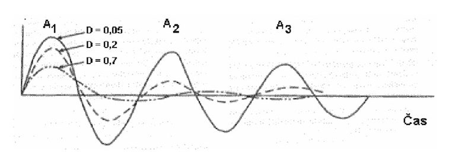

Príloha č. 2 k nariadeniu vlády č. 349/2009 Z. z.

- PODMIENKY TÝKAJÚCE SA EKVIVALENCIE MEDZI URČITÝMI SYSTÉMAMI BEZ PNEUMATICKÉHO ZAVESENIA A S PNEUMATICKÝM ZAVESENÍM PRE HNACIU NÁPRAVU ALEBO HNACIE NÁPRAVY

  - 1. VYMEDZENIE ZÁVESU

    - Závesný systém sa považuje za pneumatický záves, ak je aspoň 75 % pružiaceho efektu spôsobené pneumatickou pružinou.

  - 2. EKVIVALENTNOSŤ PNEUMATICKÉHO ZÁVESU

  - Záves uznaný za ekvivalentný pneumatickému závesu musí spĺňať tieto požiadavky:

    - 2.1 počas voľnej prechodovej nízkofrekvenčnej vertikálnej oscilácie odpruženej hmoty nad hnacou nápravou alebo podvozkom musí byť nameraná frekvencia a tlmenie so závesom pri prenose svojho maximálneho zaťaženia v rozmedzí definovanom v bodoch 2.2 až 2.5,

    - 2.2 každá náprava musí byť vybavená hydraulickými tlmičmi. Na podvozkoch so zdvojenými nápravami musia byť tlmiče umiestnené tak, aby minimalizovali osciláciu podvozkov,

    - 2.3 hodnota stredného pomerného tlmenia D musí byť vyššia než 20 % kritického tlmenia pre záves v jeho normálnom stave s umiestnenými a fungujúcimi hydraulickými tlmičmi,

    - 2.4 pomerné tlmenie D závesu so všetkými hydraulickými tlmičmi odstránenými alebo nefungujúcimi nesmie byť vyššie než 50 % D,

    - 2.5 frekvencia odpruženej hmoty nad hnacou nápravou alebo podvozkom vo voľnej prechodovej vertikálnej oscilácii nesmie byť vyššia než 2,0 Hz,

    - 2.6 frekvencia a tlmenie závesu sú uvedené v bode 3. Testovacie postupy na meranie frekvencie a tlmenia sú ustanovené v bode 4.

  - 3. VYMEDZENIE FREKVENCIE A TLMENIA

    - V tomto vymedzení sa uvažuje s odpruženou hmotou M (kg) nad hnacou nápravou alebo podvozkom. Náprava alebo podvozok majú celkovú vertikálnu tuhosť medzi cestným povrchom a odpruženou hmotou K newton/meter (N/m) a celkový koeficient tlmenia C newton krát sekunda na meter (N.s/m). Vertikálne posunutie odpruženej hmoty je Z. Pohybová rovnica pre voľnú osciláciu odpruženej hmoty je

  - 

    - Frekvencia oscilácie odpruženej hmoty F (rad/sek ) je

  - 

    - Tlmenie je kritické vtedy, keď C = Co, kde

  - 

    - Pomerné tlmenie ako zlomok kritického tlmenia je C/Co.

    - Počas voľnej prechodnej oscilácie odpruženej hmoty bude vertikálny pohyb hmoty sledovať tlmenú sínusoidnú dráhu (obrázok 2). Frekvenciu je možné odhadnúť tak, že sa odmeria čas za toľko cyklov oscilácie, koľko je možné pozorovať. Tlmenie je možné odhadnúť tak, že sa odmerajú výšky po sebe idúcich vrcholov oscilácie v rovnakom smere. Ak špičkové amplitúdy prvého a druhého cyklu oscilácie sú A1 a A2, potom je pomerné tlmenie D

  - 

    - kde „ln“ je prirodzený logaritmus pomeru amplitúd.

  - 4. POSTUP TESTU

  - Na určenie pomerného tlmenia D, pomerné tlmenie s odstránenými hydraulickými tlmičmi a frekvenciou F závesu by malo naložené vozidlo spĺňať jednu z nasledujúcich podmienok:

    - a) malo by sa pohybovať pri nízkej rýchlosti (5 km/h ± 1 km/h) cez 80 mm schod s profilom, ktorý je zobrazený na obrázku 1. Prechodová oscilácia, ktorá sa analyzuje na frekvenciu a tlmenie, nastáva po tom, čo kolesá na hnacej náprave opustia schod, alebo

    - b) malo by byť ťahané dole za svoj podvozok tak, aby záťaž hnacej nápravy bola 1,5-krát väčšia, než je jeho maximálna statická hodnota. Vozidlo, ktoré je držané v dolnej polohe, sa náhle uvoľní a analyzuje sa následná oscilácia, alebo

    - c) malo by byť ťahané hore za svoj podvozok tak, aby odpružená hmota bola zdvihnutá o 80 mm nad hnaciu nápravu. Vozidlo držané v hornej polohe sa náhle pustí a analyzuje sa následná oscilácia, alebo

    - d) malo by byť podrobené iným postupom, ak výrobca k spokojnosti technického oddelenia nepreukáže ekvivalentnosť.

      - Uvedené vozidlo by malo byť vybavené meničom vertikálneho posunutia medzi hnacou nápravou a podvozkom, priamo nad hnacou nápravou. Zo stopy môže byť nameraný časový interval medzi prvým a druhým kompresným vrcholom na zistenie frekvencie F a amplitúdový pomer na zistenie hodnoty tlmenia. Pre dvojnápravové podvozky by meniče vertikálneho posunutia mali byť namontované medzi každou hnacou nápravou a podvozkom, priamo nad touto nápravou.

      - Obrázok 1

      - Schod pre závesné testy

    - 

      - Obrázok 2

      - Tlmený prechodový jav

    - 
