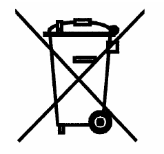

# Čl. I

Zákon č. 223/2001 Z. z. o odpadoch a o zmene a doplnení niektorých zákonov v znení zákona č. 553/2001 Z. z., zákona č. 96/2002 Z. z., zákona č. 261/2002 Z. z., zákona č. 393/2002 Z. z., zákona č. 529/2002 Z. z., zákona č. 188/2003 Z. z., zákona č. 245/2003 Z. z., zákona č. 525/2003 Z. z., zákona č. 24/2004 Z. z., zákona č. 443/2004 Z. z., zákona č. 587/2004 Z. z., zákona č. 733/2004 Z. z., zákona č. 479/2005 Z. z., zákona č. 532/2005 Z. z., zákona č. 571/2005 Z. z., zákona č. 127/2006 Z. z., zákona č. 514/2008 Z. z., zákona č. 515/2008 Z. z., zákona č. 519/2008 Z. z. a zákona č. 160/2009 Z. z. sa mení a dopĺňa takto:

- 1. V § 1 ods. 3 písmeno f) znie:

- „f)

- nakladanie s elektrickými a elektronickými zariadeniami (ďalej len „elektrozariadenie“), ktoré sú spojené s ochranou dôležitých záujmov týkajúcich sa bezpečnosti Slovenskej republiky, zbrane, muníciu a vojenský materiál, okrem elektrozariadení, ktoré nie sú určené výhradne na vojenské účely a na nakladanie s odpadom z týchto elektrozariadení,“.

- 2. V § 1 sa odsek 3 dopĺňa písmenom g), ktoré znie:

- „g)

- nakladanie s batériami a akumulátormi použitými v zariadeniach, ktoré sú spojené s ochranou dôležitých záujmov týkajúcich sa bezpečnosti Slovenskej republiky, v zbraniach, munícii a vojenskom materiáli, okrem výrobkov, ktoré nie sú výhradne určené na vojenské účely a v zariadeniach určených na vyslanie do vesmíru a na nakladanie s odpadom z týchto batérií a akumulátorov.“.

- 3. V § 2 ods. 15 sa slová „elektrozariadenia podľa § 54a ods. 14“ nahrádzajú slovami „elektroodpadu podľa § 54a ods. 17“ a na konci sa pripájajú tieto slová: „a zberné miesto podľa § 48a ods. 17“.

- 4. Nadpis § 3 znie: „Účel a ciele odpadového hospodárstva“.

- 5. Doterajší text § 3 sa označuje ako odsek 1 a dopĺňa sa odsekmi 2 a 3, ktoré znejú:

- „(2)

- Cieľom odpadového hospodárstva v oblasti nakladania s elektroodpadom je dosiahnuť, aby množstvo elektroodpadu z domácností odovzdaného do systému spätného odberu (§ 54a ods. 17) a oddeleného zberu dosiahlo v priemere aspoň štyri kilogramy na jedného obyvateľa za rok.

- (3)

- Cieľom odpadového hospodárstva v oblasti nakladania s použitými prenosnými batériami a akumulátormi je dosiahnuť zberový podiel (§ 48a ods. 19) najmenej 25 % do 26. septembra 2012 a 45 % do 26. septembra 2016.“.

- 6. V § 6 ods. 1 sa slová „500 kg“ nahrádzajú slovami „jednu tonu“.

- 7. V § 7 ods. 1 písmeno b) znie:

- „b)

- zneškodňovanie odpadov, na ktoré nebol vydaný súhlas podľa písmena a) a zhodnocovanie odpadov, na ktoré nebol vydaný súhlas podľa písmena c), okrem zneškodňovania alebo zhodnocovania odpadov v spaľovniach odpadov a zariadeniach na spoluspaľovanie odpadov a zhodnocovania odpadov vo vodných stavbách, v ktorých sa zhodnocujú osobitné druhy kvapalných odpadov,14b) alebo zmenšovania objemu komunálnych odpadov v zariadeniach, ktorých skutočná ročná kapacita neprevyšuje 50 ton,“.

- 8. V § 7 ods. 1 písm. f) sa slovo „a“ nahrádza čiarkou a na konci sa pripájajú tieto slová: „a vydanie prevádzkového poriadku mobilného zariadenia na zhodnocovanie alebo zneškodňovanie odpadov,“.

- 9. V § 7 sa odsek 4 dopĺňa písmenom e), ktoré znie:

- „e)

- povinnosť podávať príslušnému obvodnému úradu životného prostredia správu o druhoch a množstvách ukladaného odpadu a o výsledkoch monitorovania skládky odpadov každoročne do 31. januára nasledujúceho kalendárneho roka.“.

- 10. V § 7 odsek 11 znie:

- „(11)

- Súhlas na prevádzkovanie skládky odpadov vydá príslušný orgán štátnej správy odpadového hospodárstva až po vykonaní miestnej ohliadky na preverenie skutočného stavu veci v rozsahu podanej žiadosti o súhlas na prevádzkovanie skládky odpadov.“.

- 11. V § 8 ods. 3 písmeno a) znie:

- „a)

- spracovanie a recykláciu použitých batérií a akumulátorov (§ 48a až 48f),“.

- 12. § 8 sa dopĺňa odsekom 5, ktorý znie:

- „(5)

- Ministerstvo udeľuje autorizáciu podľa odseku 3 písm. a) len súčasne na výkon činnosti spracovania a recyklácie.“.

- 13. V § 9 odsek 5 znie:

- „(5)

- Pri autorizácii podľa § 8 ods. 3 písm. b), v rámci ktorej sa vykonáva regenerácia odpadových olejov (§ 42 ods. 2) alebo ich zhodnocovanie využitím ako palivo podľa položky R1 v prílohe č. 2, je súčasťou technického, materiálneho a personálneho zabezpečenia aj zabezpečenie opatrení na ochranu životného prostredia a zdravia ľudí; ak ide o zariadenia povolené a prevádzkované podľa osobitného predpisu,18a) musí použitá technológia zodpovedať úrovni najlepšej dostupnej techniky.“.

- 14. V § 10 sa odsek 2 dopĺňa písmenami e) a f), ktoré znejú:

- „e)

- záverečné stanovisko alebo rozhodnutie zo zisťovacieho konania z procesu posudzovania vplyvov na životné prostredie podľa osobitného predpisu,14c)

- f)

- súhlas udelený podľa § 7 alebo integrované povolenie udelené podľa osobitného predpisu.19a)“.

- Poznámka pod čiarou k odkazu 19a znie:

- „19a)

- § 8 zákona č. 245/2003 Z. z. v znení neskorších predpisov.“.

- 15. V § 10 sa odsek 4 dopĺňa písmenami e) a f), ktoré znejú:

- „e)

- záverečné stanovisko alebo rozhodnutie zo zisťovacieho konania z procesu posudzovania vplyvov na životné prostredie,

- f)

- súhlas udelený podľa § 7 alebo integrované povolenie udelené podľa osobitého predpisu.19a)“.

- 16. V nadpise § 11 a v celom texte § 9 až 11, § 13 a 14 sa slová „odborne spôsobilá osoba“ vo všetkých tvaroch nahrádzajú slovami „odborne spôsobilá osoba na autorizovanú činnosť“ v príslušnom tvare.

- 17. V § 11 ods. 2 písmeno b) znie:

- „b)

- má vysokoškolské vzdelanie technického alebo prírodovedného smeru a najmenej tri roky praxe v oblasti nakladania s nebezpečným odpadom alebo má vysokoškolské vzdelanie iného ako technického alebo prírodovedného smeru alebo stredoškolské vzdelanie technického smeru ukončené maturitou a najmenej päť rokov praxe v oblasti nakladania s nebezpečným odpadom, alebo má stredoškolské vzdelanie iného ako technického smeru ukončené maturitou a najmenej osem rokov praxe v oblasti nakladania s nebezpečným odpadom; do praxe sa nezapočítavajú roky počas štúdia, ale len prax od ukončenia štúdia,“.

- 18. V § 11 ods. 2 sa za písmeno b) vkladá nové písmeno c), ktoré znie:

- „c)

- absolvovala odbornú prípravu zabezpečovanú organizáciou poverenou ministerstvom,“.

- Doterajšie písmeno c) sa označuje ako písmeno d).

- 19. V § 11 ods. 3 sa na konci pripájajú tieto slová: „najmenej raz za kalendárny rok“.

- 20. V § 11 odsek 4 znie:

- „(4)

- Odbornú spôsobilosť na autorizovanú činnosť potvrdí ministerstvo, po úspešnom vykonaní skúšky, vydaním osvedčenia o odbornej spôsobilosti na autorizovanú činnosť (ďalej len „osvedčenie na autorizovanú činnosť“). Osvedčenie na autorizovanú činnosť možno vydať najviac na desať rokov. Doba platnosti osvedčenia na autorizovanú činnosť sa nepredlžuje. Po uplynutí platnosti osvedčenia na autorizovanú činnosť môže fyzická osoba, ktorá spĺňa podmienky podľa odseku 2, opätovne požiadať o vydanie osvedčenia na autorizovanú činnosť.“.

- 21. § 11 sa dopĺňa odsekmi 6 a 7, ktoré znejú:

- „(6)

- Odborne spôsobilé osoby na autorizovanú činnosť sa zúčastňujú na základe výzvy ministerstva preškolenia alebo nového overenia odbornej spôsobilosti, ak dôjde k zásadným zmenám stavu techniky odpadového hospodárstva alebo všeobecne záväzných právnych predpisov v oblasti odpadového hospodárstva.

- (7)

- Ministerstvo vyčiarkne odborne spôsobilú osobu na autorizovanú činnosť, ak sa na základe výzvy ministerstva nezúčastní preškolenia alebo nového overenia odbornej spôsobilosti podľa odseku 6.“.

- 22. Za § 11 sa vkladá § 11a, ktorý vrátane nadpisu znie:

- 㤠11a

- Zmena, zrušenie a zánik osvedčenia na autorizovanú činnosť

- (1)

- Ministerstvo osvedčenie na autorizovanú činnosť zmení, ak odborne spôsobilá osoba na autorizovanú činnosť písomne požiada o zmenu osobných údajov uvedených v osvedčení na autorizovanú činnosť a ak tieto údaje nie sú v súlade so skutočným stavom.

- (2)

- Ministerstvo osvedčenie na autorizovanú činnosť zruší, ak odborne spôsobilá osoba na autorizovanú činnosť

- a)

- bola pozbavená spôsobilosti na právne úkony alebo ak jej spôsobilosť na právne úkony bola obmedzená,

- b)

- prestala byť bezúhonnou na základe právoplatného rozsudku,

- c)

- získala osvedčenie na autorizovanú činnosť na základe uvedenia nepravdivých údajov v žiadosti alebo jej prílohách,

- d)

- písomne požiada o jeho zrušenie.

- (3)

- Účinky zmeny alebo zrušenia osvedčenia na autorizovanú činnosť nastávajú dňom ich zápisu do registra odborne spôsobilých osôb na autorizovanú činnosť.

- (4)

- Odborná spôsobilosť na autorizovanú činnosť zaniká smrťou odborne spôsobilej osoby na autorizovanú činnosť alebo uplynutím doby platnosti osvedčenia na autorizovanú činnosť. Odborne spôsobilá osoba na autorizovanú činnosť, ktorej odborná spôsobilosť zanikla, sa z registra odborne spôsobilých osôb na autorizovanú činnosť vyčiarkne.“.

- 23. V § 13 sa odsek 10 dopĺňa písmenom d), ktoré znie:

- „d)

- dôjde k zmene technológie v spôsobe nakladania s odpadom, a k žiadosti priloží odborný posudok preukazujúci technické zabezpečenie autorizovanej činnosti.“.

- 24. Poznámka pod čiarou k odkazu 25 znie:

- „25)

- Čl. 114 nariadenia Rady (EHS) č. 2913/92, ktorým sa ustanovuje Colný kódex Európskeho spoločenstva (Mimoriadne vydanie Ú. v. EÚ, kap. 2/zv. 4 v platnom znení; Ú. v. ES L 302, 19. 10. 1992).“.

- 25. V § 15 ods. 1 sa za slová „predmet podnikania,“ vkladajú slová „vrátane distribútora, ktorý vykonáva spätný odber (§ 54a ods. 17)“.

- 26. V § 18 ods. 3 písmeno d) znie:

- „d)

- vykonávať prepravu odpadov v rozpore so štvrtou časťou zákona,“.

- 27. V § 18 sa odsek 3 dopĺňa písmenami p) až t), ktoré znejú:

- „p)

- zneškodňovať alebo energeticky zhodnocovať použité batérie a akumulátory okrem zneškodňovania nezhodnotiteľných zvyškov použitých batérií a akumulátorov, ktoré prešli procesom spracovania a recyklácie, činnosťami podľa položiek D1 a D10,

- r)

- narúšať celistvosť batérií a akumulátorov vrátane použitých batérií a akumulátorov okrem zariadenia, ktorému bola udelená autorizácia podľa § 8 ods. 3 písm. a),

- s)

- sprostredkovať alebo iným spôsobom sa podieľať na cezhraničnej preprave odpadov z iného členského štátu do Slovenskej republiky, cezhraničnej preprave odpadov zo Slovenskej republiky do iného členského štátu, dovoze odpadov z iného ako členského štátu do Slovenskej republiky, vývoze odpadov zo Slovenskej republiky do iného ako členského štátu alebo tranzite odpadov, ktoré sú v rozpore s ustanoveniami štvrtej časti zákona,

- t)

- dopraviť alebo prepraviť na územie Slovenskej republiky alebo z územia Slovenskej republiky odpad v rozpore s ustanoveniami štvrtej časti zákona.“.

- 28. V § 18 ods. 7 sa slová „požiada Policajný zbor“ nahrádzajú slovami „začne konanie“.

- 29. V § 19 ods. 1 písmeno j) znie:

- „j)

- predložiť na vyžiadanie predchádzajúceho držiteľa odpadu doklady s úplnými a pravdivými informáciami preukazujúce spôsob nakladania s odpadom, a to najneskôr do 30 dní odo dňa doručenia písomnej žiadosti,“.

- 30. V § 19 ods. 9 sa na konci bodka nahrádza bodkočiarkou a pripájajú sa tieto slová: „tento postup sa nevzťahuje na odpady zo stavebných a demolačných prác podľa § 40c.“.

- 31. V § 21 sa odsek 2 sa dopĺňa písmenom f), ktoré znie:

- „f)

- oznámiť príslušnému obvodnému úradu životného prostredia negatívne stavy a vplyvy na životné prostredie zistené monitoringom počas prevádzkovania skládky odpadov a po jej uzavretí.“.

- 32. V § 22 odseky 1 a 2 znejú:

- „(1)

- Prevádzkovateľ skládky odpadov je povinný počas prevádzky skládky odpadov vytvárať účelovú finančnú rezervu, ktorej prostriedky sa použijú na uzavretie, rekultiváciu a monitorovanie skládky odpadov po jej uzatvorení a na práce súvisiace s odvrátením havárie alebo obmedzenie dôsledkov havárie. Ten, kto prevádzkuje viac ako jednu skládku odpadov, vytvára účelovú finančnú rezervu pre každú skládku odpadov osobitne.

- (2)

- Účelová finančná rezerva sa vytvára ročne na ťarchu výdavkov (nákladov)36) vo výške určeného podielu z celkových nákladov na uzavretie, rekultiváciu a monitorovanie skládky odpadov po jej uzavretí.“.

- 33. V § 22 odsek 3 znie:

- „(3)

- Ročná výška účelovej finančnej rezervy sa vypočíta takto:

- R = Q × A × CPI

- A = CN : K,

- kde R je odvod na tvorbu účelovej finančnej rezervy v eurách za rok,

- Q je množstvo uložených odpadov za kalendárny rok v m3,

- A je výška odvodu na jednotkové množstvo odpadov v eurách vypočítaná jednorazovo pri začatí tvorby účelovej finančnej rezervy podľa tohto zákona,

- CPI je medziročná miera inflácie (index spotrebiteľských cien) uverejnená Štatistickým úradom Slovenskej republiky za kalendárny rok, v ktorom boli odpady na skládku odpadov uložené,

- CN sú projektovou dokumentáciou navrhované investičné náklady na uzavretie, rekultiváciu a prevádzkové náklady na monitorovanie skládky odpadov v eurách,

- K je voľná kapacita skládky odpadov pri začatí tvorby účelovej finančnej rezervy podľa tohto zákona v čase výpočtu v m3.“.

- 34. V § 22 odsek 5 znie:

- „(5)

- Prostriedky tvoriace účelovú finančnú rezervu sa vedú na osobitnom účte alebo osobitných účtoch37) prevádzkovateľa skládky odpadov. Prevádzkovateľ skládky odpadov je pred odvedením prvej splátky účelovej finančnej rezervy povinný zabezpečiť vytvorenie osobitného účtu alebo osobitných účtov, na ktoré bude prostriedky účelovej finančnej rezervy každoročne odvádzať v zmysle odseku 6, a zároveň zabezpečiť viazanosť použitia odvedených prostriedkov účelovej finančnej rezervy na účel uvedený v odseku 1.“.

- 35. V § 22 odsek 6 znie:

- „(6)

- Prevádzkovateľ skládky odpadov odvádza ročnú výšku prostriedkov účelovej finančnej rezervy do 31. januára nasledujúceho kalendárneho roka. Účelová finančná rezerva ku dňu podania žiadosti o udelenie súhlasu na uzavretie skládky odpadov alebo jej časti, vykonanie jej rekultivácie a jej následné monitorovanie [§ 7 ods. 1 písm. k)] musí dosiahnuť výšku celkových nákladov na uzavretie, rekultiváciu a monitorovanie skládky odpadov po uzavretí.“.

- 36. § 22 sa dopĺňa odsekom 16, ktorý znie:

- „(16)

- Pri zmene prevádzkovateľa skládky odpadov je predchádzajúci prevádzkovateľ skládky odpadov povinný prostriedky účelovej finančnej rezervy skládky odpadov previesť v plnej výške na účet účelovej finančnej rezervy nového prevádzkovateľa skládky odpadov, a to do 45 dní odo dňa, keď ku zmene prevádzkovateľa skládky odpadov došlo.“.

- 37. Štvrtá časť zákona vrátane nadpisu znie:

- „ŠTVRTÁ ČASŤ

- CEZHRANIČNÁ PREPRAVA ODPADOV, DOVOZ ODPADOV, VÝVOZ ODPADOV A TRANZIT ODPADOV

- § 23

- Základné ustanovenia

- (1)

- Cezhraničnú prepravu odpadov z iného členského štátu do Slovenskej republiky, cezhraničnú prepravu odpadov zo Slovenskej republiky do iného členského štátu, dovoz odpadov z iného ako členského štátu do Slovenskej republiky, vývoz odpadov zo Slovenskej republiky do iného ako členského štátu a tranzit odpadov (ďalej len „cezhraničný pohyb odpadov“) ustanovujú osobitné predpisy.45)

- (2)

- Na území Slovenskej republiky je príslušným orgánom46) pre cezhraničný pohyb odpadov ministerstvo. Ministerstvo zároveň plní funkciu korešpondenta.47)

- (3)

- Cezhraničná preprava odpadov z iného členského štátu do Slovenskej republiky a dovoz odpadov z iného ako členského štátu do Slovenskej republiky na účel zneškodnenia sú zakázané, ak medzinárodná zmluva, ktorou je Slovenská republika viazaná, neustanovuje inak.

- (4)

- Nebezpečný odpad, ktorý vznikol v Slovenskej republike, sa prednostne zhodnotí v Slovenskej republike v súlade s programom Slovenskej republiky (§ 4 ods. 1). Ak zhodnotenie takého odpadu v Slovenskej republike nie je možné, zhodnotí sa prednostne v niektorom z členských štátov.

- (5)

- Ak ministerstvo uplatňuje námietky,48) vychádza z cieľov programu Slovenskej republiky.

- § 24

- Oznámenie

- (1)

- Oznámenie o cezhraničnom pohybe odpadov podáva oznamovateľ48a) podľa osobitných predpisov.48b)

- (2)

- Oznámenie o cezhraničnom pohybe odpadov vrátane dodatočných informácií a dodatočnej dokumentácie48c) sa podáva na ministerstvo v slovenskom jazyku alebo s úradne overeným prekladom do slovenského jazyka. Doklad o oznámení pre cezhraničné pohyby/prepravy odpadu a Doklad o pohybe pre cezhraničné pohyby/prepravy odpadu podľa osobitného predpisu48d) možno na účel oznámenia cezhraničnej prepravy odpadu z iného členského štátu do Slovenskej republiky, dovozu odpadu z iného ako členského štátu do Slovenskej republiky a tranzitu odpadov podať aj v inom ako slovenskom jazyku.

- § 25

- Finančné zabezpečenie

- (1)

- Cezhraničnú prepravu odpadov zo Slovenskej republiky do iného členského štátu a vývoz odpadov zo Slovenskej republiky do iného ako členského štátu je oznamovateľ povinný finančne zabezpečiť formou finančnej zábezpeky (ďalej len „kaucia“) alebo rovnocenného poistenia podľa osobitného predpisu.48e)

- (2)

- Výšku kaucie určí ministerstvo po preskúmaní preukázateľných nákladov na dopravu, na zhodnotenie alebo zneškodnenie vrátane všetkých potrebných predbežných činností a na skladovanie počas 90 dní, a to vo výške jeden a polnásobku týchto nákladov. Kauciu určenú ministerstvom skladá oznamovateľ v banke alebo v pobočke zahraničnej banky37a) viazaním finančných prostriedkov na neurčitý čas v prospech ministerstva najneskôr tri dni pred uskutočnením prepravy. Oznamovateľ predloží ministerstvu originál dokladu o zložení kaucie pred uskutočnením prepravy.

- (3)

- Za rovnocenné poistenie sa považuje poistenie, pri ktorom výška poistného plnenia kryje preukázateľné náklady na dopravu, na zhodnotenie alebo zneškodnenie vrátane všetkých potrebných predbežných činností a na skladovanie počas 90 dní, a to vo výške jeden a polnásobku týchto nákladov; toto poistenie musí oznamovateľ uzavrieť najneskôr tri dni pred uskutočnením prepravy. Oznamovateľ predloží ministerstvu originál dokladu o uzavretí poistenia pred uskutočnením prepravy.

- (4)

- Kaucia podľa odseku 2 sa vráti oznamovateľovi po predložení žiadosti a potvrdenia, že zneškodnenie alebo zhodnotenie odpadov sa uskutočnilo, a to vo forme potvrdeného Dokladu o pohybe pre cezhraničné pohyby/prepravy odpadu alebo sa potvrdenie k nemu priloží.

- (5)

- Kaucia podľa odseku 2 sa vráti oznamovateľovi okrem prípadov uvedených v osobitnom predpise48e) aj v prípade, ak oznamovateľ preukáže, že cezhraničná preprava odpadov zo Slovenskej republiky do iného členského štátu, vývoz odpadov zo Slovenskej republiky do iného ako členského štátu sa neuskutočnila alebo neuskutoční.

- § 26

- Vrátenie oznámenia

- Ak oznamovateľ nedoplní svoje oznámenie o cezhraničnom pohybe odpadov do 60 dní odo dňa doručenia výzvy na doplnenie oznámenia, ministerstvo môže oznámenie vrátiť oznamovateľovi.“.

- Poznámky pod čiarou k odkazom 45 až 48e znejú:

- „45)

- Nariadenie Európskeho parlamentu a Rady (ES) č. 1013/2006 zo 14. júna 2006 o preprave odpadu (Ú. v. EÚ L 190, 12. 7. 2006) v platnom znení.

- Nariadenie Komisie (ES) č. 1418/2007 z 29. novembra 2007 o vývoze na zhodnotenie určitého odpadu uvedeného v prílohe III alebo IIIA k nariadeniu Európskeho parlamentu a Rady (ES) č. 1013/2006 do určitých krajín, na ktoré sa nevzťahuje rozhodnutie OECD o riadení pohybov odpadov cez štátne hranice (Ú. v. EÚ L 316, 4. 12. 2007).

- 46)

- Čl. 53 nariadenia Európskeho parlamentu a Rady (ES) č. 1013/2006 v platnom znení.

- 47)

- Čl. 54 nariadenia Európskeho parlamentu a Rady (ES) č. 1013/2006 v platnom znení.

- 48)

- Čl. 11 a 12 nariadenia Európskeho parlamentu a Rady (ES) č. 1013/2006 v platnom znení.

- 48a)

- Čl. 2 bod 15 nariadenia Európskeho parlamentu a Rady (ES) č. 1013/2006 v platnom znení.

- 48b)

- Čl. 4 nariadenia Európskeho parlamentu a Rady (ES) č. 1013/2006 v platnom znení.

- 48c)

- Príloha II nariadenia Európskeho parlamentu a Rady (ES) č. 1013/2006 v platnom znení.

- 48d)

- Príloha IA a IB nariadenia Európskeho parlamentu a Rady (ES) č. 1013/2006 v platnom znení.

- 48e)

- Čl. 6 nariadenia Európskeho parlamentu a Rady (ES) č. 1013/2006 v platnom znení.“.

- 38. V § 39 ods. 14 sa vypúšťajú slová „a biologicky rozložiteľných odpadov“.

- 39. V § 39 odsek 15 znie:

- „(15)

- Obec je povinná separovať biologicky rozložiteľný odpad podľa stratégie nakladania s biologicky rozložiteľným odpadom schválenej vládou Slovenskej republiky.“.

- 40. § 39 sa dopĺňa odsekom 16, ktorý znie:

- „(16)

- Obec je povinná umožniť výrobcovi elektrozariadení alebo kolektívnej organizácii (§ 54ga ods. 2) na ich náklady

- a)

- zaviesť a prevádzkovať na jej území systém oddeleného zberu elektroodpadu z domácností,

- b)

- užívať v rozsahu potrebnom na tento účel existujúce zariadenia na zber komunálnych odpadov.“.

- 41. § 40c sa dopĺňa odsekom 5, ktorý znie:

- „(5)

- Pôvodcom odpadov vznikajúcich v dôsledku uskutočňovania stavebných a demolačných prác a výstavby, údržby, rekonštrukcie a demolácie komunikácií je ten, kto vykonáva tieto práce.“.

- 42. § 41 vrátane poznámok pod čiarou k odkazom 51 a 52 sa vypúšťa.

- 43. V § 42 ods. 8 sa slová „dovozca všetkých minerálnych mazacích olejov do spaľovacích motorov, prevodových olejov, olejov pre turbíny a hydraulických olejov“ nahrádzajú slovami „ten, kto prepraví cez štátnu hranicu na územie Slovenskej republiky (ďalej len „dovozca“) minerálne mazacie oleje do spaľovacích motorov, prevodové oleje, oleje pre turbíny a hydraulické oleje“.

- 44. V § 42 odsek 10 znie:

- „(10)

- Výrobca a dovozca platia príspevok do Recyklačného fondu za kalendárny štvrťrok. Výšku príspevku určia podľa § 56 zo skutočného objemu výroby alebo dovozu v spoplatňovanom štvrťroku. Príspevok je splatný do tridsiateho dňa nasledujúceho štvrťroka.“.

- 45. V § 42 ods. 11, § 43 ods. 4, § 44 ods. 5, § 44a ods. 4, § 46 ods. 5, § 48 ods. 7, § 54 ods. 4 a § 54i ods. 4 sa za slovo „registráciu“ vkladajú slová „do 30 dní od vzniku zmeny.“.

- 46. V § 43 ods. 3, § 44 ods. 4, § 44a ods. 3, § 46 ods. 4, § 48 ods. 6 a § 54 ods. 3 prvá veta znie: „Výrobca a dovozca platia príspevok podľa § 42 ods. 10.“ a druhá veta sa vypúšťa.

- 47. V § 43 ods. 1 sa za slovom „vozidiel“ vypúšťa čiarka a vkladajú sa slová „a dovozca použitých pneumatík pre motorové vozidlá a nemotorové vozidlá určených na protektorovanie“.

- 48. Za piatu časť sa vkladá nová šiesta časť, ktorá vrátane nadpisu znie:

- „ŠIESTA ČASŤ

- BATÉRIE A AKUMULÁTORY

- § 48a

- Základné ustanovenia

- (1)

- Na batérie a akumulátory uvádzané na trh bez ohľadu na ich tvar, objem, hmotnosť, materiálové zloženie alebo použitie, na spracovanie použitých batérií a akumulátorov, na nakladanie s použitými batériami a akumulátormi a na nakladanie s odpadmi zo spracovania použitých batérií a akumulátorov sa vzťahujú všeobecné ustanovenia tohto zákona, ak v tejto časti zákona nie je ustanovené inak.

- (2)

- Batéria alebo akumulátor je zdroj elektrickej energie vyrobenej priamou premenou chemickej energie, pozostávajúci z jedného alebo viacerých primárnych nedobíjateľných článkov alebo z jedného alebo viacerých sekundárnych dobíjateľných článkov.

- (3)

- Sada batérií je súbor batérií alebo akumulátorov navzájom prepojených alebo prepojených a uzavretých vo vonkajšom obale tak, aby tvorili jeden celok, ktorý by nemal byť rozdeľovaný alebo otváraný.

- (4)

- Použitá batéria alebo akumulátor je batéria alebo akumulátor, ktoré sú odpadom podľa § 2 ods. 1.

- (5)

- Prenosná batéria alebo akumulátor je batéria, gombíkový článok, sada batérií alebo akumulátor, ktoré sú hermeticky uzavreté, môžu sa ručne prenášať a nie sú priemyselnou batériou alebo akumulátorom ani automobilovou batériou alebo akumulátorom.

- (6)

- Gombíkový článok je malá okrúhla prenosná batéria alebo akumulátor s priemerom väčším ako ich výška, ktoré sa používajú na osobitné účely, napríklad v prístrojoch pre nepočujúcich, hodinách, malých prenosných zariadeniach a záložných zdrojoch.

- (7)

- Automobilová batéria alebo akumulátor je batéria alebo akumulátor, ktoré sa používajú na štartovanie motorového vozidla a jeho osvetlenie.54)

- (8)

- Priemyselná batéria alebo akumulátor je batéria alebo akumulátor, ktoré sú určené výhradne na priemyselné alebo profesionálne použitie alebo sú použité v dopravnom prostriedku poháňanom elektrickou energiou.

- (9)

- Spracovanie použitých batérií a akumulátorov je súčasťou materiálového zhodnocovania použitých batérií a akumulátorov a je to činnosť vykonávaná na použitých batériách a akumulátoroch pred samotnou recykláciou po tom, čo boli odovzdané do zariadenia, ktorému bola udelená autorizácia podľa § 8 ods. 3 písm. a).

- (10)

- Zhodnocovateľ použitých batérií a akumulátorov je fyzická osoba – podnikateľ alebo právnická osoba, ktorej bola udelená autorizácia podľa § 8 ods. 3 písm. a).

- (11)

- Výrobca batérií a akumulátorov je osoba, ktorá v rámci svojej podnikateľskej činnosti bez ohľadu na použitú techniku predaja, vrátane predaja na základe zmluvy uzavieranej na diaľku,54a) uvádza na trh batérie alebo akumulátory vyrobené v Slovenskej republike alebo dovezené na územie Slovenskej republiky vrátane batérií a akumulátorov začlenených do prístrojov alebo motorových vozidiel.

- (12)

- Distribútor batérií a akumulátorov je osoba, ktorá poskytuje batérie a akumulátory v rámci svojej podnikateľskej činnosti používateľovi.

- (13)

- Uvedenie batérií a akumulátorov na trh je na účely tohto zákona okamih, keď batérie a akumulátory prechádzajú prvýkrát odplatne alebo bezodplatne z etapy výroby alebo dovozu do etapy distribúcie alebo použitia na území Slovenskej republiky.

- (14)

- Recyklácia použitých batérií a akumulátorov je opätovné spracovanie odpadových materiálov vo výrobnom procese na ich pôvodný účel alebo na iné účely okrem spätného získavania energie.

- (15)

- Prístroj je elektrozariadenie (§ 54a ods. 2), ktoré je úplne alebo čiastočne napájané z batérií alebo akumulátorov alebo tak môže byť napájané.

- (16)

- Bezšnúrový elektrický nástroj je ručný prístroj napájaný z batérie alebo akumulátora a určený na údržbu, výstavbu alebo záhradnícke činnosti.

- (17)

- Zberné miesto je miesto, kde môže používateľ bezplatne odovzdať použité prenosné batérie a akumulátory, a prevádzkovateľ ktorého vykonáva odber použitých prenosných batérií a akumulátorov na základe zmluvy so zhodnocovateľom použitých batérií a akumulátorov, ktorému bola udelená autorizácia podľa § 8 ods. 3 písm. a).

- (18)

- Hospodársky subjekt je výrobca batérií a akumulátorov, distribútor batérií a akumulátorov, prevádzkovateľ zberného miesta, podnikateľ, ktorý je oprávnený vykonávať zber použitých batérií a akumulátorov, a zhodnocovateľ použitých batérií a akumulátorov, ktorému bola udelená autorizácia podľa § 8 ods. 3 písm. a).

- (19)

- Zberový podiel je percentuálny podiel pre daný kalendárny rok vypočítaný tak, že sa celková hmotnosť použitých prenosných batérií a akumulátorov zozbieraných v danom kalendárnom roku vydelí priemernou hmotnosťou prenosných batérií a akumulátorov, ktoré výrobcovia batérií a akumulátorov priamo predali používateľom alebo dodali distribútorom batérií a akumulátorov počas daného kalendárneho roka a počas dvoch predchádzajúcich kalendárnych rokov.

- § 48b

- Zákaz uvádzania na trh

- Zakazuje sa uvádzať na trh

- a)

- batérie alebo akumulátory vrátane tých, ktoré sú súčasťou prístrojov, ktoré obsahujú viac ako 0,0005 hmotnostných percent ortuti; tento zákaz sa nevzťahuje na gombíkové články s obsahom ortuti neprevyšujúcim dve hmotnostné percentá,

- b)

- prenosné batérie alebo akumulátory vrátane tých, ktoré sú súčasťou prístrojov, ktoré obsahujú viac ako 0,002 hmotnostných percent kadmia; tento zákaz sa nevzťahuje na prenosné batérie a akumulátory určené na použitie v núdzových a poplašných systémoch vrátane núdzového osvetlenia, zdravotníckych prístrojov alebo v bezšnúrových elektrických nástrojoch,

- c)

- batérie alebo akumulátory, ktoré nespĺňajú požiadavky tohto zákona.

- § 48c

- Povinnosti hospodárskych subjektov a výrobcov prístrojov

- (1)

- Výrobca batérií a akumulátorov je povinný dodať pri uvedení batérií a akumulátorov na trh zhodnocovateľom použitých batérií a akumulátorov chemické a materiálové zloženie batérií a akumulátorov pre potreby určenia technologického a technického postupu ich spracovania a recyklácie.

- (2)

- Výrobca prístrojov je povinný

- a)

- zabezpečiť, aby bol prístroj, ktorý je uvádzaný na trh, navrhnutý a vyrobený tak, aby sa použité batérie a akumulátory dali ľahko vybrať,

- b)

- priložiť k prístroju návod, ako možno batérie a akumulátory z prístroja bezpečne vybrať.

- (3)

- Povinnosti podľa odseku 2 sa nevzťahujú na výrobcu prístrojov, v prípade ktorých je z dôvodov bezpečnosti, výkonu, z medicínskych dôvodov alebo z dôvodu integrity údajov potrebný stály prísun elektrickej energie a vyžaduje sa stále spojenie medzi prístrojom a batériou alebo akumulátorom.

- (4)

- Distribútor batérií a akumulátorov je povinný

- a)

- zabezpečiť na svojich predajných miestach odobratie použitých prenosných batérií a akumulátorov bez ohľadu na ich výrobnú značku a dátum ich uvedenia na trh po celú prevádzkovú dobu; pričom odobratie použitých prenosných batérií a akumulátorov nemožno viazať na kúpu novej prenosnej batérie alebo akumulátora alebo iného tovaru a na odplatu za tento odber,

- b)

- informovať používateľov o možnosti odovzdania použitých prenosných batérií a akumulátorov na svojich predajných miestach,

- c)

- zabezpečiť odovzdanie odobraných použitých batérií a akumulátorov zhodnocovateľovi použitých batérií a akumulátorov, ktorému bola udelená autorizácia podľa § 8 ods. 3 písm. a),

- d)

- neuvádzať oddelene náklady na zber a recykláciu použitých batérií a akumulátorov a spracovanie použitých batérií a akumulátorov pri predaji prenosných batérií a akumulátorov.

- (5)

- Prevádzkovateľ zberného miesta je povinný zabezpečiť plnenie povinnosti podľa odseku 4 písm. c), pričom odobratie použitých prenosných batérií a akumulátorov nemožno viazať na kúpu novej prenosnej batérie alebo akumulátora alebo iného tovaru a na odplatu za tento odber.

- (6)

- Zhodnocovateľ použitých batérií a akumulátorov a prevádzkovateľ zariadenia na zber použitých priemyselných alebo automobilových batérií a akumulátorov sú povinní odobrať použité priemyselné a automobilové batérie a akumulátory bez ohľadu na ich chemické zloženie a pôvod; v prípade použitých automobilových batérií a akumulátorov pochádzajúcich z motorových vozidiel54) nevyužívaných na komerčné účely vo vlastníctve fyzickej osoby nemožno zabezpečenie tejto povinnosti viazať na kúpu novej batérie alebo akumulátora, alebo iného tovaru a na odplatu za tento odber.

- (7)

- Zhodnocovateľ použitých batérií a akumulátorov je povinný zabezpečiť dodržiavanie požiadaviek na spracovanie a recykláciu použitých batérií a akumulátorov [§ 68 ods. 3 písm. y)].

- (8)

- Podnikateľ, ktorý je oprávnený vykonávať zber použitých batérií a akumulátorov, vrátane prevádzkovateľa zariadenia na zber použitých priemyselných alebo automobilových batérií a akumulátorov, ktorému bola udelená autorizácia podľa § 8 ods. 3 písm. a) na zber, je povinný zabezpečiť plnenie povinnosti podľa odseku 4 písm. c).

- § 48d

- Zber použitých batérií a akumulátorov

- (1)

- Držiteľ použitých batérií a akumulátorov je povinný

- a)

- odovzdať použité prenosné batérie a akumulátory distribútorovi batérií a akumulátorov, na dostupnom zbernom mieste, podnikateľovi, ktorý je oprávnený vykonávať zber použitých batérií a akumulátorov alebo zhodnocovateľovi, ktorému bola udelená autorizácia podľa § 8 ods. 3 písm. a) na spracovanie a recykláciu použitých batérií a akumulátorov,

- b)

- odovzdať použité automobilové a priemyselné batérie a akumulátory prevádzkovateľovi zariadenia na zber použitých priemyselných alebo automobilových batérií a akumulátorov, ktorému bola udelená autorizácia podľa § 8 ods. 3 písm. a) na zber alebo zhodnocovateľovi použitých batérií a akumulátorov, ktorému bola udelená autorizácia podľa § 8 ods. 3 písm. a) na spracovanie a recykláciu použitých batérií a akumulátorov.

- (2)

- Spracovateľ elektroodpadu (§ 54a ods. 10) je povinný prednostne odobrať z odpadu z elektrických a elektronických zariadení použité batérie a akumulátory, ak sa zbierajú spolu s týmto odpadom, a zabezpečiť ich odovzdanie zhodnocovateľovi použitých batérií a akumulátorov, ktorému bola udelená autorizácia podľa § 8 ods. 3 písm. a) na spracovanie a recykláciu použitých batérií a akumulátorov, a to do šiestich mesiacov od prevzatia odpadu.

- (3)

- Zakazuje sa zmiešavať použité batérie a akumulátory s ostatnými druhmi odpadov.

- (4)

- Použité batérie a akumulátory možno zbierať len oddelene od ostatných druhov odpadov.

- § 48e

- Označovanie

- Výrobca batérií a akumulátorov je povinný

- a)

- označovať batérie a akumulátory symbolom uvedeným v prílohe č. 7, ktorý označuje separovaný zber pre batérie a akumulátory,

- c)

- označovať batérie, akumulátory a gombíkové články s obsahom ortuti vyšším ako 0,0005 % chemickou značkou Hg, s obsahom kadmia vyšším ako 0,002 % chemickou značkou Cd alebo s obsahom olova vyšším ako 0,004 % chemickou značkou Pb; chemická značka uvádzajúca obsah ťažkých kovov sa uvedie pod symbolom podľa písmena a) a musí dosahovať rozmery najmenej štvrtiny veľkosti symbolu podľa písmena a),

- d)

- používať symbol podľa písmena a) tak, aby pokryl aspoň 3 % najväčšej strany batérie, akumulátora alebo sady batérií, pričom najväčšia veľkosť symbolu je 5 × 5 cm; pri valcových článkoch musí symbol pokryť aspoň 1,5 % povrchovej plochy batérie alebo akumulátora, pričom veľkosť symbolu je najviac 5 × 5 cm,

- e)

- označovať batérie, akumulátory alebo sady batérií, ktorých veľkosť je taká, že symbol podľa písmena a) by bol menší ako 0,5 x 0,5 cm, tak, aby na ich obale bol vytlačený symbol s rozmermi najmenej 1 × 1 cm,

- f)

- vytlačiť symbol podľa písmena a) zreteľným, čitateľným a nezmazateľným spôsobom.

- § 48f

- Príspevok do Recyklačného fondu za batérie a akumulátory

- (1)

- Výrobca batérií a akumulátorov je povinný platiť príspevok do Recyklačného fondu za prenosné, priemyselné a automobilové batérie a akumulátory v sume určenej podľa § 56; táto povinnosť sa nevzťahuje na prístroje alebo motorové vozidlá, za ktoré sa platí príspevok do Recyklačného fondu (§ 54), v ktorých sú batérie alebo akumulátory začlenené.

- (2)

- Príspevok platí a za správnosť jeho výpočtu zodpovedá výrobca batérií a akumulátorov, ktorý uvádza batérie alebo akumulátory na trh.

- (3)

- Výrobca batérií a akumulátorov platí príspevok do Recyklačného fondu za kalendárny štvrťrok. Výšku príspevku určí podľa § 56 zo skutočného objemu výroby alebo dovozu v spoplatňovanom štvrťroku. Príspevok je splatný do tridsiateho dňa nasledujúceho štvrťroka.

- (4)

- Výrobca batérií a akumulátorov je povinný zaregistrovať sa v Recyklačnom fonde do 30 dní odo dňa začatia výroby alebo dovozu batérií a akumulátorov, za ktoré je povinný platiť príspevok, ohlásiť Recyklačnému fondu zmeny v údajoch potrebných na registráciu v Recyklačnom fonde do 30 dní od vzniku zmeny a umožniť orgánom štátneho dozoru v odpadovom hospodárstve (§ 73) kontrolu jeho registrácie, kontrolu správnosti výpočtu príspevku a kontrolu jeho platenia.

- (5)

- Výrobca batérií a akumulátorov je povinný

- a)

- viesť a uchovávať evidenciu o objeme svojej výroby, dovozu, vývozu a reexportu batérií a akumulátorov, ktoré uvádza na trh v členení na automobilové, priemyselné a prenosné batérie a akumulátory,

- b)

- ohlasovať ustanovené údaje z evidencie podľa písmena a) štvrťročne Recyklačnému fondu, príslušnému obvodnému úradu životného prostredia a ministerstvu,

- c)

- podať na ministerstvo žiadosť o zápis do Registra výrobcov batérií a akumulátorov pred uvedením batérií alebo akumulátorov na trh, v ktorej uvedie

- 1.

- obchodné meno a sídlo, ak je právnickou osobou,

- 2.

- obchodné meno a miesto podnikania, ak je fyzickou osobou – podnikateľom,

- 3.

- meno a priezvisko, dátum narodenia a adresu trvalého pobytu, ak je fyzickou osobou,

- 4.

- identifikačné číslo,

- 5.

- typ batérií a akumulátorov, ktoré zamýšľa uviesť na trh,

- d)

- oznámiť ministerstvu každú zmenu údajov, ktoré uviedol v žiadosti podľa písmena c) do 30 dní od vzniku zmeny,

- e)

- viesť evidenciu a na základe evidencie ohlasovať ministerstvu do 28. februára nasledujúceho kalendárneho roka za predchádzajúci kalendárny rok

- 1.

- množstvo použitých prenosných batérií a akumulátorov, pre ktoré zabezpečil zber, v kilogramoch,

- 2.

- množstvo použitých prenosných batérií a akumulátorov, pre ktoré zabezpečil spracovanie a recykláciu, v kilogramoch.

- (6)

- Ten, kto zabezpečuje zber alebo spracovanie a recykláciu použitých batérií a akumulátorov, je povinný

- a)

- viesť a uchovávať evidenciu o zbere použitých batérií a akumulátorov a o objeme ich spracovania a recyklácie v členení na automobilové, priemyselné a prenosné použité batérie a akumulátory,

- b)

- ohlasovať ustanovené údaje z evidencie štvrťročne Recyklačnému fondu, príslušnému obvodnému úradu životného prostredia a ministerstvu.

- (7)

- Výrobca batérií a akumulátorov, ktorý nie je zapísaný v Registri výrobcov batérií a akumulátorov podľa odseku 5 písm. c), nesmie uvádzať batérie alebo akumulátory na trh.“.

- Poznámky pod čiarou k odkazom 54 a 54a znejú:

- „54)

- § 2 písm. l) zákona č. 8/2009 Z. z. o cestnej premávke a o zmene a doplnení niektorých zákonov.

- 54a)

- § 9 ods. 1 zákona č. 108/2000 Z. z. o ochrane spotrebiteľa pri podomovom predaji a zásielkovom predaji.“.

- Doterajšia šiesta až jedenásta časť sa označujú ako siedma až dvanásta časť.

- 49. V § 49 ods. 3 sa slová „L253a)“ nahrádzajú slovami „L2e54b)“ a vypúšťajú sa slová „a 3“.

- Poznámka pod čiarou k odkazu 54b znie:

- „54b)

- Príloha č. 1 k zákonu č. 725/2004 Z. z. o podmienkach prevádzky vozidiel v premávke na pozemných komunikáciách a o zmene a doplnení niektorých zákonov.”.

- 50.

- V § 49 ods. 4 sa slovo „L2“ nahrádza slovom „L2e“.

- 51. V § 49 sa za odsek 5 vkladá nový odsek 6, ktorý znie:

- „(6)

- Kompletným starým vozidlom na účely tohto zákona je staré vozidlo, ktorého hmotnosť je najmenej 90% z hmotnosti vozidla pri jeho uvedení na trh a ktoré obsahuje motor, prevodovku, nápravu a karosériu.“.

- Doterajšie odseky 6 až 14 sa označujú ako odseky 7 až 15.

- 52. V § 49 ods.10 sa za slová „§ 51 ods. 5“ vkladajú slová „alebo podľa § 53 ods. 3“.

- 53. § 49 sa dopĺňa odsekom 16, ktorý znie:

- „(16)

- Separačné zariadenie je súbor zariadení, ktoré sa používajú na rozdelenie rozdrvených materiálových fragmentov s cieľom dosiahnuť maximálne využitie a zhodnotenie výstupných produktov.“.

- 54. V § 51 ods. 1 sa za slová „zabezpečiť odovzdanie“ vkladá slovo „kompletného“.

- 55. V § 51 ods. 4 a v § 63 ods. 1 písm. c) sa slová „§ 53 ods. 7“ nahrádzajú slovami „§ 53 ods. 8“.

- 56. V § 51 ods. 5 sa vypúšťa slovo „môže“ a slovo „určiť“ sa nahrádza slovom „určí“.

- 57. V § 52 ods. 1 písm. e) sa na konci pripájajú tieto slová: „a údaje z evidencie v rozsahu stanovenom podľa § 68 ods. 3 písm. j) oznamovať ministerstvu do konca marca nasledujúceho kalendárneho roka“.

- 58. V § 52 ods. 1 písm. i) sa za slová „spracovanie starého vozidla“ vkladajú slová „v lehote do jedného roka od jeho prevzatia na spracovanie“.

- 59. V § 52 odsek 2 znie:

- „(2)

- Spracovateľ starých vozidiel je povinný vyplatiť kúpnu cenu držiteľovi starého vozidla alebo inej osobe, ktorá staré vozidlo odovzdala na spracovanie; touto povinnosťou môže poveriť osobu vykonávajúcu zber starých vozidiel (§ 52a).“.

- 60. V § 52 sa vypúšťa odsek 3.

- Doterajší odsek 4 sa označuje ako odsek 3.

- 61. V § 53 sa za odsek 2 vkladá nový odsek 3, ktorý znie:

- „(3)

- Ak staré vozidlo nemá identifikačné číslo vozidla VIN a evidenčné číslo vozidla, obvodný úrad životného prostredia môže rozhodnutím určiť, že staré vozidlo je odpadom.“.

- Doterajšie odseky 3 až 8 sa označujú ako odseky 4 až 9.

- 62. V § 53 ods. 4 sa za slovo „inšpektorátu“ vkladá čiarka a slová „pretože staré vozidlo má identifikačné číslo vozidla VIN a evidenčné číslo vozidla, ktoré neumožňujú zistiť majiteľa vozidla“ a slová „podľa odseku 4“ sa nahrádzajú slovami „podľa odseku 5“.

- 63. V § 53 ods. 6 sa slová „podľa odseku 4“ nahrádzajú slovami „podľa odseku 5“.

- 64. V § 53 ods. 7 sa slová „podľa odseku 5“ nahrádzajú slovami „podľa odseku 6“.

- 65. V § 54 ods. 4 sa slová „§ 41 ods. 15“ nahrádzajú slovami „§ 42 ods. 11“.

- 66. § 54a vrátane nadpisu znie:

- 㤠54a

- Základné ustanovenia

- (1)

- Na spracovanie elektroodpadu, na nakladanie s elektroodpadom a na nakladanie s odpadmi zo spracovania elektroodpadu sa vzťahujú všeobecné ustanovenia tohto zákona, ak v tejto časti zákona nie je ustanovené inak, a osobitné predpisy upravujúce požiadavky na bezpečnosť a ochranu zdravia; na výrobu a uvádzanie elektrozariadení na trh, ktoré upravuje táto časť zákona sa vzťahujú osobitné predpisy upravujúce požiadavky na bezpečnosť a ochranu zdravia a osobitné predpisy o odpadovom hospodárstve.

- (2)

- Elektrozariadenia sú zariadenia, ktoré na svoju činnosť potrebujú elektrický prúd alebo elektromagnetické pole a zariadenia na výrobu, prenos a meranie takého prúdu a poľa, ktoré patria do kategórií elektrozariadení uvedených v prílohe č. 3a a ktoré sú určené na použitie pri hodnote napätia do 1 000 V pre striedavý prúd a do 1 500 V pre jednosmerný prúd.

- (3)

- Elektroodpad sú elektrozariadenia podľa odseku 2, ktoré sú odpadom (§ 2 ods. 1) vrátane komponentov, konštrukčných dielcov a spotrebných dielcov, ktoré sú súčasťou elektrozariadenia v čase, keď sa ho držiteľ zbavuje.

- (4)

- Elektroodpad z domácností je elektroodpad, ktorý pochádza z domácností fyzických osôb a z obchodných, priemyselných, inštitucionálnych a iných zdrojov, ktorý je svojím zložením a množstvom podobný tomu, ktorý pochádza z domácností fyzických osôb.

- (5)

- Elektroodpad, ktorý nie je elektroodpadom z domácností, je každý elektroodpad, ktorý nie je uvedený v odseku 4.

- (6)

- Prevenciou sú opatrenia zamerané na zníženie množstva elektroodpadu, ako aj materiálov a látok, ktoré sa v ňom nachádzajú a ich škodlivých účinkov na životné prostredie.

- (7)

- Opätovné použitie elektroodpadu je činnosť, ktorou sa elektroodpad alebo jeho komponenty použijú na rovnaký účel, na aký boli pôvodne určené bez toho, aby boli recyklované.

- (8)

- Recyklácia elektroodpadu je opätovné zhodnotenie materiálov a látok získaných z elektroodpadu vo výrobnom procese na pôvodný účel alebo na iné účely. Za recykláciu sa nepovažuje zhodnotenie elektroodpadu činnosťou R1 podľa prílohy č. 2.

- (9)

- Spracovanie elektroodpadu je činnosť nasledujúca po tom, čo bol elektroodpad odovzdaný spracovateľovi elektroodpadu na odstránenie škodlivých látok, demontáž, šrotovanie, zhodnotenie, environmentálne vhodné zneškodnenie a ďalšie činnosti vedúce k zhodnoteniu a environmentálne vhodnému zneškodneniu častí elektroodpadu, ktoré nie je možné inak opätovne materiálovo zhodnotiť.

- (10)

- Spracovateľ elektroodpadu je podnikateľ, ktorému ministerstvo udelilo autorizáciu na spracovanie elektroodpadu podľa § 8 ods. 3 písm. d).

- (11)

- Výrobca elektrozariadení je osoba, ktorá bez ohľadu na používané techniky predaja vrátane predaja na základe zmluvy uzavieranej na diaľku54a)

- a)

- vyrába a predáva elektrozariadenie pod svojou značkou,

- b)

- ďalej predáva pod svojou značkou elektrozariadenie vyrobené inými dodávateľmi; predajca, ktorý ďalej predáva, sa nepovažuje za výrobcu, ak sa na elektrozariadení nachádza značka výrobcu, ako je ustanovené v písmene a),

- c)

- v rámci podnikateľskej činnosti dováža alebo vyváža elektrozariadenie v rámci Európskeho spoločenstva.

- (12)

- Osoba, ktorá poskytuje financovanie výlučne na základe alebo v rámci zmluvy o financovaní podľa odseku 15, sa nepovažuje za výrobcu, pokiaľ súčasne nekoná ako výrobca podľa odseku 11 písmen a) až c).

- (13)

- Zahraničný výrobca elektrozariadení je výrobca elektrozariadení so sídlom alebo miestom podnikania mimo územia Slovenskej republiky, ktorý v rámci svojej podnikateľskej činnosti na základe zmluvy uzavieranej na diaľku predáva elektrozariadenie priamo používateľovi v Slovenskej republike.

- (14)

- Diaľkový výrobca elektrozariadení je výrobca elektrozariadení so sídlom alebo miestom podnikania na území Slovenskej republiky, ktorý v rámci svojej podnikateľskej činnosti na základe zmluvy uzavieranej na diaľku predáva elektrozariadenie priamo používateľovi v inom členskom štáte.

- (15)

- Zmluva o financovaní je na účely tohto zákona zmluva o pôžičke, nájme, prenájme, predaji na splátky alebo zmluva o spotrebiteľskom úvere54c) týkajúca sa elektrozariadenia bez ohľadu na to, či podmienky takej zmluvy, dohody, dodatočnej zmluvy alebo dodatočnej dohody ustanovujú, že sa uskutoční alebo sa môže uskutočniť prevod vlastníctva takého elektrozariadenia.

- (16)

- Distribútor elektrozariadení je osoba, ktorá dodáva elektrozariadenie v rámci svojej podnikateľskej činnosti priamo používateľovi.

- (17)

- Spätný odber je odobratie elektroodpadu z domácností od jeho držiteľa pri predaji nového elektrozariadenia na výmennom základe kus za kus, pokiaľ odovzdávaný elektroodpad pochádza z elektrozariadenia rovnakej kategórie a rovnakého funkčného určenia ako predávané elektrozariadenie.

- (18)

- Uvedenie elektrozariadenia na trh je na účely tohto zákona okamih, keď elektrozariadenie prechádza prvýkrát odplatne alebo bezodplatne z etapy výroby alebo dovozu do etapy distribúcie alebo použitia v niektorom z členských štátov.

- (19)

- Oddelený zber je zber elektroodpadu v členení podľa skupín elektrozariadení [§ 68 ods. 3 písm. u)].

- (20)

- Na nakladanie s elektrozariadeniami a s odpadom z nich pochádzajúcim, ktoré sú pevnou súčasťou iných zariadení ako elektrozariadení, sa nevzťahujú ustanovenia odsekov 1 až 19 a § 54b až 54i.“.

- Poznámka pod čiarou k odkazu 54c znie:

- „54c)

- § 2 písm. a) zákona č. 258/2001 Z. z. o spotrebiteľských úveroch a o zmene a doplnení zákona Slovenskej národnej rady č. 71/1986 Zb. o Slovenskej obchodnej inšpekcii v znení neskorších predpisov.“.

- 67. V § 54b ods. 1 úvodnej vete sa za slovo „elektrozariadení“ vkladajú slová „okrem diaľkového výrobcu elektrozariadení a zahraničného výrobcu elektrozariadení“.

- 68. V § 54b ods. 1 písm. a) sa za slovo „navrhnuté“ vkladajú slová „v súlade s osobitným predpisom68a)“.

- Poznámka pod čiarou k odkazu 68a znie:

- „68a)

- Zákon č. 665/2007 Z. z. o environmentálnom navrhovaní a používaní výrobkov využívajúcich energiu (zákon o ekodizajne).“.

- 69. V § 54b ods. 1 písmeno b) znie:

- „b)

- označiť elektrozariadenie pri jeho uvedení na trh ochrannou známkou alebo označením, ktoré výrobca používa na svoju identifikáciu, a časovým údajom, že elektrozariadenie bolo uvedené na trh po 13. auguste 2005; povinnosť označiť elektrozariadenie časovým údajom možno splniť aj označením elektrozariadenia grafickým symbolom podľa písmena c),“.

- 70. V § 54b ods. 1 písm. c) sa za slovami „oddeleného zberu“ vypúšťajú slová „táto povinnosť sa nevzťahuje na svetelné zdroje;“.

- 71. V § 54b ods. 1 písmená d) a e) znejú:

- „d)

- zabezpečiť, aby nové elektrozariadenia, ktoré patria do kategórie 1 až 7 a 10 podľa prílohy č. 3a, žiarivky a svietidlá určené na použitie v domácnostiach neobsahovali pri ich uvádzaní na trh olovo, kadmium, ortuť, polybrómované bifenyly, polybrómované difenylétery a šesťmocný chróm vo vyšších koncentráciách, ako sú najvyššie prípustné hodnoty koncentrácie ustanovené vo všeobecne záväznom právnom predpise [§ 68 ods. 3 písm. u)] okrem výnimiek ustanovených vo všeobecne záväznom právnom predpise [§ 68 ods. 3 písm. u)]; táto povinnosť sa nevzťahuje na náhradné dielce určené na opravu alebo na opätovné použitie elektrozariadení uvedených na trh pred 1. júlom 2006,

- e)

- zabezpečiť individuálne, kolektívne alebo prostredníctvom zmluvného partnera

- 1.

- bezplatný spätný odber a oddelený zber elektroodpadu od jeho držiteľa,

- 2.

- prednostné opätovné použitie elektroodpadu prevzatého podľa prvého bodu ako celku,

- 3.

- odovzdanie elektroodpadu, ktorý nie je možné opätovne využiť ako celok iba do zariadenia na spracovanie elektroodpadu, ktorému bola udelená autorizácia podľa § 8 ods. 3 písm. d),

- 4.

- spracovanie elektroodpadu v súlade s ustanovenými podmienkami [§ 68 ods. 3 písm. u)] a zhodnotenie elektroodpadu prevzatého podľa prvého bodu,

- 5.

- prevzatie ponúkaného elektroodpadu určeného na spracovanie bez ohľadu na plnenie minimálnej výšky limitov.“.

- 72. V § 54b ods. 1 písm. f) sa za slová „§ 54e ods. 1“ vkladajú slová „a 2“ a za slovom „§ 54g“ sa vypúšťajú slová „ods. 1“.

- 73. V § 54b ods. 1 písmená g) a h) znejú:

- „g)

- zabezpečiť nakladanie so vzniknutým elektroodpadom podľa písmena e) prvého bodu tak, aby sa zabezpečilo nakladanie so vzniknutým elektroodpadom vrátane zabezpečenia prevádzkovania najmenej jedného zariadenia na zber elektroodpadu v rámci ustanovených územných oblastí [§ 68 ods. 3 písm. z)] a odovzdanie elektroodpadu prevzatého v rámci systému spätného odberu a oddeleného zberu spracovateľovi, pri ktorom nedochádza k sťažovaniu opätovného použitia alebo recyklácie takého elektroodpadu,

- h)

- zabezpečiť, aby oddelený zber, spätný odber, preprava a spracovanie elektroodpadu boli vykonávané spôsobom, ktorý nesťažuje opätovné používanie a recykláciu komponentov alebo elektroodpadu ako celku.“.

- 74. V § 54b ods. 1 písm. i) sa vypúšťa slovo „minimálne“ a na konci sa pripájajú tieto slová: „a podľa podielu na trhu výrobcov elektrozariadení [§ 54e ods. 2] zabezpečiť plnenie cieľa odpadového hospodárstva uvedeného v § 3 ods. 2.“.

- 75. V § 54b ods. 1 písm. j) sa slová „nebezpečných látkach69)“ nahrádzajú slovami „súčiastkach a materiáloch, ktoré sa v elektrozariadení nachádzajú, umiestnení nebezpečných látok69) a prípravkov v elektrozariadení“.

- 76. V § 54b ods. 1 písm. k) sa slovo „spotrebiteľov“ nahrádza slovami „používateľov elektrozariadení“, za slovom „odpadom“ sa vypúšťa čiarka a slová „ale odovzdávať ho na miestach na to určených“ sa nahrádzajú slovami „a zbierať ho oddelene, o dostupných miestach spätného odberu a oddeleného zberu, o potrebe odovzdávať elektroodpad kompletný“.

- 77. V § 54b ods. 1 písm. l) sa slová „ do 30 dní od začatia činnosti“ nahrádzajú slovami „pred uvedením elektrozariadenia na trh“.

- 78. V § 54b ods. 1 písm. m) piatom bode sa na konci pripájajú tieto slová: „a to formou potvrdenia banky alebo pobočky zahraničnej banky o zodpovedajúcej výške finančných prostriedkov na viazanom bankovom účte v prospech Environmentálneho fondu35) alebo potvrdenia poisťovne o uzatvorení zodpovedajúceho poistenia,“.

- Poznámka pod čiarou k odkazu 35 znie:

- „35)

- Zákon č. 587/2004 Z. z. o Environmentálnom fonde a o zmene a doplnení niektorých zákonov v znení neskorších predpisov.“.

- 79. V § 54b ods. 1 písm. n) štvrtom bode sa na konci pripájajú tieto slová: „a to formou potvrdenia banky alebo pobočky zahraničnej banky o zodpovedajúcej výške finančných prostriedkov na viazanom bankovom účte v prospech Environmentálneho fondu alebo potvrdenia poisťovne o uzatvorení zodpovedajúceho poistenia,“.

- 80. V § 54b ods. 1 písm. p) sa za slovo „rok“ vkladajú slová „v kilogramoch“, v druhom bode sa slová „zozbieraného elektroodpadu“ nahrádzajú slovami „elektroodpadu prevzatého v systéme spätného odberu a oddeleného zberu“ a čiarka za slovom „kategórií“ sa nahrádza bodkočiarkou.

- 81. V § 54b ods. 1 sa písmeno p) dopĺňa siedmym bodom, ktorý znie:

- „7.

- množstvo elektroodpadu pri vstupe a výstupe do a zo zariadenia na spracovanie elektroodpadu a zariadenia na zhodnotenie alebo recykláciu elektroodpadu vrátane prednostne odoberaných materiálov a súčiastok; zabezpečenie plnenia povinnosti je možné realizovať aj prostredníctvom zmluvného partnera.“.

- 82. V § 54b ods. 1 sa vypúšťa písmeno r).

- 83. V § 54b sa vypúšťa odsek 2.

- Doterajší odsek 3 sa označuje ako odsek 2.

- 84. V § 54b ods. 2 sa slovo „porovnateľných“ nahrádza slovom „rovnocenných“.

- 85. § 54b sa dopĺňa odsekmi 3 až 5, ktoré znejú:

- „(3)

- Diaľkový výrobca elektrozariadení je povinný

- a)

- plniť povinnosti výrobcu elektrozariadení podľa odseku 1 písm. a) až c),

- b)

- plniť povinnosti výrobcu elektrozariadení podľa odseku 1 písm. d),

- c)

- plniť povinnosti výrobcu elektrozariadení podľa odseku 1 písm. e) až h), j) a k) kolektívne na základe zmluvy s kolektívnou organizáciou v inom členskom štáte, v ktorom vykonáva predaj elektrozariadení na základe zmluvy uzavieranej na diaľku priamo používateľom,

- d)

- požiadať ministerstvo o zápis do Registra výrobcov elektrozariadení pred prvým uskutočnením predaja elektrozariadení na základe zmluvy uzavieranej na diaľku priamo používateľom v iných členských štátoch,

- e)

- uviesť v žiadosti o zápis do Registra výrobcov elektrozariadení, ak je fyzickou osobou – podnikateľom,

- 1.

- obchodné meno a miesto podnikania,

- 2.

- meno a priezvisko, dátum narodenia, adresu trvalého pobytu,

- 3.

- identifikačné číslo,

- 4.

- kategóriu elektrozariadení, ktoré predáva,

- 5.

- potvrdenie o členstve v kolektívnej organizácii,

- f)

- uviesť v žiadosti o zápis do Registra výrobcov elektrozariadení, ak je právnickou osobou

- 1.

- obchodné meno a sídlo,

- 2.

- identifikačné číslo,

- 3.

- kategóriu elektrozariadení, ktoré predáva,

- 4.

- potvrdenie o členstve v kolektívnej organizácii,

- g)

- oznámiť ministerstvu každú zmenu údajov, ktoré uviedol v žiadosti o zápis do Registra výrobcov elektrozariadení do 30 dní od vzniku zmeny,

- h)

- viesť evidenciu a do 31. marca nasledujúceho kalendárneho roka ohlasovať ministerstvu údaje z evidencie v členení podľa odseku 1 písm. p) za predchádzajúci kalendárny rok ohľadne elektrozariadení uvedených na trh v jednotlivých členských štátoch a elektroodpadu zozbieraného v jednotlivých členských štátoch,

- i)

- plniť povinnosti výrobcu elektrozariadení podľa odseku 1 písm. i) kolektívne na základe zmluvy s kolektívnou organizáciou v inom členskom štáte, v ktorom vykonáva predaj elektrozariadení na základe zmluvy uzavieranej na diaľku priamo používateľom.

- (4)

- Zahraničný výrobca elektrozariadení je povinný

- a)

- plniť povinnosti výrobcu elektrozariadení podľa odseku 1 písm. a) až c),

- b)

- plniť povinnosti výrobcu elektrozariadení podľa odseku 1 písm. d),

- c)

- plniť povinnosti výrobcu elektrozariadení podľa odseku 1 písm. e) až h), j) a k) kolektívne na základe zmluvy s kolektívnou organizáciou (§ 54ga ods. 2),

- d)

- požiadať ministerstvo o zápis do Registra výrobcov elektrozariadení pred prvým uskutočnením predaja elektrozariadení na základe zmluvy uzavieranej na diaľku priamo používateľom v Slovenskej republike,

- e)

- uviesť v žiadosti o zápis do Registra výrobcov elektrozariadení, ak je fyzickou osobou – podnikateľom,

- 1.

- obchodné meno a miesto podnikania,

- 2.

- meno a priezvisko, dátum narodenia, adresu trvalého pobytu,

- 3.

- identifikačné číslo alebo iný identifikačný údaj,

- 4.

- potvrdenie o členstve v kolektívnej organizácii,

- 5.

- kategóriu elektrozariadení, ktoré predáva,

- f)

- uviesť v žiadosti o zápis do Registra výrobcov elektrozariadení, ak je právnickou osobou

- 1.

- obchodné meno a sídlo,

- 2.

- identifikačné číslo alebo iný identifikačný údaj,

- 3.

- potvrdenie o členstve v kolektívnej organizácii,

- 4.

- kategóriu elektrozariadení, ktoré predáva,

- g)

- oznámiť ministerstvu každú zmenu údajov, ktoré uviedol v žiadosti o zápis do Registra výrobcov elektrozariadení do 30 dní od vzniku zmeny,

- h)

- plniť povinnosti výrobcu elektrozariadení podľa odseku 1 písm. p),

- i)

- plniť povinnosti výrobcu elektrozariadení podľa odseku 1 písm. i) kolektívne na základe zmluvy s kolektívnou organizáciou (§ 54ga ods. 2).

- (5)

- Výrobca elektrozariadení podľa § 54a ods. 11 až 13, ktorý nie je zapísaný v Registri výrobcov elektrozariadení, nesmie uvádzať elektrozariadenia na trh.“.

- 86. § 54c vrátane nadpisu znie:

- 㤠54c

- Povinnosti distribútora elektrozariadení a oprávnenie distribútora elektrozariadení a používateľa elektrozariadenia

- (1)

- Distribútor elektrozariadení je povinný bezplatne uskutočňovať spätný odber v prevádzkach, ktoré slúžia na predaj elektrozariadení. Distribútor elektrozariadení môže spätný odber odmietnuť, ak odovzdávaný elektroodpad neobsahuje základné komponenty elektrozariadenia, z ktorého pochádza, alebo ak z dôvodu kontaminácie iným odpadom predstavuje riziko pre zdravie a bezpečnosť personálu; s odmietnutým elektroodpadom sa ďalej nakladá podľa § 19 ods. 1 písm. f).

- (2)

- Distribútor elektrozariadení je povinný

- a)

- spätne odobratý elektroodpad odovzdať výrobcovi elektrozariadení, kolektívnej organizácii (§ 54ga ods. 2) alebo podnikateľovi, oprávnenému vykonávať zber alebo spracovanie elektroodpadu, spolupracujúcemu s výrobcom elektrozariadení alebo kolektívnou organizáciou na zmluvnom základe,

- b)

- vykonávať spätný odber elektroodpadu a jeho odovzdávanie osobám uvedeným v písmene a) tak, aby nedochádzalo k sťaženiu opätovného použitia alebo recyklácie elektroodpadu.

- (3)

- Distribútor elektrozariadení je povinný pri predaji elektrozariadenia uvádzať recyklačný poplatok podľa § 54e ods. 3, ak bol uvedený výrobcom elektrozariadení pri uvedení elektrozariadenia na trh.

- (4)

- Distribútor elektrozariadení je oprávnený na bezplatné odobratie elektroodpadu odovzdávaného osobám podľa odseku 2 písm. a). Používateľ elektrozariadenia je oprávnený na bezplatné odobratie elektroodpadu odovzdávaného do systému spätného odberu alebo oddeleného zberu.

- (5)

- Na distribútora elektrozariadení, ktorý v rámci svojej podnikateľskej činnosti dodáva priamo používateľovi elektrozariadenie pochádzajúce od výrobcu elektrozariadení nezapísaného v Registri výrobcov elektrozariadení, prechádzajú vo vzťahu k tomuto elektrozariadeniu a odpadu z neho pochádzajúcemu povinnosti výrobcu elektrozariadení podľa § 54b ods. 1 písm. a) až h), j) a k), § 54e až 54g a evidenčná a ohlasovacia povinnosť podľa § 54b ods. 1 písm. p) okrem šiesteho bodu.“.

- 87. V § 54d písmená e) a f) znejú:

- „e)

- viesť evidenciu a na základe evidencie ohlasovať výrobcovi elektrozariadení štvrťročne a Recyklačnému fondu do konca mesiaca nasledujúceho po uplynutí kalendárneho štvrťroka v kilogramoch podľa kategórií elektrozariadení

- 1.

- množstvo elektroodpadu pri vstupe a výstupe do a zo zariadenia na spracovanie elektroodpadu vrátane prednostne odoberaných látok a súčiastok,

- 2.

- množstvo energeticky zhodnoteného elektroodpadu,

- 3.

- množstvo zneškodneného elektroodpadu,

- f)

- uchovávať evidenciu podľa písmena e) v písomnej forme alebo elektronickej forme najmenej päť rokov,“.

- 88. V § 54e ods. 1 sa na konci pripájajú tieto slová: „(ďalej len „nový elektroodpad“)“.

- 89. V § 54e sa vypúšťa odsek 4.

- Doterajší odsek 5 sa označuje ako odsek 4.

- 90. V § 54f odsek 1 znie:

- „(1)

- Výrobca elektrozariadení je povinný zabezpečiť na vlastné náklady individuálne alebo kolektívne nakladanie s novým elektroodpadom, ktorý nie je elektroodpadom z domácností, ak pochádza z elektrozariadení z jeho výroby, predaja alebo dovozu.“.

- 91. § 54f sa dopĺňa odsekom 4, ktorý znie:

- „(4)

- Výrobca elektrozariadení a používateľ elektrozariadenia môžu na základe písomnej zmluvy pri predaji elektrozariadenia vzájomne dohodnúť podiel zodpovednosti výrobcu elektrozariadení a držiteľa elektroodpadu z neho pochádzajúceho za nakladanie s elektroodpadom inak, ako je ustanovené v odsekoch 1 až 3.“.

- 92. § 54g vrátane nadpisu znie:

- 㤠54g

- Nakladanie s elektroodpadom z osvetľovacích zariadení

- Výrobca elektrozariadení, ktorý uvádza na trh osvetľovacie zariadenia, je povinný zabezpečiť na vlastné náklady individuálne alebo kolektívne nakladanie s elektroodpadom (§ 54ga ods. 1) bez ohľadu na miesto vzniku a dátum uvedenia elektrozariadenia na trh.“.

- 93. Za § 54g sa vkladá § 54ga, ktorý vrátane nadpisu znie:

- 㤠54ga

- Kolektívne nakladanie s elektroodpadom

- (1)

- Kolektívne nakladanie s elektroodpadom je zabezpečenie nakladania s elektroodpadom výrobcom elektrozariadení na základe zmluvy s kolektívnou organizáciou pri zachovaní zodpovednosti výrobcu elektrozariadení za nakladanie s elektroodpadom.

- (2)

- Kolektívnou organizáciou je právnická osoba založená najmenej jedným výrobcom elektrozariadení, zapísaná v Registri kolektívnych organizácií.

- (3)

- Právnická osoba uvedie v žiadosti o zápis do Registra kolektívnych organizácií

- a)

- obchodné meno a sídlo,

- b)

- identifikačné číslo,

- c)

- kategórie elektrozariadení, v ktorých bude kolektívna organizácia zabezpečovať nakladanie s elektroodpadom,

- d)

- zoznam výrobcov elektrozariadení, pre ktorých bude kolektívna organizácia zabezpečovať kolektívne nakladanie s elektroodpadom.

- (4)

- Právnická osoba k žiadosti podľa odseku 3 priloží

- a)

- zmluvu alebo inú listinu, ktorou bola kolektívna organizácia založená,

- b)

- stanovy a iné dokumenty upravujúce vnútornú organizáciu žiadateľa, ak boli prijaté,

- c)

- výpis z obchodného registra nie starší ako tri mesiace,

- d)

- zmluvné zabezpečenie nakladania s elektroodpadom s najmenej dvomi výrobcami elektrozariadení,

- e)

- zmluvné zabezpečenie spracovania elektroodpadu s autorizovaným spracovateľským zariadením [§ 8 ods. 3 písm. d)].

- (5)

- Ministerstvo zapíše do Registra kolektívnych organizácií právnickú osobu, ak

- a)

- podala žiadosť podľa odseku 3,

- b)

- priložila k žiadosti prílohy podľa odseku 4.

- (6)

- Kolektívna organizácia je povinná

- a)

- požiadať ministerstvo o zápis do Registra kolektívnych organizácií,

- b)

- oznámiť ministerstvu každú zmenu údajov, ktoré uviedla v žiadosti podľa odseku 3 alebo v prílohách podľa odseku 4 do 30 dní odo dňa vzniku zmeny,

- c)

- viesť evidenciu podľa § 54b ods. 1 písm. p) a ohlasovať z nej údaje jednotlivo a súhrnne za všetkých výrobcov elektrozariadení, pre ktorých zabezpečuje nakladanie s elektroodpadom,

- d)

- zabezpečiť spoločné plnenie povinností výrobcov elektrozariadení v rozsahu zmluvy s výrobcami elektrozariadení.“.

- 94. V § 54h ods. 1 sa slová „a výrobca svetelných zdrojov, ktorý plní povinnosti podľa § 54g ods. 1 individuálne sú povinní“ nahrádzajú slovami „je povinný“ a za slovo „zodpovedajúceho“ sa vkladá slovo „recyklačného“.

- 95. V § 54h ods. 2 sa za slovo „individuálne“ vkladá čiarka a vypúšťajú sa slová „a výrobca svetelných zdrojov, ktorý si mal plniť povinnosti podľa § 54g ods. 1 individuálne“.

- 96. V § 54i ods. 1 sa slová „výrobca svetelných zdrojov podľa § 54g ods. 1“ nahrádzajú slovami „výrobca osvetľovacích zariadení podľa § 54g“ a slová „podľa § 56 ods. 1“ sa nahrádzajú slovami „podľa § 56“.

- 97. V § 54i ods. 3 sa slová „podľa § 41 ods. 13 a 14“ nahrádzajú slovami „podľa § 42 ods. 10“ a slová „výrobcu svetelných zdrojov podľa § 54g ods. 1“ sa nahrádzajú slovami „výrobcu osvetľovacích zariadení podľa § 54g“.

- 98. § 54i sa dopĺňa odsekom 6, ktorý znie:

- „(6)

- Ten, kto zabezpečuje zber, zhodnocovanie alebo zneškodňovanie elektroodpadu je povinný

- a)

- viesť a uchovávať evidenciu o elektroodpade a o objeme jeho zhodnotenia zo zberu odpadov na území Slovenskej republiky,

- b)

- ohlasovať ustanovené údaje z evidencie štvrťročne Recyklačnému fondu a príslušnému obvodnému úradu životného prostredia.“.

- 99. V § 55 ods. 1 písm. a) sa slová „§ 41“ nahrádzajú slovami „§ 48a až 48f“.

- 100. V § 55 ods. 2 písmeno e) znie:

- „e)

- elektrozariadení,“.

- 101. V § 56 odsek 3 znie:

- „(3)

- Príspevok výrobcu a príspevok dovozcu sa zníži o príspevok zodpovedajúci množstvu odpadu z výrobkov a materiálov, za ktoré sa platí príspevok do Recyklačného fondu a o ktorom výrobca alebo dovozca preukáže, že zabezpečil jeho zhodnotenie u osoby, ktorá má udelený súhlas na prevádzkovanie zariadenia na zhodnocovanie odpadov [§ 7 ods. 1 písm. c), h) a r)] niektorou z činností R1 až R11 uvedených v prílohe č. 2 alebo zabezpečil spracovanie starých vozidiel a výsledkom tohto zhodnotenia alebo spracovania nie je odpad; na túto činnosť nemožno zmluvnému partnerovi poskytnúť prostriedky z Recyklačného fondu.“.

- 102. V § 56 ods. 5 sa slová „§ 41 ods. 15“ nahrádzajú slovami „§ 48f ods. 4“.

- 103. Poznámka pod čiarou k odkazu 70a znie:

- „70a)

- § 8 ods. 3 písm. z) zákona č. 652/2004 Z. z. o orgánoch štátnej správy v colníctve a o zmene a doplnení niektorých zákonov v znení zákona č. 537/2007 Z. z.“.

- 104. § 60 sa dopĺňa novým odsekom 3, ktorý znie:

- „(3)

- Člena správnej rady a člena dozornej rady, ktorí boli do funkcie vymenovaní ako zástupcovia štátu, možno odvolať aj pred skončením ich funkčného obdobia uvedeného v § 58 ods. 3 a v § 59 ods. 3 zákona.“.

- Doterajšie odseky 3 a 4 sa označujú ako odseky 4 a 5.

- 105. V § 60 ods. 5 sa slová „odseku 3“ nahrádzajú slovami „odseku 4“.

- 106. V § 62 ods. 1 písm. a) prvom bode sa slová „§ 41 ods. 11“ nahrádzajú slovami „§ 48f ods. 1“.

- 107. V § 62 odsek 2 znie:

- „(2)

- Zdroje príjmov Recyklačného fondu uvedené v odseku 1 písm. a) plynú vo výške 75 % do toho sektora, ktorý zodpovedá oblasti ich vzniku, a vo výške 25 % do všeobecného sektora. Zdroje príjmov Recyklačného fondu uvedené v odseku 1 písm. b), f), g) a h) plynú do všeobecného sektora. Zdroje príjmov podľa odseku 1 písm. c), d) a e) plynú do toho sektora, ktorý zodpovedá oblasti ich vzniku.“.

- 108. V § 63 ods. 1 sa vypúšťa písmeno d).

- Doterajšie písmená e) až i) sa označujú ako písmená d) až h).“.

- 109. V § 63 ods. 1 písm. f) a ods. 3 písm. a) sa za slovo „propagáciu“ vkladajú slová „zberu a“.

- 110. V § 63 sa za odsek 3 vkladá nový odsek 4, ktorý znie:

- „(4)

- Propagácia podľa odseku 1 písm. f) a odseku 3 písm. a) v prípade použitých batérií a akumulátorov zahŕňa informácie o

- a)

- možných účinkoch látok používaných v batériách a akumulátoroch na životné prostredie a zdravie ľudí,

- b)

- potrebe nezneškodňovať použité batérie a akumulátory ako zmesový komunálny odpad a o úlohe používateľa pri ich separovanom zbere,

- c)

- dostupných systémoch zberu a recyklácie,

- d)

- úlohe používateľa pri recyklácii použitých batérií a akumulátorov,

- e)

- význame symbolu uvedeného v prílohe č. 7 a chemických značiek Hg, Cd a Pb uvedených na použitých batériách a akumulátoroch.“.

- Doterajšie odseky 4 a 5 sa označujú ako odseky 5 a 6.

- 111. V § 64 odsek 1 znie:

- „(1)

- Nárokovateľnosť príspevku obcí vzniká pri hodnovernom preukázaní separácie a zhodnotenia príslušnej komodity v zariadení na zhodnocovanie odpadov, v ktorom bol odpad zhodnotený niektorou z činností R1 až R11 uvedených v prílohe č. 2. Príspevok sa poskytuje na základe zmluvy, ktorú Recyklačný fond musí s obcou uzatvoriť. Tento nárok sa netýka elektroodpadu pochádzajúceho z domácností.“.

- 112. V § 64 ods. 2 sa vypúšťajú slová „s výnimkou úhrady vyplatených finančných prostriedkov podľa odsekov 13 a 14“.

- 113. V § 64 sa odseky 13 a 14 vypúšťajú.

- 114. V § 67 ods. 2 sa slovo „a“ nahrádza čiarkou a na konci sa pripájajú tieto slová: „a colné orgány (§ 72c)“.

- 115. V § 68 ods. 2 písmeno d) znie:

- „d)

- vedie a aktualizuje prostredníctvom poverenej organizácie zoznam kontaminovaných zariadení (§ 40a ods. 3), Register výrobcov elektrozariadení [§ 54b ods. 1 písm. l), § 54b ods. 3 písm. d) a § 54b ods. 4 písm. d)] a Register kolektívnych organizácií (§ 54ga ods. 2),“.

- 116. V § 68 ods. 2 písm. g) sa za slová „pôvodcu odpadu“ vkladajú slová „a program držiteľa polychlórovaných bifenylov“.

- 117. V § 68 ods. 2 písm. m) sa za slová „odborne spôsobilých osôb“ vkladajú slová „na autorizovanú činnosť“.

- 118. V § 68 ods. 2 písmeno n) znie:

- „n)

- zabezpečuje vykonanie skúšok odbornej spôsobilosti na autorizovanú činnosť (§ 11 ods. 3) a skúšok oprávnených osôb [§ 76 ods. 3 písm. d)], zabezpečuje prostredníctvom poverenej organizácie odbornú prípravu pre odborne spôsobilé osoby na autorizovanú činnosť [§ 11 ods. 2 písm. c) a ods. 6] a pre oprávnené osoby [§ 76 ods. 3 písm. c)], ustanovuje odborne spôsobilú osobu na autorizovanú činnosť [§ 11 ods. 2 písm. d) a ods. 4] a oprávnenú osobu (§ 76 ods. 2 a 5),“.

- 119. V § 68 ods. 2 písmeno u) znie:

- „u)

- vykoná

- 1.

- zápis výrobcu elektrozariadení do Registra výrobcov elektrozariadení a vydá mu potvrdenie o zápise do Registra výrobcov elektrozariadení do 30 dní od doručenia úplnej žiadosti,

- 2.

- zápis kolektívnej organizácie do Registra kolektívnych organizácií a vydá jej potvrdenie o zápise do Registra kolektívnych organizácií do 30 dní od doručenia úplnej žiadosti vrátane príloh (§ 54ga ods. 5),

- 3.

- výmaz výrobcu elektrozariadení z Registra výrobcov elektrozariadení, ak nespĺňa definíciu výrobcu elektrozariadení (§ 54a ods. 11 až 13),

- 4.

- výmaz kolektívnej organizácie z Registra kolektívnych organizácií, ak nevykonala opatrenie na nápravu uložené orgánom štátneho dozoru v odpadovom hospodárstve (§ 73) a vydá jej oznámenie o výmaze,“.

- 120. V § 68 ods. 2 písm. v) sa na konci pripájajú tieto slová: „§ 54b ods. 3 písm. h) a § 54b ods. 4 písm. h), na základe ohlásených údajov kontroluje plnenie povinnosti podľa § 54b ods. 1 písm. i), § 54b ods. 3 písm. h) a § 54b ods. 4 písm. h) a raz ročne súhrnne vyhodnocuje ich plnenie na účely notifikácie vo vzťahu k Európskym spoločenstvám (§ 68 ods. 4),“.

- 121. V § 68 ods. 2 písm. z) sa na konci pripájajú tieto slová: „a § 54b ods. 4 písm. h)“.

- 122. V § 68 sa odsek 2 dopĺňa písmenami aa) až ac), ktoré znejú:

- „aa) vedie Register výrobcov batérií a akumulátorov, zapisuje do neho výrobcov batérií a akumulátorov a ohlásené zmeny údajov a vydáva potvrdenia o zápise do Registra výrobcov batérií a akumulátorov,

- ab) vedie evidenciu údajov ohlásených podľa § 48f ods. 5 písm. b) a e) a § 48f ods. 6 písm. b),

- ac) rozhoduje v prípade pochybností, či zariadenie je alebo nie je elektrozariadením, na ktoré sa vzťahuje ôsma časť zákona.“.

- 123. V § 68 ods. 3 písmeno b) znie:

- „b)

- podrobnosti o technickom, materiálnom a personálnom zabezpečení autorizovanej činnosti, o postupe pri ustanovení odborne spôsobilých osôb na autorizovanú činnosť a o zabezpečovaní odbornej prípravy,“.

- 124. V § 68 ods. 3 písm. c) sa za slovo „osôb“ vkladajú slová „na autorizovanú činnosť“.

- 125. V § 68 ods. 3 písm. i) sa slovo „a“ za slovom „činnosti“ nahrádza čiarkou a na konci sa pripájajú tieto slová: „a podrobnosti o zabezpečovaní odbornej prípravy a skúšok“.

- 126. V § 68 ods. 3 písm. j) sa slová „čestného vyhlásenia o ponechaní si starého vozidla“ nahrádzajú slovami „o rozsahu ohlasovacej povinnosti o spracovaní starých vozidiel“.

- 127. V § 68 ods. 3 písmeno u) znie:

- „u)

- podrobnosti o nakladaní s elektrozariadeniami a s elektroodpadom, o členení elektroodpadu na účely oddeleného zberu a skladovania pred jeho spracovaním, o skladovaní vrátane dočasného skladovania, o technických požiadavkách na spracovanie elektroodpadu, o označovaní elektrozariadenia uvádzaného na trh grafickým symbolom, o evidenčnej a ohlasovacej povinnosti výrobcu elektrozariadení a spracovateľa elektroodpadu, o obsahu a spôsobe vedenia Registra výrobcov elektrozariadení a o vzore potvrdenia o zápise do Registra výrobcov elektrozariadení, o obsahu a spôsobe vedenia Registra kolektívnych organizácií a o vzore potvrdenia o zápise do Registra kolektívnych organizácií, zoznam zariadení, na ktoré sa vzťahuje ôsma časť zákona, najvyššie prípustné hodnoty koncentrácie a prípady povoleného použitia olova, ortuti, kadmia, polybrómovaných bifenylov, polybrómovaných difenyléterov a šesťmocného chrómu,“.

- 128. V § 68 ods. 3 písm. v) sa slovo „a“ nahrádza čiarkou a za slovo „záruky“ sa vkladajú slová „a o spôsobe vrátenia záruky“.

- 129. V § 68 sa odsek 3 dopĺňa písmenami w) až z), ktoré znejú:

- „w)

- podrobnosti o nakladaní s biologicky rozložiteľným odpadom,

- x)

- podrobnosti o uvádzaní kapacity na prenosných a automobilových batériách a akumulátoroch, o evidenčnej a ohlasovacej povinnosti výrobcu prenosných batérií a akumulátorov [§ 48f ods. 5 písm. e)], o spôsobe vedenia Registra výrobcov batérií a akumulátorov a zoznam batérií a akumulátorov, na ktoré sa vzťahuje šiesta časť zákona,

- y)

- požiadavky na spracovanie a recykláciu použitých batérií a akumulátorov,

- z)

- územné oblasti vymedzené na účely zabezpečenia dostupnosti zariadení na zber elektroodpadu.“.

- 130. V § 68 sa odsek 4 dopĺňa písmenami c) a d), ktoré znejú:

- „c)

- každoročne údaje o dosiahnutom zberovom podiele za predchádzajúci kalendárny rok a spôsobe získania týchto údajov,

- d)

- každoročne údaje o efektivite a dosiahnutej úrovni recyklácie použitých batérií a akumulátorov za predchádzajúci kalendárny rok.“.

- 131. V § 69 písm. b) sa za slová „§ 78“ vkladajú slová „okrem § 78 ods. 1 písm. e) a § 78 ods. 3 písm. e)“.

- 132. V § 69 písmeno d) znie:

- „d)

- je oprávnená v oblasti cezhraničného pohybu odpadov vykonávať kontroly dokladov podľa osobitných predpisov45) a podľa tohto zákona, vykonávať fyzickú kontrolu odpadu, odoberať a analyzovať vzorky odpadu, a to na mieste vzniku odpadu, u oznamovateľa, príjemcu odpadu, na hraničných priechodoch a na celom území Slovenskej republiky.“.

- 133. V § 70 písm. d) sa slovo „a“ nahrádza čiarkou, za slovo „obce“ sa vkladajú slová „a program držiteľa polychlórovaných bifenylov,“ a slovo „presahujúci“ sa nahrádza slovami „ktoré presahujú“.

- 134. V § 71 písm. e) sa slovo „a“ nahrádza čiarkou a za slovo „obce“ sa vkladajú slová „a program držiteľa polychlórovaných bifenylov“.

- 135. V § 71 písm. f) prvom bode sa slová „§ 41 ods. 18 písm. b)“ nahrádzajú slovami „§ 48f ods. 6 písm. b)“.

- 136. V § 71 písm. f) treťom bode sa slová „§ 41 ods. 17 písm. b)“ nahrádzajú slovami „§ 48f ods. 5 písm. b)“.

- 137. V § 71 písm. i) sa slová „§ 53 ods. 3 a 5“ nahrádzajú slovami „§ 53 ods. 4 a 6“.

- 138. V § 71 sa vypúšťa písmeno r).

- Doterajšie písmeno s) sa označuje ako písmeno r).

- 139. V § 72b ods. 1 písm. a) sa slová „uvedených v § 41 ods. 3 až 6 a odseku 9“ nahrádzajú slovami „uvedených v § 48b, § 48c ods. 2 písm. b), § 48c ods. 4 písm. b) a d), § 48e, § 48f ods. 7“ a na konci sa pripájajú tieto slová: „a § 54b ods. 5“.

- 140. V § 72b ods. 2 sa pred písmeno a) vkladá nové písmeno a), ktoré znie:

- „a)

- vstupovať do skladovacích a predajných priestorov,“.

- Doterajšie písmená a) až f) sa označujú ako písmená b) až g).

- 141. V § 72b ods. 2 písm. b) až d) a písm. f) sa za slovo „zariadení“ vkladajú slová „a výrobkov“.

- 142. V § 72b ods. 2 písm. g) sa za slovo „elektrozariadenia“ vkladajú slová „alebo výrobkov“ a slovo „nezodpovedá“ sa nahrádza slovom „nezodpovedajú“.

- 143. Za § 72b sa vkladá § 72c, ktorý vrátane nadpisu znie:

- 㤠72c

- Colné orgány

- (1)

- Pri cezhraničnom pohybe odpadov colný úrad a colný kriminálny úrad kontrolujú, či:

- a)

- odpad je vybavený dokladmi podľa osobitných predpisov,45)

- b)

- prepravovaný tovar, ktorý nie je sprevádzaný dokladmi požadovanými podľa osobitných predpisov,45) nie je odpadom,

- c)

- cezhraničný pohyb odpadov nie je v rozpore s osobitnými predpismi,45)

- d)

- prepravovaný odpad zodpovedá skutočnostiam podľa priložených dokladov.

- (2)

- Pri kontrole sú colný úrad a colný kriminálny úrad oprávnené zastavovať vozidlá, nariadiť odstavenie vozidla na vhodné miesto, kontrolovať doklady, prevážaný odpad, odoberať a analyzovať vzorky a robiť fotodokumentáciu.

- (3)

- Ak colný úrad alebo colný kriminálny úrad zistí, že cezhraničný pohyb odpadov je nezákonnou prepravou podľa osobitných predpisov45) alebo, že cezhraničný pohyb odpadov je vykonaný v rozpore s povolením, nariadi prerušenie prepravy a dočasne odstaví vozidlo.

- (4)

- Ak colný úrad alebo colný kriminálny úrad zistí porušenie osobitných predpisov45) pri cezhraničnom pohybe odpadov bezodkladne informuje ministerstvo a inšpekciu. Ministerstvo alebo inšpekcia určí dopravcovi miesto na odstavenie vozidla do doby jeho spätného prevzatia podľa osobitného predpisu.80)

- (5)

- Náklady spojené s jazdou vozidla na miesto určené podľa odseku 4, parkovaním vozidla a prípadnou prekládkou, uskladnením alebo inou manipuláciou s odpadom znáša dopravca. Ministerstvo, inšpekcia a colné orgány nezodpovedajú za škodu spôsobenú dopravcovi, ku ktorej došlo v dôsledku nariadenia odstavenia vozidla podľa odseku 4.“.

- Poznámka pod čiarou k odkazu 80 znie:

- „80)

- Čl. 22 až 25 nariadenia Európskeho parlamentu a Rady (ES) č. 1013/2006 v platnom znení.“.

- 144. V § 74 ods. 4 sa za slovom „m)“ slovo „a“ nahrádza čiarkou a za slovom „n)“ sa vkladajú slová „a p)“.

- 145. V § 75 ods. 1 písm. b) piatom bode sa slová „§ 78 ods. 2 písm. v)“ nahrádzajú slovami „§ 78 ods. 3 písm. l)“.

- 146. V § 76 ods. 3 písmeno b) znie:

- „b)

- má vysokoškolské vzdelanie druhého stupňa technického alebo prírodovedného smeru a najmenej tri roky praxe vo vzťahu k oblasti posudkovej činnosti, v ktorej žiada o vydanie osvedčenia, alebo má vysokoškolské vzdelanie prvého stupňa technického alebo prírodovedného smeru alebo má stredoškolské vzdelanie technického smeru ukončené maturitou a najmenej päť rokov praxe vo vzťahu k oblasti posudkovej činnosti, v ktorej žiada o vydanie osvedčenia, alebo má vysokoškolské vzdelanie a najmenej šesť rokov praxe vo vzťahu k oblasti posudkovej činnosti, v ktorej žiada o vydanie osvedčenia, alebo má stredoškolské vzdelanie ukončené maturitou a najmenej desať rokov praxe vo vzťahu k oblasti posudkovej činnosti, v ktorej žiada o vydanie osvedčenia; do praxe sa nezapočítavajú roky počas štúdia, ale len prax od ukončenia štúdia.“.

- 147. V § 76 ods. 8 sa za slovo „ministerstvo“ vkladajú slová „na základe odporúčania Skúšobnej komisie na overenie odbornej spôsobilosti“.

- 148. V § 77a ods. 1 písm. a) sa vypúšťa prvý bod.

- Doterajší druhý a tretí bod sa označujú ako prvý a druhý bod.

- 149. V § 78 ods. 1 písm. a) sa za slová „§ 6“ vkladajú slová „alebo § 6a“.

- 150. V § 78 ods. 1 písm. e) sa slová „§ 41 ods.15“ nahrádzajú slovami „§ 48f ods. 4“, za slovami „§48 ods. 7“ sa slovo „a“ nahrádza čiarkou a na konci vety sa čiarka vypúšťa a pripájajú sa tieto slová: „a § 54i ods. 4“.

- 151. V § 78 ods. 1 písm. g) sa slová „§ 41 ods. 17 písm. b), § 41 ods. 18 písm. b)“ nahrádzajú slovami „§ 48f ods. 5 písm. b), § 48f ods. 6 písm. b)“, za slovami „§ 54 ods. 5 písm. b)“ sa slovo „a“ nahrádza čiarkou a na konci vety sa čiarka vypúšťa a pripájajú sa tieto slová: „a § 54i ods. 5 písm. b) alebo v hláseniach uvedie nepravdivé údaje,“.

- 152. V § 78 ods. 1 písm. s) sa slová „g), h) a § 54c ods. 2“ nahrádzajú slovami „§54b ods. 3 písm. a) a § 54b ods. 4 písm. a)“ .

- 153. V § 78 ods. 2 písmená g) až i) znejú:

- „g)

- nevedie alebo neuchováva evidenciu podľa § 19 ods. 1 písm. g), § 20 ods. 2 písm. a), § 21 ods. 1 písm. f), § 42 ods. 5 písm. a), § 42 ods. 12 písm. a), § 43 ods. 5 písm. a), § 43 ods. 7 písm. a), § 44 ods. 6 písm. a), § 44 ods. 7 písm. a), § 44a ods. 5 písm. a), § 44a ods. 6 písm. a), § 46 ods. 6 písm. a), § 46 ods. 7 písm. a), § 48 ods. 8 písm. a), § 48 ods. 9 písm. a), § 48f ods. 5 písm. a), § 48f ods. 6 písm. a), § 54 ods. 5 písm. a), § 54 ods. 6 písm. a) a § 54i ods. 5 písm. a) alebo nevedie prevádzkovú dokumentáciu podľa § 21 ods. 1 písm. e) alebo v nich uvádza nepravdivé údaje,

- h)

- neumožní činnosť orgánov štátneho dozoru v súlade s § 19 ods. 1 písm. i), § 20 ods. 2 písm. c), § 21 ods. 1 písm. i), § 42 ods. 11, § 43 ods. 4, § 44 ods. 5, § 44a ods. 4, § 46 ods. 5, § 48 ods. 7, § 48c ods. 1 a 2, § 54 ods. 4, § 54i ods. 4 a § 73 ods. 4,

- i)

- v ustanovenej lehote nepredloží doklady podľa § 19 ods. 1 písm. j) alebo v predložených dokladoch neuvedie pravdivú alebo úplnú informáciu,“.

- 154. V § 78 ods. 2 sa vypúšťa písmeno v).

- Doterajšie písmená w) až zn) sa označujú ako písmená v) až zm).

- 155. V § 78 ods. 2 písmeno x) znie:

- „x)

- nesplní povinnosť podľa § 48c ods. 1, 2, 4 až 6 a 8, § 48d a § 48e,“ .

- 156.

- V § 78 ods. 2 písm. zl) sa slová „i až r“ nahrádzajú slovami „i až p“.

- 157. V § 78 ods. 3 písmeno a) znie:

- „a)

- vykoná prepravu odpadov v rozpore so štvrtou časťou zákona [§ 18 ods. 3 písm. d)],“.

- 158. V § 78 ods. 3 písm. d) sa slová „§ 24 ods. 2 a 3“ nahrádzajú slovami „§ 25 ods. 1 až 3“.

- 159. V § 78 ods. 3 písmeno e) znie:

- „e)

- nezaplatí príspevok do Recyklačného fondu podľa § 42 ods. 8 a 10, § 43 ods. 1, § 44 ods. 1, § 44a ods. 1, § 46 ods. 1 a 2, § 48 ods. 1 a 2, § 48f ods. 1, § 54 ods. 1 a § 54i ods. 1 alebo ho nezaplatí včas v plnej výške,“.

- 160. V § 78 ods. 3 písmeno f) znie:

- „f)

- nesplní povinnosť podľa § 54b ods. 1 písm. d) a i), § 54b ods. 3 písm. b) a i), § 54b ods. 4 písm. b) a i) a § 54b ods. 5,“.

- 161. V § 78 ods. 3 písm. h) sa slová „cezhraničnú prepravu odpadu“ nahrádzajú slovami „cezhraničný pohyb odpadov“ a slová „o cezhraničnej preprave odpadu“ sa nahrádzajú slovami „podľa osobitného predpisu83aa)“.

- Poznámka pod čiarou k odkazu 83aa znie:

- „83aa)

- Čl. 9 nariadenia Európskeho parlamentu a Rady (ES) č. 1013/2006 v platnom znení.“.

- 162. V § 78 sa odsek 3 dopĺňa písmenami l) až p), ktoré znejú:

- „l)

- nevytvára dostatočnú účelovú finančnú rezervu podľa § 22 ods. 3, neodvedie ju v zákonom stanovenej lehote (§ 22 ods. 6) alebo s ňou nakladá v rozpore s § 22,

- m)

- poruší zákaz podľa § 18 ods. 3 písm. p) alebo r),

- n)

- poruší zákaz podľa § 18 ods. 3 písm. s) alebo t),

- o)

- poruší zákaz uvádzania na trh batérií alebo akumulátorov podľa § 48b alebo § 48f ods. 7,

- p)

- nezabezpečí dodržanie požiadaviek na spracovanie a recykláciu použitých batérií a akumulátorov (§ 48c ods. 7).“.

- 163. V § 80 ods. 1 písm. h) sa slová „§ 41“ nahrádzajú slovami „§ 48d ods. 1, 3 a 4“.

- 164. V § 80 ods. 1 písm. k) sa slová „§ 53 ods. 6“ nahrádzajú slovami „§ 53 ods. 7“.

- 165. V § 80 ods. 1 písm. n) sa slová „§ 53 ods. 5“ nahrádzajú slovami „§ 53 ods. 6“.

- 166. V § 80 ods. 2 písm. a) sa slová „a) až c) a f)“ nahrádzajú slovami „a) až c), f) a s)“.

- 167. V § 80 ods. 2 písm. b) sa slová „g) až s)“ nahrádzajú slovami „g) až r)“.

- 168. V § 81 ods. 21 sa slovo „povinnosť“ nahrádza slovom „oprávnenie“ a slovo „uvedená“ sa nahrádza slovom „uvedené“.

- 169. Za § 81a sa vkladajú § 81b až 81i, ktoré znejú:

- 㤠81b

- Kto so sídlom alebo miestom podnikania mimo územia Slovenskej republiky v rámci svojej podnikateľskej činnosti na základe zmluvy uzavieranej na diaľku predáva elektrozariadenie priamo používateľovi v Slovenskej republike, kto so sídlom alebo miestom podnikania na území Slovenskej republiky v rámci svojej podnikateľskej činnosti na základe zmluvy uzavieranej na diaľku predáva elektrozariadenie priamo používateľovi v inom členskom štáte alebo kto so sídlom alebo miestom podnikania na území Slovenskej republiky v rámci svojej podnikateľskej činnosti vyváža elektrozariadenie k 1. novembru 2009, je povinný do 60 dní od 1. novembra 2009 podať ministerstvu žiadosť o zápis do Registra výrobcov elektrozariadení.

- § 81c

- Právnická osoba, ktorá k 1. novembru 2009 vykonáva činnosti kolektívnej organizácie, je povinná do 60 dní od 1. novembra 2009 podať ministerstvu žiadosť o zápis do Registra kolektívnych organizácií.

- § 81d

- Kto je k 1. novembru 2009 držiteľom autorizácie na činnosti uvedené v § 8 ods. 3 písm. a), na ktorých vykonávanie sa autorizácia podľa tohto zákona vyžaduje v zmenenom rozsahu, je povinný rozhodnutie o udelení autorizácie predložiť ministerstvu v lehote do troch mesiacov odo dňa nadobudnutia účinnosti tohto zákona; ministerstvo je povinné rozhodnutie o udelení autorizácie zmeniť v lehote troch mesiacov odo dňa jeho predloženia.

- § 81e

- Kto k 1. novembru 2009 vykonáva zber použitých automobilových a priemyselných batérií a akumulátorov, je povinný v lehote do troch mesiacov odo dňa nadobudnutia účinnosti tohto zákona požiadať o udelenie autorizácie podľa § 8 ods. 3 písm. a) na zber.

- § 81f

- Ministerstvo plní oznamovaciu povinnosť podľa § 68 ods. 4 písm. c) zaslaním údajov Európskej komisii po prvýkrát za rok 2012 do 30. júna 2013 a následne každoročne.

- § 81g

- Ministerstvo plní oznamovaciu povinnosť podľa § 68 ods. 4 písm. d) zaslaním údajov Európskej komisii po prvýkrát za rok 2010 do 30. júna 2011 a následne každoročne.

- § 81h

- Kto k 1. novembru 2009 vykonáva spätný odber, je povinný v lehote do troch mesiacov odo dňa nadobudnutia účinnosti tohto zákona podať oznámenie obvodnému úradu životného prostredia o vykonávaní činnosti pre potrebu registrácie.

- § 81i

- Kto k 1. novembru 2009 uvádza elektrozariadenia na trh, je povinný v lehote do 30 dní odo dňa nadobudnutia účinnosti tohto zákona požiadať o zápis do Registra výrobcov elektrozariadení podľa § 54b ods. 1 písm. l).“.

- 170. Príloha č. 1a sa dopĺňa jedenástym bodom, ktorý znie:

- „11.

- Smernica Európskeho parlamentu a Rady 2006/66/ES zo 6. septembra 2006 o batériách a akumulátoroch a o použitých batériách a akumulátoroch, ktorou sa zrušuje smernica 91/157/EHS (Ú. v. EÚ L 266, 26. 9. 2006) v znení smernice Európskeho parlamentu a Rady 2008/103/ES z 19. novembra 2008 (Ú. v. EÚ L 327, 5. 12. 2008).“.

- 171. V názve prílohy č. 3a sa slovo „siedma“ nahrádza slovom „ôsma“ .

- 172. Príloha č. 7 znie:

- „Príloha č. 7 k zákonu č. 223/2001 Z. z.

- SYMBOL NA OZNAČENIE SEPAROVANÉHO ZBERU ELEKTRICKÝCH A ELEKTRONICKÝCH ZARIADENÍ VRÁTANE BATÉRIÍ A AKUMULÁTOROV

- Symbol, ktorý označuje separovaný zber elektrických a elektronických zariadení vrátane batérií a akumulátorov, uvedený v tejto prílohe, pozostáva z preškrtnutej smetnej nádoby na kolieskach.

- Symbol musí byť zreteľne, čitateľne a nezmazateľne vytlačený.“.

- 

- 173. Príloha č. 8 sa vypúšťa.
