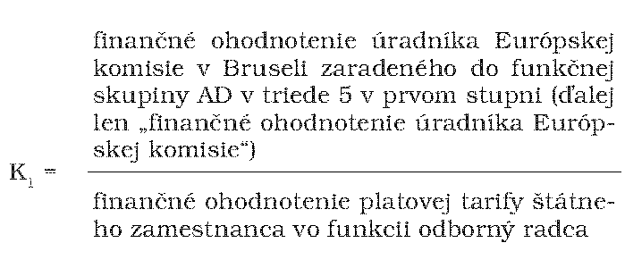
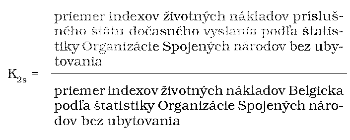
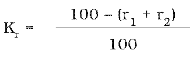

# § 2

(1) Platový koeficient príslušného štátu na kalendárny rok sa určí podľa vzorca

PKs = K1 x K2s x Kr,

kde je

PKs – platový koeficient príslušného štátu,

s – príslušný štát,

kde je

Kr – koeficient regulácie,

r1 – regulácia uplatnená pri zvýšení finančného ohodnotenia úradníka Európskej komisie,

r2– regulácia finančného vyjadrenia indexov životných nákladov podľa štatistiky Organizácie Spojených národov,

0 =1 = Európskej komisie x 100 – 100),

0 =2 = je väčší ako 1,

ak je index vývoja menší ako 1, potom sa r2 rovná 0.

(2) Na účely výpočtu platového koeficientu sa použije

- a) finančné ohodnotenie úradníka Európskej komisie účinné od 1. januára kalendárneho roka, na ktorý sa platový koeficient vypočítava, ak je nariadenie Rady uverejnené do 1. septembra kalendárneho roka, ktorý predchádza kalendárnemu roku, na ktorý sa platový koeficient vypočítava; ak nie je úprava nového finančného ohodnotenia úradníka Európskej komisie vydaná do 1. septembra, použije sa finančné ohodnotenie úradníka Európskej komisie použité na výpočet mzdy v Európskej komisii v Bruseli za mesiac jún kalendárneho roka, ktorý predchádza kalendárnemu roku, na ktorý sa platový koeficient vypočítava,

- b) finančné ohodnotenie platovej tarify štátneho zamestnanca vo funkcii odborný radca podľa zákona účinné od 1. januára kalendárneho roka, na ktorý sa platový koeficient vypočítava,

- c) priemer indexov životných nákladov príslušného štátu dočasného vyslania podľa štatistiky Organizácie Spojených národov bez ubytovania, ktorý sa zistí ako priemer indexov životných nákladov tohto štátu z posledných štyroch štatistík vydávaných štvrťročne alebo zo štatistík vydávaných v iných intervaloch za celé obdobie nasledujúce po posledne použitej štatistike pri ostatne vydanom platovom koeficiente, ktoré sú zverejnené do 1. septembra kalendárneho roka, ktorý predchádza kalendárnemu roku, na ktorý sa platový koeficient vypočítava,

- d) zvýšenie finančného ohodnotenia úradníka Európskej komisie, ktoré sa vypočíta ako pomer finančného ohodnotenia úradníka Európskej komisie podľa písmena a) k finančnému ohodnoteniu úradníka Európskej komisie použitého na výpočet platového koeficientu na kalendárny rok, ktorý predchádza kalendárnemu roku, na ktorý sa platový koeficient vypočítava,

- e) index vývoja, ktorý sa určí ako pomer

  - 1. súčtu súčinov platových taríf zamestnancov Ministerstva zahraničných vecí Slovenskej republiky v jednotlivých štátoch dočasného vyslania, platných k 1. septembru kalendárneho roka, ktorý predchádza kalendárnemu roku, na ktorý sa platový koeficient vypočítava, a priemerov indexov životných nákladov jednotlivých štátov dočasného vyslania podľa štatistiky Organizácie Spojených národov bez ubytovania zistených podľa písmena c) k

  - 2. súčtu súčinov platových taríf zamestnancov Ministerstva zahraničných vecí Slovenskej republiky v jednotlivých štátoch dočasného vyslania platných k 1. septembru kalendárneho roka, ktorý predchádza kalendárnemu roku, na ktorý sa platový koeficient vypočítava, a priemerov indexov životných nákladov jednotlivých štátov dočasného vyslania podľa štatistiky Organizácie Spojených národov bez ubytovania použitých pri ostatne vydanom platovom koeficiente.

(3) Koeficient regulácie sa určí do 31. októbra kalendárneho roka, ktorý predchádza kalendárnemu roku, na ktorý sa platový koeficient vypočítava, na základe podkladov Ministerstva zahraničných vecí Slovenskej republiky predložených Ministerstvu financií Slovenskej republiky do 15. októbra kalendárneho roka, ktorý predchádza kalendárnemu roku, na ktorý sa platový koeficient vypočítava.
