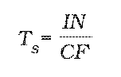
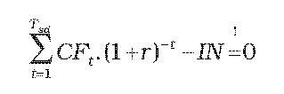
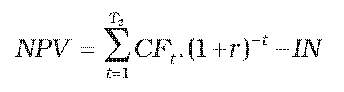
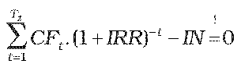

Príloha č. 3 k vyhláške č. 429/2009 Z. z.

- Ekonomické hodnotenie súboru vhodných opatrení

  - 1. Jednoduchá doba návratnosti, doba splatenia investície

  - ,

    - kde IN – investičné náklady,

    - CF – ročné prínosy (cash flow, zmena peňažného toku po realizácii opatrení).

  - 2. Reálna doba návratnosti, doba splatenia investície pri uvažovaní diskontnej sadzby Tsd sa vypočíta z podmienky

  - ,

    - kde CFt – ročné prínosy projektu (zmena peňažných tokov po realizácii projektu),

    - r – diskontný faktor,

    - (1 + r)-t – odúročiteľ.

  - 3. Čistá súčasná hodnota (NPV)

  - ,

    - kde Tž – doba životnosti zariadenia.

  - 4. Vnútorné výnosové percento (IRR).

  - Hodnota IRR sa vypočíta z podmienky:

  - 

  - 5. Výsledky ekonomického vyhodnotenia súboru opatrení sa uvedú prehľadným spôsobom, napr. podľa tabuliek č. 3.1 a 3.2.

  - Tabuľka č. 3.1: Výsledky ekonomického vyhodnotenia – 1. časť

  - VZOR

  - Riadok | Číslo opatrenia | Názov opatrenia | Náklady | Ročné úspory | | | | |

  - | | | | energia | náklady na energiu | osobné náklady | náklady na opravy a údržbu | ostatné náklady | celkom

  - | | | euro | MWh/rok | eur/rok | | | |

  - 1 | 1 | | | | | | | |

  - 2 | 2 | | | | | | | |

  - 3 | 3 | | | | | | | |

  - ... | ... | | | | | | | |

  - n | n | | | | | | | |

  - n +1 | celkom | | súčet riadkov 1 až n | | | | | | 1)

  - 1) | Pri výpočte celkovej hodnoty úspor sa zohľadnia synergické efekty jednotlivých navrhovaných opatrení. Výsledok nemusí byť jednoduchým súčtom úspor vplyvom realizácie jednotlivých opatrení v riadkoch 1 až n. | | | | | | | |

  - Tabuľka č. 3.2: Výsledky ekonomického vyhodnotenia – 2. časť

  - VZOR

  - Ukazovateľ | Hodnota | Jednotka

  - Náklady na realizáciu súboru opatrení | |

  - Zmena nákladov na zabezpečenie energie (– zníženie/+ zvýšenie) | |

  - Zmena osobných nákladov, napr. mzdy, poistné, ... (-/+) | |

  - Zmena ostatných prevádzkových nákladov, napr. opravy a údržba, služby, réžia, poistenie majetku, ... (-/+) | |

  - Zmena iných samostatne uvádzaných nákladov, napr. emisie, odpady a iné (-/+) | |

  - Zmena tržieb, napr. za teplo, elektrinu, využité odpady, ... (-/+) | |

  - Prínosy z realizácie súboru opatrení celkom | |

  - Doba hodnotenia | |

  - Diskontný faktor | |

  - Jednoduchá doba návratnosti (Ts) | |

  - Reálna doba návratnosti (Tsd) | |

  - Čistá súčasná hodnota (NPV) | |

  - Vnútorné výnosové percento (IRR) | |

  - Daň z príjmov | |

  - Iné údaje | |
