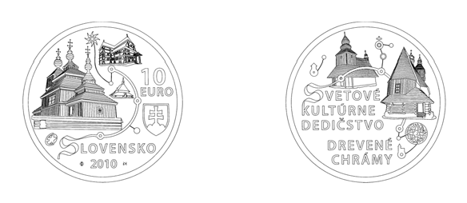

## 481

OZNÁMENIE

Národnej banky Slovenska

z 3. novembra 2009

o vydaní strieborných zberateľských mincí v nominálnej hodnote 10 eur s tematikou Svetové kultúrne dedičstvo – Drevené chrámy v slovenskej časti karpatského oblúka

1. Úvodné ustanovenia

a) Národná banka Slovenska podľa § 17h ods. 1 zákona Národnej rady Slovenskej republiky č. 566/1992 Zb. o Národnej banke Slovenska v znení neskorších predpisov a podľa § 1 ods. 2 písm. d) zákona Národnej rady Slovenskej republiky č. 1/1993 Z. z. o Zbierke zákonov Slovenskej republiky v znení zákona č. 275/2002 Z. z. oznamuje, že vydáva do obehu strieborné zberateľské mince v nominálnej hodnote 10 eur s tematikou Svetové kultúrne dedičstvo – Drevené chrámy v slovenskej časti karpatského oblúka (ďalej len „minca“).

b) Minca má štatút zákonného platidla len v Slovenskej republike.

c) Minca sa razí zo zliatiny obsahujúcej 900 dielov striebra a 100 dielov medi; jej hmotnosť je 18 g a priemer 34 mm. Pri razbe mince je povolená horná a dolná odchýlka v priemere 0,1 mm; povolená horná odchýlka v hmotnosti je 0,4 g a v obsahu striebra 10/1 000.

2. Vzhľad mince

- a) Na líci mince sú vyobrazené tri drevené chrámy v slovenskej časti karpatského oblúka zapísané do Zoznamu svetového dedičstva: v ľavej časti mincového poľa je vyobrazený Chrám sv. Mikuláša v Bodružali, vpravo od neho Kostol Všetkých svätých v Tvrdošíne a nad ním kostol v Hronseku. Vpravo od drevených chrámov je štátny znak Slovenskej republiky, nad ktorým je v dvoch riadkoch umiestnené označenie nominálnej hodnoty mince „10 EURO“. Názov štátu „SLOVENSKO“ so štylizovaným písmenom „S“ symbolizujúcim motív cesty spájajúcej jednotlivé drevené chrámy je umiestnený v spodnej časti mincového poľa. Pod ním je letopočet „2010“. Vľavo od štylizovaného písmena „S“ je umiestnená značka programu Spoločné emisie Európy znázorňujúca európsku hviezdu a symbol eura. Značka Mincovne Kremnica, štátny podnik, „MK“, medzi dvoma razidlami je umiestnená vľavo od letopočtu a štylizované iniciálky mena a priezviska autora výtvarného návrhu Mgr. art. Patrika Kovačovského „PK“ sú umiestnené vpravo od neho.

- b) Na rube mince sú vyobrazené dva drevené chrámy v slovenskej časti karpatského oblúka zapísané do Zoznamu svetového dedičstva: v pravej časti mincového poľa je vyobrazený Kostol sv. Františka z Assisi v Hervartove a vľavo od neho Chrám sv. Mikuláša v Ruskej Bystrej. Pod ním je v troch riadkoch umiestnený nápis „SVETOVÉ KULTÚRNE DEDIČSTVO“ so štylizovaným písmenom „S“ symbolizujúcim motív cesty spájajúcej jednotlivé drevené chrámy. Súčasťou motívu je značka kostola umiestnená nad štylizovaným písmenom „S“. V spodnej časti mincového poľa je v dvoch riadkoch umiestnený nápis „DREVENÉ CHRÁMY“.

- c) Na hrane mince sú nápisy do hĺbky v anglickom jazyku „WORLD HERITAGE“ a vo francúzskom jazyku „PATRIMOINE MONDIAL“. Medzi nápismi sú pomlčky.

Štát vydania: Slovenská republika

Začiatok vydávania: marec 2010

Ivan Šramko v. r.
