- LISABONSKÁ ZMLUVA, KTOROU SA MENÍ A DOPĹŇA ZMLUVA O EURÓPSKEJ ÚNII A ZMLUVA O ZALOŽENÍ EURÓPSKEHO SPOLOČENSTVA (2007/C 306/01) PREAMBULA

- JEHO VELIČENSTVO KRÁĽ BELGIČANOV,

- PREZIDENT BULHARSKEJ REPUBLIKY,

- PREZIDENT ČESKEJ REPUBLIKY,

- JEJ VELIČENSTVO KRÁĽOVNÁ DÁNSKA,

- PREZIDENT SPOLKOVEJ REPUBLIKY NEMECKO,

- PREZIDENT ESTÓNSKEJ REPUBLIKY,

- PREZIDENTKA ÍRSKA,

- PREZIDENT HELÉNSKEJ REPUBLIKY,

- JEHO VELIČENSTVO KRÁĽ ŠPANIELSKA,

- PREZIDENT FRANCÚZSKEJ REPUBLIKY,

- PREZIDENT TALIANSKEJ REPUBLIKY,

- PREZIDENT CYPERSKEJ REPUBLIKY,

- PREZIDENT LOTYŠSKEJ REPUBLIKY,

- PREZIDENT LITOVSKEJ REPUBLIKY,

- JEHO KRÁĽOVSKÁ VÝSOSŤ VEĽKOVOJVODA LUXEMBURSKA,

- PREZIDENT MAĎARSKEJ REPUBLIKY,

- PREZIDENT MALTY,

- JEJ VELIČENSTVO KRÁĽOVNÁ HOLANDSKA,

- SPOLKOVÝ PREZIDENT RAKÚSKEJ REPUBLIKY,

- PREZIDENT POĽSKEJ REPUBLIKY,

- PREZIDENT PORTUGALSKEJ REPUBLIKY,

- PREZIDENT RUMUNSKA,

- PREZIDENT SLOVINSKEJ REPUBLIKY,

- PREZIDENT SLOVENSKEJ REPUBLIKY,

- PREZIDENTKA FÍNSKEJ REPUBLIKY,

- VLÁDA ŠVÉDSKEHO KRÁĽOVSTVA,

- JEJ VELIČENSTVO KRÁĽOVNÁ SPOJENÉHO KRÁĽOVSTVA VEĽKEJ BRITÁNIE A SEVERNÉHO ÍRSKA,

- SO ŽELANÍM dokončiť proces začatý Amsterdamskou zmluvou a Zmluvou z Nice s cieľom posilniť efektívnosť a demokratickú legitimitu Únie a zlepšiť súdržnosť jej činnosti,

- SA DOHODLI NA zmene a doplnení Zmluvy o Európskej únii, Zmluvy o založení Európskeho spoločenstva a Zmluvy o založení Európskeho spoločenstva pre atómovú energiu,

- a na tento účel určili za svojich splnomocnených zástupcov:

- JEHO VELIČENSTVO KRÁĽ BELGIČANOV, Guy VERHOFSTADT

- predseda vlády

- Karel DE GUCHT

- minister zahraničných vecí

- PREZIDENT BULHARSKEJ REPUBLIKY, Sergei STANISHEV

- predseda vlády

- Ivailo KALFIN

- podpredseda vlády a minister zahraničných vecí

- PREZIDENT ČESKEJ REPUBLIKY, Mirek TOPOLÁNEK

- predseda vlády

- Karel SCHWARZENBERG

- minister zahraničných vecí

- JEJ VELIČENSTVO KRÁĽOVNÁ DÁNSKA, Anders Fogh RASMUSSEN

- predseda vlády

- Per Stig MØLLER minister zahraničných vecí

- PREZIDENT SPOLKOVEJ REPUBLIKY NEMECKO,

- Dr. Angela MERKEL spolková kancelárka

- Dr. Frank-Walter STEINMEIER

- spolkový minister zahraničných vecí a vicekancelár

- PREZIDENT ESTÓNSKEJ REPUBLIKY, Andrus ANSIP

- predseda vlády

- Urmas PAET

- minister zahraničných vecí

- PREZIDENTKA ÍRSKA, Bertie AHERN

- predseda vlády (Taoiseach)

- Dermot AHERN

- minister zahraničných vecí

- PREZIDENT HELÉNSKEJ REPUBLIKY,

- Konstantinos KARAMANLIS predseda vlády

- Dora BAKOYANNIS

- ministerka zahraničných vecí

- JEHO VELIČENSTVO KRÁĽ ŠPANIELSKA,

- José Luis RODRÍGUEZ ZAPATERO predseda vlády

- Miguel Ángel MORATINOS CUYAUBÉ

- minister zahraničných vecí a spolupráce

- PREZIDENT FRANCÚZSKEJ REPUBLIKY, Nicolas SARKOZY

- prezident

- François FILLON predseda vlády

- Bernard KOUCHNER

- minister zahraničných a európskych vecí

- Romano PRODI

- predseda Rady ministrov Massimo D´ALEMA

- podpredseda Rady ministrov a minister zahraničných vecí

- PREZIDENT CYPERSKEJ REPUBLIKY, Tassos PAPADOPOULOS

- prezident

- Erato KOZAKOU-MARCOULLIS

- ministerka zahraničných vecí

- PREZIDENT LOTYŠSKEJ REPUBLIKY, Valdis ZATLERS

- prezident

- Aigars KALVlĪIS predseda vlády

- Märis RIEKSTIŅŠ minister zahraničných vecí

- PREZIDENT LITOVSKEJ REPUBLIKY, Valdas ADAMKUS

- prezident

- Gediminas KIRKILAS

- predseda vlády

- Petras VAITIEKŪNAS minister zahraničných vecí

- JEHO KRÁĽOVSKÁ VÝSOSŤ VEĽKOVOJVODA LUXEMBURSKA,

- Jean-Claude JUNCKER predseda vlády, štátny minister

- Jean ASSELBORN

- minister zahraničných vecí a imigrácie

- PREZIDENT MAĎARSKEJ REPUBLIKY,

- Ferenc GYURCSÁNY predseda vlády

- Dr. Kinga GÖNCZ ministerka zahraničných vecí

- PREZIDENT MALTY,

- The Hon Lawrence GONZI predseda vlády

- The Hon Michael FRENDO

- minister zahraničných vecí

- JEJ VELIČENSTVO KRÁĽOVNÁ HOLANDSKA, Dr. J. P. BALKENENDE

- predseda vlády

- M. J. M. VERHAGEN

- minister zahraničných vecí

- SPOLKOVÝ PREZIDENT RAKÚSKEJ REPUBLIKY, Dr. Alfred GUSENBAUER

- spolkový kancelár

- Dr. Ursula PLASSNIK

- spolková ministerka pre európske a medzinárodné veci

- Donald TUSK

- predseda vlády

- Radoslaw SIKORSKI minister zahraničných vecí

- PREZIDENT PORTUGALSKEJ REPUBLIKY,

- José SÓCRATES CARVALHO PINTO DE SOUSA predseda vlády

- Luís Filipe MARQUES AMADO minister zahraničných vecí

- PREZIDENT RUMUNSKA,

- Traian BĂSESCU prezident

- Călin POPESCU TĂRICEANU predseda vlády

- Adrian CIOROIANU

- minister zahraničných vecí

- PREZIDENT SLOVINSKEJ REPUBLIKY, Janez JANŠA

- predseda vlády

- Dr. Dimitrij RUPEL

- minister zahraničných vecí

- Robert FICO predseda vlády

- Ján KUBIŠ

- minister zahraničných vecí

- PREZIDENTKA FÍNSKEJ REPUBLIKY, Matti VANHANEN

- predseda vlády

- Ilkka KANERVA

- minister zahraničných vecí VLÁDA ŠVÉDSKEHO KRÁĽOVSTVA,

- Fredrik REINFELDT

- predseda vlády

- Cecilia MALMSTRÖM

- ministerka európskych vecí JEJ VELIČENSTVO KRÁĽOVNÁ SPOJENÉHO KRÁĽOVSTVA VEĽKEJ BRITÁNIE A SEVERNÉHO

- ÍRSKA,

- The Rt. Hon Gordon BROWN predseda vlády

- The Rt. Hon David MILIBAND

- minister zahraničných vecí a Commonwealthu KTORÍ sa po výmene svojich plných mocí uznaných za správne a v náležitej forme

- DOHODLI NA TÝCHTO USTANOVENIACH:

  - ZMENY A DOPLNENIA ZMLUVY O EURÓPSKEJ ÚNII A ZMLUVY O ZALOŽENÍ EURÓPSKEHO SPOLOČENSTVA

    - Článok 1

      - Zmluva o Európskej únii sa mení a dopĺňa v súlade s ustanoveniami tohto článku.

      - PREAMBULA

      - 1) Preambula sa mení a dopĺňa takto:

        - a) tento text sa vkladá ako druhé odôvodnenie:

          - „ČERPAJÚC inšpiráciu z kultúrneho, náboženského a humanistického dedičstva Európy, z ktorého sa vyvinuli univerzálne hodnoty nezrušiteľných a nescudziteľných práv ľudskej bytosti, slobody, demokracie, rovnosti a právneho štátu,“;

        - b) v siedmom odôvodnení, ktoré sa stáva ôsmym odôvodnením sa slová „tejto zmluvy,“ nahrádzajú slovami „tejto zmluvy a Zmluvy o fungovaní Európskejúnie,“;

        - c) v jedenástom odôvodnení, ktoré sa stáva dvanástym odôvodnením sa slová „tejto zmluvy,“ nahrádzajú slovami „tejto zmluvy a Zmluvy o fungovaní Európskej únie,“.

      - VŠEOBECNÉ USTANOVENIA

      - 2) Článok 1 sa mení a dopĺňa takto:

        - a) na konci prvého odseku sa dopĺňa táto časť vety:

          - „... , na ktorú členské štáty preniesli právomoci na dosiahnutie spoločných cieľov.“;

        - b) tretí odsek sa nahrádza takto:

          - „Únia je založená na tejto zmluve a na Zmluve o fungovaní Európskej únie (ďalej len ,zmluvy'). Tieto dve zmluvy majú rovnakú právnu silu. Únia nahrádza Európske spoločenstvo a je jeho právnym nástupcom.“

      - 3) Vkladá sa článok 1a:

        - „Článok 1a

          - Únia je založená na hodnotách úcty k ľudskej dôstojnosti, slobody, demokracie, rovnosti, právneho štátu a rešpektovania ľudských práv vrátane práv osôb patriacich k menšinám. Tieto hodnoty sú spoločné členským štátom v spoločnosti, v ktorej prevláda pluralizmus, nediskriminácia, tolerancia, spravodlivosť, solidarita a rovnosť medzi ženami a mužmi.“

      - 4) Článok 2 sa nahrádza týmto textom:

        - „Článok 2

          - 1. Cieľom Únie je presadzovať mier, svoje hodnoty a blaho svojich národov.

          - 2. Únia ponúka svojim občanom priestor slobody, bezpečnosti a spravodlivosti bez vnútorných hraníc, v ktorom je zaručený voľný pohyb osôb spolu s príslušnými opatreniami týkajúcimi sa kontroly na vonkajších hraniciach, azylu, prisťahovalectva a predchádzania trestnej činnosti a boja s ňou.

          - 3. Únia vytvára vnútorný trh. Usiluje sa o trvalo udržateľný rozvoj Európy založený na vyváženom hospodárskom raste a cenovej stabilite, o sociálne trhové hospodárstvo s vysokou konkurencieschopnosťou zamerané na dosiahnutie plnej zamestnanosti a sociálneho pokroku, ako aj o vysokú úroveň ochrany životného prostredia a zlepšenie jeho kvality.

            - Podporuje vedecký a technický pokrok.

            - Bojuje proti sociálnemu vylúčeniu a diskriminácii a podporuje sociálnu spravodlivosť

            - a ochranu, rovnosť medzi ženami a mužmi, solidaritu medzi generáciami a ochranu práv dieťaťa.

            - Podporuje hospodársku, sociálnu a územnú súdržnosť a solidaritu medzi členskými štátmi.

            - Rešpektuje svoju bohatú kultúrnu a jazykovú rozmanitosť a zabezpečuje zachovávanie a zveľaďovanie európskeho kultúrneho dedičstva.

          - 4. Únia vytvorí hospodársku a menovú úniu, ktorej menou je euro.

          - 5. Únia vo vzťahoch so zvyškom sveta potvrdzuje a podporuje svoje hodnoty a záujmy a prispieva k ochrane svojich občanov. Prispieva k mieru, bezpečnosti, trvalo udržateľnému rozvoju Zeme, k solidarite a vzájomnému rešpektovaniu sa národov, k voľnému a spravodlivému obchodu, k odstráneniu chudoby a k ochrane ľudských práv, najmä práv dieťaťa, ako aj k prísnemu dodržiavaniu a rozvoju medzinárodného práva, najmä k dodržiavaniu zásad Charty Organizácie Spojených národov.

          - 6. Únia dosahuje svoje ciele primeranými prostriedkami podľa rozsahu, v akom boli na ňu zmluvami prenesené príslušné právomoci.“

        - 5) Článok 3 sa vypúšťa a vkladá sa článok 3a:

          - „Článok 3 a

            - 1. V súlade s článkom 3b právomoci, ktoré na Úniu neboli zmluvami prenesené, zostávajú právomocami členských štátov.

            - 2. Únia rešpektuje rovnosť členských štátov pred zmluvami, ako aj ich národnú identitu, obsiahnutú v ich základných politických a ústavných systémoch vrátane regionálnych a miestnych samospráv. Rešpektuje ich základné štátne funkcie, najmä zabezpečovanie územnej celistvosti štátu, udržiavanie verejného poriadku a zabezpečovanie národnej bezpečnosti. Predovšetkým národná bezpečnosť ostáva vo výlučnej zodpovednosti každého členského štátu.

            - 3. Podľa zásady lojálnej spolupráce sa Únia a členské štáty vzájomne rešpektujú a vzájomne si pomáhajú pri vykonávaní úloh, ktoré vyplývajú zo zmlúv.

              - Členské štáty prijmú všetky opatrenia všeobecnej alebo osobitnej povahy, aby zabezpečili plnenie záväzkov vyplývajúcich zo zmlúv alebo z aktov inštitúcií Únie.

              - Členské štáty pomáhajú Únii pri plnení jej úloh a neprijmú žiadne opatrenie, ktoré by mohlo ohroziť dosiahnutie cieľov Únie.“

        - 6) Vkladá sa článok 3b, ktorý nahrádza článok 5 Zmluvy o založení Európskeho spoločenstva:

          - „Článok 3b

            - 1. Vymedzenie právomocí Únie sa spravuje zásadou prenesenia právomocí. Vykonávanie právomocí Únie sa spravuje zásadou subsidiarity a proporcionality.

            - 2. Podľa zásady prenesenia právomocí Únia koná len v medziach právomocí, ktoré na ňu preniesli členské štáty v zmluvách na dosiahnutie cieľov v nich vymedzených. Právomoci, ktoré na Úniu neboli v zmluvách prenesené, zostávajú právomocami členských štátov.

            - 3. Podľa zásady subsidiarity koná Únia v oblastiach, ktoré nepatria do jej výlučnej právomoci, len v takom rozsahu a vtedy, ak ciele zamýšľané touto činnosťou nemôžu členské štáty uspokojivo dosiahnuť na ústrednej úrovni alebo na regionálnej a miestnej úrovni, ale z dôvodov rozsahu alebo účinkov navrhovanej činnosti ich možno lepšie dosiahnuť na úrovni Únie.

              - Inštitúcie Únie uplatňujú zásadu subsidiarity v súlade s Protokolom o uplatňovaní zásad subsidiarity a proporcionality. Národné parlamenty zabezpečujú dodržiavanie zásady subsidiarity v súlade s postupom ustanoveným v uvedenom protokole.

            - 4. Podľa zásady proporcionality neprekračuje obsah a forma činnosti Únie rámec toho, čo je nevyhnutné na dosiahnutie cieľov zmlúv.

              - Inštitúcie Únie uplatňujú zásadu proporcionality v súlade s Protokolom o uplatňovaní zásad subsidiarity a proporcionality.“

        - 7) Články 4 a 5 sa vypúšťajú.

        - 8) Článok 6 sa nahrádza týmto textom:

          - „Článok 6

            - 1. Únia uznáva práva, slobody a zásady uvedené v Charte základných práv Európskej únie zo 7. decembra 2000 upravenej 12. decembra 2007 v Štrasburgu, ktorá má rovnakú právnu silu ako zmluvy.

              - Ustanovenia charty žiadnym spôsobom nerozširujú právomoci Únie vymedzené v zmluvách.

              - Práva, slobody a zásady v charte sa vykladajú v súlade so všeobecnými ustanoveniami hlavy VII charty, ktorými sa upravuje jej výklad a uplatňovanie a pri riadnom zohľadnení vysvetliviek, na ktoré sa v charte odkazuje a ktoré označujú zdroje týchto ustanovení.

            - 2. Únia pristúpi k Európskemu dohovoru o ochrane ľudských práv a základných slobôd. Týmto pristúpením nie sú dotknuté právomoci Únie vymedzené v zmluvách.

            - 3. Základné práva tak, ako sú zaručené Európskym dohovorom o ochrane ľudských práv a základných slobôd a ako vyplývajú z ústavných tradícií spoločných pre členské štáty, predstavujú všeobecné zásady práva Únie.“

        - 9) Článok 7 sa mení a dopĺňa takto:

          - a) prvá zmena sa netýka slovenskejverzie, slová „princípov uvedených v článku 6 ods. 1“ sa nahrádzajú slovami „hodnôt uvedených v článku 1a“ a slová „tejto zmluvy“ sa nahrádzajú slovom „zmlúv“, pričom predložka „z“ sa v prípade potreby upraví na „zo“ a slovo „Komisie“ sa nahrádza slovami „Európskejkomisie“;

          - b) v odseku 1 prvom pododseku prvej vete sa vypúšťa záver vety „... , a adresovať tomuto štátu vhodné odporúčania“; v poslednej vete sa záver vety „... a v súlade s tým istým postupom môže vyzvať nezávislé osoby, aby v primeranej lehote predložili správu o situácii v príslušnom členskom štáte.“ nahrádza takto: „a v súlade s tým istým postupom mu môže adresovať vhodné odporúčania.“;

          - c) v odseku 2 sa slová „Rada, ktorú tvoria hlavy štátov a vlád, môže...“ nahrádzajú slovami „Európska rada môže... “ a slová „... vlády tohto členského štátu, aby predložila... “ sa nahrádzajú slovami „tohto členského štátu, aby predložil...“;

          - d) odseky 5 a 6 sa nahrádzajú takto:

            - „5. Pravidlá hlasovania, ktoré sa na účely tohto článku vzťahujú na Európsky parlament, Európsku radu a Radu, sú ustanovené v článku 309 Zmluvy o fungovaní Európskej únie.“

        - 10) Vkladá sa tento nový článok 7a:

          - „Článok 7a

            - 1. Únia rozvíja osobitné vzťahy so susednými krajinami s cieľom vytvoriť priestor prosperity a dobrého susedstva, ktorý je založený na hodnotách Únie a charakterizovaný blízkymi a mierovými vzťahmi založenými na spolupráci.

            - 2. Na účely odseku 1 môže Únia uzatvárať s dotknutými krajinami osobitné dohody. Tieto dohody môžu obsahovať vzájomné práva a povinnosti, ako aj možnosť spoločne prijímať opatrenia. Ich vykonávanie je predmetom pravidelných konzultácií.“

        - 11) Ustanovenia hlavy II sa vkladajú do Zmluvy o založení Európskeho spoločenstva v znení zmien a doplnení podľa iných ustanovení tejto zmluvy, ktorá sa stáva Zmluvou o fungovaní Európskej únie.

        - DEMOKRATICKÉ ZÁSADY

        - 12) Hlava II a článok 8 sa nahrádzajú týmto novým nadpisom a novými článkami 8 až 8c:

          - „HLAVA II USTANOVENIA O DEMOKRATICKÝCH ZÁSADÁCH

            - Článok 8

              - Únia dodržiava pri všetkých svojich činnostiach zásadu rovnosti občanov, ktorým sa dostáva rovnakej pozornosti zo strany jej inštitúcií, orgánov, úradov a agentúr. Občanom Únie je každá osoba, ktorá má štátnu príslušnosť členského štátu. Občianstvo Únie dopĺňa štátne občianstvo a nenahrádza ho.

            - Článok 8a

              - 1. Fungovanie Únie je založené na zastupiteľskejdemokracii.

              - 2. Občania sú na úrovni Únie priamo zastúpení v Európskom parlamente.

                - Členské štáty sú zastúpené v Európskej rade hlavami štátov alebo predsedami vlád a v Rade svojimi vládami, ktoré samotné sú demokraticky zodpovedné buď svojim národným parlamentom, alebo svojim občanom.

              - 3. Každý občan má právo zúčastňovať sa na demokratickom živote Únie. Rozhodnutia sa prijímajú podľa možnosti čo najotvorenejšie a čo najbližšie k občanovi.

              - 4. Politické strany na európskej úrovni prispievajú k formovaniu európskeho politického vedomia a k vyjadrovaniu vôle občanov Únie.

            - Článok 8b

              - 1. Inštitúcie dávajú primeraným spôsobom občanom a reprezentatívnym združeniam možnosť verejne vyjadrovať a vymieňať si názory na všetky oblasti činnosti Únie.

              - 2. Inštitúcie udržiavajú otvorený, transparentný a pravidelný dialóg s reprezentatívnymi združeniami a občianskou spoločnosťou.

              - 3. Európska komisia vedie rozsiahle konzultácie s dotknutými stranami s cieľom zabezpečiť súdržnosť a transparentnosť činností Únie.

              - 4. Občania Únie, ktorých počet dosiahne najmenej jeden milión a ktorí sú štátnymi príslušníkmi významného počtu členských štátov, sa môžu ujať iniciatívy a vyzvať Európsku komisiu, aby v rámci svojich právomocí predložila vhodný návrh vo veciach, o ktorých sa občania domnievajú, že na účely uplatňovania zmlúv je potrebný právny akt Únie.

                - Postupy a podmienky predloženia takejto iniciatívy sú ustanovené v súlade s článkom 21 prvým odsekom Zmluvy o fungovaní Európskej únie.

            - Článok 8c Národné parlamenty aktívne prispievajú k dobrému fungovaniu Únie tým, že:

              - a) ich v súlade s Protokolom o úlohe národných parlamentov v Európskej únii inštitúcie Únie informujú o návrhoch legislatívnych aktov Únie, ktoré im zasielajú;

              - b) dohliadajú na dodržiavanie zásady subsidiarity v súlade s postupmi ustanovenými v Protokole o uplatňovaní zásad subsidiarity a proporcionality;

              - c) sa v rámci priestoru slobody, bezpečnosti a spravodlivosti zúčastňujú na mechanizmoch hodnotenia vykonávania politík Únie v tejto oblasti v súlade s článkom 61c Zmluvy o fungovaní Európskej únie a že sa zapájajú do politickej kontroly Europolu a hodnotenia činnosti Eurojustu v súlade s článkami 69g a 69d uvedenejzmluvy;

              - d) sa zúčastňujú na postupoch revízie zmlúv v súlade s článkom 48 tejto zmluvy

              - e) sa im oznamujú žiadosti o pristúpenie k Únii v súlade s článkom 49 tejto zmluvy;

              - f) sa zúčastňujú medziparlamentnej spolupráce medzi národnými parlamentmi a Európskym parlamentom v súlade s Protokolom o úlohe národných parlamentov v Európskej únii“.

        - INŠTITÚCIE

        - 13) Ustanovenia hlavy III sa vypúšťajú. Hlava III sa nahrádza týmto novým nadpisom:

          - „HLAVA III

            - USTANOVENIA O INŠTITÚCIÁCH“.

        - 14) Článok 9 sa nahrádza týmto textom:

          - „Článok 9

            - 1. Únia má k dispozícii inštitucionálny rámec, ktorého účelom je podporovať jej hodnoty, sledovať jej ciele, slúžiť jej záujmom, záujmom jej občanov a členských štátov, ako aj zabezpečovať konzistentnosť, efektívnosť a kontinuitu jej politík a činností.

            - Inštitúciami Únie sú:

            - – Európsky parlament,

            - – Európska rada,

            - – Rada,

            - – Európska komisia (ďalejlen ,Komisia'),

            - – Súdny dvor Európskej únie,

            - – Európska centrálna banka,

            - – Dvor audítorov.

            - 2. Každá inštitúcia koná v medziach právomocí, ktoré sú jej zverené zmluvami, a v súlade s postupmi, podmienkami a cieľmi v nich ustanovenými. Inštitúcie navzájom v plnej miere spolupracujú.

            - 3. Ustanovenia o Európskej centrálnej banke a Dvore audítorov, ako aj podrobné ustanovenia o ostatných inštitúciách, sa nachádzajú v Zmluve o fungovaní Európskej únie.

            - 4. Európskemu parlamentu, Rade a Komisii pomáha Hospodársky a sociálny výbor a Výbor regiónov s poradnou funkciou.“

        - 15) Vkladá sa článok 9a:

          - „Článok 9a

            - 1. Európsky parlament spoločne s Radou vykonáva legislatívne a rozpočtové funkcie. Vykonáva funkciu politickej kontroly a poradnú funkciu v súlade s podmienkami ustanovenými v zmluvách. Volí predsedu Komisie.

            - 2. Európsky parlament sa skladá zo zástupcov občanov Únie. Ich počet nepresiahne sedemsto päťdesiat plus predseda. Zastúpenie občanov je zostupne proporčné, pričom každý členský štát má najmenejšesť členov. Žiadny členský štát nemá pridelených viac ako deväťdesiatšesť kresiel.

              - Európska rada prijme jednomyseľne na základe iniciatívy Európskeho parlamentu a s jeho súhlasom rozhodnutie, ktorým sa ustanoví zloženie Európskeho parlamentu, dodržiavajúc zásady uvedené v prvom pododseku.

            - 3. Poslanci Európskeho parlamentu sú volení vo všeobecných, priamych a slobodných voľbách tajným hlasovaním na volebné obdobie piatich rokov.

            - 4. Európsky parlament si z radov svojich poslancov volí predsedu a predsedníctvo.“

        - 16) Vkladá sa článok 9b:

          - „Článok 9b

            - 1. Európska rada dáva Únii potrebné podnety na jej rozvoj a určuje jej všeobecné politické smerovanie a priority. Nevykonáva legislatívnu funkciu.

            - 2. Európska rada sa skladá z hláv štátov alebo predsedov vlád členských štátov, ako aj svojho predsedu a predsedu Komisie. Jejpráce sa zúčastňuje vysoký predstaviteľ Únie pre zahraničné veci a bezpečnostnú politiku.

            - 3. Európska rada zasadá dvakrát za polrok, zvoláva ju jej predseda. Ak si to vyžaduje program rokovania, členovia Európskej rady môžu rozhodnúť, že každému z nich bude pomáhať minister, a v prípade predsedu Komisie, člen Komisie. Ak si to vyžaduje situácia, predseda zvolá mimoriadne zasadnutie Európskej rady.

            - 4. Rozhodnutia Európskej rady sa prijímajú konsenzom, ak nie je v zmluvách ustanovené inak.

            - 5. Európska rada volí svojho predsedu kvalifikovanou väčšinou na funkčné obdobie dva a pol roka s možnosťou opätovného zvolenia na jedno funkčné obdobie. Európska rada môže v prípade prekážok vo výkone funkcie alebo závažného pochybenia jeho funkčné obdobie ukončiť podľa rovnakého postupu.

            - 6. Predseda Európskej rady:

              - a) predsedá Európskej rade a podnecuje jej prácu;

              - b) zabezpečuje prípravu a plynulosť práce Európskej rady v spolupráci s predsedom Komisie a na základe práce Rady pre všeobecné záležitosti;

              - c) usiluje sa uľahčiť dosiahnutie súdržnosti a konsenzu v rámci Európskej rady;

              - d) po každom zasadnutí Európskej rady predkladá správu Európskemu parlamentu.

              - Predseda Európskej rady na svojej úrovni a z titulu svojej funkcie zabezpečuje zastupovanie Únie navonok v záležitostiach týkajúcich sa spoločnej zahraničnej a bezpečnostnej politiky bez toho, aby boli dotknuté právomoci vysokého predstaviteľa Únie pre zahraničné veci a bezpečnostnú politiku.

              - Predseda Európskej rady nesmie vykonávať vnútroštátnu funkciu.“

        - 17) Vkladá sa článok 9c:

          - „Článok 9c

            - 1. Rada spolu s Európskym parlamentom vykonáva legislatívne a rozpočtové funkcie. Vykonáva funkcie tvorby politík a koordinačné funkcie v súlade s podmienkami ustanovenými v zmluvách.

            - 2. Rada sa skladá z jedného zástupcu každého členského štátu na ministerskej úrovni, ktorý môže zaväzovať vládu príslušného členského štátu a hlasovať za ňu.

            - 3. Rada sa uznáša kvalifikovanou väčšinou s výnimkou prípadov, keď zmluvy ustanovujú inak.

            - 4. Od 1. novembra 2014 je kvalifikovaná väčšina vymedzená ako väčšina rovnajúca sa najmenej 55 % členov Rady, ktorí pozostávajú najmenejz pätnástich členov a zastupujú členské štáty zahŕňajúce najmenej 65 % obyvateľstva Únie.

              - Blokujúcu menšinu musia tvoriť najmenejštyria členovia Rady, v opačnom prípade sa kvalifikovaná väčšina považuje za dosiahnutú.

              - Ostatné pravidlá, ktorými sa spravuje hlasovanie kvalifikovanou väčšinou, sú ustanovené v článku 205 ods. 2 Zmluvy o fungovaní Európskej únie.

            - 5. Prechodné ustanovenia o vymedzení kvalifikovanej väčšiny uplatniteľné do 31. októbra 2014, ako ajustanovenia uplatniteľné od 1. novembra 2014 do 31. marca 2017, sú ustanovené v Protokole o prechodných ustanoveniach.

            - 6. Rada zasadá v rôznych zloženiach, ktorých zoznam sa prijíma v súlade s článkom 201b Zmluvy o fungovaní Európskej únie.

              - Rada pre všeobecné záležitosti zabezpečuje konzistentnosť práce rôznych zložení Rady. Pripravuje zasadnutia Európskej rady a spolu s predsedom Európskej rady a Komisiou zabezpečuje ich nadväznosť.

              - Rada pre zahraničné veci rozpracúva vonkajšiu činnosť Únie na základe strategických usmernení stanovených Európskou radou a zabezpečuje, aby činnosť Únie bola konzistentná.

            - 7. Za prípravu práce Rady je zodpovedný Výbor stálych predstaviteľov vlád členských štátov.

            - 8. Po čas rokovania a hlasovania o návrhu legislatívneho aktu sú zasadnutia Rady verejné. Na tento účel je každé zasadnutie Rady rozdelené na dve časti, pričom jedna časť sa zaoberá prerokovávaním legislatívnych aktov Únie a druhá nelegislatívnymi činnosťami.

            - 9. Zloženiam Rady s výnimkou zloženia Rady pre zahraničné veci predsedajú zástupcovia členských štátov v Rade na základe zásady rovnosti rotácie v súlade s článkom 201b Zmluvy o fungovaní Európskej únie.“

        - 18) Vkladá sa článok 9d:

          - „Článok 9d

            - 1. Komisia podporuje všeobecný záujem Únie a na tento účel sa ujíma vhodných iniciatív. Zabezpečuje uplatňovanie zmlúv, ako aj opatrení prijatých inštitúciami na ich základe. Dohliada na uplatňovanie práva Únie pod kontrolou Súdneho dvora Európskej únie. Plní rozpočet a riadi programy. Vykonáva koordinačné, výkonné a riadiace funkcie v súlade s podmienkami ustanovenými v zmluvách. S výnimkou spoločnej zahraničnej a bezpečnostnej politiky a iných prípadov ustanovených v zmluvách zabezpečuje zastupovanie Únie navonok. Dáva iniciatívy na ročné a viacročné programovanie Únie v snahe dosiahnuť medzi-inštitucionálne dohody.

            - 2. Legislatívne akty Únie môžu byť prijaté len na základe návrhu Komisie, pokiaľ zmluvy neustanovujú inak. Iné akty sa prijímajú na základe návrhu Komisie, ak tak ustanovujú zmluvy.

            - 3. Funkčné obdobie Komisie je päťročné.

              - Členovia Komisie sú vybraní na základe ich celkových schopností a ich európskej angažovanosti spomedzi osôb, ktoré poskytujú záruky úplnej nezávislosti.

              - Komisia je pri vykonávaní svojich úloh úplne nezávislá. Bez toho, aby bol dotknutý článok 9e ods. 2, členovia Komisie nesmú žiadať ani prijímať pokyny od žiadnej vlády, inštitúcie, orgánu alebo úradu alebo agentúry. Musia sa zdržať akéhokoľvek konania, ktoré je nezlučiteľné s ich funkciou alebo plnením ich úloh.

            - 4. Komisia vymenovaná medzi nadobudnutím platnosti Lisabonskejzmluvy a 31. októbrom 2014 sa skladá z jedného štátneho príslušníka za každý členský štát vrátane jejpredsedu a vysokého predstaviteľa Únie pre zahraničné veci a bezpečnostnú politiku, ktorý je jedným z jej podpredsedov.

            - 5. Od 1. novembra 2014 sa Komisia skladá z takého počtu členov vrátane jejpredsedu a vysokého predstaviteľa Únie pre zahraničné veci a bezpečnostnú politiku, ktorý zodpovedá dvom tretinám počtu členských štátov, pokiaľ Európska rada nerozhodne jednomyseľne o zmene tohto počtu.

              - Členovia Komisie sú vybraní spomedzi štátnych príslušníkov členských štátov na základe systému striktne rovnej rotácie medzi členskými štátmi, ktorý umožňuje zohľadniť demografické a geografické spektrum všetkých členských štátov. Tento systém zavedie jednomyseľne Európska rada v súlade s článkom 211a Zmluvy o fungovaní Európskejúnie.

            - 6. Predseda Komisie:

              - a) vydáva usmernenia pre prácu Komisie;

              - b) rozhoduje o vnútornej organizácii Komisie a zabezpečuje, aby konala konzistentne, efektívne a ako kolektívny orgán;

              - c) spomedzi členov Komisie vymenúva podpredsedov s výnimkou vysokého predstaviteľa Únie pre zahraničné veci a bezpečnostnú politiku.

                - Člen Komisie sa vzdá funkcie, ak ho o to požiada predseda. Vysoký predstaviteľ Únie pre zahraničné veci a bezpečnostnú politiku sa vzdá funkcie v súlade s postupom ustanoveným v článku 9e, ak ho o to požiada predseda.

            - 7. Zohľadňujúc voľby do Európskeho parlamentu a po príslušných konzultáciách navrhne Európska rada kvalifikovanou väčšinou Európskemu parlamentu kandidáta na funkciu predsedu Komisie. Tohto kandidáta volí Európsky parlament väčšinou svojich členov. Ak tento kandidát nezíska požadovanú väčšinu, Európska rada kvalifikovanou väčšinou navrhne do jedného mesiaca nového kandidáta, ktorého volí Európsky parlament podľa rovnakého postupu.

              - Rada po spoločnej dohode so zvoleným predsedom prijme zoznam ostatných osôb, ktoré navrhuje vymenovať za členov Komisie. Sú vybraní na základe návrhov členských štátov v súlade s kritériami ustanovenými v odseku 3 druhom pododseku a odseku 5 druhom pododseku.

              - Predseda, vysoký predstaviteľ Únie pre zahraničné veci a bezpečnostnú politiku a ostatní členovia Komisie podliehajú ako celok schváleniu Európskeho parlamentu. Na základe tohto schválenia vymenuje Európska rada kvalifikovanou väčšinou Komisiu.

            - 8. Komisia sa ako celok zodpovedá Európskemu parlamentu. V súlade s článkom 201 Zmluvy o fungovaní Európskejúnie môže Európsky parlament hlasovať o návrhu na vyslovenie nedôvery Komisii. Ak je takýto návrh prijatý, členovia Komisie sa musia kolektívne vzdať svojich funkcií a vysoký predstaviteľ Únie pre zahraničné veci a bezpečnostnú politiku sa musí vzdať svojich funkcií, ktoré vykonáva v rámci Komisie.“

        - 19) Vkladá sa tento nový článok 9e:

          - „Článok 9e

            - 1. Európska rada kvalifikovanou väčšinou a so súhlasom predsedu Komisie vymenuje vysokého predstaviteľa Únie pre zahraničné veci a bezpečnostnú politiku. Európska rada môže ukončiť jeho funkčné obdobie rovnakým postupom.

            - 2. Vysoký predstaviteľ vedie spoločnú zahraničnú a bezpečnostnú politiku Únie. Svojimi návrhmi prispieva k tvorbe tejto politiky a uskutočňuje ju ako splnomocnenec Rady. To isté sa vzťahuje na spoločnú bezpečnostnú a obrannú politiku.

            - 3. Vysoký predstaviteľ predsedá Rade pre zahraničné veci.

            - 4. Vysoký predstaviteľ je jedným z podpredsedov Komisie. Zabezpečuje konzistentnosť vonkajšej činnosti Únie. V rámci Komisie zodpovedá za úlohy, ktoré jej v tejto súvislosti prislúchajú v oblasti vonkajších vzťahov, a za koordináciu ostatných aspektov vonkajšej činnosti Únie. Pri vykonávaní týchto právomocí v rámci Komisie a len v súvislosti s týmito právomocami je vysoký predstaviteľ viazaný postupmi, ktoré upravujú fungovanie Komisie v rozsahu, ktorý je zlučiteľný s odsekmi 2 a 3.“

        - 20) Vkladá sa článok 9f:

          - „Článok 9f

            - 1. Súdny dvor Európskej únie sa skladá zo Súdneho dvora, Všeobecného súdu a osobitných súdov. Zabezpečuje dodržiavanie práva pri výklade a uplatňovaní zmlúv.

              - Členské štáty ustanovia v oblastiach, na ktoré sa vzťahuje právo Únie prostriedky nápravy potrebné na zabezpečenie účinnej právnej ochrany.

            - 2. Súdny dvor tvoria sudcovia, jeden za každý členský štát. Pomáhajú mu generálni advokáti.

              - Všeobecný súd tvoria sudcovia, najmenej jeden za každý členský štát.

              - Sudcovia a generálni advokáti Súdneho dvora a sudcovia Všeobecného súdu sú vybraní z osôb, ktoré poskytujú záruku úplnejnezávislosti a spĺňajú podmienky uvedené v článkoch 223 a 224 Zmluvy o fungovaní Európskej únie. Sú vymenovaní na základe spoločnej dohody vlád členských štátov na funkčné obdobie šiestich rokov. Sudcovia a generálni advokáti môžu byť opätovne vymenovaní.

            - 3. Súdny dvor Európskej únie v súlade so zmluvami rozhoduje:

              - a) o žalobách podaných členským štátom, inštitúciou alebo fyzickou osobou alebo právnickou osobou;

              - b) o prejudiciálnych otázkach o výklade práva Únie alebo platnosti aktov prijatých inštitúciami na základe žiadosti vnútroštátnych súdnych orgánov;

              - c) v iných prípadoch ustanovených zmluvami.“

        - 21) Ustanovenia hlavy IV sa vkladajú do Zmluvy o založení Európskeho spoločenstva pre atómovú energiu v znení zmien a doplnení podľa iných ustanovení tejto zmluvy.

        - POSILNENÁ SPOLUPRÁCA

        - 22) Hlava IV preberá nadpis hlavy VII, ktorý znie „USTANOVENIA O POSILNENEJ SPOLUPRÁCI“, a články 27a až 27e, články 40 až 40b a články 43 až 45 sa nahrádzajú týmto článkom 10, ktorý tiež nahrádza články 11 a 11a Zmluvy o založení Európskeho spoločenstva. Tieto články sú tiež nahradené článkami 280a až 280i Zmluvy o fungovaní Európskejúnie ako je uvedené v článku 2 bode 278) tejto zmluvy:

          - „Článok 10

            - 1. Členské štáty, ktoré majú v úmysle nadviazať medzi sebou posilnenú spoluprácu v rámci iných ako výlučných právomocí Únie, môžu využiť jej inštitúcie a vykonávať tieto právomoci uplatňovaním príslušných ustanovení zmlúv, v medziach a podľa postupov ustanovených v tomto článku a v článkoch 208a až 280i Zmluvy o fungovaní Európskej únie.

              - Posilnená spolupráca je zameraná na podporu dosiahnutia cieľov Únie, ochranu jej záujmov a posilňovanie jej integračného procesu. Je vždy otvorená pre všetky členské štáty v súlade s článkom 280c Zmluvy o fungovaní Európskej únie.

            - 2. Rozhodnutie, ktorým sa povoľuje posilnená spolupráca, prijme Rada ako poslednú možnosť, keď sa zistí, že ciele takejto spolupráce nemôže Únia ako celok dosiahnuť v primeranom čase a za predpokladu, že sa na nej zúčastní najmenej deväť členských štátov. Rada sa uznáša v súlade s postupom ustanoveným v článku 280d Zmluvy o fungovaní Európskej únie.

            - 3. Všetci členovia Rady sa môžu zúčastniť na jej rokovaniach, ale hlasovania sa zúčastňujú len členovia Rady zastupujúci členské štáty, ktoré sa zúčastňujú na posilnenej spolupráci. Pravidlá hlasovania sú ustanovené v článku 280e Zmluvy o fungovaní Európskej únie.

            - 4. Akty prijaté v rámci posilnenej spolupráce sú záväzné len pre zúčastnené členské štáty. Nepovažujú sa za acquis, ktoré musia prijať kandidátske štáty na pristúpenie k Únii.“

        - 23) Názov hlavy V sa nahrádza týmto nadpisom: „VŠEOBECNÉ USTANOVENIA O VONKAJŠEJ ČINNOSTI ÚNIE A OSOBITNÉ USTANOVENIA O SPOLOČNEJ ZAHRANIČNEJ A BEZPEČNOSTNEJ POLITIKE“.

        - VŠEOBECNÉ USTANOVENIA O VONKAJŠEJ ČINNOSTI

        - 24) Vkladá sa táto nová kapitola 1 a nové články 10a a 10b:

          - „KAPITOLA 1 VŠEOBECNÉ USTANOVENIA O VONKAJŠEJ ČINNOSTI ÚNIE

            - Článok 10a

              - 1. Činnosť Únie na medzinárodnej scéne sa spravuje zásadami, ktoré sa uplatnili pri jej založení, rozvoji a rozšírení a ktoré hodlá podporovať vo zvyšku sveta: demokracia, právny štát, univerzálnosť a nedeliteľnosť ľudských práv a základných slobôd, zachovávanie ľudskej dôstojnosti, rovnosť a solidarita a dodržiavanie zásad Charty Organizácie Spojených národov a medzinárodného práva.

                - Únia sa usiluje o rozvoj vzťahov a budovanie partnerstiev s tretími krajinami a s medzinárodnými, regionálnymi alebo svetovými organizáciami, ktoré uznávajú spoločné zásady uvedené v prvom pododseku. Presadzuje mnohostranné riešenia spoločných problémov, najmä v rámci Organizácie Spojených národov.

              - 2. Únia vymedzuje a uskutočňuje spoločné politiky a činnosti a pracuje na dosahovaní vysokého stupňa spolupráce vo všetkých oblastiach medzinárodných vzťahov s cieľom:

                - a) uchovávať svoje hodnoty, základné záujmy, bezpečnosť, nezávislosť a celistvosť;

                - b) upevňovať a podporovať demokraciu, právny štát, ľudské práva a zásady medzinárodného práva;

                - c) zachovávať mier, predchádzať konfliktom a posilňovať medzinárodnú bezpečnosť v súlade s cieľmi a zásadami Charty Organizácie Spojených národov, zásadami Helsinského záverečného aktu a cieľmi Parížskej charty vrátane tých, ktoré sa týkajú vonkajších hraníc;

                - d) podporovať trvalo udržateľný hospodársky, sociálny a environmentálny rozvoj rozvojových krajín s hlavným cieľom odstrániť chudobu;

                - e) povzbudzovať integráciu všetkých krajín do svetového hospodárstva aj prostredníctvom postupného odstraňovania prekážok v medzinárodnom obchode;

                - f) prispievať k vypracovaniu medzinárodných opatrení na zachovávanie a zlepšovanie kvality životného prostredia a trvalo udržateľného hospodárenia so svetovými prírodnými zdrojmi s cieľom zabezpečiť trvalo udržateľný rozvoj;

                - g) pomáhať obyvateľstvu, krajinám a regiónom postihnutým prírodnými katastrofami alebo katastrofami spôsobenými ľudskou činnosťou a

                - h) presadzovať medzinárodný systém založený na posilnenej mnohostrannej spolupráci a dobrej správe vecí verejných v celosvetovom meradle.

              - 3. Pri rozvoji a vykonávaní vonkajšej činnosti Únie v rôznych oblastiach, na ktoré sa vzťahuje táto hlava a piata časť Zmluvy o fungovaní Európskej únie, ako aj pri rozvíjaní a uskutočňovaní svojich ostatných politík v ich vonkajších aspektoch zachováva Únia zásady a sleduje ciele uvedené v odsekoch 1 a 2.

                - Únia zabezpečuje vzájomný súlad medzi rôznymi oblasťami svojej vonkajšej činnosti a medzi nimi a ostatnými politikami. Rada a Komisia s pomocou vysokého predstaviteľa Únie pre zahraničné veci a bezpečnostnú politiku zabezpečujú tento vzájomný súlad a na tento účel spolupracujú.

            - Článok 10b

              - 1. Na základe zásad a cieľov uvedených v článku 10a určuje Európska rada strategické záujmy a ciele Únie.

                - Rozhodnutia Európskej rady o strategických záujmoch a cieľoch Únie sa vzťahujú na spoločnú zahraničnú a bezpečnostnú politiku a na ostatné oblasti vonkajšej činnosti Únie. Tieto rozhodnutia sa môžu týkať vzťahov Únie s konkrétnou krajinou alebo regiónom, alebo môžu byť tematicky zamerané. Určujú ich dĺžku trvania a prostriedky, ktoré musia poskytnúť Únia a členské štáty.

                - Európska rada sa uznáša jednomyseľne na základe odporúčania Rady prijatého podľa postupov ustanovených pre každú oblasť. Rozhodnutia Európskej rady sa vykonávajú v súlade s postupmi určenými zmluvami.

              - 2. Vysoký predstaviteľ Únie pre zahraničné veci a bezpečnostnú politiku pre oblasť spoločnej zahraničnej a bezpečnostnej politiky a Komisia pre ostatné oblasti vonkajšej činnosti môžu Rade predkladať spoločné návrhy.“

        - SPOLOČNÁ ZAHRANIČNÁ A BEZPEČNOSTNÁ POLITIKA

        - 25) Vkladajú sa tieto nadpisy:

          - „KAPITOLA 2

            - OSOBITNÉ USTANOVENIA O SPOLOČNEJ ZAHRANIČNEJ A BEZPEČNOSTNEJ POLITIKE

            - ODDIEL 1

              - SPOLOČNÉ USTANOVENIA“.

        - 26) Vkladá sa tento nový článok 10c:

          - „Článok 10c

            - Činnosť Únie na medzinárodnej scéne podľa tejto kapitoly sa spravuje zásadami, sleduje ciele a uskutočňuje sa v súlade so všeobecnými ustanoveniami uvedenými v kapitole 1.“

        - 27) Článok 11 sa mení a dopĺňa takto:

          - a) odsek 1 sa nahrádza týmito dvomi odsekmi:

            - „1. Právomoc Únie v záležitostiach spoločnej zahraničnej a bezpečnostnej politiky sa vzťahuje na všetky oblasti zahraničnej politiky a všetky otázky týkajúce sa bezpečnosti Únie vrátane postupného vymedzenia spoločnej obrannej politiky, ktorá môže viesť k spoločnej obrane.

              - Spoločná zahraničná a bezpečnostná politika podlieha osobitným pravidlám a postupom. Vymedzuje a vykonáva ju jednomyseľne Európska rada a Rada s výnimkou prípadov, keď sa v zmluvách ustanovuje inak. Prijatie legislatívneho aktu sa vylučuje. Spoločnú zahraničnú a bezpečnostnú politiku uskutočňuje vysoký predstaviteľ Únie pre zahraničné veci a bezpečnostnú politiku a členské štáty v súlade so zmluvami. Osobitná úloha Európskeho parlamentu a Komisie v tejto oblasti je vymedzená v zmluvách. Súdny dvor Európskej únie nemá vo vzťahu k týmto ustanoveniam právomoc s výnimkou jeho právomoci monitorovať súlad s článkom 25b tejto zmluvy a preskúmavať zákonnosť niektorých rozhodnutí, ako sa ustanovuje v článku 240a druhom odseku Zmluvy o fungovaní Európskej únie.

            - 2. V rámci zásad a cieľov svojej vonkajšej činnosti Únia uskutočňuje, vymedzuje a vykonáva spoločnú zahraničnú a bezpečnostnú politiku založenú na rozvoji vzájomnej politickej solidarity medzi členskými štátmi, identifikovaní otázok všeobecného záujmu a dosahovaní stále vyššieho stupňa zblíženia činností členských štátov.“;

          - b) odsek 2 sa označuje ako odsek 3 a mení a dopĺňa sa takto:

            - i) v prvom pododseku sa na konci dopĺňajú tieto slová: „... a rešpektujú činnosť Únie v tejto oblasti.“;

            - ii) tretí pododsek sa nahrádza takto: „Rada a vysoký predstaviteľ zabezpečujú dodržiavanie týchto zásad.“

        - 28) Článok 12 sa nahrádza takto:

          - „Článok 12 Únia uskutočňuje spoločnú zahraničnú a bezpečnostnú politiku:

            - a) vymedzením všeobecných usmernení;

            - b) prijímaním rozhodnutí, ktoré vymedzujú:

              - i) aké akcie má Únia vykonať;

              - ii) aké pozície má Únia zaujať;

              - iii) opatrenia na vykonávanie rozhodnutí uvedených v bodoch i) a ii);

              - a

            - c) posilňovaním systematickej spolupráce medzi členskými štátmi pri uskutočňovaní ich politiky.“

        - 29) Článok 13 sa mení a dopĺňa takto:

          - a) v odseku 1 sa slová „... vymedzuje zásady všeobecné smery... “ nahrádzajú slovami „... určuje strategické záujmy Únie, stanovuje ciele a vymedzuje všeobecné usmernenia... “ a dopĺňa sa táto veta: „Prijíma potrebné rozhodnutia.“; dopĺňa sa tento pododsek:

        - „Ak to medzinárodný vývoj vyžaduje, predseda Európskej rady zvolá mimoriadne zasadnutie Európskej rady s cieľom vymedziť strategické smery politiky Únie s ohľadom na takýto vývoj.“;“.

          - b) vypúšťa sa odsek 2 a odsek 3 sa označuje ako odsek 2. Prvý pododsek sa nahrádza takto: „Rada tvorí spoločnú zahraničnú a bezpečnostnú politiku a prijíma rozhodnutia potrebné na vymedzenie a uskutočňovanie tejto politiky na základe všeobecných usmernení a strategických smerov vymedzených Európskou radou.“ Druhý pododsek sa vypúšťa. V treťom pododseku, ktorý sa stáva druhým pododsekom, sa slovo „... zabezpečí... “ nahrádza slovami „... a vysoký predstaviteľ Únie pre zahraničné veci a bezpečnostnú politiku zabezpečia...“.

          - c) dopĺňa sa tento nový odsek:

        - „3.

        - Spoločnú zahraničnú a bezpečnostnú politiku uskutočňuje vysoký predstaviteľ a členské štáty, pričom používajú prostriedky členských štátov a prostriedky Únie.“.

        - 30) Vkladá sa tento nový článok 13a:

          - „Článok 13a

            - 1. Vysoký predstaviteľ Únie pre zahraničné veci a bezpečnostnú politiku, ktorý predsedá Rade pre zahraničné veci, prispieva svojimi návrhmi k tvorbe spoločnej zahraničnej a bezpečnostnej politiky a zabezpečuje vykonávanie rozhodnutí prijatých Európskou radou a Radou.

            - 2. Vysoký predstaviteľ zastupuje Úniu v záležitostiach týkajúcich sa spoločnej zahraničnej a bezpečnostnej politiky. Vedie politický dialóg s tretími stranami v mene Únie a vyjadruje pozíciu Únie v medzinárodných organizáciách a na medzinárodných konferenciách.

            - 3. Vysokému predstaviteľovi pri výkone jeho funkcie pomáha Európska služba pre vonkajšiu činnosť. Táto služba pri svojej činnosti spolupracuje s diplomatickými službami členských štátov a pozostáva z úradníkov z príslušných útvarov generálneho sekretariátu Rady a Komisie, ako aj z personálu dočasne vyslaného diplomatickými službami členských štátov. Organizáciu a fungovanie Európskej služby pre vonkajšiu činnosť upraví Rada rozhodnutím. Rada sa uznáša na návrh vysokého predstaviteľa po porade s Európskym parlamentom a po získaní súhlasu Komisie.“

        - 31) Článok 14 sa mení a dopĺňa takto:

          - a) v odseku 1 sa prvé dve vety nahrádzajú touto vetou: „Keď si medzinárodná situácia vyžaduje operačnú činnosť Únie, Rada prijme potrebné rozhodnutia.“ a v tretej vete sa slová „Jednotné akcie“ nahrádzajú slovami „Tieto rozhodnutia“;

          - b) odsek 2 sa stáva druhým pododsekom odseku 1 a ďalšie odseky sa v dôsledku toho prečíslujú. V prvej vete slová „jednotnej akcie“ nahrádzajú slovami „takého rozhodnutia“ a slová „tejto akcie“ sa nahrádzajú slovami „tohto rozhodnutia“. Posledná veta sa vypúšťa;

          - c) v odseku 2 (predtým odsek 3) sa slová „Jednotné akcie...“ nahrádzajú slovami „Rozhodnutia uvedené v odseku 1...“;

          - d) súčasný odsek 4 sa vypúšťa a odseky, ktoré nasledujú, sa v dôsledku toho prečíslujú;

          - e) v odseku 3 (predtým odseku 5) sa v prvej vete slová „... v súlade s jednotnou akciou sa informácie o tomto včas oznámia,...“ nahrádzajú slovami „...pri uplatňovaní rozhodnutia uvedeného v odseku 1, dotknutý členský štát o tomto včas oznámi informácie,...“;

          - f) v odseku 4 (predtým odseku 6) sa v prvejvete slová „... ak Rada nevydala rozhodnutie,“ nahrádzajú slovami „... ak Rada neprijala revíziu rozhodnutia uvedeného v odseku 1,“ a slová „... jednotnej akcie.“ sa nahrádzajú slovami „uvedeného rozhodnutia.“

          - g) v odseku 5 (predtým odseku 7) sa v prvejvete slová „uskutočňovaní jednotnejakcie“ nahrádzajú slovami „uplatňovaní rozhodnutia uvedeného v tomto článku“ a v druhej vete slová „cieľmi jednotnej akcie, ani znižovať jej účinnosť“ sa nahrádzajú slovami „cieľmi rozhodnutia uvedeného v odseku 1, ani znižovať jeho účinnosť“.

        - 32) V článku 15 sa slová v úvode: „Rada prijíma spoločné pozície. Spoločné pozície vymedzia prístup... “ nahrádzajú slovami „Rada prijíma rozhodnutia, ktoré vymedzujú pozíciu... “ a slová „spoločným pozíciám“ sa nahrádzajú slovami „pozíciám Únie“.

        - 33) Vkladá sa článok 15a, ktorý preberá text článku 22 s týmito zmenami a doplneniami:

          - a) v odseku 1 sa slová „Každý členský štát alebo Komisia môže Rade klásť...“ nahrádzajú slovami „Každý členský štát, vysoký predstaviteľ Únie pre zahraničné veci a bezpečnostnú politiku alebo vysoký predstaviteľ s podporou Komisie môžu Rade klásť... “ a slová „... predkladať jej návrhy.“ sa nahrádzajú slovami „... predkladať jej iniciatívy, prípadne návrhy.“;

          - b) v odseku 2 sa slová „zvolá predsedníctvo... “ nahrádzajú slovami „vysoký predstaviteľ zvolá... “ a slová „alebo na žiadosť Komisie alebo členského štátu... “ sa nahrádzajú slovami „alebo na žiadosť členského štátu... “

        - 34) Vkladá sa článok 15b, ktorý preberá text článku 23 s týmito zmenami a doplneniami:

          - a) v odseku 1 sa prvý pododsek nahrádza takto: „Rozhodnutia podľa tejto kapitoly prijíma Európska rada a Rada jednomyseľne, pokiaľ nie je v tejto kapitole ustanovené inak. Prijatie legislatívneho aktu sa vylučuje.“ a v druhom pododseku sa posledná veta nahrádza takto: „Ak členovia Rady, ktorí k svojmu zdržaniu sa hlasovania vydajú takéto vyhlásenie, zastupujú aspoň jednu tretinu členských štátov predstavujúcich aspoň jednu tretinu obyvateľstva Únie, rozhodnutie nie je prijaté.“;

          - b) odsek 2 sa mení a dopĺňa takto:

            - i) prvá zarážka sa nahrádza týmito dvomi zarážkami:

            - „– keď prijíma rozhodnutie, ktorým sa vymedzuje činnosť alebo pozícia Únie na základe rozhodnutia Európskej rady týkajúceho sa strategických záujmov a cieľov Únie, ktoré je uvedené v článku 10b ods. 1,

            - – keď prijíma rozhodnutie, ktorým sa vymedzuje činnosť alebo pozícia Únie, na návrh predložený vysokým predstaviteľom Únie pre zahraničné veci a bezpečnostnú politiku na základe osobitnej žiadosti, ktorú mu predložila Európska rada z vlastnej iniciatívy alebo na základe iniciatívy vysokého predstaviteľa,“;

            - ii) v tretej zarážke (predtým druhej zarážke) sa slová „...jednotnej akcie alebo spoločnej pozície,“ nahrádzajú slovami „... rozhodnutia, ktorým sa vymedzuje činnosť alebo pozícia Únie,“;

            - iii) v druhom pododseku sa v prvej vete slová „z dôležitých“ nahrádzajú slovami „zo zásadných“; posledná veta sa nahrádza takto: „Vysoký predstaviteľ hľadá v bezprostrednej konzultácii s dotknutým členským štátom riešenie, ktoré by bolo pre tento štát prijateľné. Ak neuspeje, Rada môže kvalifikovanou väčšinou požiadať, aby sa daná záležitosť predložila Európskej rade na účely jednomyseľného prijatia rozhodnutia.“;

            - iv) tretí pododsek sa nahrádza novým odsekom 3, posledný pododsek sa označuje ako odsek 4 a odsek 3 sa označuje ako odsek 5:

          - „3.

          - Európska rada môže jednomyseľne prijať rozhodnutie ustanovujúce, že Rada sa uznáša kvalifikovanou väčšinou v iných prípadoch, ako sú uvedené v odseku 2.“;“.

          - c) v odseku 4 sa slová „Tento odsek sa nevzťahuje...“ nahrádzajú slovami „Odseky 2 a 3 sa nevzťahujú...“.

        - 35) Článok 16 sa mení a dopĺňa takto:

          - a) slovo „Rady“ sa nahrádza slovami „Európskej rady a Rady“, slová „... vzájomne informujú a... “ sa vypúšťajú a slová „...tak, aby zabezpečili čo najúčinnejšie uplatňovanie vplyvu únie prostriedkami zosúladenej a zbližujúcej činnosti.“ sa nahrádzajú slovami „... s cieľom vymedziť spoločný postup.“;

          - b) za prvú vetu sa vkladá tento text: „Pred prijatím akéhokoľvek opatrenia na medzinárodnej scéne alebo pred prijatím akéhokoľvek záväzku, ktorým by mohli byť dotknuté záujmy Únie, sa každý členský štát poradí s ostatnými štátmi v rámci Európskej rady alebo Rady. Členské štáty zabezpečujú prostredníctvom zbližovania svojich činností, aby bola Únia schopná presadzovať svoje záujmy a hodnoty na medzinárodnej scéne. Členské štáty si navzájom prejavujú solidaritu.“;

          - c) dopĺňajú sa tieto dva odseky:

        - „Ak Európska rada alebo Rada vymedzila spoločný postup Únie v zmysle prvého pododseku, vysoký predstaviteľ Únie pre zahraničné veci a bezpečnostnú politiku a ministri zahraničných vecí členských štátov koordinujú svoje činnosti v rámci Rady.

        - Diplomatické zastúpenia členských štátov a delegácie Únie v tretích krajinách a pri medzinárodných organizáciách spolupracujú a prispievajú k vypracovaniu a vykonávaniu spoločného postupu.“.

        - 36) Text článku 17 sa stáva článkom 28a so zmenami a doplneniami uvedenými v bode 49).

        - 37) Článok 18 sa mení a dopĺňa takto:

          - a) odseky 1 až 4 sa vypúšťajú;

          - b) v odseku 5, ktorého označenie sa zrušuje, sa slová „Ak to Rada považuje za nevyhnutné, môže...“ nahrádzajú slovami „Rada môže na návrh vysokého predstaviteľa Únie pre zahraničné veci a bezpečnostnú politiku... “ a na konci sa dopĺňa táto veta: „Osobitný predstaviteľ vykonáva svoju funkciu pod vedením vysokého predstaviteľa.“

        - 38) Článok 19 sa mení a dopĺňa takto:

          - a) v odseku 1 prvom a druhom pododseku sa slová „spoločné pozície“ nahrádzajú slovami „pozície Únie“ v príslušnom gramatickom tvare a na konci prvého pododseku sa dopĺňa táto veta: „Vysoký predstaviteľ Únie pre zahraničné veci a bezpečnostnú politiku zabezpečuje organizáciu tejto koordinácie.“;

          - b) odsek 2 sa mení a dopĺňa takto:

            - i) v prvom pododseku; slová „Bez dopadu na odsek 1 a článok 14 ods. 3... “ sa nahrádzajú slovami „V súlade s článkom 11 ods. 3... “ a za slová „členské štáty tam nezastúpené“ sa vkladajú slová „a vysokého predstaviteľa“;

            - ii) v druhom pododseku sa v prvej vete za slová „... ostatné členské štáty“ vkladajú slová „a vysokého predstaviteľa“; v druhej vete sa vypúšťa slovo „stálymi“ a slová „... zastávajú pri výkone svojich funkcií stanoviská... “ sa nahrádzajú slovami „... obhajujú pri výkone svojich funkcií pozície...“;

            - iii) dopĺňa sa tento nový tretí pododsek:

          - „Ak Únia vymedzila pozíciu k téme, ktorá je na programe rokovania Bezpečnostnej rady Organizácie Spojených národov, členské štáty zastúpené v Bezpečnostnej rade požiadajú, aby bol vysoký predstaviteľ vyzvaný predniesť pozíciu Únie.“.

        - 39) Článok 20 sa mení a dopĺňa takto:

          - a) v prvom odseku sa slová „delegácií Komisie“ nahrádzajú slovami „delegácií Únie“ a slová „... uskutočňovanie spoločných pozícií a jednotných akcií prijatých Radou.“ sa nahrádzajú slovami „... vykonávanie rozhodnutí, ktoré vymedzujú pozície a činnosť Únie, prijatých na základe tejto kapitoly.“;

          - b) v druhom odseku sa slová „... informácií, vypracovaním spoločných hodnotení“ nahrádzajú slovami „...informácií a vypracovaním spoločných hodnotení.“ a časť vety „... a prispievaním k uskutočňovaniu ustanovení uvedených v článku 20 Zmluvy o založení Európskeho spoločenstva.“ sa vypúšťa;

          - c) dopĺňa sa tento nový odsek:

        - „Prispievajú k vykonávaniu práva občanov Únie na ochranu na území tretích krajín podľa článku 17 ods. 2 písm. c) Zmluvy o fungovaní Európskej únie, ako aj opatrení prijatých podľa článku 20 uvedenej zmluvy.“.

        - 40) Článok 21 sa mení a dopĺňa takto:

          - a) prvý odsek sa nahrádza takto:

        - „Vysoký predstaviteľ Únie pre zahraničné veci a bezpečnostnú politiku sa pravidelne radí s Európskym parlamentom o hlavných aspektoch a základných rozhodnutiach spoločnej zahraničnej a bezpečnostnej politiky a spoločnej bezpečnostnej a obrannej politiky a informuje ho o vývoji v týchto politikách. Zabezpečuje, aby boli názory Európskeho parlamentu náležite zohľadnené. Na informovaní Európskeho parlamentu sa môžu podieľať osobitní zástupcovia.“;“.

          - b) v druhom odseku sa v prvej vete slová „Rade alebo jej“ nahrádzajú slovami „Rade a vysokému predstaviteľovi alebo im“; v druhej vete sa slovo „Každoročne... “ nahrádza slovami „Dvakrát za rok... “ a na konci sa pripájajú slová „... vrátane spoločnej bezpečnostnej a obrannej politiky.“

        - 41) Text článku 22 sa stáva článkom 15a; mení a dopĺňa sa tak, ako je uvedené v bode 33).

        - 42) Text článku 23 sa stáva článkom 15b; mení a dopĺňa sa tak, ako je uvedené v bode 34).

        - 43) Článok 24 sa nahrádza týmto textom:

          - „Článok 24

            - Únia môže uzatvárať dohody s jedným alebo viacerými štátmi, alebo medzinárodnými organizáciami v oblastiach, na ktoré sa vzťahuje táto kapitola.“

        - 44) Článok 25 sa mení a dopĺňa takto:

          - a) v prvom odseku sa zmienka v prvej vete o Zmluve o založení Európskeho spoločenstva nahradí zmienkou o Zmluve o fungovaní Európskej únie a za slová „na žiadosť Rady“ sa vkladajú slová „... , vysokého predstaviteľa Únie pre zahraničné veci a bezpečnostnú politiku...“; v druhej vete sa slová „... bez toho, aby tým bola dotknutá príslušnosť predsedníctva a Komisie.“ nahrádzajú slovami „... bez toho, aby boli dotknuté právomoci vysokého predstaviteľa.“;

          - b) druhý odsek sa nahrádza takto: „V rámci tejto kapitoly Politický a bezpečnostný výbor vykonáva pod vedením Rady a vysokého predstaviteľa politickú kontrolu a strategické riadenie operácií krízového riadenia uvedených v článku 28b.“

          - c) v treťom odseku sa vypúšťajú slová: „... , bez toho, aby bol dotknutý článok 47“.

        - 45) Články 26 a 27 sa vypúšťajú. Vkladajú sa tieto dva články 25a a 25b, pričom článkom 25b sa nahrádza článok 47:

          - „Článok 25a

            - V súlade s článkom 16b Zmluvy o fungovaní Európskejúnie a odchylne od jeho odseku 2 Rada prijme rozhodnutie ustanovujúce pravidlá, ktoré sa vzťahujú na ochranu fyzických osôb, pokiaľ ide o spracúvanie osobných údajov členskými štátmi pri výkone činností, ktoré patria do rozsahu pôsobnosti tejto kapitoly, a pravidlá, ktoré sa vzťahujú na voľný pohyb takýchto údajov. Dodržiavanie týchto pravidiel podlieha kontrole nezávislých orgánov.

          - Článok 25b

            - Uskutočňovaním spoločnej zahraničnej a bezpečnostnej politiky nie je dotknuté uplatňovanie postupov a rozsah právomocí inštitúcií ustanovených zmluvami na výkon právomocí Únie uvedených v článkoch 2b až 2e Zmluvy o fungovaní Európskejúnie.

            - Rovnako nie je uskutočňovaním politík uvedených v týchto článkoch dotknuté uplatňovanie postupov a rozsah právomocí inštitúcií ustanovených zmluvami na výkon právomocí Únie podľa tejto kapitoly.“

        - 46) Články 27a až 27e týkajúce sa posilnenejspolupráce sa nahrádzajú článkom 10 v súlade s bodom 22).

        - 47) Článok 28 sa mení a dopĺňa takto:

          - a) odsek 1 sa vypúšťa a nasledujúce odseky sa v dôsledku toho prečíslujú; v celom článku sa slová „Európskych spoločenstiev“ nahrádzajú slovom „Únie“;

          - b) v odseku 1 (predtým odseku 2) sa slová „... z ustanovení týkajúcich sa oblastí uvedených v tejto hlave“ nahrádzajú slovami „... pri vykonávaní tejto kapitoly“;

          - c) v odseku 2 (predtým odseku 3) prvom pododseku sa slová „... vykonávaním týchto ustanovení“ nahrádzajú „... pri vykonávaní tejto kapitoly“;

          - d) dopĺňa sa tento nový odsek 3, pričom odsek 4 sa vypúšťa:

        - „3.

        - Rada prijme rozhodnutie, ktorým ustanoví osobitné postupy na zabezpečenie rýchleho prístupu k rozpočtovým prostriedkom Únie určeným na neodkladné financovanie iniciatív v rámci spoločnej zahraničnej a bezpečnostnej politiky a najmä na prípravné činnosti misie uvedené v článku 28a ods. 1 a článku 28b. Uznáša sa po porade s Európskym parlamentom.

        - Prípravné činnosti na misie uvedené v článku 28a ods. 1 a článku 28b, ktoré nie sú účtované ako výdavok z rozpočtu Únie, sa financujú z počiatočného fondu, ktorý pozostáva z príspevkov členských štátov.

        - Rada prijíma kvalifikovanou väčšinou na návrh vysokého predstaviteľa Únie pre zahraničné veci a bezpečnostnú politiku rozhodnutia, ktorými sa ustanovia:

        - a)

        - podrobnosti vytvorenia a financovania počiatočného fondu, najmä finančné čiastky pridelené fondu,

        - b)

        - podrobnosti správy počiatočného fondu,

        - c)

        - podrobnosti o finančnej kontrole.

        - Ak sa misia plánovaná v súlade s článkom 28a ods. 1 a článkom 28b nemôže účtovať ako výdavok z rozpočtu Únie, Rada oprávni vysokého predstaviteľa na používanie tohto fondu. Vysoký predstaviteľ predloží Rade správu o vykonávaní tejto úlohy.“.

        - SPOLOČNÁ BEZPEČNOSTNÁ A OBRANNÁ POLITIKA

        - 48) Vkladá sa tento nový oddiel 2:

        - „ODDIEL 2

        - USTANOVENIA O SPOLOČNEJ BEZPEČNOSTNEJ A OBRANNEJ POLITIKE“.

        - 49) Vkladá sa článok 28a, ktorý preberá text článku 17 s týmito zmenami a doplneniami:

          - a) vkladá sa tento nový odsek 1, pričom odsek, ktorý nasleduje, sa označuje ako odsek 2:

        - „1.

        - Spoločná bezpečnostná a obranná politika je neoddeliteľnou súčasťou spoločnej zahraničnej a bezpečnostnej politiky. Zabezpečuje Únii operačnú schopnosť využívajúc civilné a vojenské prostriedky. Únia ich môže využiť pri misiách mimo Únie na udržanie mieru, predchádzanie konfliktom a posilňovanie medzinárodnej bezpečnosti v súlade so zásadami Charty Organizácie Spojených národov. Pri plnení týchto úloh sa využívajú spôsobilosti poskytované členskými štátmi.“;“.

          - b) odsek 2 (predtým odsek 1) sa mení a dopĺňa takto:

            - i) prvý pododsek sa nahrádza takto:

          - „2.

          - Spoločná bezpečnostná a obranná politika zahŕňa postupné vymedzenie spoločnejobrannejpolitiky Únie. Tá povedie k spoločnejobrane, keď o tom jednomyseľne rozhodne Európska rada. V takom prípade Európska rada odporučí členským štátom prijať toto rozhodnutie v súlade s ich príslušnými ústavnými požiadavkami.“;“.

            - ii) v druhom pododseku sa slová „... v súlade s týmto článkom... “ nahrádzajú slovami „... v zmysle tohto oddielu...“;

            - iii) tretí pododsek sa vypúšťa;

          - c) súčasné odseky 2, 3, 4 a 5 sa nahrádzajú týmito odsekmi 3 až 7:

            - „3. Členské štáty dávajú Únii k dispozícii civilné a vojenské spôsobilosti na uskutočňovanie spoločnej bezpečnostnej a obrannej politiky, aby prispeli k cieľom vymedzeným Radou. Členské štáty, ktoré spoločne zriadia mnohonárodné sily, môžu dať aj tieto sily k dispozícii pre spoločnú bezpečnostnú a obrannú politiku.

              - Členské štáty sa zaväzujú, že budú postupne zlepšovať svoje vojenské spôsobilosti. Agentúra pre oblasť rozvoja obranných spôsobilostí, výskumu, nadobúdania a vyzbrojovania (ďalejlen ,Európska obranná agentúr') určuje operačné požiadavky, presadzuje opatrenia na splnenie týchto požiadaviek, prispieva k identifikácii a prípadne k vykonávaniu akýchkoľvek opatrení potrebných na posilnenie priemyselnej a technologickej základne odvetvia obrany, podieľa sa na vymedzení európskej politiky v oblasti spôsobilostí a vyzbrojovania a pomáha Rade pri hodnotení zlepšovania vojenských spôsobilostí.

            - 4. Na návrh vysokého predstaviteľa Únie pre zahraničné veci a bezpečnostnú politiku alebo na základe iniciatívy členského štátu prijíma Rada jednomyseľne rozhodnutia, ktoré sa vzťahujú na spoločnú bezpečnostnú a obrannú politiku vrátane rozhodnutí o začatí misie uvedenej v tomto článku. Vysoký predstaviteľ môže, v prípade potreby spolu s Komisiou, navrhnúť použitie vnútroštátnych prostriedkov, ako aj nástrojov Únie.

            - 5. Rada môže poveriť v rámci Únie skupinu členských štátov vykonaním určitej misie s cieľom zachovať hodnoty Únie a slúžiť jej záujmom. Na vykonanie takejto misie sa vzťahuje článok 28c.

            - 6. Tie členské štáty, ktorých vojenské spôsobilosti spĺňajú prísnejšie kritériá a ktoré v tejto oblasti prevzali navzájom väčšie záväzky s cieľom plniť najnáročnejšie misie, zavedú v rámci Únie stálu štruktúrovanú spoluprácu. Na takúto spoluprácu sa vzťahuje článok 28e. Nie sú ňou dotknuté ustanovenia článku 28b.

            - 7. V prípade, že sa členský štát stane na svojom území obeťou ozbrojenej agresie, ostatné členské štáty sú povinné mu poskytnúť pomoc a podporu všetkými dostupnými prostriedkami, v súlade s článkom 51 Charty Organizácie Spojených národov. Tým nie je dotknutá osobitná povaha bezpečnostnej a obrannej politiky niektorých členských štátov.

              - Záväzky a spolupráca v tejto oblasti sú v súlade so záväzkami, ktoré vyplývajú z členstva v Organizácii Severoatlantickej zmluvy, ktorá zostáva pre členské štáty, ktoré sú jej členmi, základom ich kolektívnej obrany a fórom na jej uskutočňovanie.“

        - 50) Vkladajú sa tieto nové články 28b až 28e:

          - „Článok 28b

            - 1. Misie uvedené v článku 28a ods. 1, pri ktorých môže Únia použiť civilné a vojenské prostriedky, zahŕňajú spoločné operácie odzbrojovania, humanitárne a záchranné misie, misie vojenského poradenstva a vojenskej pomoci, misie na predchádzanie konfliktom a na udržiavanie mieru, misie bojových síl v rámci krízového manažmentu vrátane misií na opätovné nastolenie mieru a stabilizačných operácií po ukončení konfliktu. Všetky tieto misie môžu prispievať k boju proti terorizmu, vrátane podpory tretích krajín v boji proti terorizmu na ich územiach.

            - 2. Rada prijíma rozhodnutia týkajúce sa misií uvedených v odseku 1, pričom vymedzí ich ciele a rozsah, ako aj všeobecné podmienky na ich vykonávanie. Vysoký predstaviteľ Únie pre zahraničné veci a bezpečnostnú politiku pod vedením Rady a v úzkom a nepretržitom kontakte s Politickým a bezpečnostným výborom zabezpečuje koordináciu civilných a vojenských aspektov týchto misií.

          - Článok 28c

            - 1. V rámci rozhodnutí prijatých v súlade s článkom 28b môže Rada poveriť vykonávaním určitej misie skupinu členských štátov, ktoré prejavia vôľu a majú potrebné spôsobilosti pre takúto misiu. Tieto členské štáty sa v spojení s vysokým predstaviteľom Únie pre zahraničné veci a bezpečnostnú politiku navzájom dohodnú na riadení misie.

            - 2. Členské štáty, ktoré sa zúčastňujú na misii, pravidelne informujú Radu o pokroku z vlastnej iniciatívy alebo na žiadosť iného členského štátu. Tieto štáty bezodkladne predložia záležitosť Rade v prípade, ak má vykonávanie misie závažné dôsledky alebo si vyžaduje úpravu cieľa, rozsahu alebo podmienok misie, ktoré boli ustanovené rozhodnutiami uvedenými v odseku 1. V týchto prípadoch prijme Rada potrebné rozhodnutia.

          - Článok 28d

            - 1. Poslaním Európskej obrannej agentúry uvedenej v článku 28a ods. 3 a podliehajúcej vedeniu Rady je:

              - a) prispievať k určovaniu cieľov vojenských spôsobilostí členských štátov a hodnoteniu dodržiavania záväzkov prijatých členskými štátmi v oblasti spôsobilostí;

              - b) podporovať harmonizáciu operačných potrieb a prijímanie efektívnych a kompatibilných metód nadobúdania;

              - c) navrhovať mnohostranné projekty na plnenie cieľov v oblasti vojenských spôsobilostí a zabezpečovať koordináciu programov vykonávaných členskými štátmi a riadenie osobitných programov spolupráce;

              - d) podporovať výskum v oblasti obrannej technológie, koordinovať a plánovať spoločnú výskumnú činnosť a štúdie technických riešení, ktoré zodpovedajú budúcim operačným potrebám;

              - e) prispievať k určovaniu a v prípade potreby k vykonávaniu všetkých užitočných opatrení na posilňovanie priemyselnej a technickej základne odvetvia obrany a na zvyšovanie efektívnosti vojenských výdavkov.

            - 2. Európska obranná agentúra je otvorená všetkým členským štátom, ktoré majú záujem o účasť v nej. Rada kvalifikovanou väčšinou prijme rozhodnutie ustanovujúce štatút, sídlo a spôsob fungovania agentúry. Toto rozhodnutie zohľadní stupeň efektívnej účasti na činnostiach agentúry. V rámci agentúry sa vytvárajú osobitné skupiny pozostávajúce z členských štátov, ktoré sa zúčastňujú na spoločných projektoch. Agentúra plní svoje úlohy v prípade potreby v spojení s Komisiou.

          - Článok 28e

            - 1. Členské štáty, ktoré majú záujem o účasť na stálej štruktúrovanej spolupráci uvedenej v článku 28a ods. 6 a ktoré spĺňajú kritériá a prijali záväzky v oblasti vojenských spôsobilostí uvedené v Protokole o stálej štruktúrovanej spolupráci, oznámia svoj zámer Rade a vysokému predstaviteľovi Únie pre zahraničné veci a bezpečnostnú politiku.

            - 2. Do troch mesiacov od oznámenia uvedeného v odseku 1 prijme Rada rozhodnutie o nadviazaní stálej štruktúrovanej spolupráce ustanovujúce zoznam zúčastnených členských štátov. Rada sa uznáša kvalifikovanou väčšinou po porade s vysokým predstaviteľom.

            - 3. Každý členský štát, ktorý neskôr prejaví záujem o účasť na stálej štruktúrovanej spolupráci, oznámi svoj zámer Rade a vysokému predstaviteľovi.

              - Rada prijme rozhodnutie potvrdzujúce účasť dotknutého členského štátu, ktorý spĺňa kritériá a prijíma záväzky uvedené v článkoch 1 a 2 Protokolu o stálej štruktúrovanej spolupráci. Rada sa uznáša kvalifikovanou väčšinou po porade s vysokým predstaviteľom. Na hlasovaní sa zúčastnia len členovia Rady, ktorí zastupujú zúčastnené členské štáty.

              - Kvalifikovaná väčšina je vymedzená v súlade s článkom 205 ods. 3 písm. a) Zmluvy o fungovaní Európskej únie.

            - 4. Ak zúčastnený členský štát prestal spĺňať kritériá, alebo nie je schopný dodržiavať svoje záväzky uvedené v článkoch 1 a 2 Protokolu o stálej štruktúrovanej spolupráci, Rada môže prijať rozhodnutie o pozastavení účasti dotknutého členského štátu.

              - Rada sa uznáša kvalifikovanou väčšinou. Hlasovania sa zúčastňujú len členovia Rady, ktorí zastupujú zúčastnené členské štáty, s výnimkou dotknutého členského štátu.

              - Kvalifikovaná väčšina je vymedzená v súlade s článkom 205 ods. 3 písm. a) Zmluvy o fungovaní Európskej únie.

            - 5. Zúčastnený členský štát, ktorý si želá odstúpiť od stálej štruktúrovanej spolupráce, oznámi svoj zámer Rade, ktorá zoberie na vedomie ukončenie účasti dotknutého členského štátu.

            - 6. Rozhodnutia a odporúčania Rady v rámci stálej štruktúrovanej spolupráce s výnimkou tých, ktoré sú uvedené v odsekoch 2 až 5, sa prijímajú jednomyseľne. Na účely tohto odseku sú na dosiahnutie jednomyseľnosti potrebné len hlasy zástupcov zúčastnených členských štátov.“

        - 51) Články 29 až 39 hlavy VI týkajúce sa policajneja justičnejspolupráce v trestných veciach sa nahrádzajú ustanoveniami kapitol 1, 69f a 69g uvedenejzmluvy, článok 31 sa nahrádza článkami 69a, 69b a 69d uvedenejzmluvy, článok 32 sa nahrádza článkom 69h uvedenejzmluvy, článok 33 sa nahrádza článkom 61e uvedenej zmluvy a článok 36 sa nahrádza článkom 61d uvedenej zmluvy. Nadpis hlavy sa vypúšťa a jej číslom sa označuje hlava týkajúca sa záverečných ustanovení.

        - 52) Články 40 až 40b hlavy VI a články 43 až 45 hlavy VII týkajúce sa posilnenej spolupráce sa nahrádzajú článkom 10 v súlade s bodom 22) a názov hlavy VII sa vypúšťa.

        - 53) Články 41 a 42 sa vypúšťajú.

        - ZÁVEREČNÉ USTANOVENIA

        - 54) Hlava VIII týkajúca sa záverečných ustanovení sa označuje ako hlava VI; táto hlava a články 48, 49a 53 sa menia a dopĺňajú tak, ako je uvedené v bodoch 56), 57) a 61). Článok 47 sa nahrádza článkom 25b tak, ako je uvedené v bode 45), a články 46 a 50 sa vypúšťajú.

        - 55) Vkladá sa tento nový článok 46a:

          - „Článok 46a

            - Únia má právnu subjektivitu.“

        - 56) Článok 48 sa nahrádza týmto textom:

          - „Článok 48

            - 1. Zmluvy sa môžu meniť a dopĺňať v súlade s riadnym revíznym postupom. Rovnako sa môžu meniť a dopĺňať v súlade so zjednodušenými revíznymi postupmi.

            - Riadny revízny postup

            - 2. Vláda každého členského štátu, Európsky parlament alebo Komisia môžu predložiť Rade podnety na revíziu zmlúv. Tieto podnety môžu mať okrem iného za cieľ rozšíriť alebo zúžiť právomoci prenesené na Úniu zmluvami. Rada postúpi tieto podnety Európskej rade a oznámi ich národným parlamentom.

            - 3. Ak Európska rada po porade s Európskym parlamentom a Komisiou prijme jednoduchou väčšinou rozhodnutie v prospech preskúmania navrhovaných zmien a doplnení, predseda Európskej rady zvolá konvent pozostávajúci zo zástupcov národných parlamentov, hláv štátov alebo predsedov vlád členských štátov, Európskeho parlamentu a Komisie. V prípade inštitucionálnych zmien v menovejoblasti sa uskutoční porada aj s Európskou centrálnou bankou. Konvent preskúma návrhy zmien a doplnení a prijme konsenzom odporúčanie konferencii zástupcov vlád členských štátov podľa odseku 4.

              - Európska rada môže po udelení súhlasu Európskeho parlamentu rozhodnúť jednoduchou väčšinou o nezvolaní konventu, ak to nie je odôvodnené rozsahom navrhovaných zmien a doplnení. V tom prípade vymedzí Európska rada mandát pre konferenciu zástupcov vlád členských štátov.

            - 4. Konferenciu zástupcov vlád členských štátov zvolá predseda Rady s cieľom rozhodnúť vzájomnou dohodou o zmenách a doplneniach, ktoré sa majú vykonať v zmluvách.

              - Zmeny a doplnenia nadobudnú platnosť po ratifikácii všetkými členskými štátmi v súlade s ich príslušnými ústavnými požiadavkami.

            - 5. Ak zmluvu, ktorou sa menia a dopĺňajú zmluvy, do uplynutia dvoch rokov od jej podpisu ratifikovali štyri pätiny členských štátov a jeden alebo viac členských štátov sa pri postupe ratifikácie stretli s ťažkosťami, záležitosť sa predloží Európskej rade.

            - Zjednodušené revízne postupy

            - 6. Vláda každého členského štátu, Európsky parlament alebo Komisia môžu predložiť Európskej rade podnety na revíziu všetkých alebo niektorých ustanovení tretej časti Zmluvy o fungovaní Európskej únie týkajúcej sa vnútorných politík a činností Únie.

              - Európska rada môže prijať rozhodnutie, ktorým sa menia a dopĺňajú všetky alebo niektoré ustanovenia tretej časti Zmluvy o fungovaní Európskej únie. Európska rada sa uznáša jednomyseľne po porade s Európskym parlamentom a Komisiou a v prípade inštitucionálnych zmien v menovej oblasti aj s Európskou centrálnou bankou. Takéto rozhodnutie nenadobudne účinnosť, kým ho neschvália členské štáty v súlade s ich príslušnými ústavnými požiadavkami.

              - Rozhodnutie uvedené v druhom pododseku nesmie rozšíriť právomoci prenesené na Úniu zmluvami.

            - 7. Ak sa v Zmluve o fungovaní Európskej únie alebo hlave V tejto zmluvy ustanovuje, že Rada sa v určitej oblasti alebo v určitom prípade uznáša jednomyseľne, môže Európska rada prijať rozhodnutie, ktoré oprávni Radu uznášať sa v tejto oblasti alebo v tomto prípade kvalifikovanou väčšinou. Tento pododsek sa nevzťahuje na rozhodnutia s vojenskými alebo obrannými dôsledkami.

              - Ak sa v Zmluve o fungovaní Európskej únie ustanovuje, že Rada prijíma legislatívne akty v súlade s mimoriadnym legislatívnym postupom, môže Európska rada prijať rozhodnutie umožňujúce prijatie takýchto aktov v súlade s riadnym legislatívnym postupom.

              - Každá iniciatíva Európskej rady na základe prvého alebo druhého pododseku sa oznámi národným parlamentom. Ak národný parlament oznámi svoj nesúhlas do šiestich mesiacov od tohto oznámenia, rozhodnutie uvedené v prvom alebo druhom pododseku sa neprijme. V prípade, že sa nevysloví nesúhlas, Európska rada môže rozhodnutie prijať.

              - Európska rada sa pri prijímaní rozhodnutí uvedených v prvom alebo druhom pododseku uznáša jednomyseľne po udelení súhlasu Európskeho parlamentu, ktorý sa uznáša väčšinou svojich poslancov.“

        - 57) Článok 49; prvý odsek sa mení a dopĺňa takto:

          - a) v prvej vete sa slová „... v únii môže požiadať každý európsky štát, ktorý rešpektuje zásady uvedené v článku 6 ods. 1 “ nahrádzajú slovami „... v Únii môže požiadať každý európsky štát, ktorý rešpektuje hodnoty uvedené v článku 1a a zaviaže sa ich podporovať“;

          - b) v druhej vete sa slová „Svoju žiadosť adresuje Rade, ktorá sa uznáša jednomyseľne... “ nahrádzajú slovami „Táto žiadosť sa oznámi Európskemu parlamentu a národným parlamentom. Žiadajúci štát zašle svoju žiadosť Rade, ktorá sa uznáša jednomyseľne...“; slová „po obdržaní súhlasu Európskeho parlamentu“ sa nahrádzajú slovami „po udelení súhlasu Európskeho parlamentu“ a vypúšťa sa slovo „absolútnou“;

          - c) na koniec odseku sa dopĺňa táto nová veta: „Zohľadnia sa podmienky prípustnosti schválené Európskou radou.“

        - 58) Vkladá sa tento nový článok 49a:

          - „Článok 49a

            - 1. Každý členský štát sa môže rozhodnúť vystúpiť z Únie v súlade so svojimi ústavnými požiadavkami.

            - 2. Členský štát, ktorý sa rozhodne vystúpiť, oznámi svoj úmysel Európskej rade. V zmysle usmernení Európskej rady Únia dojedná a uzavrie s takým štátom dohodu, ktorá ustanoví spôsob jeho vystúpenia, pričom zohľadní rámec jeho budúcich vzťahov s Úniou. Táto dohoda sa dojedná v súlade s článkom 188n ods. 3 Zmluvy o fungovaní Európskej únie. Uzatvára ju v mene Únie Rada, ktorá sa uznáša kvalifikovanou väčšinou po udelení súhlasu Európskeho parlamentu.

            - 3. Zmluvy sa prestanú vzťahovať na dotknutý členský štát odo dňa nadobudnutia platnosti dohody o vystúpení alebo v prípade, ak sa tak nestane, dva roky po oznámení uvedenom v odseku 2, pokiaľ Európska rada jednomyseľne nerozhodne o predĺžení tejto lehoty po dohode s dotknutým členským štátom.

            - 4. Na účely odsekov 2 a 3 sa člen Európskej rady alebo Rady, ktorý zastupuje vystupujúci členský štát, nezúčastňuje na rokovaniach alebo rozhodnutiach Rady alebo Európskej rady, ktoré sa ho týkajú.

              - Kvalifikovaná väčšina je vymedzená v súlade s článkom 205 ods. 3 písm. b) Zmluvy o fungovaní Európskej únie.

            - 5. Ak štát, ktorý vystúpil z Únie, opätovne požiada o pristúpenie, takáto žiadosť podlieha postupu uvedenému v článku 49.“

        - 59) Vkladá sa článok 49b:

          - „Článok 49b

            - Protokoly a prílohy k týmto zmluvám tvoria ich neoddeliteľnú súčasť.“

        - 60) Vkladá sa článok 49c:

          - „Článok 49c

            - 1. Zmluvy sa vzťahujú na Belgické kráľovstvo, Bulharskú republiku, Českú republiku, Dánske kráľovstvo, Spolkovú republiku Nemecko, Estónsku republiku, Írsko, Helénsku republiku, Španielske kráľovstvo, Francúzsku republiku, Taliansku republiku, Cyperskú republiku, Lotyšskú republiku, Litovskú republiku, Luxemburské veľkovojvodstvo, Maďarskú republiku, Maltskú republiku, Holandské kráľovstvo, Rakúsku republiku, Poľskú republiku, Portugalskú republiku, Rumunsko, Slovinskú republiku, Slovenskú republiku, Fínsku republiku, Švédske kráľovstvo a Spojené kráľovstvo Velikej Británie a Severného Írska.

            - 2. Územná pôsobnosť zmlúv je upresnená v článku 311a Zmluvy o fungovaní Európskej únie.“

        - 61) Článok 53 sa mení a dopĺňa takto:

          - a) prvý odsek sa stáva odsekom 1, zoznam jazykov sa doplní jazykmi uvedenými v súčasnom článku 53 druhom odseku Zmluvy o Európskej únii a druhý odsek sa vypúšťa;

          - b) dopĺňa sa tento nový odsek 2:

          - „2.

          - Táto zmluva môže byť tiež preložená do akéhokoľvek iného jazyka určeného členským štátom, ak je tento jazyk v súlade s ústavným poriadkom tohto členského štátu úradným jazykom na celom jeho území alebo na jeho časti. Dotknuté členské štáty poskytnú overenú kópiu takýchto prekladov, ktoré sa uložia do archívov Rady.“.

    - Článok 2

      - Zmluva o založení Európskeho spoločenstva sa mení a dopĺňa v súlade s ustanoveniami tohto článku.

        - 1) Názov zmluvy sa nahrádza takto: „Zmluva o fungovaní Európskejúnie“.

    - A. HORIZONTÁLNE ZMENY A DOPLNENIA

    - 2)

    - V celej zmluve:

    - a)

    - s výnimkou článku 311a ods. 5 písm. c) (predtým článok 299 ods. 6 písm. c)) sa slová „Európskych spoločenstiev“ nahrádzajú slovami „Európskej únie“, s výnimkou spojenia „miestnym Spoločenstvám“ v článku 170 ods. 1 (predtým článok 154 ods. 1) sa slová „Spoločenstvo“ alebo „Európske spoločenstvo“ nahrádzajú slovom „Únia“ v príslušnom gramatickom tvare a v prípade potreby sa rod súvisiacich slovies a prídavných mien zmení na ženský a číslo na jednotné. Pokiaľ ide o článok 136 prvý odsek, predchádzajúca úprava sa vzťahuje len na slovo „Spoločenstvo“;

    - b)

    - slová „tejto zmluvy“ sa nahrádzajú slovami „zmlúv“ a slová „táto zmluva“ sa nahrádzajú množným číslom slova „zmluva“ v príslušnom gramatickom tvare a veta sa podľa potreby gramaticky upraví;toto písmeno sa nevzťahuje na článok 182 tretí odsek, článok 136 prvý odsek, článok 182 tretí odsek a na články 312, 313 a 314;

    - c)

    - slová „Rada (...) v súlade s postupom uvedeným v článku 251“, „v súlade s postupom uvedeným v článku 251 ... Rada“, „Rada (... ) v súlade s postupom stanoveným v článku 251“ alebo „Rada v súlade s postupom podľa článku 251“ nahrádzajú slovami „Európsky parlament a Rada (... ) v súlade s riadnym legislatívnym postupom“, pričom číslo súvisiacich slovies sa zmení na množné, a slová „postup uvedený v článku 251“, „postup podľa článku 251“ alebo „postup v článku 251“ sa nahrádzajú slovami „riadny legislatívny postup“ v príslušnom gramatickom tvare, pričom veta sa príslušne gramaticky upraví;

    - d)

    - v článku 45, článku 57 ods. 2 a v článku 59 sa vypúšťajú slová „kvalifikovanou väčšinou hlasov“, v článku 190 ods. 5 sa vypúšťajú slová „prijatého kvalifikovanou väčšinou“, v článku 195 ods. 4 sa vypúšťajú slová „vyjadreným kvalifikovanou väčšinou“, v článku 223 šiestom odseku a v článku 248 ods. 4 piatom pododseku sa vypúšťajú slová „kvalifikovanou väčšinou členov“, v článku 272 ods. 9 sa vypúšťajú slová „Rada sa o tom uznáša kvalifikovanou väčšinou a“, v článku 273 sa vypúšťajú slová „kvalifikovanou väčšinou a“, v celom texte zmluvy sa vypúšťajú slová „kvalifikovanou väčšinou“, prípadne aj im predchádzajúca čiarka;

    - e)

    - slová „Rada, ktorú tvoria hlavy štátov a vlád, ... “ a slová „Rada zasadajúca v zložení hláv štátov alebo predsedov vlád“ sa nahrádzajú slovami „Európska rada“ v príslušnom gramatickom tvare;

    - f)

    - s výnimkou článku 193 prvého odseku sa slová „orgány a inštitúcie“ „inštitúcie a orgány“ a „inštitúcie alebo orgány“ a v článku 105 ods. 4 druhom pododseku slová „inštitúciám, orgánom“ nahrádzajú slovami „inštitúcie, orgány, úrady alebo agentúry“ v príslušnom gramatickom tvare;

    - g)

    - slová „spoločný trh“ sa nahrádzajú slovami „vnútorný trh“ v príslušnom gramatickom tvare, prípadne sa spojka „so“ upraví na „s“;

    - h)

    - slovo „ECU“ sa nahrádza slovom „euro“ v príslušnom gramatickom tvare;

    - i)

    - slová „členské štáty (...), pre ktoré neplatí výnimka“ sa nahrádzajú slovami „členské štáty (...), ktorých menou je euro“;

    - j)

    - skratka „ECB“ sa nahrádza slovami „Európska centrálna banka“ v príslušnom gramatickom tvare;

    - k)

    - slová „štatút ESCB“ sa nahrádzajú slovami „štatút ESCB a ECB“;

    - l)

    - slová „výbor zriadený podľa článku 114“ a „výbor uvedený v článku 114“ sa nahrádzajú slovami „Hospodársky a finančný výbor“;

    - m)

    - slová „štatút Súdneho dvora“ sa nahrádza slovami „štatút Súdneho dvora Európskej únie“;

    - n)

    - slová „Súd prvého stupňa“ sa nahrádzajú slovami „Všeobecný súd“ v príslušnom gramatickom tvare;

    - o)

    - slová „súdna komora“ sa nahrádzajú slovami „osobitný súd“ v príslušnom gramatickom tvare.

    - 3)

    - V týchto článkoch sa slová „Rada (...) jednomyseľne“, „Rada jednomyseľne“ „jednomyseľným rozhodnutím“, sa nahrádzajú slovami „Rada jednomyseľne v súlade s mimoriadnym legislatívnym postupom“ a vypúšťajú sa slová „na návrh Komisie“ a prípadné nadbytočné spojky:

    - – článok 13, ktorý sa stáva článkom 16e, ods. 1 | – článok 93

    - – článok 19 ods. 1 | – článok 94, ktorý sa stáva článkom 95

    - – článok 19 ods. 2 | – článok 104 ods. 14 druhý pododsek

    - – článok 22 druhý odsek | – článok 175 ods. 2 prvý pododsek

    - 4)

    - V týchto článkoch sa za slovo „Rada“ vkladajú slová „uznášajúca sa jednoduchou väčšinou“ v príslušnom gramatickom tvare:

    - – článok 130 prvý odsek | – článok 213 posledný odsek tretia veta

    - – článok 144 prvý odsek | – článok 216

    - – článok 208 | – článok 284

    - – článok 209 |

    - 5)

    - V týchto článkoch sa slová „po porade s Európskym parlamentom“ nahrádzajú slovami „po udelení súhlasu Európskeho parlamentu“:

    - – článok 13, ktorý sa stáva článkom 16e, ods. 1

    - – článok 22 druhý odsek

    - 6)

    - Slovo „orgán“ sa v týchto článkoch nahrádza slovami „inštitúcia, orgán alebo úrad alebo agentúra“ v príslušnom gramatickom tvare, pričom sa dotknutá veta podľa potreby gramaticky upraví:

    - – článok 195 ods. 1 druhý pododsek,

    - – článok 232 druhý odsek,

    - – článok 233 prvý odsek,

    - – článok 234 písm. b),

    - – článok 255 ods. 3, ktorý sa stáva článkom 16a ods. 3 tretím pododsekom.

    - 7)

    - V týchto článkoch sa slová „Súdny dvor“ nahrádzajú slovami „Súdny dvor Európskej únie“ v príslušnom gramatickom tvare:

    - článok 83 ods. 2 písm. d) | – článok 233 prvý odsek

    - článok 88 ods. 2 druhý pododsek | – článok 234 prvý, druhý a tretí odsek

    - článok 95, ktorý sa stáva článkom 94 ods. 9 | – článok 235

    - článok 195 ods. 1 | – článok 236

    - článok 225a šiesty odsek | – článok 237, úvodná veta a písmeno d)

    - článok 226 druhý odsek | – článok 238

    - článok 227 prvý odsek a štvrtý odsek | – článok 240

    - článok 228 ods. 1 a ods. 2 | – článok 242

    - článok 229 | – článok 243

    - článok 229a | – článok 244

    - článok 230 prvý a tretí odsek | – článok 247 ods. 9, ktorý sa stáva odsekom 8

    - článok 231 prvý odsek a druhý odsek | – článok 256 druhý a štvrtý odsek

    - článok 232 prvý odsek a tretí odsek |

    - (druhá časť zmien sa netýka slovenskej verzie)

    - 8)

    - V týchto článkoch sa odkaz na iný článok zmluvy nahrádza odkazom na uvedený článok Zmluvy o Európskej únii:

    - – článok 21 tretí odsek, ktorý sa stáva štvrtým odsekom: | odkaz na článok 9 (prvý odkaz) a článok 53 ods. 1 (druhý odkaz)

    - – článok 97b: | odkaz na článok 2

    - – článok 98: | odkaz na článok 2 (prvý odkaz)

    - – článok 105 ods. 1, druhá veta: | odkaz na článok 2

    - – článok 215 tretí odsek, ktorý sa stáva štvrtým odsekom: | odkaz na článok 9d ods. 7 prvý pododsek

    - 9)

    - (netýka sa slovenskej verzie).

    - B. ŠPECIFICKÉ ZMENY A DOPLNENIA

    - PREAMBULA

    - 10)

    - V druhom odôvodnení sa slovo „krajín“ nahrádza slovom „štátov“ a poslednom odôvodnení sa slová „ROZHODLI SA vytvoriť EURÓPSKE SPOLOČENSTVO a na tento účel boli menovaní títo splnomocnení zástupcovia za“ nahrádzajú slovami „URČILI za svojich splnomocnených zástupcov“.

    - SPOLOČNÉ USTANOVENIA

    - 11)

    - Články 1 a 2 sa vypúšťajú. Vkladá sa článok 1a:

    - „Článok 1a

    - 1.

    - Táto zmluva upravuje fungovanie Únie a vymedzuje oblasti, rozsah a spôsob výkonu jej právomocí.

    - 2.

    - Táto zmluva a Zmluva o Európskej únii sú zmluvami, na ktorých je založená Únia. Tieto dve zmluvy majú rovnakú právnu silu a označujú sa slovom ,zmluvy'.“.

    - DRUHY A OBLASTI PRÁVOMOCÍ

    - 12)

    - Vkladá sa nový názov a nové články 2a až 2e:

    - „HLAVA I

    - DRUHY A OBLASTI PRÁVOMOCÍ ÚNIE

    - Článok 2a

    - 1.

    - Ak zmluvy prenesú na Úniu výlučnú právomoc v určitej oblasti, len Únia môže vykonávať legislatívnu činnosť a prijímať právne záväzné akty, pričom členské štáty tak môžu urobiť len vtedy, ak ich na to splnomocní Únia alebo na vykonanie aktov Únie.

    - 2.

    - Ak zmluvy prenesú na Úniu v určitej oblasti právomoc, ktorú vykonáva spoločne s členskými štátmi, Únia a členské štáty môžu v tejto oblasti vykonávať legislatívnu činnosť a prijímať právne záväzné akty. Členské štáty vykonávajú svoju právomoc v rozsahu, v akom Únia svoju právomoc nevykonala. Členské štáty opäť vykonávajú svoju právomoc v rozsahu, v akom sa Únia rozhodla prestať vykonávať svoju právomoc.

    - 3.

    - Členské štáty koordinujú spôsobom ustanoveným v tejto zmluve svoju hospodársku politiku a politiku zamestnanosti, na vymedzenie ktorých má právomoc Únia.

    - 4.

    - Únia má právomoc v súlade s ustanoveniami Zmluvy o Európskej únii vymedziť a vykonávať spoločnú zahraničnú a bezpečnostnú politiku vrátane postupného vymedzenia spoločnej obrannej politiky.

    - 5.

    - V určitých oblastiach a za podmienok ustanovených v zmluvách má Únia právomoc vykonávať činnosti, ktorými podporuje, koordinuje alebo dopĺňa činnosti členských štátov bez toho, aby tým v týchto oblastiach nahrádzala ich právomoc.

    - Právne záväzné akty Únie prijaté na základe ustanovení zmlúv, ktoré sa vzťahujú na tieto oblasti, nemôžu zahŕňať harmonizáciu zákonov alebo iných právnych predpisov členských štátov.

    - 6.

    - Rozsah a spôsob vykonávania právomocí Únie je upravený ustanoveniami zmlúv pre každú oblasť.

    - Článok 2b

    - 1.

    - Únia má výlučnú právomoc v týchto oblastiach:

    - a)

    - colná únia;

    - b)

    - ustanovenie pravidiel hospodárskej súťaže potrebných na fungovanie vnútorného trhu;

    - c)

    - menová politika pre členské štáty, ktorých menou je euro;

    - d)

    - ochrana morských biologických zdrojov v rámci spoločnej politiky rybného hospodárstva;

    - e)

    - spoločná obchodná politika.

    - 2.

    - Únia má tiež výlučnú právomoc uzavrieť medzinárodnú dohodu, ak je jej uzavretie ustanovené v legislatívnom akte Únie alebo ak je jej uzavretie potrebné na to, aby Únia mohla vykonávať svoju vnútornú právomoc, alebo ak môžu byť uzavretím tejto zmluvy dotknuté spoločné pravidlá alebo pozmenený rozsah ich pôsobnosti.

    - Článok 2c

    - 1.

    - Únia vykonáva spoločne právomoc s členskými štátmi vtedy, keď na ňu zmluvy prenášajú právomoc, ktorá sa nevzťahuje na oblasti uvedené v článkoch 2b a 2e.

    - 2.

    - Spoločné právomoci Únie a členských štátov sa uplatňujú v týchto hlavných oblastiach:

    - a)

    - vnútorný trh;

    - b)

    - sociálna politika, pokiaľ ide o aspekty vymedzené v tejto zmluve;

    - c)

    - hospodárska, sociálna a územná súdržnosť

    - d)

    - poľnohospodárstvo a rybné hospodárstvo s výnimkou ochrany morských biologických zdrojov;

    - e)

    - životné prostredie;

    - f)

    - ochrana spotrebiteľa;

    - g)

    - doprava;

    - h)

    - transeurópske siete;

    - i)

    - energetika;

    - j)

    - priestor slobody, bezpečnosti a spravodlivosti;

    - k)

    - spoločné otázky bezpečnosti v záležitostiach verejného zdravia, pokiaľ ide o aspekty vymedzené v tejto zmluve.

    - 3.

    - V oblasti výskumu, technického rozvoja a kozmického priestoru má Únia právomoc vykonávať činnosti, najmä vymedziť a uskutočňovať programy, avšak vykonávanie tejto právomoci nesmie viesť k tomu, aby sa členským štátom bránilo vykonávať ich právomoci.

    - 4.

    - V oblasti rozvojovej spolupráce a humanitárnej pomoci má Únia právomoc vykonávať činnosti a uskutočňovať spoločnú politiku, avšak vykonávanie tejto právomoci nesmie viesť k tomu, aby sa členským štátom bránilo vykonávať ich právomoci.

    - Článok 2d

    - 1.

    - Členské štáty koordinujú svoje hospodárske politiky v rámci Únie. Na tento účel prijíma Rada opatrenia, najmä základné usmernenia pre tieto politiky.

    - Na členské štáty, ktorých menou je euro, sa vzťahujú osobitné ustanovenia.

    - 2.

    - Únia prijíma opatrenia na zabezpečenie koordinácie politík zamestnanosti členských štátov, najmä vymedzením usmernení pre tieto politiky.

    - 3.

    - Únia sa môže ujať iniciatívy na zabezpečenie koordinácie sociálnych politík členských štátov.

    - Článok 2e

    - Únia má právomoc vykonávať činnosti na podporu, koordináciu alebo doplnenie činnosti členských štátov. Týmito činnosťami na európskej úrovni sú:

    - a)

    - ochrana a zlepšovanie zdravia ľudí;

    - b)

    - priemysel;

    - c)

    - kultúra;

    - d)

    - cestovný ruch;

    - e)

    - vzdelávanie, odborné vzdelávanie, mládež a šport;

    - f)

    - civilná ochrana;

    - g)

    - administratívna spolupráca.“.

    - VŠEOBECNE UPLATNITEĽNÉ USTANOVENIA

    - 13)

    - Vkladá sa tento názov a tento článok 2f:

    - „HLAVA II

    - VŠEOBECNE UPLATNITEĽNÉ USTANOVENIA

    - Článok 2f

    - Únia zabezpečuje vzájomný súlad medzi svojimi politikami a činnosťami, zohľadňujúc všetky svoje ciele a podriaďujúc sa zásade prenesenia právomocí.“.

    - 14)

    - V článku 3 sa vypúšťa odsek 1. Jeho odsek 2 sa mení a dopĺňa takto: slová „činnostiach uvedených v tomto článku“ sa nahrádzajú slovami „svojich činnostiach“ a zrušuje sa označenie odseku 2.

    - 15)

    - Text článku 4 sa stáva článkom 97b. Mení a dopĺňa sa tak, ako je uvedené v bode 85).

    - 16)

    - Vypúšťa sa článok 5, nahrádza sa článkom 3b Zmluvy o Európskej únii.

    - 17)

    - Vkladá sa článok 5a:

    - „Článok 5a

    - Pri vymedzovaní a uskutočňovaní svojich politík a činností Únia prihliada na požiadavky spojené s podporou vysokej úrovne zamestnanosti, zárukou primeranej sociálnej ochrany, bojom proti sociálnemu vylúčeniu a s vysokou úrovňou vzdelávania, odbornej prípravy a ochrany ľudského zdravia.“.

    - 18)

    - Vkladá sa článok 5b:

    - „Článok 5b

    - Pri vymedzovaní a uskutočňovaní svojich politík a činností sa Únia zameriava na boj proti diskriminácii z dôvodu pohlavia, rasy alebo etnického pôvodu, náboženstva alebo viery, zdravotného postihnutia, veku alebo sexuálnej orientácie.“.

    - 19)

    - V článku 6 sa slová „uvedených v článku 3“ vypúšťajú.

    - 20)

    - Vkladá sa článok 6a s textom článku 153 ods. 2.

    - 21)

    - Vkladá sa článok 6b s textom ustanovení protokolu o ochrane a blahu zvierat; za slovo „poľnohospodárstva,“ sa vkladajú slová „rybného hospodárstva,“ a slová „... a výskumu“ sa nahrádzajú slovami „... , výskumu a technologického rozvoja a kozmického priestoru“ a za slová „blaha zvierat“ sa vkladajú slová „ako cítiacich bytostí“.

    - 22)

    - Vypúšťajú sa články 7 až 10. Články 11 a 11a sa nahrádzajú článkom 10 Zmluvy o Európskej únii a článkami 280a až 280i Zmluvy o fungovaní Európskej únie tak, ako je uvedené v článku 1 bode 22) tejto zmluvy a v bode 278).

    - 23)

    - Text článku 12 sa stáva článkom 16d.

    - 24)

    - Text článku 13 sa stáva článkom 16e. Mení a dopĺňa sa tak, ako je uvedené v bode 33).

    - 25)

    - Text článku 14 sa stáva článkom 22a. Mení a dopĺňa sa tak, ako je uvedené v bode 41).

    - 26)

    - Text článku 15 sa stáva článkom 22b. Mení a dopĺňa sa tak, ako je uvedené v bode 42).

    - 27)

    - Článok 16 sa mení a dopĺňa takto:

    - a)

    - na začiatku článku sa slová „Bez toho, aby boli dotknuté články 73, 86 a 87 tejto zmluvy,“;

    - b)

    - na konci vety sa slová „... a podmienok, ktoré umožňujú splnenie ich poslania.“ sa nahrádzajú slovami „... a podmienok, najmä hospodárskych a finančných, ktoré im umožňujú plniť ich poslanie.“;

    - c)

    - dopĺňa sa táto veta:

    - „Európsky parlament a Rada v súlade s riadnym legislatívnym postupom prostredníctvom nariadení ustanovia tieto zásady a podmienky bez toho, aby boli dotknuté právomoci členských štátov v súlade so zmluvami poskytovať, objednávať a financovať takéto služby.“.

    - 28)

    - Vkladá sa článok 16a s textom článku 255;mení a dopĺňa sa takto:

    - a)

    - číslovanie súčasných odsekov 3, a pred tento odsek sa vložia tieto odseky:

    - „1.

    - S cieľom podporovať dobrú správu vecí verejných a zabezpečiť účasť občianskej spoločnosti dodržiavajú inštitúcie, orgány, úrady a agentúry Únie v čo najväčšej možnej miere zásadu otvorenosti.

    - 2.

    - Zasadnutia Európskeho parlamentu, ako aj zasadnutia Rady pri prerokúvaní a hlasovaní o návrhu legislatívneho aktu sú verejné.“;“.

    - b)

    - v odseku 1, ktorý sa označil ako odsek 2 a 3.“ sa nahrádzajú slovami „... s týmto odsekom.“;

    - c)

    - v odseku 2, ktorý sa stáva druhým pododsekom odseku 3 (predtým odseku 1) sa za slovo „stanoví“ vkladá slovo „prostredníctvom nariadení“ a vypúšťajú sa slová „... , do dvoch rokov po nadobudnutí platnosti Amsterdamskej zmluvy“;

    - d)

    - v odseku 3, ktorý sa stáva tretím pododsekom odseku 3 (predtým odseku 1) sa slová „... uvedený vyššie zapracuje... “ nahrádzajú slovami „... zabezpečí transparentnosť svojej práce a zapracuje...“, na konci pododseku sa vkladajú slová „... v súlade s nariadeniami uvedeným v druhom pododseku“ a dopĺňajú sa tieto pododseky:

    - „Na Súdny dvor Európskej únie, Európsku centrálnu banku a Európsku investičnú banku sa tento odsek vzťahuje iba pri výkone ich administratívnych úloh.

    - Európsky parlament a Rada zabezpečia zverejnenie dokumentov týkajúcich sa legislatívnych postupov v súlade s podmienkami ustanovenými v nariadení uvedenom v druhom pododseku.“.

    - 29)

    - Vkladá sa článok 16b, ktorý nahrádza článok 286:

    - „Článok 16b

    - 1.

    - Každý má právo na ochranu osobných údajov, ktoré sa ho týkajú.

    - 2.

    - Európsky parlament a Rada v súlade s riadnym legislatívnym postupom ustanovia pravidlá, ktoré sa vzťahujú na ochranu fyzických osôb, pokiaľ ide o spracúvanie osobných údajov inštitúciami, orgánmi, úradmi a agentúrami Únie, ako ajčlenskými štátmi pri výkone činností, ktoré patria do rozsahu pôsobnosti práva Únie, a pravidlá, ktoré sa vzťahujú na voľný pohyb takýchto údajov. Dodržiavanie týchto pravidiel podlieha kontrole nezávislých orgánov.

    - Pravidlami prijatými na základe tohto článku nie sú dotknuté osobitné pravidlá ustanovené v článku 25a Zmluvy o Európskej únii.“.

    - 30)

    - Vkladá sa tento nový článok 16 c:

    - „Článok 16c

    - 1.

    - Únia rešpektuje a nezasahuje do postavenia, ktoré majú cirkvi a náboženské združenia alebo spoločenstvá v členských štátoch podľa vnútroštátneho práva.

    - 2.

    - Únia rovnako rešpektuje postavenie, ktoré majú filozofické a nekonfesionálne organizácie podľa vnútroštátneho práva.

    - 3.

    - Uznávajúc ich identitu a ich osobitný prínos, udržiava Únia s týmito cirkvami a organizáciami otvorený, transparentný a pravidelný dialóg.“.

    - NEDISKRIMINÁCIA A OBČIANSTVO

    - 31)

    - Názov druhejčasti sa nahrádza takto: „NEDISKRIMINÁCIA A OBČIANSTVO ÚNIE“.

    - 32)

    - Vkladá sa článok 16d s textom článku 12.

    - 33)

    - Vkladá sa článok 16e s textom článku 13;v odseku 2 sa slová „Ak Rada ...“ nahrádzajú slovami: „Bez ohľadu na odsek 1 môžu Európsky parlament a Rada v súlade s riadnym legislatívnym postupom...“, slová „...prijíma motivačné opatrenia“ sa nahrádzajú slovami „prijímať základné zásady motivačných opatrení... “ a vypúšťajú sa slová „... , koná bez ohľadu na ustanovenia odseku 1 v súlade s postupom uvedeným v článku 251“.

    - 34)

    - Článok 17 sa mení a dopĺňa takto:

    - a)

    - druhá veta sa nahrádza takto: „Občianstvo Únie dopĺňa štátne občianstvo a nenahrádza ho.“;

    - b)

    - odsek 2 sa nahrádza takto:

    - „2.

    - Občania Únie požívajú práva a podliehajú povinnostiam ustanoveným v zmluvách. Majú okrem iného:

    - a)

    - právo na slobodný pohyb a pobyt na území členských štátov;

    - b)

    - právo voliť a byť volení vo voľbách do Európskeho parlamentu a vo voľbách do orgánov samosprávy obcí v členskom štáte, v ktorom majú bydlisko, za rovnakých podmienok ako štátni príslušníci tohto štátu;

    - c)

    - právo požívať na území tretej krajiny, v ktorej nie je zastúpený členský štát, ktorého sú štátnymi príslušníkmi, ochranu diplomatických a konzulárnych orgánov ktoréhokoľvek členského štátu za rovnakých podmienok ako štátni príslušníci tohto štátu;

    - d)

    - právo obrátiť sa s petíciou na Európsky parlament, obrátiť sa na európskeho ombudsmana a na inštitúcie a poradné orgány Únie v ktoromkoľvek jazyku zmlúv a dostať odpoveď v tom istom jazyku.

    - Tieto práva sa uplatňujú v súlade s podmienkami a obmedzeniami vymedzenými v zmluvách a opatreniami prijatými na ich vykonanie.“.

    - 35)

    - Článok 18 sa mení a dopĺňa takto:

    - a)

    - v odseku 2 sa slová „...Rada môže prijať... “ nahrádzajú slovami „... Európsky parlament a Rada môžu v súlade s riadnym legislatívnym postupom prijať...“ a posledná veta sa vypúšťa;

    - b)

    - odsek 3 sa nahrádza takto:

    - „3.

    - Na rovnaké účely, ako sú uvedené v odseku 1, a pokiaľ zmluvy neustanovili na tento účel potrebné právomoci, môže Rada v súlade s mimoriadnym legislatívnym postupom ustanoviť opatrenia týkajúce sa sociálneho zabezpečenia alebo sociálnej ochrany. Rada sa uznáša jednomyseľne po porade s Európskym parlamentom.“.

    - 36)

    - V článku 20 sa slová „... dohodnú medzi sebou potrebné pravidlá a...“ nahrádzajú slovami: „... prijmú potrebné ustanovenia a... “ Dopĺňa sa tento nový odsek:

    - „Rada môže v súlade s mimoriadnym legislatívnym postupom a po porade s Európskym parlamentom prijať smernice zavádzajúce opatrenia koordinácie a spolupráce potrebné na uľahčenie takejto ochrany.“.

    - 37)

    - V článku 21 sa dopĺňa nový prvý odsek:

    - „Európsky parlament a Rada v súlade s riadnym legislatívnym postupom prostredníctvom nariadení upravia postupy a podmienky predloženia iniciatívy občanov v zmysle článku 8b Zmluvy o Európskej únii vrátane minimálneho počtu členských štátov, z ktorých musia občania predkladajúci iniciatívu pochádzať.“.

    - 38)

    - V článku 22 druhom odseku sa slová „... pravidlá na posilnenie alebo na doplnenie práv zakotvených v tejto časti, ktoré odporučí členským štátom na prijatie v súlade s ich ústavnými predpismi... “ nahrádzajú slovami „... ustanovenia na posilnenie alebo na doplnenie práv vymenovaných v článku 17b ods. 2. Tieto ustanovenia nadobudnú účinnosť po schválení členskými štátmi v súlade s ich príslušnými ústavnými požiadavkami.“

    - 39)

    - Názov tretejčasti sa nahrádza takto: „VNÚTORNÉ POLITIKY A ČINNOSTI ÚNIE“.

    - VNÚTORNÝ TRH

    - 40)

    - Na začiatku tretej časti sa vkladá hlava I s názvom „VNÚTORNÝ TRH“.

    - 41)

    - Vkladá sa článok 22a s textom článku 14. Odsek 1 sa nahrádza takto:

    - „1.

    - Únia prijíma opatrenia s cieľom vytvoriť vnútorný trh alebo zabezpečiť jeho fungovanie v súlade s príslušnými ustanoveniami zmlúv.“.

    - 42)

    - Vkladá sa článok 22b s textom článku 15. V prvom odseku sa slová „...počas obdobia vytvárania... “ nahrádzajú slovami „... na vytvorenie... “

    - 43)

    - Označenie hlavy I o voľnom pohybe tovaru sa mení na „Ia“.

    - 44)

    - V článku 23 ods. 1 sa slová „je založená na colnej únii“ nahrádzajú slovami „predstavuje colnú úniu“.

    - 45)

    - Za článok 27 sa vkladá kapitola 1a s názvom „COLNÁ SPOLUPRÁCA“ a vkladá sa článok 27a s textom článku 135, pričom posledná veta článku 135 sa vypúšťa.

    - POĽNOHOSPODÁRSTVO A RYBNÉ HOSPODÁRSTVO

    - 46)

    - V názve hlavy II sa dopĺňajú slová „A RYBNÉ HOSPODÁRSTVO“.

    - 47)

    - Článok 32 sa mení a dopĺňa takto:

    - a)

    - v odseku 1 sa vkladá nový prvý pododsek:

    - „1.

    - Únia vymedzuje a vykonáva spoločnú poľnohospodársku politiku a spoločnú politiku v oblasti rybného hospodárstva.“ a pôvodný text odseku 1 sa stáva druhým pododsekom;

    - v prvej vete druhého pododseku za slovo „poľnohospodárstvo“ sa vkladajú slová „... , rybné hospodárstvo“ a na konci pododseku sa pripája táto veta: „Odkazy na spoločnú poľnohospodársku politiku alebo poľnohospodárstvo a používanie pojmu ,poľnohospodársky' sa týkajú aj rybného hospodárstva, pričom sa zohľadňujú osobitné charakteristiky tohto odvetvia.“;“.

    - b)

    - v odseku 2 sa za slovo „vytvorenie“ vkladajú slová „alebo fungovanie“.

    - c)

    - v odseku 3 sa vypúšťajú slová „k tejto zmluve“.

    - 48)

    - Článok 36 sa mení a dopĺňa takto:

    - a)

    - v prvom odseku sa slovo „určí“ nahrádza slovami „určia Európsky parlament a“ a vypúšťa sa odkaz na odsek 3;

    - b)

    - v druhom odseku sa úvodná veta nahrádza takto: „Na návrh Komisie môže Rada schváliť poskytovanie pomoci:“.

    - 49)

    - Článok 37 sa mení a dopĺňa takto:

    - a)

    - vypúšťa sa odsek 1;

    - b)

    - odsek 2 sa označuje ako odsek 1; slová „S prihliadnutím na výsledky konferencie uvedenej v odseku 1 predloží Komisia po porade s Hospodárskym a sociálnym výborom do dvoch rokov od nadobudnutia platnosti tejto zmluvy návrhy...“ sa nahrádzajú slovami „Komisia predloží návrhy...“ a tretí pododsek sa vypúšťa;

    - c)

    - vkladajú sa tieto odseky ako nové odseky 2 a 3, ďalšie odseky sa v dôsledku toho prečíslujú:

    - „2.

    - Európsky parlament a Rada v súlade s riadnym legislatívnym postupom a po porade s Hospodárskym a sociálnym výborom ustanovia spoločnú organizáciu trhu ustanovenú v článku 34 ods. 1 a iné ustanovenia potrebné pre dosiahnutie cieľov spoločnej poľnohospodárskej politiky a spoločnej politiky v oblasti rybného hospodárstva.

    - 3.

    - Rada na návrh Komisie prijíma opatrenia týkajúce sa stanovovania cien, odvodov, pomoci a množstvových obmedzení a určovania a prideľovania rybolovných možností.“;“.

    - d)

    - v úvodnejvete odseku 4 (predtým odsek 3) sa úvodná veta nahrádza takto: „Vnútroštátne trhové organizácie sa môžu v súlade s odsekom 2 nahradiť spoločnou organizáciou stanovenou v článku 34 ods. 1, ak:“;

    - e)

    - v odseku 5 (predtým odsek 4) sa slová „pred zavedením“ nahrádzajú slovami „po zavedení“.

    - VOĽNÝ POHYB PRACOVNÍKOV

    - 50)

    - V článku 39 ods. 3 písm. d) sa vypúšťa slovo „vykonávacích“, pričom predložka „vo“ sa upraví na „v“.

    - 51)

    - Článok 42 sa mení a dopĺňa takto:

    - a)

    - v prvom odseku sa slová „...migrujúcim pracovníkom a na nich závislým osobám.“ nahrádzajú slovami „... migrujúcim pracovníkom bez ohľadu na to, či ide o zamestnancov, a na nich závislým osobám...“;

    - b)

    - posledný odsek sa nahrádza takto:

    - „Ak člen Rady vyhlási, že by návrhom legislatívneho aktu uvedeného v prvom pododseku boli dotknuté dôležité aspekty jeho systému sociálneho zabezpečenia najmä jeho rozsahu pôsobnosti, nákladov alebo finančnej štruktúry alebo by bola dotknutá finančná rovnováha tohto systému, môže požiadať, aby sa táto záležitosť predložila Európskej rade. V takom prípade sa riadny legislatívny postup pozastaví. Európska rada po diskusii a v lehote štyroch mesiacov od tohto pozastavenia buď:

    - a)

    - vráti návrh späť Rade, ktorá ukončí pozastavenie riadneho legislatívneho postupu, alebo

    - b)

    - nepodnikne žiadne kroky, alebo požiada Komisiu, aby predložila nový návrh; v takom prípade sa pôvodne navrhovaný akt považuje za neprijatý.“.

    - PRÁVO USADIŤ SA

    - 52)

    - V článku 44 ods. 2 sa na začiatku prvého pododseku vkladajú slová: „Európsky parlament,“.

    - 53)

    - V článku 45 sa v druhom odseku slová „Rada môže na návrh Komisie kvalifikovanou väčšinou hlasov ... “ nahrádzajú slovami „Európsky parlament a Rada môžu v súlade s riadnym legislatívnym postupom ...“.

    - 54)

    - Článok 47 sa mení a dopĺňa takto:

    - a)

    - na konci odseku 1 sa pripája táto veta: „a na koordináciu ustanovení zákonov, iných právnych predpisov a správnych opatrení v členských štátoch týkajúcich sa začatia a vykonávania činností samostatne zárobkovo činných osôb.“;

    - b)

    - vypúšťa sa odsek 2 a odsek 3 sa označuje ako odsek 2; prvá časť vety sa nahrádza takto: „Pri lekárskych a zdravotníckych povolaniach a farmaceutických povolaniach závisí postupné zrušenie obmedzení od... “

    - 55)

    - Vkladá sa článok 48a s textom článku 294.

    - SLUŽBY

    - 56)

    - Článok 49 sa mení a dopĺňa takto:

    - a)

    - v prvom odseku sa slová „štáte Spoločenstva“ nahrádzajú slovami „členskom štáte“;

    - b)

    - v druhom odseku sa slová „Na návrh Komisie môže Rada kvalifikovanou väčšinou... “ nahrádzajú slovami „Európsky parlament a Rada môžu v súlade s riadnym legislatívnym postupom rozšíriť ... “

    - 57)

    - V článku 50 treťom odseku sa slová „v štáte“ nahrádzajú slovami „v členskom štáte“.

    - 58)

    - V článku 52 ods. 1 sa slová „... vydá Rada kvalifikovanou väčšinou smernice na návrh Komisie a po porade s Hospodárskym a sociálnym výborom a s Európskym parlamentom.“ nahrádzajú týmito slovami „... Európsky parlament a Rada v súlade s riadnym legislatívnym postupom a po porade s Hospodárskym a sociálnym výborom vydajú smernice.“

    - 59)

    - V článku 53 sa slová „... vyhlasujú, že sú pripravené uskutočniť liberalizáciu služieb... “ nahrádzajú slovami „... sa usilujú o dosiahnutie liberalizácie služieb...“.

    - KAPITÁL

    - 60)

    - V článku 57 ods. 2 sa slová „... môže Rada na návrh Komisie kvalifikovanou väčšinou hlasov prijať opatrenia... “ nahrádzajú slovami „... prijmú Európsky parlament a Rada v súlade s riadnym legislatívnym postupom opatrenia... “ a druhá veta sa označuje ako odsek 3 a nahradí sa takto:

    - „3.

    - Odchylne od odseku 2 môže opatrenia, ktoré predstavujú krok späť v práve Únie, pokiaľ ide o liberalizáciu pohybu kapitálu do tretích krajín a z tretích krajín, ustanoviť len Rada v súlade s mimoriadnym legislatívnym postupom.“.

    - 61)

    - V článku 58 sa dopĺňa odsek 4:

    - „4.

    - Ak sa neprijmú opatrenia podľa článku 57 ods. 3, Komisia, alebo ak Komisia do troch mesiacov od žiadosti dotknutého členského štátu neprijme rozhodnutie, tak Rada, môže prijať rozhodnutie, ktoré potvrdzuje, že obmedzujúce daňové opatrenia prijaté členským štátom voči jednej alebo viacerým tretím krajinám sa považujú za zlučiteľné so zmluvami, ak ich je možné odôvodniť jedným z cieľov Únie a ak sú zlučiteľné s riadnym fungovaním vnútorného trhu. Rada sa uznáša jednomyseľne na žiadosť členského štátu.“.

    - 62)

    - Článok 60 sa stáva článkom 61h. Mení a dopĺňa sa tak, ako je uvedené v bode 64).

    - PRIESTOR SLOBODY, BEZPEČNOSTI A SPRAVODLIVOSTI

    - 63)

    - Hlava IV o vízovej, azylovej, prisťahovaleckejpolitike a iných politikách, ktoré sa týkajú

    - voľného pohybu osôb, sa nahrádza hlavou IV s názvom „PRIESTOR SLOBODY, BEZPEČNOSTI A SPRAVODLIVOSTI“. Táto hlava obsahuje tieto kapitoly:

    - Kapitola 1: Všeobecné ustanovenia

    - Kapitola 2: Politiky vzťahujúce sa na hraničné kontroly, azyl a prisťahovalectvo

    - Kapitola 3: Justičná spolupráca v občianskych veciach

    - Kapitola 4: Justičná spolupráca v trestných veciach

    - Kapitola 5: Policajná spolupráca

    - VŠEOBECNÉ USTANOVENIA

    - 64)

    - Článok 61 sa nahrádza nasledujúcou kapitolou 1 a článkami 61 až 61i. Článok 61 tiež nahrádza článok 29 súčasnej Zmluvy o Európskej únii, článok 61d nahrádza článok 36 uvedenej zmluvy, článok 61e nahrádza článok 64 ods. 1 Zmluvy o založení Európskeho spoločenstva a článok 33 súčasnej Zmluvy o Európskej únii, článok 61g nahrádza článok 66 Zmluvy o založení Európskeho spoločenstva a článok 61h preberá text článku 60 Zmluvy o založení Európskeho spoločenstva ako je uvedené v bode 62):

    - „KAPITOLA 1

    - VŠEOBECNÉ USTANOVENIA

    - Článok 61

    - 1.

    - Únia vytvára priestor slobody, bezpečnosti a spravodlivosti pri rešpektovaní základných práv a rozličných právnych systémov a tradícií členských štátov.

    - 2.

    - Zabezpečuje absenciu kontrol osôb na vnútorných hraniciach a tvorí spoločnú politiku v oblasti azylu, prisťahovalectva a kontroly vonkajších hraníc, ktorá sa zakladá na solidarite medzi členskými štátmi a ktorá je spravodlivá voči štátnym príslušníkom tretích krajín. Na účely tejto hlavy sa osoby bez štátnej príslušnosti považujú za štátnych príslušníkov tretích krajín.

    - 3.

    - Únia sa usiluje o zabezpečenie vysokej úrovne bezpečnosti prostredníctvom opatrení na predchádzanie trestnej činnosti, rasizmu a xenofóbie a na boj proti nim prostredníctvom opatrení na koordináciu a spoluprácu medzi policajnými a justičnými orgánmi a inými príslušnými orgánmi, ako aj vzájomným uznávaním rozsudkov v trestných veciach a v prípade potreby aj aproximáciou trestnoprávnych predpisov.

    - 4.

    - Únia uľahčuje prístup k spravodlivosti najmä prostredníctvom zásady vzájomného uznávania súdnych a mimosúdnych rozhodnutí v občianskych veciach.

    - Článok 61a

    - Európska rada vymedzuje strategické usmernenia pre legislatívne a operačné plánovanie v rámci priestoru slobody, bezpečnosti a spravodlivosti.

    - Článok 61b

    - Národné parlamenty zabezpečia, aby sa v návrhoch a legislatívnych iniciatívach predložených v rámci kapitol 4 a 5 dodržiavala zásada subsidiarity v súlade s Protokolom o uplatňovaní zásad subsidiarity a proporcionality.

    - Článok 61c

    - Bez toho, aby boli dotknuté články 226, 227 a 228, môže Rada na návrh Komisie prijať opatrenia ustanovujúce podrobnosti, podľa ktorých členské štáty v spolupráci s Komisiou objektívne a nestranne hodnotia vykonávanie politík Únie uvedených v tejto hlave orgánmi členských štátov, najmä s cieľom presadzovať úplné uplatňovanie zásady vzájomného uznávania. Európsky parlament a národné parlamenty sú oboznamované s obsahom a výsledkami tohto hodnotenia.

    - Článok 61d

    - V rámci Rady sa zriaďuje stály výbor s cieľom zabezpečiť v rámci Únie podporu a posilnenie operačnej spolupráce v oblasti vnútornej bezpečnosti. Bez toho, aby bol dotknutý článok 207, stály výbor napomáha koordinovať činnosť príslušných orgánov členských štátov. Zástupcovia dotknutých orgánov, úradov a agentúr Únie sa môžu zapájať do rokovaní tohto výboru. Európsky parlament a národné parlamenty sú oboznamované s rokovaniami.

    - Článok 61e

    - Touto hlavou nie je dotknutý výkon právomocí členských štátov vo veci udržiavania verejného poriadku a zabezpečovania vnútornej bezpečnosti.

    - Článok 61f

    - Členské štáty môžu spoločne a vo svojej vlastnej zodpovednosti slobodne organizovať formy spolupráce a koordináciu podľa vlastného uváženia medzi príslušnými útvarmi zodpovednými za ochranu národnej bezpečnosti.

    - Článok 61g

    - Rada prijíma opatrenia na zabezpečenie administratívnej spolupráce medzi príslušnými útvarmi členských štátov v oblastiach uvedených v tejto hlave, ako aj medzi týmito útvarmi a Komisiou. Koná na návrh Komisie s výhradou článku 61i a po porade s Európskym parlamentom.

    - Článok 61h

    - Ak je to potrebné na dosiahnutie cieľov uvedených v článku 61 v súvislosti s predchádzaním a bojom proti terorizmu a súvisiacimi činnosťami, Európsky parlament a Rada v súlade s riadnym legislatívnym postupom prostredníctvom nariadení vymedzia rámec pre administratívne opatrenia týkajúce sa pohybu kapitálu a platieb, ako napr. zmrazenie finančných prostriedkov, finančných aktív alebo hospodárskych výnosov, ktoré sú vo vlastníctve alebo v držbe fyzických alebo právnických osôb, skupín alebo neštátnych subjektov.

    - Na návrh Komisie prijme Rada opatrenia na vykonávanie rámca uvedeného v prvom odseku.

    - Právne akty uvedené v tomto článku obsahujú potrebné ustanovenia o právnych zárukách.

    - Článok 61i

    - Právne akty uvedené v kapitolách 4 a 5 spolu s opatreniami uvedenými v článku 61g, ktoré zabezpečujú administratívnu spoluprácu v oblastiach uvedených v týchto kapitolách, sa prijímajú:

    - a)

    - na návrh Komisie alebo

    - b)

    - na základe iniciatívy jednej štvrtiny členských štátov.“.

    - HRANIČNÉ KONTROLY, AZYL A PRISŤAHOVALECTVO

    - 65)

    - Články 62 až 64 sa nahrádzajú touto kapitolou 3 a 4:

    - „KAPITOLA 2

    - POLITIKY VZŤAHUJÚCE SA NA HRANIČNÉ KONTROLY, AZYL A PRISŤAHOVALECTVO

    - Článok 62

    - 1.

    - Únia tvorí politiku s cieľom:

    - a)

    - zabezpečiť absenciu akýchkoľvek kontrol osôb bez ohľadu na štátnu príslušnosť pri prekročení vnútorných hraníc;

    - b)

    - zabezpečiť kontroly osôb a účinné monitorovanie prekračovania vonkajších hraníc;

    - c)

    - postupne zaviesť integrovaný systém riadenia vonkajších hraníc.

    - 2.

    - Na účely odseku 1 Európsky parlament a Rada prijmú v súlade s riadnym legislatívnym postupom opatrenia týkajúce sa:

    - a)

    - spoločnej politiky v oblasti víz a iných povolení na krátkodobý pobyt;

    - b)

    - kontrol, ktorým sú podrobené osoby prekračujúce vonkajšie hranice;

    - c)

    - podmienok, za ktorých môžu štátni príslušníci tretích krajín počas krátkeho obdobia voľne cestovať v rámci Únie;

    - d)

    - všetkých opatrení potrebných na postupné vybudovanie integrovaného systému riadenia vonkajších hraníc;

    - e)

    - absencia akýchkoľvek kontrol osôb bez ohľadu na štátnu príslušnosť pri prekračovaní vnútorných hraníc.

    - 3.

    - Ak by sa ukázalo, že činnosť Únie je nevyhnutná na uľahčenie vykonávania práva uvedeného v článku 17 ods. 2 písm. a), a ak zmluvy inak na tento účel neustanovujú potrebné právomoci, môže Rada v súlade s mimoriadnym legislatívnym postupom prijať ustanovenia o cestovných pasoch, preukazoch totožnosti, povoleniach na pobyt alebo iných obdobných dokladoch. Rada sa uznáša jednomyseľne po porade s Európskym parlamentom.

    - 4.

    - Týmto článkom nie je dotknutá právomoc členských štátov týkajúca sa geografického vymedzenia ich hraníc v súlade s medzinárodným právom.

    - Článok 63

    - 1.

    - Únia tvorí spoločnú politiku v oblasti azylu, doplnkovej ochrany a dočasnej ochrany s cieľom poskytnúť zodpovedajúce právne postavenie každému štátnemu príslušníkovi tretej krajiny, ktorý potrebuje medzinárodnú ochranu, a zabezpečiť súlad so zásadou non-refoulement. Táto politika musí byť v súlade so Ženevským dohovorom z 28. júla 1951 a Protokolom z 31. januára 1967 týkajúcimi sa právneho postavenia utečencov, ako aj inými príslušnými zmluvami.

    - 2.

    - Na účely odseku 1 Európsky parlament a Rada v súlade s riadnym legislatívnym postupom prijmú opatrenia týkajúce sa spoločného európskeho azylového systému, ktorý zahŕňa:

    - a)

    - jednotný štatút azylu pre štátnych príslušníkov tretích krajín platný v celej Únii;

    - b)

    - jednotný štatút doplnkovej ochrany pre štátnych príslušníkov tretích krajín, ktorí bez toho, aby získali európsky azyl, potrebujú medzinárodnú ochranu;

    - c)

    - spoločný systém dočasnej ochrany pre odídencov v prípade hromadného prílevu;

    - d)

    - spoločné postupy udeľovania a odnímania jednotného štatútu azylu alebo doplnkovej ochrany;

    - e)

    - kritériá a mechanizmy na určenie členského štátu príslušného pre posúdenie žiadosti o azyl alebo o doplnkovú ochranu;

    - f)

    - normy týkajúce sa podmienok prijímania žiadateľov o udelenie azylu alebo o poskytnutie doplnkovej ochrany;

    - g)

    - partnerstvo a spoluprácu s tretími krajinami na účely riadenia prílevov žiadateľov o udelenie azylu alebo o poskytnutie doplnkovej alebo dočasnú ochranu.

    - 3.

    - Ak sa jeden alebo viac členských štátov ocitne v núdzovej situácii v dôsledku náhleho prílevu štátnych príslušníkov tretích krajín, môže Rada na návrh Komisie prijať dočasné opatrenia v prospech dotknutého, respektíve dotknutých členských štátov. Uznáša sa po porade s Európskym parlamentom.

    - Článok 63a

    - 1.

    - Únia tvorí spoločnú prisťahovaleckú politiku s cieľom zabezpečiť vo všetkých etapách účinné riadenie migračných tokov, spravodlivé zaobchádzanie so štátnymi príslušníkmi tretích krajín, ktorí sa oprávnene zdržiavajú v členských štátoch, ako aj predchádzanie a posilnený boj proti nelegálnemu prisťahovalectvu a obchodovaniu s ľuďmi.

    - 2.

    - Na účely odseku 1 Európsky parlament a Rada v súlade s riadnym legislatívnym postupom prijmú opatrenia v týchto oblastiach:

    - a)

    - podmienky vstupu a pobytu, ako aj normy týkajúce sa udeľovania dlhodobých víz a povolení na dlhodobý pobyt členskými štátmi vrátane tých, ktoré sú udeľované na účely zlúčenia rodiny;

    - b)

    - vymedzenie práv štátnych príslušníkov tretích krajín, ktorí sa oprávnene zdržiavajú v členskom štáte, vrátane podmienok, ktorými sa spravuje sloboda pohybu a pobytu v iných členských štátoch;

    - c)

    - nelegálne prisťahovalectvo a neoprávnený pobyt vrátane odsunu a repatriácie osôb, ktoré sa zdržiavajú na území štátu neoprávnene;

    - d)

    - bojproti obchodovaniu s ľuďmi, najmä so ženami a deťmi.

    - 3.

    - Únia môže uzatvárať dohody s tretími krajinami o readmisii štátnych príslušníkov tretích krajín, ktorí nespĺňajú alebo prestali spĺňať podmienky vstupu, prítomnosť alebo pobytu na území jedného z členských štátov, do krajiny pôvodu alebo do krajiny, z ktorej prichádzajú.

    - 4.

    - Európsky parlament a Rada môžu v súlade s riadnym legislatívnym postupom ustanoviť opatrenia na povzbudzovanie a podporu činnosti členských štátov s cieľom presadzovať integráciu štátnych príslušníkov tretích krajín, ktorí sa oprávnene zdržiavajú na ich územiach, pričom je vylúčená akákoľvek harmonizácia zákonov a iných právnych predpisov členských štátov.

    - 5.

    - Týmto článkom nie je dotknuté právo členských štátov určiť počty prijímaných štátnych príslušníkov tretích krajín, ktorí prichádzajú na ich územie z tretích krajín s cieľom nájsť si prácu buď ako zamestnanci, alebo ako samostatne zárobkovo činné osoby.

    - Článok 63b

    - Politiky Únie uvedené v tejto kapitole a ich vykonávanie sa spravujú zásadou solidarity a spravodlivého rozdelenia zodpovednosti medzi členskými štátmi vrátane finančných dôsledkov. Právne akty Únie prijaté podľa tejto kapitoly obsahujú vždy, keď je to potrebné, vhodné opatrenia na uplatnenie tejto zásady.“.

    - JUSTIČNÁ SPOLUPRÁCA V OBČIANSKYCH VECIACH

    - 66)

    - Článok 65 sa nahrádza touto kapitolou 3 a článkom 65:

    - „KAPITOLA 3

    - JUSTIČNÁ SPOLUPRÁCA V OBČIANSKYCH VECIACH

    - Článok 65

    - 1.

    - Únia rozvíja justičnú spoluprácu v občianskych veciach, ktoré majú cezhraničné dôsledky, na základe zásady vzájomného uznávania súdnych a mimosúdnych rozhodnutí. Takáto spolupráca môže zahŕňať prijatie opatrení na aproximáciu zákonov a iných právnych predpisov členských štátov.

    - 2.

    - Na účely odseku 1 Európsky parlament a Rada v súlade s riadnym legislatívnym postupom prijmú, najmä ak je to nevyhnutné pre riadne fungovanie vnútorného trhu, opatrenia zamerané na zabezpečenie:

    - a)

    - vzájomného uznávania a výkonu súdnych a mimosúdnych rozhodnutí medzi členskými štátmi;

    - b)

    - cezhraničného doručovania súdnych a mimosúdnych písomností;

    - c)

    - zlučiteľnosti kolíznych noriem a noriem určujúcich právomoc uplatniteľných v členských štátoch;

    - d)

    - spolupráce pri obstarávaní dôkazov;

    - e)

    - účinného prístupu k spravodlivosti;

    - f)

    - odstraňovania prekážok riadneho priebehu občianskoprávneho konania, v prípade potreby podporovaním zlučiteľnosti pravidiel občianskeho súdneho konania uplatniteľných v členských štátoch;

    - g)

    - rozvíjania alternatívnych metód riešenia sporov;

    - h)

    - podpory vzdelávania sudcov a justičných pracovníkov.

    - 3.

    - Odchylne od odseku 2 Rada v súlade s mimoriadnym legislatívnym postupom ustanoví opatrenia týkajúce sa rodinného práva, ktoré majú cezhraničné dôsledky. Rada sa uznáša jednomyseľne po porade s Európskym parlamentom.

    - Rada môže na návrh Komisie prijať rozhodnutie, ktorým sa určujú tie aspekty rodinného práva s cezhraničnými dôsledkami, ktoré môžu byť predmetom aktov prijatých riadnym legislatívnym postupom. Rada sa uznáša jednomyseľne po porade s Európskym parlamentom.

    - Návrh uvedený v druhom pododseku sa oznámi národným parlamentom. Ak národný parlament oznámi svoj nesúhlas do šiestich mesiacov od tohto oznámenia, rozhodnutie sa neprijme. V prípade, že sa nevysloví nesúhlas, Rada môže rozhodnutie prijať.“.

    - JUSTIČNÁ SPOLUPRÁCA V TRESTNÝCH VECIACH

    - 67)

    - Článok 66 sa nahrádza článkom 61g ako je uvedené v bode 64) a články 67 až 69 sa vypúšťajú. Vkladá sa táto kapitola 4 a články 69a až 69e. Články 69a, 69b a 69d nahrádzajú článok 31 súčasnej Zmluvy o Európskej únii tak, ako je uvedené v článku 1 bode 51) tejto zmluvy:

    - „KAPITOLA 4

    - JUSTIČNÁ SPOLUPRÁCA V TRESTNÝCH VECIACH

    - Článok 69a

    - 1.

    - Justičná spolupráca v trestných veciach v Únii je založená na zásade vzájomného uznávania rozsudkov a iných justičných rozhodnutí a zahŕňa aproximáciu zákonov a iných právnych predpisov členských štátov v oblastiach uvedených v odseku 2 a článku 69b.

    - Európsky parlament a Rada prijmú v súlade s riadnym legislatívnym postupom opatrenia zamerané na:

    - a)

    - vytvorenie pravidiel a postupov na zabezpečovanie uznávania všetkých foriem rozsudkov a iných súdnych rozhodnutí v celej Únii;

    - b)

    - predchádzanie sporom o právomoc medzi členskými štátmi a ich riešenie;

    - c)

    - podpory vzdelávania sudcov a justičných pracovníkov;

    - d)

    - uľahčovanie spolupráce medzi justičnými orgánmi alebo rovnocennými orgánmi členských štátov v rámci trestného stíhania a výkonu rozhodnutí.

    - 2.

    - Európsky parlament a Rada môžu v súlade s riadnym legislatívnym postupom prostredníctvom smerníc ustanoviť minimálne pravidlá s cieľom uľahčiť v potrebnom rozsahu vzájomné uznávanie rozsudkov a iných justičných rozhodnutí, ako aj policajnú a justičnú spoluprácu v trestných veciach, ktoré majú cezhraničný rozmer. Tieto minimálne pravidlá zohľadňujú rozdiely medzi právnymi tradíciami a systémami členských štátov.

    - Týkajú sa:

    - a)

    - vzájomnej prípustnosti dôkazov medzi členskými štátmi;

    - b)

    - práv jednotlivcov v trestnom konaní;

    - c)

    - práv obetí trestných činov;

    - d)

    - ďalších osobitných aspektov trestného konania, ktoré Rada vopred určí rozhodnutím; pri prijímaní tohto rozhodnutia sa Rada uznáša jednomyseľne po udelení súhlasu Európskeho parlamentu.

    - Prijatie minimálnych pravidiel uvedených v tomto odseku nebráni členským štátom zachovať alebo zaviesť vyššiu úroveň ochrany pre jednotlivcov.

    - 3.

    - Ak sa člen Rady domnieva, že navrhovanou smernicou uvedenou v odseku 2 by mohli byť dotknuté základné aspekty jeho systému trestného súdnictva, môže požiadať, aby o návrhu smernice rokovala Európska rada. V takom prípade sa riadny legislatívny postup pozastaví. Európska rada po prerokovaní v prípade dosiahnutia konsenzu vráti do štyroch mesiacov od tohto pozastavenia návrh späť Rade, čím sa ukončí pozastavenie riadneho legislatívneho postupu.

    - Ak sa konsenzus nedosiahne a ak si aspoň deväť členských štátov želá na základe dotknutého návrhu smernice nadviazať posilnenú spoluprácu, v rovnakej lehote to oznámia Európskemu parlamentu, Rade a Komisii. V takom prípade sa povolenie uskutočňovať posilnenú spoluprácu podľa článku 10 ods. 2 Zmluvy o Európskej únii a článku 280d ods. 1 tejto zmluvy považuje za udelené a uplatnia sa ustanovenia o posilnenej spolupráci.

    - Článok 69b

    - 1.

    - Európsky parlament a Rada môžu v súlade s riadnym legislatívnym postupom prostredníctvom smerníc ustanoviť minimálne pravidlá týkajúce sa vymedzenia trestných činov a sankcií v oblastiach obzvlášť závažnej trestnej činnosti s cezhraničným rozmerom vyplývajúcim z povahy alebo dôsledkov týchto trestných činov alebo z osobitnej potreby bojovať proti nim na spoločnom základe.

    - Týmito oblasťami trestnej činnosti sú: terorizmus, obchodovanie s ľuďmi a sexuálne zneužívanie žien a detí, nedovolené obchodovanie s drogami, nedovolené obchodovanie so zbraňami, pranie špinavých peňazí, korupcia, falšovanie platobných prostriedkov, počítačová kriminalita a organizovaná trestná činnosť.

    - V závislosti od vývoja trestnej činnosti môže Rada prijať rozhodnutie určujúce ďalšie oblasti trestnejčinnosti, ktoré spĺňajú kritériá uvedené v tomto odseku. Rada sa uznáša jednomyseľne po udelení súhlasu Európskeho parlamentu.

    - 2.

    - Ak sa ukáže, že aproximácia zákonov a iných právnych predpisov v oblasti trestného práva je nevyhnutná na zabezpečenie účinného uskutočňovania politiky Únie v oblasti, ktorá bola predmetom harmonizačných opatrení, môžu smernice ustanoviť minimálne pravidlá týkajúce sa vymedzenia trestných činov a sankcií v dotknutej oblasti. Takéto smernice sa prijímajú v súlade s riadnym legislatívnym postupom alebo mimoriadnym legislatívnym postupom podľa toho, aký bol použitý pri prijímaní príslušných harmonizačných opatrení, bez toho, aby bol dotknutý článok 61i.

    - 3.

    - Ak sa člen Rady domnieva, že navrhovanou smernicou uvedenou v odseku 1 alebo 2 by mohli byť dotknuté základné aspekty jeho systému trestného súdnictva, môže požiadať, aby o návrhu smernice rokovala Európska rada. V takom prípade sa riadny legislatívny postup pozastaví. Európska rada po prerokovaní v prípade dosiahnutia konsenzu vráti do štyroch mesiacov od tohto pozastavenia návrh späť Rade, čím sa ukončí pozastavenie riadneho legislatívneho postupu.

    - Ak sa konsenzus nedosiahne a ak si aspoň deväť členských štátov želá na základe dotknutého návrhu smernice nadviazať posilnenú spoluprácu, v rovnakej lehote to oznámia Európskemu parlamentu, Rade a Komisii. V takom prípade sa povolenie uskutočňovať posilnenú spoluprácu podľa článku 10 ods. 2 Zmluvy o Európskej únii a článku 280d ods. 1 tejto zmluvy považuje za udelené a uplatnia sa ustanovenia o posilnenej spolupráci.

    - Článok 69c

    - Európsky parlament a Rada môžu v súlade s riadnym legislatívnym postupom ustanoviť opatrenia na povzbudenie a podporu činnosti členských štátov v oblasti predchádzania trestnej činnosti, pričom je vylúčená akákoľvek harmonizácia zákonov a iných právnych predpisov členských štátov.

    - Článok 69d

    - 1.

    - Poslaním Eurojustu je podporovať a posilňovať koordináciu a spoluprácu medzi vnútroštátnymi orgánmi zodpovednými za vyšetrovanie a stíhanie závažnej trestnej činnosti, ktorá sa týka dvoch alebo viacerých členských štátov alebo ktorá si vyžaduje trestné stíhanie na spoločnom základe, a to na základe operácií vykonaných a informácií poskytovaných orgánmi členských štátov a Europolom.

    - V tejto súvislosti Európsky parlament a Rada v súlade s riadnym legislatívnym postupom určia prostredníctvom nariadení štruktúru, fungovanie, oblasť pôsobenia a úlohy Eurojustu. Medzi tieto úlohy môže patriť:

    - a)

    - začatie vyšetrovania trestných činov, ako aj podnetov na začatie trestného stíhania vykonávaného príslušnými vnútroštátnymi orgánmi, najmä toho, ktoré sa týka trestných činov, ktoré spôsobujú ujmu finančným záujmom Únie;

    - b)

    - koordinácia vyšetrovania a trestného stíhania uvedených v písmene a);

    - c)

    - posilňovanie justičnej spolupráce vrátane riešenia sporov o právomoc a úzkej spolupráce s Európskou justičnou sieťou.

    - Tieto nariadenia tiež ustanovia podrobnosti účasti Európskeho parlamentu a národných parlamentov na hodnotení činnosti Eurojustu.

    - 2.

    - V rámci stíhania uvedeného v odseku 1 a bez toho, aby bol dotknutý článok 69e, formálne procesné úkony vykonávajú príslušní vnútroštátni úradníci.

    - Článok 69e

    - 1.

    - S cieľom bojovať proti trestnej činnosti, ktorá poškodzuje finančné záujmy Únie, môže Rada v súlade s mimoriadnym legislatívnym postupom prostredníctvom nariadení vytvoriť z Eurojustu Európsku prokuratúru. Rada sa uznáša jednomyseľne po udelení súhlasu Európskeho parlamentu.

    - Ak sa v Rade nedosiahla jednomyseľnosť, môže skupina pozostávajúca aspoň z deviatich členských štátov požiadať, aby sa návrh nariadenia predložil Európskej rade. V takom prípade sa postup v Rade pozastaví. Európska rada po prerokovaní v prípade dosiahnutia konsenzu vráti do štyroch mesiacov od tohto pozastavenia návrh späť Rade na prijatie.

    - Ak sa konsenzus nedosiahne a ak si aspoň deväť členských štátov želá na základe dotknutého návrhu nariadenia nadviazať posilnenú spoluprácu, v rovnakej lehote to oznámi Európskemu parlamentu, Rade a Komisii. V takom prípade sa povolenie vykonávať posilnenú spoluprácu podľa článku 10 ods. 2 Zmluvy o Európskej únii a článku 280d ods. 1 tejto zmluvy považuje za udelené a uplatnia sa ustanovenia o posilnenej spolupráci.

    - 2.

    - Európska prokuratúra zodpovedá, ak je to vhodné, v spojení s Europolom, za vyšetrovanie a trestné stíhanie páchateľov a spolupáchateľov trestných činov, ktoré spôsobujú ujmu finančným záujmom Únie, vymedzených nariadením uvedeným v odseku 1, a za podanie obžaloby. Pred súdnymi orgánmi členských štátov vystupuje vo vzťahu k takýmto trestným činom vo funkcii prokurátora.

    - 3.

    - Nariadenia uvedené v odseku 1 ustanovia právne postavenie Európskej prokuratúry, podrobnosti výkonu jej funkcií, procesné predpisy vzťahujúce sa na jej činnosť, ako aj pravidlá prípustnosti dôkazov a pravidlá súdnej kontroly preskúmania jej procesných úkonov pri výkone jej funkcií.

    - 4.

    - Európska rada môže zároveň alebo neskôr prijať rozhodnutie, ktorým sa mení alebo dopĺňa odsek 1 s cieľom rozšíriť právomoci Európskejprokuratúry na bojproti závažnej trestnej činnosti, ktorá má cezhraničný rozmer, a ktorým sa v dôsledku toho mení alebo dopĺňa odsek 2, pokiaľ ide o páchateľov a spolupáchateľov závažnej trestnej činnosti, ktorá sa týka viac ako jedného členského štátu. Európska rada sa uznáša jednomyseľne po udelení súhlasu Európskeho parlamentu a po porade s Komisiou.“.

    - POLICAJNÁ SPOLUPRÁCA

    - 68)

    - Vkladá sa táto kapitola 69f a 69g nahrádzajú článok 30 súčasnejZmluvy o Európskej únii a článok 69h nahrádza článok 32 uvedenejzmluvy tak, ako je uvedené v článku 1 bode 51) tejto zmluvy:

    - „KAPITOLA 5

    - POLICAJNÁ SPOLUPRÁCA

    - Článok 69f

    - 1.

    - Únia rozvíja policajnú spoluprácu, do ktorej sú zapojené všetky príslušné orgány členských štátov vrátane polície, colných orgánov a iných orgánov presadzujúcich výkon práva špecializovaných v oblastiach predchádzania alebo odhaľovania a vyšetrovania trestných činov.

    - 2.

    - Na účely odseku 1 môžu Európsky parlament a Rada v súlade s riadnym legislatívnym postupom ustanoviť opatrenia, ktoré sa týkajú:

    - a)

    - zhromažďovania, uchovávania, spracúvania, analýzy a výmeny príslušných informácií;

    - b)

    - podpory odborného vzdelávania personálu, ako aj spolupráce v oblasti výmeny personálu, v oblasti zariadenia a výskumu v kriminalistike;

    - c)

    - spoločných techník vyšetrovania pri odhaľovaní závažných foriem organizovanej trestnej činnosti.

    - 3.

    - Rada môže v súlade s mimoriadnym legislatívnym postupom ustanoviť opatrenia týkajúce sa operačnej spolupráce medzi orgánmi uvedenými v tomto článku. Rada sa uznáša jednomyseľne po porade s Európskym parlamentom.

    - Ak sa v Rade nedosiahla jednomyseľnosť, môže skupina pozostávajúca aspoň z deviatich členských štátov požiadať, aby sa návrh opatrení predložil Európskej rade. V takom prípade sa postup v Rade pozastaví. Európska rada po prerokovaní v prípade dosiahnutia konsenzu vráti do štyroch mesiacov od tohto pozastavenia návrh späť Rade na prijatie.

    - Ak sa konsenzus nedosiahne a ak si aspoň deväť členských štátov želá na základe dotknutého návrhu opatrení nadviazať posilnenú spoluprácu, v rovnakej lehote to oznámia Európskemu parlamentu, Rade a Komisii. V takom prípade sa povolenie vykonávať posilnenú spoluprácu podľa článku 10 ods. 2 Zmluvy o Európskej únii a článku 280d ods. 1 tejto zmluvy považuje za udelené a uplatnia sa ustanovenia o posilnenej spolupráci.

    - Osobitný postup ustanovený v druhom a treťom pododseku sa nevzťahuje na akty, ktoré predstavujú vývoj ustanovení schengenského acquis.

    - Článok 69g

    - 1.

    - Poslaním Europolu je podporovať a posilňovať činnosť policajných orgánov a iných orgánov členských štátov presadzujúcich výkon práva, ako aj ich vzájomnú spoluprácu pri predchádzaní závažnej trestnej činnosti, ktorá sa týka dvoch alebo viacerých členských štátov, terorizmu a formám trestnej činnosti, ktoré zasahujú do spoločného záujmu, na ktorý sa vzťahuje politika Únie, a v boji proti nim.

    - 2.

    - Európsky parlament a Rada v súlade s riadnym legislatívnym postupom určia prostredníctvom nariadení štruktúru, fungovanie, oblasť pôsobenia a úlohy Eurojustu. Medzi tieto úlohy môže patriť:

    - a)

    - zhromažďovanie, uchovávanie, spracúvanie, analýza a výmena informácií zasielaných najmä orgánmi členských štátov alebo tretích krajín alebo subjektov;

    - b)

    - koordinácia, organizácia a uskutočňovanie vyšetrovania a operačnej činnosti vykonávanej spoločne s príslušnými orgánmi členských štátov alebo v rámci spoločných vyšetrovateľ-ských tímov, prípadne v spojení s Eurojustom.

    - Nariadenia tiež ustanovia podrobnosti kontroly činnosti Europolu Európskym parlamentom a kontroly, na ktorej sa zúčastňujú národné parlamenty.

    - 3.

    - Každá operačná činnosť Europolu sa musí vykonávať v spojení a so súhlasom orgánov členského štátu, respektíve členských štátov, ktorých územia sa dotýka. Uplatňovanie donucovacích opatrení je vo výlučnej právomoci príslušných vnútroštátnych orgánov.

    - Článok 69h

    - Rada v súlade s mimoriadnym legislatívnym postupom ustanoví podmienky a obmedzenia, za ktorých príslušné orgány členských štátov uvedené v článkoch 69a a 69f môžu zasiahnuť na území iného členského štátu v spojení a so súhlasom orgánov tohto štátu. Rada sa uznáša jednomyseľne po porade s Európskym parlamentom.“.

    - DOPRAVA

    - 69)

    - Text článku 70 sa nahrádza takto:

    - „V záležitostiach upravených touto hlavou sa ciele zmlúv sledujú v rámci spoločnej dopravnej politiky.“.

    - 70)

    - V článku 71 sa odsek 2 nahrádza týmto textom:

    - „2.

    - Pri prijímaní opatrení uvedených v odseku 1 sa zohľadnia prípady, v ktorých by uplatňovanie mohlo závažne ovplyvniť životnú úroveň a úroveň zamestnanosti v určitých regiónoch a prevádzku dopravných zariadení.“.

    - 71)

    - V článku 72 sa slová „... bez jednomyseľného súhlasu Rady...“ nahrádzajú slovami „... bez toho, aby Rada jednomyseľne prijala opatrenie udeľujúce výnimku,... “

    - 72)

    - Článok 75 sa mení a dopĺňa takto:

    - a)

    - v odseku 1 sa slová „sa zruší“ nahrádzajú slovami „sa zakazuje“;

    - b)

    - v odseku 2 sa slovo „Rade“ nahrádza slovami „Európskemu parlamentu a Rade“ pričom číslo súvisiaceho slovesa sa zmení na množné;

    - c)

    - v odseku 3 prvom pododseku sa za slová „po porade s“ vkladajú slová „Európskym parlamentom a“.

    - 73)

    - V článku 78 sa dopĺňa táto veta:

    - „Päť rokov po nadobudnutí platnosti Lisabonskej zmluvy, môže Rada na návrh Komisie prijať rozhodnutie, ktorým sa zruší tento článok.“.

    - 74)

    - V článku 79 sa vypúšťajú slová „bez toho, aby boli dotknuté právomoci Hospodárskeho a sociálneho výboru“.

    - 75)

    - V článku 80 sa odsek 2 nahrádza týmto textom:

    - „2.

    - Európsky parlament a Rada môžu v súlade s riadnym legislatívnym postupom prijať vhodné ustanovenia upravujúce námornú a leteckú dopravu. Uznášajú sa po porade s Hospodárskym a sociálnym výborom a Výborom regiónov.“.

    - PRAVIDLÁ HOSPODÁRSKEJ SÚŤAŽE

    - 76)

    - V článku 85 sa dopĺňa odsek 3:

    - „3.

    - Komisia môže prijať nariadenia týkajúce sa kategórií dohôd, v súvislosti s ktorými Rada prijala nariadenie alebo smernicu podľa článku 83 ods. 2 písm. b).“.

    - 77)

    - Článok 87 sa mení a dopĺňa takto:

    - a)

    - v odseku 2 sa na konci písmena c) pripája táto veta:

    - „Päť rokov po nadobudnutí platnosti Lisabonskej zmluvy, môže Rada na návrh Komisie prijať rozhodnutie, ktorým sa zruší toto písmeno.“;

    - b)

    - v odseku 3 sa na konci písmena a) pripája: „... , ako aj na podporu regiónov uvedených v článku 299, pričom sa zohľadní ich štrukturálna, hospodárska a sociálna situácia;“.

    - 78)

    - V článku 88 sa dopĺňa odsek 4:

    - „4.

    - Komisia môže prijať nariadenia týkajúce sa kategórií štátnej pomoci, o ktorej Rada podľa článku 89 rozhodla, že môže byť oslobodená od povinnosti informovať uvedenej v odseku 3 tohto článku.“.

    - DAŇOVÉ USTANOVENIA

    - 79)

    - Na konci článku 93 sa slová „... v lehote uvedenej v článku 14.“ nahrádzajú slovami „... a zabránilo narušovaniu hospodárskej súťaže.“

    - APROXIMÁCIA PRÁVNYCH PREDPISOV

    - 80)

    - Poradie článkov 94 a 95 sa vymení. Článok 94 sa označí číslom „95“ a článok 95 sa označí číslom „94“.

    - 81)

    - Článok 94 (predtým článok 95) sa mení a dopĺňa takto:

    - a)

    - na začiatku odseku 1 sa vypúšťajú slová „Odlišne od článku 94“, slovo „sa“ sa presúva za slovo „ustanovenia“;

    - b)

    - na začiatku odseku 4 sa slová „Ak po prijatí zosúlaďovacích opatrení Radou alebo Komisiou... “ nahrádzajú slovami „Ak po prijatí harmonizačného opatrenia Európskym parlamentom a Radou, Radou alebo Komisiou ...“;

    - c)

    - na začiatku odseku 5 sa slová „Okrem toho, bez toho, aby bol dotknutý odsek 4, ak po prijatí zosúlaďovacích opatrení Radou alebo Komisiou ... “ nahrádzajú slovami „Okrem toho a bez toho, aby bol dotknutý odsek 4, ak po prijatí harmonizačného opatrenia Európskym parlamentom a Radou, Radou alebo Komisiou ...“;

    - d)

    - (netýka sa slovenskej verzie).

    - 82)

    - V článku 95 (predtým článku 94) sa na začiatku vkladajú slová „Bez toho, aby bol dotknutý článok 94, ... “

    - 83)

    - V článku 96 druhom odseku prvejvete sa slová „... Rada na návrh Komisie vydá...“ nahrádzajú slovami „... Európsky parlament a Rada v súlade s riadnym legislatívnym postupom na návrh Komisie prijmú... “ Druhá veta sa nahrádza takto: „Môžu sa prijať akékoľvek iné vhodné opatrenia ustanovené v zmluvách.“

    - PRÁVO DUŠEVNÉHO VLASTNÍCTVA

    - 84)

    - Vkladá sa tento nový článok 97a ako posledný článok hlavy VI:

    - „Článok 97a

    - V rámci vytvárania alebo fungovania vnútorného trhu Európsky parlament a Rada v súlade s riadnym legislatívnym postupom ustanovia opatrenia vzťahujúce sa na vytvorenie európskych právnych titulov na zabezpečenie jednotnej ochrany práv duševného vlastníctva v celej Únii a na zavedenie centralizovaných úprav povoľovania, koordinácie a dohľadu.

    - Rada v súlade s mimoriadnym legislatívnym postupom ustanoví prostredníctvom nariadení jazykové režimy európskych právnych titulov. Rada sa uznáša jednomyseľne po porade s Európskym parlamentom.“.

    - HOSPODÁRSKA A MENOVÁ POLITIKA

    - 85)

    - Vkladá sa článok 97b ako posledný článok hlavy VII, s textom článku 4;mení a dopĺňa sa takto:

    - a)

    - v odseku 1 sa vypúšťajú slová „a z časového plánu v nej stanovenom“;

    - b)

    - v odseku 2 sa slová: „... vyplýva z ustanovení tejto zmluvy a z časového plánu v nej stanovenom, zahŕňajú tieto činnosti neodvolateľné stanovenie menových kurzov vedúce k zavedeniu jednotnej meny ECU, stanoveniu a vykonávaniu... “ nahrádzajú slovami „... vyplýva z podmienok a postupov ustanovených v zmluvách, zahŕňajú tieto činnosti jednotnú menu euro, stanovenie a vykonávanie...“.

    - 86)

    - Článok 99 sa mení a dopĺňa takto:

    - a)

    - v odseku 4 prvom pododseku sa prvá veta nahrádza týmito dvoma vetami:

    - „Ak sa na základe postupu uvedeného v odseku 3 zistí, že hospodárske politiky členského štátu nie sú v súlade s hlavnými smermi uvedenými v odseku 2 alebo že môžu ohroziť riadne fungovanie hospodárskej a menovej únie, Komisia môže napomenúť dotknutý členský štát. Rada môže dotknutému členskému štátu na základe odporúčania Komisie adresovať potrebné odporúčania.“;

    - b)

    - druhý pododsek odseku 4 sa stáva odsekom 5 a súčasný odsek 5 sa označuje číslom 6;

    - c)

    - v odseku 4 sa dopĺňajú tieto dva pododseky:

    - „Podľa tohto odseku sa Rada uznáša bez toho, aby zohľadnila hlas člena Rady zastupujúceho dotknutý členský štát.

    - Kvalifikovaná väčšina ostatných členov Rady je vymedzená v súlade s článkom 205 ods. 3 písm. a).“;“.

    - d)

    - v odseku 6 (predtým odseku 5) sa slová „V súlade s postupom uvedeným v článku 252 môže Rada prijať...“ nahrádzajú týmito slovami: „Európsky parlament a Rada môžu v súlade s riadnym legislatívnym postupom prostredníctvom nariadení ustanoviť... “ a slová „tohto článku“ sa vypúšťajú.

    - ŤAŽKOSTI S DODÁVKAMI URČITÝCH PRODUKTOV (ENERGIE)

    - 87)

    - V článku 100 sa odsek 1 nahrádza takto:

    - „1.

    - Bez toho, aby boli dotknuté iné postupy ustanovené v zmluvách, môže Rada na návrh Komisie v duchu solidarity medzi členskými štátmi rozhodnúť o vhodných opatreniach z hľadiska hospodárskej situácie, a to predovšetkým, ak sa vyskytnú vážne ťažkosti v dodávke určitých produktov najmä v oblasti energetiky.“.

    - OSTATNÉ USTANOVENIA - HOSPODÁRSKA A MENOVÁ POLITIKA

    - 88)

    - V článku 102 sa vypúšťa odsek 2 a zrušuje sa označenie odseku 1.

    - 89)

    - V článku 103 sa odsek 2 nahrádza týmto textom:

    - „2.

    - Rada môže na návrh Komisie a po porade s Európskym parlamentom v prípade potreby upresniť vymedzenia pojmov pre uplatňovanie zákazov ustanovených v článkoch 101 a 102, ako aj v tomto článku.“.

    - POSTUP V PRÍPADE NADMERNÉHO DEFICITU

    - 90)

    - Článok 104 sa mení a dopĺňa takto:

    - a)

    - odsek 5 sa nahrádza takto:

    - „5.

    - Ak sa Komisia domnieva, že v členskom štáte existuje alebo sa môže vyskytnúť nadmerný deficit, predloží dotknutému členskému štátu svoje stanovisko a informuje o tom Radu.“;“.

    - b)

    - v odseku 6 sa slovo „odporúčanie“ nahrádza slovom „návrh“;

    - c)

    - v odseku 7 sa prvá veta nahrádza takto: „Ak Rada podľa odseku 6 rozhodne, že existuje nadmerný deficit, prijme bez zbytočného odkladu na základe odporúčania Komisie odporúčania adresované dotknutému členskému štátu s cieľom ukončiť daný stav v rámci stanovenej lehoty.“;

    - d)

    - v odseku 11 prvom pododseku sa v úvodnej vete slovo „sprísni“ nahrádza slovom „posilní“;

    - e)

    - v odseku 12 na začiatku prvej vety sa slová „svoje rozhodnutia“ nahrádzajú slovami „svoje rozhodnutia alebo odporúčania“;

    - f)

    - odsek 13 sa nahrádza takto:

    - „13.

    - Pri prijímaní rozhodnutí alebo odporúčaní uvedených v odsekoch 8, 9, 11 a 12 sa Rada uznáša na odporúčanie Komisie.

    - Pri prijímaní opatrení uvedených v odsekoch 6 až 9, 11 a 12 sa Rada uznáša bez toho, aby zohľadnila hlas člena Rady zastupujúceho dotknutý členský štát.

    - Kvalifikovaná väčšina ostatných členov Rady je vymedzená v súlade s článkom 205 ods. 3 písm. a).“;“.

    - g)

    - v odseku 14 treťom pododseku sa vypúšťajú slová „do 1. januára 1994“.

    - MENOVÁ POLITIKA

    - 91)

    - Článok 105 sa mení a dopĺňa takto:

    - a)

    - v odseku 1 prvej vete sa skratka „ESCB“ nahrádza slovami „Európskeho systému centrálnych bánk ,ďalej len ,ESCB'“;

    - b)

    - v odseku 2 druhej zarážke sa odkaz na článok 111 nahrádza odkazom článku 188o

    - c)

    - odsek 6 nahrádza takto:

    - „6.

    - Rada môže v súlade s mimoriadnym legislatívnym postupom jednomyseľne a po porade s Európskym parlamentom a Európskou centrálnou bankou prostredníctvom nariadení poveriť Európsku centrálnu banku osobitnými úlohami, ktoré sa týkajú politiky obozretného dohľadu nad úverovými inštitúciami a ďalšími finančnými inštitúciami s výnimkou poisťovní.“.

    - 92)

    - Článok 106 sa mení a dopĺňa takto:

    - a)

    - v odseku 1 prvej vete sa slovo „bankoviek“ nahrádza slovom „eurobankoviek“;

    - b)

    - v odseku 2 prvej vete sa slovo „mince“ nahrádza slovom „euromince“; na začiatku druhej vety sa slová „Rada môže v súlade s postupom podľa článku 252 a po porade s ECB...“ nahrádzajú slovami: „Rada môže na návrh Komisie a po porade s Európskym parlamentom a Európskou centrálnou bankou... “

    - 93)

    - Článok 107 sa mení a dopĺňa takto:

    - a)

    - odseky 3 a 4;

    - b)

    - v odseku 2 (predtým odseku 4) sa slová „Štatút ESCB“ nahrádzajú týmito slovami: „Štatút Európskeho systému centrálnych bánk a Európskejcentrálnejbanky, ďalejlen ,štatút ESCB a ECB'“;

    - c)

    - odsek 3 (predtým odsek 5) sa nahrádza takto:

    - „3.

    - Články 5.1, 5.2, 5.3, 17, 18, 19.1, 22, 23, 24, 26, 32.2, 32.3, 32.4, 32.6, článok 33.1 písm. a) a článok 36 štatútu ESCB a ECB môže zmeniť a doplniť Európsky parlament a Rada v súlade s riadnym legislatívnym postupom. Konajú pritom buď na odporúčanie Európskej centrálnej banky a po porade s Komisiou, alebo na návrh Komisie a po porade s Európskou centrálnou bankou.“.

    - 94)

    - V článku 109 sa vypúšťajú slová „najneskôr k dátumu ustanovenia ESCB“.

    - 95)

    - V článku 110 ods. 2 sa vypúšťajú prvé štyri pododseky.

    - OPATRENIA VZŤAHUJÚCE SA NA POUŽÍVANIE EURA

    - 96)

    - Odseky 1 až 3 a 5 článku 111 sa stávajú odsekmi 1 až 4 článku 188o;menia a dopĺňajú sa tak, ako je uvedené v bode 174). Text odseku 4 sa stáva odsekom 1 článku 115c;mení a dopĺňa sa tak, ako je uvedené v bode 100).

    - 97)

    - Vkladá sa článok 111a:

    - „Článok 111a

    - Bez toho, aby boli dotknuté právomoci Európskej centrálnej banky, Európsky parlament a Rada v súlade s riadnym legislatívnym postupom ustanovia opatrenia potrebné na používanie eura ako jednotnej meny. Takéto opatrenia sa prijmú po porade s Európskou centrálnou bankou.“.

    - INŠTITUCIONÁLNE USTANOVENIA (HMÚ)

    - 98)

    - Text článku 112 sa stáva článkom 245b, mení a dopĺňa sa ako je uvedené v bode 228). Text článku 113 sa stáva článkom 245c.

    - 99)

    - Článok 114 sa mení a dopĺňa takto:

    - a)

    - v odseku 1 prvom pododseku sa slová „Menový výbor s poradnou funkciou“ nahrádzajú slovami „Hospodársky a finančný výbor“;

    - b)

    - v odseku 1 sa vypúšťa druhý a tretí pododsek;

    - c)

    - v odseku 2 sa vypúšťa prvý pododsek; v tretej zarážke sa odkaz na článok 99 ods. 2, 3, 2 a 3;

    - d)

    - v odseku 4 sa odkaz na články 122 a 123 nahrádza odkazom na článok 116a.

    - OSOBITNÉ USTANOVENIA PRE ČLENSKÉ ŠTÁTY, KTORÝCH MENOU JE EURO

    - 100)

    - Vkladá sa nová kapitola 3a s týmito novými článkami 115a, 115b a 115c:

    - „KAPITOLA 3a

    - OSOBITNÉ USTANOVENIA PRE ČLENSKÉ ŠTÁTY, KTORÝCH MENOU JE EURO

    - Článok 115a

    - 1.

    - S cieľom prispieť k riadnemu fungovaniu hospodárskej a menovej únie a v súlade s príslušnými ustanoveniami zmlúv Rada prijíma v súlade s príslušným postupom spomedzi tých, ktoré sú uvedené v článkoch 99 a 104, s výnimkou postupu ustanoveného v článku 104 ods. 14, osobitné opatrenia pre tie členské štáty, ktorých menou je euro:

    - a)

    - na posilnenie koordinácie a dohľadu nad ich rozpočtovou disciplínou;

    - b)

    - na vypracovanie usmernení pre hospodársku politiku pre tieto štáty, pričom zabezpečí, aby boli zlučiteľné s tými, ktoré boli prijaté pre celú Úniu, a aby sa zabezpečil dohľad nad nimi.

    - 2.

    - Na hlasovaní o opatreniach uvedených v odseku 1 sa zúčastňujú len členovia Rady zastupujúci členské štáty, ktorých menou je euro.

    - Kvalifikovaná väčšina uvedených členov je vymedzená v súlade s článkom 205 ods. 3 písm. a).

    - Článok 115b

    - Podrobnosti o zasadaniach ministrov tých členských štátov, ktorých menou je euro, sú ustanovené Protokolom o euroskupine.

    - Článok 115c

    - 1.

    - S cieľom zabezpečiť postavenie eura v medzinárodnom menovom systéme prijme Rada na návrh Komisie rozhodnutie ustanovujúce spoločné pozície k záležitostiam osobitného záujmu pre hospodársku a menovú úniu v rámci príslušných medzinárodných finančných inštitúcií a konferencií. Rada sa uznáša po porade s Európskou centrálnou bankou.

    - 2.

    - Rada môže na návrh Komisie prijať vhodné opatrenia na zabezpečenie jednotného zastupovania v rámci medzinárodných finančných inštitúcií a konferencií. Rada sa uznáša po porade s Európskou centrálnou bankou.

    - 3.

    - Na hlasovaní o opatreniach uvedených v odsekoch 1 a 2 sa zúčastňujú len členovia Rady zastupujúci členské štáty, ktorých menou je euro.

    - Kvalifikovaná väčšina uvedených členov je vymedzená v súlade s článkom 205 ods. 3 písm. a).“.

    - PRECHODNÉ USTANOVENIA TÝKAJÚCE SA ČLENSKÝCH ŠTÁTOV, PRE KTORÉ PLATÍ VÝNIMKA

    - 101)

    - Článok 116 sa vypúšťa a vkladá sa článok 116a:

    - „Článok 116a

    - 1.

    - Členské štáty, v prípade ktorých Rada nerozhodla, že spĺňajú potrebné podmienky na prijatie eura, sa ďalejoznačujú ako ,členské štáty, pre ktoré platí výnimka?.

    - 2.

    - Pre členské štáty, pre ktoré platí výnimka, neplatia tieto ustanovenia zmlúv:

    - a)

    - prijatie častí základných usmernení pre hospodársku politiku, ktoré sa týkajú eurozóny všeobecne (článok 99 ods. 2);

    - b)

    - donucovacie prostriedky na nápravu nadmerných deficitov (článok 104 ods. 9 a 11);

    - c)

    - ciele a úlohy Európskeho systému centrálnych bánk (článok 105 ods. 1, 2, 3 a 5);

    - d)

    - vydávanie eura (článok 106);

    - e)

    - právne akty Európskej centrálnej banky (článok 110);

    - f)

    - opatrenia vzťahujúce sa na používanie eura (článok 111a);

    - g)

    - menové dohody a iné opatrenia týkajúce sa politiky výmenných kurzov (článok 188o);

    - h)

    - vymenovanie členov Výkonnej rady Európskej centrálnej banky (článok 245b ods. 2);

    - i)

    - rozhodnutia ustanovujúce spoločné pozície k otázkam osobitného významu pre hospodársku a menovú úniu v rámci príslušných medzinárodných finančných inštitúcií a konferencií (článok 115c ods. 1);

    - j)

    - opatrenia na zabezpečenie jednotného zastupovania v rámci medzinárodných finančných inštitúcií a konferencií (článok 115c ods. 2).

    - V článkoch uvedených v písmenách a) až j) preto pojem ,členské štáty' znamená členské štáty, ktorých menou je euro.

    - 3.

    - Členské štáty, pre ktoré platí výnimka, a ich národné centrálne banky, sú vylúčené z práv a záväzkov v rámci ESCB podľa kapitoly IX Štatútu ESCB a ECB.

    - 4.

    - Hlasovacie práva členov Rady zastupujúcich členské štáty, pre ktoré platí výnimka, sú pozastavené pri prijímaní opatrení uvedených v článkoch uvedených v odseku 2 Radou a v týchto prípadoch:

    - a)

    - pri odporúčaniach adresovaných členským štátom, ktorých menou je euro, v rámci mnohostranného dohľadu vrátane odporúčaní o programoch stability a napomenutiach

    - (článok 99 ods. 4);

    - b)

    - pri opatreniach vzťahujúcich sa na nadmerný deficit týkajúcich sa členských štátov, ktorých menou je euro (článok 104 ods. 6, 7, 8, 12 a 13).

    - Kvalifikovaná väčšina ostatných členov Rady je vymedzená v súlade s článkom 205 ods. 3 písm. a).“.

    - 102)

    - Článok 117 sa vypúšťa s výnimkou piatich prvých zarážok jeho odseku 2, ktoré sa stávajú prvými piatimi zarážkami odseku 2 článku 118a, menia a dopĺňajú sa tak, ako je uvedené v bode 103). Vkladá sa článok 117a takto:

    - a)

    - jeho odsek 1 preberá text odseku 1 článku 121 s týmito zmenami a doplneniami:

    - i)

    - v celom odseku sa slovo „EMI“ nahrádza slovom „Európska centrálna banka“ v príslušnom gramatickom tvare;

    - ii)

    - na začiatku prvého pododseku sa vkladá táto časť vety: „Najmenej každé dva roky alebo na návrh členského štátu, pre ktorý platí výnimka...“;

    - iii)

    - v prvom pododseku prvej vete sa slová „... pokroku, ktorý členské štáty dosiahli pri plnení záväzkov... “ nahrádzajú slovami „... pokroku, ktorý dosiahli členské štáty, pre ktoré platí výnimka, pri plnení záväzkov...“;

    - iv)

    - v prvom pododseku druhej vete sa slová „jednotlivých členských štátov“ nahrádzajú slovami „každého z členských štátov“ a vypúšťajú sa slová „tejto zmluvy“;

    - v)

    - v prvom pododseku tretej zarážke sa slová „voči mene iného členského štátu,“ nahrádzajú slovami „voči euru,“;

    - vi)

    - vo prvom pododseku štvrtej zarážke sa slová „členským štátom“ nahrádzajú slovami „členským štátom, pre ktorý platí výnimka,... “ a vypúšťajú sa slová „Európskeho menového systému“;

    - vii)

    - v druhom pododseku sa vypúšťajú slová „vývoj ECU,“;

    - b)

    - jeho odsek 2 preberá text odseku 2 druhú vetu článku 122 s týmito zmenami a doplneniami:

    - i)

    - na konci textu sa slová „stanovených v článku 121 ods. 1 “ nahrádzajú slovami „ustanovených v odseku 1 “;

    - ii)

    - dopĺňa sa nový druhý a tretí pododsek:

    - „Rada sa uznáša po prijatí odporúčania zo strany kvalifikovanej väčšiny tých svojich členov, ktorí zastupujú členské štáty, ktorých menou je euro. Títo členovia sa uznášajú v lehote 6 mesiacov od doručenia návrhu Komisie Rade.

    - Kvalifikovaná väčšina členov uvedených v druhom pododseku je vymedzená v súlade s článkom 205 ods. 3 písm. a).“;

    - c)

    - jeho odsek 3 preberá text odseku 5 článku 123 s týmito zmenami a doplneniami:

    - i)

    - slová „Ak sa v súlade s postupom uvedeným v článku 122 ods. 2 rozhodne o zrušení výnimky, ... “ sa nahrádzajú slovami „Ak sa v súlade s postupom uvedeným v odseku 2 rozhodne o zrušení výnimky, ...“;

    - ii)

    - slová „prijme kurz“ sa nahrádzajú slovami „neodvolateľne stanoví kurz“;

    - 103)

    - Článok 118 sa vypúšťa. Vkladá sa článok 118a takto:

    - a)

    - jeho odsek 1 preberá text odseku 3 článku 123; vypúšťajú sa slová „tejto zmluvy“;

    - b)

    - jeho odsek 2 preberá text prvých piatich zarážok odseku 2 článku 117; päť zarážok sa mení a dopĺňa tak, ako je uvedené nižšie a vkladá sa pred ne táto úvodná veta:

    - „Ak a pokiaľ existujú členské štáty, pre ktoré platí výnimka, Európska centrálna banka, pokiaľ ide o takéto členské štáty:“; a slovesá v zarážkach sa gramaticky upravia;

    - i)

    - v tretej zarážke sa slová „Európskeho menového systému“ nahrádzajú slovami „mechanizmu výmenných kurzov“;

    - ii)

    - piata zarážka sa nahrádza takto:

    - „– vykonáva pôvodné úlohy Európskeho fondu pre menovú spoluprácu, ktoré predtým prevzal Európsky menový inštitút.“.

    - 104)

    - Vkladá sa článok 118b s textom článku 124 ods. 1;mení a dopĺňa sa takto:

    - a)

    - slová „Do začiatku tretej etapy každý členský štát pokladá... “ sa nahrádzajú slovami „Každý členský štát, pre ktorý platí výnimka, pokladá...“;

    - b)

    - slová „... Európskeho menového systému (EMS) a pri vývoji ECU a rešpektujú existujúce právomoci v tejto oblasti.“ sa nahrádzajú slovami „... mechanizmu výmenných kurzov.“

    - 105)

    - Článok 119 sa mení a dopĺňa takto:

    - a)

    - v odseku 1 sa za slová „členský štát“ v prvom pododseku a „členským štátom“ v druhom pododseku vkladajú slová „... , pre ktorý platí výnimka, ... “ a v prvom pododseku sa vypúšťa slovo „postupné“;

    - b)

    - v odseku 2 písm. a) sa za slová „členské štáty“ vkladajú slová „... , pre ktoré platí výnimka, ... “ a v písmene b) sa slová „štát, ktorý má ťažkosti, ... “ nahrádzajú slovami „členský štát, pre ktorý platí výnimka a ktorý má ťažkosti, ...“;

    - c)

    - v odseku 3 sa slová „Komisia zmocní štát, ktorý má ťažkosti, ... “ nahrádzajú slovami „Komisia povolí členskému štátu, pre ktorý platí výnimka a ktorý má ťažkosti, ...“;

    - d)

    - odsek 4 sa vypúšťa.

    - 106)

    - Článok 120 sa mení a dopĺňa takto:

    - a)

    - v odseku 1 sa slová „príslušný členský štát môže preventívne prijať“ sa nahrádzajú slovami „členský štát, pre ktorý platí výnimka, môže preventívne prijať“;

    - b)

    - v odseku 3 sa slová „Ak Komisia zaujme stanovisko“ nahrádza slovami „Na odporúčanie Komisie a“ a pred slovo štát sa vkladá slovo „členský“;

    - c)

    - odsek 4 sa vypúšťa.

    - 107)

    - Odsek 1 článku 121 sa stáva odsekom 1 článku 117a; mení a dopĺňa sa tak, ako je uvedené v bode 102). Ostatné odseky článku 121 sa vypúšťajú.

    - 108)

    - Druhá veta článku 122 ods. 2 sa stáva prvým pododsekom odseku 2 článku 117a; mení a dopĺňa sa tak, ako je uvedené v bode 102). Zvyšok článku 122 sa vypúšťa.

    - 109)

    - Odsek 3 článku 123 sa stáva odsekom 1 článku 118a odsek 5 sa stáva odsekom 3 článku 117a; menia a dopĺňajú sa tak, ako je uvedené v bodoch 103) a 102). Zvyšok článku 123 sa vypúšťa.

    - 110)

    - Odsek 1 článku 124 sa stáva novým článkom 118b; mení a dopĺňa sa tak, ako je uvedené v bode 104). Zvyšok článku 124 sa vypúšťa.

    - ZAMESTNANOSŤ

    - 111)

    - V článku 125 sa vypúšťajú slová „a v článku 2 tejto zmluvy“.

    - PRESUNUTÉ HLAVY

    - 112)

    - Hlava IX s názvom „SPOLOČNÁ OBCHODNÁ POLITIKA“ a články 131 a 133 sa stávajú hlavou II a článkami 188b a 188c v piatejčasti o vonkajšejčinnosti Únie. Článok 131 sa mení a dopĺňa tak, ako je uvedené v bode 157), a článok 133 sa nahrádza článkom 188c.

    - Články 132 a 134 sa vypúšťajú.

    - 113)

    - Hlava X s názvom „COLNÁ SPOLUPRÁCA“ a článok 135 sa stávajú kapitolou 1a a článkom 27a v hlave Ia „Voľný pohyb tovaru“ tak, ako je uvedené v bode 45).

    - SOCIÁLNA POLITIKA

    - 114)

    - Názov hlavy XI „SOCIÁLNA POLITIKA, VŠEOBECNÉ A ODBORNÉ VZDELÁVANIE A MLÁDEŽ“ sa nahrádza takto: „SOCIÁLNA POLITIKA“, hlava XI sa označuje ako hlava IX a názov „Kapitola 1 Sociálne ustanovenia“ sa vypúšťa.

    - 115)

    - Vkladá sa tento nový článok 136a:

    - „Článok 136a

    - Únia uznáva a podporuje úlohu sociálnych partnerov na svojej úrovni, pričom zohľadňuje rozmanitosť vnútroštátnych systémov. Uľahčuje dialóg medzi sociálnymi partnermi a rešpektuje pritom ich autonómiu.

    - Vrcholná tripartitná sociálna schôdzka pre rast a zamestnanosť prispieva k sociálnemu dialógu.“.

    - 116)

    - Článok 137 sa mení a dopĺňa takto:

    - a)

    - v odseku 2 prvom pododseku sa v úvodnom slovnom spojení slovo „Rada:“ nahrádza slovami „Európsky parlament a Rada:“ a veta sa podľa potreby gramaticky upraví, prvá veta druhého pododseku sa nahrádza týmito dvoma pododsekmi:

    - „Európsky parlament a Rada rozhodujú v súlade s riadnym legislatívnym postupom po porade s Hospodárskym a sociálnym výborom a Výborom regiónov.

    - V oblastiach uvedených v odseku 1 písm. c), d), f) a g) tohto článku sa Rada uznáša jednomyseľne v súlade mimoriadnym legislatívnym postupom po porade s Európskym parlamentom a uvedenými výbormi.“.

    - Druhá veta druhého pododseku sa stáva posledným pododsekom a vypúšťajú sa slová „tohto článku“;

    - b)

    - v odseku 3 prvom pododseku sa na konci pripájajú slová „... , prípadne vykonávaním rozhodnutia Rady prijatého v súlade s článkom 139.“; v druhom pododseku sa slová „musí byť smernica transponovaná v súlade s článkom 249“ nahrádzajú slovami „musia byť smernice alebo rozhodnutia transponované alebo vykonané“ a na konci pododseku sa pripájajú slová „alebo takýmto rozhodnutím“.

    - 117)

    - V článku 138 ods. 4 prvejvete sa slová „Pri príležitosti takejto porady...“ nahrádzajú slovami „Pri príležitosti porád uvedených v odsekoch 2 a 3... “

    - 118)

    - Článok 139 ods. 2 sa mení a dopĺňa takto:

    - a)

    - v prvom pododseku sa na konci dopĺňa táto veta: „Európsky parlament je o tom informovaný.“;

    - b)

    - v druhom pododseku sa začiatok vety „Rada rozhoduje kvalifikovanou väčšinou okrem prípadov, kedy... “ nahrádza takto: „Rada sa uznáša jednomyseľne, keď... “ a posledná veta sa vypúšťa.

    - 119)

    - V článku 140 sa na konci druhého pododseku pripájajú slová: „..., najmä predkladá iniciatívy zamerané na vydanie usmernení a stanovenie ukazovateľov, organizovanie výmeny najlepšej praxe a prípravu potrebných prvkov na pravidelné monitorovanie a vyhodnocovanie. Európsky parlament je o tom v plnom rozsahu informovaný.“

    - 120)

    - V článku 143 sa vypúšťa druhý odsek.

    - EURÓPSKY SOCIÁLNY FOND

    - 121)

    - Kapitola 2 sa označuje ako „HLAVA X“.

    - 122)

    - V článku 148 sa slová „vykonávacie rozhodnutia“ nahrádzajú slovami „vykonávacie nariadenia“.

    - VŠEOBECNÉ A ODBORNÉ VZDELÁVANIE, MLÁDEŽ A ŠPORT

    - 123)

    - Kapitola 3 sa označuje ako „HLAVA XI“ a slová „A MLÁDEŽ“ sa nahrádzajú slovami „... , MLÁDEŽ A ŠPORT“.

    - 124)

    - Článok 149 sa mení a dopĺňa takto:

    - a)

    - v odseku 1 sa dopĺňa tento pododsek:

    - „Únia prispieva k podpore európskych záležitostí týkajúcich sa športu, pričom zohľadňuje jeho osobitnú povahu, jeho štruktúry založené na dobrovoľnosti, ako aj jeho spoločenskú a vzdelávaciu úlohu.“;

    - b)

    - v odseku 2 sa v piatejzarážke dopĺňajú slová „a podporu účasti mladých ľudí na demokratickom živote v Európe“; ako posledná zarážka sa dopĺňa táto zarážka:

    - „– rozvoj európskeho rozmeru v športe podporovaním spravodlivosti a otvorenosti pri športových súťažiach a spolupráce medzi subjektmi zodpovednými za šport, ako aj ochranou fyzickej a morálnej integrity športovcov, najmä mladých športovcov.“;

    - c)

    - v odseku 3 sa slová „na poli vzdelania“ nahrádzajú slovami „v oblasti vzdelávania a športu“;

    - d)

    - v odseku 4 sa v úvodnej vete vypúšťa slovo „Rada“ a prvá zarážka sa nahrádza takto: „Európsky parlament a Rada v súlade s riadnym legislatívnym postupom a po porade s Hospodárskym a sociálnym výborom a Výborom regiónov prijmú podporné opatrenia bez toho, aby harmonizovali zákony, iné právne predpisy členských štátov,“; druhá zarážka začína slovami „Rada na návrh ... “

    - 125)

    - V článku 150 ods. 4 sa na konci pripájajú slová: „... , a Rada na návrh Komisie prijme odporúčania.“

    - KULTÚRA

    - 126)

    - Článok 151 ods. 5 sa mení a dopĺňa takto:

    - a)

    - v úvodnej vete sa vypúšťa slovo „Rada“;

    - b)

    - v prvej zarážke sa prvá veta začína takto: Európsky parlament a Rada v súlade s riadnym legislatívnym postupom a po porade s Výborom regiónov prijmú... a druhá veta sa vypúšťa;

    - c)

    - druhá zarážka sa nahrádza takto: „– Rada na návrh Komisie prijme odporúčania.“

    - VEREJNÉ ZDRAVIE

    - 127)

    - Článok 152 sa mení a dopĺňa takto:

    - a)

    - v odseku 1 druhom pododseku sa slová „zdravie ľudí“ nahrádzajú slovami „telesné a duševné zdravie“ a na konci sa pripájajú slová: „... , monitorovanie závažných cezhraničných ohrození zdravia, včasné varovanie a boj proti nim.“;

    - b)

    - v odseku 2 sa na konci prvého pododseku dopĺňa táto veta: „Povzbudzuje najmä spoluprácu medzi členskými štátmi zameranú na zlepšenie komplementárnosti ich zdravotníckych služieb v cezhraničných oblastiach.“;

    - c)

    - v odseku 2 sa na konci druhého pododseku dopĺňa tento text: „..., najmä iniciatívy zamerané na vydanie usmernen a stanovenie ukazovateľov, organizovanie výmeny najlepšej praxe a prípravu potrebných prvkov na pravidelné monitorovanie a vyhodnocovanie. Európsky parlament je o tom v plnom rozsahu informovaný.“;

    - d)

    - odsek 4 sa mení a dopĺňa takto:

    - i)

    - v prvom pododseku sa úvodná veta nahrádza takto: „Odchylne od článku 2a ods. 5 a článku 2e písm. a) a v súlade s článkom 2c ods. 2 písm. k) a s cieľom riešiť spoločné otázky bezpečnosti, Európsky parlament a Rada v súlade s riadnym legislatívnym postupom a po porade s Hospodárskym a sociálnym výborom a Výborom regiónov prispievajú k dosiahnutiu cieľov uvedených v tomto článku prijatím:“;

    - ii)

    - v písmene b) sa vypúšťajú slová „odlišne od článku 37,“;

    - iii)

    - vkladá sa nové písmeno c):

    - „c) opatrení stanovujúcich vysoké normy pre kvalitu a bezpečnosť liekov a zdravotníckych pomôcok.“;

    - iv)

    - pôvodný text písmena c) sa označuje ako odsek 5 a nahrádza sa takto:

    - „5.

    - Európsky parlament a Rada môžu v súlade s riadnym legislatívnym postupom a po porade s Hospodárskym a sociálnym výborom a Výborom regiónov tiež prijať motivačné opatrenia určené na ochranu a zlepšenie ľudského zdravia, najmä na boj proti veľkým cezhraničným zdravotným pohromám, ako aj opatrenia týkajúce sa monitorovania závažných cezhraničných ohrození zdravia, včasného varovania v prípade takýchto ohrození a boja proti nim, ako aj opatrenia, ktorých priamym cieľom je ochrana verejného zdravia, pokiaľ ide o tabak a nadmerné užívanie alkoholu, pričom je vylúčená akákoľvek harmonizácia zákonov a iných právnych predpisov členských štátov.“;“.

    - e)

    - druhý pododsek súčasného odseku 4 sa stáva odsekom 6 a odsek 5, ktorý sa označuje ako odsek 7, sa nahrádza takto:

    - „7.

    - Pri činnosti Únie sa rešpektuje zodpovednosť členských štátov za vymedzenie ich zdravotnej politiky, za organizáciu a poskytovanie zdravotníckych služieb a zdravotnej starostlivosti. Zodpovednosť členských štátov zahŕňa správu zdravotníckych služieb a zdravotnej starostlivosti, ako aj rozdeľovanie zdrojov, ktoré sú im pridelené. Opatreniami uvedenými v odseku 4 písm. a) nie sú dotknuté vnútroštátne ustanovenia o darcovstve orgánov a krvi alebo o ich použití na lekárske účely.“.

    - OCHRANA SPOTREBITEĽA

    - 128)

    - V článku 153 sa odsek 2 stáva článkom 6a a následne sa odseky 3, 3 a 4.

    - PRIEMYSEL

    - 129)

    - Článok 157 sa mení a dopĺňa takto:

    - a)

    - v odseku 2 sa na konci dopĺňa tento text: „..., najmä iniciatívy zamerané na vydanie usmernení a stanovenie ukazovateľov, organizovanie výmeny najlepšej praxe a prípravu potrebných prvkov na pravidelné monitorovanie a vyhodnocovanie. Európsky parlament je o tom v plnom rozsahu informovaný.“;

    - b)

    - v odseku 3 prvom pododseku sa na konci druhej vety pripájajú tieto slová: „... , pričom je vylúčená akákoľvek harmonizácia zákonov a iných právnych predpisov členských štátov.“

    - HOSPODÁRSKA, SOCIÁLNA A ÚZEMNÁ SÚDRŽNOSŤ

    - 130)

    - Názov hlavy XVII sa nahrádza takto: „HOSPODÁRSKA, SOCIÁLNA A ÚZEMNÁ SÚDRŽNOSŤ“.

    - 131)

    - Článok 158 sa mení a dopĺňa takto:

    - a)

    - v prvom odseku sa slová „hospodárskej a sociálnej súdržnosti“ nahrádzajú slovami „hospodárskej, sociálnej a územnej súdržnosti“;

    - b)

    - v druhom odseku sa vypúšťajú slová „alebo ostrovoch vrátane vidieckych oblastí“;

    - c)

    - dopĺňa sa tento nový odsek:

    - „V rámci dotknutých regiónov je potrebné venovať mimoriadnu pozornosť vidieckym regiónom, regiónom zasiahnutým zmenami v priemysle a regiónom závažne a trvalo znevýhodneným prírodnými a demografickými podmienkami, ako sú najsevernejšie regióny s veľmi nízkou hustotou obyvateľstva, ostrovné, cezhraničné a horské regióny.“.

    - 132)

    - V článku 159 druhom odseku sa slová „hospodárskeja sociálnejsúdržnosti“ nahrádzajú slovami „hospodárskej, sociálnej a územnej súdržnosti“.

    - 133)

    - Článok 161 sa mení a dopĺňa takto:

    - a)

    - v prvom odseku prvej vete sa slová „Bez toho, aby bol dotknutý článok 162, Rada na návrh Komisie so súhlasom Európskeho parlamentu a po porade s Hospodárskym a sociálnym výborom a Výborom regiónov jednomyseľne... “ nahrádzajú slovami „Bez toho, aby bol dotknutý článok 162, Európsky parlament a Rada v súlade s riadnym legislatívnym postupom a po porade s Hospodárskym a sociálnym výborom a Výborom regiónov prostredníctvom nariadení... “ a číslo slovesa, ktoré nasleduje, sa zmení na množné. V druhej vete sa slová „Rovnakým postupom definuje Rada... “ nahrádzajú slovami „Rovnakým postupom sa definujú...“;

    - b)

    - v druhom odseku sa vypúšťa slovo „Radou“;

    - c)

    - tretí odsek sa vypúšťa.

    - 134)

    - V článku 162 prvom odseku sa slová „vykonávacie rozhodnutia“ nahrádzajú slovami „vykonávacie nariadenia“.

    - VÝSKUM A TECHNOLOGICKÝ ROZVOJ

    - 135)

    - V názve hlavy XVIII sa dopĺňajú slová „A KOZMICKÝ PRIESTOR“.

    - 136)

    - Článok 163 sa mení a dopĺňa takto:

    - a)

    - odsek 1 sa nahrádza takto:

    - „1.

    - Cieľom činnosti Únie je posilňovať svoju vedeckú a technickú základňu prostredníctvom vytvorenia európskeho výskumného priestoru, v ktorom sa voľne pohybujú vedci, vedecké poznatky a technológie, a podporovať zvyšovanie jej konkurencieschopnosti vrátane konkurencieschopnosti jej priemyslu za podpory všetkých výskumných činností, ktoré sa pokladajú za potrebné v iných kapitolách zmlúv.“;“.

    - b)

    - v odseku 2 sa slová „... najmä tým, že umožňuje podnikom plne využiť potenciál vnútorného trhu... “ nahrádzajú slovami „...najmä tým, že umožňuje výskumným pracovníkom voľnú cezhraničnú spoluprácu a podnikom plne využiť potenciál vnútorného trhu... “

    - 137)

    - V článku 165 ods. 2 sa na konci dopĺňa text: „..., najmä iniciatívy zamerané na vydanie usmernení a stanovenie ukazovateľov, organizovanie výmeny najlepšej praxe a prípravu potrebných prvkov na pravidelné monitorovanie a vyhodnocovanie. Európsky parlament je o tom v plnom rozsahu informovaný.“

    - 138)

    - Článok 166 sa mení a dopĺňa takto:

    - a)

    - v odseku 4 sa slová „... Rada prijme kvalifikovanou väčšinou na návrh Komisie“ nahrádzajú slovami „... Rada prijme v súlade s mimoriadnym legislatívnym postupom“;

    - b)

    - dopĺňa sa nový odsek 5:

    - „5.

    - Európsky parlament a Rada v súlade s riadnym legislatívnym postupom a po porade s Hospodárskym a sociálnym výborom ustanovia opatrenia potrebné na uskutočnenie európskeho výskumného priestoru ako doplnok k činnostiam plánovaným v rámci viacročného rámcového programu.“.

    - 139)

    - V článku 167 sa slovo „Rada“ nahrádza slovom „Únia“.

    - 140)

    - V článku 168 druhom odseku sa slovo „Rada“ nahrádza slovom „Únia“.

    - 141)

    - V článku 170 druhom pododseku sa vypúšťajú slová „... , ktoré sa môžu prerokovať a uzavrieť v súlade s článkom 300“.

    - KOZMICKÝ PRIESTOR

    - 142)

    - Vkladá sa tento nový článok 172a:

    - „Článok 172a

    - 1.

    - Únia vypracuje európsku politiku v oblasti kozmického priestoru na presadzovanie vedeckého a technického pokroku, priemyselnej konkurencieschopnosti a na uskutočňovanie svojich politík. Na tento účel môže presadzovať spoločné iniciatívy, podporovať výskum a technologický rozvoj a koordinovať úsilie potrebné na prieskum a využívanie kozmického priestoru.

    - 2.

    - S cieľom prispieť k dosiahnutiu cieľov uvedených v odseku 1 Európsky parlament a Rada v súlade s riadnym legislatívnym postupom ustanovia potrebné opatrenia, ktoré môžu mať podobu európskeho vesmírneho programu, pričom je vylúčená akákoľvek harmonizácia ustanovení zákonov a iných právnych predpisov členských štátov.

    - 3.

    - Únia nadviaže vhodné vzťahy s Európskou vesmírnou agentúrou.

    - 4.

    - Týmto článkom nie sú dotknuté ostatné ustanovenia tejto hlavy.“.

    - ŽIVOTNÉ PROSTREDIE (ZMENA KLÍMY)

    - 143)

    - Článok 174 sa mení a dopĺňa takto:

    - a)

    - v odseku 1 sa štvrtá zarážka nahrádza takto:

    - „– podpora opatrení na medzinárodnejúrovni na riešenie regionálnych alebo celosvetových problémov životného prostredia, a to predovšetkým na boj proti zmene klímy.“;“.

    - b)

    - (netýka sa slovenskej verzie);

    - c)

    - v odseku 4 prvom pododseku sa vypúšťajú slová „... , ktorá sa prerokuje a uzavrie v súlade s článkom 300“.

    - 144)

    - Článok 175 sa mení a dopĺňa takto:

    - a)

    - v odseku 2 sa druhý pododsek nahrádza takto:

    - „Rada môže na návrh Komisie a po porade s Európskym parlamentom, Hospodárskym a sociálnym výborom a Výborom regiónov jednomyseľne stanoviť, že na oblasti uvedené v prvom pododseku sa bude vzťahovať riadny legislatívny postup.“;“.

    - b)

    - v odseku 3 sa v prvom pododseku vypúšťajú slová „V ostatných oblastiach“ a druhý pododsek nahrádza takto:

    - „Opatrenia potrebné na vykonávanie týchto programov sa prijímajú za podmienok ustanovených v odseku 1 alebo 2 podľa okolností prípadu.“;“.

    - c)

    - v odseku 4 sa slová: „určité opatrenia vnútornej povahy v rámci Spoločenstva“ nahrádzajú slovami „určité opatrenia prijaté Úniou,“

    - d)

    - v odseku 5 sa slová „Rada v akte prijímajúcom toto opatrenie stanoví primerané ustanovenia... “ nahrádzajú slovami „... toto opatrenie obsahuje primerané ustanovenia... “

    - PRESUNUTÉ HLAVY

    - 145)

    - Hlava XX s názvom „ROZVOJOVÁ SPOLUPRÁCA“ a článok 177, 179, 180 a 181 sa stávajú kapitolou 1 hlavy III piatejčasti o vonkajšejčinnosti Únie a článkami 188d až 188g;menia a dopĺňajú sa tak, ako je uvedené v bodoch 161) až 164). Článok 178 sa vypúšťa.

    - 146)

    - Hlava XXI s názvom „HOSPODÁRSKA, FINANČNÁ A TECHNICKÁ SPOLUPRÁCA S TRETÍMI KRAJINAMI“ a článok 181a sa stávajú kapitolou 2 hlavy III piatejčasti o vonkajšejčinnosti Únie a článkom 188h; uvedený článok sa mení a dopĺňa tak, ako je uvedené v bode 166).

    - ENERGETIKA

    - 147)

    - Hlava XX sa nahrádza novou hlavou a článkom 176a:

    - „HLAVA XX

    - ENERGETIKA

    - Článok 176a

    - 1.

    - V rámci vytvorenia a fungovania vnútorného trhu a so zreteľom na potrebu zachovávať a zlepšovať životné prostredie sleduje politika Únie v oblasti energetiky v duchu solidarity medzi členskými štátmi tieto ciele:

    - a)

    - zabezpečovať fungovanie trhu v oblasti energetiky;

    - b)

    - zabezpečovať bezpečnosť dodávok energie v Únii;

    - c)

    - presadzovať energetickú efektívnosť, úsporu a vývoj nových a obnoviteľných zdrojov energie a

    - d)

    - podporovať prepojenie energetických sietí.

    - 2.

    - Bez toho, aby bolo dotknuté uplatňovanie ostatných ustanovení zmlúv, Európsky parlament a Rada v súlade s riadnym legislatívnym postupom ustanovia opatrenia potrebné na dosiahnutie cieľov uvedených v odseku 1. Takéto opatrenia sa prijmú po porade s Hospodárskym a sociálnym výborom a Výborom regiónov a.

    - Nie je nimi dotknuté právo členských štátov určiť podmienky pre využívanie svojich energetických zdrojov, jeho voľba medzi rôznymi zdrojmi energie a všeobecná štruktúra jeho zásobovania bez toho, aby bol dotknutý článok 175 ods. 2 písm. c).

    - 3.

    - Odchylne od odseku 2 Rada v súlade s mimoriadnym legislatívnym postupom jednomyseľne a po porade s Európskym parlamentom ustanoví uvedené opatrenia, ak sú najmä fiškálnej povahy.“.

    - CESTOVNÝ RUCH

    - 148)

    - Hlava XXI sa nahrádza novou hlavou a novým článkom 176b:

    - „HLAVA XXI

    - CESTOVNÝ RUCH

    - Článok 176b

    - 1.

    - Únia dopĺňa činnosť členských štátov v odvetví cestovného ruchu najmä podporou konkurencieschopnosti podnikov Únie v tomto odvetví.

    - Na tento účel sa činnosť Únie zameriava na:

    - a)

    - podporu vytvárania priaznivého prostredia pre rozvoj podnikov v tomto odvetví;

    - b)

    - podporu spolupráce medzi členskými štátmi, najmä výmenou dobrej praxe.

    - 2.

    - Európsky parlament a Rada v súlade s riadnym legislatívnym postupom ustanovia osobitné opatrenia doplňujúce činnosti vykonávané členskými štátmi na dosiahnutie cieľov uvedených v tomto článku, pričom je vylúčená akákoľvek harmonizácia zákonov a iných právnych predpisov členských štátov.“.

    - CIVILNÁ OCHRANA

    - 149)

    - Vkladá sa nová hlava XXII a článok 176c:

    - „HLAVA XXII

    - CIVILNÁ OCHRANA

    - Článok 176c

    - 1.

    - Únia podporuje spoluprácu medzi členskými štátmi s cieľom zlepšiť efektívnosť systémov na predchádzanie prírodným katastrofám alebo katastrofám spôsobeným ľudskou činnosťou a na ochranu pred nimi.

    - Činnosť Únie je zameraná na:

    - a)

    - podporu a dopĺňanie činnosti členských štátov na ústrednej, regionálneja miestnejúrovni, ktorá sa týka predchádzania rizík, prípravy ich personálu civilnej ochrany a zásahov v prípade, že v rámci Únie dôjde k prírodným katastrofám alebo katastrofám spôsobeným ľudskou činnosťou;

    - b)

    - presadzovanie rýchlej a efektívnej operačnej spolupráce v rámci Únie medzi vnútroštátnymi útvarmi civilnej ochrany;

    - c)

    - presadzovanie vzájomného súladu činností vykonávaných na medzinárodnej úrovni v oblasti civilnej ochrany.

    - 2.

    - Európsky parlament a Rada v súlade s riadnym legislatívnym postupom ustanovia opatrenia potrebné na napomáhanie dosiahnutia cieľov uvedených v odseku 1, pričom je vylúčená akákoľvek harmonizácia zákonov a iných právnych predpisov členských štátov.“.

    - ADMINISTRATÍVNA SPOLUPRÁCA

    - 150)

    - Vkladá sa nová hlava XXIII a článok 176d:

    - „HLAVA XXIII

    - ADMINISTRATÍVNA SPOLUPRÁCA

    - Článok 176d

    - 1.

    - Účinné vykonávanie práva Únie členskými štátmi, ktoré je nevyhnutné pre správne fungovanie Únie, sa považuje za záležitosť spoločného záujmu.

    - 2.

    - Únia môže podporovať úsilie členských štátov, aby zlepšovali svoju administratívnu kapacitu na vykonávanie práva Únie. Táto činnosť môže zahŕňať uľahčovanie výmeny informácií a úradníkov, ako aj podporu plánov vzdelávania a prípravy. Žiaden členský štát nie je povinný túto podporu využiť. Európsky parlament a Rada v súlade s riadnym legislatívnym postupom prostredníctvom nariadení ustanovia na tento účel potrebné opatrenia, pričom je vylúčená akákoľvek harmonizácia zákonov a iných právnych predpisov členských štátov.

    - 3.

    - Týmto článkom nie sú dotknuté záväzky členských štátov vykonávať právo Únie alebo výsadné práva a povinnosti Komisie. Tiež ním nie sú dotknuté iné ustanovenia zmlúv, ktoré upravujú administratívnu spoluprácu medzi členskými štátmi a medzi nimi a Úniou.“.

    - PRIDRUŽENIE ZÁMORSKÝCH KRAJÍN A ÚZEMÍ

    - 151)

    - V článku 182 prvom odseku druhejvete sa vypúšťajú slová „tejto zmluvy“.

    - 152)

    - V článku 186 sa slovo „upravia“ vypúšťa a slová „... dohovory, ktoré budú následne uzavreté a jednomyseľne schválené členskými štátmi.“ sa nahrádzajú slovami „... sa spravuje právnymi aktmi prijatými v súlade s článkom 187.“.

    - 153)

    - V článku 187 sa za slovom „jednomyseľne“ vkladajú slová „na návrh Komisie“ a na konci sa pripája táto veta: „Ak dotknuté ustanovenia prijíma Rada v súlade s mimoriadnym legislatívnym postupom, uznáša sa jednomyseľne na návrh Komisie a po porade s Európskym parlamentom.“

    - VONKAJŠIA ČINNOSŤ ÚNIE

    - 154)

    - Vkladá sa nová piata časť. Má názov „VONKAJŠIA ČINNOSŤ ÚNIE“ a obsahuje tieto hlavy a kapitoly:

    - Hlava I: Všeobecné ustanovenia o vonkajšej činnosti Únie Hlava II: Spoločná obchodná politika

    - Hlava III: Spolupráca s tretími krajinami a humanitárna pomoc Kapitola 1: Rozvojová spolupráca

    - Kapitola 2: Hospodárska, finančná a technická spolupráca s tretími krajinami

    - Kapitola 3: Humanitárna pomoc Hlava IV: Reštriktívne opatrenia Hlava V: Medzinárodné dohody

    - Hlava VI: Vzťahy Únie s medzinárodnými organizáciami a tretími krajinami a delegácie Únie

    - Hlava VII: Doložka o solidarite

    - VŠEOBECNÉ USTANOVENIA

    - 155)

    - Vkladá sa nová hlava I a článok 188a:

    - „HLAVA I

    - VŠEOBECNÉ USTANOVENIA O VONKAJŠEJ ČINNOSTI ÚNIE

    - Článok 188a

    - Činnosť Únie na medzinárodnej scéne podľa tejto časti sa spravuje zásadami, sleduje ciele a uskutočňuje sa v súlade so všeobecnými ustanoveniami uvedenými v kapitole 1 hlavy V Zmluvy o Európskej únii.“.

    - SPOLOČNÁ OBCHODNÁ POLITIKA

    - 156)

    - Vkladá sa hlava II s názvom „SPOLOČNÁ OBCHODNÁ POLITIKA“, ktorá preberá nadpis hlavy IX tretej časti.

    - 157)

    - Vkladá sa článok 188b s textom článku 131;mení a dopĺňa sa takto:

    - a)

    - prvý odsek sa nahrádza takto:

    - „Vytvorením colnej únie v súlade s článkami 23 až 27 Únia v spoločnom záujme prispieva k harmonickému rozvoju svetového obchodu, postupnému zrušovaniu obmedzení medzinárodného obchodu a k priamym zahraničným investíciám, ako aj k znižovaniu colných a iných prekážok.“;“.

    - b)

    - druhý odsek sa vypúšťa.

    - 158)

    - Vkladá sa článok 188c, ktorý nahrádza článok 133:

    - „Článok 188c

    - 1.

    - Spoločná obchodná politika vychádza z jednotných zásad, najmä vo vzťahu k úpravám colných sadzieb, uzavieraniu colných a obchodných dohôd týkajúcich sa obchodu s tovarom a službami, k obchodným aspektom duševného vlastníctva, priamym zahraničným investíciám, zjednocovaniu liberalizačných opatrení, vývoznej politike, ako aj k opatreniam na ochranu obchodu, napríklad v prípade dumpingu a subvencií. Spoločná obchodná politika sa uskutočňuje v rámci zásad a cieľov vonkajšej činnosti Únie.

    - 2.

    - Európsky parlament a Rada v súlade s riadnym legislatívnym postupom prijmú prostredníctvom nariadení opatrenia vymedzujúce rámec pre uskutočňovanie spoločnej obchodnej politiky.

    - 3.

    - Ak sú potrebné rokovania a uzavretie dohôd s jedným alebo viacerými tretími krajinami alebo medzinárodnými organizáciami, uplatní sa článok 188n, pokiaľ nie je v osobitných ustanoveniach tohto článku ustanovené inak.

    - Komisia predloží odporúčania Rade, ktorá poverí Komisiu začatím potrebných rokovaní. Rada a Komisia zodpovedajú za zabezpečenie toho, aby dojednané dohody boli v súlade s vnútornými politikami a predpismi Únie.

    - Tieto rokovania vedie Komisia, pričom sa radí s osobitným výborom ustanoveným Radou na pomoc Komisii pri vykonávaní tejto úlohy a v rámci smerníc, ktoré jej Rada môže adresovať. Komisia pravidelne podáva osobitnému výboru a Európskemu parlamentu správy o pokroku v rokovaniach.

    - 4.

    - Pri rokovaní a uzatváraní dohôd uvedených v odseku 3 sa Rada uznáša kvalifikovanou väčšinou.

    - Pri rokovaní a uzatváraní dohôd v oblasti obchodu so službami, obchodných aspektov duševného vlastníctva a v oblasti priamych zahraničných investícií sa Rada uznáša jednomyseľne, ak takéto dohody obsahujú ustanovenia, pre ktoré sa vyžaduje jednomyseľnosť na prijatie vnútorných predpisov.

    - Rada sa uznáša jednomyseľne aj pri rokovaní a uzavieraní dohôd:

    - a)

    - v oblasti obchodu s kultúrnymi a audiovizuálnymi službami, ak hrozí, že týmito dohodami bude dotknutá kultúrna a jazyková rozmanitosť Únie,

    - b)

    - v oblasti obchodu so sociálnymi, vzdelávacími a zdravotníckymi službami, ak hrozí, že týmito dohodami bude vážne narušená vnútroštátna organizácia týchto služieb a dotknutá zodpovednosť členských štátov za ich poskytovanie.

    - 5.

    - Rokovania a uzatváranie medzinárodných dohôd v oblasti dopravy sa spravujú hlavou V tretej časti a článkom 188n.

    - 6.

    - Výkonom právomocí prenesených týmto článkom v oblasti obchodnej politiky nie je dotknuté rozdelenie právomocí medzi Úniou a členskými štátmi a tento výkon nepovedie k harmonizácii zákonov alebo iných právnych predpisov členských štátov, pokiaľ zmluvy takúto harmonizáciu vylučujú.“.

    - ROZVOJOVÁ SPOLUPRÁCA

    - 159)

    - Vkladá sa hlava III s názvom „SPOLUPRÁCA S TRETÍMI KRAJINAMI A HUMANITÁRNA POMOC“.

    - 160)

    - Vkladá sa kapitola 1 s názvom „ROZVOJOVÁ SPOLUPRÁCA“, ktorá preberá nadpis hlavy XX tretej časti.

    - 161)

    - Vkladá sa článok 188d s textom článku 177; mení a dopĺňa sa takto:

    - a)

    - odseky 1 a 2 sa nahrádzajú týmto textom:

    - „1.

    - Politika Únie v oblasti rozvojovej spolupráce sa vykonáva v rámci zásad a cieľov vonkajšej činnosti Únie. Politika Únie v oblasti rozvojovej spolupráce a politiky členských štátov v tejto oblasti sa vzájomne dopĺňajú a posilňujú.

    - Hlavným cieľom politiky Únie v oblasti rozvojovej spolupráce je obmedzovanie chudoby a v dlhodobom horizonte jej odstránenie. Únia zohľadní ciele rozvojovej spolupráce pri uskutočňovaní politík, ktoré môžu ovplyvniť rozvojové krajiny.“;“.

    - b)

    - odsek 3 sa označuje ako odsek 2.

    - 162)

    - Vkladá sa článok 188e s textom článku 179; mení a dopĺňa sa takto:

    - a)

    - odsek 1 sa nahrádza takto:

    - „1.

    - Európsky parlament a Rada v súlade s riadnym legislatívnym postupom prijmú opatrenia potrebné na uskutočňovanie politiky v oblasti rozvojovej spolupráce, ktoré sa môžu vzťahovať na viacročné programy spolupráce s rozvojovými krajinami alebo na tematicky zamerané programy.“;“.

    - b)

    - vkladá sa tento nový odsek 2:

    - „2.

    - Únia môže uzavrieť s tretími krajinami a príslušnými medzinárodnými organizáciami akúkoľvek dohodu vhodnú na dosiahnutie cieľov uvedených v článku 10a Zmluvy o Európskej únii a článku 188d tejto zmluvy.

    - Prvým pododsekom nie sú dotknuté právomoci členských štátov rokovať v medzinárodných orgánoch a uzavierať dohody.“;“.

    - c)

    - pôvodný odsek 2 sa označuje ako odsek 3 a pôvodný odsek 3 sa vypúšťa.

    - 163)

    - Vkladá sa článok 188f s textom článku 180; mení a dopĺňa sa takto:

    - na začiatku odseku 1 sa dopĺňajú tieto slová: „S cieľom podporovať komplementárnosť a efektívnosť svojich činností ... “

    - 164)

    - Vkladá sa článok 188g s textom článku 181; druhá veta prvého odseku a druhý odsek sa vypúšťajú.

    - HOSPODÁRSKA, FINANČNÁ A TECHNICKÁ SPOLUPRÁCA S TRETÍMI KRAJINAMI

    - 165)

    - Vkladá sa kapitola 2 s názvom „HOSPODÁRSKA, FINANČNÁ A TECHNICKÁ SPOLUPRÁCA S TRETÍMI KRAJINAMI“, ktorá preberá nadpis hlavy XXI tretej časti.

    - 166)

    - Vkladá sa článok 188h s textom článku 181a;mení a dopĺňa sa takto:

    - a)

    - odsek 1 sa nahrádza takto:

    - „1.

    - Bez toho, aby boli dotknuté ostatné ustanovenia zmlúv, najmä článkov 188d až 188g, Únia vykonáva činnosti hospodárskej, finančnej a technickej spolupráce vrátane pomoci najmä vo finančnej oblasti s inými ako rozvojovými tretími krajinami. Tieto činnosti sú v súlade s politikou Únie v oblasti rozvoja a vykonávajú sa v rámci zásad a cieľov jejvonkajšejčinnosti. Činnosti Únie a členských štátov sa vzájomne dopĺňajú a posilňujú.“;“.

    - b)

    - odsek 2 sa nahrádza takto:

    - „2.

    - Európsky parlament a Rada v súlade s riadnym legislatívnym postupom ustanovia opatrenia potrebné na vykonávanie odseku 1.“;“.

    - c)

    - v odseku 3 prvom pododseku druhej vete sa vypúšťajú slová „... , ktorá sa prerokujú a uzavrú v súlade s článkom 300“.

    - 167)

    - Vkladá sa tento nový článok 188i:

    - „Článok 188i

    - Ak si situácia v tretej krajine vyžaduje neodkladnú finančnú pomoc Únie, Rada na návrh Komisie prijme potrebné rozhodnutia.“.

    - HUMANITÁRNA POMOC

    - 168)

    - Vkladá sa nová kapitola 3 a článok 188j:

    - „KAPITOLA 3

    - HUMANITÁRNA POMOC

    - Článok 188j

    - 1.

    - Činnosti Únie v oblasti humanitárnej pomoci sa vykonávajú v rámci zásad a cieľov vonkajšej činnosti Únie. Tieto činnosti sú zamerané na poskytovanie ad hoc pomoci a záchrany obyvateľstvu tretích krajín, obetiam prírodných katastrof alebo katastrof spôsobených ľudskou činnosťou s cieľom pokryť humanitárne potreby vyplývajúce z týchto situácií. Činnosti Únie a činnosti členských štátov sa vzájomne dopĺňajú a posilňujú.

    - 2.

    - Činnosti v oblasti humanitárnej pomoci sa vykonávajú v súlade so zásadami medzinárodného práva a zásadami nestrannosti, neutrality a nediskriminácie.

    - 3.

    - Európsky parlament a Rada v súlade s riadnym legislatívnym postupom ustanovia opatrenia vymedzujúce rámec, v ktorom sa vykonávajú činnosti Únie v oblasti humanitárnej pomoci.

    - 4.

    - Únia môže uzavrieť s tretími krajinami a príslušnými medzinárodnými organizáciami akúkoľvek dohodu vhodnú na dosiahnutie cieľov uvedených v odseku 1 a v článku 10a Zmluvy o Európskej únii.

    - Prvým pododsekom nie sú dotknuté právomoci členských štátov dojednávať na medzinárodnej úrovni a uzavierať dohody.

    - 5.

    - S cieľom vytvoriť rámec pre spoločné príspevky mladých Európanov na humanitárne činnosti Únie sa zakladá Európsky dobrovoľnícky zbor pre humanitárnu pomoc. Európsky parlament a Rada v súlade s riadnym legislatívnym postupom prostredníctvom nariadení ustanovia jeho štatút a spôsob jeho fungovania.

    - 6.

    - Komisia môže vyvíjať akúkoľvek užitočnú iniciatívu na podporu koordinácie činností Únie a činností členských štátov s cieľom posilniť efektívnosť a komplementárnosť opatrení Únie a vnútroštátnych opatrení v oblasti humanitárnej pomoci.

    - 7.

    - Únia zabezpečí, aby jej humanitárne činnosti boli koordinované a v súlade s činnosťami medzinárodných organizácií a orgánov, najmä tých, ktoré sú súčasťou systému Organizácie Spojených národov.“.

    - REŠTRIKTÍVNE OPATRENIA

    - 169)

    - Vkladá sa hlava IV a článok 188k, ktorými sa nahrádza článok 301:

    - „HLAVA IV

    - REŠTRIKTÍVE OPATRENIA

    - Článok 188k

    - 1.

    - Ak rozhodnutie prijaté v súlade s kapitolou 2 hlavy V Zmluvy o Európskej únii ustanovuje prerušenie alebo čiastočné alebo úplné obmedzenie hospodárskych a finančných vzťahov s jednou alebo viacerými tretími krajinami, Rada prijme kvalifikovanou väčšinou na základe spoločného návrhu vysokého predstaviteľa Únie pre zahraničné veci a bezpečnostnú politiku a Komisie potrebné opatrenia. Informuje o nich Európsky parlament.

    - 2.

    - Ak tak ustanovuje rozhodnutie prijaté v súlade s kapitolou 2 hlavy V Zmluvy o Európskej únii, Rada môže v súlade s postupom uvedeným v odseku 1 prijať reštriktívne opatrenia voči fyzickým alebo právnickým osobám, skupinám alebo neštátnym subjektom.

    - 3.

    - Právne akty uvedené v tomto článku obsahujú potrebné ustanovenia o právnych zárukách.“.

    - MEDZINÁRODNÉ DOHODY

    - 170)

    - Za článok 188k sa vkladá hlava V s názvom „MEDZINÁRODNÉ DOHODY“.

    - 171)

    - Vkladá sa tento článok 188l:

    - „Článok 188l

    - 1.

    - Únia môže uzavierať dohody s jednou alebo viacerými tretími krajinami alebo medzinárodnými organizáciami, keď to ustanovujú zmluvy alebo keď je uzavretie dohody buď potrebné na dosiahnutie jedného z cieľov stanovených zmluvami v rámci politík Únie, alebo je ustanovené v právne záväznom akte Únie, alebo sa môže dotknúť spoločných pravidiel alebo pozmeniť ich pôsobnosť.

    - 2.

    - Dohody uzavreté Úniou sú záväzné pre inštitúcie Únie a pre členské štáty.“.

    - 172)

    - Vkladá sa článok 188m s textom článku 310. Slovo „štátmi“ sa nahrádza slovami „tretími krajinami“.

    - 173)

    - Vkladá sa článok 188n, ktorý nahrádza článok 300:

    - „Článok 188n

    - 1.

    - Bez toho, aby boli dotknuté osobitné ustanovenia článku 188c, dohody medzi Úniou a tretími krajinami alebo medzinárodnými organizáciami sa dojednávajú a uzavierajú podľa nasledovného postupu.

    - 2.

    - Rada poveruje na začatie rokovaní, prijíma smernice pre rokovania, poveruje na podpis a uzaviera dohody.

    - 3.

    - Komisia alebo vysoký predstaviteľ Únie pre zahraničné veci a bezpečnostnú politiku v prípadoch, keď sa predpokladaná dohoda výlučne alebo hlavne týka spoločnej zahraničnej a bezpečnostnej politiky, predkladá odporúčania Rade, ktorá prijme rozhodnutie poverujúce na začatie rokovaní a vymenúvajúce, v závislosti od predmetu predpokladanej dohody, vyjednávača alebo vedúceho negociačného tímu Únie.

    - 4.

    - Rada môže adresovať vyjednávačovi smernice a určiť osobitný výbor, po porade s ktorým sa musia viesť rokovania.

    - 5.

    - Rada na návrh vyjednávača prijme rozhodnutie poverujúce na podpis dohody a v prípade potreby jej predbežné vykonávanie pred nadobudnutím jej platnosti.

    - 6.

    - Rada na návrh vyjednávača prijme rozhodnutie o uzavretí dohody.

    - S výnimkou prípadov, keď sa dohoda týka výlučne spoločnej zahraničnej a bezpečnostnej politiky, Rada prijme rozhodnutie, ktorým sa uzaviera dohoda:

    - a)

    - po udelení súhlasu Európskeho parlamentu v týchto prípadoch:

    - i)

    - dohody o pridružení;

    - ii)

    - dohoda o pristúpení Únie k Európskemu dohovoru o ochrane ľudských práv a základných slobôd;

    - iii)

    - dohody, ktoré zakladajú osobitný inštitucionálny rámec organizovaním postupov spolupráce;

    - iv)

    - dohody s významnými rozpočtovými dôsledkami pre Úniu;

    - v)

    - dohody, ktoré sa vzťahujú na oblasti, na ktoré sa uplatňuje riadny legislatívny postup alebo mimoriadny legislatívny postup, pri ktorom sa vyžaduje súhlas Európskeho parlamentu.

    - Európsky parlament a Rada sa môžu v prípade naliehavej situácie dohodnúť na lehote na udelenie súhlasu;

    - b)

    - v ostatných prípadoch po porade s Európskym parlamentom. Európsky parlament vydá svoje stanovisko v lehote, ktorú môže Rada určiť podľa naliehavosti záležitosti. Ak stanovisko nie je poskytnuté v tejto lehote, Rada sa môže uznášať.

    - 7.

    - Odchylne od odsekov 5, 6 a 9 môže Rada pri uzavretí dohody splnomocniť vyjednávača na schválenie zmien dohody v mene Únie, ak táto dohoda ustanovuje, že môžu byť prijaté zjednodušeným postupom alebo orgánom zriadeným danou dohodou. Rada môže pripojiť k tomuto splnomocneniu osobitné podmienky.

    - 8.

    - Rada sa počas celého postupu uznáša kvalifikovanou väčšinou.

    - Jednomyseľne sa však uznáša vtedy, keď sa dohoda vzťahuje na oblasť, v ktorej sa na prijatie aktu Únie vyžaduje jednomyseľnosť, ako aj pri dohodách o pridružení a dohodách uvedených v článku 188h so štátmi, ktoré sú kandidátmi na pristúpenie. Rada sa tiež uznáša jednomyseľne o dohode o pristúpení Únie k Európskemu dohovoru o ochrane ľudských práv a základných slobôd; takéto rozhodnutie nenadobudne účinnosť, kým ho neschvália členské štáty v súlade s ich príslušnými ústavnými požiadavkami.

    - 9.

    - Rada prijme na návrh Komisie alebo vysokého predstaviteľa Únie pre zahraničné veci a bezpečnostnú politiku rozhodnutie o pozastavení vykonávania dohody a rozhodnutie, ktorým sa určujú pozície, ktoré sa majú prijať v mene Únie v rámci orgánu zriadeného dohodou, keď je tento orgán vyzvaný prijať akty s právnymi účinkami s výnimkou aktov dopĺňajúcich alebo meniacich inštitucionálny rámec danejdohody.

    - 10.

    - Európsky parlament je ihneď a v plnom rozsahu informovaný vo všetkých etapách konania.

    - 11.

    - Členský štát, Európsky parlament, Rada alebo Komisia môžu získať stanovisko Súdneho dvora k tomu, či je zamýšľaná dohoda v súlade s ustanoveniami zmlúv. Ak je stanovisko Súdneho dvora záporné, zamýšľaná dohoda nemôže nadobudnúť platnosť, pokiaľ nie je zmenená alebo doplnená, alebo pokiaľ nie sú zmluvy revidované.“.

    - 174)

    - Vkladá sa článok 188o s textom odsekov 1 až 3 a odseku 5 článku 111, pričom posledné dve vety odseku 1 sa stávajú jeho druhým pododsekom;mení a dopĺňa sa takto:

    - a)

    - v odseku 1 sa prvý pododsek nahrádza takto:

    - „1.

    - Odchylne od článku 188n môže Rada jednomyseľne buď na odporúčanie Európskej centrálnej banky, alebo na odporúčanie Komisie a po porade s Európskou centrálnou bankou v snahe o dosiahnutie konsenzu v súlade s cieľom cenovej stability uzatvárať formálne dohody o systéme výmenných kurzov eura vo vzťahu k menám tretích štátov. Rada sa uznáša jednomyseľne po porade s Európskym parlamentom a v súlade s postupom ustanoveným v odseku 3.“.

    - V druhom pododseku sa za slovo „môže“ vkladá slovo „buď“ a pred slovo „alebo“ sa vkladá čiarka a slová „menových kurzov“ sa nahrádzajú slovami „výmenných kurzov“.

    - b)

    - v odseku 2 sa slová „menám krajín, ktoré nie sú členmi Spoločenstva“ nahrádzajú slovami „menám tretích štátov“;

    - c)

    - v odseku 3 prvom pododseku prvej vete sa odkaz na článok 300 nahrádza odkazom na článok 188n a pred slovo „štátmi“ vkladá slovo „tretími“ a druhý pododsek sa vypúšťa;

    - d)

    - odsek 5 sa označuje ako odsek 4.

    - VZŤAHY ÚNIE S MEDZINÁRODNÝMI ORGANIZÁCIAMI A TRETÍMI KRAJINAMI A DELEGÁCIE ÚNIE

    - 175)

    - Vkladá sa hlava VI a články 188p a 188q, pričom článok 188p nahrádza články 302 až 304:

    - „HLAVA VI

    - VZŤAHY ÚNIE S MEDZINÁRODNÝMI ORGANIZÁCIAMI A TRETÍMI KRAJINAMI A DELEGÁCIE ÚNIE

    - Článok 188p

    - 1.

    - Únia nadväzuje všetky vhodné formy spolupráce s orgánmi Organizácie Spojených národov a jej odbornými organizáciami, s Radou Európy, Organizáciou pre bezpečnosť a spoluprácu v Európe a Organizáciou pre hospodársku spoluprácu a rozvoj.

    - Únia okrem toho udržiava vhodné vzťahy s ostatnými medzinárodnými organizáciami.

    - 2.

    - Vysoký predstaviteľ Únie pre zahraničné veci a bezpečnostnú politiku a Komisia sú poverení vykonávaním tohto článku.

    - Článok 188q

    - 1.

    - Delegácie Únie v tretích krajinách a pri medzinárodných organizáciách zabezpečujú zastupovanie Únie.

    - 2.

    - Delegácie Únie podliehajú vedeniu vysokého predstaviteľa Únie pre zahraničné veci a bezpečnostnú politiku. Konajú v úzkej spolupráci s diplomatickými a konzulárnymi zastúpeniami členských štátov.“.

    - DOLOŽKA O SOLIDARITE

    - 176)

    - Vkladá sa nová hlava VII a článok 188r:

    - „HLAVA VII

    - DOLOŽKA O SOLIDARITE

    - Článok 188r

    - 1.

    - Únia a jej členské štáty konajú spoločne v duchu solidarity, ak sa niektorý členský štát stane objektom teroristického útoku alebo obeťou prírodnej katastrofy alebo katastrofy spôsobenej ľudskou činnosťou. Únia zmobilizuje všetky nástroje, ktoré má k dispozícii vrátane vojenských prostriedkov poskytnutých členskými štátmi, aby:

    - a)

    - – zabránila teroristickejhrozbe na území členských štátov,

    - – chránila demokratické inštitúcie a civilné obyvateľstvo pred prípadným teroristickým útokom,

    - – pomohla členskému štátu na jeho území na žiadosť jeho politických predstaviteľov v prípade teroristického útoku;

    - b)

    - pomohla členskému štátu na jeho území na žiadosť jeho politických predstaviteľov v prípade prírodnej katastrofy alebo katastrofy spôsobenej ľudskou činnosťou.

    - 2.

    - Ak sa členský štát stane obeťou teroristického útoku, prírodnej katastrofy alebo katastrofy spôsobenej ľudskou činnosťou, ostatné členské štáty mu pomáhajú na žiadosť jeho politických orgánov. Na tento účel členské štáty navzájom koordinujú svoju činnosť v Rade.

    - 3.

    - Podrobnosti vykonávania tejto doložky o solidarite Úniou sa vymedzia v rozhodnutí, ktoré Rada prijme na základe spoločného návrhu Komisie a vysokého predstaviteľa Únie pre zahraničné veci a bezpečnostnú politiku. Rada sa uznáša v súlade s článkom 15b ods. 1 Zmluvy o Európskej únii, ak má toto rozhodnutie obranné dôsledky. Európsky parlament je informovaný.

    - Na účely tohto odseku a bez toho, aby bol dotknutý článok 207, Rade pomáha Politický a bezpečnostný výbor s podporou štruktúr vytvorených v rámci spoločnej bezpečnostnej a obrannejpolitiky, ako ajvýbor uvedený v článku 65, ktoré jejv prípade potreby predkladajú spoločné stanoviská.

    - 4.

    - S cieľom umožniť Únii a jej členským štátom konať efektívne Európska rada pravidelne vyhodnocuje hrozby, ktorým Únia čelí.“.

    - INŠTITUCIONÁLNE A ROZPOČTOVÉ USTANOVENIA

    - 177)

    - Piata časť sa označuje ako „ŠIESTA ČASŤ“ a jejnázov sa nahrádza slovami „INŠTITUCIONÁLNE A FINANČNÉ USTANOVENIA“.

    - EURÓPSKY PARLAMENT

    - 178)

    - Článok 189 sa vypúšťa.

    - 179)

    - Článok 190 sa mení a dopĺňa takto:

    - a)

    - odseky 1, 1 a 2;

    - b)

    - odsek 1 (predtým odsek 4) sa mení a dopĺňa takto:

    - i)

    - v prvom pododseku sa slová „návrhy na priame a všeobecné voľby“ nahrádzajú slovami „návrh s cieľom prijať ustanovenia potrebné na umožnenie priamych a všeobecných volieb jeho poslancov“;

    - ii)

    - druhý pododsek sa nahrádza takto:

    - „Rada po udelení súhlasu Európskeho parlamentu vyjadrenom väčšinou hlasov svojich členov v súlade s mimoriadnym legislatívnym postupom jednomyseľne prijme potrebné ustanovenia. Tieto ustanovenia nadobudnú platnosť po ich schválení členskými štátmi v súlade s ich príslušnými vnútroštátnymi ústavnými požiadavkami.“;“.

    - c)

    - v odseku 2 (predtým odseku 5) sa za slová „Európsky parlament“ vkladajú slová „z vlastnej iniciatívy a v súlade s mimoriadnym legislatívnym postupom“ a pred slovo „stanoví“ sa vkladajú slová „prostredníctvom nariadení“.

    - 180)

    - V článku 191 sa vypúšťa prvý odsek;v druhom odseku sa pred slovo „stanovia“ vkladajú slová „prostredníctvom nariadení“ a za slová „na európskej úrovni“ sa vkladajú slová „uvedené v článku 8a ods. 4 Zmluvy o Európskej únii“.

    - 181)

    - V článku 192 sa vypúšťa prvý odsek; v druhom odseku sa slová „hlasov členov“ nahrádzajú slovami „svojich členov“ a na konci odseku sa pripája táto veta: „Ak Komisia návrh nepredloží, informuje Európsky parlament o dôvodoch.“

    - 182)

    - Článok 193 sa mení a dopĺňa takto:

    - a)

    - v prvom odseku sa pred slovo „členov“ vkladá slovo „svojich“;

    - b)

    - tretí odsek sa nahrádza takto:

    - „Európsky parlament z vlastnej iniciatívy a v súlade s mimoriadnym legislatívnym postupom a po súhlase Rady a Komisie prostredníctvom nariadení ustanoví podrobné pravidlá, ktorými sa spravuje výkon práva vyšetrovať.“.

    - 183)

    - Článok 195 sa mení a dopĺňa takto:

    - a)

    - v odseku 1 prvom pododseku sa slová „Európsky parlament vymenuje ombudsmana zmocneného... “ nahrádzajú slovami „Európsky ombudsman, volený Európskym parlamentom, je oprávnený...“, vypúšťajú sa slová „a Súdu prvého stupňa“, slovo „ich“ sa nahrádza slovom „jeho“ a pripája sa táto veta: „Prešetruje tieto sťažnosti a podáva o nich správy.“;

    - b)

    - v odseku 2 prvom pododseku sa slovo „menovaný“ nahrádza slovom „volený“;

    - c)

    - v odseku 3 sa slová „žiadneho orgánu“ nahrádzajú slovami „žiadnej vlády, inštitúcie, orgánu alebo úradu alebo agentúry“;

    - d)

    - v odseku 4 sa za slová „Európsky parlament“ vkladajú slová „z vlastnej iniciatívy a v súlade s mimoriadnym legislatívnym postupom“ a za slovo „prijme“ sa vkladajú slová „prostredníctvom nariadení“.

    - 184)

    - V článku 196 druhom odseku sa slová „na mimoriadnom zasadaní“ nahrádzajú slovami „na mimoriadnej schôdzi“.

    - 185)

    - Článok 197 sa mení a dopĺňa takto:

    - a)

    - prvý odsek sa vypúšťa;

    - b)

    - druhý odsek sa nahrádza takto:

    - „Komisia sa môže zúčastňovať na všetkých rokovaniach a, ak o to požiada, musí byť vypočutá.“;“.

    - c)

    - štvrtý odsek sa nahrádza takto:

    - „Európsky parlament vypočuje Európsku radu a Radu v súlade s podmienkami ustanovenými v rokovacom poriadku Európskej rady a v rokovacom poriadku Rady.“.

    - 186)

    - V článku 198 prvom odseku sa vypúšťa slovo „absolútnou“.

    - 187)

    - V článku 199 druhom odseku sa slová „... uverejňujú spôsobom, ktorý je stanovený v rokovacom poriadku.“ nahrádzajú slovami „uverejňujú spôsobom, ktorý je stanovený v zmluvách a v rokovacom poriadku.“

    - 188)

    - V článku 201 sa druhý odsek nahrádza takto:

    - „Ak je návrh na vyslovenie nedôvery prijatý dvojtretinovou väčšinou odovzdaných hlasov, ktorá predstavuje väčšinu všetkých poslancov Európskeho parlamentu, členovia Komisie sa kolektívne vzdajú funkcie a vysoký predstaviteľ Únie pre zahraničné veci a bezpečnostnú politiku sa vzdá funkcií, ktoré vykonáva v rámci Komisie. Ostávajú vo funkcii a pokračujú vo vybavovaní bežných záležitostí, až kým nie sú nahradení v súlade s článkom 9d Zmluvy o Európskej únii. V takom prípade sa funkčné obdobie členov Komisie, ktorí majú nahradiť pôvodných členov Komisie, skončí dňom, ktorým by sa skončilo funkčné obdobie členov Komisie, ktorí boli povinní kolektívne sa vzdať funkcie.“.

    - EURÓPSKA RADA

    - 189)

    - Vkladá sa oddiel 1a a články 201a a 201b:

    - „ODDIEL 1a

    - EURÓPSKA RADA

    - Článok 201a

    - 1.

    - Pri hlasovaní môže každý člen Európskej rady tiež konať najviac za jedného ďalšieho člena.

    - Ak sa Európska rada uznáša kvalifikovanou väčšinou, vzťahuje sa na ňu článok 9c ods. 4 Zmluvy o Európskej únii a článok 205 ods. 2 tejto zmluvy. Ak sa o veci v Európskej rade hlasuje, jej predseda a predseda Komisie sa nezúčastnia hlasovania.

    - Ak sa prítomní alebo zastúpení členovia zdržia hlasovania, nebráni to prijatiu uznesení Európskou radou, pre ktoré sa vyžaduje jednomyseľnosť.

    - 2.

    - Predseda Európskeho parlamentu môže byť pozvaný na vypočutie Európskou radou.

    - 3.

    - Európska rada sa pri procedurálnych otázkach a pri prijímaní svojho rokovacieho poriadku uznáša jednoduchou väčšinou.

    - 4.

    - Európskej rade pomáha Generálny sekretariát Rady.

    - Článok 201b

    - Európska rada kvalifikovanou väčšinou prijme:

    - a)

    - rozhodnutie ustanovujúce zoznam iných zložení Rady, ako sú všeobecné veci a zahraničné veci v súlade s článkom 9c ods. 6 Zmluvy o Európskej únii;

    - b)

    - v súlade s článkom 9c ods. 9 Zmluvy o Európskej únii rozhodnutie o tom, kto bude predsedať zloženiam Rady, s výnimkou Rady pre zahraničné veci.“.

    - RADA

    - 190)

    - Články 202 a 203 sa vypúšťajú.

    - 191)

    - Článok 205 sa mení a dopĺňa takto:

    - a)

    - odseky 1 a 2 sa nahrádzajú takto:

    - „1.

    - Keď sa vyžaduje, aby sa Rada uzniesla jednoduchou väčšinou, uznáša sa väčšinou svojich členov.

    - 2.

    - Odchylne od článku 9c ods. 4 Zmluvy o Európskej únii a pokiaľ nie je v Protokole o prechodných ustanoveniach ustanovené inak, je od 1. novembra 2014 v prípadoch, keď sa Rada neuznáša na základe návrhu Komisie alebo vysokého predstaviteľa Únie pre zahraničné veci a bezpečnostnú politiku, kvalifikovaná väčšina vymedzená ako väčšina rovnajúca sa najmenej72 % členov Rady, ktorí zastupujú členské štáty zahŕňajúce najmenej 65 % obyvateľstva Únie.

    - 3.

    - Od 1. novembra 2014 a pokiaľ nie je v Protokole o prechodných ustanoveniach ustanovené inak, v prípadoch, v ktorých podľa zmlúv, ak sa nezúčastňujú hlasovania všetci členovia Rady, kvalifikovaná väčšina je vymedzená takto:

    - a)

    - Kvalifikovaná väčšina je vymedzená ako väčšina rovnajúca sa najmenej 55 % členov Rady, ktorí zastupujú zúčastnené členské štáty zahŕňajúce najmenej 65 % obyvateľstva týchto členských štátov.

    - Blokujúcu menšinu musí tvoriť aspoň minimálny počet členov Rady, ktorí zastupujú viac ako 35 % obyvateľstva zúčastnených členských štátov, plus jeden člen, v opačnom prípade sa kvalifikovaná väčšina považuje za dosiahnutú;

    - b)

    - Odchylne od písmena a), ak sa Rada neuznáša na návrh Komisie alebo vysokého predstaviteľa Únie pre zahraničné veci a bezpečnostnú politiku, kvalifikovaná väčšina je vymedzená ako väčšina rovnajúca sa najmenej 72 % členov Rady, ktorí zastupujú zúčastnené členské štáty zahŕňajúce najmenej 65 % obyvateľstva týchto štátov.“;“.

    - b)

    - odsek 4 sa vypúšťa a pôvodný odsek 3 sa označuje ako odsek 4.

    - 192)

    - Článok 207 sa nahrádza takto:

    - „Článok 207

    - 1.

    - Výbor zložený zo stálych predstaviteľov vlád členských štátov zodpovedá za prípravu činnosti Rady a za plnenie úloh, ktoré mu Rada uloží. Výbor môže prijímať procesné rozhodnutia v prípadoch stanovených v rokovacom poriadku Rady.

    - 2.

    - Rade pomáha generálny sekretariát pod vedením generálneho tajomníka vymenovaného Radou.

    - Rada rozhoduje o organizácii generálneho sekretariátu jednoduchou väčšinou.

    - 3.

    - Rada sa o procedurálnych otázkach a prijímaní jej rokovacieho poriadku uznáša jednoduchou väčšinou.“.

    - 193)

    - V článku 208 sa na konci pripája táto veta: „Ak Komisia návrh nepredloží, informuje Radu o dôvodoch.“

    - 194)

    - V článku 209 sa slová „Na základe stanoviska Komisie... “ nahrádzajú slovami „Po porade s Komisiou... “

    - 195)

    - Článok 210 sa nahrádza takto:

    - „Článok 210

    - Rada stanoví platy, požitky a dôchodky predsedu Európskej rady, predsedu Komisie, vysokého predstaviteľa Únie pre zahraničné veci a bezpečnostnú politiku, členov Komisie, predsedov, členov a tajomníkov Súdneho dvora Európskej únie, ako aj generálneho tajomníka Rady. Kvalifikovanou väčšinou stanoví tiež všetky náhrady poskytované namiesto odmien.“.

    - KOMISIA

    - 196)

    - Článok 211 sa vypúšťa. Vkladá sa článok 211a:

    - „Článok 211a

    - V súlade s článkom 9d ods. 5 Zmluvy o Európskej únii sú členovia Komisie vybraní na základe systému rotácie ustanoveného jednomyseľne Európskou radou a založeného na týchto zásadách:

    - a)

    - členské štáty majú úplne rovnaké postavenie, pokiaľ ide o určovanie poradia a času, počas ktorého pôsobia ich štátni príslušníci ako členovia Komisie; v dôsledku toho rozdiel medzi celkovým počtom funkčných období, ktoré zastávajú štátni príslušníci ktorýchkoľvek dvoch členských štátov, nesmie byť nikdy vyšší ako jeden;

    - b)

    - s výhradou písmena a) je každá nasledujúca Komisia zložená tak, aby dostatočne odrážala demografické a geografické spektrum všetkých členských štátov.“.

    - 197)

    - Článok 212 sa stáva novým odsekom 2 článku 218.

    - 198)

    - V článku 213 sa vypúšťa odsek 1, súčasne sa zrušuje označenie odseku 2, jeho prvé dva pododseky sa nahrádzajú takto:

    - „Členovia Komisie sa zdržia akéhokoľvek konania nezlučiteľného s povahou ich funkcií. Členské štáty rešpektujú ich nezávislosť a nesnažia sa ich ovplyvňovať pri výkone ich funkcií.“.

    - 199)

    - Článok 214 sa vypúšťa.

    - 200)

    - Článok 215 sa mení a dopĺňa takto:

    - a)

    - druhý odsek sa nahrádza týmito dvoma odsekmi:

    - „Funkciu uvoľnenú z dôvodu vzdania sa funkcie, odvolania alebo smrti zastáva po zvyšok funkčného obdobia člena nový člen rovnakej štátnej príslušnosti vymenovaný Radou na základe vzájomnej dohody s predsedom Komisie a po porade s Európskym parlamentom a v súlade s kritériami ustanovenými v článku 9d ods. 3 druhom pododseku Zmluvy o Európskej únii.

    - Rada môže na návrh predsedu Komisie jednomyseľne rozhodnúť, že uvoľnená funkcia sa neobsadí, najmä ak je zvyšok funkčného obdobia člena Komisie krátky.“;“.

    - b)

    - vkladá sa tento nový piaty odsek:

    - „V prípade vzdania sa funkcie, odvolania alebo smrti je vysoký predstaviteľ Únie pre zahraničné veci a bezpečnostnú politiku na zvyšok funkčného obdobia nahradený v súlade s článkom 9e ods. 1 Zmluvy o Európskej únii.“;“.

    - c)

    - posledný odsek sa nahrádza takto:

    - „V prípade vzdania sa funkcie všetkých členov Komisie zostávajú jej členovia vo funkcii a pokračujú vo vybavovaní bežných záležitostí, až kým nie sú na zvyšok funkčného obdobia nahradení v súlade s článkom 9d Zmluvy o Európskej únii.“.

    - 201)

    - V článku 217 sa vypúšťajú odseky 1, 3 a 4, súčasne sa zrušuje označenie odseku 2. Jeho prvá veta sa nahrádza takto: „Bez toho, aby bol dotknutý článok 9e ods. 4 Zmluvy o Európskej únii, predseda Komisie rozdelí príslušnosti Komisie a pridelí ich jej členom v súlade s článkom 9d ods. 6 uvedenejzmluvy.“

    - 202)

    - V článku 218 sa vypúšťa odsek 1; odsek 2 sa označuje ako odsek 1 a jeho prvá veta sa nahrádza takto: „Komisia prijme svoj rokovací poriadok, aby tak zabezpečila svoje vlastné fungovanie, ako aj fungovanie svojich útvarov.“ Vkladá sa odsek 2 s textom článku 212.

    - 203)

    - V článku 219 prvom odseku sa slová „väčšiny členov, ako je uvedené v článku 213“ sa nahrádzajú slovami „väčšiny svojich členov“ a druhý odsek sa nahrádza takto: „Podmienky uznášaniaschopnosti sa ustanovia v jej rokovacom poriadku.“

    - SÚDNY DVOR

    - 204)

    - V názve oddielu 4 sa na konci dopĺňajú slová „EURÓPSKEJ ÚNIE“.

    - 205)

    - Článok 220 sa vypúšťa.

    - 206)

    - V článku 221 sa vypúšťa prvý odsek.

    - 207)

    - V článku 223 prvom odseku sa za slová „členských štátov“ vkladajú slová „po porade s výborom uvedeným v článku 224a“.

    - 208)

    - V článku 224 prvom odseku sa vypúšťa prvá veta a za slová „Počet sudcov...“ sa vkladajú slová „Všeobecného súdu“. V druhom odseku sa za slová „členských štátov“ vkladajú slová „po porade s výborom uvedeným v článku 224a“.

    - 209)

    - Vkladá sa tento nový článok 224a:

    - „Článok 224a

    - Zriadi sa výbor na účely poskytnutia stanoviska k vhodnosti kandidátov vykonávať funkciu sudcu a generálneho advokáta na Súdnom dvore a na Všeobecnom súde predtým, ako vlády členských štátov vykonajú vymenovania uvedené v článkoch 223 a 224.

    - Výbor sa skladá zo siedmich osôb vybraných spomedzi bývalých členov Súdneho dvora a Všeobecného súdu, členov najvyšších vnútroštátnych súdnych orgánov a uznávaných odborníkov v oblasti práva, pričom jedného z nich navrhne Európsky parlament. Rada prijme rozhodnutie ustanovujúce pravidlá činnosti výboru a rozhodnutie, ktorým sa vymenúvajú jeho členovia. Uznáša sa na základe iniciatívy predsedu Súdneho dvora.“.

    - 210)

    - V článku 225 ods. 1 prvom pododseku prvej vete sa slová „... na súdnu komoru“ nahrádzajú slovami „...na osobitný súd zriadený podľa článku 225a“ a v odseku 2 prvom pododseku sa vypúšťajú slová „zriadených podľa článku 225a“.

    - 211)

    - Článok 225a sa mení a dopĺňa takto:

    - a)

    - prvý odsek sa nahrádza týmto textom:

    - „Európsky parlament a Rada môžu v súlade s riadnym legislatívnym postupom pri Všeobecnom súde zriadiť osobitné súdy na rozhodovanie v určitých veciach v osobitných oblastiach v prvom stupni. Európsky parlament a Rada prostredníctvom nariadení konajú buď na návrh Komisie a po porade so Súdnym dvorom, alebo na žiadosť Súdneho dvora a po porade s Komisiou.“;“.

    - b)

    - v druhom odseku, sa slovo „rozhodnutie“ nahrádza slovom „nariadenie“ a slová ;

    - c)

    - v treťom a sa slovo „komora“ nahrádza slovami „osobitný súd“ v príslušnom gramatickom tvare a slová „rozhodnutie o zriadení súdnej komory“ nahrádzajú slovami „nariadenie o zriadení osobitného súdu“ v príslušnom gramatickom tvare;

    - d)

    - v šiestom odseku sa slovo „rozhodnutie“ nahrádza slovom „nariadenie“ a na konci dopĺňa táto veta: „Hlava I štatútu a jeho článok 64 sa vzťahujú na osobitné súdy vždy.“

    - 212)

    - Článok 228 sa mení a dopĺňa takto:

    - a)

    - v odseku 2 sa prvý a druhý pododsek nahrádzajú týmto textom, ktorý sa stáva prvým pododsekom:

    - „2.

    - Ak sa Komisia domnieva, že dotknutý členský štát neprijal potrebné opatrenia, aby vyhovel rozsudku Súdneho dvora, môže predložiť vec Súdnemu dvoru Európskej únie po tom, ako tomuto štátu umožní vyjadriť sa. Navrhne výšku paušálnej pokuty alebo penále, ktoré má dotknutý členský štát zaplatiť a ktoré pokladá v daných podmienkach za primerané.“.

    - (netýka sa slovenskej verzie); b) dopĺňa sa tento nový odsek 3:

    - „3.

    - Ak Komisia predloží vec Súdnemu dvoru Európskej únie podľa článku 226, pretože sa domnieva, že dotknutý členský štát porušil svoju povinnosť oznámiť opatrenie, ktorým transponoval smernicu prijatú v súlade s legislatívnym postupom, môže, ak to považuje za vhodné, navrhnúť výšku paušálnej pokuty alebo penále, ktoré má dotknutý členský štát zaplatiť a ktoré pokladá v daných podmienkach za primerané.

    - Ak Súdny dvor Európskej únie určí, že došlo k nesplneniu povinnosti, môže dotknutému členskému štátu uložiť paušálnu pokutu alebo penále najviac vo výške navrhnutej Komisiou. Povinnosť platiť nadobudne účinnosť ku dňu, ktorý Súdny dvor Európskej únie určí vo svojom rozsudku.“.

    - 213)

    - V článku 229a sa slová „... Rada na návrh Komisie a po porade s Európskym parlamentom jednomyseľne... “ nahrádzajú slovami „... Rada v súlade s mimoriadnym legislatívnym postupom a po porade s Európskym parlamentom jednomyseľne... “ a slová „práva priemyselného vlastníctva Spoločenstva“ sa nahrádzajú slovami „európske práva duševného vlastníctva“. Posledná veta sa nahrádza takto: „Tieto ustanovenia nadobudnú účinnosť po schválení členskými štátmi v súlade s ich príslušnými ústavnými požiadavkami.“

    - 214)

    - Článok 230 sa mení a dopĺňa takto:

    - a)

    - v prvom odseku sa slová „... aktov prijatých spoločne Európskym parlamentom a Radou, ... “ nahrádzajú slovami „... legislatívnych aktov, ...“, za slová „Európskeho parlamentu“ sa vkladajú slová „a Európskej rady“ a na konci sa dopĺňa táto veta: „Tiež preskúmava zákonnosť aktov orgánov alebo úradov alebo agentúr Únie, ktoré zakladajú právne účinky voči tretím stranám.“;

    - b)

    - v treťom odseku sa slová „...Dvorom audítorov a ECB“ nahrádzajú slovami „...Dvorom audítorov, Európskou centrálnou bankou a Výborom regiónov“;

    - c)

    - štvrtý odsek sa nahrádza takto:

    - „Akákoľvek fyzická alebo právnická osoba môže za podmienok ustanovených v prvom a druhom odseku podať žalobu proti aktom, ktoré sú jej určené alebo ktoré sa jej priamo a osobne týkajú, ako aj voči regulačným aktom, ktoré sa jej priamo týkajú a nevyžadujú vykonávacie opatrenia.“;“.

    - d)

    - vkladá sa tento nový piaty odsek, pričom pôvodný priaty odsek sa stáva šiestym:

    - „Právne akty, ktorými sa zriaďujú orgány, úrady a agentúry Únie, môžu ustanoviť osobitné podmienky a úpravy týkajúce sa žalôb podaných fyzickými alebo právnickými osobami proti aktom týchto orgánov alebo úradov alebo agentúr Únie, ktoré zakladajú právne účinky voči nim.“.

    - 215)

    - V článku 231 sa druhý odsek nahrádza takto: „Súdny dvor Európskejúnie však uvedie, ak to považuje za potrebné, ktoré z účinkov aktu, ktorý vyhlásil za neplatný, sa považujú za konečné.“

    - 216)

    - Článok 232 sa mení a dopĺňa takto:

    - a)

    - v prvom odseku sa za slová „Európsky parlament,“ vkladajú slová „Európska rada,“, slová „alebo Komisia“ sa nahrádzajú slovami „... , Komisia alebo Európska centrálna banka“ a na konci sa dopĺňa táto veta: „Tento článok sa primerane uplatní na orgány, úrady a agentúry Únie, ktoré opomenú konanie.“;

    - b)

    - v treťom odseku sa slová „proti niektorému orgánu“ nahrádzajú slovami „proti niektorej inštitúcii, orgánu alebo úradu alebo agentúre“;

    - c)

    - štvrtý odsek sa vypúšťa.

    - 217)

    - V článku 233 sa v prvom odseku vypúšťajú slová „alebo orgány“ a vypúšťa sa tretí odsek.

    - 218)

    - V článku 234 prvom odseku v písm. b) sa vypúšťajú slová „a ECB“ a vypúšťa sa písmeno c). Na konci článku sa dopĺňa tento odsek: „Ak sa takáto otázka položí v prebiehajúcom konaní pred súdnym orgánom členského štátu v súvislosti s osobou, ktorá je vo väzbe, Súdny dvor Európskej únie koná bezodkladne.“

    - 219)

    - V článku 235 sa odkaz na článok 288 ods. 2 nahrádzajú odkazom na článok 288 druhý a tretí odsek.

    - 220)

    - Vkladá sa tento nový článok 235a:

    - „Článok 235a

    - Súdny dvor má právomoc rozhodovať o zákonnosti aktu prijatého Európskou radou alebo Radou podľa článku 7 Zmluvy o Európskej únii výhradne na návrh členského štátu dotknutého rozhodnutím Európskej rady alebo Rady, a to výhradne o dodržaní procesných ustanovení uvedeného článku.

    - Taký návrh musí byť predložená do jedného mesiaca odo dňa takéhoto rozhodnutia. Súdny dvor rozhodne do jedného mesiaca odo dňa návrhu.“.

    - 221)

    - V článku 236 sa slová „. služobným poriadkom alebo podmienkami zamestnávania“ nahrádzajú slovami „. Služobným poriadkom úradníkov Únie a podmienkami zamestnávania ostatných zamestnancov Únie“.

    - 222)

    - V článku 237 písm. d) druhej vete sa slovo „Rada“ vkladá slovo „guvernérov“.

    - 223)

    - Vkladajú sa dva nové články 240a a 240b:

    - „Článok 240a

    - Súdny dvor Európskej únie nemá právomoc, pokiaľ ide o ustanovenia týkajúce sa spoločnej zahraničnej a bezpečnostnej politiky, ani pokiaľ ide o akty prijaté na ich základe.

    - Súdny dvor Európskej únie má však právomoc dohliadať na dodržiavanie článku 25 Zmluvy o Európskej únii a rozhodovať o žalobách podaných v súlade s podmienkami ustanovenými v článku 230 štvrtom odseku tejto zmluvy, ktorými sa preskúmava zákonnosť rozhodnutí upravujúcich reštrikt vne opatrenia voči fyzickým alebo právnickým osobám, ktoré boli prijaté Radou na základe hlavy V kapitoly 2 Zmluvy o Európskej únii.

    - Článok 240b

    - Pri výkone svojich právomocí týkajúcich sa ustanovení kapitol 4 a 5 hlavy IV tretej časti, ktoré sa vzťahujú na priestor slobody, bezpečnosti a spravodlivosti, Súdny dvor Európskej únie nemá právomoc preskúmavať platnosť alebo primeranosť operácií vykonaných políciou alebo inými orgánmi členského štátu presadzujúcimi výkon práva, ani rozhodovať o výkone právomocí členských štátov v oblasti udržiavania verejného poriadku a zabezpečovania vnútornej bezpečnosti.“.

    - 224)

    - Článok 241 sa nahrádza takto:

    - „Článok 241

    - Bez ohľadu na uplynutie lehoty stanovenejv článku 230 piatom odseku sa každý účastník konania môže v konan , ktorého predmetom je všeobecne záväzný právny akt prijatý inštitúciou, orgánom alebo úradom alebo agentúrou Únie, dovolávať pred Súdnym dvorom Európskej únie neuplatniteľnosti daného aktu z dôvodov ustanovených v článku 230 druhom odseku.“.

    - 225)

    - (netýka sa slovenskej verzie.)

    - 226)

    - V článku 245 sa druhý odsek nahrádza takto:

    - „Európsky parlament a Rada môžu v súlade s riadnym legislatívnym postupom zmeniť a doplniť ustanovenia štatútu s výnimkou jeho hlavy I a článku 64. Európsky parlament a Rada konajú buď na žiadosť Súdneho dvora a po porade s Komisiou, alebo na návrh Komisie a po porade so Súdnym dvorom.“.

    - EURÓPSKA CENTRÁLNA BANKA

    - 227)

    - Vkladá sa oddiel 4a a článok 245a:

    - „ODDIEL 4a

    - EURÓPSKA CENTRÁLNA BANKA

    - Článok 245a

    - 1.

    - Európska centrálna banka tvorí spolu s národnými centrálnymi bankami Európsky systém centrálnych bánk (ESCB). Európska centrálna banka spolu s národnými centrálnymi bankami členských štátov, ktorých menou je euro a ktoré tvoria Eurosystém, riadi menovú politiku Únie.

    - 2.

    - ESCB riadia orgány Európskej centrálnej banky s rozhodovacími právomocami. Hlavným cieľom ESCB je udržať cenovú stabilitu. Bez toho, aby bol dotknutý tento cieľ, podporuje všeobecné hospodárske politiky v Únii s cieľom prispieť k dosiahnutiu cieľov Únie.

    - 3.

    - Európska centrálna banka má právnu subjektivitu. Len ona môže povoľovať vydávanie eura. Je nezávislá pri vykonávaní svojich právomocí a pri spravovaní svojich financií. Inštitúcie, orgány, úrady a agentúry Únie a vlády členských štátov rešpektujú túto nezávislosť.

    - 4.

    - Európska centrálna banka prijíma opatrenia potrebné na plnenie svojich úloh v súlade s článkami 105 až 111a a článkom 115c a s podmienkami ustanovenými v štatúte ESCB a ECB. V súlade s týmito článkami zostávajú zachované právomoci členských štátov, ktorých menou nie je euro, ako aj ich centrálnych bánk v menových záležitostiach.

    - 5.

    - Európska centrálna banka môže predkladať stanoviská a v oblastiach jej pôsobnosti sa s ňou uskutočnia konzultácie o všetkých navrhovaných aktoch Únie, ako aj o všetkých návrhoch právnych predpisov na vnútroštátnej úrovni.“.

    - 228)

    - Vkladá sa článok 245b s textom článku 112;mení a dopĺňa sa takto:

    - a)

    - v odseku 1 sa za slová „národných centrálnych bánk“ vkladajú slová „členských štátov, ktorých menou je euro“;

    - b)

    - v odseku 2 sa zrušuje označenie písmenami, pôvodné písmeno a) sa stáva prvým pododsekom a tri pododseky pôvodného písmena b) sa stávajú druhým, tretím a štvrtým pododsekom; v druhom pododseku sa slová „vzájomnou dohodou vlád členských štátov na úrovni hláv štátov alebo predsedov vlád“ nahrádzajú slovami „Európskou radou uznášajúcou sa kvalifikovanou väčšinou“.

    - 229)

    - Vkladá sa článok 245c s textom článku 113.

    - DVOR AUDÍTOROV

    - 230)

    - V článku 246 sa na konci dopĺňa slovo „Únie“ a vkladá sa tento nový druhý odsek:

    - „Skladá sa z jedného štátneho príslušníka z každého členského štátu. Jeho členovia vykonávajú svoju funkciu úplne nezávisle, vo všeobecnom záujme Únie.“.

    - 231)

    - Článok 247 sa mení a dopĺňa takto:

    - a)

    - odsek 1 a prvý pododsek odseku 4 sa vypúšťajú. Odseky 2 až 9 sa označujú ako odseky 1 až 8;

    - b)

    - v odseku 1 (predtým odseku 2) sa slovo „krajinách“ nahrádza slovom „štátoch“;

    - c)

    - v odseku 3 (predtým odseku 4) sa na začiatku prvej vety vkladajú slová „Členovia Dvora audítorov... “

    - 232)

    - V článku 248 sa v odseku 1 prvom pododseku slovo „orgánov“ nahrádza slovami „orgánov alebo úradov alebo agentúr“, v odseku 3 sa v prvom pododseku slová „akéhokoľvek orgánu, ktorý spravuje“ nahrádzajú slovami „akéhokoľvek orgánu alebo úradu alebo agentúry, ktoré spravujú“ a v druhom pododseku sa slová „všetky orgány spravujúce“ nahrádzajú slovami „všetky orgány alebo úrady alebo agentúry spravujúce“ v príslušnom gramatickom tvare.

    - PRÁVNE AKTY ÚNIE

    - 233)

    - Názov kapitoly 2 sa nahrádza takto: „PRÁVNE AKTY ÚNIE, POSTUPY PRIJÍMANIA A INÉ USTANOVENIA“.

    - 234)

    - Pred článok 249 sa vkladá oddiel 1:

    - „ODDIEL 1

    - PRÁVNE AKTY ÚNIE“.

    - 235)

    - Článok 249 sa mení a dopĺňa takto:

    - a)

    - prvý odsek sa nahrádza takto:

    - „Na účely výkonu právomocí Únie inštitúcie prijímajú nariadenia, smernice, rozhodnutia, odporúčania a stanoviská.“;“.

    - b)

    - štvrtý odsek sa nahrádza takto:

    - „Rozhodnutie je záväzné v celom rozsahu. Rozhodnutie, ktoré označuje tých, ktorým je určené, je záväzné len pre nich.“.

    - 236)

    - Vkladajú sa tieto nové články 249a až 249d:

    - „Článok 249a

    - 1.

    - Riadny legislatívny postup predstavuje spoločné prijatie nariadenia, smernice alebo rozhodnutia Európskym parlamentom a Radou na návrh Komisie. Tento postup je vymedzený v článku 251.

    - 2.

    - V osobitných prípadoch ustanovených zmluvami predstavuje prijatie nariadenia, smernice alebo rozhodnutia Európskym parlamentom za účasti Rady alebo prijatie Radou za účasti Európskeho parlamentu mimoriadny legislatívny postup.

    - 3.

    - Právne akty prijaté legislatívnym postupom sú legislatívnymi aktmi.

    - 4.

    - V osobitných prípadoch ustanovených zmluvami môžu byť legislatívne akty prijaté na základe iniciatívy skupiny členských štátov alebo Európskeho parlamentu, na odporúčanie Európskej centrálnej banky alebo na žiadosť Súdneho dvora alebo Európskej investičnej banky.

    - Článok 249b

    - 1.

    - Legislatívny akt môže na Komisiu delegovať právomoc prijímať všeobecne záväzné nelegislatívne akty, ktorými sa dopĺňajú alebo menia určité nepodstatné prvky legislatívneho aktu.

    - Ciele, obsah, rozsah a trvanie delegovania právomoci sú výslovne vymedzené v legislatívnych aktoch. Základné otázky určitej oblasti sú vyhradené legislatívnemu aktu, a preto nemôžu byť predmetom delegovania právomoci.

    - 2.

    - Legislatívne akty výslovne ustanovujú podmienky, ktorým delegovanie podlieha, a ktoré môžu byť takéto:

    - a)

    - Európsky parlament alebo Rada sa môžu rozhodnúť odvolať delegovanie;

    - b)

    - delegovaný právny akt môže nadobudnúť účinnosť, len ak Európsky parlament alebo Rada nevznesú žiadne námietky v lehote stanovenej legislatívnym aktom.

    - Na účely písmen a) a b) sa Európsky parlament uznáša väčšinou svojich členov a Rada sa uznáša kvalifikovanou väčšinou.

    - 3.

    - V názve delegovaných aktov sa uvádza slovo ,delegovaná' alebo ,delegované'.

    - Článok 249c

    - 1.

    - Členské štáty prijmú všetky opatrenia vnútroštátneho práva potrebné na vykonanie právne záväzných aktov Únie.

    - 2.

    - Ak sú potrebné jednotné podmienky na vykonávanie právne záväzných aktov Únie, tieto akty zveria vykonávacie právomoci Komisii alebo v osobitných, náležito odôvodnených prípadoch a v prípadoch ustanovených v článkoch 11 a 13 Zmluvy o Európskej únii Rade.

    - 3.

    - Na účely odseku 2 Európsky parlament a Rada v súlade s riadnym legislatívnym postupom prostredníctvom nariadení vopred upravia pravidlá a všeobecné zásady kontrolného mechanizmu, ktorým členské štáty uskutočňujú kontrolu nad vykonávaním vykonávacích právomocí Komisie.

    - 4.

    - V názve vykonávacích aktov sa uvádza slovo ,vykonávacia' alebo ,vykonávacie'.

    - Článok 249d

    - Rada prijíma odporúčania. Uznáša sa na návrh Komisie vo všetkých prípadoch, v ktorých zmluvy ustanovujú, že prijíma akty na návrh Komisie. Uznáša sa jednomyseľne v tých oblastiach, v ktorých sa na prijatie aktu Únie vyžaduje jednomyseľnosť. Komisia, a v osobitných prípadoch ustanovených v zmluvách Európska centrálna banka, prijímajú odporúčania.“.

    - POSTUP PRIJÍMANIA PRÁVNYCH AKTOV A INÉ USTANOVENIA

    - 237)

    - Pred článok 250 sa vkladá oddiel 2 s názvom „POSTUPY PRIJÍMANIA PRÁVNYCH AKTOV A INÉ USTANOVENIA“.

    - 238)

    - V článku 250 sa odsek 1 nahrádza takto:

    - „1.

    - Ak podľa zmlúv Rada koná na návrh Komisie, môže Rada taký návrh zmeniť a doplniť iba jednomyseľne okrem prípadov uvedených v článku 251 ods. 272 a v článku 273 druhom odseku.“.

    - 239)

    - Článok 251 sa mení a dopĺňa takto:

    - a)

    - v odseku 1 sa slová „na tento článok“ nahrádzajú slovami „na riadny legislatívny postup“;

    - b)

    - druhý a tretí pododsek odseku 2 a odseky 3 až 7 sa nahrádzajú takto:

    - „Prvé čítanie

    - 3.

    - Európsky parlament prijme svoju pozíciu v prvom čítaní a predloží ju Rade.

    - 4.

    - Ak Rada schváli pozíciu Európskeho parlamentu, dotknutý akt sa prijme v znení, ktoré zodpovedá pozícii Európskeho parlamentu.

    - 5.

    - Ak Rada neschváli pozíciu Európskeho parlamentu, prijme svoju pozíciu v prvom čítaní a predloží ju Európskemu parlamentu.

    - 6.

    - Rada v plnom rozsahu informuje Európsky parlament o dôvodoch, ktoré ju viedli k prijatiu pozície v prvom čítaní. Komisia v plnom rozsahu informuje o svojej pozícii Európsky parlament.

    - Druhé čítanie

    - 7.

    - Ak do troch mesiacov od tohto oznámenia Európsky parlament:

    - a)

    - schváli pozíciu Rady v prvom čítaní alebo neprijme rozhodnutie, dotknutý právny akt sa považuje za prijatý v znení, ktoré zodpovedá pozícii Rady;

    - b)

    - odmietne väčšinou svojich členov pozíciu Rady v prvom čítaní, navrhovaný právny akt sa považuje za neprijatý;

    - c)

    - navrhne väčšinou svojich členov zmeny a doplnenia pozície Rady v prvom čítaní, takto zmenené a doplnené znenie sa predloží Rade a Komisii; Komisia k týmto zmenám a doplneniam vydá stanovisko.

    - 8.

    - Ak do troch mesiacov od doručenia zmien a doplnení Európskeho parlamentu Rada kvalifikovanou väčšinou:

    - a)

    - schváli všetky tieto zmeny a doplnenia, dotknutý právny akt sa považuje za prijatý;

    - b)

    - neschváli všetky zmeny a doplnenia, predseda Rady po dohode s predsedom Európskeho parlamentu zvolá do šiestich týždňov zasadnutie Zmierovacieho výboru.

    - 9.

    - Rada sa uznáša jednomyseľne o zmenách a doplneniach, ku ktorým Komisia zaujala zamietavé stanovisko.

    - Zmierovací postup

    - 10.

    - Úlohou Zmierovacieho výboru, ktorý sa skladá z členov Rady alebo ich zástupcov a rovnakého počtu členov zastupujúcich Európsky parlament, je dosiahnuť do šiestich týždňov od jeho zvolania kvalifikovanou väčšinou členov Rady alebo ich zástupcov a väčšinou členov zastupujúcich Európsky parlament dohodu o spoločnom návrhu na základe pozícií Európskeho parlamentu a Rady v druhom čítaní.

    - 11.

    - Na rokovaniach Zmierovacieho výboru sa zúčastňuje Komisia, ktorá vyvinie akékoľvek užitočné iniciatívy s cieľom zblížiť pozície Európskeho parlamentu a Rady.

    - 12.

    - Ak do šiestich týždňov od svojho zvolania Zmierovací výbor neschváli spoločný návrh, navrhovaný právny akt sa považuje za neprijatý.

    - Tretie čítanie

    - 13.

    - Ak v tejto lehote Zmierovací výbor schváli spoločný návrh, Európsky parlament, ktorý sa uznáša väčšinou odovzdaných hlasov, a Rada, ktorá sa uznáša kvalifikovanou väčšinou, majú od schválenia lehotu šiestich týždňov na prijatie dotknutého právneho aktu v súlade so spoločným návrhom. Ak tak neurobia, navrhovaný právny akt sa považuje za neprijatý.

    - 14.

    - Lehoty troch mesiacov a šiestich týždňov uvedené v tomto článku môžu byť predĺžené najviac o jeden mesiac, respektíve o dva týždne, a to na základe iniciatívy Európskeho parlamentu alebo Rady.

    - Osobitné ustanovenia

    - 15.

    - Keď je v prípadoch ustanovených v zmluvách legislatívny akt v rámci riadneho legislatívneho postupu predložený na základe iniciatívy skupiny členských štátov, na základe odporúčania Európskej centrálnej banky alebo na žiadosť Súdneho dvora, odsek 2, odsek 6 druhá veta a odsek 9 sa neuplatňujú.

    - V takýchto prípadoch Európsky parlament a Rada predložia Komisii navrhovaný právny akt spolu so svojimi pozíciami v prvom a druhom čítaní. Európsky parlament alebo Rada môžu počas celého postupu požiadať Komisiu o stanovisko, ktoré Komisia môže vydať aj z vlastnej iniciatívy. Ak to považuje za potrebné, môže sa Komisia v súlade s odsekom 11 zúčastňovať aj na práci Zmierovacieho výboru.“.

    - 240)

    - Článok 252 sa vypúšťa. Vkladá sa tento nový článok 252a:

    - „Článok 252a

    - Európsky parlament, Rada a Komisia sa navzájom radia a vzájomnou dohodou upravia podrobnosti svojej spolupráce. Na tento účel môžu v súlade so zmluvami uzatvárať medziinštitucionálne dohody, ktoré môžu mať záväznú povahu.“.

    - 241)

    - Článok 253 sa nahrádza takto:

    - „Článok 253

    - Ak zmluvy neustanovujú druh aktu, ktorý sa má prijať, inštitúcie si ho vyberú od prípadu k prípadu v súlade s uplatniteľnými postupmi a zásadou proporcionality.

    - V právnych aktoch sa uvedú odôvodnenia a odkazy na všetky návrhy, iniciatívy, odporúčania, žiadosti alebo stanoviská ustanovené v zmluvách.

    - Pri posudzovaní návrhov legislatívnych aktov sa Európsky parlament a Rada zdržia prijatia aktov, ktoré nie sú upravené v príslušnom legislatívnom postupe pre danú oblasť.“.

    - 242)

    - Článok 254 sa nahrádza takto:

    - „Článok 254

    - 1.

    - Legislatívne akty, ktoré sú prijaté v súlade s riadnym legislatívnym postupom, podpisuje predseda Európskeho parlamentu a predseda Rady.

    - Legislatívne akty prijaté v súlade s mimoriadnym legislatívnym postupom podpisuje predseda inštitúcie, ktorá ich prijala.

    - Legislatívne akty sa uverejňujú v Úradnom vestníku Európskej únie. Nadobúdajú účinnosť dňom, ktorý je v nich stanovený alebo, ak takýto deň nie je stanovený, dvadsiatym dňom po ich uverejnení.

    - 2.

    - Nelegislatívne akty prijaté vo forme nariadení, smerníc a rozhodnutí, ktoré neuvádzajú, komu sú určené, podpisuje predseda inštitúcie, ktorá ich prijala.

    - Nariadenia a smernice určené všetkým členským štátom a rozhodnutia, ktoré neuvádzajú, komu sú určené, sa uverejňujú v Úradnom vestníku Európskej únie. Nadobúdajú účinnosť dňom, ktorý je v nich stanovený alebo, ak takýto deň nie je stanovený, dvadsiatym dňom po ich uverejnení.

    - Ostatné smernice a rozhodnutia, ktoré uvádzajú, komu sú určené, sa oznamujú tomu, komu sú určené, a týmto oznámením nadobúdajú účinnosť.“.

    - 243)

    - Vkladá sa tento nový článok 254a:

    - „Článok 254a

    - 1.

    - Pri vykonávaní svojich poslaní sú inštitúcie, orgány, úrady a agentúry Únie podporované otvorenou, efektívnou a nezávislou európskou administratívou.

    - 2.

    - Európsky parlament a Rada v súlade s riadnym legislatívnym postupom prijmú na tento účel prostredníctvom nariadení ustanovenia, pritom rešpektujú služobný poriadok a podmienky zamestnávania prijaté na základe článku 283.“.

    - 244)

    - Článok 255 sa stáva článkom 16a;mení a dopĺňa sa tak, ako je uvedené v bode 28).

    - 245)

    - V článku 256 prvom odseku sa slová „Rozhodnutia Rady alebo Komisie...“ nahrádzajú slovami „Právne akty Rady, Komisie alebo Európskejcentrálnejbanky...“.

    - PORADNÉ ORGÁNY

    - 246)

    - Vkladá sa nová kapitola 2 a kapitola 5 sa označuje ako kapitola 4:

    - „KAPITOLA 3

    - PORADNÉ ORGÁNY ÚNIE

    - Článok 256a

    - 1.

    - Európskemu parlamentu, Rade a Komisii pomáha Hospodársky a sociálny výbor a Výbor regiónov, ktoré vykonávajú poradné funkcie.

    - 2.

    - Hospodársky a sociálny výbor sa skladá zo zástupcov organizácií zamestnávateľov, zástupcov organizácií zamestnancov a iných zástupcov občianskej spoločnosti, najmä zo sociálno-ekonomických, občianskych, profesijných a kultúrnych oblastí.

    - 3.

    - Výbor regiónov sa skladá zo zástupcov regionálnych a miestnych územných celkov, ktorí buď vykonávajú volenú funkciu regionálneho alebo miestneho územného celku, alebo sú politicky zodpovední volenému zhromaždeniu.

    - 4.

    - Členovia Hospodárskeho a sociálneho výboru a Výboru regiónov a nie sú viazaní žiadnymi záväznými pokynmi. Vykonávajú svoju funkciu úplne nezávisle vo všeobecnom záujme Únie.

    - 5.

    - Pravidlá uvedené v odsekoch 2 a 3, ktoré sa vzťahujú na charakter zloženia týchto výborov, reviduje Rada v pravidelných intervaloch s cieľom zohľadniť hospodársky, sociálny a demografický vývoj v Únii. Na tento účel prijíma Rada na návrh Komisie rozhodnutia.“.

    - HOSPODÁRSKY A SOCIÁLNY VÝBOR

    - 247)

    - Články 257 a 261 sa vypúšťajú.

    - 248)

    - V článku 258 sa druhý a tretí odsek nahrádzajú takto:

    - „Rada, ktorá sa uznáša jednomyseľne, prijme na návrh Komisie rozhodnutie, ktorým sa určí zloženie výboru.“.

    - 249)

    - Článok 259 sa mení a dopĺňa takto:

    - a)

    - v odseku 1 sa prvá veta nahrádza takto: „Členovia výboru sú vymenovaní na obdobie piatich rokov.“;

    - b)

    - odsek 2 sa nahrádza takto:

    - „2.

    - Rada sa uznáša po porade s Komisiou. Môže získať stanovisko európskych organizácií, ktoré zastupujú rozličné hospodárske a sociálne odvetvia a občiansku spoločnosť, dotknuté činnosťou Únie.“.

    - 250)

    - V článku 260 prvom odseku sa slová „dvoch rokov“ nahrádzajú slovami „dva a pol roka“ a v treťom odseku sa za slovo „žiadosť“ vkladajú slová „Európskeho parlamentu, ...“.

    - 251)

    - Článok 262 sa mení a dopĺňa takto:

    - a)

    - v prvom, druhom a treťom odseku sa pred slovo „Rada“ vkladajú slová „Európsky parlament,“ v príslušnom gramatickom tvare;

    - b)

    - v prvom odseku sa slová „sú povinné poradiť sa“ nahrádzajú slovami „sa poradia“;

    - c)

    - v treťom odseku sa vypúšťajú slová „a špecializovanej sekcie“;

    - d)

    - štvrtý odsek sa vypúšťa.

    - VÝBOR REGIÓNOV

    - 252)

    - Článok 263 sa mení a dopĺňa takto:

    - a)

    - prvý odsek sa vypúšťa;

    - b)

    - druhý odsek (predtým tretí odsek) sa nahrádza takto:

    - „Rada, ktorá sa uznáša jednomyseľne, prijme na návrh Komisie rozhodnutie, ktorým sa určí zloženie výboru.“;“.

    - c)

    - v treťom odseku (predtým štvrtom odseku) prvej vete sa slovo „štyroch“ nahrádza slovom „piatich“ a vypúšťajú sa slová „na návrh príslušných členských štátov“; vo štvrtej vete sa slová „prvom odseku“ nahrádzajú slovami „článku 256a ods. 3“;

    - d)

    - posledný odsek sa vypúšťa.

    - 253)

    - V článku 264 prvom odseku sa slová „dvoch rokov“ nahrádzajú slovami „dva a pol roka“ a v treťom odseku sa za slovo „žiadosť“ vkladajú slová „Európskeho parlamentu,“.

    - 254)

    - Článok 265 sa mení a dopĺňa takto:

    - a)

    - v prvom, druhom, treťom a poslednom odseku sa pred slovo „Rada“ vkladajú slová „Európsky parlament,“ v príslušnom gramatickom tvare;

    - b)

    - (netýka sa slovenskej verzie);

    - c)

    - štvrtý odsek sa vypúšťa;

    - EURÓPSKA INVESTIČNÁ BANKA

    - 255)

    - V článku 266 treťom odseku sa slová „na žiadosť Komisie“ nahrádzajú slovami „na návrh Komisie“, za slovo „jednomyseľne“ sa vkladajú slová „v súlade s mimoriadnym legislatívnymi postupom“ a vypúšťajú sa slová „články 4, 12 a článok 18 ods. 5“ štatútu banky.

    - 256)

    - V článku 267 písm. b) sa slová „potrebných na postupný vznik“ sa nahrádzajú slovami „potrebné na vznik alebo fungovanie“.

    - FINANČNÉ USTANOVENIA

    - 257)

    - Článok 268 sa mení a dopĺňa takto:

    - a)

    - v prvom pododseku sa vypúšťajú slová „... , vrátane tých, ktoré sa týkajú Európskeho sociálneho fondu, ...“; súčasné tri pododseky sa stávajú odsekom 1;

    - b)

    - druhý pododsek sa nahrádza takto:

    - „Európsky parlament a Rada ustanovia ročný rozpočet Únie v súlade s článkom 272.“; c) dopĺňajú sa tieto nové odseky 2 až 6:

    - „2.

    - Výdavky zahrnuté do rozpočtu sa schvaľujú na ročné rozpočtové obdobie v súlade s nariadením uvedeným v článku 279.

    - 3.

    - Na plnenie výdavkov zahrnutých do rozpočtu je potrebné vopred prijať právne záväzný akt Únie poskytujúci právny základ na jej činnosť a na plnenie zodpovedajúcich výdavkov v súlade s nariadením uvedeným v článku 279 okrem výnimiek ustanovených v tomto nariadení.

    - 4.

    - S cieľom dodržať rozpočtovú disciplínu neprijme Únia žiadne akty, ktoré by mohli mať významný dosah na rozpočet, bez toho, aby poskytla záruku, že výdavky vyplývajúce z týchto aktov je možné financovať v medziach vlastných zdrojov Únie a v súlade s viacročným finančným rámcom uvedeným v článku 270a.

    - 5.

    - Rozpočet sa plní v súlade so zásadou správneho finančného hospodárenia. Členské štáty spolupracujú s Úniou s cieľom zabezpečiť, aby sa prostriedky zahrnuté do rozpočtu použili v súlade s touto zásadou.

    - 6.

    - Únia a členské štáty bojujú v súlade s článkom 280 proti podvodom a akýmkoľvek iným protiprávnym konaniam, ktoré poškodzujú finančné záujmy Únie.“.

    - VLASTNÉ ZDROJE ÚNIE

    - 258)

    - Pred článok 269 sa vkladá kapitola 1 s názvom „VLASTNÉ ZDROJE ÚNIE“.

    - 259)

    - Článok 269 sa mení a dopĺňa takto:

    - a)

    - vkladá sa nový prvý odsek:

    - „Únia si zabezpečí prostriedky potrebné na dosiahnutie svojich cieľov a uskutočňovanie svojich politík.“;

    - b)

    - posledný odsek sa nahrádza týmito dvoma odsekmi:

    - „Rada v súlade s mimoriadnym legislatívnym postupom po porade s Európskym parlamentom jednomyseľne prijme rozhodnutie upravujúce systém vlastných zdrojov Únie. V tomto rámci možno zaviesť nové kategórie vlastných zdrojov alebo zrušiť existujúce kategórie. Toto rozhodnutie nenadobudne účinnosť, kým ho neschvália členské štáty v súlade s ich príslušnými ústavnými požiadavkami.

    - Rada v súlade s mimoriadnym legislatívnym postupom ustanoví prostredníctvom nariadení vykonávacie opatrenia pre systém vlastných zdrojov Únie, pokiaľ tak ustanovuje rozhodnutie prijaté na základe tretieho odseku. Rada sa uznáša po udelení súhlasu Európskeho parlamentu.“.

    - 260)

    - Článok 270 sa vypúšťa.

    - VIACROČNÝ FINANČNÝ RÁMEC

    - 261)

    - Vkladá sa nová kapitola 2 a článok 270a:

    - „KAPITOLA 2

    - VIACROČNÝ FINANČNÝ RÁMEC

    - Článok 270a

    - 1.

    - Viacročný finančný rámec zabezpečuje, aby sa výdavky Únie čerpali systematickým spôsobom a v medziach jej vlastných zdrojov.

    - Ustanovuje sa na obdobie najmenej piatich rokov. Ročný rozpočet Únie je v súlade s viacročným finančným rámcom.

    - 2.

    - Rada v súlade s mimoriadnym legislatívnym postupom prijme nariadenie, ktorým sa určí viacročný finančný rámec. Rada sa uznáša jednomyseľne po udelení súhlasu Európskeho parlamentu, ktorý sa uznáša väčšinou svojich poslancov.

    - Európska rada môže jednomyseľne prijať rozhodnutie, ktorým oprávni Radu uznášať sa kvalifikovanou väčšinou na prijatí nariadenia uvedeného v prvom odseku.

    - 3.

    - Finančný rámec stanovuje výšky súm ročných stropov pre viazané rozpočtové prostriedky podľa kategórií výdavkov a ročný strop pre výdavkové rozpočtové prostriedky. Kategórie výdavkov, ktorých počet je obmedzený, zodpovedajú hlavným odvetviam činnosti Únie.

    - Finančný rámec ustanoví akékoľvek iné ustanovenia potrebné pre hladký priebeh ročného rozpočtového postupu.

    - 4.

    - Ak nie je do konca predchádzajúceho finančného rámca prijaté nariadenie Rady, ktorým sa určuje nový finančný rámec, stropy a iné ustanovenia zodpovedajúce poslednému roku tohto rámca sa predĺžia až do prijatia takéhoto aktu.

    - 5.

    - V priebehu celého postupu, ktorý vedie k prijatiu finančného rámca, prijmú Európsky parlament, Rada a Komisia všetky opatrenia potrebné na uľahčenie jeho prijatia.“.

    - ROČNÝ ROZPOČET ÚNIE

    - 262)

    - Za článok 270a sa vkladá kapitola 3 s názvom „ROČNÝ ROZPOČET ÚNIE“.

    - 263)

    - Vkladá sa článok 270b s textom článku 272 ods. 1.

    - 264)

    - Článok 271 sa stáva novým článkom 273a;mení a dopĺňa sa tak, ako je uvedené v bode 267).

    - 265)

    - Odsek 1 článku 272 sa stáva článkom 270b a odseky 2 až 10 sa nahrádzajú takto:

    - „Článok 272

    - Európsky parlament a Rada v súlade s mimoriadnym legislatívnym postupom ustanovia ročný rozpočet Únie v súlade s týmito ustanoveniami:

    - 1.

    - Každá inštitúcia s výnimkou Európskej centrálnej banky vypracuje do 1. júla odhad svojich výdavkov na nasledujúci rozpočtový rok. Komisia tieto odhady zlúči do návrhu rozpočtu, ktorý môže obsahovať rôzne odhady.

    - Návrh rozpočtu obsahuje odhad príjmov a odhad výdavkov.

    - 2.

    - Komisia predloží návrh obsahujúci návrh rozpočtu Európskemu parlamentu a Rade najneskôr do 1. septembra roka, ktorý predchádza roku, v ktorom sa má príslušný rozpočet plniť.

    - Komisia môže návrh rozpočtu zmeniť a doplniť počas daného postupu až do zvolania Zmierovacieho výboru uvedeného v odseku 5.

    - 3.

    - Rada prijme svoju pozíciu k návrhu rozpočtu a predloží ju Európskemu parlamentu najneskôr do 1. októbra roka, ktorý predchádza roku, v ktorom sa má príslušný rozpočet plniť. Rada informuje Európsky parlament v plnom rozsahu o dôvodoch, ktoré ju viedli k prijatiu jej pozície.

    - 4.

    - Ak do štyridsiatich dvoch dní po tomto predložení Európsky parlament:

    - a)

    - schváli pozíciu Rady, rozpočet je prijatý;

    - b)

    - neprijme rozhodnutie, rozpočet sa považuje za prijatý;

    - c)

    - prijme zmeny a doplnenia väčšinou svojich poslancov, takto zmenený a doplnený návrh sa predloží Rade a Komisii. Predseda Európskeho parlamentu po dohode s predsedom Rady bezodkladne zvolá zasadnutie Zmierovacieho výboru. Ak však do desiatich dní od predloženia návrhu Rada informuje Európsky parlament o tom, že schválila všetky jeho zmeny a doplnenia, Zmierovací výbor nezasadne.

    - 5.

    - Úlohou Zmierovacieho výboru, ktorý sa skladá z členov Rady alebo ich zástupcov a rovnakého počtu členov zastupujúcich Európsky parlament, je dosiahnuť do dvadsaťjeden dní od jeho zvolania kvalifikovanou väčšinou členov Rady alebo ich zástupcov a väčšinou členov zastupujúcich Európsky parlament dohodu o spoločnom návrhu na základe pozícií Európskeho parlamentu a Rady.

    - Na rokovaniach Zmierovacieho výboru sa zúčastňuje Komisia, ktorá vyvinie akékoľvek užitočné iniciatívy s cieľom zblížiť pozície Európskeho parlamentu a Rady.

    - 6.

    - Ak sa Zmierovací výbor v lehote dvadsaťjeden dní uvedenej v odseku 5 dohodne na spoločnom návrhu, Európsky parlament a Rada majú lehotu štrnástich dní od dosiahnutia dohody na to, aby schválili spoločný návrh.

    - 7.

    - Ak v lehote štrnástich dní uvedenejv odseku 6:

    - a)

    - Európsky parlament aj Rada schvália spoločný návrh alebo neprijmú rozhodnutie, alebo ak jedna z týchto inštitúcií schváli spoločný návrh a druhá neprijme rozhodnutie, rozpočet sa považuje s konečnou platnosťou za prijatý v súlade so spoločným návrhom, alebo

    - b)

    - Európsky parlament, ktorý sa uznáša väčšinou svojich členov, a Rada spoločný návrh zamietnu, alebo ak jeden z týchto orgánov zamietne spoločný návrh, zatiaľ čo druhý neprijme rozhodnutie, Komisia predloží nový návrhu rozpočtu, alebo

    - c)

    - Európsky parlament, ktorý sa uznáša väčšinou svojich členov, zamietne spoločný návrh, zatiaľ čo Rada ho schváli, Komisia predloží nový návrhu rozpočtu, alebo

    - d)

    - Európsky parlament schváli spoločný návrh, zatiaľ čo Rada ho zamietne, Európsky parlament môže do štrnástich dní odo dňa zamietnutia Radou väčšinou svojich poslancov a troma pätinami odovzdaných hlasov rozhodnúť, že potvrdzuje všetky alebo niektoré zmeny a doplnenia uvedené v odseku 4 písm. c). Ak jedna zo zmien a doplnení Európskeho parlamentu nie je potvrdená, považuje sa pozícia dohodnutá v Zmierovacom výbore k rozpočtovej položke, ktorá je predmetom tejto zmeny a doplnenia, za zachovanú. Rozpočet sa považuje s konečnou platnosťou za prijatý na tomto základe.

    - 8.

    - Ak Zmierovací výbor neschváli spoločný návrh v lehote dvadsaťjeden dní uvedenej v odseku 5, Komisia predloží nový návrhu rozpočtu.

    - 9.

    - Po skončení postupu uvedeného v tomto článku predseda Európskeho parlamentu vyhlási, že rozpočet je s konečnou platnosťou prijatý.

    - 10.

    - Každá inštitúcia vykonáva právomoci jejzverené týmto článkom v súlade so zmluvami a právnymi aktmi prijatými na ich základe, najmä so zreteľom na vlastné zdroje Únie a rovnováhu príjmov a výdavkov.“.

    - 266)

    - Článok 273 sa mení a dopĺňa takto:

    - a)

    - v prvom odseku sa slovo „schválený“ nahrádza slovami „s konečnou platnosťou prijatý“, slová „alebo inejčasti rozpočtu“ sa vypúšťajú a slová „jednu dvanástinu prostriedkov určených v rozpočte predchádzajúceho rozpočtového roka; toto opatrenie však Komisii neposkytuje možnosť disponovať väčšou čiastkou, ako je jedna dvanástina prostriedkov stanovených v príprave návrhu rozpočtu.“ sa nahrádzajú slovami „jednu dvanástinu rozpočtových prostriedkov príslušnej kapitoly na predchádzajúci rozpočtový rok, ktoré zároveň nesmú presiahnuť jednu dvanástinu prostriedkov ustanovených v danej kapitole návrhu rozpočtu.“;

    - b)

    - v druhom odseku sa za slová „Rada môže“ vkladajú slová „na návrh Komisie v súlade s nariadením prijatým na základe článku 279“. Dopĺňa sa táto veta: „Rada bezodkladne predloží svoje rozhodnutie Európskemu parlamentu.“;

    - c)

    - tretí odsek sa vypúšťa;

    - d)

    - posledný odsek sa nahrádza takto:

    - „Rozhodnutie uvedené v druhom odseku ustanoví potrebné opatrenia týkajúce sa zdrojov pre uplatňovanie tohto článku v súlade s právnymi aktmi uvedenými v článku 269.

    - Nadobúda účinnosť tridsať dní po svojom prijatí, ak Európsky parlament, ktorý sa uznáša väčšinou všetkých svojich poslancov, v rámci tejto lehoty nerozhodne, že zníži tieto výdavky.“.

    - 267)

    - Vkladá sa článok 273a s textom článku 271; mení a dopĺňa sa takto:

    - a)

    - prvý odsek sa vypúšťa;

    - b)

    - v druhom (predtým treťom) odseku sa vypúšťajú slová „ak je to potrebné, ...“;

    - c)

    - v poslednom odseku sa slová „Rady, Komisie a Súdneho dvora“ nahrádzajú slovami „Európskej rady, Rady, Komisie a Súdneho dvora Európskej únie“.

    - PLNENIE ROZPOČTU A ABSOLUTÓRIUM

    - 268)

    - Pred článok 274 sa vkladá kapitola 4 s názvom „PLNENIE ROZPOČTU A ABSOLUTÓRIUM“ a článok 274 sa mení a dopĺňa takto:

    - a)

    - v prvom odseku sa slová na začiatku vety „Komisia plní rozpočet ...“ nahrádza slovami „Komisia v spolupráci s členskými štátmi plní rozpočet

    - b)

    - druhý odsek sa nahrádza takto:

    - „Nariadenie ustanovuje povinnosti kontroly a auditu členských štátov pri plnení rozpočtu a z toho vyplývajúce zodpovednosti. Ustanovuje zodpovednosti a podrobné pravidlá, podľa ktorých každá inštitúcia postupuje pri vynakladaní svojich vlastných výdavkov.“.

    - 269)

    - V článku 275 sa vymení poradie Rady a Európskeho parlamentu. Dopĺňa sa nový druhý odsek:

    - „Komisia tiež predloží Európskemu parlamentu a Rade hodnotiacu správu o financiách Únie založenú na výsledkoch získaných najmä na základe požiadaviek Európskeho parlamentu a Rady podľa článku 276.“.

    - 270)

    - V článku 276 ods. 1 sa slová „účet a účtovnú závierku tak, ako je uvedené v článku 275,“ nahrádzajú slovami „účty, finančné výkazy a hodnotiacu správu uvedené v článku 275,“.

    - SPOLOČNÉ FINANČNÉ USTANOVENIA

    - 271)

    - Pred článok 277 sa vkladá kapitola 5 s názvom „SPOLOČNÉ USTANOVENIA“.

    - 272)

    - Článok 277 sa nahrádza týmto textom:

    - „Článok 277

    - Viacročný finančný rámec a ročný rozpočet sa zostavujú v eurách.“.

    - 273)

    - Článok 279 sa mení a dopĺňa takto: a) odsek 1 sa nahrádza takto:

    - „1.

    - Európsky parlament a Rada prijmú v súlade s riadnym legislatívnym postupom a po porade s Dvorom audítorov prostredníctvom nariadení:

    - a)

    - rozpočtové pravidlá upravujúce najmä postup zostavovania a plnenia rozpočtu a predkladania a auditu účtov;

    - b)

    - pravidlá týkajúce sa zodpovednosti účastníkov finančných operácií, najmä povoľujúcich úradníkov a účtovníkov.“;

    - b)

    - v odseku 2 sa slová „a po získaní stanoviska Dvora audítorov“ nahrádzajú slovami „a Dvorom audítorov“ a vypúšťa sa slovo „jednomyseľne“.

    - 274)

    - Vkladajú sa nové články 279a a 279b:

    - „Článok 279a

    - Európsky parlament, Rada a Komisia zabezpečujú, aby boli k dispozícii finančné prostriedky a aby sa tak umožnilo Únii plniť jej právne záväzky vo vzťahu k tretím stranám.

    - Článok 279b

    - Pravidelné stretnutia predsedov Európskeho parlamentu, Rady a Komisie sa zvolávajú z iniciatívy Komisie v rámci rozpočtových postupov uvedených v tejto kapitole. Predsedovia prijmú všetky potrebné opatrenia na podporu zmierenia a zblíženia pozícií inštitúcií, ktorým predsedajú, s cieľom uľahčiť vykonávanie tejto hlavy.“.

    - BOJ PROTI PODVODOM

    - 275)

    - Pred článok 280 sa vkladá kapitola 6 s názvom „BOJ PROTI PODVODOM“.

    - 276)

    - Článok 280 mení a dopĺňa takto:

    - a)

    - v odseku 1 sa slová: „...členským štátom... “ nahrádzajú slovami „... , v členských štátoch, inštitúciách, orgánoch, úradoch a agentúrach Únie...“;

    - b)

    - v odseku 4 sa za slová „v členských štátoch“ vkladajú slová „... , inštitúciách, orgánoch, úradoch a agentúrach Únie“ a posledná veta sa vypúšťa.

    - POSILNENÁ SPOLUPRÁCA

    - 277)

    - Za článok 280 sa vkladá hlava III s názvom „POSILNENÁ SPOLUPRÁCA“.

    - 278)

    - Vkladajú sa tieto nové články 280a až 280i, ktoré spolu s článkom 10 Zmluvy o Európskej únii nahrádzajú články 27a až 27e, 40 až 40b a 43 až 45 súčasnejZmluvy o Európskej únii a články 11 a 11a Zmluvy o založení Európskeho spoločenstva:

    - „Článok 280a

    - Každá posilnená spolupráca musí byť v súlade so zmluvami a právom Únie.

    - Takáto spolupráca nesmie narušiť vnútorný trh ani hospodársku, sociálnu a územnú súdržnosť. Tiež nesmie predstavovať prekážku alebo diskrimináciu v obchode medzi členskými štátmi, ani medzi nimi nesmie narušiť hospodársku súťaž.

    - Článok 280b

    - Každá posilnená spolupráca rešpektuje právomoci, práva a povinnosti tých členských štátov, ktoré sa jej nezúčastňujú. Takéto členské štáty nesmú brániť jej vykonávaniu zúčastnenými členskými štátmi.

    - Článok 280c

    - 1.

    - Posilnená spolupráca je pri nadviazaní otvorená všetkým členským štátom a podmienená dodržaním všetkých podmienok účasti, ktoré ustanovuje rozhodnutie, ktorým bola povolená. Naďalejje im kedykoľvek otvorená, pokiaľ okrem uvedených podmienok dodržiavajú aj právne akty už prijaté v jej rámci.

    - Komisia a členské štáty zúčastnené na posilnenej spolupráci zabezpečia podporu účasti čo najväčšieho počtu členských štátov.

    - 2.

    - Komisia a prípadne vysoký predstaviteľ Únie pre zahraničné veci a bezpečnostnú politiku poskytujú Európskemu parlamentu a Rade pravidelné informácie týkajúce sa vývoja posilnenej spolupráce.

    - Článok 280d

    - 1.

    - Členské štáty, ktoré si želajú nadviazať medzi sebou posilnenú spoluprácu v jednej z oblastí, na ktoré sa vzťahujú zmluvy, s výnimkou oblastí výlučnej právomoci a spoločnej zahraničnej a bezpečnostnej politiky, predložia žiadosť Komisii a upresnia rozsah pôsobnosti a ciele navrhovanej posilnenej spolupráce. Komisia môže na tento účel predložiť návrh Rade. Ak Komisia návrh nepredloží, informuje dotknuté členské štáty o dôvodoch, prečo tak neurobila.

    - Povolenie nadviazať posilnenú spoluprácu uvedené v prvom pododseku udeľuje Rada na návrh Komisie a po udelení súhlasu Európskeho parlamentu.

    - 2.

    - Žiadosť členských štátov, ktoré si želajú medzi sebou nadviazať posilnenú spoluprácu v rámci spoločnejzahraničneja bezpečnostnejpolitiky, sa podáva Rade. Žiadosť sa postúpi vysokému predstaviteľovi Únie pre zahraničné veci a bezpečnostnú politiku, ktorý zaujme stanovisko k tomu, či je zamýšľaná posilnená spolupráca v súlade so spoločnou zahraničnou a bezpečnostnou politikou Únie, a Komisii, ktorá zaujme stanovisko najmä k tomu, či je navrhovaná posilnená spolupráca v súlade s ostatnými politikami Únie. Pre informáciu sa postúpi aj Európskemu parlamentu.

    - Povolenie postupovať formou posilnenej spolupráce sa udeľuje rozhodnutím Rady, ktorá sa uznáša jednomyseľne.

    - Článok 280e

    - Všetci členovia Rady sa môžu zúčastniť na jej rokovaniach, ale hlasovania sa zúčastňujú len členovia Rady zastupujúci členské štáty, ktoré sa zúčastňujú na posilnenej spolupráci.

    - Jednomyseľnosť predstavujú len hlasy zástupcov zúčastnených členských štátov.

    - Kvalifikovaná väčšina je vymedzená v súlade s článkom 205 ods. 3.

    - Článok 280f

    - 1.

    - Každý členský štát, ktorý si želá zúčastniť sa prebiehajúcej posilnenej spolupráce v jednejz oblastí uvedených v článku 280d ods. 1, oznámi svoj zámer Rade a Komisii.

    - Komisia potvrdí účasť dotknutého členského štátu v priebehu štyroch mesiacov odo dňa prijatia oznámenia. V prípade potreby skonštatuje, že sú splnené podmienky účasti a prijme akékoľvek potrebné prechodné opatrenia týkajúce sa uplatňovania už prijatých právnych aktov v rámci posilnenej spolupráce.

    - Ak sa však Komisia domnieva, že neboli splnené podmienky účasti, označí opatrenia, ktoré je potrebné prijať, aby tieto podmienky boli splnené, a stanoví lehotu na opätovné preskúmanie žiadosti. Po uplynutí tejto lehoty opätovne preskúma žiadosť v súlade s postupom ustanoveným v druhom pododseku. Ak sa Komisia domnieva, že podmienky účasti ešte stále sú splnené, dotknutý členský štát môže záležitosť predložiť Rade, ktorá rozhodne o žiadosti. Rada sa uznáša v súlade s článkom 280e. Na návrh Komisie môže tiež prijať prechodné opatrenia uvedené v druhom pododseku.

    - 2.

    - Každý členský štát, ktorý si želá zúčastniť sa prebiehajúcejposilnenejspolupráce v rámci spoločnej zahraničnej a bezpečnostnej politiky, oznámi svoj zámer Rade, vysokému predstaviteľovi Únie pre zahraničné vecí a bezpečnostnú politiku a Komisii.

    - Rada potvrdí účasť dotknutého členského štátu po porade s vysokým predstaviteľom Únie pre zahraničné veci a bezpečnostnú politiku a v prípade potreby po konštatovaní, že sú splnené podmienky účasti. Rada tiež môže na návrh vysokého predstaviteľa Únie prijať akékoľvek potrebné prechodné opatrenia týkajúce sa uplatňovania už prijatých právnych aktov v rámci posilnenej spolupráce. Ak sa však Rada domnieva, že podmienky účasti nie sú splnené, označí opatrenia, ktoré je potrebné prijať, aby tieto podmienky boli splnené, a stanoví lehotu na opätovné preskúmanie žiadosti o účasť.

    - Na účely tohto odseku sa Rada uznáša jednomyseľne a v súlade s článkom 280e.

    - Článok 280g

    - Výdavky vyplývajúce z uskutočňovania posilnenej spolupráce s výnimkou administratívnych nákladov vznikajúcich inštitúciám znášajú zúčastnené členské štáty, pokiaľ všetci členovia Rady po porade s Európskym parlamentom nerozhodnú jednomyseľne inak.

    - Článok 280h

    - 1.

    - Keď ustanovenie zmlúv, ktoré môže byť uplatňované v súvislosti s posilnenou spoluprácou, ustanovuje, že Rada sa uznáša jednomyseľne, môže Rada jednomyseľne v súlade s postupom ustanovenými v článku 280e prijať rozhodnutie ustanovujúce, že sa bude uznášať kvalifikovanou väčšinou.

    - 2.

    - Keď ustanovenie zmlúv, ktoré môže byť uplatňované v súvislosti s posilnenou spoluprácou, ustanovuje, že Rada prijíma právne akty podľa mimoriadneho legislatívneho postupu, môže Rada jednomyseľne v súlade s postupom ustanoveným v článku 280e prijať rozhodnutie ustanovujúce, že sa bude uznášať podľa riadneho legislatívneho postupu. Rada sa uznáša po porade s Európskym parlamentom.

    - 3.

    - Odseky 1 a 2 sa neuplatňujú na rozhodnutia, ktoré majú vojenské alebo obranné dôsledky.

    - Článok 280i

    - Rada a Komisia zabezpečujú vzájomný súlad činností vykonávaných v rámci posilnenej spolupráce a súlad takýchto činností s politikami Únie a na tento účel spolupracujú.“.

    - VŠEOBECNÉ A ZÁVEREČNÉ USTANOVENIA

    - 279)

    - Šiesta časť sa označuje ako „SIEDMA ČASŤ“.

    - 280)

    - Články 281, 293, 305 a 314 sa vypúšťajú. Článok 286 sa nahrádza článkom 16b.

    - 281)

    - V článku 282 sa na konci dopĺňa táto veta: „Únia je však zastúpená aj každou z inštitúcií na základe ich administratívnej autonómie v záležitostiach týkajúcich sa ich fungovania.“

    - 282)

    - Text článku 283 sa nahrádza takto: „Európsky parlament a Rada v súlade s riadnym legislatívnym postupom a po porade s ďalšími dotknutými inštitúciami vydajú prostredníctvom nariadení Služobný poriadok úradníkov Únie a podmienky zamestnávania ostatných zamestnancov Únie.“

    - 283)

    - V článku 288 sa tretí odsek nahrádza takto:

    - „Bez ohľadu na druhý odsek je Európska centrálna banka povinná nahradiť akúkoľvek škodu spôsobenú ňou alebo jej zamestnancami pri plnení ich povinností v súlade so všeobecnými zásadami spoločnými pre právne poriadky členských štátov.“.

    - 284)

    - V článku 290 sa za slovom „Rada“ dopĺňajú slová „prostredníctvom nariadení“.

    - 285)

    - V článku 291 sa vypúšťajú slová „..., Európsky menový inštitút“.

    - 286)

    - Článok 294 sa stáva článkom 48a.

    - 287)

    - Článok 299 sa mení a dopĺňa takto:

    - a)

    - odsek 1 sa vypúšťa. Prvý pododsek odseku 2 a odseky 3 až 6 sa stávajú článkom 311a; menia a dopĺňajú sa tak, ako je uvedené v bode 293).

    - Označenie odseku číslom 2 sa zrušuje;

    - b)

    - v prvom odseku sa slová „francúzskych zámorských departementov“ nahrádzajú slovami „Guadeloupe, Francúzskej Guyany, Martiniku, Réunionu, Svätého Bartolomeja, Svätého Martina“; na konci odseku sa dopĺňa táto veta: „Ak Rada prijíma príslušné osobitné opatrenia v súlade s mimoriadnym legislatívnym postupom, tiež sa uznáša na návrh Komisie a po porade s Európskym parlamentom.“;

    - c)

    - na začiatku druhého odseku sa slová „Opatrenia uvedené v druhom pododseku tohto odseku Rada vydá s prihliadnutím na... “ nahrádzajú slovami „Opatrenia uvedené v prvom odseku sa vzťahujú najmä na...“;

    - d)

    - na začiatku tretieho odseku sa slová „v druhom pododseku tohto odseku“ nahrádzajú slovami „v prvom odseku“.

    - 288)

    - Články 300 a 301 sa nahrádzajú článkami 188n a 188k a články 302 až 304 sa nahrádzajú článkom 188p.

    - 289)

    - Článok 308 sa nahrádza takto:

    - „Článok 308

    - 1.

    - Ak sa preukáže, že v rámci politík vymedzených v zmluvách je na dosiahnutie niektorého z cieľov uvedených v zmluvách nevyhnutná činnosť Únie a zmluvy na to neposkytujú potrebné právomoci, prijme Rada jednomyseľne na návrh Komisie a po udelení súhlasu Európskeho parlamentu vhodné ustanovenia. Ak Rada prijíma tieto ustanovenia v súlade s mimoriadnym legislatívnym postupom, tiež sa uznáša na návrh Komisie a po udelení súhlasu Európskeho parlamentu.

    - 2.

    - Komisia upozorňuje v rámci postupu kontroly dodržiavania zásady subsidiarity uvedenej v článku 3b ods. 3 Zmluvy o Európskej únii národné parlamenty na návrhy založené na tomto článku.

    - 3.

    - Opatrenia založené na tomto článku nesmú zahŕňať harmonizáciu zákonov a iných právnych predpisov členských štátov v prípadoch, v ktorých zmluvy takúto harmonizáciu vylučujú.

    - 4.

    - Tento článok nemôže slúžiť ako základ na dosiahnutie cieľov týkajúcich sa spoločnej zahraničnej a bezpečnostnej politiky a všetky akty prijaté v súlade s týmto článkom sú v súlade s obmedzeniami ustanovenými v článku 25b druhom odseku Zmluvy o Európskej únii.“.

    - 290)

    - Vkladá sa tento nový článok 308a:

    - „Článok 308a

    - Článok 48 ods. 7 Zmluvy o Európskej únii sa nevzťahuje na tieto články:

    - – článok 269 tretí a štvrtý odsek,

    - – článok 270a ods. 2 prvý pododsek,

    - – článok 308 a

    - – článok 309.“

    - 291)

    - Článok 309 sa nahrádza takto:

    - „Článok 309

    - Na účely článku 7 Zmluvy o Európskej únii o pozastavení niektorých práv vyplývajúcich z členstva v Únii sa člen Európskej rady alebo Rady zastupujúci daný členský štát nezúčastňuje hlasovania a daný členský štát sa neberie do úvahy pri výpočte jednej tretiny alebo štyroch pätín členských štátov ustanovených v odsekoch 1 a 2 uvedeného článku. Zdržanie sa hlasovania členov, ktorí sú osobne prítomní alebo ktorí sú zastúpení, nebráni prijatiu rozhodnutí uvedených v odseku 2 uvedeného článku.

    - Na prijatie rozhodnutí uvedených v článku 7 odsekoch 3 a 4 Zmluvy o Európskej únii je kvalifikovaná väčšina vymedzená v súlade s článkom 205 ods. 3 písm. b) tejto zmluvy.

    - Ak sa v nadväznosti na rozhodnutie o pozastavení výkonu hlasovacích práv prijaté v súlade s článkom 7 ods. 3 Zmluvy o Európskej únii Rada uznáša kvalifikovanou väčšinou na základe ustanovení zmlúv, táto kvalifikovaná väčšina je vymedzená v súlade s článkom 205 ods. 3 písm. b) tejto zmluvy alebo, ak sa Rada uznáša na návrh Komisie alebo vysokého predstaviteľa Únie pre zahraničné veci a bezpečnostnú politiku, v súlade s článkom 205 ods. 3 písm. a).

    - Na účely článku 7 Zmluvy o Európskej únii sa Európsky parlament uznáša dvojtretinovou väčšinou odovzdaných hlasov, ktoré predstavujú väčšinu všetkých jeho poslancov.“.

    - 292)

    - Článok 310 sa stáva článkom 188m.

    - 293)

    - Článok 311 sa vypúšťa. Vkladá sa článok 311a s textom odseku 2 prvým pododsekom a odsekmi 3 až 6 článku 299; tento text sa mení a dopĺňa sa takto:

    - a)

    - odsek 2 prvý pododsek a odseky 3 až 6 sa označujú ako odseky 1 až 5 a pred ne sa vkladá úvodná veta:

    - „Okrem ustanovení článku 49c Zmluvy o Európskej únii o územnejpôsobnosti zmlúv sa uplatňujú tieto ustanovenia:“;“.

    - b)

    - v odseku 1 (predtým odseku 2 prvom pododseku) sa za slovo „sa“ vkladajú slová „v súlade s článkom 299“ a slová „francúzske zámorské departementy, ... “ sa nahrádzajú slovami „Guadeloupe, Francúzsku Guayanu, Martinik, Réunion, Svätého Bartolomeja, Svätého Martina, ...“;

    - c)

    - v odseku 2 (predtým odseku 3) sa vypúšťajú slová „tejto zmluvy“;

    - d)

    - v odseku 5 (predtým odseku 6) sa úvodná veta „Odlišne od predchádzajúcich odsekov platí, že“ nahrádza takto: „Odchylne od článku 49c Zmluvy o Európskej únii a odsekov 1 až 4 tohto článku, platí že“;

    - e)

    - na konci článku sa dopĺňa nový odsek:

    - „6.

    - Európska rada môže na základe iniciatívy dotknutého členského štátu prijať rozhodnutie, ktorým sa vo vzťahu k Únii mení a dopĺňa postavenie dánskej, francúzskej alebo holandskej krajiny alebo územia uvedených v odsekoch 1 a 2. Európska rada sa uznáša jednomyseľne po porade s Komisiou.“.

    - 294)

    - Nadpis „Záverečné ustanovenia“ pred článkom 313 sa vypúšťa.

    - 295)

    - Vkladá sa článok 313a:

    - „Článok 313a

    - Ustanovenia článku 53 Zmluvy o Európskej únii sa vzťahujú na túto zmluvu.“.

    - ZÁVEREČNÉ USTANOVENIA

    - Článok 3

    - Táto zmluva sa uzatvára na dobu neurčitú.

    - Článok 4

    - 1.

    - Protokol č. 1 pripojený k tejto zmluve obsahuje zmeny a doplnenia protokolov pripojených k Zmluve o Európskej únii, Zmluve o založení Európskeho spoločenstva a/alebo Zmluve o založení Európskeho spoločenstva pre atómovú energiu.

    - 2.

    - Protokol č. 2 pripojený k tejto zmluve obsahuje zmeny a doplnenia Zmluvy o založení Európskeho spoločenstva pre atómovú energiu.

    - Článok 5

    - 1.

    - Články, oddiely, kapitoly, hlavy a časti Zmluvy o Európskej únii a Zmluvy o založení Európskeho spoločenstva v znení zmenenom a doplnenom touto zmluvou, sú prečíslované v súlade s tabuľkami zhody uvedenými v prílohe tejto zmluvy, ktorá je neoddeliteľnou súčasťou tejto zmluvy.

    - 2.

    - Vzájomné odkazy na články, oddiely, kapitoly, hlavy a časti v Zmluve o Európskej únii a Zmluve o fungovaní Európskej únie, ako aj medzi týmito zmluvami navzájom, sú upravené v súlade s odsekom 1, a odkazy na odseky alebo pododseky uvedených článkov, ako boli prečíslované alebo presunuté určitými ustanoveniami tejto zmluvy, sú upravené v súlade s týmito ustanoveniami.

    - Odkazy na články, oddiely, kapitoly, hlavy a časti Zmluvy o Európskej únii a Zmluvy o založení Európskeho spoločenstva obsiahnuté v iných zmluvách a aktoch primárneho práva, na ktorých je Únia založená, sú upravené v súlade s odsekom 1. Odkazy na odôvodnenia Zmluvy o Európskej únii alebo odseky alebo pododseky článkov Zmluvy o Európskej únii a Zmluvy o založení Európskeho spoločenstva, ako boli prečíslované alebo presunuté touto zmluvou, sú upravené v súlade s touto zmluvou.

    - Tieto úpravy sa podľa potreby rovnako týkajú prípadov, keď je dané ustanovenie vypustené.

    - 3.

    - Odkazy na odôvodnenia, články, oddiely, kapitoly, hlavy a časti Zmluvy o Európskej únii a Zmluvy o založení Európskeho spoločenstva zmenené a doplnené touto zmluvou, ktoré sú obsiahnuté v iných nástrojoch alebo právnych aktoch sa považujú za odkazy na odôvodnenia, články, oddiely, kapitoly, hlavy a časti uvedených zmlúv tak, ako boli tieto prečíslované v súlade s odsekom 1, prípadne na odseky a pododseky, ako boli prečíslované alebo presunuté ustanoveniami tejto zmluvy.

    - Článok 6

    - 1.

    - Túto zmluvu ratifikujú Vysoké zmluvné strany v súlade s ich ústavnými požiadavkami. Ratifikačné listiny budú uložené u vlády Talianskej republiky.

    - 2.

    - Táto zmluva nadobúda platnosť 1. januára 2009, ak budú uložené všetky ratifikačné listiny, alebo ak sa tak nestane, prvým dňom mesiaca nasledujúceho po vykonaní tohto úkonu posledným signatárskym štátom.

    - Článok 7

    - Táto zmluva, nazvaná Lisabonská, je vyhotovená v jedinom origináli v anglickom, bulharskom, českom, dánskom, estónskom, fínskom, francúzskom, gréckom, holandskom, írskom, litovskom, lotyšskom, maďarskom, maltskom, nemeckom, poľskom, portugalskom, rumunskom, slovenskom, slovinskom, španielskom, švédskom a talianskom jazyku, pričom texty v každom z týchto jazykov sú rovnako autentické a uložia sa v archívoch vlády Talianskej republiky, ktorá pošle overenú kópiu každej z vlád ostatných signatárskych štátov.

  - NA DÔKAZ TOHO dolupodpísaní splnomocnení zástupcovia podpísali túto zmluvu.

  - Съставено в Лисабон на тринадесети декември две хиляди и седма година.

  - Hecho en Lisboa, el trece de diciembre de dos mil siete.

  - V Lisabonu dne třináctého prosince dva tisíce sedm.

  - Udfærdiget i Lissabon den trettende december to tusind og syv.

  - Geschehen zu Lissabon am dreizehnten Dezember zweitausendsieben.

  - Kahe tuhande seitsmenda aasta detsembrikuu kolmeteistkümnendal päeval Lissabonis.

  - Έγινε στη Λισσαβώνα, στις δέκα τρεις Δεκεμβρίου δύο χιλιάδες επτά.

  - Done at Lisbon on the thirteenth day of December in the year two thousand and seven.

  - Fait à Lisbonne, le treize décembre deux mille sept.

  - Arna dhéanamh i Liospóin, an tríú lá déag de Nollaig sa bhliain dhá mhíle a seacht.

  - Fatto a Lisbona, addì tredici dicembre duemilasette.

  - Lisabonā, divtūkstoš septītā gada trīspadsmitajā decembrī.

  - Priimta Lisabonoje du tūkstančiai septintųjų metų gruodžio tryliktą dieną.

  - Kelt Lisszabonban, a kétezer-hetedik év december tizenharmadik napján.

  - Magħmul f'Lisbona, fit-tlettax-il jum ta' Diċembru tas-sena elfejn u sebgħa.

  - Gedaan te Lissabon, de dertiende december tweeduizend zeven.

  - Sporządzono w Lizbonie dnia trzynastego grudnia roku dwa tysiące siódmego.

  - Feito em Lisboa, em treze de Dezembro de dois mil e sete.

  - Întocmit la Lisabona la treisprezece decembrie două mii șapte.

  - V Lisabone dňa trinásteho decembra dvetisícsedem.

  - V Lizboni, dne trinajstega decembra leta dva tisoč sedem.

  - Tehty Lissabonissa kolmantenatoista päivänä joulukuuta vuonna kaksituhattaseitsemän.

  - Som skedde i Lissabon den trettonde december tjugohundrasju.

  - Voor Zijne Majesteit de Koning der Belgen

  - Pour Sa Majesté le Roi des Belges

  - Fúr Seine Majestät den Kônig der Belgier

- 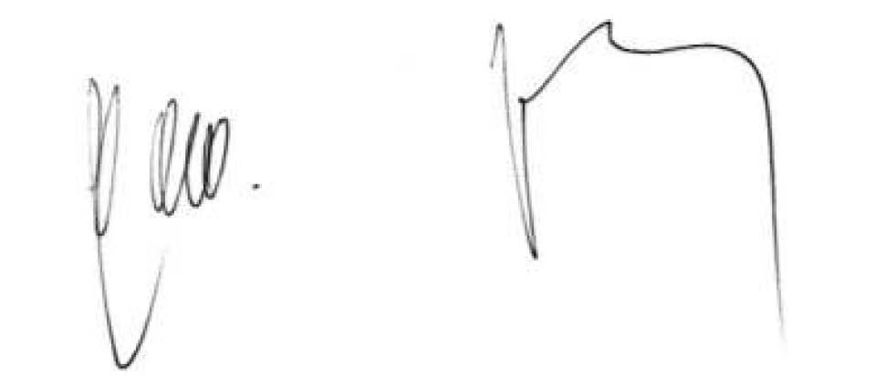

  - „Deze handtekening verbindt eveneens de Vlaamse Gemeenschap, de Franse Gemeenschap, de Duitstalige Gemeenschap, het Vlaamse Gewest, het Waalse Gewest en het Brussels Hoofdstedelijk Gewest.“

  - «Cette signature engage également la Région de Bruxelles-Capitale.»

  - „Diese Unterschrift bindet zugleich die Deutschsprachige Gemeinschaft, die Flämische Gemeinschaft, die Franzôsische Gemeinschaft, die Wallonische Region, die Flämische Region und die Region Brússel-Hauptstadt.“

  - За Правителството на Република България

- 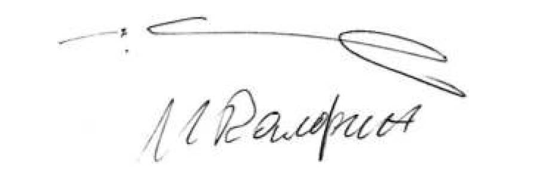

  - Za prezidenta České republiky

- 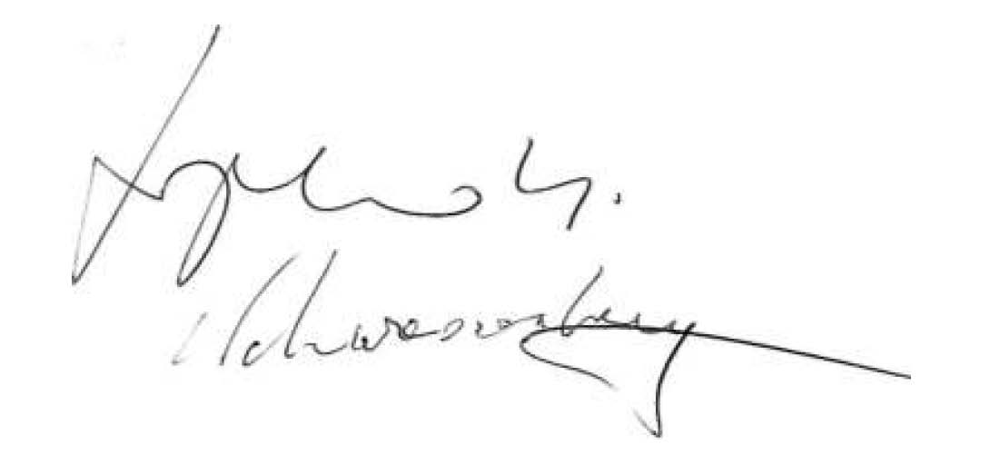

  - For Hendes Majestæt Danmarks Dronning

- 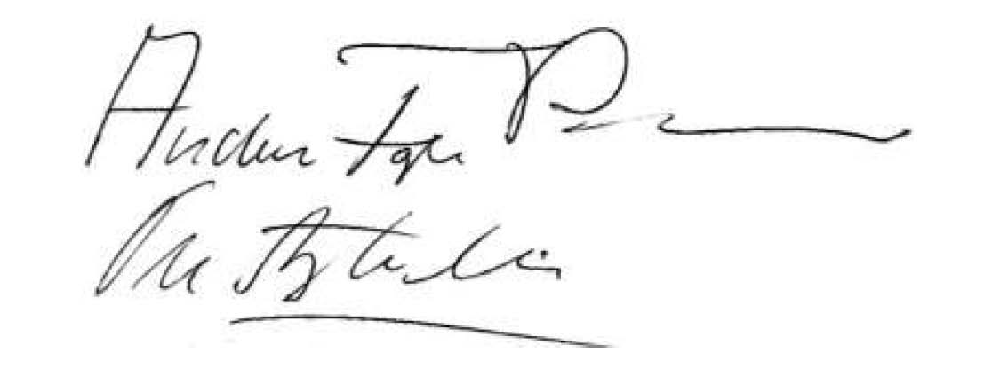

  - Für den Präsidenten der Bundesrepublik Deutschland

- 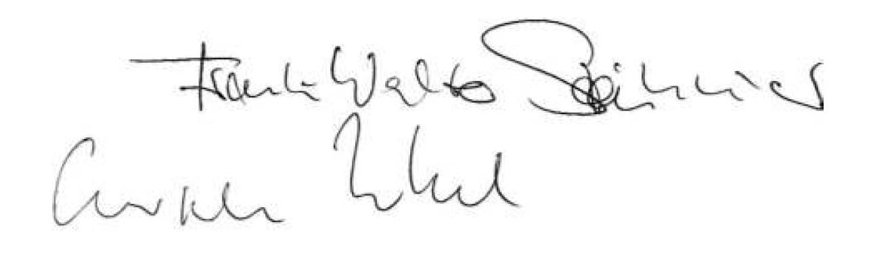

  - Eesti Vabariigi Presidendi nimel

- 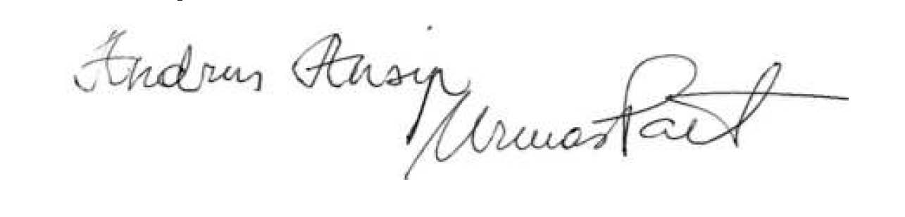

  - Thar ceann Uachtarán na hÉireann

  - For the President of Ireland

- 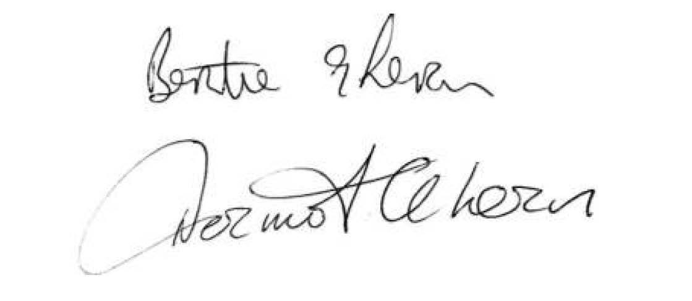

  - Για τον Πρόεδρο της Ελληνικής Δημοκρατίας

- 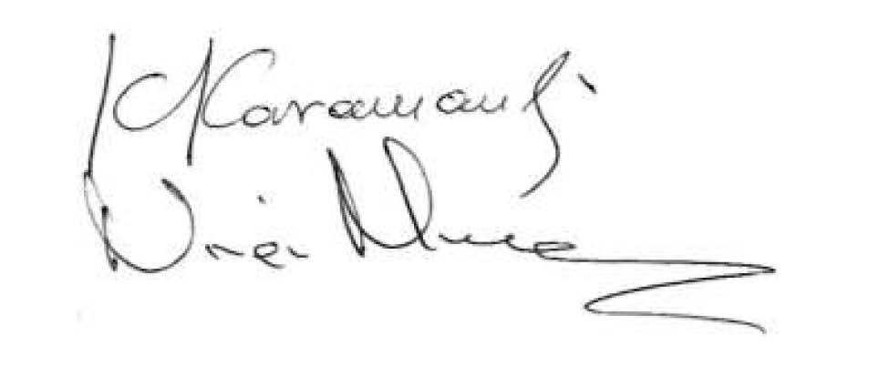

  - Por Su Majestad el Rey de España

- 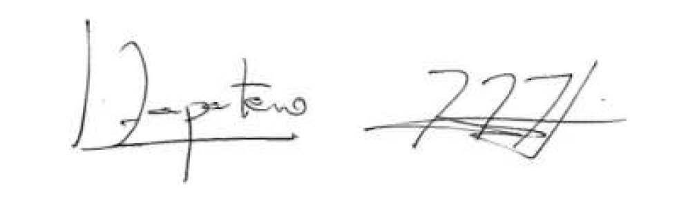

  - Pour le Président de la République française

- 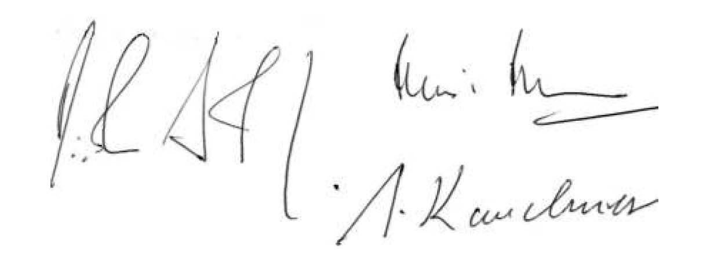

  - Per il Presidente della Repubblica italiana

- 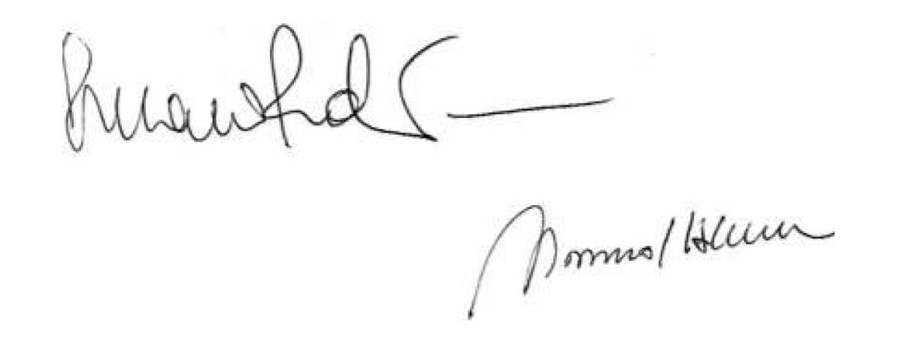

  - Για τον Πρόεδρο της Κυπριακής Δημοκρατίας

- 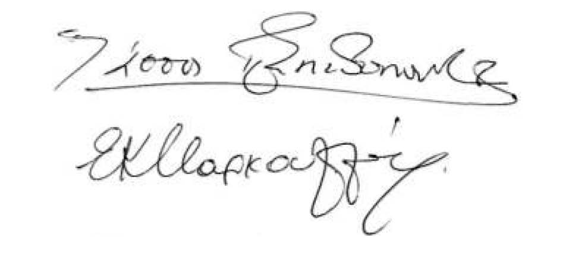

  - Latvijas Republikas Valsts prezidenta vārdā

- 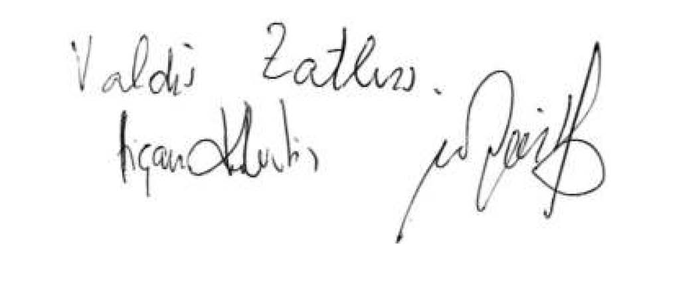

  - Lietuvos Respublikos Prezidento vardu

- 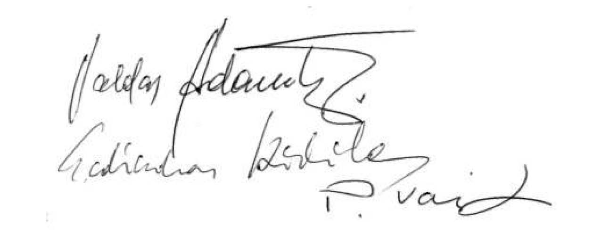

  - Pour Son Altesse Royale le Grand-Duc de Luxembourg

- 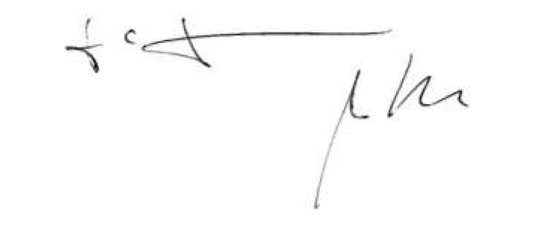

  - A Magyar Köztársaság Elnöke részéről

- 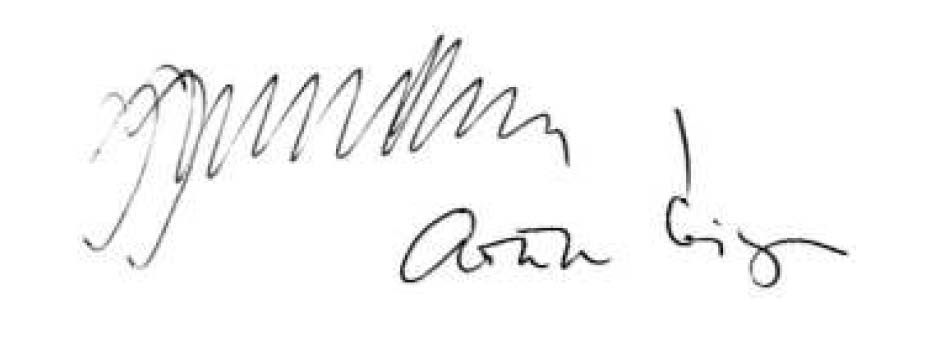

  - Għall-President ta' Malta

- 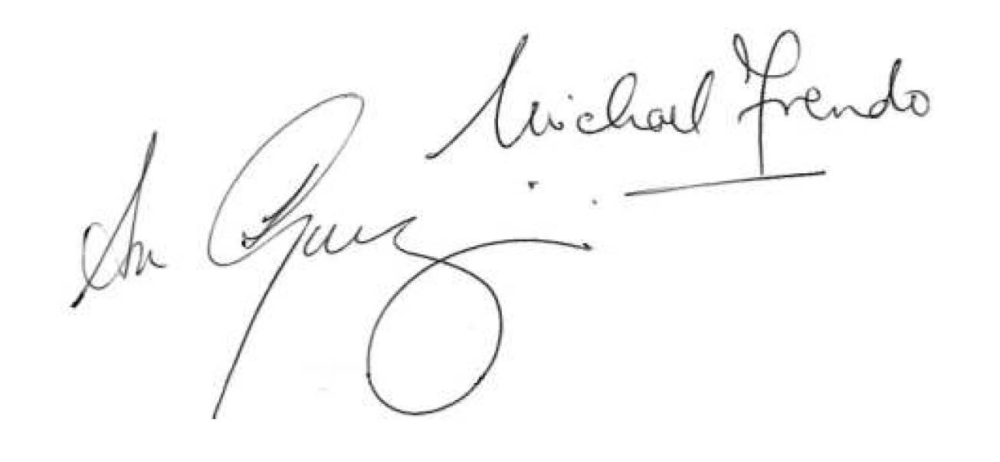

  - Voor Hare Majesteit de Koningin der Nederlanden

- 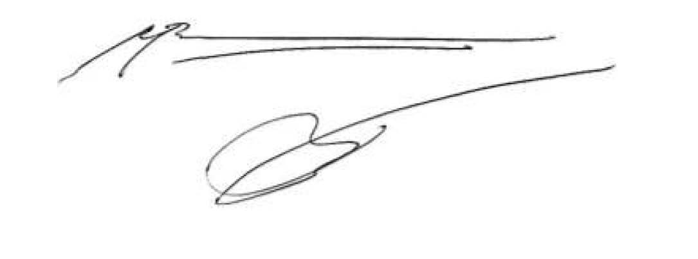

  - Für den Bundespräsidenten der Republik Österreich

- 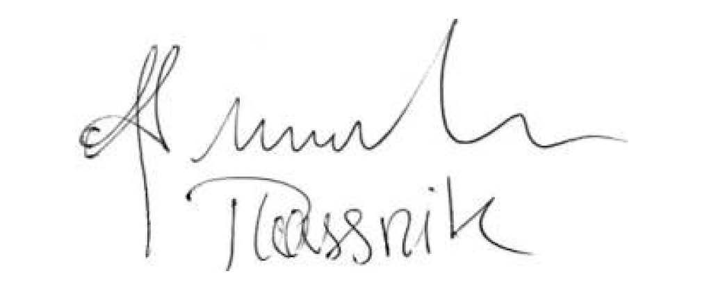

  - Za Prezydenta Rzeczypospolitej Polskiej

- 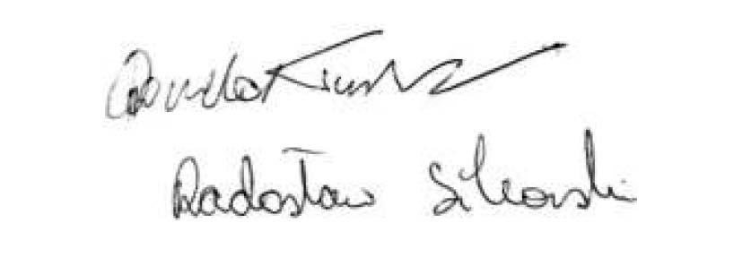

  - Pelo Presidente da República Portuguesa

- 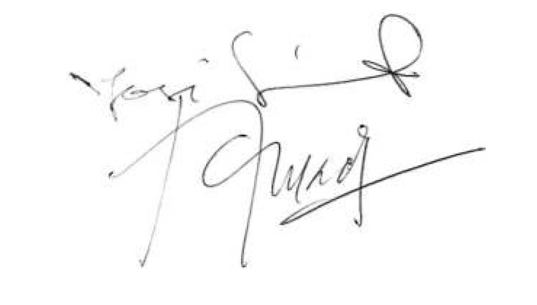

  - Pentru Președintele României

- 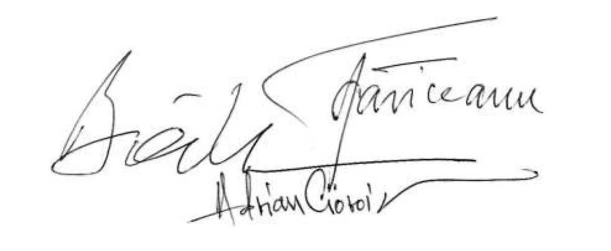

  - Za predsednika Republike Slovenije

- 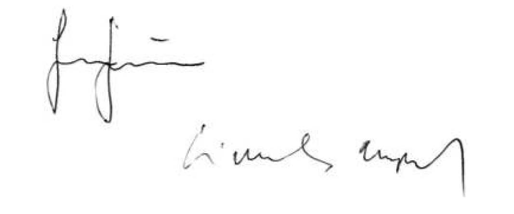

  - Za prezidenta Slovenskej republiky

- 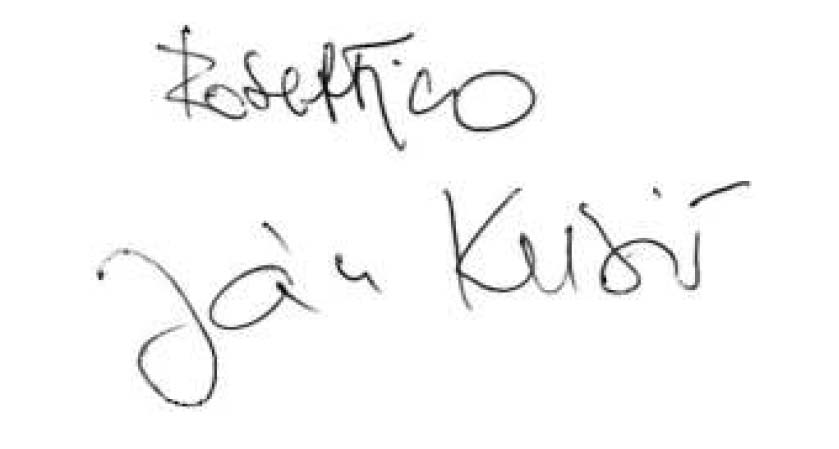

  - Suomen Tasavallan Presidentin puolesta

  - För Republiken Finlands President

- 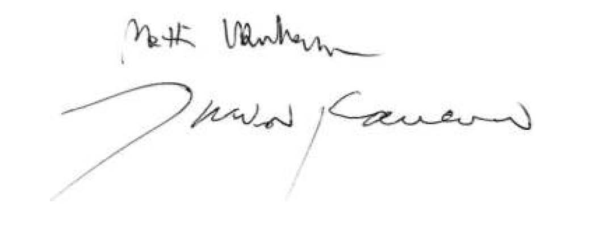

  - För Konungariket Sveriges regering

- 

  - For Her Majesty the Queen of the United Kingdom of Great Britain and Northern Ireland

- 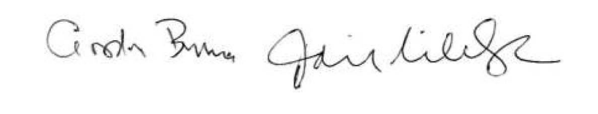
