- ZÁVEREČNÝ AKT

  - KONFERENCIA ZÁSTUPCOV VLÁD ČLENSKÝCH ŠTÁTOV, zvolaná do Bruselu 23. júla 2007 s cieľom prijať spoločnou dohodou zmeny a doplnenia, ktoré sa majú vykonať v Zmluve o Európskej únii, Zmluve o založení Európskeho spoločenstva a Zmluve o založení Európskeho spoločenstva pre atómovú energiu, prijala tieto dokumenty:

  - I. Lisabonská zmluva, ktorou sa mení a dopĺňa Zmluva o Európskej únii a Zmluva o založení Európskeho spoločenstva

  - II. Protokoly

    - A. Protokoly pripojené k Zmluve o Európskej únii, k Zmluve o fungovaní Európskej únie a prípadne k Zmluve o založení Európskeho spoločenstva pre atómovú energiu:

    - – Protokol o úlohe národných parlamentov v Európskej únii

    - – Protokol o uplatňovaní zásad subsidiarity a proporcionality

    - – Protokol o Euroskupine

    - – Protokol o stálejštuktúrovanejspolupráci zriadenejčlánkom 28a Zmluvy o Európskej únii

    - – Protokol k článku 6 ods. 2 Zmluvy o Európskej únii o pristúpení Únie k Európskemu dohovoru o ochrane ľudských práv a základných slobôd

    - – Protokol o vnútornom trhu a hospodárskej súťaži

    - – Protokol o uplatňovaní Charty základných práv Európskej únie na Poľsko a Spojené kráľovstvo

    - – Protokol o vykonávaní spoločných právomocí

    - – Protokol o službách všeobecného záujmu

    - – Protokol o rozhodnutí Rady o vykonávaní článku 9c ods. 4 Zmluvy o Európskej únii a článku 205 ods. 2 Zmluvy o fungovaní Európskejúnie od 1. novembra 2014 do 31. marca 2017 na jednejstrane a od 1. apríla 2017 na strane druhej

    - – Protokol o prechodných ustanoveniach

    - B. Protokoly pripojené k Lisabonskejzmluve

    - – Protokol č. 1, ktorým sa menia a dopĺňajú protokoly pripojené k Zmluve o Európskej únii, Zmluve o založení Európskeho spoločenstva a/alebo Zmluve o založení Európskeho spoločenstva pre atómovú energiu

    - – Tabuľky zhody uvedené v článku 2 Protokolu č. 1, ktorým sa menia a dopĺňajú protokoly pripojené k Zmluve o Európskej únii, Zmluve o založení Európskeho spoločenstva

    - a/alebo Zmluve o založení Európskeho spoločenstva pre atómovú energiu

    - – Protokol č. 2, ktorým sa mení a dopĺňa Zmluva o založení Európskeho spoločenstva pre atómovú energiu

  - III. Príloha k Lisabonskej zmluve

  - – Tabuľky zhody uvedené v článku 5 Lisabonskejzmluvy.

  - Konferencia prijala tieto vyhlásenia a prílohy k tomuto záverečnému aktu

    - A. Vyhlásenia vzťahujúce sa na ustanovenia zmlúv

      - 1. Vyhlásenie k Charte základných práv Európskej únie

      - 2. Vyhlásenie k článku 6 ods. 2 Zmluvy o Európskej únii

      - 3. Vyhlásenie k článku 7a Zmluvy o Európskej únii

      - 4. Vyhlásenie o zložení Európskeho parlamentu

      - 5. Vyhlásenie o politickej dohode Európskej rady o návrhu rozhodnutia o zložení Európskeho parlamentu

      - 6. Vyhlásenie k článku 9b ods. 7 a článku 9e Zmluvy o Európskej únii

      - 7. Vyhlásenie k článku 9c ods. 4 Zmluvy o Európskej únii a k článku 205 ods. 2 Zmluvy o fungovaní Európskej únie

      - 8. Vyhlásenie k praktickým opatreniam, ktoré je potrebné prijať v čase nadobudnutia platnosti Lisabonskej zmluvy, pokiaľ ide o predsedníctvo Európskej rady a Rady pre zahraničné veci

      - 9. Vyhlásenie k článku 9c ods. 9 Zmluvy o Európskej únii týkajúcemu sa rozhodnutia Európskej rady o vykonávaní predsedníctva Rady

      - 10. Vyhlásenie k článku 9d Zmluvy o Európskej únii

      - 11. Vyhlásenie k článku 9d ods. 6 a 7 Zmluvy o Európskej únii

      - 12. Vyhlásenie o spoločnej zahraničnej a bezpečnostnej politike

      - 13. Vyhlásenie o spoločnej zahraničnej a bezpečnostnej politike

      - 14. Vyhlásenie k článku 13a Zmluvy o Európskej únii

      - 15. Vyhlásenie k článku 53 ods. 2 Zmluvy o Európskej únii

      - 16. Vyhlásenie o prednosti

      - 17. Vyhlásenie o rozdelení právomocí

      - 18. Vyhlásenie k článku 3 Zmluvy o fungovaní Európskej únie

      - 19. Vyhlásenie k článku 16b Zmluvy o fungovaní Európskej únie

      - 20. Vyhlásenie o ochrane osobných údajov v oblasti justičnejspolupráce v trestných veciach a policajnej spolupráce

      - 21. Vyhlásenie k článkom 42 a 63a Zmluvy o fungovaní Európskejúnie

      - 22. Vyhlásenie k článku 42 druhému odseku Zmluvy o fungovaní Európskej únie

      - 23. Vyhlásenie k právnej subjektivite Európskej únie

      - 24. Vyhlásenie k článkom 61h a 188k Zmluvy o fungovaní Európskejúnie

      - 25. Vyhlásenie k neúčasti členského štátu na opatrení založenom na tretej časti hlave IV Zmluvy o fungovaní Európskej únie

      - 26. Vyhlásenie k článku 69d ods. 1 druhému pododseku Zmluvy o fungovaní Európskej únie

      - 27. Vyhlásenie k článku 78 Zmluvy o fungovaní Európskej únie

      - 28. Vyhlásenie k článku 87 ods. 2 písm. c) Zmluvy o fungovaní Európskej únie

      - 29. Vyhlásenie k článku 104 Zmluvy o fungovaní Európskej únie

      - 30. Vyhlásenie k článku 152 ods. 4 písm. c) Zmluvy o fungovaní Európskej únie

      - 31. Vyhlásenie k článku 158 Zmluvy o fungovaní Európskej únie

      - 32. Vyhlásenie k článku 163 Zmluvy o fungovaní Európskej únie

      - 33. Vyhlásenie k článku 176a Zmluvy o fungovaní Európskej únie

      - 34. Vyhlásenie k článku 188n Zmluvy o fungovaní Európskej únie týkajúce sa dojednávania a uzavierania medzinárodných dohôd vzťahujúcich sa na priestor slobody, bezpečnosti a spravodlivosti členskými štátmi

      - 35. Vyhlásenie k článku 188r Zmluvy o fungovaní Európskej únie

      - 36. Vyhlásenie k článku 222 Zmluvy o fungovaní Európskej únie o počte generálnych advokátov na Súdnom dvore

      - 37. Vyhlásenie k článku 249b Zmluvy o fungovaní Európskej únie

      - 38. Vyhlásenie k článku 280d Zmluvy o fungovaní Európskej únie

      - 39. Vyhlásenie k článku 308 Zmluvy o fungovaní Európskej únie

      - 40. Vyhlásenie k článku 308 Zmluvy o fungovaní Európskejúnie

      - 41. Vyhlásenie k článku 311a ods. 6 Zmluvy o fungovaní Európskej únie

    - B. Vyhlásenia vzťahujúce sa na protokoly pripojené k zmluvám

      - 44. Vyhlásenie k článku 5 Protokolu o Schengenskom acquis začlenenom do rámca Európskej únie

      - 45. Vyhlásenie k článku 5 ods. 2 Protokolu o Schengenskom acquis začlenenom do rámca Európskej únie

      - 46. Vyhlásenie k článku 5 ods. 3 Protokolu o Schengenskom acquis začlenenom do rámca Európskej únie

      - 47. Vyhlásenie k článku 5 ods. 3, 4 a 5 Protokolu o Schengenskom acquis začlenenom do rámca Európskej únie

      - 48. Vyhlásenie týkajúce sa Protokolu o postavení Dánska

      - 49. Vyhlásenie týkajúce sa Talianska

      - 50. Vyhlásenie k článku 10 Protokolu o prechodných ustanoveniach

      - Okrem toho, konferencia vzala na vedomie tieto vyhlásenia, ktoré sú pripojené k záverečnému aktu

      - 51. Vyhlásenie Belgického kráľovstva o národných parlamentoch

      - 52. Vyhlásenie Belgického kráľovstva, Bulharskejrepubliky, Spolkovejrepubliky Nemecko, Helénskejrepubliky, Španielskeho kráľovstva, Talianskejrepubliky, Cyperskej republiky, Litovskejrepubliky, Luxemburského veľkovojvodstva, Maďarskejrepubliky, Maltskej republiky, Rakúskej republiky, Portugalskej republiky, Rumunska, Slovinskej republiky a Slovenskej republiky k symbolom Európskej únie

      - 53. Vyhlásenie Českejrepubliky k Charte základných práv Európskejúnie

      - 54. Vyhlásenie Spolkovejrepubliky Nemecko, Írska, Maďarskejrepubliky, Rakúskej republiky a Švédskeho kráľovstva

      - 55. Vyhlásenie Španielskeho kráľovstva a Spojeného kráľovstva Veľkej Británie a Severného Írska

      - 56. Vyhlásenie Írska k článku 3 Protokolu o postavení Spojeného kráľovstva a Írska s ohľadom na priestor slobody, bezpečnosti a spravodlivosti

      - 57. Vyhlásenie Talianskejrepubliky o zložení Európskeho parlamentu

      - 58. Vyhlásenie Lotyšskej republiky a Maďarskejrepubliky o spôsobe písania názvu jednotnej meny v zmluvách

      - 59. Vyhlásenie Holandského kráľovstva k článku 270a Zmluvy o fungovaní Európskej únie

      - 60. Vyhlásenie Holandského kráľovstva k článku 311a Zmluvy o fungovaní Európskej únie

      - 61. Vyhlásenie Poľskej republiky k Charte základných práv Európskejúnie

      - 62. Vyhlásenie Poľskej republiky k Protokolu o uplatňovaní Charty základných práv Európskej únie na Poľsko a Spojené kráľovstvo

      - 63. Vyhlásenie Spojeného kráľovstva VeľkejBritánie a Severného Írska k vymedzeniu pojmu „štátni príslušníci“

      - 64. Vyhlásenie Spojeného kráľovstva Veľkej Británie a Severného Írska k hlasovaciemu právu v európskych parlamentných voľbách

      - 65. Vyhlásenie Spojeného kráľovstva VeľkejBritánie a Severného Írska k článku 61h Zmluvy o fungovaní Európskejúnie

  - Съставено в Лисабон на тринадесети декември две хиляди и седма година.

  - Hecho en Lisboa, el trece de diciembre de dos mil siete.

  - V Lisabonu dne třináctého prosince dva tisíce sedm.

  - Udfærdiget i Lissabon den trettende december to tusind og syv.

  - Geschehen zu Lissabon am dreizehnten Dezember zweitausendsieben.

  - Kahe tuhande seitsmenda aasta detsembrikuu kolmeteistkümnendal päeval Lissabonis.

  - Έγινε στη Λισσαβώνα, στις δέκα τρεις Δεκεμβρίου δύο χιλιάδες επτά.

  - Done at Lisbon on the thirteenth day of December in the year two thousand and seven.

  - Fait à Lisbonne, le treize décembre deux mille sept.

  - Arna dhéanamh i Liospóin, an tríú lá déag de Nollaig sa bhliain dhá mhíle a seacht.

  - Fatto a Lisbona, addě tredici dicembre duemilasette.

  - Lisabonā, divtūkstoš septītā gada trīspadsmitajā decembrī.

  - Priimta Lisabonoje du tūkstančiai septintųjų metų gruodžio tryliktą dieną.

  - Kelt Lisszabonban, a kétezer-hetedik év december tizenharmadik napján.

  - Magħmul f'Lisbona, fit-tlettax-il jum ta' Diċembru tas-sena elfejn u sebgħa.

  - Gedaan te Lissabon, de dertiende december tweeduizend zeven.

  - Sporządzono w Lizbonie dnia trzynastego grudnia roku dwa tysiące siódmego.

  - Feito em Lisboa, em treze de Dezembro de dois mil e sete.

  - Întocmit la Lisabona la treisprezece decembrie două mii șapte.

  - V Lisabone dňa trinásteho decembra dvetisícsedem.

  - V Lizboni, dne trinajstega decembra leta dva tisoč sedem.

  - Tehty Lissabonissa kolmantenatoista päivänä joulukuuta vuonna kaksituhattaseitsemän.

  - Som skedde i Lissabon den trettonde december tjugohundrasju.

  - Voor Zijne Majesteit de Koning der Belgen

  - Pour Sa Majesté le Roi des Belges

  - Für Seine Majestät den König der Belgier

- 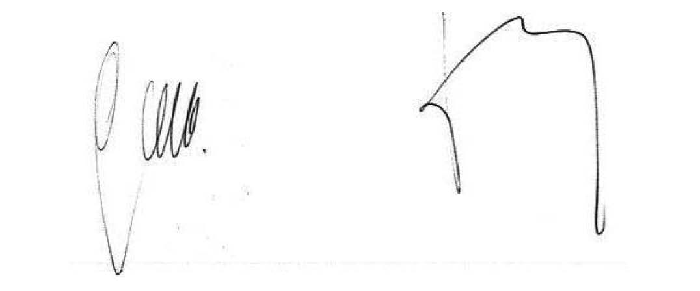

  - „Deze handtekening verbindt eveneens de Vlaamse Gemeenschap, de Franse Gemeenschap, de Duitstalige Gemeenschap, het Vlaamse Gewest, het Waalse Gewest en het Brussels Hoofdstedelijk Gewest.”

  - «Cette signature engage également la Région de Bruxelles-Capitale.»

  - „Diese Unterschrift bindet zugleich die Deutschsprachige Gemeinschaft, die Flämische emeinschaft, die Französische Gemeinschaft, die Wallonische Region, die Flämische Region und die Region Brüssel-Hauptstadt.“

  - За Правителството на Република България

- 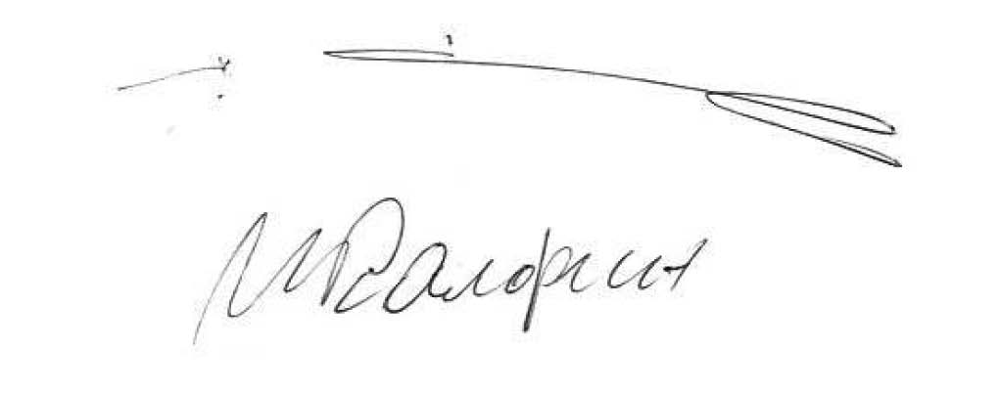

  - Za prezidenta České republiky

- 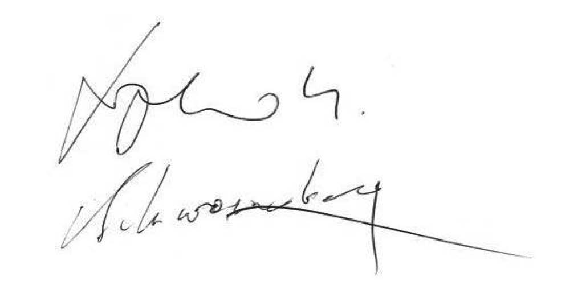

  - For Hendes Majestat Danmarks Dronning

- 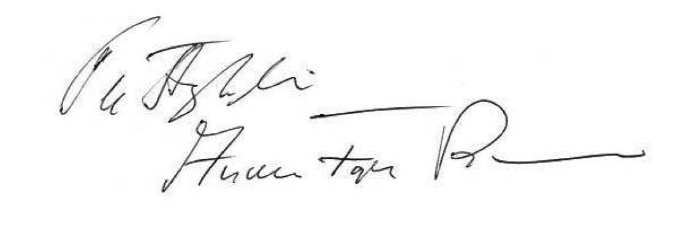

  - Für den Präsidenten der Bundesrepublik Deutschland

- 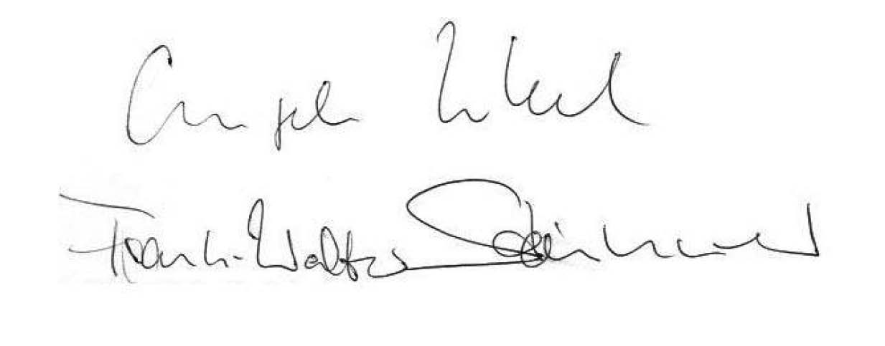

  - Eesti Vabariigi Presidendi nimel

- 

  - Thar ceann Uachtarán na hÉireann

  - For the President of Ireland

- 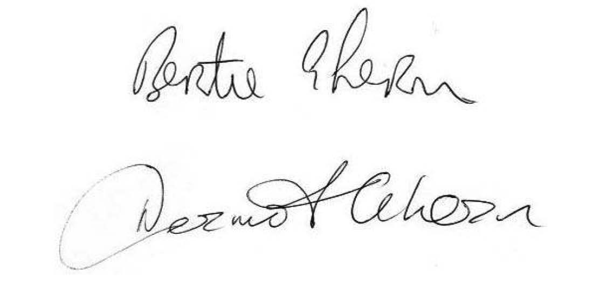

  - Για τον Πρόεδρο της Ελληνικής Δημοκρατίας

- 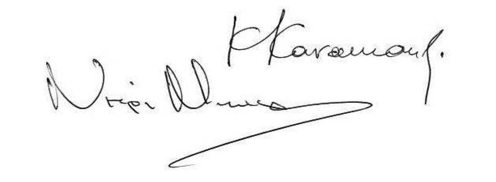

  - Por Su Majestad el Rey de España

- 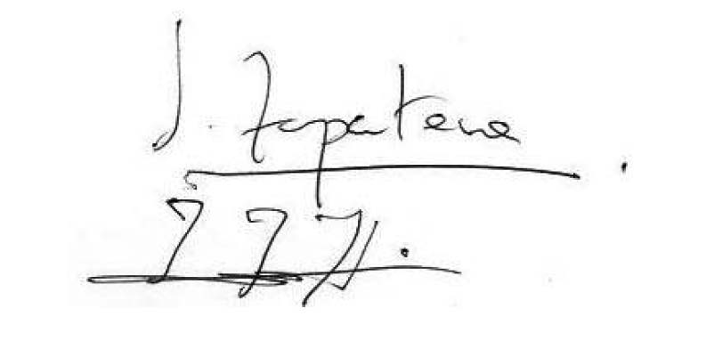

  - Pour le Président de la République française

- 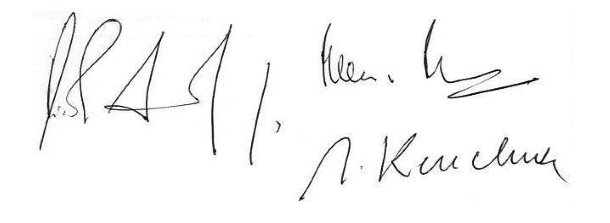

  - Per il Presidente della Repubblica italiana

- 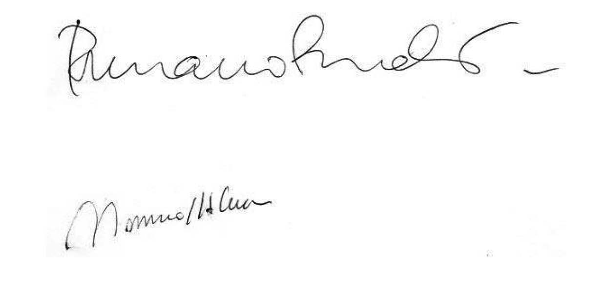

  - Για τον Πρόεδρο της Κυπριακής Δημοκρατίας

- 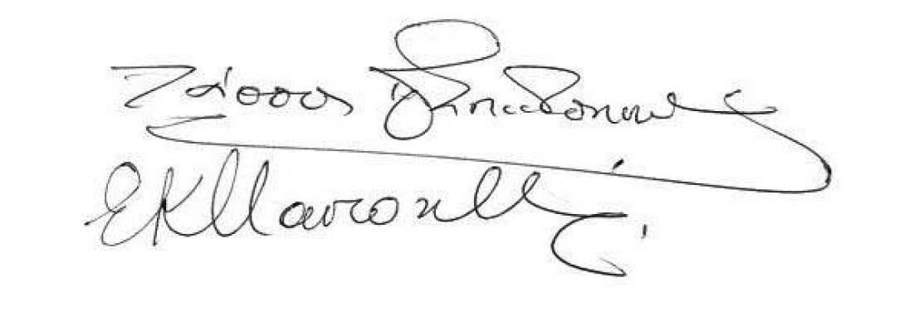

  - Latvijas Republikas Valsts prezidenta vārdā

- 

  - Lietuvos Respublikos Prezidento vardu

- 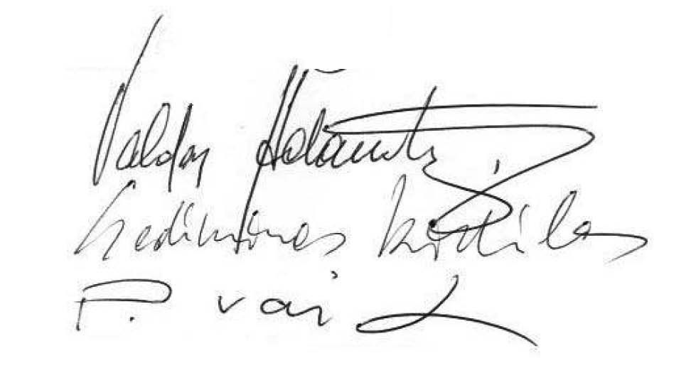

  - Pour Son Altesse Royale le Grand-Duc de Luxembourg

- 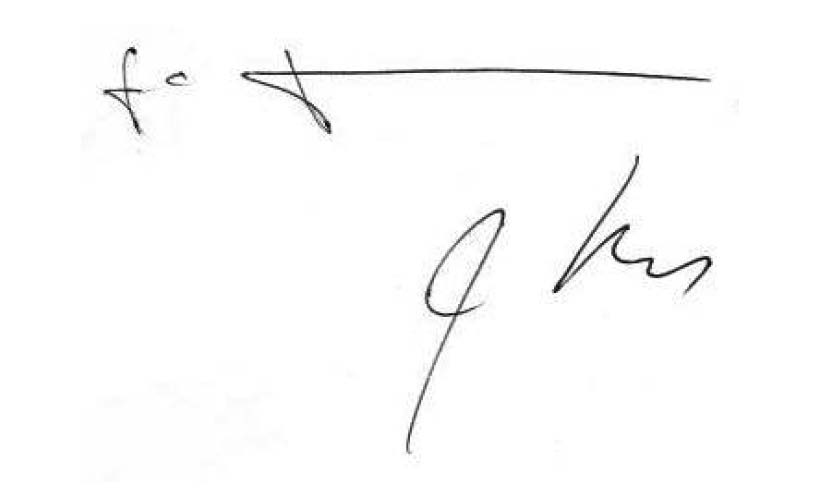

  - A Magyar Köztársaság Elnöke részéről

- 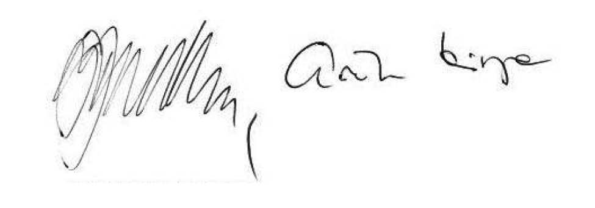

  - Għall-President ta' Malta

- 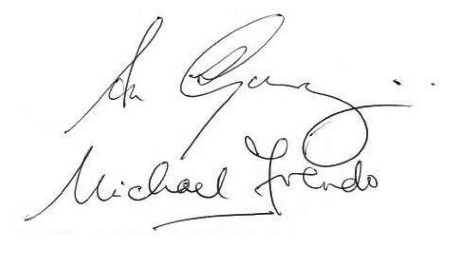

  - Voor Hare Majesteit de Koningin der Nederlanden

- 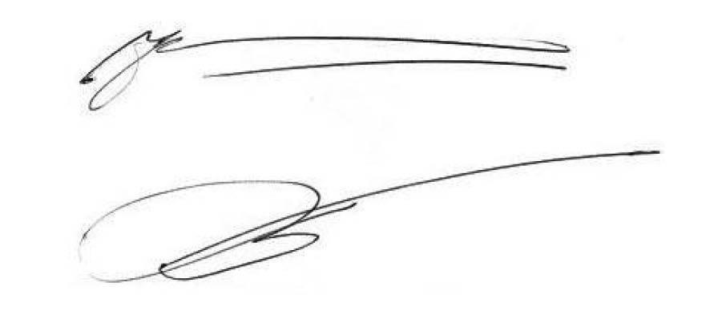

  - Für den Bundespräsidenten der Republik Österreich

- 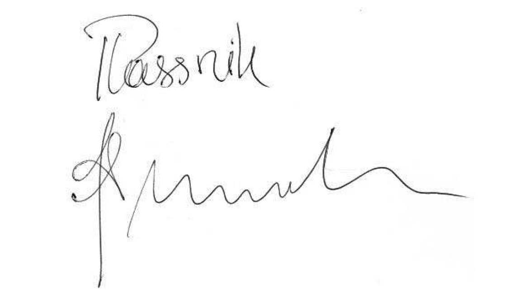

  - Za Prezydenta Rzeczypospolitej Polskiej

- 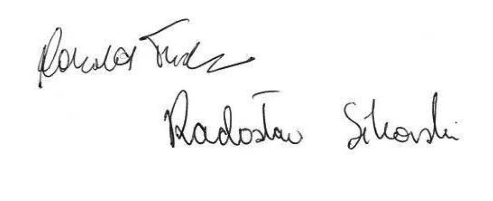

  - Pelo Presidente da República Portuguesa

- 

  - Pentru Președintele României

- 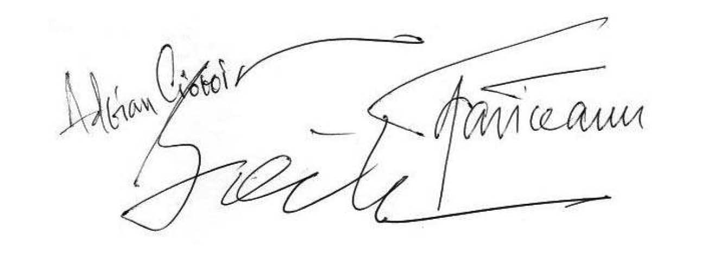

  - Za predsednika Republike Slovenije

- 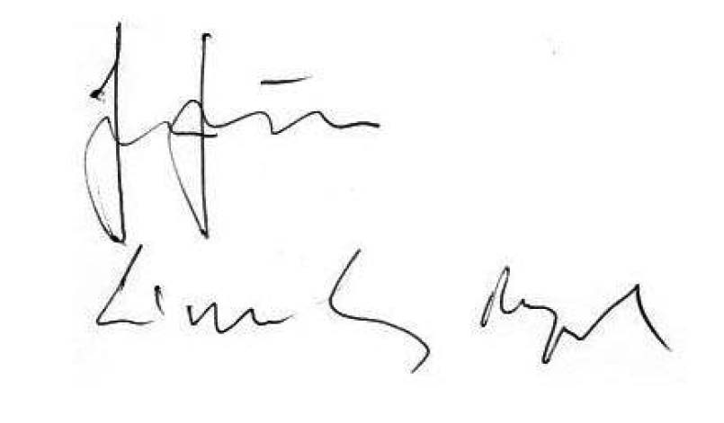

  - Za prezidenta Slovenskej republiky

- 

  - Suomen Tasavallan Presidentin puolesta

  - För Republiken Finlands President

- 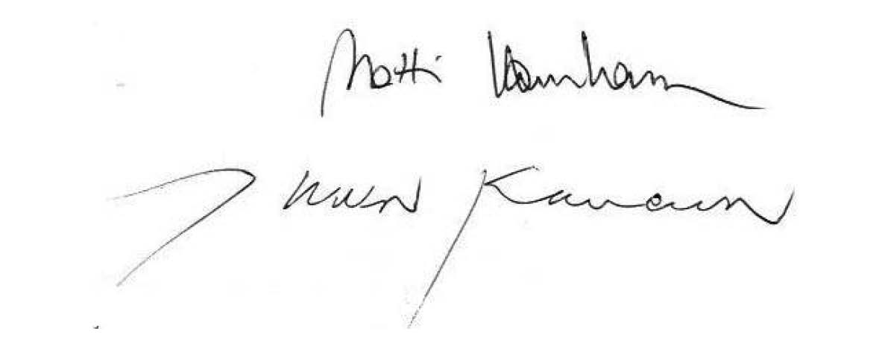

  - För Konungariket Sveriges regering

- 

  - For Her Majesty the Queen of the United Kingdom of Great Britain and Northern Ireland

- 

  - A. VYHLÁSENIA VZŤAHUJÚCE SA NA USTANOVENIA ZMLÚV

    - 1. Vyhlásenie k Charte základných práv Európskej únie

      - Chartou základných práv Európskejúnie, ktorá má právne záväzný charakter, sa potvrdzujú základné práva, ktoré sú zaručené Európskym dohovorom o ochrane ľudských práv a základných slobôd tak, a ktoré vyplývajú z ústavných tradícií spoločných pre členské štáty.

      - Chartou sa nerozširuje oblasť uplatňovania práva Únie nad rámec právomocí Únie, ani sa ňou pre Úniu nevytvárajú žiadne nové právomoci a neukladajú sa jejžiadne úlohy, a jejsúčasné právomoci a úlohy vymedzené v zmluvách sa nemenia.

    - 2. Vyhlásenie k článku 6 ods. 2 Zmluvy o Európskej únii

      - Konferencia súhlasí, aby sa pristúpenie Únie k Európskemu dohovoru o ochrane ľudských práv a základných slobôd uskutočnilo spôsobom, ktorý umožňuje zachovať charakteristické znaky práva Únie. V tejto súvislosti konferencia poznamenáva, že existuje pravidelný dialóg medzi Súdnym dvorom Európskejúnie a Európskym súdom pre ľudské práva, dialóg, ktorý by mohol byť posilnený, keď Únia pristúpi k tomuto dohovoru.

    - 3. Vyhlásenie k článku 7a Zmluvy o Európskej únii

      - Únia zohľadní osobitnú situáciu malých krajín, ktoré s ňou udržiavajú osobitne blízke vzťahy.

    - 4. Vyhlásenie o zložení Európskeho parlamentu

      - Taliansku sa udelí dodatočné kreslo v Európskom parlamente.

    - 5. Vyhlásenie o politickej dohode Európskej rady o návrhu rozhodnutia o zložení Európskeho parlamentu

      - Európska rada politicky schváli revidovaný návrh rozhodnutia o zložení Európskeho parlamentu na volebné obdobie rokov 2009-2014, ktorý sa zakladá na návrhu Európskeho parlamentu.

    - 6. Vyhlásenie k článku 9b ods. 7 a článku 9e Zmluvy o Európskej únii

      - Pri výbere osôb vyzvaných, aby zastávali funkciu predsedu Európskejrady, predsedu Komisie a vysokého predstaviteľa Únie pre zahraničné veci a bezpečnostnú politiku, sa bude venovať zvýšená pozornosť potrebe zohľadniť geografickú a demografickú rozmanitosť Únie a jejčlenských štátov.

    - 7. Vyhlásenie k článku 9c ods. 4 Zmluvy o Európskej únii a k článku 205 ods. 2 Zmluvy o fungovaní Európskej únie

      - Konferencia vyhlasuje, že rozhodnutie o vykonávaní článku 9c ods. 4 Zmluvy o Európskej únii a článku 205 ods. 2 Zmluvy o fungovaní Európskejúnie prijme Rada v deň podpisu Lisabonskej zmluvy, a nadobudne účinnosť v deň nadobudnutia platnosti uvedenejzmluvy. Návrh rozhodnutia znie:

      - Návrh rozhodnutia Rady

      - o vykonávaní článku 9c ods. 4 Zmluvy o Európskej únii a článku 205 ods. 2 Zmluvy o fungovaní Európskejúnie od 1. novembra 2014 do 31. marca 2017 na jednej strane a od 1. apríla 2017 na strane druhej

      - RADA EURÓPSKEJ ÚNIE,

      - keďže:

      - (1) Je vhodné prijať ustanovenia umožňujúce plynulý prechod od systému rozhodovania v Rade kvalifikovanou väčšinou tak, ako je vymedzený v článku 3 ods. 3 Protokolu o prechodných ustanoveniach, ktorý sa uplatňuje naďalejaž do 31. októbra 2014, k systému hlasovania ustanovenom v článku 9c ods. 4 Zmluvy o Európskej únii a článku 205 ods. 2 Zmluvy o fungovaní Európskej únie, ktorý sa bude uplatňovať od 1. novembra 2014, vrátane osobitných ustanovení uvedených v článku 3 ods. 2 uvedeného protokolu počas prechodného obdobia do 31. marca 2017.

      - (2) Pripomína, že praxou Rady je venovať všetko úsilie posilňovaniu demokratickej legitimity aktov prijatých kvalifikovanou väčšinou,

      - ROZHODLA TAKTO:

      - Oddiel 1 Ustanovenia uplatniteľné od 1. novembra 2014 do 31. marca 2017

        - Článok 1 Počas obdobia od 1. novembra 2014 do 31. marca 2017, ak členovia Rady zastupujúci:

          - a) najmenej tri štvrtiny obyvateľstva alebo

          - b) najmenej tri štvrtiny počtu členských štátov,

        - ktoré sú potrebné na vytvorenie blokujúcej menšiny, ktorá vyplýva z uplatňovania článku 9c ods. 4 prvého pododseku Zmluvy o Európskej únii alebo článku 205 ods. 2 Zmluvy o fungovaní Európskej únie, vyjadria svoj nesúhlas s prijatím aktu Rady kvalifikovanou väčšinou, Rada túto otázku prerokuje.

        - Článok 2

          - Rada v priebehu tohto rokovania urobí všetko, čo je v jej silách, aby sa v rozumnom čase a bez toho, aby boli ohrozené povinné lehoty stanovené právom Únie, našlo uspokojivé riešenie problémov, ktoré nastolili členovia Rady uvedení v článku 1.

        - Článok 3

          - Predseda Rady na tento účel s pomocou Komisie a dodržiavajúc rokovací poriadok Rady vyvinie všetky iniciatívy potrebné na uľahčenie dosiahnutia širšejdohody v rámci Rady. Členovia Rady mu poskytnú potrebnú súčinnosť.

      - Oddiel 2 Ustanovenia uplatniteľné od 1. apríla 2017 Článok 4 Od 1. apríla 2017, ak členovia Rady zastupujúci:

        - a) najmenej 55 % obyvateľstva alebo

        - b) najmenej 55 % počtu členských štátov,

      - ktoré sú potrebné na vytvorenie blokujúcej menšiny, ktorá vyplýva z uplatňovania článku 9c ods. 4 prvého pododseku Zmluvy o Európskej únii alebo článku 205 ods. 2 Zmluvy o fungovaní Európskej únie, vyjadria svoj nesúhlas s prijatím aktu Rady kvalifikovanou väčšinou, Rada túto otázku prerokuje.

        - Článok 5

          - Rada v priebehu tohto rokovania urobí všetko, čo je v jej silách, aby sa v rozumnom čase a bez toho, aby boli ohrozené povinné lehoty stanovené právom Únie, našlo uspokojivé riešenie na zodpovedanie problémov, ktoré nastolili členovia Rady uvedení v článku 4.

        - Článok 6

          - Predseda Rady na tento účel s pomocou Komisie a dodržiavajúc rokovací poriadok Rady vyvinie všetky iniciatívy potrebné na uľahčenie dosiahnutia širšejdohody v rámci Rady. Členovia Rady mu poskytnú potrebnú súčinnosť.

      - Oddiel 3 Nadobudnutie účinnosti rozhodnutia

        - Článok 7

          - Toto rozhodnutie nadobúda účinnosť v deň nadobudnutia platnosti Lisabonskej zmluvy.

    - 8. Vyhlásenie k praktickým opatreniam, ktoré je potrebné prijať v čase nadobudnutia platnosti Lisabonskej zmluvy, pokiaľ ide o predsedníctvo Európskej rady a Rady pre zahraničné veci

      - V prípade, že Lisabonská zmluva nadobudne platnosť po 1. januári 2009, konferencia vyzýva príslušné orgány členského štátu vykonávajúceho v tom čase polročné predsedníctvo Rady na jednej strane, a osobu, ktorá bude zvolená za predsedu Európskej rady, a osobu, ktorá bude vymenovaná za vysokého predstaviteľa Únie pre zahraničné veci a bezpečnostnú politiku, na strane druhej, aby prijali po porade s nasledujúcim polročným predsedníctvom potrebné konkrétne opatrenia, ktoré umožnia efektívny prechod materiálnych a organizačných aspektov výkonu predsedníctva Európskej rady a Rady pre zahraničné veci.

    - 9. Vyhlásenie k článku 9c ods. 9 Zmluvy o Európskej únii týkajúcemu sa rozhodnutia Európskej rady o vykonávaní predsedníctva Rady

      - Konferencia vyhlasuje, že Rada by mala začať s prípravou rozhodnutia, ktoré ustanoví postupy na vykonanie rozhodnutia o vykonávaní predsedníctva Rady hneď po podpise Lisabonskejzmluvy, a politicky ho schváliť do šiestich mesiacov. Návrh rozhodnutia Európskej rady, ktoré sa prijme v deň nadobudnutia platnosti uvedenej zmluvy, znie:

      - Návrh rozhodnutia Európskej rady o vykonávaní predsedníctva Rady

      - Článok 1

        - 1. Predsedníctvo Rady, s výnimkou zloženia Rady pre zahraničné veci, vykonávajú vopred určené skupiny troch členských štátov počas obdobia 18 mesiacov. Skupiny sú vytvorené na základe rovnej rotácie medzi členskými štátmi s prihliadnutím na ich rozmanitosť a geografickú rovnováhu v rámci Únie.

        - 2. Každý člen skupiny po poradí predsedá počas obdobia šiestich mesiacov všetkým zloženiam Rady s výnimkou zloženia Rady pre zahraničné veci. Ostatní členovia skupiny pomáhajú predsedníctvu pri vykonávaní všetkých jeho právomocí na základe spoločného programu. Členovia skupiny sa môžu medzi sebou dohodnúť o iných úpravách.

      - Článok 2

        - Výboru stálych predstaviteľov vlád členských štátov predsedá predstaviteľ členského štátu, ktorý predsedá Rade pre všeobecné záležitosti.

        - Politickému a bezpečnostnému výboru predsedá zástupca vysokého predstaviteľa Únie pre zahraničné veci a bezpečnostnú politiku.

        - Predsedníctvo prípravných orgánov rôznych zložení Rady, s výnimkou zloženia Rady pre zahraničné veci, vykonáva člen skupiny, ktorý predsedá príslušnému zloženiu, pokiaľ sa nerozhodne inak v súlade s článkom 4.

      - Článok 3

        - Rada pre všeobecné záležitosti zabezpečuje konzistentnosť a kontinuitu práce rôznych zložení Rady v rámci viacročných programov v spolupráci s Komisiou. Členské štáty, ktoré vykonávajú predsedníctvo, prijmú s pomocou Generálneho sekretariátu Rady všetky opatrenia potrebné na organizáciu a hladký priebeh práce Rady.

      - Článok 4

        - Rada prijme rozhodnutie, ktorým sa ustanovujú opatrenia na vykonanie tohto rozhodnutia.

    - 10. Vyhlásenie k článku 9d Zmluvy o Európskej únii

      - Konferencia sa domnieva, že v prípade, ak sa už Komisia nebude skladať zo štátnych príslušníkov všetkých členských štátov, mala by venovať náležitú pozornosť potrebe zabezpečiť úplnú transparentnosť vo vzťahoch so všetkými členskými štátmi. Komisia by preto mala mať úzke vzťahy so všetkými členskými štátmi bez ohľadu na to, či majú štátneho príslušníka medzi členmi Komisie alebo nie, a v tomto ohľade by mala venovať osobitnú pozornosť potrebe zdieľať informácie a konzultovať so všetkými členskými štátmi.

      - Konferencia sa tiež domnieva, že Komisia by mala prijať všetky potrebné opatrenia na zabezpečenie zohľadnenia politickej, sociálnej a hospodárskej reality všetkých členských štátov, vrátane tých, ktoré nemajú v Komisii svojho štátneho príslušníka. Tieto opatrenia by mali zahŕňať zabezpečenie toho, aby sa postavenie týchto členských štátov zohľadnilo pri prijímaní vhodných organizačných opatrení.

    - 11. Vyhlásenie k článku 9d ods. 6 a 7 Zmluvy o Európskej únii

      - Konferencia sa domnieva, že v súlade s ustanoveniami zmlúv sú Európsky parlament a Európska rada spoločne zodpovední za plynulý priebeh procesu vedúceho k voľbám predsedu Európskej komisie. Z tohto dôvodu zástupcovia Európskeho parlamentu a Európskej rady uskutočnia potrebné konzultácie predtým, ako Európska rada prijme rozhodnutie v rámci, ktorý považujú za najvhodnejší. V súlade s článkom 9d ods. 7 prvým pododsekom sa tieto konzultácie zamerajú na profil kandidátov na funkciu predsedu Komisie, pričom sa zohľadnia voľby do Európskeho parlamentu. Podrobnosti o týchto konzultáciách sa bližšie určia vo vhodnom čase vzájomnou dohodou medzi Európskym parlamentom a Európskou radou.

    - 12. Vyhlásenie k článku 9e Zmluvy o Európskej únii

      - 1. Konferencia vyhlasuje, že v priebehu prípravných prác predchádzajúcich vymenovaniu vysokého predstaviteľa Únie pre zahraničné veci a bezpečnostnú politiku, ku ktorému dôjde v deň nadobudnutia platnosti Lisabonskejzmluvy, v súlade s článkom 9e Zmluvy o Európskej únii a článkom 5 Protokolu o prechodných ustanoveniach a ktorého funkčné obdobie bude trvať od tohto dňa do konca aktuálneho funkčného obdobia Komisie, sa nadviažu náležité kontakty s Európskym parlamentom.

      - 2. Konferencia okrem toho pripomína, že vysoký predstaviteľ Únie pre zahraničné veci a bezpečnostnú politiku, ktorého funkčné obdobie sa začne v novembri 2009 v rovnakom čase ako funkčné obdobie ďalšej Komisie a bude trvať rovnako dlho, sa vymenuje v súlade s ustanoveniami článkov 9d a 9e Zmluvy o Európskej únii.

    - 13. Vyhlásenie o spoločnej zahraničnej a bezpečnostnej politike

      - Konferencia zdôrazňuje, že ustanovenia Zmluvy o Európskej únii, ktoré sa týkajú spoločnej zahraničnej a bezpečnostnej politiky vrátane vytvorenia novej pozície vysokého predstaviteľa Únie pre zahraničné veci a bezpečnostnú politiku a vytvorenie služby pre vonkajšiu činnosť, nemajú vplyv na zodpovednosti členských štátov v ich súčasnej podobe pri formulovaní a vykonávaní ich zahraničnej politiky, ani na ich národné zastúpenie v tretích krajinách a medzinárodných organizáciách.

      - Konferencia taktiež pripomína, že ustanovenia, ktorými sa riadi spoločná bezpečnostná a obranná politika, sa nedotýkajú osobitného charakteru bezpečnostnej a obrannej politiky členských štátov.

      - Zdôrazňuje, že Európska únia a jej členské štáty zostanú pri udržiavaní medzinárodného mieru a bezpečnosti viazané ustanoveniami Charty Organizácie Spojených národov a najmä primárnou zodpovednosťou Bezpečnostnej rady a jej členov.

    - 14. Vyhlásenie o spoločnej zahraničnej a bezpečnostnej politike

      - Okrem osobitných pravidiel a postupov uvedených v článku 11 ods. 1 Zmluvy o Európskej únii konferencia zdôrazňuje, že ustanoveniami, ktoré sa týkajú spoločnej zahraničnej a bezpečnostnej politiky, a to aj tými, ktoré sa vzťahujú na vysokého predstaviteľa Únie pre zahraničné veci a bezpečnostnú politiku a službu vonkajšej činnosti, sa neovplyvní existujúci právny základ, zodpovednosti ani právomoci žiadneho členského štátu vo vzťahu k formulácii a výkonu svojej zahraničnej politiky, jej národným diplomatickým službám, vzťahom s tretími krajinami a k účasti v medzinárodných organizáciách vrátane členstva členských štátov v Bezpečnostnej rade Organizácie spojených národov.

      - Konferencia taktiež konštatuje, že ustanovenia, ktoré sa týkajú spoločnej zahraničnej a bezpečnostnej politiky, nedávajú Komisii nové právomoci iniciovať rozhodnutia ani nerozširujú úlohu Európskeho parlamentu.

      - Konferencia rovnako pripomína, že ustanovenia, ktorými sa riadi spoločná bezpečnostná a obranná politika, sa nedotýkajú osobitného charakteru bezpečnostnej a obrannej politiky členských štátov.

    - 15. Vyhlásenie k článku 13a Zmluvy o Európskej únii

      - Konferencia vyhlasuje, že hneď po podpise Lisabonskej zmluvy by generálny tajomník Rady, vysoký predstaviteľ pre spoločnú zahraničnú a bezpečnostnú politiku, Komisia a členské štáty mali začať prípravné práce na vytvorenie Európskej služby pre vonkajšiu činnosť.

    - 16. Vyhlásenie k článku 53 ods. 2 Zmluvy o Európskej únii

      - Konferencia sa domnieva, že možnosť prekladať zmluvy do jazykov uvedených v článku 53 ods. 2 prispieva k naplneniu cieľa uvedeného v článku 2 ods. 3 štvrtom pododseku, ktorým je rešpektovanie bohatej kultúrnej a jazykovej rozmanitosti Únie. V tejto súvislosti konferencia potvrdzuje oddanosť Únie kultúrnejrozmanitosti Európy a osobitnú pozornosť, ktorú bude ajnaďalejvenovať týmto a iným jazykom.

      - Konferencia odporúča členským štátom, ktoré si želajú využiť možnosť uvedenú v článku 53 ods. 2, oznámiť Rade do šiestich mesiacov odo dňa podpisu Lisabonskej zmluvy, jazyk alebo jazyky, do ktorých budú zmluvy preložené.

    - 17. Vyhlásenie o prednosti

      - Konferencia pripomína, že v súlade s ustálenou judikatúrou Súdneho dvora Európskej únie majú zmluvy a právo prijaté Úniou na základe zmlúv prednosť pred právom členských štátov za podmienok ustanovených v uvedenej judikatúre Súdneho dvora EÚ.

      - Okrem toho sa konferencia rozhodla pripojiť k tomuto záverečnému aktu stanovisko Právneho servisu Rady o prednosti, ktoré sa nachádza v dokumente 11197/07 (JUR 260):

      - „Stanovisko Právneho servisu Rady z 22. júna 2007

      - Z judikatúry Súdneho dvora vyplýva, že prednosť práva Spoločenstva je základnou zásadou tohto práva. Podľa Súdneho dvora táto zásada je obsiahnutá v osobitnom charaktere Európskeho spoločenstva. V čase vynesenia prvého rozsudku tejto ustálenej judikatúry (rozsudok z 15. júla 1964 č. 6/64 vo veci Costa/ENEL (1) sa v zmluve prednosť práva nespomínala. Dnes je situácia rovnaká. Skutočnosť, že zásada prednosti nebude uvedená v budúcej zmluve, žiadnym spôsobom nemení existenciu tejto zásady ani existujúcu judikatúru Súdneho dvora.

      - (1), Z toho vyplýva (...), že právo vyplývajúce zo zmluvy, nezávislého zdroja práva, nemohlo byť vzhľadom na svoju osobitnú a pôvodnú povahu prevýšené domácimi právnymi ustanoveniami, nech boli stanovené v akomkoľvek rámci, bez toho, aby bolo zbavené svojej podstaty práva Spoločenstva, a bez toho, aby sa spochybnil samotný právny základ Spoločenstva.“'

    - 18. Vyhlásenie o rozdelení právomocí

      - Konferencia zdôrazňuje, že v súlade so systémom rozdelenia právomocí medzi Úniou a členskými štátmi, ako je ustanovené v Zmluve o Európskej únii a Zmluve o fungovaní Európskej únie, zostávajú členským štátom všetky právomoci, ktoré sa zmluvami nepreniesli na Úniu.

      - Ak sa zmluvami prenesie na Úniu v určitej oblasti právomoc, ktorú vykonáva spoločne s členskými štátmi, členské štáty v tejto oblasti vykonávajú svoju právomoc v rozsahu, v akom Únia svoju právomoc nevykonala alebo sa rozhodla, že ju prestane vykonávať. Posledná spomenutá situácia môže nastať, ak príslušné inštitúcie Únie rozhodnú o zrušení legislatívneho aktu najmä s cieľom lepšie zabezpečiť trvalé dodržiavanie zásad subsidiarity a proporcionality. Na podnet jedného alebo viacerých svojich členov (predstaviteľov členských štátov) môže Rada v súlade s článkom 208 Zmluvy o fungovaní Európskej únie požiadať Komisiu, aby predložila návrhy na zrušenie legislatívneho aktu. Konferencia víta vyhlásenie Komisie, že týmto požiadavkám bude venovať osobitnú pozornosť.

      - Rovnako zástupcovia vlád členských štátov, ktorí sa zišli na medzivládnej konferencií, môžu v súlade s riadnym revíznym postupom ustanoveným v článku 48 ods. 2 až 5 Zmluvy o Európskej únii rozhodnúť o zmene a doplnení zmlúv, na ktorých je Únia založená, vrátane rozšírenia alebo zúženia právomocí prenesených na Úniu uvedenými zmluvami.

    - 19. Vyhlásenie k článku 3 Zmluvy o fungovaní Európskej únie

      - Konferencia súhlasí, že vo svojom všeobecnom úsilí odstrániť nerovnosť medzi ženami a mužmi, sa Únia bude vo svojich rôznych politikách zameriavať na boj proti všetkým formám domáceho násilia. Je vhodné, aby členské štáty prijali všetky opatrenia, ktoré sú potrebné na predchádzanie a odstránenie týchto trestných činov, ako aj na podporu a ochranu obetí.

    - 20. Vyhlásenie k článku 16b Zmluvy o fungovaní Európskej únie

      - Konferencia vyhlasuje, že vždy, keď by predpisy o ochrane osobných údajov, ktoré majú byť prijaté na základe článku 16b, mohli mať priame dôsledky na národnú bezpečnosť, musí sa náležito zohľadniť osobitná povaha záležitosti. Pripomína, že v súčasnosti platné právne predpisy (pozri najmä smernicu 95/46/ES) ustanovujú v tomto ohľade osobitné výnimky.

    - 21. Vyhlásenie o ochrane osobných údajov v oblasti justičnej spolupráce v trestných veciach a policajnej spolupráce

      - Konferencia uznáva, že vzhľadom na osobitný charakter oblasti policajnej a justičnej spolupráce v trestných veciach, sa možno budú musieť prijať osobitné pravidlá o ochrane osobných údajov a o voľnom pohybe takýchto údajov v tejto oblasti na základe článku 16b Zmluvy o fungovaní Európskej únie,.

    - 22. Vyhlásenie k článkom 42 a 63a Zmluvy o fungovaní Európskej únie

      - Konferencia sa domnieva, že v prípade, ak by návrh legislatívneho aktu, ktorý je založený na článku 63a ods. 2, ovplyvňoval významné aspekty systému sociálneho zabezpečenia členského štátu, najmä s ohľadom na rozsah jeho pôsobnosti, náklady alebo finančnú štruktúru, alebo by ovplyvňoval finančnú rovnováhu tohto systému, ako je ustanovené v článku 42 druhom odseku, sa náležito zohľadnia záujmy tohto členského štátu.

    - 23. Vyhlásenie k článku 42 druhému odseku Zmluvy o fungovaní Európskej únie

      - Konferencia pripomína, že v takom prípade sa Európska rada v súlade s článkom 9b ods. 4 Zmluvy o Európskej únii uznáša konsenzom.

    - 24. Vyhlásenie k právnej subjektivite Európskej únie

      - Konferencia potvrdzuje, že skutočnosť, že Európska únia má právnu subjektivitu, Úniu nijakým spôsobom neoprávňuje vykonávať zákonodarnú činnosť alebo konať nad rámec právomocí, ktoré na ňu v zmluvách preniesli členské štáty.

    - 25. Vyhlásenie k článkom 61h a 188k Zmluvy o fungovaní Európskej únie

      - Konferencia pripomína, že rešpektovanie práv a základných slobôd vyžaduje, aby sa dostatočná pozornosť venovala najmä ochrane a rešpektovaniu práva dotknutých fyzických osôb alebo subjektov na riadne súdne konanie. Na tento účel a s cieľom zabezpečiť striktné súdne preskúmanie rozhodnutí, ktoré uložili reštriktívne opatrenia fyzickej osobe alebo subjektu, musia byť predmetné rozhodnutia založené na jasných a zreteľných kritériách. Tieto kritéria musia byť prispôsobené osobitným vlastnostiam každého reštriktívneho opatrenia.

    - 26. Vyhlásenie k neúčasti členského štátu na opatrení založenom na tretej časti hlave IV Zmluvy o fungovaní Európskej únie

      - Konferencia vyhlasuje, že ak sa členský štát rozhodne nezúčastniť na opatrení založenom na tretej časti hlave IV Zmluvy o fungovaní Európskej únie, Rada uskutoční podrobnú diskusiu o možných dôsledkoch a účinkoch neúčasti tohto členského štátu na tomto opatrení.

      - Okrem toho môže ktorýkoľvek členský štát vyzvať Komisiu, aby preskúmala situáciu na základe článku 96 Zmluvy o fungovaní Európskej únie.

      - Predchádzajúcimi odsekmi nie je dotknutá možnosť členského štátu predložiť túto otázku Európskej rade.

    - 27. Vyhlásenie k článku 69d ods. 1 druhému pododseku Zmluvy o fungovaní Európskej únie

      - Konferencia sa domnieva, že nariadenia uvedené v článku 69d ods. 1 druhom pododseku Zmluvy o fungovaní Európskej únie by mali brať do úvahy vnútroštátne pravidlá a prax, ktoré sa týkajú začatia vyšetrovania trestných činov.

    - 28. Vyhlásenie k článku 78 Zmluvy o fungovaní Európskej únie

      - Konferencia poznamenáva, že ustanovenia článku 78 sa musia uplatňovať v súlade so súčasnou praxou. Pojem „opatrenia potrebné na vyrovnanie hospodárskych nevýhod spôsobených rozdelením Nemecka hospodárstvu určitých oblastí Spolkovejrepubliky dotknutých týmto rozdelením“ sa musí vykladať v súlade s existujúcou judikatúrou Súdneho dvora Európskej únie.

    - 29. Vyhlásenie k článku 87 ods. 2 písm. c) Zmluvy o fungovaní Európskej únie

      - Konferencia poznamenáva, že článok 87 ods. 2 písm. c) sa musí vykladať v súlade s existujúcou judikatúrou Súdneho dvora Európskej únie v záležitostiach, keď sa uplatňujú jeho ustanovenia na pomoc poskytovanú určitým oblastiam Spolkovej republiky Nemecko, ktoré sú dotknuté bývalým rozdelením Nemecka.

    - 30. Vyhlásenie k článku 104 Zmluvy o fungovaní Európskej únie

      - S ohľadom na článok 104 konferencia potvrdzuje, že zvyšovanie rastového potenciálu a zabezpečenie riadneho rozpočtového stavu tvorí dva piliere hospodárskej a rozpočtovej politiky Únie a členských štátov. Pakt stability a rastu je dôležitým nástrojom na dosiahnutie týchto cieľov.

      - Konferencia opätovne potvrdzuje svoj záväzok voči ustanoveniam vzťahujúcim sa na Pakt stability a rastu, ktoré vytvárajú rámec pre koordináciu rozpočtových politík členských štátov Európskej únie.

      - Konferencia potvrdzuje, že systém založený na pravidlách je najlepšou zárukou na dodržiavanie záväzkov a pre rovnaké zaobchádzanie so všetkými členskými štátmi.

      - V tomto rámci konferencia takisto opätovne potvrdzuje svoj záväzok voči cieľom Lisabonskej stratégie: vytváranie pracovných miest, štrukturálne reformy a sociálna súdržnosť.

      - Cieľom Únie je dosiahnuť vyrovnaný hospodársky rast a cenovú stabilitu. Hospodárske a rozpočtové politiky preto potrebujú určiť správne priority v záležitostiach hospodárskych reforiem, inovácii, konkurencieschopnosti a posilňovania súkromného investovania a spotreby v obdobiach slabého hospodárskeho rastu. Toto by sa malo odrážať v nasmerovaní rozpočtových rozhodnutí na vnútroštátnej úrovni a na úrovni Únie, najmä prostredníctvom reštrukturalizácie verejných príjmov a výdavkov za predpokladu dodržiavania rozpočtovej disciplíny v súlade so zmluvami a Paktom stability a rastu.

      - Rozpočtové a hospodárske výzvy, ktorým čelia členské štáty, zdôrazňujú dôležitosť riadnej rozpočtovej politiky uplatňovanej počas celého hospodárskeho cyklu.

      - Konferencia súhlasí s tým, že členské štáty by mali aktívne využiť obdobia hospodárskej obnovy na konsolidáciu verejných financií a zlepšenie ich rozpočtovej situácie. Cieľom je postupné dosiahnutie rozpočtového prebytku v období hospodárskeho rastu, ktorý vytvorí potrebný priestor na prekonanie hospodárskych poklesov, a tým prispieva k dlhodobej udržateľnosti verejných financií.

      - Členské štáty očakávajú so záujmom možné návrhy Komisie, ako aj ďalšie príspevky členských štátov so zreteľom na posilnenie a objasnenie vykonávania Paktu stability a rastu. Členské štáty prijmú všetky potrebné opatrenia na zvýšenie rastového potenciálu svojich hospodárstiev. Zlepšenie koordinácie hospodárskej politiky by mohlo napomôcť tomuto cieľu. Toto vyhlásenie nemá vplyv na ďalšie diskusie o Pakte stability a rastu.

    - 31. Vyhlásenie k článku 140 Zmluvy o fungovaní Európskej únie

      - Konferencia potvrdzuje, že politiky uvedené v článku 140 patria najmä do právomocí členských štátov. Podporné a koordinačné opatrenia, ktoré prijmú na úrovni Únie v súlade s ustanoveniami tohto článku, majú doplnkovú povahu. Slúžia na posilnenie spolupráce medzi členskými štátmi, a nie na harmonizáciu vnútroštátnych systémov. Záruky a postupy existujúce v každom členskom štáte s ohľadom na zodpovednosť sociálnych partnerov tým nie sú dotknuté.

      - Toto vyhlásenie sa uplatňuje bez toho, aby boli dotknuté ustanovenia zmlúv, ktorými sa prenáša právomoc na Úniu, vrátane právomocí v sociálnej oblasti.

    - 32. Vyhlásenie k článku 152 ods. 4 písm. c) Zmluvy o fungovaní Európskej únie

      - Konferencia vyhlasuje, že opatrenia, ktoré budú prijaté podľa článku 152 ods. 4 písm. c) musia zohľadniť spoločné otázky bezpečnosti a musia mať za cieľ stanovenie vysokých noriem pre kvalitu a bezpečnosť, ak by vnútroštátne normy týkajúce sa vnútorného trhu inak bránili dosiahnutiu vysokej úrovne ochrany zdravia ľudí.

    - 33. Vyhlásenie k článku 158 Zmluvy o fungovaní Európskej únie

      - Konferencia sa domnieva, že pojem „ostrovné regióny“, ktorý je uvedený v článku 158, môže zahŕňať ajostrovné štáty ako celky, ak spĺňajú potrebné podmienky.

    - 34. Vyhlásenie k článku 163 Zmluvy o fungovaní Európskej únie

      - Konferencia súhlasí, že činnosť Únie v oblasti výskumu a technického rozvoja bude náležito rešpektovať základné smerovanie a orientáciu výskumných politík členských štátov.

    - 35. Vyhlásenie k článku 176a Zmluvy o fungovaní Európskej únie

      - Konferencia sa domnieva, že článkom 176a nie je dotknuté právo členských štátov prijímať potrebné opatrenia na zabezpečenie svojich dodávok energie za podmienok ustanovených v článku 297.

    - 36. Vyhlásenie k článku 188n Zmluvy o fungovaní Európskej únie týkajúce sa dojednávania a uzavierania medzinárodných dohôd vzťahujúcich sa na priestor slobody, bezpečnosti a spravodlivosti členskými štátmi

      - Konferencia potvrdzuje, že členské štáty majú právo dojednávať a uzavierať dohody s tretími krajinami alebo medzinárodnými organizáciami v oblastiach zahrnutých v tretej časti, hlave IV, kapitolách 3, 4 a 5, pokiaľ sú tieto dohody v súlade s právom Únie.

    - 37. Vyhlásenie k článku 188r Zmluvy o fungovaní Európskej únie

      - Bez toho, aby boli dotknuté opatrenia prijaté Úniou na splnenie jej záväzkov solidarity voči členskému štátu, ktorý je objektom teroristického útoku alebo obeťou prírodnej katastrofy alebo katastrofy spôsobenej ľudskou činnosťou, žiadne z ustanovení článku 188r nie je určené na to, aby ovplyvnilo právo iného členského štátu na výber najvhodnejších prostriedkov na splnenie jeho vlastného záväzku solidarity voči uvedenému členskému štátu.

    - 38. Vyhlásenie k článku 222 Zmluvy o fungovaní Európskej únie o počte generálnych advokátov na Súdnom dvore

      - Konferencia vyhlasuje, že ak Súdny dvor v súlade s článkom 222 prvým odsekom Zmluvy o fungovaní Európskej únie požiada, aby sa počet generálnych advokátov zvýšil o troch (jedenásť namiesto ôsmich), Rada takéto zvýšenie jednomyseľne schváli.

      - V takom prípade konferencia súhlasí, aby Poľsko, podobne ako Nemecko, Francúzsko, Taliansko, Španielsko a Spojené kráľovstvo, malo stáleho generálneho advokáta a už sa ďalejnezúčastňovalo rotačného systému, zatiaľ čo existujúci rotačný systém bude pozostávať z rotácie piatich generálnych advokátov namiesto troch.

    - 39. Vyhlásenie k článku 249b Zmluvy o fungovaní Európskej únie

      - Konferencia berie na vedomie zámer Komisie pokračovať v poradách s odborníkmi, ktorých vymenovali členské štáty, pri vypracovávaní návrhov delegovaných aktov v oblasti finančných služieb v súlade so zaužívanou praxou.

    - 40. Vyhlásenie k článku 280d Zmluvy o fungovaní Európskej únie

      - Konferencia vyhlasuje, že členské štáty môžu pri vznesení žiadosti o nadviazanie posilnenej spolupráce uviesť, či majú v úmysle už v tomto štádiu uplatňovať článok 280h, ktorý ustanovuje rozšírenie hlasovania kvalifikovanou väčšinou alebo použitie riadneho legislatívneho postupu.

    - 41. Vyhlásenie k článku 308 Zmluvy o fungovaní Európskej únie

      - Konferencia vyhlasuje, že odkaz v článku 308 ods. 1 Zmluvy o fungovaní Európskejúnie na ciele Únie odkazuje na ciele ustanovené v článku 2 ods. 2 a 3 Zmluvy o Európskej únii a na ciele ustanovené v článku 2 ods. 5 uvedenej zmluvy, pokiaľ ide o vonkajšie činnosti podľa piatej časti Zmluvy o fungovaní Európskej únie. Je preto vylúčené, aby činnosť založená na článku 308 Zmluvy o fungovaní Európskej únie sledovala len ciele ustanovené v článku 2 ods. 1 Zmluvy o Európskej únii. V tejto súvislosti konferencia poznamenáva, že v súlade s článkom 15b ods. 1 Zmluvy o Európskej únii sa v oblasti spoločnej zahraničnej a bezpečnostnej politiky nesmú prijímať legislatívne akty.

      - Konferencia zdôrazňuje, že v súlade s ustálenou judikatúrou Súdneho dvora Európskej únie je článok 308 Zmluvy o fungovaní Európskej únie neoddeliteľnou súčasťou inštitucionálneho systému, ktorý je založený na zásade prenesenia právomocí, a nemôže slúžiť ako základ pre rozširovanie rozsahu právomocí Únie nad všeobecný rámec vytvorený ustanoveniami zmlúv ako celku, a najmä tými, ktoré vymedzujú úlohy a činnosti Únie. V každom prípade uvedený článok nemožno použiť ako základ pre prijatie ustanovení, ktorých účinkom by bola v podstate zmena a doplnenie zmlúv bez toho, aby prebehol postup, ktorý na tento účel ustanovujú.

    - 43. Vyhlásenie k článku 311a ods. 6 Zmluvy o fungovaní Európskej únie

      - Vysoké zmluvné strany súhlasia, aby Európska rada pri uplatňovaní článku 311a ods. 6 prijala rozhodnutie, ktoré povedie k zmene postavenia Mayotte vo vzťahu k Únii, aby sa toto územie stalo najvzdialenejším územím v zmysle článku 311a ods. 1 a článku 299, keď francúzske orgány oznámia Európskej rade a Komisii, že to umožňuje súčasný vývoj vnútorného postavenia ostrova.

  - B. VYHLÁSENIA VZŤAHUJÚCE SA NA PROTOKOLY PRIPOJENÉ K ZMLUVÁM

    - 44. Vyhlásenie k článku 5 Protokolu o Schengenskom acquis začlenenom do rámca Európskej únie

      - Konferencia berie na vedomie, že ak členský štát podľa článku 5 ods. 2 Protokolu o Schengenskom acquis začlenenom do rámca Európskej únie oznámil, že si neželá zúčastňovať sa na návrhu alebo podnete, toto oznámenie môže vziať kedykoľvek späť, pokiaľ nebolo opatrenie založené na schengenskom acquis prijaté.

    - 45. Vyhlásenie k článku 5 ods. 2 Protokolu o Schengenskom acquis začlenenom do rámca Európskej únie

      - Konferencia vyhlasuje, že vždy, keď Spojené kráľovstvo alebo Írsko oznámi Rade svoj úmysel nezúčastňovať sa na opatrení založenom na takej časti schengenského acquis, na ktorej sa inak zúčastňuje, Rada dôkladne prerokuje možné dôsledky neúčasti daného členského štátu na tomto opatrení. Rokovanie v rámci Rady by sa malo viesť so zreteľom na údaje o vzťahu návrhu k schengenskému acquis poskytnuté Komisiou.

    - 46. Vyhlásenie k článku 5 ods. 3 Protokolu o Schengenskom acquis začlenenom do rámca Európskej únie

      - Konferencia pripomína, že ak Rada neprijme rozhodnutie po prvom dôkladnom prerokovaní danej otázky, Komisia môže v lehote 4 mesiacov predložiť zmenený a doplnený návrh na účely ďalšieho podrobného preskúmania Radou.

    - 47. Vyhlásenie k článku 5 ods. 3, 4 a 5 Protokolu o Schengenskom acquis začlenenom do rámca Európskej únie

      - Konferencia poznamenáva, že podmienky, ktoré sa majú stanoviť v rozhodnutí uvedenom v článku 5 ods. 3, 4 alebo 5 Protokolu o Schengenskom acquis začlenenom do rámca Európskej únie, môžu určiť, že dotknutý členský štát bude znášať prípadné priame finančné dôsledky, ktoré nevyhnutne a vznikli v dôsledku ukončenia jeho účasti na niektorej časti alebo na celom acquis uvedenom v akomkoľvek rozhodnutí prijatom Radou podľa článku 4 uvedeného protokolu.

    - 48. Vyhlásenie týkajúce sa Protokolu o postavení Dánska

      - Konferencia poznamenáva, že s ohľadom na právne akty, ktoré má prijať Rada sama alebo spoločne s Európskym parlamentom a ktoré obsahujú ustanovenia vzťahujúce sa na Dánsko, ako aj ustanovenia, ktoré sa na neho nevzťahujú, pretože majú právny základ, na ktorý sa vzťahuje časť I Protokolu o postavení Dánska, Dánsko vyhlasuje, že nepoužije svoje hlasovacie právo, aby bránilo prijatiu ustanovení, ktoré sa na Dánsko nevzťahujú.

      - Konferencia ďalejpoznamenáva, že na základe Vyhlásenia konferencie k článku 188r Dánsko vyhlasuje, že sa zúčastní v súlade s časťami I a II Protokolu o postavení Dánska na opatreniach alebo právnych aktoch podľa článku 188r.

    - 49. Vyhlásenie týkajúce sa Talianska

      - Konferencia berie na vedomie skutočnosť, že Protokol týkajúci sa Talianska, ktorý bol pripojený k Zmluve o založení Európskeho hospodárskeho spoločenstva z roku 1957 a ktorý bol zmenený a doplnený prijatím Zmluvy o Európskej únii, znel:

      - „VYSOKÉ ZMLUVNÉ STRANY,

      - ŽELAJÚC SI urovnať niektoré osobitné problémy, ktoré sa týkajú Talianska,

      - SA DOHODLI na týchto ustanoveniach, ktoré sú pripojené k zmluve:

      - ČLENSKÉ ŠTÁTY SPOLOČENSTVA

      - BERÚ NA VEDOMIE skutočnosť, že talianska vláda začala desaťročný program hospodárskeho rozvoja, ktorý je zameraný na nápravu nevyváženejštruktúry talianskeho hospodárstva, najmä prostredníctvom rozvoja menej rozvinutých oblast na juhu Talianska a na talianskych ostrovoch a prostredn ctvom vytvárania nových pracovných miest s cieľom odstrániť nezamestnanosť,

      - PRIPOMÍNAJÚ SI, že zásady a ciele tohto programu talianskej vlády zvážili a schválili organizácie pre medzinárodnú spoluprácu, ku ktorým členské štáty patria,

      - UZNÁVAJÚ, že dosiahnutie cieľov uvedeného talianskeho programu je v ich spoločnom záujme,

      - SÚHLASIA s cieľom uľahčiť talianskejvláde splnenie tejto úlohy s tým, aby sa inštitúciám Spoločenstva doporučilo prijatie všetkých prostriedkov a postupov upravených zmluvou, a najmä, primerané využitie zdrojov Európskej investičnej banky a Európskeho sociálneho fondu,

      - ZASTÁVAJÚ STANOVISKO, že inštitúcie Spoločenstva pri vykonávaní tejto zmluvy zohľadnia záťaž, ktorú musí niesť talianske hospodárstvo počas nadchádzajúcich rokov a naliehavosť odvrátenia nebezpečného napätia, najmä ohľadom platobnej bilancie a úrovne zamestnanosti, ktoré by mohlo ohroziť uplatňovanie tejto zmluvy v Taliansku,

      - UZNÁVAJÚ najmä, že v súvislosti s uplatňovaním článkov 109 H a 109 I, je potrebné dbať na zabezpečenie toho, že opatrenia požadované talianskou vládou zabezpečia úspešný výsledok uvedeného programu hospodárskeho rozvoja a zvýšenia životnejúrovne obyvateľstva.“.

    - 50. Vyhlásenie k článku 10 Protokolu o prechodných ustanoveniach

      - Konferencia vyzýva Európsky parlament, Radu a Komisiu, aby sa v rámci svojich právomocí a vo vhodných prípadoch snažili podľa možností v lehote piatich rokov uvedenej v článku 10 ods. 3 Protokolu o prechodných ustanoveniach prijať právne akty, ktorými by sa zmenili a doplnili alebo nahradili akty uvedené v článku 10 ods. 1 uvedeného protokolu.

  - C. VYHLÁSENIA ČLENSKÝCH ŠTÁTOV

  - Okrem toho, konferencia vzala na vedomie tieto vyhlásenia, ktoré sú pripojené k záverečnému aktu:

    - 51. Vyhlásenie Belgického kráľovstva o národných parlamentoch

      - Belgicko upresňuje, že v súlade s jeho ústavným právom konajú poslanecká snemovňa a senát federálneho parlamentu, ako aj parlamentné zhromaždenia spoločenstiev a regiónov vo vzťahu k právomociam vykonávaným Úniou ako súčasti vnútroštátneho parlamentného systému alebo ako komory národného parlamentu.

    - 52. Vyhlásenie Belgického kráľovstva, Bulharskej republiky, Spolkovej republiky Nemecko, Helénskej republiky, Španielskeho kráľovstva, Talianskej republiky, Cyperskej republiky, Litovskej republiky, Luxemburského veľkovojvodstva, Maďarskej republiky, Maltskej republiky, Rakúskej republiky, Portugalskej republiky, Rumunska, Slovinskej republiky a Slovenskej republiky k symbolom Európskej únie

      - Belgicko, Bulharsko, Nemecko, Grécko, Španielsko, Taliansko, Cyprus, Litva, Luxembursko, Maďarsko, Malta, Rakúsko, Portugalsko, Rumunsko, Slovinsko a Slovensko vyhlasujú, že vlajka predstavujúca kruh dvanástich zlatých hviezd na modrom pozadí, hymna vychádzajúca z „Ódy na radosť“ z Deviatej symfónie Ludwiga van Beethovena, heslo „Zjednotení v rozmanitosti“, euro ako mena Európskejúnie a deň Európy 9. mája budú pre ne naďalejsymbolmi spoločnejpríslušnosti občanov k Európskej únii a ich spojenia s ňou.

    - 53. Vyhlásenie Českej republiky k Charte základných práv Európskej únie

      - 1. Česká republika pripomína, že ustanovenia Charty základných práv Európskejúnie sú určené inštitúciám a orgánom Európskej únie v súlade so zásadou subsidiarity a rozdelením právomocí medzi Európsku úniu a jejčlenské štáty, ako to opätovne potvrdzuje vyhlásenie (č. 18) o rozdelení právomocí. Česká republika zdôrazňuje, že jej ustanovenia sú určené členským štátom len vtedy, keď vykonávajú právo Únie, a nie vtedy, keď prijímajú alebo vykonávajú vnútroštátne právo nezávisle od práva Únie.

      - 2. Česká republika tiež zdôrazňuje, že charta nerozširuje oblasť uplatňovania práva Únie a nezakladá žiadnu novú právomoc Únie. Charta nezužuje oblasť uplatňovania vnútroštátneho práva a neobmedzuje žiadne zo súčasných právomocí vnútroštátnych orgánov v tejto oblasti.

      - 3. Česká republika tiež zdôrazňuje, že v rozsahu, v akom charta uznáva základné práva a zásady, ktoré vyplývajú z ústavných tradícií spoločných pre členské štáty, sa tieto práva a zásady musia vykladať v súlade s týmito tradíciami.

      - 4. Česká republika ďalejzdôrazňuje, že žiadne ustanovenie tejto charty sa nesmie vykladať ako obmedzenie alebo narušenie ľudských práv a základných slobôd, ktoré sú v oblasti svojej pôsobnosti uznané právom únie a medzinárodnými zmluvami, ktorých zmluvnou stranou je Únia, Spoločenstvo alebo všetky členské štáty, vrátane Európskeho dohovoru o ochrane ľudských práv a základných slobôd, ako aj ústavami členských štátov.

    - 54. Vyhlásenie Spolkovej republiky Nemecko, Írska, Maďarskej republiky, Rakúskej republiky a Švédskeho kráľovstva

      - Nemecko, Írsko, Maďarsko, Rakúsko a Švédsko poznamenávajú, že základné ustanovenia Zmluvy o založení Európskeho spoločenstva pre atómovú energiu neboli podstatne zmenené a doplnené od nadobudnutia jej platnosti a je potrebné ich aktualizovať. Preto podporujú myšlienku Konferencie zástupcov vlád členských štátov, ktorá by mala byť zvolaná čo najskôr.

    - 55. Vyhlásenie Španielskeho kráľovstva a Spojeného kráľovstva Veľkej Británie a Severného Írska

      - Zmluvy sa vzťahujú na Gibraltár ako na európske územie, za ktorého zahraničné vzťahy je zodpovedný členský štát. Toto neznamená zmeny príslušných pozícií dotknutých členských štátov.

    - 56. Vyhlásenie Írska k článku 3 Protokolu o postavení Spojeného kráľovstva a Írska s ohľadom na priestor slobody, bezpečnosti a spravodlivosti

      - Írsko potvrdzuje svoj angažovaný vzťah k Únii ako ku priestoru slobody, bezpečnosti a spravodlivosti, v ktorom sa rešpektujú základné práva a rozličné právne systémy a tradície členských štátov a občanom sa poskytuje vysoký stupeň bezpečnosti.

      - Írsko preto deklaruje svoje pevné odhodlanie uplatňovať svoje právo podieľať sa na prijímaní opatrení podľa tretej časti hlavy IV Zmluvy o fungovaní Európskej únie, ktoré vyplýva z článku 3 Protokolu o postavení Spojeného kráľovstva a Írska s ohľadom na priestor slobody, bezpečnosti a spravodlivosti, a to v najväčšej miere, ktorú bude považovať za možnú.

      - Írsko sa bude v najväčšej možnej miere podieľať najmä na opatreniach v oblasti policajnej spolupráce.

      - Írsko navyše pripomína, že v súlade s článkom 8 protokolu môže Rade písomne oznámiť, že si viac neželá, aby sa naň vzťahovali ustanovenia protokolu. Írsko má v úmysle preskúmať fungovanie týchto opatrení do troch rokov od nadobudnutia platnosti Lisabonskej zmluvy.

    - 57. Vyhlásenie Talianskej republiky o zložení Európskeho parlamentu

      - Taliansko poznamenáva, že v súlade s článkom 8a (po prečíslovaní článok 10) a článkom 9a (po prečíslovaní článok 14) Zmluvy o Európskej únii sa Európsky parlament skladá zo zástupcov občanov Únie, ktorých zastúpenie má byť zostupne pomerné.

      - Taliansko zároveň konštatuje, že ma základe článku 8 (po prečíslovaní článok 9) Zmluvy o Európskej únii a článku 17b (po prečíslovaní článok 20) Zmluvy o fungovaní Európskej únie je občanom Európskej únie každý štátny príslušník niektorého z členských štátov.

      - Taliansko sa preto nazdáva, že bez toho, aby bolo dotknuté rozhodnutie o legislatívnom období 2009 - 2014, musí akékoľvek rozhodnutie týkajúce sa stanovenia zloženia Európskeho parlamentu, ktoré Európska rada prijme na základe iniciatívy Európskeho parlamentu a s jeho súhlasom, spĺňať zásady článku 9a (prečíslovaný článok 14) ods. 2 prvého pododseku.

    - 58. Vyhlásenie Lotyšskej republiky, Maďarskej republiky a Maltskej republiky o spôsobe písania názvu jednotnej meny v zmluvách

      - Bez toho, aby bol dotknutý jednotný spôsob písania názvu jednotnej meny Európskej únie uvedenej v zmluvách, ktorý je uvedený na bankovkách a minciach, Lotyšsko, Maďarsko a Malta vyhlasujú, že spôsob písania názvu jednotnej meny vrátane jeho odvodených tvarov, ktoré sa uplatňujú v celom lotyšskom a maďarskom znení zmlúv, nemá účinok na existujúce pravidlá o lotyšskom, maďarskom a maltskom jazyku.

    - 59. Vyhlásenie Holandského kráľovstva k článku 270a Zmluvy o fungovaní Európskej únie

      - Holandské kráľovstvo bude súhlasiť s rozhodnutím uvedeným v článku 270a ods. 2 druhom pododseku Zmluvy o fungovaní Európskej únie v prípade, že revízia rozhodnutia uvedeného v článku 269 treťom odseku uvedenej zmluvy poskytne Holandsku uspokojivé riešenie jeho nadmerného negatívneho čistého príspevku do rozpočtu Únie.

    - 60. Vyhlásenie Holandského kráľovstva k článku 311a Zmluvy o fungovaní Európskej únie

      - Holandské kráľovstvo vyhlasuje, že podnet na rozhodnutie uvedené v článku 311a ods. 6, ktorého cieľom je zmeniť postavenie Holandských Antíl a/alebo ostrova Aruba vo vzťahu k Únii, bude predložený len na základe rozhodnutia prijatého v súlade s postavením Holandského kráľovstva.

    - 61. Vyhlásenie Poľskej republiky k Charte základných práv Európskej únie

      - Charta nijakým spôsobom neovplyvňuje právo členských štátov vykonávať zákonodarnú činnosť v oblasti verejnej morálky, rodinného práva, ochrany ľudskej dôstojnosti a rešpektovania ľudskej fyzickej a morálnej integrity.

    - 62. Vyhlásenie Poľskej republiky k Protokolu o uplatňovaní Charty základných práv Európskej únie na Poľsko a Spojené kráľovstvo

      - Poľská republika vyhlasuje, že so zreteľom na tradíciu sociálneho hnutia „Solidarita“ a jeho významný príspevok k boju za sociálne a pracovné práva plne rešpektuje sociálne a pracovné práva ustanovené v práve Európskej únie, a najmä tie, ktoré sú opätovne potvrdené v hlave IV Charty základných práv Európskej únie.

    - 63. Vyhlásenie Spojeného kráľovstva Veľkej Británie a Severného Írska k vymedzeniu pojmu „štátni príslušníci“

      - S ohľadom na zmluvy a Zmluvu o založení Európskeho spoločenstva pre atómovú energiu a všetky akty vyplývajúce z týchto zmlúv, alebo tie, ktoré sú naďalej v platnosti na základe týchto zmlúv, Spojené kráľovstvo opätovne potvrdzuje vyhlásenie z 31. decembra 1982 k vymedzeniu pojmu „štátni príslušníci“ s tou výnimkou, že výraz „občania britských závislých území“ je potrebné vždy chápať ako „občania britských zámorských území“.

    - 64. Vyhlásenie Spojeného kráľovstva Veľkej Británie a Severného Írska k hlasovaciemu právu v európskych parlamentných voľbách

      - Spojené kráľovstvo poznamenáva, že článok 9a Zmluvy o Európskej únii a iné ustanovenia zmlúv nemajú za cieľ zmeniť zásady hlasovacieho práva pre európske parlamentné voľby.

    - 65. Vyhlásenie Spojeného kráľovstva Veľkej Británie a Severného Írska k článku 61h a Zmluvy o fungovaní Európskej únie

      - Spojené kráľovstvo plne podporuje ráznu akciu, pokiaľ ide o prijatie finančných sankcií na účely predchádzania terorizmu a súvisiacich činností a na boj proti nim. Vyhlasuje preto, že má v úmysle vykonávať svoje právo zúčastňovať sa podľa článku 3 Protokolu o postavení Spojeného kráľovstva a Írska na prijímaní všetkých návrhov založených na článku 61h Zmluvy o fungovaní Európskej únie, pokiaľ ide o priestor slobody, bezpečnosti a spravodlivosti.
