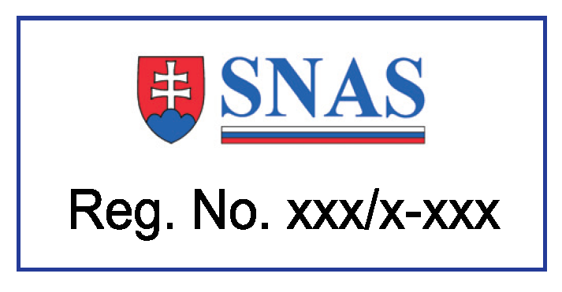
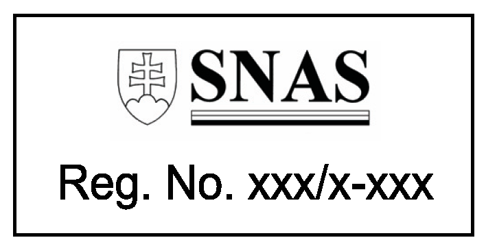
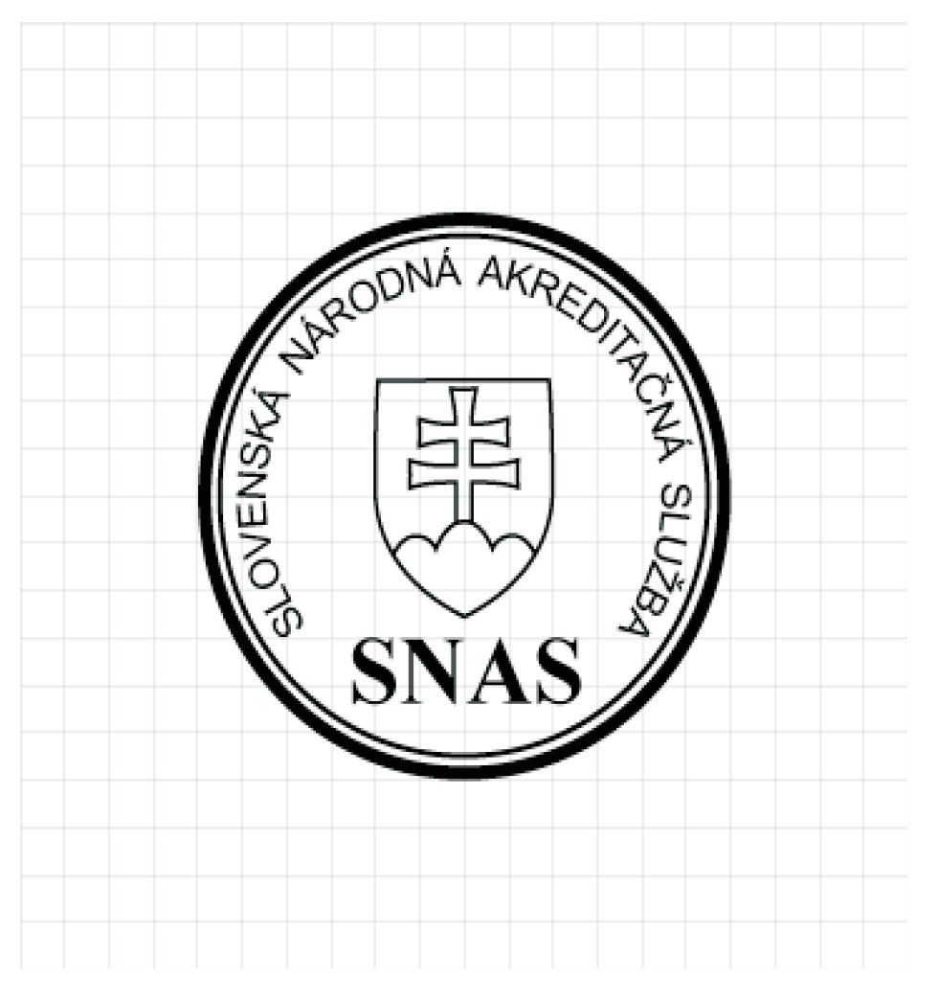
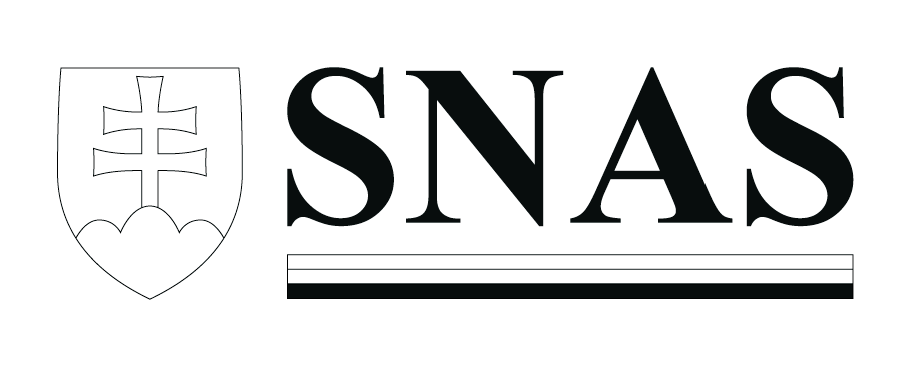

Príloha k zákonu č. 505/2009 Z. z.

- 1. Vzor akreditačnej značky Slovenskej národnej akreditačnej služby:

  - Farebná verzia:

- 

  - Monochromatická verzia:

- 

- 2. Vzor pečiatky Slovenskej národnej akreditačnej služby:

- 

- 3. Vyobrazenie loga Slovenskej národnej akreditačnej služby:

  - Farebná verzia:

- 

  - Monochromatická verzia:

- 

- 4. Vysvetlivky:

  - 4.1. Akreditačná značka Slovenskej národnej akreditačnej služby pozostáva z loga Slovenskej národnej akreditačnej služby, registračného čísla „Reg. No. xxx/x-xxx“, kde prvé trojčíslie xxx je členské číslo registrovaného člena Slovenskej národnej akreditačnej služby a druhé číslo x-xxx je číslo osvedčenia o akreditácii a modrého rámčeka okolo loga Slovenskej národnej akreditačnej služby a registračného čísla.

  - 4.2. Logo Slovenskej národnej akreditačnej služby a akreditačná značka Slovenskej národnej akreditačnej služby sa môžu použiť vo farebnej verzii alebo v monochromatickej verzii. Pri použití monochromatickej verzie sa odporúča použiť čiernobiele vyhotovenie.

  - 4.3. Definovanie povolených farieb:

  - | CMYK | RGB | PANT

  - biela | 0-0-0-0 | 255-255-255 | trans. white

  - červená | 0-100-100-0 | 208-25-16 | 1795 C

  - modrá | 100-80-0-0 | 0-49-131 | 288 C

  - čierna | 100-100-100-100 | 0-0-0 | black C

  - 4.4. Pri reprodukcii akreditačnej značky Slovenskej národnej akreditačnej služby musí byť zabezpečené, aby vnútorné pozadie značky ohraničenej modrým rámčekom bolo bielej farby.

  - 4.5. Povolené je použiť embosované, reliéfne a pečiatkové vyhotovenie loga Slovenskej národnej akreditačnej služby a so súhlasom Slovenskej národnej akreditačnej služby sa môže použiť embosované a reliéfne vyhotovenie akreditačnej značky Slovenskej národnej akreditačnej služby.

  - 4.6. Veľkosť loga Slovenskej národnej akreditačnej služby a akreditačnej značky Slovenskej národnej akreditačnej služby musí byť taká, aby bola zachovaná ich čitateľnosť a presnosť ich reprodukcie.

  - 4.7. Logo Slovenskej národnej akreditačnej služby a akreditačná značka Slovenskej národnej akreditačnej služby sú nedeliteľné. Je potrebné ich reprodukovať celé a výhradne v takej podobe a v takých proporciách, ako je uvedené v tejto prílohe.

  - 4.8. Na všetkých dokumentoch musia byť logo Slovenskej národnej akreditačnej služby a akreditačná značka Slovenskej národnej akreditačnej služby umiestnené vo vodorovnej polohe.

  - 4.9. Použitý podklad alebo okolie loga Slovenskej národnej akreditačnej služby alebo akreditačnej značky Slovenskej národnej akreditačnej služby nesmú znižovať ich čitateľnosť. Použité pozadie musí byť jasne kontrastné.

  - 4.10. Minimálna voľná ochranná zóna okolo loga Slovenskej národnej akreditačnej služby a akreditačnej značky Slovenskej národnej akreditačnej služby je 5 mm.
