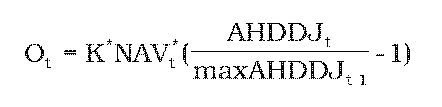

# Čl. I

Zákon č. 650/2004 Z. z. o doplnkovom dôchodkovom sporení a o zmene a doplnení niektorých zákonov v znení zákona č. 747/2004 Z. z., zákona č. 584/2005 Z. z., zákona č. 310/2006 Z. z., zákona č. 209/2007 Z. z., zákona č. 555/2007 Z. z., zákona č. 659/2007 Z. z., zákona č. 449/2008 Z. z. a zákona č. 186/2009 Z. z. sa mení a dopĺňa takto:

- 1. § 2 sa dopĺňa odsekmi 4 a 5, ktoré znejú:

- „(4)

- Výška príspevkov dohodnutá podľa odseku 3 musí byť vyjadrená

- a)

- pevnou sumou,

- b)

- násobkom príspevku zamestnanca alebo

- c)

- percentuálnou sadzbou z vymeriavacieho základu zamestnanca podľa osobitného predpisu.1)

- (5)

- Výška príspevkov podľa odseku 4 písm. b) a c) môže byť ohraničená.“.

- Poznámka pod čiarou k odkazu 1 znie:

- „1)

- § 138 zákona č. 461/2003 Z. z. o sociálnom poistení v znení neskorších predpisov.“.

- 2. V § 3 ods. 1 sa slovo „predpisu1)“ nahrádza slovom „predpisu1a)“.

- Poznámka pod čiarou k odkazu 1a znie:

- „1a)

- § 4 ods. 1 zákona č. 461/2003 Z. z. v znení neskorších predpisov.“.

- 3. V § 11 odsek 1 znie:

- „(1)

- Účastníkovi zaniká doplnkové dôchodkové sporenie zánikom účastníckej zmluvy podľa § 57 ods. 5 písm. a) až e), smrťou účastníka alebo vyhlásením účastníka za mŕtveho.“.

- 4. V § 13 odseky 1 a 2 znejú:

- „(1)

- Výška príspevkov a lehota splatnosti príspevkov účastníka sa dohodnú v účastníckej zmluve. Účastník je povinný platiť príspevky bezhotovostným prevodom, ak sa s doplnkovou dôchodkovou spoločnosťou nedohodne inak.

- (2)

- Výška príspevkov a lehota splatnosti príspevkov zamestnávateľa, ktorý platí príspevky za zamestnanca, ktorý je účastníkom, sa dohodnú v zamestnávateľskej zmluve. Zamestnávateľ je povinný platiť príspevky bezhotovostným prevodom, ak sa s doplnkovou dôchodkovou spoločnosťou nedohodne inak. Zamestnávateľ je povinný zasielať doplnkovej dôchodkovej spoločnosti rozpis príspevkov za zamestnancov, ktorí sú účastníkmi, elektronicky. Ak zamestnávateľ platí príspevok za účastníka podľa § 5 ods. 2, je povinný túto platbu v rozpise označiť spôsobom, ktorý vyjadruje skutočnosť, že ide o účastníka podľa § 5 ods. 2 a umožní jej osobitnú evidenciu.“.

- 5. V § 13 ods. 3 sa slovo „predpisu4)“ nahrádza slovom „predpisu1)“.

- Poznámka pod čiarou k odkazu 4 sa vypúšťa.

- 6. V § 16 odsek 1 znie:

- „(1)

- Účastníkovi, ktorý požiada doplnkovú dôchodkovú spoločnosť o vyplácanie doplnkového starobného dôchodku, sa tento dôchodok vypláca, ak doplnkové dôchodkové sporenie trvalo aspoň minimálne obdobie určené dávkovým plánom a dovŕši potrebný vek určený dávkovým plánom.“.

- 7. V § 17 odsek 1 znie:

- „(1)

- Účastníkovi, ktorý požiada doplnkovú dôchodkovú spoločnosť o vyplácanie doplnkového výsluhového dôchodku, sa tento dôchodok vypláca, ak doplnkové dôchodkové sporenie trvalo aspoň minimálne obdobie určené dávkovým plánom z dôvodu výkonu prác, ktoré sú zaradené na základe rozhodnutia orgánu na ochranu zdravia do kategórie 3 a 4, alebo z dôvodu výkonu prác tanečného umelca alebo hráča na dychový nástroj a dovŕši potrebný vek určený dávkovým plánom.“.

- 8. V § 17 odsek 4 znie:

- „(4)

- Dočasný doplnkový výsluhový dôchodok sa vypláca najmenej do dovŕšenia veku 62 rokov. Ak účastník preukáže, že vek potrebný na nárok na starobný dôchodok podľa osobitného predpisu5) dovŕši skôr ako vo veku 62 rokov, dočasný doplnkový výsluhový dôchodok sa vypláca najmenej do dovŕšenia veku potrebného na nárok na starobný dôchodok podľa osobitného predpisu.5)“.

- 9. V § 18 ods. 1 písm. a) sa na konci pripájajú tieto slová: „ak o vyplatenie jednorazového vyrovnania požiada,“.

- 10. V § 18 odseky 2 až 4 znejú:

- „(2)

- Účastníkovi sa vyplatí jednorazové vyrovnanie aj vtedy, ak spĺňa podmienky vyplácania doplnkového starobného dôchodku a v žiadosti podľa § 20 ods. 4 požiada o vyplácanie doplnkového starobného dôchodku a o vyplatenie jednorazového vyrovnania.

- (3)

- Jednorazové vyrovnanie podľa odseku 2 sa vyplatí v sume požadovanej účastníkom, najviac v sume zodpovedajúcej 50 % aktuálnej hodnoty osobného účtu účastníka ku dňu predchádzajúcemu dňu prevodu sumy zodpovedajúcej aktuálnej hodnote osobného účtu účastníka do poisťovne podľa § 20 ods. 3, ak účastník súčasne požiada o tento prevod.

- (4)

- Jednorazové vyrovnanie podľa odseku 2 sa vyplatí v sume požadovanej účastníkom, najviac v sume zodpovedajúcej 25 % aktuálnej hodnoty osobného účtu účastníka ku dňu predchádzajúcemu dňu jej vyplatenia, ak účastník súčasne požiada o vyplácanie dočasného doplnkového starobného dôchodku.“.

- 11. V § 18 ods. 5 sa slová „ku dňu požiadania o jeho vyplatenie“ nahrádzajú slovami „ku dňu predchádzajúcemu dňu vyplatenia“.

- 12. § 19 a 20 vrátane nadpisov znejú:

- 㤠19

- Odstupné

- (1)

- Účastníkovi sa vyplatí odstupné v sume zodpovedajúcej 80 % aktuálnej hodnoty osobného účtu účastníka ku dňu určenému v žiadosti o vyplatenie odstupného, ak do dňa doručenia tejto žiadosti nepožiadal o inú dávku, na ktorú splnil podmienky vyplácania podľa dávkového plánu.

- (2)

- Rozdiel medzi aktuálnou hodnotou osobného účtu účastníka pred výplatou odstupného a vyplatenou sumou odstupného podľa odseku 1, znížený o odplatu za odstupné podľa § 35d, sa považuje za kladný výnos príspevkového doplnkového dôchodkového fondu, z ktorého bolo účastníkovi vyplatené odstupné.

- § 20

- Výplata dávok

- (1)

- Doplnková dôchodková spoločnosť je povinná vyplatiť dočasný doplnkový starobný dôchodok, dočasný doplnkový výsluhový dôchodok, jednorazové vyrovnanie a odstupné, ak o ne účastník požiada po splnení podmienok na ich vyplácanie ustanovených týmto zákonom a určených v dávkovom pláne. Účastník podáva žiadosť o výplatu dávok uvedených v § 15 doplnkovej dôchodkovej spoločnosti, s ktorou má uzatvorenú účastnícku zmluvu.

- (2)

- Doplnková dôchodková spoločnosť je povinná previesť do poisťovne,7) ktorú si zvolí účastník, sumu zodpovedajúcu aktuálnej hodnote osobného účtu účastníka ku dňu predchádzajúcemu dňu prevodu tejto sumy do poisťovne; táto suma sa znižuje o sumu vyplateného jednorazového vyrovnania, ak účastník žiada o jednorazové vyrovnanie podľa § 18 ods. 3.

- (3)

- Poisťovňa vypláca doživotný doplnkový starobný dôchodok a doživotný doplnkový výsluhový dôchodok po splnení podmienok na ich vyplácanie ustanovených týmto zákonom a určených v dávkovom pláne, a to na základe poistnej zmluvy8) uzatvorenej medzi poisťovňou a účastníkom. Poisťovňa na účely tohto zákona je poisťovňa, poisťovňa z iného členského štátu a zahraničná poisťovňa podľa osobitného predpisu.7) Poistná zmluva sa môže uzatvoriť najskôr po podaní žiadosti o vyplácanie doživotného doplnkového starobného dôchodku alebo doživotného doplnkového výsluhového dôchodku.

- (4)

- Žiadosť o výplatu dávok uvedených v § 15 obsahuje

- a)

- meno, priezvisko a adresu trvalého bydliska účastníka,

- b)

- druh dávky alebo dávok, ktoré účastník žiada vyplatiť alebo vyplácať, a ak ide o doplnkový starobný dôchodok alebo doplnkový výsluhový dôchodok, aj formu týchto dôchodkov,

- c)

- požadovanú výšku jednorazového vyrovnania vyjadrenú percentuálne alebo pevnou sumou, ak účastník žiada jednorazové vyrovnanie súčasne s doplnkovým starobným dôchodkom,

- d)

- vyhlásenie účastníka, že je oboznámený s tým, že doživotný doplnkový starobný dôchodok a doživotný doplnkový výsluhový dôchodok sa nestávajú predmetom dedenia podľa § 21, ak účastník žiada o prevod sumy zodpovedajúcej aktuálnej hodnote osobného účtu účastníka do poisťovne podľa odseku 2,

- e)

- číslo účtu v banke alebo pobočke zahraničnej banky, na ktorý má byť dávka prevedená, ak účastník nežiada zaslanie poštovou poukážkou,

- f)

- prílohy, z ktorých vyplýva preukázanie skutočností nevyhnutných na posúdenie splnenia podmienok vyplácania dávok.

- (5)

- Žiadosť podľa odseku 4 musí byť účastníkom podpísaná a pravosť podpisu musí byť úradne osvedčená; táto podmienka sa považuje za splnenú, ak totožnosť žiadateľa overila osoba poverená doplnkovou dôchodkovou spoločnosťou.

- (6)

- Ak žiadosť podľa odseku 4 neobsahuje predpísané náležitosti, doplnková dôchodková spoločnosť je povinná účastníka do 15 dní od doručenia tejto žiadosti písomne vyzvať na odstránenie nedostatkov. Výzva na odstránenie nedostatkov musí obsahovať odôvodnenie.

- (7)

- Výplatu dávky je doplnková dôchodková spoločnosť povinná zrealizovať v lehote podľa dávkového plánu, ktorá nesmie byť dlhšia ako 60 dní od doručenia úplnej žiadosti podľa odseku 4.

- (8)

- Dávka sa vypláca aj do cudziny. Ak sa dávka vypláca do členského štátu Európskej únie iného ako Slovenská republika a do Islandu, Lichtenštajnska, Nórska a Švajčiarska, doplnková dôchodková spoločnosť nemá nárok na manipulačný poplatok z dôvodu takého vyplácania dávky.“.

- Poznámka pod čiarou k odkazu 7 znie:

- „7)

- Zákon č. 8/2008 Z. z. o poisťovníctve a o zmene a doplnení niektorých zákonov v znení neskorších predpisov.“.

- 13. V § 22 ods. 8 a v § 33 ods. 1 sa slová „50 000 000 Sk“ nahrádzajú slovami „1 650 000 eur“.

- 14. V poznámke pod čiarou k odkazu 16 sa citácia „Zákon č. 328/1991 Zb. o konkurze a vyrovnaní v znení neskorších predpisov.“ nahrádza citáciou „Zákon č. 7/2005 Z. z. o konkurze a reštrukturalizácii a o zmene a doplnení niektorých zákonov v znení neskorších predpisov.“.

- 15. V poznámke pod čiarou k odkazu 24c sa citácia „Napríklad zákon č. 367/2000 Z. z. o ochrane pred legalizáciou príjmov z trestnej činnosti a o zmene a doplnení niektorých zákonov v znení neskorších predpisov.“ nahrádza citáciou „Napríklad zákon č. 297/2008 Z. z. o ochrane pred legalizáciou príjmov z trestnej činnosti a o ochrane pred financovaním terorizmu a o zmene a doplnení niektorých zákonov v znení neskorších predpisov.“.

- 16. Poznámka pod čiarou k odkazu 28 sa vypúšťa.

- 17. V § 33 ods. 3 písmeno a) znie:

- „a)

- súčet hodnoty 1 650 000 eur a 0,05 % z hodnoty majetku v doplnkových dôchodkových fondoch prevyšujúcej 165 000 000 eur; táto suma sa ďalej nezvyšuje, ak dosiahne 16 500 000 eur, a“.

- 18. V § 33 ods. 5 sa slová „prekračujúcej 50 000 000 Sk“ nahrádzajú slovami „prevyšujúcej 1 650 000 eur“.

- 19. § 35 vrátane nadpisu znie:

- 㤠35

- Odplata doplnkovej dôchodkovej spoločnosti, úhrada nákladov a poplatkov

- (1)

- Doplnková dôchodková spoločnosť má za podmienok ustanovených týmto zákonom nárok na

- a)

- odplatu za správu doplnkového dôchodkového fondu,

- b)

- odplatu za zhodnotenie majetku v doplnkovom dôchodkovom fonde,

- c)

- odplatu za prestup účastníka do inej doplnkovej dôchodkovej spoločnosti,

- d)

- odplatu za odstupné.

- (2)

- V súvislosti s doplnkovým dôchodkovým sporením sa môžu z majetku v doplnkovom dôchodkovom fonde uhrádzať len

- a)

- dane vzťahujúce sa na majetok v doplnkovom dôchodkovom fonde,

- b)

- pomerná časť odplaty za výkon činnosti depozitára zodpovedajúca podielu majetku v tomto doplnkovom dôchodkovom fonde k celkovému majetku spravovanému doplnkovou dôchodkovou spoločnosťou,

- c)

- poplatky subjektu zabezpečujúcemu vyrovnanie obchodov s cennými papiermi, poplatky za vedenie bežných účtov a vkladových účtov,

- d)

- poplatky obchodníkovi s cennými papiermi alebo zahraničnému obchodníkovi s cennými papiermi,

- e)

- poplatky centrálnemu depozitárovi cenných papierov alebo členovi centrálneho depozitára, alebo osobe s obdobným predmetom činnosti mimo územia Slovenskej republiky,

- f)

- odplata audítorovi za overenie účtovnej závierky doplnkového dôchodkového fondu.

- (3)

- Doplnková dôchodková spoločnosť je povinná pred uzatvorením účastníckej zmluvy oboznámiť záujemcu o uzatvorenie účastníckej zmluvy so skutočnosťou, že z majetku v doplnkovom dôchodkovom fonde sa uhrádzajú náklady a poplatky v súvislosti s doplnkovým dôchodkovým sporením tretím osobám podľa odseku 2 a s percentuálnou výškou týchto poplatkov a nákladov vo vzťahu k čistej hodnote majetku v príslušnom príspevkovom doplnkovom dôchodkovom fonde v predchádzajúcom kalendárnom roku.

- (4)

- Dane, odplaty a poplatky podľa odseku 2 sa môžu uhrádzať, len ak dôvod ich úhrady bezprostredne súvisí s majetkom v doplnkovom dôchodkovom fonde.“.

- 20. Za § 35 sa vkladajú § 35a až 35d, ktoré vrátane nadpisov znejú:

- 㤠35a

- Odplata za správu doplnkového dôchodkového fondu

- (1)

- Odplata za správu doplnkového dôchodkového fondu za jeden mesiac správy doplnkového dôchodkového fondu nesmie presiahnuť

- a)

- 0,083 % z priemernej mesačnej čistej hodnoty majetku vo výplatnom doplnkovom dôchodkovom fonde,

- b)

- 0,165 % z priemernej mesačnej čistej hodnoty majetku v príspevkovom doplnkovom dôchodkovom fonde.

- (2)

- Doplnková dôchodková spoločnosť je povinná každý pracovný deň určiť pomernú časť odplaty za správu doplnkového dôchodkového fondu za predchádzajúci pracovný deň. V nasledujúci pracovný deň sa zníži o sumu tejto pomernej časti hodnota majetku v doplnkovom dôchodkovom fonde platná pre deň, v ktorom sa určila podľa prvej vety.

- (3)

- Doplnková dôchodková spoločnosť nezníži počet doplnkových dôchodkových jednotiek evidovaných na osobných účtoch všetkých účastníkov alebo poberateľov dávok v doplnkovom dôchodkovom fonde o sumu určenú podľa odseku 2.

- § 35b

- Odplata za zhodnotenie majetku v doplnkovom dôchodkovom fonde

- (1)

- Odplata za zhodnotenie majetku v doplnkovom dôchodkovom fonde sa určuje každý pracovný deň podľa vzorca uvedeného v prílohe č. 1. Doplnková dôchodková spoločnosť nemá nárok na odplatu za zhodnotenie majetku v doplnkovom dôchodkovom fonde, ak suma vypočítaná podľa predchádzajúcej vety má zápornú hodnotu.

- (2)

- Doplnková dôchodková spoločnosť v pracovný deň bezprostredne nasledujúci po dni určenia odplaty podľa odseku 1 zníži hodnotu majetku v doplnkovom dôchodkovom fonde platnú pre deň, v ktorom sa výpočet podľa odseku 1 vykonal. Doplnková dôchodková spoločnosť nezníži počet doplnkových dôchodkových jednotiek evidovaných na osobných účtoch všetkých účastníkov o sumu určenú podľa odseku 1.

- § 35c

- Odplata za prestup účastníka do inej doplnkovej dôchodkovej spoločnosti

- (1)

- Odplata za prestup účastníka do inej doplnkovej dôchodkovej spoločnosti je v období troch rokov od uzatvorenia účastníckej zmluvy najviac 5 % hodnoty zostatku na osobnom účte účastníka ku dňu predchádzajúcemu dňu prestupu.

- (2)

- Doplnková dôchodková spoločnosť nemá nárok na odplatu za prestup účastníka do inej doplnkovej dôchodkovej spoločnosti, ak

- a)

- od uzatvorenia účastníckej zmluvy uplynuli viac ako tri roky alebo

- b)

- ide o účastníka, ktorý je zamestnancom zamestnávateľa, ktorý nemá uzatvorenú zamestnávateľskú zmluvu s doplnkovou dôchodkovou spoločnosťou, s ktorou má prestupujúci účastník uzatvorenú účastnícku zmluvu.

- § 35d

- Odplata za odstupné

- Odplata za odstupné je 5 % aktuálnej hodnoty osobného účtu účastníka ku dňu, ku ktorému sa odstupné vypláca.“.

- 21. V § 41 odsek 2 znie:

- „(2)

- Majetok v doplnkovom dôchodkovom fonde a majetok vedený na bežnom účte určenom výlučne na účely prijímania platieb od účastníkov a zamestnávateľov do okamihu identifikácie účastníka, ktorého sa platba týka (ďalej len „účet nepriradených platieb“), nie sú súčasťou konkurznej podstaty doplnkovej dôchodkovej spoločnosti a nesmú byť použité na vyrovnanie s veriteľmi doplnkovej dôchodkovej spoločnosti alebo na reštrukturalizáciu podľa osobitného predpisu.16)“.

- 22. V § 48 ods. 4 písmeno d) znie:

- „d)

- percentuálne určenie výšky odplát uvedených v § 35 ods. 1 písm. a), c) a d), ako aj koeficient na určenie výšky odplaty za zhodnotenie majetku v príspevkovom doplnkovom dôchodkovom fonde,“.

- 23. § 56 znie:

- 㤠56

- (1)

- Majetok v doplnkovom dôchodkovom fonde sa musí zveriť depozitárovi v súlade s týmto zákonom.

- (2)

- Depozitárom doplnkového dôchodkového fondu môže byť len banka alebo pobočka zahraničnej banky,41) ktorá má povolenie podľa osobitných predpisov41a) na vykonávanie činnosti depozitára a na vykonávanie vedľajšej investičnej služby spočívajúcej v úschove alebo v správe finančných nástrojov a ktorá nie je v nútenej správe.

- (3)

- Depozitárom doplnkového dôchodkového fondu nemôže byť právnická osoba uvedená v odseku 2, ktorá je zakladateľom doplnkovej dôchodkovej spoločnosti spravujúcej tento doplnkový dôchodkový fond (ďalej len „spravujúca doplnková dôchodková spoločnosť“), akcionárom spravujúcej doplnkovej dôchodkovej spoločnosti alebo ktorá je členom skupiny s úzkymi väzbami vo vzťahu k spravujúcej doplnkovej dôchodkovej spoločnosti, k akcionárom s kvalifikovanou účasťou na spravujúcej doplnkovej dôchodkovej spoločnosti a k zakladateľom spravujúcej doplnkovej dôchodkovej spoločnosti.

- (4)

- Depozitár doplnkového dôchodkového fondu môže na základe zmluvy zveriť úschovu zahraničných cenných papierov inej osobe, ktorá je oprávnená na výkon zverených činností. Výkon týchto činností depozitár nesmie zveriť osobe, ktorej záujmy môžu byť v konflikte so záujmami účastníkov a poberateľov dávok. Depozitár a osoba, ktorej bola zverená úschova zahraničných cenných papierov, sú povinní viesť úschovu týchto cenných papierov vždy oddelene od ostatného majetku a spôsobom, ktorý zabezpečí ochranu práv účastníkov a poberateľov dávok podľa § 46.

- (5)

- Všetky doplnkové dôchodkové fondy spravujúcej doplnkovej dôchodkovej spoločnosti musia mať toho istého depozitára.

- (6)

- Na činnosť depozitára sa vzťahujú ustanovenia osobitných predpisov,41b) ak v odsekoch 1 až 5 a v § 56a až 56e nie je ustanovené inak.“.

- Poznámky pod čiarou k odkazom 41 až 41b znejú:

- „41)

- § 2 ods. 1, 5 a 8 zákona č. 483/2001 Z. z. o bankách a o zmene a doplnení niektorých zákonov v znení neskorších predpisov.

- 41a)

- Zákon č. 566/2001 Z. z. v znení neskorších predpisov.

- Zákon č. 483/2001 Z. z. v znení neskorších predpisov.

- 41b)

- Napríklad Obchodný zákonník v znení neskorších predpisov, zákon č. 566/2001 Z. z. v znení neskorších predpisov.“.

- 24. Za § 56 sa vkladajú § 56a až 56e, ktoré znejú:

- 㤠56a

- (1)

- Depozitár vykonáva činnosť na základe písomnej zmluvy s doplnkovou dôchodkovou spoločnosťou o výkone činnosti depozitára (ďalej len „depozitárska zmluva“).

- (2)

- V depozitárskej zmluve musia byť dohodnuté činnosti depozitára, a to najmenej v rozsahu podľa § 56c ods. 2 a výška odplaty za výkon činnosti depozitára.

- (3)

- Depozitárska zmluva sa uzatvára na neurčitý čas. Depozitársku zmluvu môžu zmluvné strany vypovedať. Výpovedná lehota je tri mesiace, ak sa v depozitárskej zmluve nedohodla kratšia výpovedná lehota. Výpovedná lehota začína plynúť od prvého dňa kalendárneho mesiaca, ktorý nasleduje po kalendárnom mesiaci, v ktorom bola výpoveď doručená druhej zmluvnej strane.

- (4)

- Ak sa depozitárovi odoberie bankové povolenie alebo ak mu zanikne bankové povolenie,41c) povolenie na poskytovanie investičných služieb41d) v časti potrebnej na výkon činnosti depozitára, alebo ak je nad ním zavedená nútená správa, dňom právoplatnosti príslušných rozhodnutí depozitárovi zaniká oprávnenie vykonávať činnosť depozitára podľa tohto zákona a depozitárska zmluva uzatvorená s týmto depozitárom stráca platnosť.

- (5)

- Vypovedanie depozitárskej zmluvy alebo vznik skutočností podľa odseku 4 oznámi depozitár bez zbytočného odkladu Národnej banke Slovenska a doplnkovej dôchodkovej spoločnosti, s ktorou mal uzatvorenú depozitársku zmluvu.

- (6)

- Doplnková dôchodková spoločnosť je po skončení platnosti depozitárskej zmluvy povinná bez zbytočného odkladu pozastaviť nakladanie s majetkom v doplnkových dôchodkových fondoch okrem úhrady záväzkov vzniknutých pred zánikom depozitárskej zmluvy a úkonov nevyhnutných na zabezpečenie majetku v doplnkových dôchodkových fondoch pred vznikom škody na tomto majetku až do uzatvorenia zmluvy s novým depozitárom.

- (7)

- Doplnková dôchodková spoločnosť je povinná pripraviť najneskôr ku dňu uplynutia výpovednej lehoty alebo do jedného mesiaca po skončení platnosti depozitárskej zmluvy spôsobom podľa odseku 4 návrh depozitárskej zmluvy s iným depozitárom a požiadať Národnú banku Slovenska o udelenie predchádzajúceho písomného súhlasu na zmenu depozitára.

- (8)

- Ak doplnková dôchodková spoločnosť nepožiada Národnú banku Slovenska o udelenie predchádzajúceho písomného súhlasu na zmenu depozitára v lehote podľa odseku 7, Národná banka Slovenska do jedného mesiaca od uplynutia tejto lehoty určí nového depozitára. Doplnková dôchodková spoločnosť a depozitár určený Národnou bankou Slovenska sú povinní bez zbytočného odkladu uzatvoriť depozitársku zmluvu. Doplnková dôchodková spoločnosť je povinná depozitársku zmluvu po jej uzatvorení bez zbytočného odkladu predložiť Národnej banke Slovenska.

- (9)

- Depozitár, ktorý prestal pre doplnkové dôchodkové fondy spravujúcej doplnkovej dôchodkovej spoločnosti vykonávať činnosť depozitára, je povinný bez zbytočného odkladu odovzdať majetok v doplnkových dôchodkových fondoch a s ním súvisiacu dokumentáciu a informácie o výkone depozitárskej činnosti súvisiace s odovzdávaným majetkom novému depozitárovi. Do odovzdania majetku a súvisiacej dokumentácie nesmie depozitár vykonávať ani umožniť vykonať nakladanie s majetkom v doplnkových dôchodkových fondoch; to neplatí na úkony nevyhnutné na zabezpečenie majetku v doplnkových dôchodkových fondoch pred vznikom škody na tomto majetku a na úkony nevyhnutné na zabezpečenie výplaty dávok podľa tohto zákona.

- (10)

- Depozitár je povinný plniť povinnosti vyplývajúce z depozitárskej zmluvy aj v prípade vstupu doplnkovej dôchodkovej spoločnosti do konkurzu alebo reštrukturalizácie, a to až do uzatvorenia depozitárskej zmluvy s inou doplnkovou dôchodkovou spoločnosťou, na ktorú sa previedla správa doplnkových dôchodkových fondov, alebo do zrušenia všetkých doplnkových dôchodkových fondov spravovaných doplnkovou dôchodkovou spoločnosťou podľa § 52.

- § 56b

- (1)

- Depozitár je povinný viesť pre doplnkovú dôchodkovú spoločnosť, s ktorou má uzatvorenú depozitársku zmluvu, bežný účet41e) v určitej mene. Depozitár je povinný viesť pre každý doplnkový dôchodkový fond spravujúcej doplnkovej dôchodkovej spoločnosti, s ktorou má uzavretú depozitársku zmluvu, jeden bežný účet v určitej mene.

- (2)

- Bežným účtom doplnkového dôchodkového fondu podľa odseku 1 musia prechádzať všetky platby, výplaty a prevody peňažných prostriedkov, ktoré tvoria majetok v doplnkovom dôchodkovom fonde.

- (3)

- Depozitár je oprávnený po dohode s doplnkovou dôchodkovou spoločnosťou otvoriť a viesť okrem bežných účtov podľa odseku 1 aj jeden účet nepriradených platieb. Prijaté platby nachádzajúce sa na účte nepriradených platieb nie sú majetkom doplnkovej dôchodkovej spoločnosti. Výnosy z nepriradených platieb sú príjmom doplnkovej dôchodkovej spoločnosti.

- (4)

- Doplnková dôchodková spoločnosť si nemôže otvoriť v banke a v pobočke zahraničnej banky odlišnej od depozitára bežné účty. Doplnková dôchodková spoločnosť si môže otvoriť vkladové účty aj v inej banke a v pobočke zahraničnej banky odlišnej od depozitára.

- (5)

- Depozitár môže uvoľniť peňažné prostriedky z bežných účtov doplnkového dôchodkového fondu podľa odseku 1 na nákup cenných papierov len po prevode týchto cenných papierov alebo ako platbu oproti dodávke týchto cenných papierov.

- (6)

- Ak sú súčasťou majetku v doplnkovom dôchodkovom fonde listinné cenné papiere, musia sa uschovať u depozitára. Ak nemožno zabezpečiť úschovu listinných cenných papierov u depozitára, musia sa uschovať u tretej osoby, ktorú určí depozitár. Za takto uschované listinné cenné papiere zodpovedá depozitár, akoby boli uschované u neho.

- (7)

- Doplnková dôchodková spoločnosť je povinná na nakladanie so svojím majetkom tvoreným zaknihovanými cennými papiermi evidovanými v registri emitentov v centrálnom depozitári zriadiť a používať len jeden účet majiteľa.

- (8)

- Doplnková dôchodková spoločnosť je povinná na nakladanie s majetkom v ňou spravovaných doplnkových dôchodkových fondoch tvoreným zaknihovanými cennými papiermi evidovanými v registri emitentov v centrálnom depozitári zriadiť a používať osobitne pre každý ňou spravovaný doplnkový dôchodkový fond samostatný účet majiteľa. Na evidovanie a nakladanie s majetkom v doplnkovom dôchodkovom fonde nesmie mať doplnková dôchodková spoločnosť zriadený a používať viac ako jeden účet majiteľa pre každý ňou spravovaný doplnkový dôchodkový fond ani používať účet majiteľa podľa odseku 7.

- (9)

- Ak je depozitár členom centrálneho depozitára, účty majiteľa podľa odsekov 7 a 8 je doplnková dôchodková spoločnosť povinná zriadiť u svojho depozitára. Ak depozitár nie je členom centrálneho depozitára, účty majiteľa podľa odsekov 7 a 8 je doplnková dôchodková spoločnosť povinná zriadiť u iného člena centrálneho depozitára; tieto účty majiteľa musia byť zriadené u toho istého člena centrálneho depozitára.

- (10)

- Ak sú súčasťou majetku v doplnkovom dôchodkovom fonde zahraničné zaknihované cenné papiere, je depozitár povinný bez zbytočného odkladu zabezpečiť spravujúcej doplnkovej dôchodkovej spoločnosti výpisy z účtu majiteľa alebo z účtu plniaceho obdobnú funkciu, alebo ich kópie, ak ich spravujúca doplnková dôchodková spoločnosť nedostáva priamo.

- (11)

- Doplnková dôchodková spoločnosť nesmie nakladať s majetkom v doplnkových dôchodkových fondoch bez vedomia depozitára.

- § 56c

- (1)

- Pri výkone svojej činnosti koná depozitár samostatne, s odbornou starostlivosťou, v súlade s depozitárskou zmluvou a výlučne v záujme účastníkov a poberateľov dávok.

- (2)

- Depozitár je pri výkone svojej činnosti povinný najmä

- a)

- vykonávať pokyny doplnkovej dôchodkovej spoločnosti, ak neodporujú tomuto zákonu, iným všeobecne záväzným právnym predpisom alebo štatútu doplnkového dôchodkového fondu,

- b)

- kontrolovať, či je hodnota majetku v doplnkovom dôchodkovom fonde určovaná v súlade s týmto zákonom a so štatútom doplnkového dôchodkového fondu,

- c)

- kontrolovať dodržiavanie pravidiel obmedzenia a rozloženia rizika pri nakladaní s majetkom v doplnkovom dôchodkovom fonde,

- d)

- kontrolovať dodržiavanie ustanovení tohto zákona, iných všeobecne záväzných právnych predpisov, ako aj štatútov spravovaných doplnkových dôchodkových fondov spravujúcou doplnkovou dôchodkovou spoločnosťou,

- e)

- zabezpečovať, aby pri transakciách s majetkom v doplnkových dôchodkových fondoch bola prevádzaná protihodnota v prospech majetku v doplnkových dôchodkových fondoch na princípe platby oproti dodávke, ak to povaha obchodu alebo obchodné zvyklosti nevylučujú, v lehotách obvyklých na regulovanom trhu, kde sa obchod uskutočňuje, a v prípade obchodov uzavretých mimo regulovaného trhu v zmluvne dohodnutých lehotách, ktoré sú obvyklé pre daný typ obchodov,

- f)

- kontrolovať výpočet hodnoty doplnkovej dôchodkovej jednotky.

- (3)

- Depozitár je povinný bez zbytočného odkladu písomne informovať Národnú banku Slovenska o porušení ustanovení týkajúcich sa investovania.

- (4)

- Ak depozitár pri výkone svojej činnosti zistí, že doplnková dôchodková spoločnosť porušila tento zákon, všeobecne záväzné právne predpisy alebo štatút doplnkového dôchodkového fondu, bez zbytočného odkladu písomne informuje o tejto skutočnosti Národnú banku Slovenska a doplnkovú dôchodkovú spoločnosť. Depozitár je povinný bez zbytočného odkladu informovať Národnú banku Slovenska o prekročení limitov podľa § 53 až 55.

- (5)

- Depozitár je povinný na písomné požiadanie bez zbytočného odkladu poskytnúť požadované informácie o doplnkovej dôchodkovej spoločnosti a o doplnkových dôchodkových fondoch získané pri výkone činnosti depozitára, a to Národnej banke Slovenska, službe kriminálnej polície Policajného zboru alebo službe finančnej polície Policajného zboru na účely plnenia úloh ustanovených osobitným zákonom.41f)

- (6)

- Depozitár plní len tie pokyny doplnkovej dôchodkovej spoločnosti, ktoré sú v súlade s týmto zákonom, so všeobecne záväznými právnymi predpismi, s depozitárskou zmluvou a so štatútmi doplnkových dôchodkových fondov. Ak pokyn doplnkovej dôchodkovej spoločnosti depozitárovi odporuje tomuto zákonu, všeobecne záväzným právnym predpisom, depozitárskej zmluve alebo štatútu doplnkového dôchodkového fondu, depozitár ho nevykoná a písomne upozorní na to doplnkovú dôchodkovú spoločnosť; ak doplnková dôchodková spoločnosť aj napriek upozorneniu trvá na vykonaní takého pokynu, depozitár ho nevykoná a písomne oznámi túto skutočnosť bez zbytočného odkladu Národnej banke Slovenska.

- (7)

- Pri výkone svojej činnosti je depozitár oprávnený požadovať od doplnkovej dôchodkovej spoločnosti okrem údajov a dokladov o doplnkových dôchodkových fondoch, ktoré spravuje, aj údaje a doklady o jej činnosti. Doplnková dôchodková spoločnosť je povinná tieto údaje a doklady bez zbytočného odkladu predložiť depozitárovi.

- (8)

- Depozitár nesmie údaje a doklady získané pri výkone činnosti depozitára poskytnúť tretej osobe, ak tento zákon neustanovuje inak, ani využiť na iné účely, než je výkon činnosti depozitára.

- (9)

- Člen predstavenstva, člen dozornej rady, prokurista alebo zamestnanec depozitára je povinný zachovávať mlčanlivosť o skutočnostiach, o ktorých sa dozvedel pri výkone činnosti depozitára, a to aj po skončení výkonu tejto činnosti, ak tento zákon alebo osobitný predpis neustanovuje inak.

- § 56d

- Zodpovednosť depozitára

- (1)

- Depozitár zodpovedá doplnkovej dôchodkovej spoločnosti, účastníkom a poberateľom dávok za škody spôsobené porušením alebo nedostatočným plnením povinností vyplývajúcich z tohto zákona, zo všeobecne záväzných právnych predpisov, štatútu doplnkového dôchodkového fondu a z depozitárskej zmluvy uzatvorenej medzi doplnkovou dôchodkovou spoločnosťou a depozitárom pri výkone svojej činnosti, a to aj po jej skončení. Tým nie je dotknutá zodpovednosť doplnkovej dôchodkovej spoločnosti podľa § 37 ods. 4.

- (2)

- Zodpovednosť depozitára za škody spôsobené porušením alebo nedostatočným plnením povinností vyplývajúcich z tohto zákona, zo všeobecne záväzných právnych predpisov, štatútu doplnkového dôchodkového fondu a z depozitárskej zmluvy nie je ovplyvnená skutočnosťou, že depozitár zveril plnenie týchto povinností tretej osobe.

- (3)

- Doplnková dôchodková spoločnosť je povinná vymáhať náhradu škody spôsobenú depozitárom.

- (4)

- Doplnková dôchodková spoločnosť je povinná zastupovať záujmy účastníkov a poberateľov dávok pri vymáhaní škody, ktorú im pri výkone svojej činnosti spôsobil depozitár porušením alebo nedostatočným plnením svojich povinností, ktoré mu vyplývajú z tohto zákona, zo všeobecne záväzných právnych predpisov, štatútu doplnkového dôchodkového fondu a z depozitárskej zmluvy, a to aj v prípade, ak depozitárovi zaniklo alebo mu bolo odobraté bankové povolenie alebo povolenie na poskytovanie investičných služieb.

- § 56e

- Platobná schopnosť depozitára

- Majetok v doplnkových dôchodkových fondoch a majetok nachádzajúci sa na účte nepriradených platieb podľa § 56b ods. 3, ako aj majetok doplnkovej dôchodkovej spoločnosti, ktorý je zverený v súlade s ustanoveniami tohto zákona depozitárovi, nesmie byť predmetom výkonu rozhodnutia alebo exekúcie vedenej voči depozitárovi podľa osobitných predpisov,41g) predmetom výkonu nútenej správy nad depozitárom a nie je ani súčasťou konkurznej podstaty16) depozitára.“.

- Poznámky pod čiarou k odkazom 41c až 41g znejú :

- „41c)

- § 50 až 65 zákona č. 483/2001 Z. z. v znení neskorších predpisov.

- 41d)

- § 156 zákona č. 566/2001 Z. z.

- 41e)

- § 708 až 715 Obchodného zákonníka v znení neskorších predpisov.

- 41f)

- Napríklad § 2 ods. 1 písm. d) a § 4 ods. 1 a 3 zákona Národnej rady Slovenskej republiky č. 171/1993 Z. z. o Policajnom zbore v znení neskorších predpisov, § 91 ods. 4 písm. g) zákona č. 483/2001 Z. z. v znení neskorších predpisov.

- 41g)

- § 251 až 320a Občianskeho súdneho poriadku v znení neskorších predpisov a zákon Národnej rady Slovenskej republiky č. 233/1995 Z. z. o súdnych exekútoroch a exekučnej činnosti (Exekučný poriadok) a o zmene a doplnení ďalších zákonov v znení neskorších predpisov.“.

- 25. V § 57 ods. 3 sa vypúšťa písmeno e).

- Doterajšie písmená f) až j) sa označujú ako písmená e) až i).

- 26. V § 57 ods. 3 písm. i) sa slová „§ 35 ods. 6.“ nahrádzajú slovami „§ 35 ods. 3,“.

- 27. V § 57 sa odsek 3 dopĺňa písmenom j), ktoré znie:

- „j)

- prílohu, ktorou je dávkový plán.“.

- 28. V § 57 odsek 5 znie:

- „(5)

- Účastnícka zmluva zaniká len

- a)

- vyplatením poslednej splátky dočasného doplnkového starobného dôchodku alebo dočasného doplnkového výsluhového dôchodku,

- b)

- vyplatením jednorazového vyrovnania podľa § 18 ods. 1,

- c)

- vyplatením odstupného,

- d)

- prevodom sumy zodpovedajúcej aktuálnej hodnote osobného účtu účastníka do poisťovne, ak účastník požiada o vyplácanie doživotného doplnkového starobného dôchodku alebo doživotného doplnkového výsluhového dôchodku,

- e)

- na základe rozhodnutia súdu alebo

- f)

- zrušením osobného účtu účastníka podľa § 64 ods. 2.“.

- 29. V § 59 ods. 1 písm. b) a c) sa vypúšťajú slová „okrem zamestnávateľskej zmluvy, ktorú je zamestnávateľ povinný uzatvoriť podľa § 5 ods. 2“.

- 30. V § 59 ods. 2 písm. a) sa slovo „vyrovnanie“ nahrádza slovami „povolenie reštrukturalizácie“.

- 31. V § 60 odseky 1 a 2 znejú:

- „(1)

- Dávkový plán musí obsahovať najmä

- a)

- druhy vyplácaných dávok,

- b)

- minimálne obdobie doplnkového dôchodkového sporenia a potrebný vek na vyplácanie doplnkového starobného dôchodku a doplnkového výsluhového dôchodku,

- c)

- podmienky prerušenia doplnkového dôchodkového sporenia,

- d)

- spôsob určenia sumy dočasného doplnkového starobného dôchodku a dočasného doplnkového výsluhového dôchodku,

- e)

- lehotu a spôsob výplaty dávok,

- f)

- záväzok doplnkovej dôchodkovej spoločnosti previesť sumu na osobnom účte účastníka do poisťovne, ak účastník požiada o tento prevod, ako aj podmienky tohto prevodu a

- g)

- podmienky prevodu príspevkov do inej doplnkovej dôchodkovej spoločnosti a podmienky prestupu účastníka z jedného príspevkového doplnkového dôchodkového fondu do iného príspevkového doplnkového dôchodkového fondu tej istej doplnkovej dôchodkovej spoločnosti.

- (2)

- Dávkový plán nesmie podmieňovať práva účastníka ani povinnosti doplnkovej dôchodkovej spoločnosti skutočnosťami, ktoré sťažujú alebo znemožňujú uplatňovanie práv účastníka priznaných týmto zákonom a inými všeobecne záväznými právnymi predpismi.“.

- 32. V § 60 sa vypúšťa odsek 3.

- Doterajší odsek 4 sa označuje ako odsek 3.

- 33. V § 61 ods. 2 písmeno f) znie:

- „f)

- informáciu o aktuálnej percentuálnej výške odplaty podľa § 35 ods. 1 písm. a) a b),“.

- 34. V § 61 ods. 4 písmeno h) znie:

- „h)

- informáciu o aktuálnej percentuálnej výške odplaty podľa § 35 ods. 1 písm. a),“.

- 35. V § 61 ods. 7 písmeno e) znie:

- „e)

- percentuálnu výšku odplát podľa § 35 ods. 1,“.

- 36. V § 61 ods. 7 písm. f) sa na konci čiarka nahrádza bodkočiarkou a pripájajú sa tieto slová: „tento údaj musí byť graficky zvýraznený,“.

- 37. V § 61 ods. 7 sa za písmeno f) vkladá nové písmeno g), ktoré znie:

- „g)

- počiatočný stav osobného účtu účastníka k 1. januáru kalendárneho roka a konečný stav osobného účtu účastníka k 31. decembru kalendárneho roka; tieto údaje musia byť graficky zvýraznené,“.

- Doterajšie písmeno g) sa označuje ako písmeno h).

- 38. V § 61 ods. 8 písmeno e) znie:

- „e)

- percentuálnu výšku odplát podľa § 35 ods. 1 písm. a),“.

- 39. § 62 znie:

- 㤠62

- (1)

- Ku dňu, kedy bol na bežný účet doplnkového dôchodkového fondu vedený u depozitára pripísaný príspevok a majetok prevedený podľa § 63 a 64 alebo prevedený z iného členského štátu Európskej únie, pripíše príslušná doplnková dôchodková spoločnosť účastníkovi na jeho osobný účet taký počet doplnkových dôchodkových jednotiek doplnkového dôchodkového fondu, ktorý zodpovedá podielu hodnoty príspevku a majetku prevedeného podľa § 63 a 64 alebo prevedeného z iného členského štátu Európskej únie a aktuálnej hodnoty doplnkovej dôchodkovej jednotky doplnkového dôchodkového fondu.

- (2)

- Ak z platby príspevkov, ktoré sú pripísané na bežný účet depozitára alebo na účet nepriradených platieb v súlade s § 56b ods. 3, nie je možné určiť, ktorého účastníka sa taká platba týka, môžu byť príspevky pripísané na osobný účet účastníka až po identifikácii účastníka, ktorého sa platba týka. Ak dôjde k identifikácii účastníka, ktorého sa platba týka, do 90 dní od pripísania príspevkov na bežný účet depozitára alebo na účet nepriradených platieb, pripíše príspevky doplnková dôchodková spoločnosť účastníkovi na jeho osobný účet ku dňu jeho identifikácie. Ak nedôjde k identifikácii účastníka, ktorého sa platba týka, do 90 dní od pripísania príspevkov na bežný účet depozitára alebo na účet nepriradených platieb, doplnková dôchodková spoločnosť vráti príspevky tomu, od koho ich dostala.“.

- 40. V § 63 ods. 1 sa na konci bodka nahrádza bodkočiarkou a pripájajú sa tieto slová: „taký prestup doplnková dôchodková spoločnosť účastníkovi nespoplatňuje.“.

- 41. V § 64 odsek 1 znie:

- „(1)

- Účastník môže prestúpiť z príspevkového doplnkového dôchodkového fondu do iného príspevkového doplnkového dôchodkového fondu spravovaného inou doplnkovou dôchodkovou spoločnosťou na základe písomnej žiadosti; doplnková dôchodková spoločnosť, z ktorej účastník prestupuje, je povinná tento prestup zrealizovať do 30 dní od doručenia písomnej žiadosti účastníka. Poberateľ dávky nemôže prestúpiť z výplatného doplnkového dôchodkového fondu do iného výplatného doplnkového dôchodkového fondu spravovaného inou doplnkovou dôchodkovou spoločnosťou.“.

- 42. V § 65 ods. 16 a v § 67 ods. 2 písm. b) sa slová „§ 35 ods. 5“ nahrádzajú slovami „§ 35 ods. 2“.

- 43. V § 71 ods. 1 písm. n) sa slová „20 000 000 Sk“ nahrádzajú slovami „650 000 eur“.

- 44. V § 74 ods. 3 písm. c) sa za slovo „spoločnosti“ vkladajú slová „alebo návrh na povolenie reštrukturalizácie doplnkovej dôchodkovej spoločnosti“.

- 45. Nadpis nad § 84 znie: „Spoločné ustanovenia“.

- 46. Za § 84 sa vkladá § 84a, ktorý znie:

- 㤠84a

- Výška odmeny priamo súvisiaca s uzatvorením jednej účastníckej zmluvy o doplnkovom dôchodkovom sporení je najviac 10 % priemernej mesačnej mzdy v hospodárstve Slovenskej republiky vykázanej Štatistickým úradom Slovenskej republiky za kalendárny rok, ktorý dva roky predchádza kalendárnemu roku, v ktorom sa uzatvorila účastnícka zmluva o doplnkovom dôchodkovom sporení.“.

- 47. Za § 87i sa vkladajú § 87j až 87l, ktoré vrátane nadpisu znejú:

- „Prechodné ustanovenia k úpravám účinným od 1. januára 2010

- § 87j

- (1)

- V roku 2010 odplata za správu príspevkového doplnkového dôchodkového fondu nesmie za jeden kalendárny mesiac presiahnuť 0,2084 % z priemernej mesačnej čistej hodnoty majetku v doplnkovom dôchodkovom fonde.

- (2)

- V roku 2011 odplata za správu príspevkového doplnkového dôchodkového fondu nesmie za jeden kalendárny mesiac presiahnuť 0,205 % z priemernej mesačnej čistej hodnoty majetku v doplnkovom dôchodkovom fonde.

- (3)

- V roku 2012 odplata za správu príspevkového doplnkového dôchodkového fondu nesmie za jeden kalendárny mesiac presiahnuť 0,200 % z priemernej mesačnej čistej hodnoty majetku v doplnkovom dôchodkovom fonde.

- (4)

- V roku 2013 odplata za správu príspevkového doplnkového dôchodkového fondu nesmie za jeden kalendárny mesiac presiahnuť 0,195 % z priemernej mesačnej čistej hodnoty majetku v doplnkovom dôchodkovom fonde.

- (5)

- V roku 2014 odplata za správu príspevkového doplnkového dôchodkového fondu nesmie za jeden kalendárny mesiac presiahnuť 0,190 % z priemernej mesačnej čistej hodnoty majetku v doplnkovom dôchodkovom fonde.

- (6)

- V roku 2015 odplata za správu príspevkového doplnkového dôchodkového fondu nesmie za jeden kalendárny mesiac presiahnuť 0,185 % z priemernej mesačnej čistej hodnoty majetku v doplnkovom dôchodkovom fonde.

- (7)

- V roku 2016 odplata za správu príspevkového doplnkového dôchodkového fondu nesmie za jeden kalendárny mesiac presiahnuť 0,180 % z priemernej mesačnej čistej hodnoty majetku v doplnkovom dôchodkovom fonde.

- (8)

- V roku 2017 odplata za správu príspevkového doplnkového dôchodkového fondu nesmie za jeden kalendárny mesiac presiahnuť 0,175 % z priemernej mesačnej čistej hodnoty majetku v doplnkovom dôchodkovom fonde.

- (9)

- V roku 2018 odplata za správu príspevkového doplnkového dôchodkového fondu nesmie za jeden kalendárny mesiac presiahnuť 0,170 % z priemernej mesačnej čistej hodnoty majetku v doplnkovom dôchodkovom fonde.

- § 87k

- Doplnková dôchodková spoločnosť je povinná zosúladiť znenie štatútov doplnkových dôchodkových fondov a dávkových plánov s ustanoveniami zákona účinného od 1. januára 2010 a predložiť ich Národnej banke Slovenska na vydanie predchádzajúceho súhlasu podľa § 26 ods. 1 písm. h) a i) najneskôr do 31. januára 2010. Na žiadosť doplnkovej dôchodkovej spoločnosti môže Národná banka Slovenska lehotu podľa prvej vety primerane predĺžiť.

- § 87l

- (1)

- Doplnková dôchodková spoločnosť je povinná do 30. apríla 2010 zaslať všetkým účastníkom vrátane účastníkov uvedených v § 86 ods. 1 návrh na zmenu účastníckej zmluvy účinnej od 1. júla 2010, ktorej obsahom je zmena dávkového plánu podľa odseku 2 a poučenie o právnych dôsledkoch podpísania zmeny účastníckej zmluvy; účastník môže tento návrh na zmenu účastníckej zmluvy prijať najneskôr do 30. júna 2010.

- (2)

- Zmena dávkového plánu musí obsahovať výlučne zmeny podľa zákona účinného od 1. januára 2010 týkajúce sa

- a)

- podmienok vyplácania, súm a spôsobu výplaty jednotlivých druhov dávok uvedených v § 15 písm. a) až c),

- b)

- úpravy podľa § 19 ods. 2 a

- c)

- podmienok prestupu účastníka z príspevkového doplnkového dôchodkového fondu do iného príspevkového doplnkového dôchodkového fondu spravovaného inou doplnkovou dôchodkovou spoločnosťou a výšky odplaty za tento prestup.“.

- 48. V § 88 sa slová „v prílohe“ nahrádzajú slovami „v prílohe č. 2“.

- 49. Pred doterajšiu prílohu sa vkladá nová príloha č. 1, ktorá znie:

- „Príloha č. 1 k zákonu č. 650/2004 Z. z.

- VZOREC NA VÝPOČET VÝŠKY ODPLATY ZA ZHODNOTENIE MAJETKU V DOPLNKOVOM DÔCHODKOVOM FONDE

- Vzorec na výpočet výšky odplaty za zhodnotenie majetku v doplnkovom dôchodkovom fonde:

- 

- Pri výpočte odplaty za zhodnotenie majetku v doplnkovom dôchodkovom fonde sa použijú tieto veličiny, funkcie a ich označenia:

- Ot | výška odplaty za zhodnotenie majetku v doplnkovom dôchodkovom fonde pre deň t

- NAVt | čistá hodnota majetku v doplnkovom dôchodkovom fonde platná pre deň t

- AHDDJt | aktuálna hodnota doplnkovej dôchodkovej jednotky platná pre deň t

- maxAHDDJt-1 | maximálna aktuálna hodnota doplnkovej dôchodkovej jednotky dosiahnutá po 1. januári 2010 do dňa t-1

- K | koeficient na určenie výšky odplaty za zhodnotenie majetku v doplnkovom dôchodkovom fonde, ktorý

- | môže byť maximálne:

- | v roku 2010 vo výške 0,10,

- | v roku 2011 vo výške 0,11,

- | v roku 2012 vo výške 0,12,

- | v roku 2013 vo výške 0,13,

- | v roku 2014 vo výške 0,14,

- | v roku 2015 vo výške 0,15,

- | v roku 2016 vo výške 0,16,

- | v roku 2017 vo výške 0,17,

- | v roku 2018 vo výške 0,18,

- | v roku 2019 vo výške 0,19,

- | a v roku 2020 a v nasledujúcich rokoch vo výške 0,20,

- t | pracovný deň bezprostredne predchádzajúci dňu výpočtu odplaty za zhodnotenie majetku v doplnkovom dôchodkovom fonde.“.

- Doterajšia príloha sa označuje ako príloha č. 2.“.
