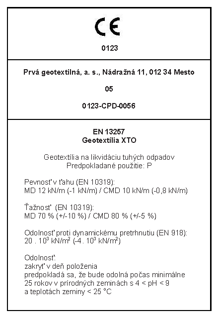
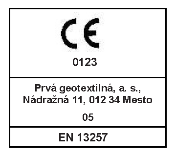
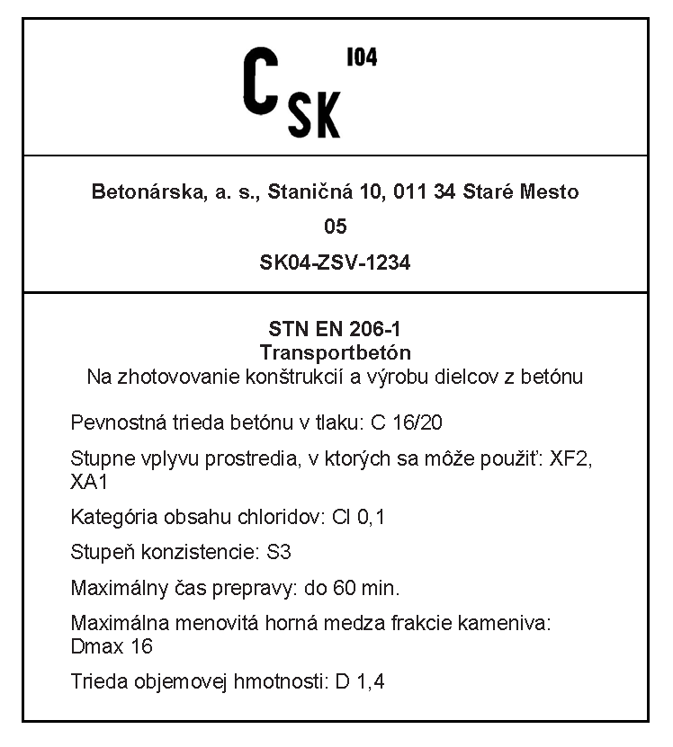
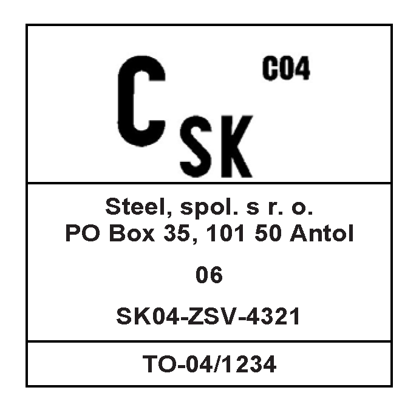
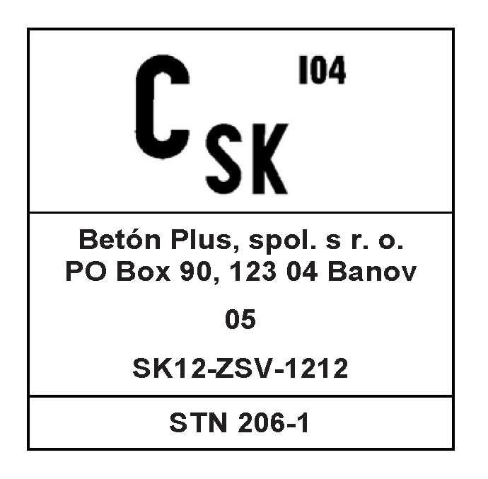
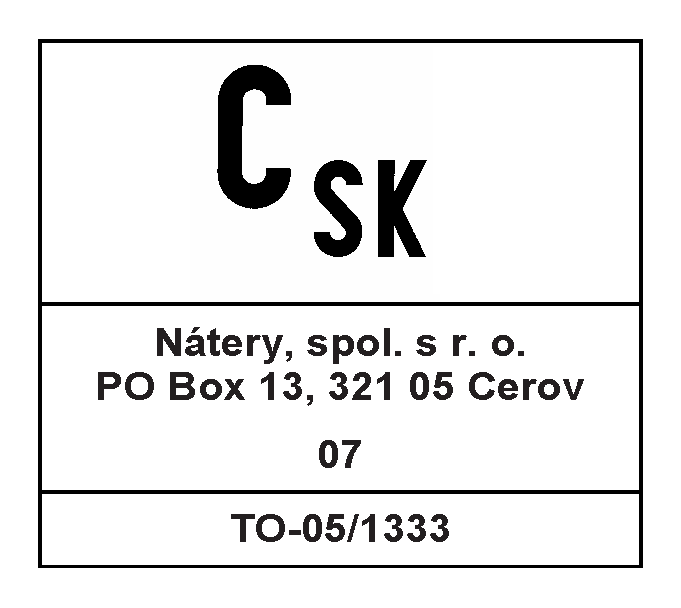

Príloha č. 1 k vyhláške č. 558/2009 Z. z. SKUPINY STAVEBNÝCH VÝROBKOV S URČENÝMI SYSTÉMAMI PREUKAZOVANIA ZHODY

Oblasť použitia výrobkov | | |

Číslo | Názov skupiny výrobkov | Členenie skupiny | SPZ

Výrobky na úpravu podložia stavieb a zemných konštrukcií a pre základové konštrukcie | | |

0101 | Geotextílie a geotextíliám podobné výrobky do stavieb pozemných komunikácií a iných dopravných plôch, stavieb železníc, zemných stavieb, základov a podperných konštrukcií, odvodňovacích systémov, stavieb na ochranu proti erózii, stavieb nádrží a hrádzí, stavieb kanálov a do stavieb na likvidáciu tuhých odpadov | Podľa účelu: |

| | na filtráciu | 2+

| | na odvodňovanie | 2+

| | na ochranu | 2+

| | na vystužovanie | 2+

| | aj na oddeľovanie1) | 4

0102 | Geotextílie a geotextíliám podobné výrobky do podzemných stavieb a tunelov alebo do stavieb na zadržiavanie kvapalných odpadov | | 2+

0103 | Geosyntetické zábrany proti kvapalinám pri stavbe nádrží a hrádzí, tunelov a podzemných stavieb, proti kvapalinám a plynom v skládkach tekutých odpadov, pri stavbe prečerpávacích staníc alebo bezpečnostných nádrží, stavbe miest na skladovanie a zneškodňovanie tuhých odpadov a pri stavbách dopravnej infraštruktúry | | 2+

0104 | Stabilizačné a hydroizolačné zmesi do podložia stavieb vrátane podložia násypu pozemnej komunikácie alebo telesa dráhy | | 2+

0105 | Prefabrikované pilóty a súvisiace konštrukčné prvky2) | | 2+

0106 | Základové trámy a pätky z betónu3) | | 2+

Výrobky na kotvenie do hornín a nosných vrstiev zemín | | |

0201 | Zemné a horninové kotvy | | 3

Výrobky pre oporné múry a vodné stavby | | |

0301 | Prvky oporných múrov z betónu3) | | 2+

0302 | Kameň na gabióny | | 2+

0303 | Siete na gabióny | | 3

0304 | Gabiónové bloky | | 2+

0305 | Kameň na vodné stavby | Podľa kategórie vodnej stav-by:4) |

| | I., II. a III. kategória | 2+

| | IV. kategória | 4

Membrány proti vlhkosti, vode a radónu | | |

0401 0402 0403 0404 0405 0406 | Hydroizolačné a protiradónové pásy a fólie pre nadzemné podlažie (nepodpivničené) a pre podzemné (pivničné) priestory Hydroizolačné pásy pre murované steny Parozábrany a paropriepustné vrstvy pre steny a strechy Strešné povlakové fólie a iné strešné membránové povlaky Strešné podkladové vrstvy Hydroizolačné náterové látky pre nadzemné podlažia, pre podzemné priestory stavieb a pod dlažby a obklady | Na základný účel5) | 3 2+6)

| | Na účel, na ktorý sa vzťahujú PPB s členením podľa TRO, resp. potreby skúšania RVO |

| | (A1, A2, B, C)7) | 1

| | (A1, A2, B, C),8) D, E | 3

| | (A1 až E),9) F | 4

| | výrobky vyžadujúce skúšanie RVO10) | 3

| | výrobky nevyžadujúce skúšanie RVO10) | 4

Výrobky pre cesty, chodníky a iné dopravné plochy | | |

0501 | Asfalty prírodné a modifikované a asfaltové emulzie pre konštrukcie ciest a povrchové úpravy ciest | | 2+

0502 | Asfaltové zmesi na konštrukcie ciest a povrchové úpravy dopravných plôch a špeciálne výrobky na povrchové úpravy dopravných plôch | Na základný účel5) | 2+

| | Na účel, na ktorý sa vzťahujú PPB, s členením podľa TRO: |

| | (A1FL, A2FL, BFL, CFL)7) | 1

| | (A1FL, A2FL, BFL, CFL),8) DFL, EFL | 3

| | (A1FL až EFL),9) FFL | 4

0503 | Kamenivo do nestmelených materiálov a do hydraulicky stmelených materiálov na konštrukcie ciest | Podľa účelu: |

| | do stmelených materiálov | 2+

| | do nestmelených materiálov | 4

0504 | Hydraulicky stmelené zmesi na konštrukcie ciest a iných dopravných plôch | | 2+

0505 | Kamenivo do asfaltových zmesí a na povrchové úpravy ciest, letísk a iných dopravných plôch | Podľa účelu: |

| | do obrusných vrstiev | 2+

| | do ostatných vrstiev | 4

0506 | Betóny na cementobetónové kryty vozoviek | | 2+

0507 | Klzné tŕne a zálievky pre betónové3) vozovky | | 4

0508 | Dilatačné závery dopravných plôch okrem mostov | | 3

0509 | Zálievky a tmely na chodníky okrem chemických prevádzok, ciest a iných dopravných plôch, letiskových dráh a čističiek odpadových vôd | Na základný účel5) | 3

| | Na účel, na ktorý sa vzťahujú PPB, s členením podľa TRO: |

| | (A1, A2, B, C)7) | 1

| | (A1, A2, B, C),8) D, E | 3

| | (A1 až E),9) F | 4

0510 | Dosky, dlažbové kocky a obrubníky z prírodného kameňa na vonkajšie dlažby | | 4

0511 | Betónové dlažbové tvarovky, dlaždice a obrubníky na vonkajšie dlažby | | 4

0512 | Dlažbové tehly | | 4

0513 | Dlažbové prvky zahŕňajúce dlažbové kocky, dlaždice, obrubníky (okrem výrobkov skupín 0507 až 0509), sklobetónové svetlíky, podlahy z kovových platní, platne z mrežového plechu alebo z roštov, tuhé dlážkoviny, bridlice, mozaiky, terazzové dlaždice a vegetačné dielce11) | | 4

0514 | Cestné záchytné systémy – zvodidlá, tlmiče nárazov, premiest- niteľné bariéry, laná a rímsy | | 1

0515 | Bezpečnostné systémy pre chodcov vrátane mostných ríms (obslužných chodníkov) | | 1

0516 | Svetelná dopravná signalizácia, trvalé výstražné svetlá a dopravné majáky | | 1

0517 | Zvislé dopravné značky, premenné dopravné značky, stĺpy dopravných značiek a svetelnej signalizácie, reflexné stĺpiky, bariérové stĺpiky a vodiace zariadenia určené na trvalú inštaláciu | | 1

0518 | Trvalé označovacie pásy, prefabrikované vodorovné dopravné značky a retroreflexné dopravné gombíky na vodorovné dopravné značenie | | 1

0519 | Náterové látky na vodorovné dopravné značenie, za tepla nanášané termoplasty, za studena nanášané plasty s protišmykovými prísadami alebo bez nich a s premixovou balotinou alebo bez nej, alebo uvádzané na trh s uvedením typu a podielu balotiny alebo protišmykových prísad | | 1

0520 | Balotina, protišmykové prísady a ich zmesi používané ako posypové materiály vodorovných dopravných značiek | | 1

0521 | Protihlukové steny a zariadenia | | 3

0522 | Zariadenia proti oslneniu protiidúcimi vozidlami a externými zdrojmi svetla | | 3

Výrobky pre železničné a električkové dráhy | | |

0601 | Kamenivo do podkladových vrstiev konštrukcie podvalového podložia a konštrukcie koľajového lôžka | Podľa druhu trate: |

| | pre rýchlostné trate | 2+

| | pre ostatné trate | 4

0602 | Podvaly | | 2+

0603 | Panely betónové3)bez vystrojenia alebo s vystrojením | | 2+

0604 | Koľajnice, drobné koľajivo a výhybky | | 2+

Výrobky pre mosty | | |

0701 | Mostné konštrukčné2) prvky z betónu3) alebo z kovu | | 2+

0702 | Mostné konštrukčné2) prvky z lepeného dreva | | 1

0703 | Mostné konštrukčné2) prvky z prírodného dreva | Podľa TRO: |

| | (A1, A2, B, C)7) | 1

| | (A1, A2, B, C),8) D, E, (A1 až E),9) F | 2+

0704 | Mostné dilatačné závery | | 1

0705 | Výrobky a systémy na hydroizoláciu mostoviek | | 2+

Stožiare | | |

0801 | Osvetľovacie stožiare, oceľové, hliníkové a z polymérov vystužených vláknom | | 1

0802 | Osvetľovacie stožiare zo železobetónu a z predpätého betónu | | 1

0803 | Stožiare pre trakčné vedenie električkových a trolejbusových dráh | | 2+

0804 | Stožiare pre trakčné vedenie železničných dráh | | 2+

0805 | Drevené stožiare pre nadzemné elektrické vedenia | | 2+

0806 | Ostatné prefabrikované stožiare alebo ich prefabrikované konštrukčné časti pre nadzemné elektrické vedenia, telekomunikačné zariadenia, veterné elektrárne a podobné zariadenia | | 2+

Výrobky na odpadovú a povrchovú (dažďovú) vodu | | |

0901 | Rúry a tvarovky z prostého betónu, betónu vystuženého oceľovými vláknami a zo železobetónu, s tesnením alebo bez tesnenia, na kanalizačné potrubia | | 4

0902 | Rúry a tvarovky ostatné a tesnenia na kanalizačné potrubia | | 4

0903 0904 0905 | Rúry a tvarovky na odpadové potrubia budov Vstupné šachty a revízne komory kanalizačných potrubí vrátane stúpadiel, rebríkov a zábradlí Zavzdušňovacie ventily na odpadové potrubia budov | Na základný účel5) | 4

| | Na účel, na ktorý sa vzťahujú PPB, s členením podľa TRO: |

| | (A1, A2, B, C)7) | 1

| | (A1, A2, B, C),8) D, E | 3

| | (A1 až E),9) F | 4

0906 0907 | Čerpacie stanice odpadových vôd a spätné klapky na odpado-vé vody na použitie vnútri budov Systémy a prvky domových čistiarní odpadových vôd a nádrže žúmp | Na základný účel5) | 3

| | Na účel, na ktorý sa vzťahujú PPB, s členením podľa TRO: |

| | (A1, A2, B, C)7) | 1

| | (A1, A2, B, C),8) D, E | 3

| | (A1 až E),9) F | 4

0908 0909 | Lapače a odlučovače (separátory) odpadových vôd z budov a z inžinierskych stavieb vrátane ciest Vpusty, poklopy a vtokové mreže na použitie na vozovkách, na odstavných pruhoch, na parkoviskách a spevnených plochách mimo budov | Na základný účel5) | 4 112)

| | Na účel, na ktorý sa vzťahujú PPB, s členením podľa TRO: |

| | (A1, A2, B, C)7) | 1

| | (A1, A2, B, C),8) D, E | 3

| | (A1 až E),9) F | 4

0910 | Skriňové priepusty z betónu3) | | 4

0911 | Odvodňovacie žľaby na komunikácie a plochy pre vozidlá a pre chodcov | Na základný účel5) | 3

| | Na účel, na ktorý sa vzťahujú PPB, s členením podľa TRO: |

| | (A1, A2, B, C)7) | 1

| | (A1, A2, B, C),8) D, E | 3

| | (A1 až E),9) F | 4

0912 | Podlahové vpusty | | 4

Ložiská pre stavby | | |

1001 | Guľové a valcové ložiská s PTFE | | 1

1002 | Ostatné ložiská pre konštrukcie budov a inžinierskych stavieb, kde v prípade porušenia ložiska sa stavby alebo ich časti dostanú do stavu za hranicou použiteľnosti a medzných stavov | | 1

1003 | Ložiská pre ostatné stavebné konštrukcie | | 3

Kamenivo do betónu a mált | | |

1101 | Kamenivo do betónu | | 2+

1102 | Kamenivo do malty | Podľa účelu: |

| | do murovacích mált | 2+

| | do ostatných mált | 4

1103 | Ľahké kamenivo do betónu, do malty a do injektážnej malty | Podľa účelu: |

| | do betónov a murovacích a injektážnych mált | 2+

| | do ostatných mált | 4

Cementy, vápna a iné spojivá | | |

1201 | Cementy a bežné zmesné cementy na prípravu betónu, malty, injektážnej (zálievkovej) malty a ostatných zmesí | | 1+

1202 | Špeciálne cementy odolné proti nízkym teplotám, biele cementy, cementy odolné proti síre a proti morskej vode, nízkoalkalické cementy, hlinitano-vápenaté cementy s veľmi nízkym hydratačným teplom, vysokopecné cementy s nízkou začiatočnou pevnosťou, murovacie cementy a cestné cementy na prípravu betónu, malty, injektážnej (zálievkovej) malty a ostatných zmesí | | 1+

1203 | Stavebné vápna vrátane páleného vápna, dolomitického vápna a hydraulického vápna na prípravu betónu, malty, injektážnej (zálievkovej) malty a ostatných zmesí | | 2

1204 | Hydraulické spojivá na výrobu zmesí do podkladových vrstiev dopravných plôch a hydraulické spojivá na výrobu mált | | 2+

Betóny, malty, injektážne zmesi, prísady a prímesi | | |

1301 | Betóny vyrábané v stabilných alebo mobilných betonárňach okrem betónov na cementobetónové kryty vozoviek | | 2+

1302 | Striekané betóny | | 2+

1303 | Zmesi na injektážne (zálievkové) malty | | 2+

1304 | Priemyselne vyrábané malty na murovanie | Podľa druhu:13) |

| | navrhovaná malta | 2+

| | malta s predpísaným zložením | 4

1305 | Priemyselne vyrábané malty na vnútorné a vonkajšie omietky na báze anorganických spojív vrátane tepelnoizolačných mált | | 4

1306 | Priemyselne vyrábané malty na ostatné omietky | | 4

1307 | Prímesi do betónov a mált vrátane injektážnych mált | Podľa druhu:14) |

| | druh I | 2+

| | druh II | 1+

1308 | Prísady do betónu, mált a zálievok a prísady do injektážnej malty na predpínaciu výstuž | | 2+

Výrobky na vystužovanie a predpínanie betónu | | |

1401 | Tyče, prúty, vrúbkovaná pásová oceľ, zvárané siete a priestorová (priehradová) výstuž | | 1+

1402 | Vlákna na zvýšenie pevnosti betónov a mált vrátane injektážnych mált (rozptýlená výstuž) | Podľa účelu: |

| | do konštrukčných2)betónov a mált | 1

| | do ostatných betónov a mált | 3

1403 | Predpínacie výrobky, najmä drôty, laná, tyče so závitmi, rebierkové, ploché alebo hladké a predpínacie káble | | 1+

1404 | Systémy na dodatočné predpínanie konštrukcií okrem rúrok a puzdier | | 1+

1405 | Rúrky a puzdrá na ochranu a vedenie predpínacích výrobkov | | 4

Kovové profily, ploché kovové výrobky, odliatky a výkovky | | |

1501 | Za tepla valcované, za studena tvarované alebo inak vyrobené kovové prierezy (profily) rôznych tvarov (T, L, H, U, Z, I), žľaby, duté profily, rúrky, ploché výrobky (dosky, plechy, pásy), tyče (okrem výstužných a predpínacích), odliatky a výkovky, nechrá-nené alebo chránené proti korózii náterom, na použitie v kovo-vých stavebných konštrukciách alebo v stavebných konštruk-ciách s kombináciou kovu a iných materiálov | | 2+

Murovacie prvky a doplnkové výrobky | | |

1601 | Murovacie prvky, prípadne s integrovanými tepelnoizolačnými materiálmi, vnútornými alebo vonkajšími, okrem debniacich tvaroviek, dlažbových prvkov, komínových vložkových tvaroviek a panelov s výškou jedného poschodia | Podľa kategórie:15) |

| | kategória I | 2+

| | kategória II | 4

| | Na účel, na ktorý sa vzťahujú PPB, s členením podľa TRO:16) |

| | (A1, A2, B, C)7) | 1

| | (A1, A2, B, C),8) D, E | 3

| | (A1 až E),9) F | 4

1602 | Doplnkové stavebné dielce do muriva, najmä spony, ťahadlá, závesy, podperné uholníky, konzolky, preklady a oceľová výstuž do ložných škár a stykov | | 3

Zabudované debniace systémy | | |

1701 | Debniace systémy na báze dutých blokov (debniace tvarovky) alebo panelov prepojených rozperkami vyrobených z izolačných materiálov alebo z kombinácie izolačných a iných materiálov, ktoré sa vypĺňajú betónom, prípadne betónom s výstužou, slúžiace na konštrukcie nenosných i nosných vnútorných i vonkajších stien | Na základný účel5) | 2+

| | Na účel, na ktorý sa vzťahujú PPB, s členením podľa TRO: |

| | (A1, A2, B, C)3) | 1

| | (A1, A2, B, C),8) D, E, (A1 až E),9) F | 2+

1702 | Debniace systémy na báze betónových debniacich tvaroviek alebo panelov z betónu prepojených rozperkami | Podľa nosnosti: |

| | nosné | 2+

| | nenosné | 4

Nosné prvky rámových, stenových, stropných a strešných konštrukcií budov | | |

1801 | Konštrukčné2) prefabrikované nosníky, väzníky, stĺpy a dosky z betónu3) alebo z murovacích prvkov a kovové nechránené alebo chránené proti korózii náterom, zvárané alebo nezvárané | | 2+

1802 | Konštrukčné2) nosníky, väzníky, stĺpy a dosky z lepeného lamelového dreva | | 1

1803 | Konštrukčné2)nosníky, väzníky, stĺpy a dosky z prírodného dreva | Podľa TRO: |

| | (A1, A2, B, C)7) | 1

| | (A1, A2, B, C),8) D, E, (A1 až E),9) F | 2+

1804 | Ľahké kompozitné nosníky a stĺpy na báze dreva najmenej s jedným konštrukčným komponentom na báze dreva | | 1

Systémy budov a miestností a stavebné bunky | | |

1901 | Systémy budov s drevenou rámovou konštrukciou alebo so zrubovou konštrukciou | | 1

1902 | Systémy budov s kovovou konštrukciou alebo s betónovou3) rámovou konštrukciou | | 1

1903 | Prefabrikované stavebné bunky okrem prefabrikovaných garáží | | 1

1904 | Systémy chladiarní bez chladiaceho systému na inštaláciu vnútri budov | | 1

1905 | Prefabrikované garáže | | 2+

Dosky a panely na báze dreva a kompozitné ľahké panely | | |

2001 | Dosky na báze dreva vo forme plošne spájaného prírodného dreva, vrstveného dyhového dreva (LVL), preglejovaných dosák, dosák z orientovaných triesok, štiepok (OSB) a trieskovo-štiepkových dosák spájaných cementom alebo živicami a vláknitých dosák vyrobených mokrým alebo suchým spôsobom s prípadným obsahom chemických látok zlepšujúcich reakciu na oheň a odolnosť proti napadnutiu biotickými činiteľmi | Podľa účelu a reakcie na oheň: |

| | konštrukčné2) prvky |

| | (A1, A2, B, C)7) | 1

| | (A1, A2, B, C),8) D, E, (A1 až E),9) F | 2+

| | nenosné prvky |

| | (A1, A2, B, C)7) | 1

| | (A1, A2, B, C),8) D, E | 3

| | (A1 až E),9) F | 4

2002 | Prefabrikované konštrukčné2) panely na báze dreva v tvare uzavretých alebo otvorených kaziet, opláštené z vnútornej strany alebo aj z vonkajšej strany, prípadne obsahujúce membránu, izoláciu, výstužné a upevňovacie prvky určené na konštrukcie stien, podláh, striech a pod. | | 1

2003 | Samonosné kompozitné ľahké panely skladajúce sa z opláštenia (z rozličných organických, minerálnych alebo kovových materiálov) z vonkajšej strany alebo aj z vnútornej strany spojeného s prípadným vnútorným rámom alebo aj izolačným jadrom, ktoré sú určené na konštrukcie vnútorných a vonkajších stien, stropov a striech a obklady stien | Na základný účel5) | 4

| | Na účel, na ktorý sa vzťahujú PPB, s členením podľa TRO, resp. potreby skúšania RVO: |

| | (A1, A2, B, C),7) (A1FL, A2FL, BFL, CFL)7) | 1

| | (A1, A2, B, C),8) D, E, (A1FL, A2FL, BFL, CFL),8) DFL, EFL | 3

| | (A1 až E),9) F, (A1FL až EFL),9) FFL | 4

| | výrobky vyžadujúce skúšanie RVO | 3

| | výrobky nevyžadujúce skúšanie RVO | 4

| | Na delenie požiarnych úsekov | 3

| | Na zvýšenie únosnosti, resp. tuhosti17) konštrukcie | 1 317)

| | Na použitie podľa PNL | 3

Tepelnoizolačné výrobky a systémy | | |

2101 | Tepelnoizolačné systémy na vonkajšiu tepelnú ochranu stien (kontaktné zatepľovacie systémy – KZS, resp. ETICS) na báze mechanicky upevňovaných alebo lepených tepelnoizolačných dosák omietaných jednou alebo viacerými vrstvami malty | Na základný účel5) | 2+

| | Na účel, na ktorý sa vzťahujú PPB, s členením podľa TRO: |

| | (A1, A2, B, C)7) | 1

| | (A1, A2, B, C),8) D, E, (A1 až E),9) F | 2+

2102 2103 2104 2105 2106 | Tepelnoizolačné systémy na vonkajšiu tepelnú ochranu stien (Vetures), skladajúce sa z vonkajších obkladových prvkov, z tepelnoizolačnej vrstvy a z upevňovacích prvkov. Obkladové prvky sa môžu dodávať už spojené s izolačnou vrstvou alebo sa tieto elementy spájajú na stavbe. Upevňujú sa tak, aby medzi izolačnou vrstvou a stenou nebola vzduchová medzera. Priemyselne vyrábané tepelnoizolačné výrobky vo forme dosák, rohoží, rolovaných pásov alebo v inej forme, určené na tepelnú izoláciu budov Tepelnoizolačné výrobky formované alebo nanášané na mieste zo sypaných alebo z penových materiálov, určené na tepelnú izoláciu budov Tepelnoizolačné výrobky v rôznych formách určené na technické zariadenia budov a priemyselné inštalácie Tepelnoizolačné výrobky na cesty, na železničné dráhy a iné použitie v stavebníctve (ľahké výplňové a protimrazové izolácie, zníženie bočného tlaku zeminy na podporných múroch a mostných pilieroch, rozloženie zaťaženia na zakopanom potrubí v kanáloch a pod.) | Na základný účel5) | 3

| | Na účel, na ktorý sa vzťahujú PPB, s členením podľa TRO: |

| | (A1, A2, B, C)7) | 1

| | (A1, A2, B, C),8) D, E | 3

| | (A1 až E),9) F | 4

| | | | Ľahké obvodové plášte a strešné samonosné systémy | | |

| | | | 2201 | Závesné steny | Na základný účel5) | 3

Na účel, na ktorý sa vzťahujú PPB, s členením podľa TRO: |

(A1, A2, B, C)7) | 1

(A1, A2, B, C),8) D, E, F | 3

2202 | Konštrukčné2) lepené steny s presklenou fasádou alebo strechy rovnakého systému s minimálnym sklonom 7º, s mechanickým prenosom vlastnej tiaže a ostatných síl (napr. od vetra a snehu) do tesniaceho podporného rámu a následne do konštrukcie budovy | Podľa typu:18) | | |

| | typy I a III | 2+ | |

| | typy II a IV | 1 | |

2203 | Samonosné priesvitné strešné systémy okrem zostáv na báze skla | Na základný účel5) | 3

| | Na účel, na ktorý sa vzťahujú PPB, s členením podľa TRO, resp. potreby skúšania RVO: |

| | (A1, A2, B, C)7) | 1

| | (A1, A2, B, C),8) D, E | 3

| | (A1 až E),9) F | 4

| | výrobky vyžadujúce skúšanie RVO | 3

| | výrobky nevyžadujúce skúšanie RVO | 4

Strešné skladané krytiny, strešné okná a svetlíky | | |

2301 2302 2303 2304 | St rešné škridly, dosky, vlnovky, šindle a tvarovky – keramické, betónové, vláknocementové, bridlicové, kamenné, plastové, asfaltové a pod. Ploché a tvarované tabule z kovových plechov, plastov a pod. Priemyselne vyrábané kompozitné a sendvičové strešné panely s izoláciou alebo bez nej Strešné okná a strešné svetlíky | Na základný účel5) | 4 319)

| | Na účel, na ktorý sa vzťahujú PPB, s členením podľa TRO, resp. potreby skúšania RVO: |

| | (A1, A2, B, C)7) | 1

| | (A1, A2, B, C),8) D, E | 3

| | (A1 až E),9) F | 4

| | výrobky vyžadujúce skúšanie RVO | 3

| | výrobky nevyžadujúce skúšanie RVO | 4

| | Na použitie v požiarnych úsekoch | 3

| | Na použitie prispievajúce k tuhosti strechy19) | 3

| | Na použitie podľa PNL | 3

Strešné membránové a liate výrobky | | |

2401 | Parozábrany a paropriepustné vrstvy, strešné podkladové vrstvy a strešné povlakové fólie a iné strešné membránové povlaky | Poznámka: Výrobky sú zahrnuté v skupinách 0403, 0404 a 0405 |

2402 2403 | Strešné vodotesné systémy aplikované v tekutom stave Strešný liaty asfalt | Na základný účel5) | 3

| | Na účel, na ktorý sa vzťahujú PPB, s členením podľa TRO, resp. potreby skúšania RVO: |

| | (A1, A2, B, C)7) | 1

| | (A1, A2, B, C),8) D, E | 3

| | (A1 až E),9) F | 4

| | výrobky vyžadujúce skúšanie RVO | 3

| | výrobky nevyžadujúce skúšanie RVO | 4

| | Na použitie podľa PNL20) | 3

2404 | Systémy mechanicky upevňovaných pružných vodotesných povlakových krytín vrátane systému na upevňovanie, spájanie a lemovanie, prípadne aj s tepelnou izoláciou | | 2+

Príslušenstvo striech a iné výrobky pre strechy | | |

2501 | Strešné prístupové systémy, najmä strešné lávky a stupne, nástupné plochy, strešné bezpečnostné háky a kotevné prvky určené na údržbu a opravy striech | | 3

2502 | Strešné dlaždice, hrebenáče, oplechovanie úžľabí, príchytky strešnej krytiny, rímsové a podhľadové dosky striech | | 4

2503 | Tuhé ploché alebo profilované podkladové dosky pod strešnú skladanú krytinu | Na základný účel5) | 4

| | Na účel, na ktorý sa vzťahujú PPB, s členením podľa TRO: |

| | (A1, A2, B, C)7) | 1

| | (A1, A2, B, C),8) D, E | 3

| | (A1 až E),9) F | 4

| | Na použitie podľa PNL | 3

Dvere, brány a kovania | | |

2601 | Požiarne/dymotesné dvere a brány s kovaním alebo bez neho pre deliace konštrukcie požiarnych úsekov | | 1

2602 | Dvere a brány s kovaním alebo bez neho k únikovým cestám | | 1

2603 | Stavebné kovania (závesy, uzávery, zatváracie zariadenia a pod.) na požiarne/dymotesné dvere a dvere k únikovým cestám | | 1

2604 | Dvere a brány s kovaním alebo bez kovania s deklarovaným použitím podmieneným splnením špecifických požiadaviek, a to najmä na zvukovú a tepelnú izoláciu, na tesnosť a bezpečnosť používania | | 3

2605 | Dvere a brány s kovaním alebo bez kovania na vnútorné použitie | | 4

Okná | | |

2701 | Požiarne/dymotesné okná s kovaním alebo bez kovania na deliace konštrukcie požiarnych úsekov | | 1

2702 | Okná s kovaním alebo bez kovania na únikové cesty | | 1

2703 | Ostatné okná s kovaním alebo bez kovania | | 3

Okenice a rolety | | |

2801 | Okenice a rolety s kovaním alebo bez kovania na vonkajšie použitie | | 4

Špecifické výrobky zo skla, z materiálov podobných sklu a materiály na zasklievanie | | |

2901 2902 | Ploché alebo zakrivené sklené tabule, profilované sklo s drôtenou vložkou alebo bez vložky, izolačné sklené dielce, sklené tvarovky a panely z nich na sklené systémy, stenové panely zo sklených blokov Ploché a zakrivené tabule z materiálov podobných sklu | Na základný účel5) | 4

| | Podľa špecifických vlastností, resp. účelu: |

| | odolné voči požiaru | 1

| | odolné voči priestrelu a/alebo výbuchu | 1

| | bezpečné (riziko úrazu) | 3

| | tepelnoizolačné a/alebo zvukovoizolačné | 3

| | Na účel, na ktorý sa vzťahujú PPB, s členením podľa TRO, resp. potreby skúšania RVO: |

| | A1, A2, B, C, D, E | 3

| | (A1 až E),9) F | 4

| | výrobky vyžadujúce skúšanie RVO | 3

| | výrobky nevyžadujúce skúšanie RVO | 4

2903 | Tmely na zasklievanie okrem tmelov na akváriá, konštrukčné2) zasklenia, tmelenia izolačných skiel, horizontálneho zasklievania do sklonu < 7º a tmelenia organických skiel z polykarbonátu, polymetylmetakrylátu a pod. | Na základný účel5) | 2+

| | Na účel, na ktorý sa vzťahujú PPB, s členením podľa TRO: |

| | (A1, A2, B, C)7) | 1

| | (A1, A2, B, C),8) D, E | 3

| | (A1 až E),9) F | 4

2904 | Tmely na tmelenie organických skiel z polykarbonátu, polymetylmetakrylátu a pod. | | 3

Prefabrikované schodiská a schodiskové systémy | | |

3001 | Prefabrikované kompletné schodiskové systémy (okrem povalových a podkrovných schodov) | Na základný účel5) | 2+

| | Na účel, na ktorý sa vzťahujú PPB, s členením podľa TRO: |

| | (A1, A2, B, C)7) | 1

| | (A1, A2, B, C),8) D, E | 3

| | (A1 až E),9) F | 4

3002 | Prefabrikované schodiská z betónu3) | | 2+

3003 | Dosky z betónu, terazza a pod. na schodiskové stupne v interiéri a v exteriéri | Podľa nosnosti: |

| | nosné | 3

| | nenosné | 4

Systémy priečok a tmely na priečky a vnútorné steny | | |

3101 | Samonosné systémy priečok na pevné a demontovateľné zabudovanie | Na základný účel5) | 4

| | Na oddeľovanie požiar-nych úsekov | 3

| | Bezpečné (riziko úrazu) | 3

| | Na použitie podľa PNL | 3

| | Na účel, na ktorý sa vzťahujú PPB, s členením podľa TRO: |

| | (A1, A2, B, C)7) | 1

| | (A1, A2, B, C),8) D, E | 3

| | (A1 až E),9) F | 4

3102 | Tmely na priečky a vnútorné steny | Na základný účel5) | 2+

| | Na účel, na ktorý sa vzťahujú PPB, s členením podľa TRO: |

| | (A1, A2, B, C)7) | 1

| | (A1, A2, B, C),8) D, E | 3

| | (A1 až E),9) F | 4

Sadrové výrobky na steny, na priečky a stropy | | |

3201 | Sadrové tvarovky a sadrové lepidlá na nenosné priečky, na obklady stien a požiarnu ochranu (tvarovky nie sú určené na stropy) | Na základný účel5) | 4

| | Na požiarnu ochranu | 3

3202 | Sadrokartón a stropné prvky s tenkou povrchovou úpravou, vláknité sadrové dosky a kompozitné panely (lamináty) a sadrové omietky vrátane príslušných doplnkových výrobkov | Na základný účel5) | 4

| | Na účel, na ktorý sa vzťahujú PPB, s členením podľa TRO: |

| | (A1, A2, B, C)7) | 1

| | (A1, A2, B, C),8) D, E | 3

| | (A1 až E),9) F | 4

| | Na požiarnu ochranu konštrukčných prvkov a oddeľovanie požiar-nych úsekov | 3

| | Na vystuženie drevených rámových stien a dreveného krovu | 3

Výrobky na dlažby a podlahy | | |

3301 3302 | Dlažbové prvky, dlážkoviny, mozaiky, vlysky a parkety, krycie mriežky a platne, tuhé laminátové podlahy, výrobky na báze dreva na vnútorné použitie vrátane vnútorných verejných dopravných komunikácií Systémy zvýšených a dutinových podláh na vnútorné použitie vrátane vnútorných verejných dopravných komunikácií | Podľa TRO: |

| | (A1FL, A2FL, BFL, CFL)7) | 1

| | (A1FL, A2FL, BFL, CFL),8) DFL, EFL | 3

| | (A1FL až EFL),9) FFL | 4

| | Na použitie podľa PNL | 3

3303 3304 | Potery pod podlahy, nivelizačné látky, liate podlahy a vsypy do podláh, potery na podlahy vrátane vnútorných verejných dopravných komunikácií Homogénne a heterogénne pružné dlážkoviny dodávané ako dlaždice, tabule alebo v rolovanej forme, a to textilné, plastové, gumové, linoleové, korkové, antistatické tabule, pružné laminátové podlahy a pružné dlaždice | Na vnútorné použitie podľa TRO: |

| | (A1FL, A2FL, BFL, CFL)7) | 1

| | (A1FL, A2FL, BFL, CFL),8) DFL, EFL, (A1FL až EFL),9) FFL | 3

| | Na vonkajšie použitie | 4

3305 | Náterové látky na povrchové úpravy podláh | | 4

Výrobky na obklady stien a stropov vrátane zavesených podhľadov a príslušenstva | | |

3401 3402 3403 | Obklady v rolovanej forme, obkladové prvky, šindle, dosky (okrem dosák z betónu,3)) panely a profily na obklady stien a stropov v interiéri a v exteriéri Systémy zavesených podhľadov na stropy v interiéri a v exteriéri Profily určené na upevnenie obkladov stien a stropov a závesné rámy na upevnenie zavesených podhľadov | Na základný účel5) | 4

| | Na účel, na ktorý sa vzťahujú PPB, s členením podľa TRO: |

| | (A1, A2, B, C)7) | 1

| | (A1, A2, B, C),8) D, E | 3

| | (A1 až E),9) F | 4

| | Na požiarnu ochranu21) | 3

| | Na vystuženie22) | 3

| | Bezpečné (riziko úrazu)23) | 3

| | Na použitie podľa PNL | 3

3404 | Malty a lepidlá na obkladové prvky v interiéri a v exteriéri | Na základný účel5) | 3

| | Na účel, na ktorý sa vzťahujú PPB, s členením podľa TRO: |

| | (A1, A2, B, C)7) | 1

| | (A1, A2, B, C),8) D, E | 3

| | (A1 až E),9) F | 4

3405 | Obkladové systémy vonkajších stien na ich ochranu pred poveternostnými vplyvmi, prípadne prispievajúce k vonkajšej tepelnej izolácii stien okrem komponentov týchto systémov dodávaných samostatne a okrem systémov skupín 2101, 2102 a 2202 | Na základný účel5) | 2+

| | Na účel, na ktorý sa vzťahujú PPB, s členením podľa TRO: |

| | (A1, A2, B, C)7) | 1

| | (A1, A2, B, C),8) D, E | 3

| | (A1 až E),9) F | 4

3406 | Prefabrikované kovové rámy na zavesenie ťažkých podhľadov, chránené alebo nechránené proti korózii náterom, zvárané alebo nezvárané | Podľa TRO: |

| | (A1, A2, B, C)7) | 1

| | (A1, A2, B, C),8) D, E, (A1 až E),9) F | 2+

Spojovacie prvky, materiály na zváranie a lepidlá | | |

3501 | Spojovacie prvky na kovové konštrukčné2) časti stavieb, najmä nity, svorníky, čapy a skrutky s maticami a podložkami | | 2+

3502 | Spojovacie prostriedky na výrobky z konštrukčného2) dreva, najmä spony do dreva, delené prstencové spony, záchytky, valcovité oceľové a drevené spojovacie články, skrutky do dreva, závitové svorníky a klince | | 3

3503 | Šmykové dosky, styčníkové dosky s prelisovanými hrotmi a spojovacie klincované dosky na výrobky z konštrukčného2) dreva | | 2+

3504 | Kovové kotvy do betónu (typy určené pre ľahké systémy) na upevnenie alebo na podoprenie ľahkých zavesených stropných podhľadov, inštalácií a pod. | | 2+

3505 | Kovové kotvy na použitie do betónu (vysokozaťažené typy), určené na upevnenie alebo podoprenie betónových konštrukčných2) prvkov alebo ťažkých častí, ako sú obklady a zavesené stropy | | 1

3506 | Kovové injektované (zalievané) kotvy určené do muriva na upevnenie alebo na podoprenie konštrukčných2) prvkov, ktoré prispievajú k stabilite stavby, alebo ťažkých prvkov, ako sú obvodové plášte a inštalácie | | 1

3507 | Plastové kotvy do betónu a muriva na použitie v systémoch, ako sú fasádne systémy vrátane tepelnoizolačných, a to na upevňovanie alebo na podoprenie prvkov prispievajúcich k stabilite týchto systémov | | 2+

3508 | Materiály na zváranie kovových konštrukčných2) častí stavieb | | 2+

3509 | Závrtné a závitorezné kovové skrutky a nity s tesniacimi podložkami na upevňovanie ľahkých fasádnych systémov a krytín šikmých striech | | 3

3510 | Upevňovače zostavené z plastových nadstavcov alebo tanierových podložiek a závrtných a závitorezných skrutiek na hydroizolačné a tepelnoizolačné vrstvy strešných systémov | | 3

3511 3512 | Dilatačné čapy umožňujúce vzájomný pohyb medzi spojenými doskami alebo medzi doskami a stenami Lepidlá na použitie v konštrukčných2) častiach budov a inžinierskych stavieb | Na základný účel5) | 2+

| | Na účel, na ktorý sa vzťahujú PPB, s členením podľa TRO: |

| | (A1, A2, B, C)7) | 1

| | (A1, A2, B, C),8) D, E | 3

| | (A1 až E),9) F | 4

Rúry, nádrže a príslušenstvo na pitnú vodu24) | | |

3601 | Potrubné a zásobníkové systémy skladajúce sa z výrobkov skupín 3602 až 3609 | | 1+

3602 | Rúry na tlakové a beztlakové rozvody pitnej vody v budovách alebo mimo budov, inštalované na povrchu alebo pod povrchom | | 1+

3603 | Prípojné hadice | | 1+

3604 | Tlakové a beztlakové nádrže vrátane zásobníkov teplej vody inštalované na povrchu alebo pod povrchom | | 1+

3605 | Ochranné a bezpečnostné zariadenia, ako sú hlásiče priesakov, ochrany pred preplnením nádrží a pod. | | 1+

3606 | Tvarovky, spojky, spájky, lepidlá a tesnenia na tesné spájanie tuhých, pružných a tvárnych potrubí | | 1+

3607 | Armatúry | | 1+

3608 | Čerpadlá a vodomery | | 1+

3609 | Membrány, živice, povlaky, vložky a mazivá | | 1+

Rúry, nádrže a príslušenstvo na úžitkovú a napájaciu vodu,24) plyn a tekuté palivá | | |

3701 | Výrobky na dopravu, rozvod a skladovanie úžitkovej vody, ako sú rúry, prípojné hadice, nádrže, hlásiče priesakov, ochrany proti preplneniu nádrží, tvarovky, spojky, spájky, lepidlá, tesnenia, držiaky potrubí (bez kotiev), čerpadlá, armatúry a bezpečnostné zariadenia a potrubné a zásobníkové systémy skladajúce sa z týchto výrobkov | Na základný účel5) | 4

| | Na vykurovacie systémy | 3

| | Na účel, na ktorý sa vzťahujú PPB, s členením podľa TRO:25) |

| | (A1, A2, B, C)7) | 1

| | (A1, A2, B, C),8) D, E | 3

| | (A1 až E),9) F | 4

3702 | Výrobky na dopravu, rozvod a skladovanie plynu alebo tekutého paliva od vonkajšieho zásobníka, poslednej redukčnej tlakovej stanice alebo prvého oddeľovacieho ventilu (vždy mimo budovy) po vstup do systému na ohrev vody, na vykurovanie alebo na chladenie budovy, ako sú rúry, prípojné hadice, nádrže, hlásiče priesakov, ochrany proti preplneniu nádrží, tvarovky, spojky, tesnenia, spájky, lepidlá, držiaky potrubí (bez kotiev), armatúry a bezpečnostné zariadenia a potrubné a zásobníkové systémy skladajúce sa z týchto výrobkov | Na základný účel5) | 3

| | Na účel, na ktorý sa vzťahujú PPB | 1

| | Na inštalácie v priesto-roch, kde sa vyžaduje požiarna odolnosť26) | 1

Výrobky na rozvod elektrickej energie, riadenie a komunikáciu | | |

3801 | Káble na rozvod elektrickej energie, riadenie a komunikáciu | Na účel, na ktorý sa vzťahujú PPB, s členením podľa TRO: |

| | Aca, B1ca, B2ca, Cca | 1+

| | Dca, Eca | 3

| | Fca | 4

| | Na účel, na ktorý sa vzťahujú PPB na požiarnu odolnosť | 1

| | Na použitie podľa PNL | 3

3802 | Rošty, žľaby, kanály, výložníky, stojiny a závesy na uloženie káblov na rozvod elektrickej energie, riadenie a komunikáciu | Na účel, na ktorý sa vzťahujú PPB na požiarnu odolnosť | 1

Komíny | | |

3901 | Kovové výrobky komínových systémov (okrem komínových nadstavcov), pálené/keramické alebo betónové komínové vložky, tvarovky a prvky vonkajšieho plášťa, materiály na murované vložky a oceľové prefabrikáty a vložky samostatne stojacich komínov | | 2+

3902 | Komínové systémy s plastovými vložkami | Na základný účel5) | 2+ 427)

| | Na účel, na ktorý sa vzťahujú PPB, s členením podľa TRO: |

| | (A1, A2, B, C)7) | 1

| | (A1, A2, B, C),8) D, E | 3

| | (A1 až E),9) F | 4

3903 | Komínové nadstavce okrem nadstavcov z plastov | | 4

Vykurovacie zariadenia a žiaruvzdorné prvky | | |

4001 4002 4003 4004 4005 | Spotrebiče na tuhé palivá na vykurovanie obytných priestorov, ako sú kachle, pece a vstavané spotrebiče (kozubové vložky a pod.) Spotrebiče na tuhé palivá na varenie pre domácnosť Vykurovacie telesá spaľujúce kvapalné palivá Vykurovacie telesá bez vlastného zdroja energie, najmä radiátory, konvektory, teplovzdušné konvektory vrátane jednotkových ventilátorov, vykurovacie lišty a štrbiny, stropné sálavé panely a ďalšie stacionárne vykurovacie telesá, stenové a podlahové vykurovacie systémy Žiaruvzdorné prvky a malty na stavbu vstavaných spotrebičov na tuhé palivá na vykurovanie obytných priestorov | Na základný účel5) | 3

| | Na účel, na ktorý sa vzťahujú PPB, s členením podľa TRO: |

| | (A1, A2, B, C)7) | 1

| | (A1, A2, B, C),8) D, E | 3

| | (A1 až E),9) F | 4

Sanitárne zariadenia a materiály | | |

4101 | Drezy, umývadlá, komunálne žľaby, bidety, kúpacie vane, vírivé vane a sprchovacie vaničky | | 4

4102 | Sprchové a vaňové zásteny a ochranné kryty | | 4

4103 | Zostavy toaletných modulov | | 4

4104 | Pisoáre, záchodové misy, zemné, chemické a kompostovacie záchody, macerovacie a drepové toalety | | 4

4105 | Splachovače | | 4

4106 | Stavebnicové verejné toalety a prefabrikované toalety | Podľa TRO: |

| | (A1, A2, B, C)7) | 1

| | (A1, A2, B, C),8) D, E | 3

| | (A1 až E),9) F | 4

4107 | Tmely na spoje prvkov sanitárnych zariadení okrem tmelov v priemyselných aplikáciách, v rozvodoch pitnej vody, v styku s potravinami a v aplikáciách pod vodou, ako sú bazény, odpadové potrubia a pod. | Na základný účel5) | 3

| | Na účel, na ktorý sa vzťahujú PPB, s členením podľa TRO: |

| | (A1, A2, B, C)7) | 1

| | (A1, A2, B, C),8) D, E | 3

| | (A1 až E),9) F | 4

Výrobky na ochranu pred požiarom a potlačenie výbuchu | | |

4201 4202 | Výrobky na ochranu pred požiarom alebo zlepšenie požiarnej odolnosti, najmä nátery, povlaky alebo obloženia, okrem sadrových výrobkov, výrobkov z minerálnej vlny a prefabrikovaných železobetónových prvkov Výrobky na zabránenie alebo obmedzenie šírenia požiaru, ako sú tmely, tesnenia, peny, elastoméry a pod., aplikované na mieste, alebo v prefabrikovaných podobách, ako sú dosky, bloky, vankúše, vrecia, ovínadlá, rukávy a pod., požiarne tesnenia prestupov, tesnenia lineárnych spojov, potrubia s požiarnou odolnosťou a požiarne uzávery,28) ako sú požiarne klapky, poklopy a dopravníkové uzávery | Na základný účel5) | 1

| | Na účel, na ktorý sa vzťahujú PPB, s členením podľa TRO: |

| | (A1, A2, B, C)7) | 1

| | (A1, A2, B, C),8) D, E | 3

| | (A1 až E),9) F | 4

4203 | Ventilačné jednotky na prirodzený alebo nútený odvod splodín horenia a tepla | | 1

4204 | Ventilačné systémy a tlakové diferenčné systémy na odvod splodín horenia a tepla alebo ich komponenty, ako sú dymové závesy, klapky, vetracie potrubia, detektory, panely na ovládanie a havarijné spúšťanie vrátane zdroja energie | | 1

4205 | Systémy na potlačenie výbuchu a ich komponenty | | 1

Stabilné hasiace zariadenia | | |

4301 | Hydranty a komponenty hadicových hasiacich zariadení | | 1

4302 | Komponenty sprinklerových a im podobných hasiacich zariadení | | 1

4303 | Komponenty plynových hasiacich zariadení | | 1

4304 | Komponenty práškových hasiacich zariadení | | 1

4305 | Komponenty penových hasiacich zariadení | | 1

Komponenty a zariadenia požiarnej signalizácie | | |

4401 | Elektrická požiarna signalizácia – zariadenia akustickej poplachovej signalizácie požiaru | | 1

4402 | Elektrická požiarna signalizácia – napájacie zariadenia | | 1

4403 | Elektrická požiarna signalizácia – bodové tepelné hlásiče | | 1

4404 | Elektrická požiarna signalizácia – bodové dymové hlásiče využívajúce rozptyl svetla, prenikajúce svetlo alebo ionizáciu | | 1

4405 | Elektrická požiarna signalizácia – líniové dymové hlásiče využívajúce optický lúč | | 1

4406 | Komponenty zariadení požiarnej signalizácie, ktoré nie sú zahrnuté v skupinách 4401 až 4405 – hlásiče dymu, tepla a plameňa, ústredne požiarnej signalizácie, zariadenia na prenos poplachového signálu vrátane ochrany proti skratu prenoso-vých ciest, poplachové zariadenia, vstupné a výstupné zariadenia, tlačidlové hlásiče a súvisiace napájacie zariadenia | | 1

4407 | Kombinované zariadenia požiarnej signalizácie a poplachovej signalizácie, systémy na ohlasovanie požiarov | | 1

Náterové a penetračné látky a systémy | | |

4501 4502 4503 | Náterové a penetračné látky a systémy na ochranu konštrukčných častí stavieb pred koróziou a degradáciou okrem ochrany betónových stavieb a ochrany pred požiarom Náterové systémy na ochranu kovových potrubných systémov a nádrží pred koróziou Náterové systémy na ochranu tepelných izolácií pred degradáciou a náterové systémy proti vlhkosti | Na základný účel5) | 3

| | Na účel, na ktorý sa vzťahujú PPB, s členením podľa TRO: |

| | (A1, A2, B, C)7) | 1

| | (A1, A2, B, C),8) D, E | 3

| | (A1 až E),9) F | 4

Zvukovoizolačné a antivibračné výrobky | | |

4601 4602 | Systémy do plávajúcich podláh na tlmenie vibrácií a hluku Systémy na steny na tlmenie vibrácií a hluku | Na základný účel5) | 3

| | Na účel, na ktorý sa vzťahujú PPB, s členením podľa TRO: |

| | (A1, A2, B, C)7) | 1

| | (A1, A2, B, C),8) D, E | 3

| | (A1 až E),9) F | 4

4603 | Antivibračné prvky na upevňovanie inštalácií | | 3

Výrobky na opravy a ochranu betónových3)konštrukcií | | |

4701 4702 4703 | Výrobky na opravy betónových3)konštrukcií, napríklad na vypĺňanie dutín, tmelenie trhlín a pod. Výrobky na dodatočné zosilnenie betónových3) konštrukcií, napríklad kovové alebo kompozitné lamely lepené na upravený povrch nosníkov a pod. Výrobky na ochranu betónových3) konštrukcií, napríklad na impregnovanie povrchu betónu, protikoróznu ochranu výstuže a pod. | Podľa účelu: |

| | na konštrukčné2) časti | 2+29)

| | na ostatné časti | 429)

| | Podľa TRO: |

| | (A1, A2, B, C)7) | 1

| | (A1, A2, B, C),8) D, E | 3

| | (A1 až E),9) F | 4

Zvláštne výrobky | | |

4801 | Prefabrikované silá z betónu3)na sypké materiály a kontajnery na pevný odpad, ukladané do zeme | | 2+

4802 | Prefabrikované výrobky z betónu3)pre málo namáhané a ne-nosné časti stavieb okrem rúr, nádrží a prvkov plotov, napríklad telekomunikačné skrine, malé krabicové vpusty, prvky nenosných stien, obkladové dosky a pod. | | 4

4803 | Prefabrikované prvky z betónu3) na ploty | | 4

4804 | Prefabrikované inštalačné bytové jadrá s požiarnym uzáverom | | 1

4805 | Systémy na ochranu proti padajúcim skalám na inžinierske stavby | | 1

4806 | Požiarne výťahy | | 1

4807 | Systémy sanácie vlhkého muriva | | 4

4808 | Systémy zasklenia balkónov a lodžií | | 3

4809 | Výrobky na povrchy detských ihrísk | Na vnútorné použitie podľa TRO: |

| | (A1FL, A2FL, BFL, CFL)7) | 1

| | (A1FL, A2FL, BFL, CFL),8) DFL, EFL, (A1FL až EFL),9) FFL | 3

| | Na vonkajšie použitie | 4

4810 | Systémy vodotesných povlakov alebo obkladov podláh a stien vlhkých miestností, napríklad kúpeľní, umyvární a práčovní | | 1

4811 | Tmely na vonkajšie steny budov | Na základný účel5) | 3

| | Na účel, na ktorý sa vzťahujú PPB, s členením podľa TRO: |

| | (A1, A2, B, C)7) | 1

| | (A1, A2, B, C),8) D, E | 3

| | (A1 až E),9) F | 4

Použité skratky:

PNL – predpisy o nebezpečných látkach;

PPB – predpisy o požiarnej bezpečnosti;

RVO – reakcia na vonkajší oheň;

SPZ – určený systém preukazovania zhody podľa § 7 zákona;

TRO – trieda reakcie na oheň.

Príloha č. 2 k vyhláške č. 558/2009 Z. z.

Vzory označovania stavebných výrobkov značkami zhody spolu so sprievodnými údajmi

1. Označenie CE so všetkými sprievodnými údajmi vyžadovanými harmonizovanou európskou normou

2. Označenie CE s minimálnymi sprievodnými údajmi

3. Slovenská značka zhody CSK so všetkými sprievodnými údajmi podľa tejto vyhlášky a neharmonizovanej slovenskej technickej normy

4. Slovenská značka zhody CSK s minimálnymi sprievodnými údajmi

a) na výrobok s preukázanou zhodou v systéme 1+ alebo 1 (s technickým osvedčením č. TO-04/1234)

b) na výrobok s preukázanou zhodou v systéme 2+ (s normou STN EN 206-1)

c) na výrobok s preukázanou zhodou v systéme 2, 3 alebo 4 (s technickým osvedčením č. TO-05/1333).

Poznámky:

a) Tvar a veľkosť písmen označenia CE a slovenskej značky zhody CSK, spôsoby vyhotove-nia a zabezpečenia proti opätovnému použitiu upravuje § 18, § 19, § 21 a príloha k zákonu č. 264/1999 Z. z. o technických požiadavkách na výrobky a o posudzovaní zhody a o zmene a doplnení niektorých zákonov v znení neskorších predpisov.

b) Na označenie CE sa harmonizovaná norma uvádza bez národných prefixov, ako sú STN, ČSN, DIN a pod.

c) Kód autorizovanej osoby pri značke CSK pozostáva z písmena C, resp. I, a z dvojciferného poradového čísla prideleného autorizovanej osobe ministerstvom, ktorá vydala certifikát zhody v rámci preukazovania zhody systémom 1+ alebo 1, resp. certifikát vnútropodnikovej kontroly v rámci preukazovania zhody systémom 2+. V iných systémoch preukazovania zhody sa kód autorizovanej osoby k značke nepridáva.

d) Písmená i číslice v značke CSK vrátane kódu autorizovanej osoby sú typu Gothic No. 13. Veľkosť písmena a čísla kódu autorizovanej osoby je približne 50 % z veľkosti písmen SK.
