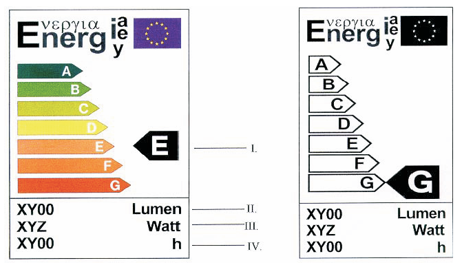
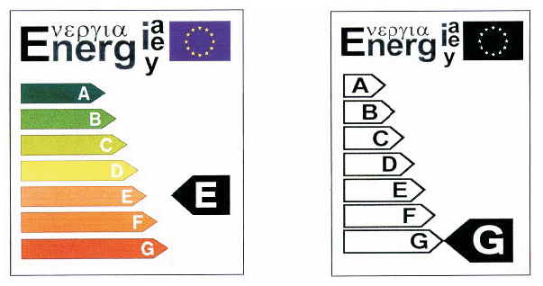
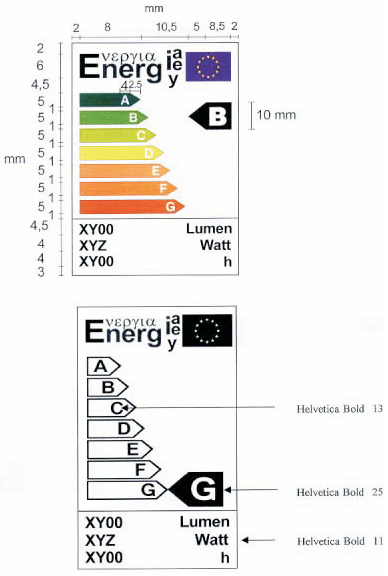

Príloha č. 1 k nariadeniu vlády č. 62/2009 Z. z.

- ENERGETICKÝ ŠTÍTOK

  - 1. Energetický štítok sa vyberá z nasledujúcich ilustrácií. Ak energetický štítok nie je vytlačený na obale, ale je použitý samostatný energetický štítok umiestnený na obale alebo pripevnený k obalu, musí sa použiť farebná verzia energetického štítku. Ak sa použije čierno-biela verzia energetického štítku, tlač a pozadie môžu mať ľubovoľné farby, ktoré zachovávajú čitateľnosť energetického štítku.

  - 

  - 2. Špecifické informácie pre potreby vytvorenia energetického štítku:

    - I. Trieda energetickej hospodárnosti svetelného zdroja určená podľa prílohy č. 3. Toto indikačné písmeno musí byť umiestnené na tej istej úrovni ako príslušná šípka.

    - II. Svetelný tok svetelného zdroja v lúmenoch zmeraný podľa skúšobných postupov určených v harmonizovaných normách.

    - III. Príkon svetelného zdroja vo wattoch zmeraný podľa skúšobných postupov určených v harmonizovaných normách.

    - IV. Priemerná vypočítaná životnosť svetelného zdroja v hodinách zmeraná podľa skúšobných postupov určených v harmonizovaných normách. Ak na obale nie je žiadna iná informácia o životnosti svetelného zdroja, tento údaj sa môže vynechať.

  - 3. Ak sú informácie špecifikované v druhom bode bodoch II a III, a keď ich možno použiť aj v bode IV a uviesť niekde inde na obale svetelného zdroja, môžu sa z energetického štítka spolu s prázdnym okrajom, ktorý ich obsahuje, vynechať. Energetický štítok sa potom vyberie z nasledujúcich obrázkov:

  - 

  - 

    - Okolo energetického štítku musí byť minimálne 5 mm prázdny okraj. Ak žiadna strana obalu nie je dostatočne veľká na to, aby mohla obsahovať energetický štítok s prázdnym okrajom, alebo ak by energetický štítok s prázdnym okrajom pokrýval viac ako 50 % plochy povrchu najväčšej strany, energetický štítok a prázdny okraj sa môžu zmenšiť, ale nie viac, ako je potrebné na splnenie uvedených podmienok. Energetický štítok sa nesmie zmenšiť po dĺžke na menej ako 40 % jeho štandardnej veľkosti. Ak je obal príliš malý na to, aby na ňom mohol byť umiestnený zmenšený energetický štítok, energetický štítok sa musí pripevniť k svetelnému zdroju alebo k obalu. Energetický štítok možno vynechať, ak sa vystavuje spolu so svetelným zdrojom v plnej veľkosti (napríklad pripevnený k regálu, na ktorom je svetelný zdroj vystavený).

    - Použité farby:

    - Farebná verzia:

    - CMYB – tyrkysová, fialová, žltá, čierna.

    - Príklad použitia farieb:

    - 07X0: 0 % tyrkysová, 70 % fialová, 100 % žltá, 0 % čierna.

    - Šípky:

    - A: X0X0

    - B: 70X0

    - C: 30X0

    - D: 00X0

    - E: 03X0

    - F: 07X0

    - G: 0XX0

    - Farba rámčeka X070.

    - Celý text je čierny. Podklad je biely.
