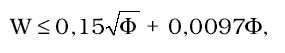
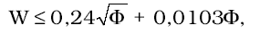
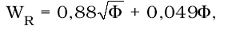
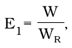

Príloha č. 3 k nariadeniu vlády č. 62/2009 Z. z.

- TRIEDA ENERGETICKEJ HOSPODÁRNOSTI Trieda energetickej hospodárnosti svetelného zdroja sa určí takto:

- Svetelné zdroje sa zaradia do triedy A, ak pre ne platí:

  - a) pre žiarivky bez integrovaného predradníka (tie, ktoré si vyžadujú na pripojenie k sieti predradník alebo iné regulačné zariadenie)

  - 

  - b) pre ostatné svetelné zdroje

  - 

    - kde Φ je svetelný tok svetelného zdroja,

    - W je príkon svetelného zdroja vo wattoch.

    - Ak svetelný zdroj nie je zaradený do triedy A, referenčný príkon WR sa vypočíta takto:

  - 

    - keď Φ > 34 lúmenov,

    - 0,2 Φ,

    - keď Φ ≤ 34 lúmenov,

    - kde Φ je svetelný tok svetelného zdroja.

    - Koeficient energetickej hospodárnosti sa potom stanoví ako

  - 

    - kde W je príkon svetelného zdroja vo wattoch.

  - Triedy energetickej hospodárnosti sa potom určia podľa tejto tabuľky:

  - Trieda energetickej hospodárnosti | Koeficient energetickej hospodárnosti EI

  - B | EI < 60 %

  - C | 60 % ≤ EI < 80 %

  - D | 80 % ≤ EI < 95 %

  - E | 95 % ≤ EI < 110 %

  - F | 110 % ≤ EI < 130 %

  - G | EI ≥ 130 %
