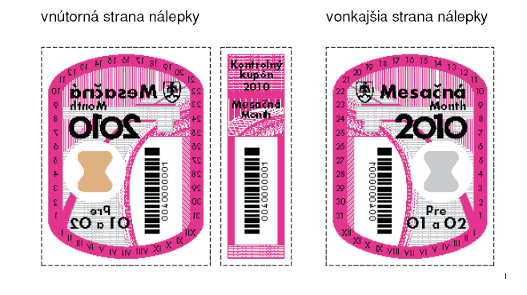
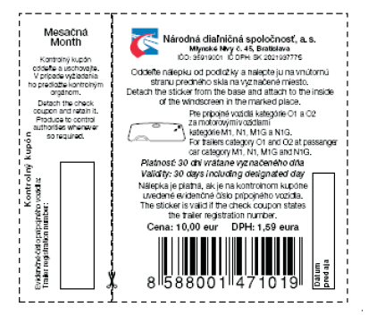
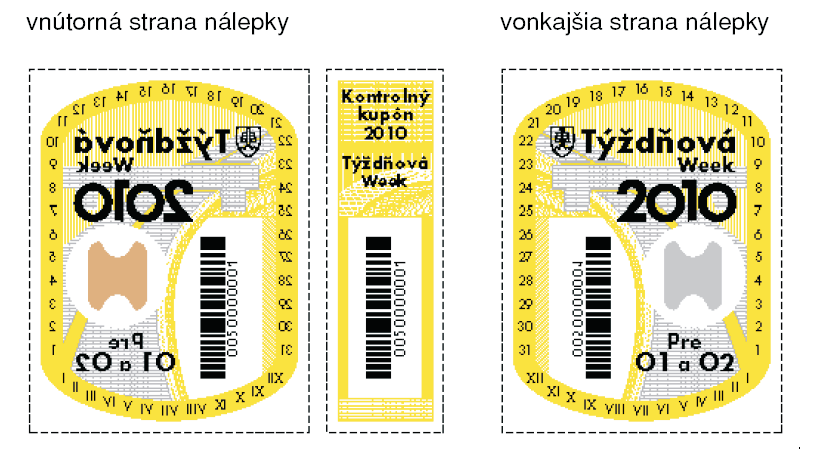
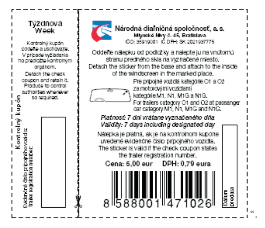

# Čl. I

Vyhláška Ministerstva dopravy, pôšt a telekomunikácií Slovenskej republiky č. 547/2009 Z. z., ktorou sa ustanovuje spôsob označenia úsekov diaľnic a rýchlostných ciest, ktorých užívanie podlieha úhrade, vzor nálepky a spôsob jej umiestnenia na motorovom vozidle v znení vyhlášky č. 146/2010 Z. z. sa mení a dopĺňa takto:

- 1. § 3 znie:

- 㤠3

- Nálepka určená pre motorové vozidlá a jazdné súpravy s celkovou hmotnosťou do 3,5 t a nálepka určená pre prípojné vozidlá kategórie O1 a O2 za motorovými vozidlami kategórie M1, N1, MIG a NIG, ak celková hmotnost jazdnej súpravy je nad 3,5 t (dalej len „nálepka určená pre prípojné vozidlá kategórie O1 a O2“), je zložená z dvoch oddeliteľných častí. Prvá časť nálepky sa umiestňuje na motorovom vozidle. Druhú časť nálepky tvorí kontrolný kupón, ktorým sa vodič preukazuje pri kontrole.1)“.

- 2. Za § 3 sa vkladajú § 3a a 3b, ktoré znejú:

- 㤠3a

- (1)

- Prvá časť nálepky určenej pre motorové vozidlá a jazdné súpravy s celkovou hmotnosťou do 3,5 t sa nalepuje na vnútornú stranu predného skla motorového vozidla alebo prvého vozidla jazdnej súpravy tak, aby bola dobre viditeľná aj z vonkajšej prednej strany motorového vozidla. Na trojkolesových vozidlách, štvorkolkách a motocykloch s postranným vozíkom, ktoré nemajú predné sklo, sa prvá časť nálepky nalepuje na ich dobre viditeľnú, rovnú, čistú a nie ľahko vymeniteľnú časť spravidla v smere jazdy.

- (2)

- Na určené miesto na kontrolnom kupóne nálepky vpíše vodič motorového vozidla alebo prvého vozidla jazdnej súpravy s celkovou hmotnosťou do 3,5 t evidenčné číslo motorového vozidla alebo evidenčné číslo prvého vozidla jazdnej súpravy. Tento údaj sa vpíše čitateľne tak, aby nebol bežným spôsobom odstrániteľný.

- § 3b

- (1)

- Prvá časť nálepky určenej pre prípojné vozidlá kategórie O1 a O2 sa nalepuje na vnútornú stranu predného skla prvého vozidla jazdnej súpravy s celkovou hmotnosťou nad 3,5 t tak, aby bola dobre viditeľná aj z vonkajšej prednej strany motorového vozidla.

- (2)

- Na urcené miesto na kontrolnom kupóne nálepky určenej pre prípojné vozidlá kategórie O1 a O2 vpíše vodič prvého vozidla jazdnej súpravy s celkovou hmotnosťou nad 3,5 t evidenčné číslo prípojného vozidla. Tento údaj sa vpíše čitateľne tak, aby nebol bežným spôsobom odstrániteľný.“.

- 3. V § 4 ods. 1 písm. e) sa na konci pripájajú tieto slová: „alebo označenie kategórie prípojného vozidla,“.

- 4. V § 4 ods. 2 písm. a) sa na konci pripájajú tieto slová: „alebo evidenčného čísla prípojného vozidla“.

- 5. V § 4 ods. 5 až 7 sa za slová „Vzor nálepky“ vkladajú slová „určenej pre motorové vozidlá a jazdné súpravy s celkovou hmotnosťou do 3,5 t“.

- 6. § 4 sa dopĺňa odsekmi 8 a 9, ktoré znejú:

- „(8)

- Vzor nálepky určenej pre prípojné vozidlá kategórie O1 a O2 s mesačnou platnosťou a vzor textu na papierovej podložke nálepky sú uvedené v prílohe č. 4.

- (9)

- Vzor nálepky určenej pre prípojné vozidlá kategórie O1 a O2 s týždennou platnosťou a vzor textu na papierovej podložke nálepky sú uvedené v prílohe č. 5.“.

- 7. Za prílohu č. 3 sa vkladajú prílohy č. 4 a 5, ktoré znejú:

- „Príloha č. 4 k vyhláške č. 547/2009 Z. z.

- VZORY NÁLEPIEK s mesačnou dobou platnosti pre prípojné vozidlá kategórie O1 a O2

- 

- VZORY TEXTOV NA PAPIEROVEJ PODLOŽKE NÁLEPIEK s mesačnou dobou platnosti pre prípojné vozidlá kategórie O1 a O2

- 

- Príloha č. 5 k vyhláške č. 547/2009 Z. z.

- VZORY NÁLEPIEK s týždennou dobou platnosti pre prípojné vozidlá kategórie O1 a O2

- 

- VZORY TEXTOV NA PAPIEROVEJ PODLOŽKE NÁLEPIEK s týždennou dobou platnosti pre prípojné vozidlá kategórie O1 a O2

- 
