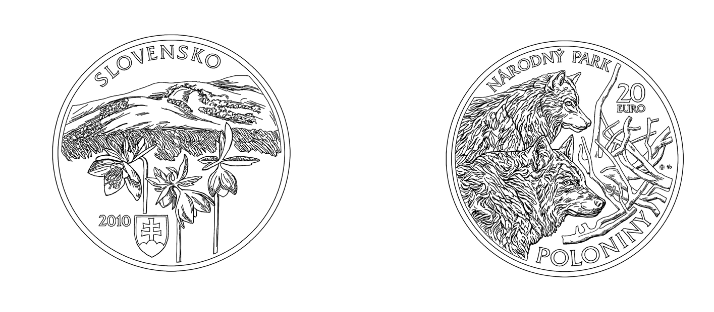

## 243

OZNÁMENIE

Národnej banky Slovenska

z 18. mája 2010

## o vydaní strieborných zberateľských euromincí v nominálnej hodnote 20 eur s tematikou ochrany prírody a krajiny - Národný park Poloniny

1. Úvodné ustanovenia

- a) Národná banka Slovenska podľa § 17h ods. 1 zákona Národnej rady Slovenskej republiky č. 566/1992 Zb. o Národnej banke Slovenska v znení neskorších predpisov a podľa § 1 ods. 2 písm. d) zákona Národnej rady Slovenskej republiky č. 1/1993 Z. z. o Zbierke zákonov Slovenskej republiky v znení zákona č. 275/2002 Z. z. oznamuje, že vydáva do obehu strieborné zberateľské euromince v nominálnej hodnote 20 eur s tematikou ochrany prírody a krajiny - Národný park Poloniny (ďalej len „zberateľská eurominca“).

- b) Zberateľská eurominca má štatút zákonného platidla len v Slovenskej republike.

- c) Zberateľská eurominca sa razí zo zliatiny obsahujúcej 925 dielov striebra a 75 dielov medi; jej hmotnosť je 33,63 g a priemer 40 mm. Pri razbe zberateľskej euromince je povolená horná a dolná odchýlka v priemere 0,1 mm; povolená horná odchýlka v hmotnosti je 0,4 g a v obsahu striebra 10/1000.

2. Vzhľad zberateľskej euromince

- a) Na líci zberateľskej euromince je v hornej polovici mincového poľa vyobrazená časť krajinného motívu z Národného parku Poloniny. Pod ním sú vyobrazené kvety čemerice purpurovej. Pri hornom okraji zberateľskej euromince je v opise zľava doprava názov štátu „SLOVENSKO“. V spodnej časti zberateľskej euromince je umiestnený štátny znak Slovenskej republiky a vľavo od neho letopočet „2010“.

- b) Na rube zberateľskej euromince je vyobrazená dvojica vlkov dravých v kompozícii s časťou padnutého stromu. Pri hornom okraji zberateľskej euromince je v opise zľava doprava nápis „NÁRODNÝ PARK“. Pri spodnom okraji zberateľskej euromince je v opise zľava doprava nápis „POLONINY“. Vpravo od kompozície je v hornej časti zberateľskej euromince v dvoch riadkoch označenie jej nominálnej hodnoty „20 EURO“. Značka Mincovne Kremnica, štátny podnik, „MK“ medzi dvoma razidlami a štylizované iniciálky mena a priezviska autora výtvarného návrhu zberateľskej euromince sochára Karola Lička sú pri pravom okraji zberateľskej euromince.

- c) Na hrane zberateľskej euromince je reliéfny nápis „OCHRANA PRÍRODY A KRAJINY“. Začiatok a koniec textu je oddelený vyobrazením štylizovaného kvetu.

Štát vydania: Slovenská republika

Začiatok vydávania: september 2010

Jozef Makúch v. r.
